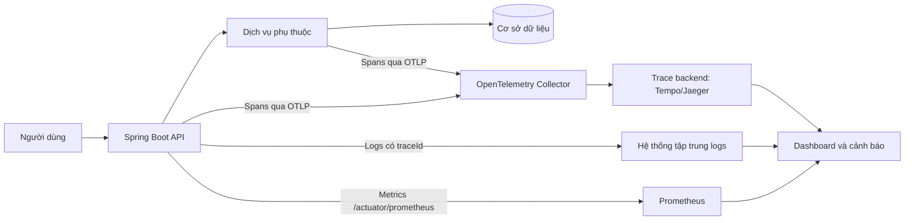

# Từ metric đến trace điều tra sự cố

Khi người dùng phản ánh API chậm hoặc trả lỗi, một biểu đồ tăng đột biến mới cho biết **hệ thống có vấn đề**, chưa cho biết **request nào bị ảnh hưởng**, **nó đi qua những thành phần nào** và **đâu là nguyên nhân có thể kiểm chứng**. Trong Spring Boot, kết hợp metrics, logs và distributed tracing giúp thu hẹp câu hỏi theo từng bước: từ xu hướng của hàng nghìn request đến dòng log và chuỗi span của một request cụ thể.

Bài học thuộc chương **Ba trụ cột** của mô-đun **SPRING_BOOT_OBSERVABILITY**, tập trung vào quy trình điều tra sự cố bằng **Micrometer Observation**, metrics, logs và tracing phân tán. Bên cạnh cách truy dấu nguyên nhân, ta sẽ xem xét propagation ngữ cảnh, tag/cardinality, exporter, sampling và cách liên kết ba tín hiệu trong môi trường thực.

## 1. Kết quả cần đạt

Sau bài này, bạn có thể:

1. Bắt đầu bằng metrics để xác định **dịch vụ, endpoint, thời điểm và mức độ ảnh hưởng** thay vì chọn ngẫu nhiên một trace.
2. Dùng logs để tìm **lỗi và ngữ cảnh nghiệp vụ**, rồi dùng `traceId` để truy cập luồng xử lý liên quan.
3. Đọc một distributed trace, phân biệt parent/child span, thời lượng span và đoạn thực sự gây trễ.
4. Cấu hình Spring Boot ở mức tối thiểu để phát metrics và traces, đồng thời tạo observation cho thao tác nghiệp vụ.
5. Tránh những kết luận sai do sampling, mất propagation, nhãn quá nhiều giá trị hoặc việc nhầm tương quan với nguyên nhân.

## 2. Mỗi trụ cột trả lời câu hỏi nào?

| Tín hiệu | Đơn vị quan sát | Giỏi nhất khi trả lời | Giới hạn cần nhớ |
| --- | --- | --- | --- |
| **Metrics** | Số đo được tổng hợp theo thời gian và tập nhãn | Có bao nhiêu request lỗi? P95 tăng từ lúc nào? Endpoint nào chịu ảnh hưởng? | Thường không chỉ ra một request cụ thể; nhãn có cardinality cao gây tốn kém. |
| **Logs** | Bản ghi sự kiện tại một thời điểm | Thành phần nào ném exception? Quy tắc nghiệp vụ hoặc trạng thái nào dẫn đến lỗi? | Logs rời rạc dễ khó ghép nối; có `traceId` thì điều tra nhanh hơn. |
| **Traces** | Chuỗi span cùng một `traceId` | Một request đi qua dịch vụ nào? Thời gian nằm ở span nào? Lỗi lan qua các hop ra sao? | Chỉ phản ánh request đã được ghi trace; các span có thể thiếu do sampling hoặc mất context. |

**Observation** trong Micrometer là lớp API giúp mã ứng dụng mô tả một thao tác được quan sát, kèm tên, key-value và sự kiện. Tùy các observation handler đã cấu hình, một observation có thể sinh ra metric, span tracing hoặc cả hai. Vì vậy không cần gắn một lệnh đo thời gian và một lệnh tạo span riêng cho cùng một thao tác nghiệp vụ.

Hình dung đường đi thông thường:



Sơ đồ mô tả một kiến trúc tham khảo. Trên thực tế, logs có thể được thu từ stdout bởi agent, collector hoặc nền tảng chạy container; metrics có thể được scrape trực tiếp hoặc chuyển qua một pipeline khác. Tracing không tự bảo đảm có dữ liệu logs và metrics nếu các đường xuất tín hiệu chưa được cấu hình.

## 3. Tình huống xuyên suốt: endpoint đọc đơn hàng bị chậm

Giả sử `order-api` phục vụ `GET /orders/{id}`. Sau một lần triển khai, hệ thống xuất hiện các dấu hiệu sau (số liệu **giả định để thực hành**):

| Chỉ số trong 5 phút | Trước 10:15 | 10:15–10:20 |
| --- | ---: | ---: |
| Số request mỗi giây | 120 | 125 |
| Độ trễ P95 của `GET /orders/{id}` | 220 ms | 1.700 ms |
| Tỉ lệ HTTP 5xx | 0,2% | 4,5% |
| CPU của `order-api` | 38% | 41% |

Lưu lượng chỉ tăng nhẹ, CPU không tăng tương ứng, nhưng P95 và lỗi 5xx tăng mạnh. Từ đây **chưa thể kết luận do database, network hay bản triển khai**. Cách điều tra tốt là lập giả thuyết, tìm bằng chứng ở từng trụ cột, rồi xác nhận bằng phép đo sau khi khắc phục.

Các mốc thời gian, tên service, môi trường, phiên bản triển khai và nhãn route cần được ghi cùng một mốc điều tra. Nếu không, rất dễ so sánh metric của production với trace ở staging, hoặc so sánh các cửa sổ thời gian khác nhau.

## 4. Chuẩn bị tín hiệu trong Spring Boot

Ví dụ dưới đây sử dụng cách cấu hình thông dụng trên **Spring Boot 3.x** cùng Micrometer. Các tên dependency/property có thể thay đổi theo phiên bản Spring Boot và backend đang dùng; khi triển khai cần đối chiếu tài liệu của phiên bản cụ thể.

Một ứng dụng Gradle có thể cần các dependency sau (Spring Boot quản lý version tương thích thông qua BOM):

```groovy
dependencies {
    implementation 'org.springframework.boot:spring-boot-starter-actuator'
    implementation 'io.micrometer:micrometer-registry-prometheus'
    implementation 'io.micrometer:micrometer-tracing-bridge-otel'
    implementation 'io.opentelemetry:opentelemetry-exporter-otlp'
}
```

`spring-boot-starter-actuator` cung cấp hạ tầng health/metrics/observations; registry Prometheus xuất metrics; bridge Micrometer–OpenTelemetry chuyển các observation thích hợp thành span; exporter OTLP gửi span tới collector hoặc trace backend hỗ trợ giao thức này.

Ví dụ `application.yml` cho **môi trường thử nghiệm có kiểm soát**:

```yaml
spring:
  application:
    name: order-api

management:
  endpoints:
    web:
      exposure:
        include: health,info,metrics,prometheus
  metrics:
    distribution:
      percentiles-histogram:
        http.server.requests: true
  tracing:
    sampling:
      probability: 1.0
  otlp:
    tracing:
      endpoint: http://otel-collector:4318/v1/traces
```

Một vài điểm cần hiểu trước khi chạy:

- Histogram của `http.server.requests` tạo các bucket để tính phân vị từ **tập request**, phù hợp cho P95 tổng hợp qua nhiều instance. Việc bật histogram trên diện rộng sẽ tăng số time series và chi phí lưu trữ.
- `sampling.probability: 1.0` giúp quan sát hầu hết request khi thực hành; không nên mặc định dùng 100% tracing ở production có lưu lượng lớn. Chọn tỉ lệ, chính sách lấy mẫu và chi phí theo nhu cầu vận hành.
- Endpoint OTLP ở ví dụ giả định có collector nhận HTTP/protobuf tại cổng `4318` và đường `/v1/traces`. Collector/backend cần được chạy riêng; chỉ khai báo endpoint không tự tạo ra nơi lưu traces.
- `/actuator/prometheus` và các endpoint Actuator phải được bảo vệ bằng network policy, authentication hoặc cơ chế tương đương. Không công khai thông tin vận hành ra Internet.

Sau khi ứng dụng có traffic, thử kiểm tra hai loại tín hiệu:

```bash
curl -i http://localhost:8080/actuator/metrics/http.server.requests
curl -s http://localhost:8080/actuator/prometheus
```

Endpoint `/actuator/metrics/...` cho phép xem metric ở dạng quản trị của Actuator; endpoint Prometheus trả về tên metric và nhãn theo định dạng registry. Dữ liệu có thể chưa xuất hiện nếu chưa có request tương ứng. Trace chỉ hiển thị ở trace backend sau khi được tạo, xuất thành công và được backend tiếp nhận.

### Tạo observation cho thao tác nghiệp vụ

Spring MVC thường đã có observation HTTP server khi Actuator và hạ tầng phù hợp được bật. Với đoạn xử lý quan trọng bên trong request, ta có thể tạo observation thủ công:

```java
import io.micrometer.observation.Observation;
import io.micrometer.observation.ObservationRegistry;
import org.springframework.http.HttpStatus;
import org.springframework.stereotype.Service;
import org.springframework.web.server.ResponseStatusException;

@Service
public class OrderService {
    private final OrderRepository repository;
    private final ObservationRegistry registry;

    public OrderService(OrderRepository repository, ObservationRegistry registry) {
        this.repository = repository;
        this.registry = registry;
    }

    public Order load(long id) {
        return Observation.createNotStarted("order.load", registry)
                .lowCardinalityKeyValue("operation", "load")
                .lowCardinalityKeyValue("component", "order-service")
                .observe(() -> repository.findById(id)
                        .orElseThrow(() -> new ResponseStatusException(
                                HttpStatus.NOT_FOUND, "Order not found")));
    }
}
```

`Order` và `OrderRepository` là kiểu nghiệp vụ minh họa, cần được định nghĩa trong ứng dụng thật. `observe(...)` quản lý vòng đời observation và ghi nhận lỗi phát sinh trong khối xử lý. Khi có tracing handler thích hợp, observation này còn có thể xuất hiện như span con bên trong server span. Không nên tạo nhiều span quá nhỏ cho từng dòng code: hãy đo những công đoạn có ý nghĩa điều tra, như đọc kho, gọi dịch vụ thanh toán hoặc thực thi thao tác database quan trọng.

**Cardinality:** `operation=load` và `component=order-service` có số lượng giá trị hữu hạn, phù hợp cho metrics. Ngược lại, gắn `orderId`, `userId`, email, URL chứa ID hoặc mã request vào **low-cardinality tag** có thể tạo một chuỗi thời gian riêng cho gần như mỗi request. Nếu thực sự cần thuộc tính chi tiết trong trace, phải xem xét giới hạn cardinality, quyền riêng tư và quy định xử lý dữ liệu; không tự động đưa dữ liệu nhạy cảm vào span hoặc logs.

## 5. Bước một: dùng metrics xác định phạm vi sự cố

Bắt đầu từ những tín hiệu phục vụ người dùng: **traffic, errors, latency**, rồi kiểm tra thêm **saturation** (hàng đợi, connection pool, thread pool, CPU, memory, database). Cần trả lời:

1. Sự cố bắt đầu lúc nào, có trùng lúc deploy hoặc thay đổi cấu hình không?
2. Chỉ một `uri`, một HTTP method, một zone/instance hay nhiều dịch vụ bị ảnh hưởng?
3. Lượng request có tăng đột biến không? Các lỗi thuộc 4xx hay 5xx?
4. Độ trễ tăng ở P50, P95, P99 hay chỉ một nhóm ít request?
5. Dấu hiệu ở tài nguyên hoặc dependency có thay đổi cùng thời điểm không?

Ví dụ PromQL cho metric timer HTTP server được Micrometer xuất sang Prometheus. Tên metric và tập nhãn thực tế cần được **kiểm tra từ `/actuator/prometheus`**, vì registry, version và cấu hình có thể khác nhau.

**Lưu lượng request/giây** của route:

```promql
sum(rate(http_server_requests_seconds_count{uri="/orders/{id}",method="GET"}[5m]))
```

**Tỉ lệ lỗi HTTP 5xx** của route, theo phần trăm:

```promql
100 *
sum(rate(http_server_requests_seconds_count{
  uri="/orders/{id}",method="GET",status=~"5.."
}[5m]))
/
sum(rate(http_server_requests_seconds_count{
  uri="/orders/{id}",method="GET"
}[5m]))
```

**P95 latency** qua các instance, khi histogram được bật:

```promql
histogram_quantile(
  0.95,
  sum by (le) (
    rate(http_server_requests_seconds_bucket{
      uri="/orders/{id}",method="GET"
    }[5m])
  )
)
```

Đơn vị của timer Prometheus ở ví dụ là **giây**, nên `1.7` tương ứng khoảng `1.700 ms`. Nếu dùng nhiều service trong cùng Prometheus, cần lọc thêm bằng nhãn xác định service/namespace/job thực có trong hệ thống để tránh gộp sai. Nếu mẫu số của tỉ lệ lỗi bằng không, kết quả có thể trống hoặc không xác định; dashboard và alert nên xử lý tình huống thiếu traffic.

Không lấy trung bình cộng các giá trị P95 từ từng instance để ra P95 toàn hệ thống: **phân vị không có tính cộng gộp**. Hãy gộp các histogram bucket cùng ranh giới trước khi chạy `histogram_quantile`. Cũng đừng gộp mọi route nếu mục tiêu là tìm endpoint lỗi; số đo tổng thể có thể che khuất một route ít traffic nhưng ảnh hưởng nghiêm trọng.

Trong tình huống giả định, metrics giúp khoanh vùng `GET /orders/{id}`, khoảng 10:15–10:20 và nhóm HTTP 5xx. Đó là cơ sở để sang logs/traces; bản thân việc CPU thấp **không chứng minh** lỗi nằm ở database hay network.

## 6. Bước hai: dùng logs tìm sự kiện và traceId

Trong cửa sổ thời gian đã khoanh vùng, tìm logs ở `order-api` theo service, environment, mức log, loại exception và thông tin request **đã chuẩn hóa**. Khi Micrometer tracing được cấu hình và context đang active, logging integration của Spring Boot có thể đưa `traceId` và `spanId` vào MDC để hiển thị cùng dòng log.

Ví dụ các dòng log **mô phỏng**, có cùng trace:

```text
2026-11-22T10:17:06.104Z WARN  order-api traceId=b7a9a02f9bf44b8e9d07e2bdca7f0a11 spanId=8f932cf18cab920b inventory lookup slow elapsedMs=1082
2026-11-22T10:17:06.128Z ERROR order-api traceId=b7a9a02f9bf44b8e9d07e2bdca7f0a11 spanId=8f932cf18cab920b request failed upstream=inventory-service error=ReadTimeout
```

Từ đây có một **giả thuyết**: `order-api` đang đợi `inventory-service` quá lâu. Hai dòng log liên quan nhau vì có cùng `traceId`; `spanId` chỉ rõ span đang active khi ghi log. Nhưng thông báo `ReadTimeout` chưa nói được nguyên nhân nằm trong `inventory-service`, database của nó, network hay timeout quá ngắn ở phía client.

Logs hữu ích khi chứa dữ kiện hành động cụ thể: tên dependency, loại lỗi, thời lượng, số lần retry và kết quả xử lý. Cần tránh ghi access token, mật khẩu, request body nhạy cảm, thông tin cá nhân hoặc ID có khả năng định danh người dùng. Hãy chọn cấu trúc và chính sách retention phù hợp với môi trường.

Nếu không thấy `traceId` trong logs, kiểm tra lần lượt: dependency tracing và logging pattern, việc request có đang nằm trong tracing context hay không, exporter/backend có lỗi không, và đoạn code có chuyển sang thread hay hàng đợi làm mất context không. **Không có traceId trong một dòng log** chưa đủ để khẳng định không có request hoặc không có lỗi.

## 7. Bước ba: mở distributed trace để hiểu đường đi của request

Tra cứu `traceId=b7a9a02f9bf44b8e9d07e2bdca7f0a11` trong trace backend. Nếu backend hỗ trợ liên kết giữa logs và traces, có thể mở trace trực tiếp từ trường `traceId`. Nếu Prometheus và giao diện quan sát hỗ trợ **exemplars** kèm trace ID, có thể bắt đầu từ một điểm trên biểu đồ metric để tới trace minh họa. Liên kết exemplar phụ thuộc hỗ trợ và cấu hình của registry, giao thức xuất, backend và UI; không thể giả định mọi biểu đồ đều có.

Một trace giả định có thể trông như sau:

```text
Trace b7a9a02f9bf44b8e9d07e2bdca7f0a11
└─ order-api: GET /orders/{id}                 1,420 ms
   ├─ order-api: order.load                    1,355 ms
   │  ├─ HTTP GET inventory-service             1,160 ms
   │  │  └─ inventory-service: GET /stock       1,110 ms
   │  │     └─ database SELECT stock              980 ms
   │  └─ order-api: map response                  24 ms
   └─ HTTP response 500
```

Đây là **mô hình minh họa**, không phải kết quả đo từ một hệ thống thật. Các đoạn hiển thị thụt lề thể hiện quan hệ cha–con, chưa chắc phản ánh chính xác thứ tự nối tiếp. Span con có thể chạy song song, vì thế không cộng tất cả duration của các span con để suy ra thời gian toàn request.

Khi đọc trace, hãy kiểm tra:

- **Root/server span:** thời gian request đầu cuối, trạng thái HTTP, service và đường route đã chuẩn hóa.
- **Client/server spans qua HTTP hoặc messaging:** hai đầu có nằm cùng một trace hay đã bị tách vì mất propagation? Thời gian ở client có lớn hơn thời gian server vì network, connection pool hoặc retry không?
- **Database span:** khoảng thời gian nào chờ truy vấn? Có truy vấn bất thường, lock contention hoặc thiếu kết nối không? Không ghi nội dung SQL chứa dữ liệu nhạy cảm.
- **Events/attributes/errors:** span được đánh dấu lỗi tại đâu? Có timeout, retry, exception hay dấu hiệu xử lý bù trừ không?
- **Khoảng thời gian trống:** nếu một parent span dài nhưng không có child span tương ứng, có thể có công việc chưa được instrument, chờ thread/lock hoặc dữ liệu trace bị thiếu.

Trong ví dụ, database span gần `980 ms` nằm trên nhánh `inventory-service`, rất đáng ưu tiên điều tra. Nhưng **span dài chỉ là vị trí tiêu tốn thời gian**: cần đối chiếu thêm slow query, số kết nối, lock wait, kế hoạch thực thi, logs của inventory và thay đổi gần thời điểm xảy ra sự cố. Một database span dài có thể là hậu quả của connection pool cạn, chứ không nhất thiết do câu SQL chậm.

### Propagation: điều kiện để trace nối qua nhiều dịch vụ

Distributed tracing cần truyền trace context giữa các hop. Với HTTP, chuẩn W3C Trace Context thường dùng `traceparent` (và có thể có `tracestate`):

```http
GET /stock HTTP/1.1
Host: inventory-service
traceparent: 00-b7a9a02f9bf44b8e9d07e2bdca7f0a11-8f932cf18cab920b-01
```

Ví dụ `traceparent` chứa version, trace ID, parent span ID và flags; khi dịch vụ nhận request, nó có thể tạo server span mới thuộc cùng trace nhưng với span ID riêng. Các thư viện HTTP client/server được tích hợp observability sẽ hỗ trợ inject/extract context. Với client tự khởi tạo ngoài cơ chế được Spring Boot instrument, thread pool tùy biến, `@Async`, reactive pipeline hoặc hàng đợi, cần xác minh context được truyền đúng. Việc tạo một thread hoặc gửi một message **không tự động bảo đảm** MDC/tracing context đi theo.

Trace bị chia thành hai phần ngay tại một hop thường dẫn đến đường điều tra sai: cùng một thao tác nhìn như hai request độc lập. Khi gặp hiện tượng này, kiểm tra headers, instrumentation ở hai phía, format propagator, cấu hình message headers và context propagation cho async execution. Không dùng headers chứa thông tin nhạy cảm hoặc baggage không được kiểm soát để “vá” việc liên kết.

## 8. Bước bốn: xác nhận nguyên nhân và giảm tác động

Sau khi metrics chỉ ra phạm vi và trace chỉ ra nhánh đáng nghi, chuyển giả thuyết thành phép kiểm chứng. Với ví dụ `inventory-service` và database:

| Giả thuyết | Bằng chứng cần tìm | Phép xác nhận hoặc hành động phù hợp |
| --- | --- | --- |
| Query chậm sau thay đổi schema/index | Slow query, execution plan, số hàng quét tăng đúng khung 10:15 | So sánh plan/bản triển khai, tối ưu query hoặc rollback thay đổi gây hồi quy. |
| Database connection pool cạn | Active connections sát ngưỡng, pending acquisition tăng, thời gian chờ kết nối cao | Kiểm tra leak, truy vấn giữ connection lâu, giới hạn pool và năng lực database. |
| `inventory-service` tự quá tải | Queue/thread pool bão hòa, CPU/GC hoặc dependency latency tăng | Giảm tải, xử lý bottleneck, scale nếu tài nguyên thực sự là giới hạn. |
| Timeout/retry ở client gây khuếch đại | Nhiều retry cho cùng một request; client span kéo dài hơn server span | Xem lại timeout budget, retry policy, backoff và circuit breaker. |
| Mất trace context khiến chẩn đoán sai | Trace ID đổi giữa `order-api` và `inventory-service` dù request vẫn đến | Sửa propagation, tái chạy trường hợp có kiểm soát và so sánh trace hoàn chỉnh. |

Đừng đồng nhất tương quan với nhân quả. Nếu lỗi bắt đầu sau deploy, hãy xem thay đổi cụ thể và các bằng chứng từ dependency trước khi quy lỗi cho deploy. Nếu database chậm trong trace, tìm hiểu lý do nó chậm. Mỗi biện pháp nên đi kèm tiêu chí đo lại: P95, tỉ lệ 5xx, traffic, saturation, số lượng timeout và một số trace sau khi xử lý.

Ví dụ nếu chứng minh được query mới thiếu index, việc khôi phục index hoặc rollback query có thể kéo P95 xuống. Chỉ khi biểu đồ P95, tỉ lệ 5xx và các tín hiệu dependency trở lại mức chấp nhận được trong khoảng thời gian đủ dài mới kết luận sự cố đã được kiểm soát; một request thành công đơn lẻ chưa đủ.

## 9. Sampling, cardinality và giới hạn liên kết tín hiệu

Ba trụ cột không có cùng cách thu thập và chi phí. Điều này ảnh hưởng trực tiếp đến khả năng trả lời câu hỏi trong lúc có sự cố.

| Vấn đề | Hệ quả khi điều tra | Nguyên tắc xử lý |
| --- | --- | --- |
| **Head sampling** với xác suất thấp | Request lỗi hiếm có thể không có trace dù metric 5xx vẫn tăng. | Chọn tỉ lệ phù hợp; hiểu quyết định sampling được đưa ra sớm và có thể được truyền qua context. |
| **Tail sampling** tại collector phù hợp | Có thể giữ trace chậm/lỗi theo chính sách sau khi quan sát spans. | Cần pipeline collector và tài nguyên chờ đủ spans; không coi đây là chức năng tự có chỉ bằng một property Spring Boot. |
| **Cardinality cao** từ tag `orderId`, `userId`, URL thô | Bùng nổ số chuỗi metrics, chi phí tăng, truy vấn chậm. | Dùng route mẫu `/orders/{id}`, operation, outcome, status và nhóm giá trị hữu hạn. |
| **Thiếu context propagation** | Các span của một request nằm ở nhiều trace khác nhau; MDC có thể trống. | Kiểm tra instrumentation cho HTTP client, async, Reactor và messaging ở từng hop. |
| **Exporter/collector ngắt kết nối** | Ứng dụng vẫn có thể xử lý request nhưng traces không đến backend. | Quan sát lỗi xuất dữ liệu, queue/buffer/drop của collector và sức khỏe của backend. |
| **Thiếu liên kết log–trace hoặc exemplar** | Phải dò thủ công qua thời gian và service. | Chuẩn hóa trường `traceId`, `spanId`, service/environment; cấu hình liên kết ở backend phù hợp. |

Sampling của traces **không đồng nghĩa** lấy mẫu metrics theo cùng tỉ lệ: timer HTTP có thể vẫn tổng hợp toàn bộ các request được quan sát trong ứng dụng, trong khi chỉ một phần traces được xuất. Vì vậy, nếu lỗi 5xx tăng nhưng không tìm được trace lỗi, hãy kiểm tra sampling và exporter trước khi kết luận metric “sai”. Ngược lại, một trace lỗi đơn lẻ không chứng minh tỉ lệ lỗi toàn dịch vụ; mức độ ảnh hưởng phải quay lại metrics để xác nhận.

Với tags, nên phân biệt **low cardinality** để nhóm metrics và **high cardinality** dùng có chọn lọc ở tracing context. Ngay cả thuộc tính chỉ nằm trên span cũng gây chi phí lưu trữ và rủi ro lộ dữ liệu nếu không được quản trị. Giới hạn số thuộc tính, độ dài giá trị và thời gian lưu cần được quyết định theo nhu cầu tìm kiếm.

## 10. Runbook: từ cảnh báo đến kết luận có bằng chứng

Có thể dùng quy trình sau cho lỗi ứng dụng Spring Boot trên production:

1. **Ghi nhận sự cố:** mốc giờ, môi trường, service, phiên bản triển khai, triệu chứng người dùng và mức độ ưu tiên.
2. **Xác định phạm vi từ metrics:** traffic, tỉ lệ 5xx, P95/P99 theo route, method, instance và khu vực. Kiểm tra ngưỡng traffic để tránh bị đánh lừa bởi mẫu quá ít.
3. **Đặt giả thuyết:** tách các nhóm phụ thuộc, tài nguyên, deploy, mạng và lỗi nghiệp vụ; ưu tiên theo tác động và bằng chứng.
4. **Lọc logs theo cửa sổ đã khoanh:** tìm exception, timeout, retry, thông tin dependency; trích `traceId` nếu có.
5. **Mở một số traces đại diện:** chọn request chậm/lỗi và request bình thường để so sánh; dùng exemplar nếu pipeline hỗ trợ.
6. **Đọc waterfall:** tìm đoạn chiếm thời gian, các khoảng không có span, retry và sự khác nhau giữa client/server duration.
7. **Đối chiếu dependency:** kiểm tra connection pool, DB, hàng đợi, CPU, GC hoặc hệ thống ngoài tại cùng thời điểm.
8. **Giảm tác động và sửa nguyên nhân:** rollback, giảm tải, chỉnh query/timeout/retry hoặc cải thiện tài nguyên dựa trên bằng chứng.
9. **Xác nhận bằng metrics sau thay đổi:** theo dõi error rate, latency, traffic và saturation đủ lâu; mở trace mới khi cần xác minh đường xử lý.
10. **Ghi lại bài học vận hành:** dashboard, alert, dữ kiện còn thiếu, chỗ mất propagation và instrumentation cần bổ sung.

### Bài tập tự kiểm tra

**Tình huống A.** P95 toàn hệ thống tăng, nhưng `GET /health` không đổi và chỉ `POST /checkout` xấu đi. Bước tiếp theo hợp lý là gì?

*Gợi ý:* So sánh latency/error rate theo `uri` và `method` của `POST /checkout`, sau đó xem logs và traces cùng khoảng thời gian. Không tiếp tục xem duy nhất đường trung bình của mọi endpoint.

**Tình huống B.** Dashboard báo 3% HTTP 5xx, nhưng search trace không thấy request lỗi. Có thể giải thích thế nào?

*Gợi ý:* Kiểm tra sampling, đường xuất OTLP, collector/backend, mốc giờ và bộ lọc service. Metrics vẫn có thể đúng khi các request lỗi không được trace hoặc spans bị mất.

**Tình huống C.** `order-api` có client span 1.200 ms, trong khi server span của `inventory-service` chỉ 140 ms. Có nên kết luận inventory xử lý chậm 1.200 ms?

*Gợi ý:* Chưa. Phần chênh lệch có thể nằm ở DNS, kết nối, queue, network, retry, timeout hoặc spans chưa ghi nhận. Cần xem timeline, logs hai phía và metrics kết nối trước khi kết luận.

## 11. Ghi nhớ khi điều tra sự cố thực tế

**Metrics xác nhận phạm vi và mức độ ảnh hưởng; logs cung cấp sự kiện cụ thể; traces chỉ ra đường đi và vị trí tiêu tốn thời gian.** Hãy di chuyển qua ba tín hiệu theo một câu hỏi điều tra rõ ràng, liên tục đối chiếu với giả thuyết và quay lại metrics để xác nhận hiệu quả khắc phục.

Trong Spring Boot, Micrometer Observation tạo điểm nối tiện dụng giữa instrumentation nghiệp vụ với metrics và tracing, còn propagation, sampling, exporter và kiểm soát cardinality quyết định chất lượng dữ liệu thu được. Một trace rất đẹp nhưng bị thiếu đoạn quan trọng, hay một dashboard có nhãn quá chi tiết, đều có thể khiến đội vận hành mất thời gian ngay lúc cần phản ứng nhanh nhất.
