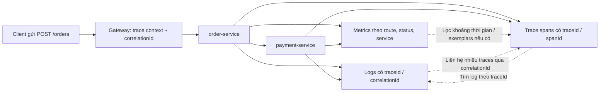

# Correlation ID giữa các tín hiệu

> **Chương:** Ba trụ cột  
> **Phạm vi:** SPRING_BOOT_OBSERVABILITY — xây dựng observability trong Spring Boot với Micrometer Observation, metrics, logs và distributed tracing; kết nối tín hiệu để điều tra lỗi, độ trễ và hành vi ứng dụng.

## Mục tiêu học tập

Sau bài này, bạn có thể:

- Giải thích **correlation ID** là gì, phân biệt nó với **trace ID**, **span ID**, **request ID** và định danh nghiệp vụ.
- Mô tả cách một request được nối với **logs**, **distributed traces** và **metrics**, kể cả trường hợp metrics được tổng hợp nên không chứa ID riêng của từng request.
- Hiểu cơ chế truyền ngữ cảnh qua HTTP, tác vụ bất đồng bộ và message broker; nhận ra điểm dễ đánh mất tương quan.
- Triển khai correlation ID cơ bản trong Spring Boot bằng Servlet filter và MDC, tích hợp với Micrometer Tracing, đồng thời kiểm soát bảo mật và cardinality.
- Dùng ID cùng các thuộc tính ngữ cảnh để điều tra một lỗi hoặc độ trễ xuyên qua nhiều dịch vụ.

## 1. Vì sao cần correlation ID?

Một yêu cầu thanh toán trong hệ thống phân tán có thể tạo ra các sự kiện ở API gateway, `order-service`, `payment-service`, cơ sở dữ liệu và hàng đợi. Mỗi thành phần lại ghi log và phát metrics riêng. Nếu chỉ tìm theo thời điểm, rất khó biết bản ghi nào thuộc **cùng một yêu cầu**; tại giờ cao điểm, hàng nghìn yêu cầu có thể chạy đồng thời.

**Correlation ID** là một định danh dùng để **liên hệ những sự kiện thuộc cùng một luồng xử lý hoặc cùng một ngữ cảnh được quy ước**. Hệ thống gắn ID vào các điểm cần quan sát và truyền ID khi công việc đi qua các ranh giới dịch vụ.

Ví dụ cùng ID `corr-7f3b` có mặt trong:

```text
12:00:01.100  gateway          INFO  correlationId=corr-7f3b  POST /orders
12:00:01.170  order-service    INFO  correlationId=corr-7f3b  inventory reserved
12:00:04.215  payment-service  ERROR correlationId=corr-7f3b  provider timeout
12:00:04.230  order-service    WARN  correlationId=corr-7f3b  payment failed
```

Tìm kiếm `correlationId=corr-7f3b` giúp gom các log liên quan. Tuy vậy, **có chung ID không tự chứng minh quan hệ nhân quả** giữa mọi dòng log; cần xem thứ tự thời gian, thông điệp, span cha–con và ngữ cảnh nghiệp vụ.

Một hệ thống observability hiệu quả cần kết hợp:

- **Logs:** mô tả các sự kiện cụ thể của luồng đang điều tra.
- **Traces:** thể hiện đường đi, quan hệ cha–con và thời gian của các thao tác.
- **Metrics:** cho biết hiện tượng xảy ra thường xuyên đến mức nào, ảnh hưởng tới nhóm request nào và xu hướng theo thời gian.

Correlation ID đặc biệt hữu ích cho **liên kết logs và các sự kiện ngoài phạm vi một trace**, còn trace ID là định danh gốc cho distributed tracing.

## 2. Phân biệt các loại ID thường gặp

Các tên gọi hay bị dùng lẫn nhau, nhưng phạm vi và vòng đời của chúng có thể khác nhau.

| Định danh | Đại diện cho | Vòng đời/phạm vi điển hình | Nơi sử dụng |
| --- | --- | --- | --- |
| **Correlation ID** | Một nhóm sự kiện hoặc luồng xử lý do ứng dụng quy ước | Có thể kéo dài qua nhiều request, retries, message hoặc nhiều traces | Logs, HTTP/message metadata, tìm kiếm sự kiện nghiệp vụ |
| **Trace ID** | Một distributed trace | Từ khi bắt đầu tới khi kết thúc một trace, qua các spans được nối với nhau | Traces và logs khi tích hợp tracing |
| **Span ID** | Một thao tác đơn lẻ trong một trace | Một HTTP server span, HTTP client span, DB span... | Xác định vị trí cụ thể trong trace, logs có tracing context |
| **Request ID** | Một request HTTP cụ thể | Thường từ lúc nhận tới khi trả một response | API gateway, ứng dụng, logs, support ticket |
| **Business ID** | Một thực thể nghiệp vụ như đơn hàng | Có thể tồn tại nhiều ngày hoặc nhiều năm | DB, nghiệp vụ, truy vấn được phân quyền |

Một trace điển hình có **một trace ID và nhiều span ID**. Ví dụ:

```text
Correlation ID: corr-7f3b
Trace ID:       4d45a9d0e7724d449ef59e00b2b4e23a

gateway            spanId=aaaabbbb11112222
  order-service    spanId=ccccdddd33334444
    payment call   spanId=eeeeffff55556666
      payment      spanId=9999aaaa77778888
```

Chuỗi ID ở đây chỉ để minh họa cách đặt và liên kết; trace ID và span ID thực tế phải tuân thủ định dạng của hệ thống tracing. Trace ID theo W3C Trace Context có 16 byte (32 ký tự hex), còn parent/span ID có 8 byte (16 ký tự hex).

**Khi nào dùng trace ID thay cho correlation ID riêng?** Nếu mục tiêu chỉ là tìm mọi log của **một trace**, trace ID do Micrometer Tracing cung cấp thường đủ; không cần tự tạo thêm ID. Một correlation ID nghiệp vụ riêng có ích khi một hành trình kéo dài qua **nhiều traces**, như tạo đơn → xếp hàng đợi → đối soát thanh toán sau vài phút hoặc retry từ một job độc lập.

**Không thay thế lẫn nhau:** cùng một `orderId` có thể xuất hiện trong nhiều lần cập nhật hoặc nhiều yêu cầu; một trace lại có thể xử lý nhiều đối tượng. Không dùng ID của khách hàng hoặc dữ liệu nhạy cảm làm trace ID/correlation ID chỉ vì chúng có sẵn.

## 3. Correlation giữa logs, traces và metrics

### 3.1. Logs: gắn định danh vào mỗi sự kiện cần điều tra

Các log quan trọng nên có những trường nhất quán, ví dụ:

- `service.name`: dịch vụ phát ra log.
- `traceId` và `spanId`: được tích hợp từ ngữ cảnh tracing hiện hành.
- `correlationId`: ID luồng do ứng dụng quy ước, nếu thật sự cần ngoài trace.
- `event`, `outcome`, `dependency`: tên sự kiện, kết quả và thành phần phụ thuộc có ý nghĩa.
- Thời điểm và mức độ log.

Ví dụ:

```json
{
  "timestamp": "2026-11-22T05:00:04.215Z",
  "level": "ERROR",
  "service": "payment-service",
  "event": "payment.provider.timeout",
  "correlationId": "corr-7f3b",
  "traceId": "4d45a9d0e7724d449ef59e00b2b4e23a",
  "spanId": "9999aaaa77778888",
  "provider": "provider_a",
  "durationMs": 3000
}
```

Dùng **structured logging** để tìm chính xác theo trường `correlationId` hoặc `traceId`. Nếu dùng log dạng văn bản, vẫn có thể thêm trường vào pattern, nhưng phải bảo đảm nhất quán giữa các dịch vụ và tránh chỉ có dữ liệu trong một vài nhánh xử lý.

### 3.2. Traces: dùng trace ID và quan hệ giữa các spans

Trace cho phép đi từ server span của API đến client span gọi dependency rồi tới server span ở dịch vụ đích, miễn là **tracing context được truyền** đúng cách. Span chứa duration, status và thuộc tính có thể chỉ ra điểm nghẽn:

```text
traceId = 4d45a9d0e7724d449ef59e00b2b4e23a
POST /orders [server]                        3.2s
├── inventory.reserve [internal]             80ms
├── POST /payments [client]                   3.0s
│   └── POST /payments [server]                2.9s
│       └── provider.authorize [client]       2.8s  ERROR
└── orders.save [internal]                    45ms
```

Một `spanId` trả lời “thao tác nào?”, `traceId` trả lời “luồng thực thi nào?”. Nếu cùng một correlation ID xuất hiện ở hai traces khác nhau, quan hệ giữa chúng có thể được diễn giải bằng metadata riêng, message ID, parent workflow ID hoặc **span links** khi phù hợp. Không nên nối bừa các spans chỉ vì chúng cùng correlation ID.

### 3.3. Metrics: tương quan bằng ngữ cảnh tổng hợp, không bằng ID từng request

Metric dùng để đo **phân bố và xu hướng**. Ví dụ đo độ trễ HTTP với các nhãn có cardinality thấp:

```text
http.server.requests
  method=POST
  uri=/orders
  status=504
  service=order-service
```

**Không gắn `correlationId`, `traceId`, `spanId`, `orderId` hay `userId` vào metric tags.** Mỗi request sinh ra giá trị mới, làm số time series tăng theo lưu lượng và gây tốn bộ nhớ, lưu trữ, truy vấn. Ngoài ra, một số giá trị còn mang rủi ro lộ dữ liệu.

Từ metric báo p95 của `POST /orders` tăng, ta chọn khoảng thời gian và nhóm nhãn tương ứng để tìm trace chậm hoặc logs lỗi. Một số backend hỗ trợ **metric exemplars**: điểm mẫu trên biểu đồ có thể tham chiếu tới trace ID để mở trace liên quan. Tính năng này chỉ hoạt động khi instrumentation, exporter, format dữ liệu và backend cùng hỗ trợ; không giả định mọi metric tự chứa trace ID.

### 3.4. Bản đồ liên kết



Sơ đồ chỉ mô tả quan hệ dữ liệu. Instrumentation, exporter và cấu hình backend quyết định những mối liên kết nào thực sự có thể thao tác được.

## 4. Vòng đời correlation ID và truyền ngữ cảnh

### 4.1. Tại điểm vào: nhận, kiểm tra hoặc tạo mới

Ở đầu luồng, hệ thống cần một chính sách rõ ràng:

1. Nếu sử dụng `X-Correlation-ID` từ bên ngoài, phải kiểm tra **độ dài, bảng ký tự và độ tin cậy** của giá trị nhận được.
2. Nếu không có hoặc không hợp lệ, sinh một ID mới bằng nguồn ngẫu nhiên phù hợp như UUID.
3. Ghi ID vào ngữ cảnh logging và, nếu cần, trả lại trong response header để hỗ trợ chẩn đoán.
4. Gửi ID sang dịch vụ tiếp theo theo hợp đồng của hệ thống.

**Trust boundary:** client có thể tự gửi một chuỗi bất kỳ vào header. Không được dùng correlation ID do client cung cấp làm bằng chứng xác thực, phân quyền, quyền truy cập logs hoặc quyền xem dữ liệu của người khác. Nếu cần kiểm soát hoàn toàn ID, hãy để gateway tin cậy cấp lại ID và chỉ tin metadata từ gateway trong mạng nội bộ.

Nên định nghĩa rõ tên header, độ dài tối đa, định dạng và quy tắc tạo mới; dùng cùng chính sách trên các dịch vụ. Một ID ổn định để hỗ trợ khách hàng tra cứu vẫn không phải bí mật hay token truy cập.

### 4.2. Tracing context qua HTTP

Các hệ thống hỗ trợ **W3C Trace Context** thường sử dụng header `traceparent` có dạng:

```http
traceparent: 00-4d45a9d0e7724d449ef59e00b2b4e23a-aaaabbbb11112222-01
X-Correlation-ID: corr-7f3b
```

Trong `traceparent`, phần trace ID xác định trace, parent ID mang thông tin span cha ở phía gửi và phần cuối chứa trace flags (ví dụ cờ sampled). Bên nhận sẽ tạo span của nó, duy trì trace ID và liên kết với span gửi nếu context được xử lý đúng.

`X-Correlation-ID` là **header do ứng dụng thỏa thuận**, không thuộc chuẩn W3C Trace Context. Spring Boot/Micrometer Tracing có thể tự truyền tracing headers qua các client được instrument; **không mặc nhiên tự truyền custom header này**. Nếu muốn bảo toàn correlation ID riêng, phải cấu hình propagation, interceptor hoặc cơ chế baggage thích hợp.

Có nhiều chuẩn/định dạng propagation tùy nền tảng; các dịch vụ cần thống nhất định dạng và đảm bảo tương thích. Không cố tự phân tích và lắp ghép `traceparent` bằng cách nối chuỗi.

### 4.3. Ranh giới bất đồng bộ và message broker

Bối cảnh khó hơn HTTP đồng bộ:

- **Task ở thread khác:** MDC và tracing context gắn với luồng thực thi hiện hành có thể không đi theo `@Async`, `Executor`, `CompletableFuture` hoặc reactive scheduler nếu thiếu cơ chế context propagation.
- **Queue/broker:** producer cần gửi context trong message headers/properties; consumer phải extract khi nhận. Một message xử lý sau vài giờ có thể thuộc cùng hành trình nghiệp vụ nhưng không nhất thiết cùng trace đang chạy lúc tạo message.
- **Retries:** mỗi retry có thể tạo span mới; retry do scheduler hoặc hệ thống khác khởi động có thể tạo trace mới. Correlation ID nghiệp vụ có thể giữ ổn định để nhóm các lần thử.
- **Fan-out/fan-in:** một request tạo nhiều message song song. Correlation ID có thể chỉ nhóm công việc; message ID và parent links giúp nhận biết nhánh nào phụ thuộc nhánh nào.

Đừng giả định chỉ cần truyền HTTP header là sẽ tự hoạt động qua Kafka, RabbitMQ hay các job nền. Kiểm tra instrumentation đang dùng, cách inject/extract và cách khôi phục logging context ở từng ranh giới.

## 5. Triển khai trong Spring Boot

Phần này dùng một ứng dụng Spring Boot chạy trên **Servlet stack** để minh họa. Các chi tiết tích hợp có thể khác giữa các phiên bản Spring Boot, đặc biệt khi dùng WebFlux, Micrometer Tracing bridge và exporter.

### 5.1. Chuẩn bị tracing và logging

Thông thường ứng dụng cần:

- `spring-boot-starter-actuator` để bật khả năng vận hành/instrumentation liên quan.
- Một bridge cho **Micrometer Tracing** (ví dụ bridge tới OpenTelemetry hoặc Brave).
- Exporter phù hợp nếu muốn gửi traces tới backend.
- Hệ thống logging đang dùng (thường là SLF4J/Logback), với định dạng chứa trường correlation.

Một cấu hình ví dụ:

```yaml
spring:
  application:
    name: order-service

management:
  tracing:
    sampling:
      probability: 0.2

logging:
  pattern:
    level: "%5p trace_id=%X{traceId:-} span_id=%X{spanId:-} correlation_id=%X{correlationId:-}"
```

Trong môi trường minh họa này, xác suất lấy mẫu traces là 20% khi cấu hình tracing tương thích. Chọn sampling theo tải, độ hiếm lỗi, chi phí và khả năng backend; không coi `0.2` là giá trị bắt buộc. Logback đọc các giá trị bằng `MDC`. Khi tracing được cấu hình đúng, Micrometer Tracing có thể đưa `traceId`/`spanId` vào MDC trong ngữ cảnh span đang hoạt động.

**Lưu ý:** cấu hình trên không tự thêm dependency tracing/exporter, không tự tạo correlation ID tùy chỉnh và không bảo đảm context đi qua mọi async boundary. Trong Spring Boot có tracing được cấu hình đầy đủ, nếu chỉ cần tra cứu theo trace ID thì hãy ưu tiên khả năng correlation logs sẵn có.

### 5.2. Tạo correlation ID ở Servlet filter

Khi hệ thống cần correlation ID **tách khỏi trace ID** để theo dõi workflow, ta có thể tạo filter ở biên vào:

```java
package example.observability;

import java.io.IOException;
import java.util.UUID;
import java.util.regex.Pattern;

import jakarta.servlet.FilterChain;
import jakarta.servlet.ServletException;
import jakarta.servlet.http.HttpServletRequest;
import jakarta.servlet.http.HttpServletResponse;

import org.slf4j.MDC;
import org.springframework.stereotype.Component;
import org.springframework.web.filter.OncePerRequestFilter;

@Component
public class CorrelationIdFilter extends OncePerRequestFilter {
    private static final String HEADER = "X-Correlation-ID";
    private static final String MDC_KEY = "correlationId";
    private static final Pattern VALID_ID =
            Pattern.compile("[A-Za-z0-9._-]{1,64}");

    @Override
    protected void doFilterInternal(
            HttpServletRequest request,
            HttpServletResponse response,
            FilterChain chain) throws ServletException, IOException {

        String incomingId = request.getHeader(HEADER);
        String correlationId = incomingId != null
                && VALID_ID.matcher(incomingId).matches()
                ? incomingId
                : UUID.randomUUID().toString();

        response.setHeader(HEADER, correlationId);
        try (MDC.MDCCloseable ignored =
                     MDC.putCloseable(MDC_KEY, correlationId)) {
            chain.doFilter(request, response);
        }
    }
}
```

Điểm quan trọng của ví dụ:

- Header đầu vào được giới hạn tối đa 64 ký tự và chỉ chấp nhận tập ký tự cho phép; chuỗi không hợp lệ được thay bằng UUID mới.
- `MDC.putCloseable` đặt giá trị vào MDC trong phạm vi request và tự dọn sau khi xử lý để tránh rò ngữ cảnh sang request khác trên thread tái sử dụng.
- Header response hỗ trợ người gọi báo lỗi kèm correlation ID.
- Filter chỉ thiết lập ngữ cảnh cho luồng xử lý servlet đang chạy; **không tự lan truyền** giá trị đến service khác, reactive pipeline hoặc các tác vụ bất đồng bộ.

Nếu cần log của error dispatch, async dispatch hoặc việc tái sử dụng MDC từ một context bao ngoài, phải kiểm tra hành vi filter thực tế theo servlet lifecycle của ứng dụng. Với WebFlux, dùng cơ chế Reactor Context và instrumentation phù hợp thay vì áp dụng nguyên xi filter này.

### 5.3. Truyền correlation ID khi gọi service khác

Với HTTP client `RestClient` của Spring, có thể thêm interceptor để gửi custom header:

```java
package example.observability;

import org.slf4j.MDC;
import org.springframework.context.annotation.Bean;
import org.springframework.context.annotation.Configuration;
import org.springframework.web.client.RestClient;

@Configuration
public class DownstreamClientConfig {
    @Bean
    RestClient downstreamClient(RestClient.Builder builder) {
        return builder.requestInterceptor((request, body, execution) -> {
            String correlationId = MDC.get("correlationId");
            if (correlationId != null) {
                request.getHeaders().set("X-Correlation-ID", correlationId);
            }
            return execution.execute(request, body);
        }).build();
    }
}
```

Ví dụ dùng `RestClient.Builder` được Spring Boot quản lý để có thể nhận các customizer/instrumentation đã cấu hình. Interceptor trên chỉ gửi **custom correlation ID**; việc tạo span và truyền `traceparent` thuộc trách nhiệm của Micrometer Tracing/instrumentation tương ứng. Nếu code gọi client chạy ở thread không mang MDC, giá trị có thể rỗng. Hãy xác minh bằng request thực tế thay vì suy luận rằng ID đã được truyền.

Không gửi nguyên header do nguồn không tin cậy đến mọi external endpoint nếu nó có thể tiết lộ metadata nội bộ hoặc không thuộc hợp đồng với đối tác. Với hệ thống ngoài phạm vi tin cậy, cân nhắc tạo ID giao tiếp mới và giữ ánh xạ ở backend nội bộ.

### 5.4. Một log có cả correlation ID và trace ID

Trong controller/service, chỉ cần ghi log như bình thường:

```java
import org.slf4j.Logger;
import org.slf4j.LoggerFactory;
import org.springframework.stereotype.Service;

@Service
public class PaymentService {
    private static final Logger log =
            LoggerFactory.getLogger(PaymentService.class);

    public void authorize() {
        log.info("event=payment.authorize.started");
        // Gọi dependency; tracing context có thể bao quanh thao tác này.
    }
}
```

Nếu filter và tracing integration đều hoạt động, pattern logging có thể hiển thị:

```text
INFO trace_id=4d45a9d0e7724d449ef59e00b2b4e23a
     span_id=ccccdddd33334444 correlation_id=corr-7f3b
     event=payment.authorize.started
```

Ba giá trị có ý nghĩa khác nhau. `trace_id` giúp mở trace; `span_id` trỏ đến thao tác cụ thể; `correlation_id` có thể gom thêm các lần xử lý thuộc cùng workflow. Việc pattern log chứa placeholder không đồng nghĩa mọi bản ghi đều có đủ ba trường — các log chạy ngoài tracing context hoặc MDC có thể để trống.

## 6. Correlation ID trong Micrometer Observation

**Micrometer Observation** mô tả một thao tác thông qua `ObservationRegistry` và có thể kết nối với metrics/tracing bằng các `ObservationHandler` phù hợp.

Ví dụ observation cho nghiệp vụ:

```java
import io.micrometer.observation.Observation;
import io.micrometer.observation.ObservationRegistry;
import org.springframework.stereotype.Service;

@Service
public class CheckoutOperation {
    private final ObservationRegistry registry;

    public CheckoutOperation(ObservationRegistry registry) {
        this.registry = registry;
    }

    public void submit(Runnable action) {
        Observation.createNotStarted("checkout.submit", registry)
                .lowCardinalityKeyValue("operation", "submit")
                .observe(action);
    }
}
```

`operation=submit` là một nhãn ít giá trị khả dĩ, phù hợp cho metric. **Không làm như sau**:

```java
// Sai: giá trị riêng của từng request sẽ tạo quá nhiều time series.
Observation.createNotStarted("checkout.submit", registry)
        .lowCardinalityKeyValue("correlationId", correlationId);
```

Nếu cần nối correlation ID tùy chỉnh vào trace để tìm kiếm, có thể lưu thuộc tính phù hợp trong **tracing span** hoặc dùng **baggage** với chính sách propagation rõ ràng. Các thuộc tính có cardinality cao cần được xem xét về chi phí và dữ liệu nhạy cảm; không biến chúng thành metric tags. Nếu chỉ cần log correlation, MDC cùng trace ID có thể đã đủ.

Việc thêm custom span attribute hay baggage tùy tracing bridge, exporter và backend. Observation cũng không tự sinh ra log sự kiện nghiệp vụ; logging phải được phát ở nơi có ý nghĩa.

## 7. Quy trình điều tra lỗi xuyên các tín hiệu

**Tình huống:** Người dùng nhận phản hồi `504 Gateway Timeout` khi đặt hàng và gửi cho đội hỗ trợ ID `corr-7f3b`.

1. **Tìm logs theo correlation ID.** Lọc `correlationId=corr-7f3b`, giới hạn khoảng thời gian hợp lý. Xác định request đầu vào, dịch vụ tham gia, các retries và lỗi đầu tiên được ghi nhận.
2. **Lấy trace ID từ log.** Nếu có `traceId` và trace được export, mở trace tương ứng. Xem khoảng thời gian của các spans và nhánh nào chiếm phần lớn latency.
3. **Đối chiếu các span ID.** Tìm bản ghi log tại đúng thao tác `payment.authorize`, phân biệt timeout, retry, lỗi DB hoặc exception từ dependency.
4. **Đối chiếu metrics tổng hợp.** Xem latency p95/p99, tỉ lệ 5xx/timeout và throughput của `POST /orders`, của payment dependency và các instance. Bước này xác định sự cố là cá biệt hay xảy ra trên diện rộng.
5. **Kiểm tra context propagation.** Nếu chỉ thấy log ở gateway mà thiếu logs ở payment, kiểm tra header `X-Correlation-ID`, `traceparent`, instrumentation HTTP client/server, async context và message headers.
6. **Kiểm chứng giả thuyết.** So sánh thời điểm deploy, thay đổi timeout/retry, mức bão hòa connection pool và trạng thái dependency; dùng các tín hiệu độc lập để phân biệt nguyên nhân và hệ quả.
7. **Xác nhận sau sửa.** Theo dõi error rate, latency, tải hệ thống và kiểm tra lại một request mẫu để thấy ID, logs và trace được liên kết xuyên dịch vụ.

**Ví dụ diễn giải đúng:** “p95 của route đặt hàng tăng; các traces được lấy mẫu cho thấy phần chậm chủ yếu tại payment provider; logs cùng trace ID ghi nhận timeout; metrics của lời gọi provider cho thấy lỗi tăng cùng thời điểm.” Đây là một giả thuyết có bằng chứng nhiều phía, cần kiểm chứng bằng thực nghiệm, cấu hình và thay đổi vận hành.

**Ví dụ diễn giải sai:** “Không tìm thấy trace với correlation ID nên request không hề đến payment-service.” Trace có thể bị sampling, export thất bại, không được instrument hoặc correlation ID chưa được chuyển tiếp; thiếu trace không phải bằng chứng request không xảy ra.

## 8. Các lỗi thiết kế thường gặp

| Triệu chứng | Nguyên nhân thường gặp | Hướng kiểm tra hoặc khắc phục |
| --- | --- | --- |
| Log ở gateway có correlation ID, log ở service sau không có | Không truyền custom header hoặc không đưa ID vào MDC phía nhận | Kiểm tra HTTP/message metadata và filter/interceptor ở mỗi hop |
| Trace bị tách thành nhiều trace ID | Sai hoặc thiếu tracing context propagation, tạo root span mới không đúng chỗ | Kiểm tra `traceparent` và tích hợp Micrometer Tracing tại client/server |
| Log trong `@Async` thiếu cả correlation ID lẫn trace ID | Ngữ cảnh thread-local không được capture/restore | Dùng context propagation hoặc task decorator thích hợp; xác minh trên nhánh async |
| Số lượng time series tăng đột biến | Dùng ID từng request làm metric label | Bỏ ID khỏi metric tags; dùng route/status/result có cardinality thấp |
| Có log lỗi nhưng không mở được trace | Sampling, span chưa instrument hoặc exporter/collector lỗi | Kiểm tra sampling, tracing bridge, pipeline và bộ lọc truy vấn |
| Hai nghiệp vụ khác nhau dùng chung correlation ID | Tin giá trị client không kiểm tra hoặc tái sử dụng ID sai phạm vi | Quy định phạm vi ID và chính sách sinh/kiểm tra tại ingress |
| Dashboard có trace nhưng thiếu log tương quan | Logging pattern chưa ghi trace ID hoặc ngữ cảnh mất khi ghi log | Kiểm tra MDC/instrumentation và pipeline logging |

### 8.1. Bảo mật và vận hành

- Không coi correlation ID là bằng chứng danh tính hay quyền truy cập. Support phải kiểm tra quyền trước khi truy xuất dữ liệu liên quan.
- Tránh ghi trực tiếp email, số điện thoại, token, access key hoặc dữ liệu nhạy cảm vào ID, logs, baggage và tracing attributes.
- Giới hạn độ dài/định dạng giá trị đầu vào để tránh log injection và tác động tới hệ thống thu thập.
- Đừng lạm dụng baggage có kích thước lớn: nó có thể được gửi qua nhiều hop và làm tăng overhead.
- Gắn correlation ID tùy chỉnh chỉ khi nó giải quyết nhu cầu nghiệp vụ cụ thể; tránh tạo nhiều ID gần giống nhau nhưng thiếu quy tắc.
- Theo dõi trạng thái exporter/collector, thời gian giữ dữ liệu và sampling. Việc không tìm thấy tín hiệu có thể là vấn đề của pipeline quan sát.

## 9. Thực hành kiểm chứng trên môi trường thử nghiệm

Thiết lập hai dịch vụ Spring Boot: `order-service` gọi `payment-service`, tracing và log correlation đã được bật. Thử theo thứ tự:

1. Gửi `POST /orders` kèm header `X-Correlation-ID: demo-flow-001`. Kiểm tra response header và log của `order-service`.
2. Kiểm tra log `payment-service` có cùng custom correlation ID và trace ID hay không; xác nhận các span HTTP server/client nằm trong cùng trace khi dữ liệu tracing đã được xuất.
3. Tạm thời bỏ interceptor truyền custom header: nhận xét log correlation thay đổi ra sao, trong khi `traceparent` vẫn có thể được truyền nhờ tracing instrumentation.
4. Chạy bước payment trong một executor không truyền ngữ cảnh: xác định bản ghi nào mất `traceId`/`correlationId`. Sau đó cấu hình context propagation phù hợp và kiểm chứng lại.
5. Giả lập timeout của payment: tìm trace/log liên quan, rồi dùng metric latency/error để đánh giá tần suất. Kiểm tra traces bị sampling có thể không xuất hiện.
6. Rà soát metric labels: chỉ giữ `method`, `uri` đã chuẩn hóa, `status` và các nhóm có cardinality được kiểm soát; bảo đảm không có nhãn với giá trị thay đổi ở từng request.

**Tiêu chí đạt:** từ một correlation ID do khách hàng cung cấp, bạn tìm được logs của các bước liên quan; từ trace ID có thể mở trace nếu nó được thu thập; từ metrics bạn biết lỗi có ảnh hưởng tới nhiều request hay không. Thử nghiệm cũng phải chỉ ra giới hạn do sampling, instrumentation và async propagation.

## 10. Tự kiểm tra

**Câu 1.** Có nên dùng `traceId` làm một tag của metric `http.server.requests` để “gắn metrics với traces”?  
**Đáp án:** Không. Trace ID gần như khác nhau ở từng trace nên gây cardinality rất cao; sử dụng metric tags hữu hạn, rồi đối chiếu bằng thời gian/route hoặc exemplars khi được hỗ trợ.

**Câu 2.** `traceId` và `correlationId` có bắt buộc trùng nhau không?  
**Đáp án:** Không. Trace ID định danh một distributed trace; correlation ID do ứng dụng quy ước và có thể bao phủ nhiều traces. Trong một số hệ thống đơn giản, chỉ dùng trace ID đã đủ.

**Câu 3.** Đã gửi `X-Correlation-ID` thì có cần `traceparent` nữa không?  
**Đáp án:** Có nếu muốn distributed tracing đúng chuẩn. Custom header chỉ nhóm sự kiện; `traceparent` truyền ngữ cảnh để các spans được nối vào trace.

**Câu 4.** Log ở tác vụ `@Async` mất correlation ID; có thể kết luận request không tồn tại không?  
**Đáp án:** Không. Ngữ cảnh MDC/tracing có thể bị mất khi chuyển thread; phải kiểm tra context propagation.

**Câu 5.** Hai traces có cùng correlation ID thì có tự động trở thành một trace không?  
**Đáp án:** Không. Correlation ID liên hệ các workflow events ở mức ứng dụng; cấu trúc trace/span vẫn được xác định bởi tracing context và quan hệ spans/links.

**Ghi nhớ:** Correlation ID giúp nối các **sự kiện liên quan**, trace ID giúp nối **các spans trong một trace**, còn metrics tổng hợp cho biết **mức độ và xu hướng**. Trong Spring Boot, Micrometer Tracing, MDC và context propagation tạo ra liên kết hữu ích khi được cấu hình nhất quán; sử dụng IDs đúng phạm vi, không đưa ID từng request vào metric tags và luôn lưu ý sampling, exporter cùng ranh giới bất đồng bộ.
