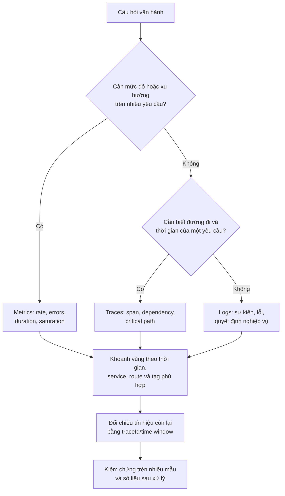
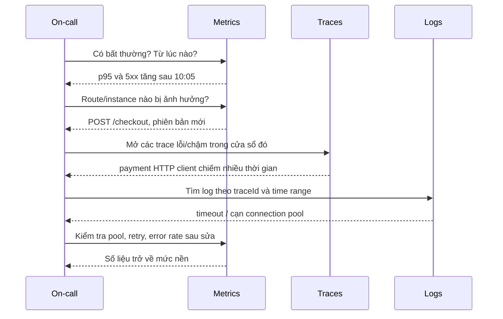

# Chọn tín hiệu cho từng câu hỏi vận hành

Khi ứng dụng Spring Boot gặp sự cố, câu hỏi đầu tiên không phải “mở dashboard nào?” mà là **“mình đang cố xác minh điều gì?”**. Nếu cần biết tỷ lệ lỗi trên toàn hệ thống, xem từng dòng log là cách khởi đầu kém hiệu quả. Nếu cần tìm vì sao **một** yêu cầu mất ba giây, biểu đồ độ trễ trung bình cũng chưa đủ. Chọn đúng tín hiệu giúp giảm thời gian điều tra và tránh kết luận sai từ dữ liệu thiếu ngữ cảnh.

Bài này thuộc chương **Ba trụ cột** của **SPRING_BOOT_OBSERVABILITY**: thiết lập khả năng quan sát Spring Boot bằng Micrometer Observation, metrics, logs và distributed tracing; hiểu propagation ngữ cảnh, tag/cardinality, exporter và sampling; kết nối các tín hiệu để giải thích lỗi, độ trễ và hành vi ứng dụng trong môi trường thực. Trọng tâm bài là **ra quyết định chọn tín hiệu theo câu hỏi vận hành**, từ phát hiện đến khoanh vùng, giải thích và kiểm chứng.

## 1. Mục tiêu học tập

Sau bài học, bạn có thể:

1. Chọn **metrics**, **logs** hoặc **traces** làm điểm bắt đầu cho từng kiểu câu hỏi; giải thích khi nào phải kết hợp.
2. Biến câu hỏi mơ hồ (“hệ thống chậm”) thành giả thuyết có thể kiểm tra (“p95 của `POST /checkout` tăng trên các instance vừa triển khai”).
3. Thực hiện quy trình **phát hiện → khoanh vùng → giải thích → kiểm chứng** với dữ liệu Spring Boot.
4. Biết giới hạn của dữ liệu tổng hợp, log thiếu correlation và trace bị sampling.
5. Gắn tên, tag và context vừa đủ để trả lời câu hỏi mà vẫn kiểm soát chi phí và dữ liệu nhạy cảm.

## 2. Ba tín hiệu trả lời ba kiểu câu hỏi khác nhau

| Tín hiệu | Đơn vị dữ liệu | Mạnh nhất khi hỏi | Điểm yếu nếu dùng riêng |
|---|---|---|---|
| **Metrics** | Giá trị số hoặc chuỗi thời gian tổng hợp: counter, gauge, timer, histogram | **Bao nhiêu? Bao lâu? Từ lúc nào? Có vượt ngưỡng? Ảnh hưởng rộng đến đâu?** | Thường mất chi tiết của một lần gọi; trung bình có thể che giấu đuôi phân phối. |
| **Logs** | Bản ghi sự kiện có timestamp, level, message và thuộc tính | **Sự kiện/ngoại lệ cụ thể nào đã xảy ra? Ứng dụng đã quyết định gì?** | Dễ quá nhiều hoặc quá ít; ghép log nhiều dịch vụ khó khi thiếu ID liên kết. |
| **Distributed traces** | Một trace chứa các span, quan hệ và thời lượng của từng bước | **Yêu cầu này đã đi qua đâu? Thời gian tiêu ở bước nào? Lệnh gọi nào là con của lệnh gọi nào?** | Trace có thể không được ghi vì sampling; các đoạn chưa instrument không hiện thành span. |

Ví dụ với `POST /checkout`:

- Metrics chỉ ra p95 tăng từ 300 ms lên 2 s, tập trung ở route thanh toán.
- Một trace chậm cho thấy span HTTP client gọi Payment Service chiếm 1,7 s.
- Logs của Payment Service mang cùng `traceId` ghi `connection pool exhausted`.

Ba dữ kiện hỗ trợ giả thuyết về nghẽn connection pool ở Payment Service. **Chúng chưa tự chứng minh nguyên nhân gốc**: cần đối chiếu thêm metrics của pool, tỷ lệ lỗi và nhiều yêu cầu khác trước khi kết luận.

> **Nguyên tắc:** dùng **metrics** để thấy mức độ và xu hướng; dùng **traces** để hiểu đường đi của một công việc; dùng **logs** để tìm sự kiện, quyết định và thông tin chẩn đoán cụ thể. Khi câu hỏi có nhiều vế, sử dụng nhiều tín hiệu theo thứ tự có chủ đích.

### “Không có dữ liệu” khác “không có sự cố”

Một request có thể thực sự xảy ra nhưng trace không được lưu vì sampling. Ứng dụng có thể vẫn xử lý traffic khi exporter mất kết nối. Backend log có thể thiếu một khoảng thời gian do collector bị lỗi. Vì vậy, không tìm thấy span hoặc log **không đủ để kết luận** một hoạt động chưa từng xảy ra.

Health check hoặc synthetic probe là nguồn bằng chứng độc lập về khả dụng, nhưng chúng **không thay thế** metrics, logs và traces trong việc giải thích hành vi hệ thống.

## 3. Quy trình chọn tín hiệu bắt đầu từ câu hỏi

Trước khi mở công cụ, hãy xác định bốn phần của câu hỏi:

1. **Đối tượng**: dịch vụ, endpoint, instance, dependency, queue hay thao tác nghiệp vụ nào?
2. **Khoảng thời gian**: từ lúc nào, dài bao lâu, trước và sau thay đổi nào?
3. **Phạm vi**: toàn bộ traffic, một nhóm route, một giao dịch hay một người dùng?
4. **Điều cần chứng minh**: phát hiện bất thường, xác định nơi xảy ra, giải thích nguyên nhân hay xác nhận đã phục hồi?

Sau đó chọn **tín hiệu đầu tiên** theo mức chi tiết mong muốn:



Không nhất thiết lúc nào cũng đi tuần tự metrics → traces → logs. Khi có một `traceId` từ báo cáo lỗi cụ thể, có thể mở trace hoặc tìm log ngay. Khi JVM bị OutOfMemoryError, metrics bộ nhớ và log exception thường hữu ích hơn trace HTTP.

### Ma trận lựa chọn nhanh

| Câu hỏi vận hành | Bắt đầu bằng | Bổ sung khi cần | Vì sao |
|---|---|---|---|
| Dịch vụ còn nhận và xử lý request không? | **Metrics** traffic, success/error; thêm health/synthetic probe | Logs khởi động, dependency health | Xác nhận mức độ và thời gian ảnh hưởng; health 200 không đồng nghĩa mọi tính năng hoạt động. |
| Tỷ lệ HTTP 5xx có tăng không? | **Metrics** request count, error ratio theo route/status | Logs exception và traces lỗi | Đo phạm vi rồi tìm loại lỗi và bước bị lỗi. |
| p95/p99 tăng ở đâu? | **Metrics** histogram thời gian theo route | **Traces** chậm, logs timeout/retry | Metric xác nhận phân phối; trace tìm đoạn tiêu tốn thời gian. |
| Một request trả lỗi vì điều gì? | **Logs** có `traceId`/request correlation | **Trace** nếu đã ghi; metrics cùng thời điểm | Cần sự kiện và ngữ cảnh của lần gọi cụ thể. |
| Phụ thuộc nào làm chậm Order Service? | **Traces** theo HTTP client/server spans | Metrics độ trễ/lỗi theo dependency | Trace cho tuyến gọi; metrics cho tính phổ biến của vấn đề. |
| Sau deploy, lưu lượng hoặc lỗi khác trước không? | **Metrics** trước/sau deploy theo service/route | Logs thay đổi cấu hình, traces mẫu | So sánh xu hướng và mức độ, hạn chế thiên lệch của vài trace. |
| CPU, heap hoặc GC đang tăng? | **Metrics** JVM, process, GC | Logs OOM/GC, profiler khi cần | Đây là vấn đề tài nguyên tổng thể; HTTP trace không luôn là điểm đầu tiên tốt nhất. |
| Hàng đợi bị tích tụ và consumer xử lý chậm? | **Metrics** backlog, message age, throughput, retries | Logs lỗi message, traces luồng xử lý đã instrument | Phải tách lỗi tốc độ nạp, tiêu thụ và phụ thuộc phía sau. |
| Tác vụ `@Async` mất correlation ID? | **Logs** đối chiếu trước/sau chuyển thread | **Traces** xem đứt span; cấu hình propagation | Kiểm tra ranh giới đổi ngữ cảnh thực thi. |
| Có nhiều đơn bị từ chối nhưng HTTP 200? | **Metrics nghiệp vụ** số đơn bị từ chối theo nhóm nguyên nhân | Logs quyết định và traces nếu cần phân tích luồng | HTTP status không phản ánh hết thất bại nghiệp vụ. |
| Vì sao một transaction thất bại thỉnh thoảng? | **Logs** có nguyên nhân và correlation | **Trace** khi bắt được mẫu; metrics tỷ lệ | Sự cố hiếm cần bằng chứng chi tiết; trace có thể bị sampling. |
| Dashboard bỗng không còn dữ liệu? | **Metrics** về scrape/exporter/collector và health độc lập | Logs pipeline, cấu hình/trace thử nghiệm | Phải tách ứng dụng ngừng hoạt động khỏi telemetry pipeline hỏng. |
| Tác vụ xử lý xong nhưng mất thời gian ở bước nào? | **Traces** cho một execution | Metrics duration/throughput theo bước | Span trả lời đường đi; metrics kiểm tra liệu đây có phải hiện tượng phổ biến. |

**Lưu ý:** “tín hiệu đầu tiên” là phương án có xác suất trả lời nhanh nhất; không phải quy tắc bất biến. Độ tin cậy của kết luận tăng khi nguồn thứ hai có thể **bác bỏ hoặc củng cố** giả thuyết.

## 4. Chọn metrics khi câu hỏi cần định lượng

Metrics phù hợp với các câu hỏi cần số liệu **tổng hợp qua thời gian**, theo dõi ngưỡng và cảnh báo.

### 4.1 Bốn nhóm câu hỏi thực dụng

- **Traffic (lưu lượng):** Có bao nhiêu request/giây? Có giảm đột ngột không?
- **Errors (lỗi):** Bao nhiêu request thất bại? Lỗi 4xx và 5xx có cùng ý nghĩa nghiệp vụ không?
- **Duration/latency (độ trễ):** p50, p95, p99 khác nhau thế nào? Có đuôi dài chỉ ảnh hưởng nhóm nhỏ người dùng không?
- **Saturation (bão hòa):** CPU, heap, GC, thread, DB connection pool, độ dài hàng đợi có gần giới hạn không?

Ví dụ Spring MVC thường có meter `http.server.requests`. Khi có Prometheus registry, timer có thể được xuất thành các series như `http_server_requests_seconds_count` và `http_server_requests_seconds_sum`. Cấu hình histogram mới sinh thêm bucket cần thiết để ước lượng percentile bên phía Prometheus.

Một số câu PromQL mẫu:

```promql
# Request/giây, tổng toàn ứng dụng
sum(rate(http_server_requests_seconds_count[5m]))

# Tỷ lệ 5xx trong 5 phút; chỉ diễn giải khi có đủ lưu lượng
sum(rate(http_server_requests_seconds_count{status=~"5.."}[5m]))
/
sum(rate(http_server_requests_seconds_count[5m]))

# p95 theo URI template khi histogram bucket đã được bật
histogram_quantile(
  0.95,
  sum by (le, uri) (
    rate(http_server_requests_seconds_bucket[5m])
  )
)
```

Chú ý bốn điều kiện:

1. **Tên metric phải kiểm tra theo exporter/convention thực tế**. `http.server.requests` trong Micrometer không giữ nguyên dấu chấm khi đi vào Prometheus.
2. **`p95` không có sẵn chỉ vì đã bật Actuator**. Cần histogram buckets, số lượng mẫu đủ và truy vấn đúng cửa sổ thời gian; p95 của các nhóm request gộp bừa có thể vô nghĩa.
3. **Tỷ lệ lỗi HTTP không đồng nhất với lỗi nghiệp vụ**. `POST /checkout` trả 200 kèm `paymentDeclined` vẫn có thể cần metric riêng cho tỷ lệ giao dịch bị từ chối.
4. **Tăng số chiều phân nhóm sẽ tăng số chuỗi thời gian**. Gắn `orderId` hoặc `userId` vào tag metrics có thể làm tăng series khổng lồ.

### 4.2 Không dùng trung bình để đại diện mọi người dùng

Giả sử có 100 request: 95 request mất 100 ms, 5 request mất 4 s. Độ trễ trung bình khoảng 295 ms, nhưng một số người dùng vẫn phải chờ 4 s. Bởi vậy, với độ trễ, nên xem cả số request, percentile, histogram và các nhóm route có ý nghĩa.

Nếu trace được sample ngẫu nhiên 10%, lấy percentile chỉ từ vài trace chậm đã tìm được thường **không** cho ước lượng p95 đáng tin cậy. Histogram metrics (nếu được instrument đầy đủ) thường thích hợp hơn để đo phân phối toàn tập request.

### 4.3 Metric biết “bao nhiêu”, ít biết “vì sao”

Đồ thị `http_server_requests_seconds_count` tăng không nói điều gì trong code gây lỗi. Timer `pricing.quote` chậm không luôn cho biết chậm do CPU, DB hay lock. Đó là lúc chuyển sang trace cụ thể và log theo cùng khoảng thời gian.

## 5. Chọn logs khi câu hỏi cần sự kiện và giải thích

Logs là nơi ghi **điều ứng dụng nhìn thấy hoặc quyết định**: validation thất bại, timeout, retry, chuyển trạng thái, exception, dead-letter, thay đổi cấu hình, nhánh xử lý nghiệp vụ.

Một bản ghi đủ hữu ích nên thể hiện sự kiện, mức độ, thời gian, service, kết quả và ngữ cảnh liên kết:

```json
{
  "timestamp": "2026-11-22T10:15:23.456Z",
  "level": "WARN",
  "service": "order-service",
  "event": "payment.provider_timeout",
  "dependency": "payment-service",
  "durationMs": 1500,
  "traceId": "4bf92f3577b34da6a3ce929d0e0e4736",
  "spanId": "00f067aa0ba902b7"
}
```

Đây là **mẫu thiết kế log có cấu trúc**, không phải JSON được Spring Boot mặc định xuất ra trong mọi cấu hình. Muốn có field JSON tương ứng phải cấu hình structured logging và bảo đảm trace/span ID được đặt vào MDC hoặc log context khi scope hiện hành.

### 5.1 Nên log điều gì?

- Lỗi không mong đợi, ngoại lệ có nguyên nhân và điểm gọi rõ ràng.
- Lần retry có ý nghĩa, quyết định circuit breaker, timeout của dependency.
- Trạng thái nghiệp vụ quan trọng và các trường hợp bị từ chối cần kiểm toán.
- Các thay đổi cấu hình hoặc vòng đời khởi động/tắt có ảnh hưởng vận hành.

Hạn chế ghi log mỗi phần tử của vòng lặp hoặc mỗi bước kỹ thuật nhỏ chỉ để “có thêm dữ liệu”: log quá nhiều làm tăng chi phí và che khuất sự kiện quan trọng. Chọn `INFO` cho sự kiện thường cần theo dõi, `WARN` cho điều kiện bất thường nhưng có kiểm soát và `ERROR` cho lỗi cần xử lý; áp dụng theo convention của đội.

### 5.2 Khi nào logs chưa đủ?

Nếu có 10.000 dòng “timeout”, logs tự thân chưa cho tỷ lệ timeout trên tổng số request và xu hướng p95. Chuyển sang metrics để đo mức độ. Nếu thấy stack trace ở Inventory Service nhưng không biết request đã đi qua những dịch vụ nào, dùng trace ID và distributed tracing để tái tạo luồng.

Đừng ghi dữ liệu bí mật vào logs: token, password, cookie, access key, dữ liệu cá nhân hoặc body nhạy cảm. Chỉ log identifier có thật sự cần cho điều tra, theo chính sách phân quyền, masking và retention.

## 6. Chọn traces khi câu hỏi cần đường đi và quan hệ nguyên nhân gần

Một **trace** biểu diễn một lần thực thi xuyên các thành phần có instrumentation. Mỗi **span** chứa tên hoạt động, khoảng thời gian, quan hệ với span cha, thuộc tính và đôi khi lỗi/sự kiện.

Ví dụ:

```text
Trace: checkout request (traceId=T)
└── checkout-service HTTP POST /checkout       2500 ms
    ├── validate-cart                            25 ms
    ├── inventory HTTP POST /reserve             120 ms
    └── payment HTTP POST /authorize            2100 ms
        └── payment-service HTTP POST /authorize
            └── provider-adapter call           1850 ms
```

Từ trace này, giả thuyết hợp lý là tập trung kiểm tra Payment Service hoặc provider adapter. Tuy nhiên **duration của span có thể chồng nhau** (nhất là xử lý song song); không được cộng đơn giản mọi duration con để suy ra latency tổng. Thời gian không có span cũng có thể chứa lập lịch thread, queue wait, xử lý chưa được instrument hoặc network delay.

### 6.1 Những câu hỏi traces giải tốt

- Yêu cầu này qua bao nhiêu dịch vụ và phụ thuộc nào?
- Retry xuất hiện ở bước nào, có fan-out song song hay không?
- Timeout ở outbound HTTP client hay trong xử lý của server đích?
- Context có được truyền đến downstream hay tạo trace mới?
- Phần nào của đường đi có bằng chứng về chậm trễ?

Spring Boot có thể instrument HTTP server, HTTP client và các hoạt động khác tùy stack/dependency. Với nghiệp vụ tùy chỉnh, dùng `Observation` để đo đoạn quan trọng. Một database call hoặc mọi method trong code không nhất thiết tự có span.

### 6.2 Sampling làm thay đổi cách diễn giải

Nếu sampling là 10%, một trace cụ thể có thể không hiện trong backend. Traces thấy được có thể chưa đại diện cho toàn bộ traffic, đặc biệt khi quyết định sampling phụ thuộc endpoint, parent/upstream hoặc một chính sách chọn trace lỗi/chậm.

Vì vậy:

- Dùng **metrics** để đo phân bố độ trễ và tỷ lệ lỗi toàn tập.
- Dùng **traces** để hiểu những execution đã quan sát được.
- Dùng **logs** theo correlation ID nếu cần lần theo request không có trace.
- Khi thiếu trace, kiểm tra sampler, exporter, backend và propagation trước khi kết luận không có request.

## 7. Khi nào phải kết hợp cả ba?

Một sự cố thường chứa ba câu hỏi liên tiếp: **độ nghiêm trọng bao nhiêu → đường đi nào liên quan → điều gì diễn ra tại điểm lỗi**.

### 7.1 Quy trình điều tra chung



**Mỗi lần chuyển tín hiệu phải có câu hỏi cụ thể.** Ví dụ “trace cho biết Payment chậm; log ở Payment có ghi timeout, retry hoặc pool exhaustion không?” cụ thể hơn việc mở toàn bộ log của mọi dịch vụ.

### 7.2 Liên kết bằng ngữ cảnh chung

Hai lớp liên kết bổ trợ:

1. **Thời gian + tên dịch vụ/route/phiên bản**: dùng để khoanh vùng metrics và tìm nhóm traces/logs đúng thời điểm.
2. **`traceId` và `spanId`**: dùng để tìm logs liên quan tới một execution; cùng trace ID có thể có nhiều span ID. Một `requestId` nghiệp vụ có thể được dùng bổ sung khi truy vết qua async/message, nhưng phải thiết kế và quản trị cẩn thận.

W3C Trace Context dùng header `traceparent` để tiếp tục trace giữa các dịch vụ HTTP. Ví dụ hình thức:

```http
traceparent: 00-4bf92f3577b34da6a3ce929d0e0e4736-00f067aa0ba902b7-01
```

Spring Boot với Micrometer Tracing và HTTP client được Spring cấu hình có thể truyền ngữ cảnh. Nếu tự tạo HTTP client, executor hoặc thread ngoài cơ chế instrumentation/context propagation, trace dễ đứt và log có thể mất `traceId`. Với messaging, propagation phụ thuộc thư viện/instrumentation và semantics xử lý; một số quan hệ thích hợp thể hiện bằng **span links** thay vì quan hệ cha-con trực tiếp.

**Đừng đưa traceId vào metric tags**: giá trị gần như duy nhất cho mỗi trace gây cardinality cực lớn. Trái lại, tag như `uri=/checkout`, `status=500` và `client.name=payment-service` (khi tập dịch vụ đích được kiểm soát) là các chiều nhóm phù hợp hơn.

## 8. Tình huống A: 5xx tăng mạnh sau triển khai

**Câu hỏi ban đầu:** “Bản triển khai lúc 10:00 có làm API đặt hàng lỗi không?”

**Tín hiệu chính: metrics.**

1. Xác nhận tổng request rate và tỷ lệ 5xx theo cửa sổ trước/sau 10:00; kiểm tra liệu mẫu có đủ lớn.
2. Phân tách theo route, service, instance hoặc phiên bản triển khai nếu những nhãn đó được thu thập và kiểm soát số giá trị.
3. Đối chiếu thay đổi traffic: 500 lỗi trên 1 triệu request khác với 500 lỗi trên 700 request.
4. Mở traces lỗi đã sample tại route/instance liên quan để tìm dependency hoặc span nổi bật.
5. Tìm logs cùng trace ID và khung thời gian để phân biệt timeout, database exception hay lỗi validation.
6. Kiểm tra lỗi có thực sự được báo qua HTTP status: lỗi nghiệp vụ trả 200 cần metric riêng.

**Điều có thể gây nhầm:** Sau triển khai, log level tăng từ INFO lên DEBUG nên lượng log tăng đột biến; đó không phải bằng chứng rằng request cũng lỗi nhiều hơn. Kiểm tra metric lỗi độc lập trước.

## 9. Tình huống B: p95 tăng nhưng tỷ lệ 5xx vẫn ổn

**Câu hỏi:** “Người dùng chờ lâu ở đâu, có phải tại dependency bên ngoài không?”

**Bắt đầu bằng metrics đo duration**, rồi mở traces chậm:

1. Xác nhận p50/p95/p99 theo **URI template** và thời gian; phân biệt một route với toàn service.
2. Kiểm tra rate, queue backlog, DB connection pool, CPU/GC và độ trễ HTTP client để hình thành giả thuyết.
3. Mở một số trace chậm và một số trace bình thường cùng route, so sánh các span.
4. Tìm logs timeout/retry ở span nghi ngờ; chú ý retry có thể làm tổng latency tăng mà cuối cùng vẫn trả HTTP 200.
5. Nếu trace không cho thấy đoạn chậm, tìm khoảng trống instrumentation, thời gian chờ thread/queue, client/server không có trace context hoặc delay ngoài ứng dụng.
6. Kiểm chứng cải thiện qua p95 và throughput sau khi xử lý.

**Sai lầm phổ biến:** Thấy một trace có span DB dài rồi kết luận “DB là nguyên nhân mọi request chậm”. Cần xác minh số liệu trên nhiều request và so sánh trước/sau.

## 10. Tình huống C: một giao dịch thất bại hiếm gặp

**Câu hỏi:** “Vì sao yêu cầu của một lần thanh toán cụ thể bị từ chối?”

Bắt đầu bằng **log nghiệp vụ có correlation ID** hoặc trace ID mà ứng dụng trả về qua cơ chế hỗ trợ được thiết kế an toàn. Truy vấn đúng khoảng thời gian và dịch vụ, đọc chuỗi sự kiện “validate → authorize → fail/retry → response”. Nếu có trace đã ghi, mở để xác định vị trí và thời lượng của từng bước. Cuối cùng dùng metrics tỷ lệ từ chối để biết trường hợp đó là đơn lẻ hay đang lan rộng.

Nếu trace không tồn tại do sampling, không phải mọi log cũng cần biến mất. Việc ghi log có policy riêng; hãy tìm dấu vết nghiệp vụ còn được lưu, miễn phù hợp bảo mật. Nếu cần thu thập thêm trace cho sự cố hiếm, thiết kế chính sách sampling hoặc quy trình tái hiện có kiểm soát; không bật 100% sampling vô hạn trên toàn production.

Khi một giao dịch có HTTP 200 nhưng kết quả `declined`, **không coi HTTP success rate là thước đo duy nhất** của trải nghiệm người dùng.

## 11. Tình huống D: queue xử lý chậm và tác vụ bất đồng bộ

**Câu hỏi:** “Hàng đợi đang chậm vì producer gửi quá nhanh hay consumer xử lý quá chậm?”

Tín hiệu bắt đầu là **metrics**:

- Độ dài hàng đợi và tuổi message lâu nhất (nếu broker cung cấp).
- Số message nạp vào/hoàn tất trên giây, retry, dead-letter.
- Số consumer đang hoạt động, thời gian xử lý, độ trễ dependency, tài nguyên.

Sau khi thấy tiêu thụ chậm, mở **traces** của những message đã được instrument để xem đường xử lý và các lời gọi downstream. Dùng **logs** để giải thích poison message, lỗi deserialize, retry exhausted hoặc business rejection.

Lưu ý:

- Một message có thể được nhận lại và xử lý nhiều lần. Không suy ra đúng một span hoặc một log cho mỗi message nghiệp vụ.
- Header truyền trace context qua broker phụ thuộc công cụ, interceptor và cách tạo consumer. `@Async`/executor tùy biến cũng cần context propagation.
- Khi message đổi ngữ cảnh hoặc fan-out, cần kiểm tra semantics parent/child và span link; không ép mọi luồng song song vào một cây tuyến tính.

## 12. Tình huống E: dashboard đột nhiên trống

**Câu hỏi:** “Ứng dụng ngừng phục vụ, hay chỉ pipeline telemetry không hoạt động?”

Không lấy **sự vắng mặt của metric** làm bằng chứng ứng dụng đã ngừng. Hãy đối chiếu health/synthetic check và traffic đo ở ingress/load balancer, rồi kiểm tra:

| Tín hiệu/vị trí | Dấu hiệu cần tìm |
|---|---|
| Metrics collector | `up`/scrape status, timeout, endpoint `/actuator/prometheus` có trả dữ liệu không? |
| Exporter/collector tracing | Mất kết nối, queue đầy, lỗi gửi batch, sampling, backend từ chối. |
| Log collector | Agent ngừng chạy, buffer đầy, pipeline parse field bị đổi, log retention/quyền truy cập. |
| Ứng dụng | Crash/restart, cấu hình exposure thay đổi, bị giới hạn CPU/memory/network. |
| Truy vấn dashboard | Bộ lọc service/namespace/label hoặc time range không còn khớp. |

Một tín hiệu mất trong khi hai tín hiệu khác vẫn có thể báo **lỗi thu thập**, không phải ứng dụng khỏe hay hỏng. Phải giám sát cả đường vận chuyển tín hiệu.

## 13. Thiết kế tín hiệu phù hợp với câu hỏi ngay trong Spring Boot

Không phải mọi điều cần biết đều có sẵn từ auto-instrumentation. Với nghiệp vụ “giữ hàng”, câu hỏi vận hành có thể là:

- “Có bao nhiêu lượt giữ hàng bị từ chối?” → **counter nghiệp vụ**.
- “Tác vụ giữ hàng mất bao lâu?” → **Observation** để tạo timing metric và có thể tạo span.
- “Vì sao lần giữ hàng cụ thể thất bại?” → **log** với kết quả/nguyên nhân và correlation context.

### 13.1 Nền tảng cấu hình

Với ứng dụng có Spring Boot Actuator, metrics Prometheus và tracing integration phù hợp phiên bản:

```yaml
spring:
  application:
    name: inventory-service

management:
  endpoints:
    web:
      exposure:
        include: "health,info,metrics,prometheus"
  metrics:
    distribution:
      percentiles-histogram:
        http.server.requests: true
  tracing:
    sampling:
      probability: 0.1
```

Muốn có `/actuator/prometheus` cần thêm `io.micrometer:micrometer-registry-prometheus`. Để thực sự tạo, xuất và tìm trace cần tracer implementation/bridge, exporter và backend tương ứng với **phiên bản Spring Boot** đang dùng; `sampling.probability` một mình không tạo trace backend. Các endpoint management cần giới hạn exposure và bảo vệ truy cập ở môi trường production.

Ví dụ dependency tối thiểu cho Actuator và Prometheus khi dự án đã có web starter:

```groovy
dependencies {
    implementation 'org.springframework.boot:spring-boot-starter-actuator'
    runtimeOnly 'io.micrometer:micrometer-registry-prometheus'
}
```

Cấu hình tracing và logging JSON có thể khác giữa các phiên bản. Kiểm tra reference docs đúng phiên bản trước khi đưa vào production.

### 13.2 Quan sát nghiệp vụ và đếm rejection

```java
import io.micrometer.core.instrument.Counter;
import io.micrometer.core.instrument.MeterRegistry;
import io.micrometer.observation.Observation;
import io.micrometer.observation.ObservationRegistry;
import org.slf4j.Logger;
import org.slf4j.LoggerFactory;
import org.springframework.stereotype.Service;

@Service
public class InventoryService {
    private static final Logger log =
            LoggerFactory.getLogger(InventoryService.class);

    private final ObservationRegistry observations;
    private final Counter outOfStockRejections;

    public InventoryService(ObservationRegistry observations,
                            MeterRegistry meters) {
        this.observations = observations;
        this.outOfStockRejections = Counter.builder("inventory.reservation.rejected")
                .description("Reservation attempts rejected as out of stock")
                .tag("reason", "out_of_stock")
                .register(meters);
    }

    public boolean reserve(String rawCategory, boolean available) {
        // Tập giá trị cố định, tránh đẩy category bất kỳ vào metric tags.
        String category = switch (rawCategory) {
            case "book" -> "book";
            case "electronics" -> "electronics";
            default -> "other";
        };

        Observation observation =
                Observation.createNotStarted("inventory.reserve", observations)
                        .contextualName("reserve inventory")
                        .lowCardinalityKeyValue("category", category);

        return observation.observe(() -> {
            if (!available) {
                outOfStockRejections.increment(); // metrics: bao nhiêu lượt bị từ chối?
                observation.lowCardinalityKeyValue("outcome", "rejected");
                log.info("Reservation declined: category={} reason=out_of_stock",
                         category);              // logs: chuyện gì xảy ra?
                return false;
            }

            observation.lowCardinalityKeyValue("outcome", "accepted");
            log.debug("Reservation accepted: category={}", category);
            return true;
        });
    }
}
```

Với `ObservationRegistry` được cấu hình có metrics handler, `inventory.reserve` có thể tạo timer cho số lần và thời lượng theo `category`/`outcome`. Nếu có tracing handler, nó cũng có thể tạo span liên quan trong scope của request. `Counter` riêng trả lời **số lần bị từ chối vì hết hàng**, kể cả khi API trả HTTP 200.

Lưu ý:

- `rawCategory` chỉ là giá trị ví dụ; hệ thống thực cần xác thực input và chuẩn hóa null/unknown trước khi dùng. Không đưa raw SKU, order ID hay customer ID vào tag.
- `Observation` không tự sinh các dòng `log.info(...)`; developer phải chủ động xác định sự kiện cần log.
- Tránh tạo một bộ counter ghi trùng chính xác tổng request HTTP đã có sẵn. Counter nghiệp vụ có ý nghĩa khi đo kết quả mà HTTP status không biểu đạt.
- Nếu xử lý ném exception, `observe(...)` đảm nhận việc dừng Observation và ghi lỗi qua các handler thích hợp; nhưng response status và cách framework đánh dấu lỗi cần được xác minh.
- Không gán `outcome=accepted` khi chưa thực sự hoàn tất thao tác có side effect. Với luồng thực tế, đặt outcome theo kết quả cuối cùng.

### 13.3 Cách kiểm chứng trong môi trường local

Kết nối một controller hoặc test gọi `InventoryService.reserve(...)` với các trường hợp `available=true/false`, rồi xem:

```bash
curl http://localhost:8080/actuator/metrics
curl http://localhost:8080/actuator/metrics/inventory.reserve
curl http://localhost:8080/actuator/metrics/inventory.reservation.rejected
curl http://localhost:8080/actuator/prometheus
```

Dự kiến: `inventory.reserve` xuất hiện sau khi có lần thực thi; counter rejection tăng khi `available=false`; console có log `Reservation declined`. Khi tracing đã cấu hình và một request hiện hành có trace scope, log có thể chứa trace/span ID. Việc thấy span trong trace backend còn phụ thuộc sampling và exporter.

Nếu muốn truy vấn một trace cụ thể, trước tiên kiểm tra tracing integration và exporter hoạt động. Chỉ có Actuator/Prometheus registry không bảo đảm có traces.

## 14. Ràng buộc dữ liệu: cardinality, sampling, chi phí và bảo mật

Chọn tín hiệu còn là chọn **khối lượng dữ liệu nào được phép sinh ra**.

| Quyết định | Metrics | Logs | Traces |
|---|---|---|---|
| Cardinality | Giữ tập tag nhỏ: route mẫu, status, method, nhóm kết quả. | Có thể chứa ID để liên kết sự kiện khi chính sách cho phép; không tự đưa mọi ID vào log. | Có thể mang thuộc tính chi tiết hữu ích cho một execution, nhưng vẫn cần kiểm soát dữ liệu nhạy cảm. |
| Sampling | Thường phải giữ bức tranh thống kê đầy đủ; cân nhắc tần suất/độ phân giải và chi phí. | Có thể giảm mức log hoặc rate limit sự kiện lặp; không bỏ mất các sự kiện kiểm toán bắt buộc. | Tỷ lệ sampling là công cụ kiểm soát chi phí; trace không có nghĩa là request không xảy ra. |
| Chi phí chủ yếu | Số series × retention × độ phân giải. | Số sự kiện × kích thước × indexing/retention. | Số trace/span × thuộc tính × thời gian lưu. |
| Độ tin cậy | Scrape/exporter, reset counter, label mapping. | Collector, định dạng, thời gian/đồng hồ, truy cập, retention. | Propagation, instrumentation, sampler, exporter, collector. |
| Bảo mật | Tránh PII trong tag. | Mask/redact dữ liệu nhạy cảm và giới hạn quyền tìm kiếm. | Tránh secret trong span name, attribute, event và baggage. |

Với metrics, số chuỗi thời gian có thể tăng theo **tích** số giá trị của các tag: 10 route × 5 trạng thái × 3 phương thức × 100.000 user ID sẽ tạo ra hàng triệu tổ hợp tiềm năng. Không dùng ID riêng lẻ làm nhãn metrics. Với tracing và logs, khả năng thêm thuộc tính chi tiết lớn hơn, nhưng cũng phải tuân thủ chính sách thu thập và lưu trữ.

Một hệ thống có thể dùng **exemplars** để liên kết một số mẫu trong histogram/counter với trace ID. Đây là khả năng phụ thuộc exporter, backend và cấu hình; không mặc định coi nó luôn sẵn có. Khi không có exemplar, tìm trace qua time range, service, route và các thuộc tính được lập chỉ mục.

## 15. Kiểm chứng kết luận và tránh thiên lệch

Một quy trình điều tra có chất lượng luôn kiểm tra:

1. **Khung thời gian đồng nhất**: dashboard, logs và traces cùng múi giờ và time range; cân nhắc lệch đồng hồ.
2. **Tập mẫu so sánh được**: cùng route, loại request, dependency, khoảng tải và phiên bản; không so p95 từ nhóm rất khác nhau.
3. **Metric có mẫu đủ lớn**: percentile trên traffic hiếm dễ dao động; tỷ lệ 100% lỗi trên một request không có nghĩa hệ thống mất toàn bộ khả dụng.
4. **Sampling và khoảng trống instrumentation**: trace được thấy chỉ là một phần, không nhất thiết đại diện toàn bộ.
5. **Không đồng nhất tương quan với nguyên nhân**: CPU và p95 tăng cùng lúc vẫn có thể do thay đổi traffic, query hoặc lock; cần kiểm chứng cơ chế.
6. **Đo lại sau xử lý**: rate, error ratio, p95/p99, backlog, saturation và các chỉ số nghiệp vụ phải trở về mức chấp nhận được.

### Bảng kiểm nhanh cho on-call

| Trước khi kết luận | Câu hỏi tự kiểm tra |
|---|---|
| Phát hiện | Tôi có số liệu định lượng cho thấy bất thường thực sự? |
| Phạm vi | Tôi biết service, route, phiên bản và khoảng thời gian bị ảnh hưởng? |
| Giả thuyết | Span/log nào gợi ý nguyên nhân? Có lời giải thích khác hợp lý không? |
| Đại diện | Trace có bị sampling? Metric có đủ số mẫu và histogram đúng? |
| Liên kết | `traceId`, `spanId`, correlation context có được truyền qua HTTP, thread và message đúng không? |
| Chất lượng telemetry | Collector/exporter có bỏ dữ liệu, timeout hoặc thất bại không? |
| Kết quả | Sau thay đổi, metrics và hành vi người dùng có thực sự tốt hơn? |

## 16. Bài tập tình huống

**Bài 1 — Mất chuyển đổi nhưng không có HTTP 5xx.** Sau một đợt triển khai, tỷ lệ người dùng hoàn tất thanh toán giảm từ 85% xuống 60%, nhưng HTTP `/checkout` vẫn trả 200. Bạn chọn tín hiệu nào để *phát hiện*, *phân nhóm nguyên nhân*, và *điều tra một lần thất bại*? Có nên gắn `customerId` làm metric tag?

**Bài 2 — Trace “đẹp” nhưng người dùng vẫn báo chậm.** Metrics cho thấy p99 của `GET /search` là 4 giây; bạn mở ngẫu nhiên ba trace và chỉ thấy dưới 200 ms. Bạn cần kiểm tra sampling, histogram, số mẫu, trace selection và phần instrumentation nào?

**Bài 3 — Hàng đợi phình to.** Backlog tăng trong khi consumer vẫn chạy. Bạn sẽ xem metrics nào để phân biệt tăng producer rate với consumer throughput giảm? Logs hoặc traces nào giúp tìm điểm nghẽn?

**Bài 4 — Mất log correlation sau `@Async`.** Trong controller log có trace ID, trong worker log không có. Hãy giải thích tại sao việc chỉ tăng log level không giải quyết vấn đề, và đâu là lớp cần kiểm tra.

**Bài 5 — Mất toàn bộ biểu đồ.** Prometheus không còn series của dịch vụ, nhưng endpoint người dùng vẫn hoạt động. Nguồn dữ liệu độc lập và các điểm trong pipeline telemetry nào cần kiểm tra trước?

**Đáp án định hướng:** Bài 1 bắt đầu bằng metrics nghiệp vụ, phân nhóm theo nguyên nhân hữu hạn, sau đó dùng logs/traces; không gắn customer ID vào metrics. Bài 2 không suy ra ba trace nhanh đại diện p99; phải xem sampling, thời gian và histogram. Bài 3 đối chiếu ingress/egress, tuổi message, retry, worker concurrency và độ trễ dependency. Bài 4 kiểm tra context propagation qua executor. Bài 5 đối chiếu synthetic/ingress/health rồi kiểm tra scrape, endpoint, exporter, label/filter và network.

## 17. Tài liệu đọc thêm

- [Spring Boot — Observability](https://docs.spring.io/spring-boot/reference/actuator/observability.html): ObservationRegistry, instrumentation và propagation.
- [Spring Boot — Metrics](https://docs.spring.io/spring-boot/reference/actuator/metrics.html): MeterRegistry, timer, metrics endpoint và Prometheus.
- [Spring Boot — Tracing](https://docs.spring.io/spring-boot/reference/actuator/tracing.html): sampling, exporter, correlation trong logs và propagation.
- [Spring Boot — Actuator Endpoints](https://docs.spring.io/spring-boot/reference/actuator/endpoints.html): exposure và bảo vệ endpoint quản trị.
- [Micrometer — Observation](https://docs.micrometer.io/micrometer/reference/observation/introduction.html): Observation, handlers, low/high-cardinality key-value.
- [Prometheus — Histograms and summaries](https://prometheus.io/docs/practices/histograms/): cách đo và truy vấn phân phối độ trễ.
- [OpenTelemetry — Signals](https://opentelemetry.io/docs/concepts/signals/): khái niệm metrics, logs và traces.
- [W3C Trace Context](https://www.w3.org/TR/trace-context/): header `traceparent` dùng liên kết trace giữa các hệ thống.

**Điều cần nhớ:** Để trả lời câu hỏi vận hành, hãy chọn tín hiệu theo **mức độ cần biết**: metrics để đo quy mô và xu hướng, logs để giải thích sự kiện cụ thể, traces để theo dõi đường đi của một lần thực thi. Sau đó kết hợp theo thời gian và ngữ cảnh, kiểm tra sampling/cardinality và đo lại kết quả. Một hệ thống có nhiều tín hiệu chưa chắc dễ điều tra; điều quyết định là các tín hiệu đó có trả lời được câu hỏi thật sự của người vận hành hay không.
