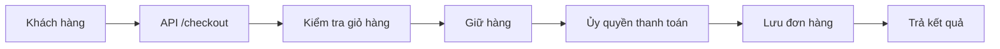
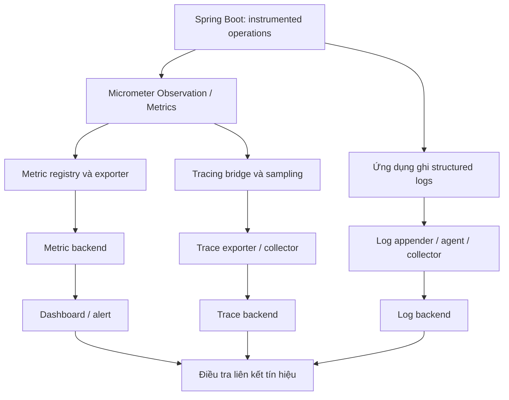

# Giới hạn của từng trụ cột

Trong một hệ thống Spring Boot, **metrics, logs và distributed traces** thường được gọi là *ba trụ cột của observability*. Mỗi trụ cột trả lời một nhóm câu hỏi tốt hơn các nhóm còn lại. Tuy nhiên, không trụ cột nào tự nó bảo đảm rằng ta hiểu được nguyên nhân của mọi sự cố.

Ví dụ, biểu đồ cho thấy API thanh toán chậm hơn bình thường, log ghi nhiều lỗi `Read timed out`, còn một trace cho thấy lời gọi tới nhà cung cấp thanh toán kéo dài 1,5 giây. Những dữ liệu này có vẻ cùng chỉ về một hướng. Nhưng nếu log không gắn cùng request, trace chỉ là một mẫu được chọn và metric tổng hợp nhiều phiên bản triển khai, việc kết luận tất cả người dùng gặp lỗi vì nhà cung cấp bên ngoài là quá sớm.

Bài học thuộc chương **Ba trụ cột** của module **SPRING_BOOT_OBSERVABILITY**. Mục tiêu là hiểu **dữ liệu mỗi trụ cột giữ lại, dữ liệu nó làm mất, các kết luận không thể suy ra**, và cách phối hợp Micrometer Observation, metrics, logs, distributed tracing, propagation, tag/cardinality, exporter và sampling để điều tra hệ thống Spring Boot trong môi trường thực.

## Mục tiêu học tập

Sau khi học, bạn có thể:

1. Phân biệt những giới hạn về **tổng hợp** của metrics, **ngữ cảnh và khối lượng** của logs, **độ phủ và lấy mẫu** của traces.
2. Phát hiện các kết luận sai thường gặp khi đọc một dashboard, một dòng log hoặc một trace riêng lẻ.
3. Giải thích vì sao **cardinality**, **sampling**, **context propagation** và **telemetry pipeline** quyết định chất lượng dữ liệu điều tra.
4. Chọn tín hiệu bổ sung để kiểm chứng một giả thuyết khi một trụ cột không đủ bằng chứng.
5. Thiết kế cách instrument một luồng Spring Boot sao cho dữ liệu có thể liên kết với nhau mà vẫn kiểm soát chi phí và thông tin nhạy cảm.

## 1. Cùng quan sát một hệ thống, nhưng mỗi trụ cột nhìn thấy một lát cắt

Giả sử luồng `POST /checkout` gồm:



Nếu khách hàng báo “bấm thanh toán và chờ rất lâu”, các tín hiệu thường cung cấp bằng chứng khác nhau:

| Trụ cột | Đơn vị dữ liệu thường gặp | Câu hỏi trả lời tốt | Điều còn thiếu |
|---|---|---|---|
| **Metrics** | Giá trị đo theo thời gian cùng một tập nhãn | Bao nhiêu request? Lỗi tăng khi nào? Phân bố độ trễ thay đổi ra sao? | Đường đi và hoàn cảnh chi tiết của một request cụ thể |
| **Logs** | Bản ghi về một sự kiện hoặc thông điệp | Lỗi nào xuất hiện? Thành phần ghi nhận điều kiện gì? | Quan hệ nhân quả, toàn bộ thời lượng và đường đi của request nếu thiếu ngữ cảnh |
| **Traces** | Các span mô tả thao tác thuộc một luồng xử lý | Request được ghi nhận đã đi qua đâu, đoạn nào chậm hoặc lỗi? | Bức tranh thống kê đầy đủ của mọi request, đặc biệt khi sampling hoặc thiếu instrumentation |

Vì vậy, cách nói “metrics trả lời *what*, logs trả lời *why*, traces trả lời *where*” chỉ là quy tắc ghi nhớ sơ lược. **Log không tự chứng minh nguyên nhân**, và **trace không bảo đảm xác định chính xác đoạn mã gây lỗi**. Cần kết hợp các tín hiệu, đối chiếu thời gian và kiểm chứng giả thuyết.

## 2. Giới hạn của metrics

Metrics ghi nhận số liệu hiệu quả ở quy mô lớn, đặc biệt phù hợp với theo dõi SLI/SLO, biểu đồ và cảnh báo. Sự hiệu quả đó đến từ việc **tổng hợp** và hạn chế số chiều dữ liệu, nên metric thường đánh đổi chi tiết của từng sự kiện.

### 2.1. Tính tổng hợp làm mất hoàn cảnh riêng của request

Giả sử trong một phút có 10.000 request với độ trễ trung bình 150 ms. Chỉ số này không cho biết:

- Có nhóm nhỏ request bị chậm 5 giây hay không.
- Nhóm chậm có cùng phiên bản triển khai hoặc nhà cung cấp thanh toán không.
- Mỗi request chậm đã trải qua những bước xử lý nào.
- Điều kiện nào kích hoạt lỗi, ví dụ retry, timeout hoặc khóa dữ liệu.

Ngay cả khi có p95/p99, ta vẫn biết **phân bố** chứ chưa biết nguyên nhân. Một p95 tăng có thể do DB lock, thread pool chờ, GC, queue, mạng hoặc dịch vụ ngoài.

**Bẫy suy luận:** “CPU bình thường nên ứng dụng không bị nghẽn.” CPU thấp vẫn có thể đi cùng nhiều thread bị block bởi I/O, pool kết nối cạn hoặc chờ khóa.

### 2.2. Label quá chi tiết gây bùng nổ cardinality

Trong Micrometer Metrics, một meter được nhận diện bởi tên và tập tag. Mỗi tổ hợp giá trị nhãn khác nhau có thể tạo một time series riêng ở backend.

Ví dụ:

```text
http.server.requests{
  method="POST",
  uri="/checkout",
  status="500",
  application="checkout-service"
}
```

Các chiều như `method`, tên route đã chuẩn hóa và trạng thái HTTP thường có số lượng giá trị giới hạn. Ngược lại, nếu thêm `userId`, `orderId`, `traceId` hoặc URL chứa ID động làm tag, số chuỗi có thể tăng theo số khách hàng hoặc request.

Giả sử một metric có 6 giá trị `method`, 40 giá trị `uri`, 5 nhóm `status` và 8 instance. Về mặt tổ hợp, có thể xuất hiện tới **6 × 40 × 5 × 8 = 9.600** chuỗi cho một bộ nhãn, chưa tính các nhãn khác. Nếu thêm hàng trăm nghìn mã đơn riêng biệt, chi phí lưu trữ và truy vấn có thể tăng rất mạnh. Đây là giới hạn về mô hình dữ liệu, không chỉ là vấn đề dung lượng ổ đĩa.

**Cách sử dụng:** giữ metric tags ở cardinality thấp và ổn định. Các ID riêng lẻ nên nằm trong log hoặc thuộc tính trace có kiểm soát. Với HTTP server metrics, dùng route mẫu như `/orders/{id}` thay vì `/orders/873214`.

### 2.3. Độ phân giải và phép tính tổng hợp có thể che khuất bất thường

Backend thường lưu/hiển thị giá trị theo khoảng thời gian: 10 giây, 1 phút hoặc lâu hơn. Sự cố chỉ kéo dài vài giây có thể bị làm phẳng khi xem biểu đồ với bước lớn.

Các phép đo cũng có ngữ nghĩa khác nhau:

- **Counter** tích lũy theo thời gian; trên JVM restart, giá trị có thể về 0. Thường cần xét tốc độ tăng và tính đúng việc counter reset, thay vì nhìn vào hiệu giữa hai mốc tùy ý.
- **Gauge** phản ánh một giá trị tại thời điểm đo; không thể suy ra các đỉnh ngắn nằm giữa hai lần lấy mẫu.
- **Timer/histogram** cung cấp thời lượng và dữ liệu phân bố tùy cấu hình; độ chính xác của percentile phụ thuộc bucket, phương pháp tính và dữ liệu được thu thập.
- **Percentile** không được cộng hoặc lấy trung bình tùy tiện giữa các instance. Ví dụ, trung bình các p99 của 3 instance **không phải** p99 của toàn bộ request. Histogram phù hợp có thể hỗ trợ tính quantile gần đúng từ dữ liệu gộp; kết quả còn phụ thuộc bucket và pipeline.

Nhìn một giá trị `avg` hoặc một percentile duy nhất không đủ để mô tả toàn bộ trải nghiệm người dùng. Nên xem đồng thời lưu lượng, tỷ lệ lỗi, độ trễ và phân bố theo phân nhóm nghiệp vụ có ý nghĩa.

### 2.4. Metrics không chứng minh quan hệ nhân quả

Hai biểu đồ cùng tăng sau khi deploy không chứng minh việc deploy là nguyên nhân trực tiếp. Có thể lúc đó lưu lượng đột biến hoặc nhà cung cấp thứ ba cũng gặp sự cố. Một metric giúp **đặt câu hỏi và khoanh vùng thời gian**, sau đó cần log, trace, thông tin triển khai và kiểm chứng bổ sung.

**Dấu hiệu cần chuyển sang trụ cột khác:** biểu đồ chứng minh “API chậm” nhưng không giải thích “request chậm ở đâu” → kiểm tra trace. Nếu cần tìm điều kiện lỗi cụ thể → kiểm tra log cùng ngữ cảnh.

## 3. Giới hạn của logs

Logs có thể lưu chi tiết về sự kiện: thông báo lỗi, mã kết quả, quyết định nghiệp vụ, retry, timeout và stack trace. Nhưng chi tiết của từng dòng log **không tự tạo ra cái nhìn xuyên suốt hệ thống**.

### 3.1. Log rời rạc không tự mô tả quan hệ nhân quả

Ví dụ:

```text
10:14:02.105 WARN  timeout calling payment provider
10:14:02.109 ERROR checkout failed
10:14:02.112 WARN  retry payment authorization
```

Ba dòng log đứng gần nhau về thời gian chưa chắc thuộc cùng một request. Hệ thống nhiều instance có thể xử lý hàng nghìn request đồng thời, đôi khi log đến collector không theo thứ tự do queue/buffering.

Nếu không có `traceId`/`spanId`, service, instance, event name và ngữ cảnh nghiệp vụ phù hợp, kỹ sư phải đoán các dòng nào liên quan. **Thứ tự xuất hiện trong hệ thống lưu log không đồng nghĩa với quan hệ cha–con hay trình tự thực thi thực tế.**

Một structured log có ích hơn:

```json
{
  "timestamp": "2026-03-12T10:14:02.105Z",
  "level": "WARN",
  "service": "payment-service",
  "event": "payment_provider_timeout",
  "traceId": "8a1d23ef79ac4f4b8c2e19a861b34d40",
  "spanId": "0011223344556677",
  "provider": "provider-a",
  "elapsedMs": 1500
}
```

Các trường được minh họa với dữ liệu giả định. Việc có `traceId` giúp tìm các log thuộc cùng trace **nếu** ngữ cảnh đã được propagate và log pipeline thực sự giữ trường này. Nó không bảo đảm sự kiện nào cũng được ghi, hoặc log và span cùng xuất hiện ở backend.

### 3.2. Log phụ thuộc vào quyết định của người lập trình

Những gì không được log sẽ khó truy hồi sau này. Một ngoại lệ có thể bị bắt rồi bỏ qua, một lỗi được log ở lớp quá cao khiến mất ngữ cảnh, hoặc chỉ có log `payment failed` mà không ghi loại lỗi (timeout, từ chối nghiệp vụ, lỗi cấu hình).

Ngược lại, log mọi bước nhỏ trong request có thể tạo ra hàng triệu bản ghi ít giá trị. Kỹ sư phải cân nhắc:

- Sự kiện nào giúp tái dựng trạng thái và quyết định quan trọng?
- Mức `INFO`, `WARN`, `ERROR` phù hợp ở đâu? Có lặp stack trace cho cùng lỗi không?
- Có đủ trường có cấu trúc để truy vấn không?
- Có thể điều tra khi logger, exporter hoặc collector bị gián đoạn không?

Log là bằng chứng về **sự kiện mà thành phần đã ghi nhận**, không phải bản chụp toàn bộ trạng thái nội bộ.

### 3.3. Khối lượng, thời gian lưu và mất dữ liệu

Logs có thể lớn và tốn tài nguyên gửi, lưu, đánh chỉ mục và truy vấn. Một hệ thống thường áp dụng lọc, sampling, giới hạn tốc độ hoặc retention; các cơ chế này có thể loại bỏ đúng dòng cần tìm khi có sự cố hiếm.

Ngoài ra:

- Bộ đệm logging hoặc mạng có thể khiến log đến chậm, đến sai thứ tự hoặc bị mất.
- Đồng hồ giữa các node có thể lệch, làm timeline không đáng tin nếu chưa đồng bộ.
- Một exception log nhiều lần trong các lớp xử lý có thể làm số dòng lỗi tăng mà số request lỗi thực tế không tăng tương ứng.
- Một số lỗi xảy ra trước khi logger sẵn sàng, hoặc khi process bị kill đột ngột, có thể không được ghi đầy đủ.

Do đó, **đếm số log ERROR không tự động bằng đếm số request lỗi**. Muốn biết tỷ lệ tác động, nên dựa vào metric/event đếm theo request hoặc giao dịch có định nghĩa rõ.

### 3.4. Nội dung log có giới hạn về an toàn và tính đúng đắn

Request body, token, email, số thẻ và dữ liệu định danh có thể là thông tin nhạy cảm; không nên đưa nguyên văn vào log chỉ để điều tra thuận tiện. Cần che/loại bỏ giá trị nhạy cảm, giới hạn người truy cập, retention và kiểm soát thao tác export.

Cũng không nên ghi thông tin do client cung cấp rồi mặc nhiên coi đó là sự thật. Ví dụ, `X-Request-Id` gửi từ bên ngoài có thể bị giả mạo hoặc trùng; cần phân biệt identifier tin cậy trong hệ thống với trường do người dùng kiểm soát.

**Dấu hiệu cần chuyển sang trụ cột khác:** tìm được log timeout nhưng chưa biết nó xảy ra ở bước nào của request hoặc tổng thời gian bị chậm bao nhiêu → xem trace liên quan. Muốn biết lỗi timeout ảnh hưởng bao nhiêu phần trăm request → xem metric.

## 4. Giới hạn của distributed traces

Distributed tracing theo dõi một luồng thực thi thông qua các span và trace context. Nó rất mạnh khi phân tích đường đi qua các service, database, HTTP client hay message broker. Tuy nhiên, trace là **bản ghi của những thao tác được instrument và được giữ lại**, không phải phép đo toàn tri.

### 4.1. Trace chỉ hiển thị những gì đã được instrument

Giả sử nhìn thấy:

```text
trace: POST /checkout (1.9 s)
  ├─ checkout-service: validate (20 ms)
  └─ checkout-service: payment (1.6 s)
```

Trace cho biết khoảng 1,6 giây thuộc span `payment`, nhưng chưa chắc đủ để kết luận:

- Thời gian đó là CPU, I/O, chờ connection pool hay retry.
- Payment provider ở xa thực sự tiêu tốn bao nhiêu thời gian so với client-side queueing.
- Đoạn mã nào bên trong `payment` gây chậm nếu không có span con hoặc sự kiện đáng tin.
- Khoảng thời gian còn lại thuộc bước nào nếu instrumentation không bao phủ mọi thao tác.

Instrumentation tự động thường chỉ hỗ trợ những thư viện, giao thức và entry point cụ thể. Các thao tác nghiệp vụ riêng như xét điều kiện giảm giá hoặc áp chính sách idempotency sẽ không mặc nhiên xuất hiện thành span có ý nghĩa.

Vì thế, span dài là **vị trí để điều tra sâu hơn**, chưa phải chứng minh nguyên nhân gốc.

### 4.2. Sampling có thể làm mất request quan trọng

Dù mỗi request đều có thể phát sinh trace context, backend có thể chỉ lưu một phần trace do chính sách sampling.

- **Head-based sampling** quyết định ở đầu luồng dựa trên thông tin có sẵn lúc đó. Hệ thống có thể bỏ qua request sẽ trở thành lỗi hiếm ở phía sau.
- **Tail-based sampling** đưa ra quyết định sau khi thu thập đủ thông tin của trace, có thể ưu tiên giữ trace lỗi/chậm nếu pipeline hỗ trợ. Đổi lại, collector cần buffer và năng lực xử lý tương ứng.
- **Parent-based sampling** có thể giúp các thành phần đưa ra quyết định theo trace parent, nhưng nếu cấu hình hoặc việc propagate không nhất quán thì độ phủ vẫn không được bảo đảm.

Ví dụ, nếu cấu hình lấy mẫu xấp xỉ 10%, không thể coi số trace lỗi trên backend là số request lỗi thực tế. Tỷ lệ có thể bị thiên lệch bởi chính sách sampling, mất dữ liệu và loại lỗi. Không nên suy ra p99 toàn hệ thống từ vài trace chậm được chọn thủ công.

Một request **không có trace được lưu** vẫn có thể góp vào HTTP metrics và có log, tùy cách instrument, sampling và export được thiết lập.

### 4.3. Trace context có thể bị đứt qua ranh giới thực thi

Một trace xuyên service phụ thuộc vào việc tạo, truyền và khôi phục context qua các ranh giới như HTTP, gRPC, message broker, queue, thread hoặc coroutine.

Trong một hệ thống Spring Boot, cần kiểm tra cụ thể:

- HTTP client/server có instrumentation tương thích không?
- Các header truyền context (chẳng hạn W3C `traceparent`) có thực sự đi qua proxy hoặc gateway không?
- Khi chạy bất đồng bộ qua executor, thread pool hay consumer, context có được khôi phục trong scope đúng không?
- Message consumer có dùng quan hệ parent–child hoặc span link phù hợp với mô hình xử lý không?
- Dịch vụ ngoài có tham gia tracing hay chỉ xuất hiện dưới dạng một client span tại phía gọi?

**Trace bị đứt không chứng minh luồng nghiệp vụ bị đứt.** Nó có thể chỉ là lỗi propagation, thiếu instrumentation hoặc không export span.

### 4.4. Span duration, timestamp và trạng thái lỗi có thể bị hiểu sai

Một trace là timeline của các span, nhưng:

- Các span có thể **chồng lấn** vì xử lý song song. Cộng mọi span duration thường lớn hơn tổng thời gian request.
- Thời gian của parent span có thể đã bao gồm thời gian chờ child span. Muốn phân tích “self time” phải hiểu cấu trúc và cách công cụ tính toán.
- Đồng hồ giữa các máy có thể lệch, khiến thứ tự và vị trí span có vẻ bất thường; không suy ra quan hệ nhân quả chỉ từ timestamp.
- Span có `status=ERROR` phụ thuộc việc instrumentation hoặc code đánh dấu lỗi; một HTTP response 4xx có thể là kết quả nghiệp vụ dự kiến, và không phải mọi sự cố đều tự chuyển thành error span.
- Một lời gọi tới dependency không có span con không chứng minh dependency đó nhanh. Có thể chỉ thiếu dữ liệu.

Cần kiểm tra semantic conventions và ngữ nghĩa span của thư viện cụ thể trước khi so sánh thời lượng hoặc tỷ lệ lỗi giữa các hệ thống.

### 4.5. Trace có chi phí và rủi ro dữ liệu riêng

Các span mang tên thao tác, attribute và event. Quá nhiều span, attribute có giá trị dài, stack trace lớn hoặc payload nhạy cảm đều có thể tăng chi phí và rủi ro. Không đưa token, email, nội dung thanh toán hoặc dữ liệu người dùng nhạy cảm vào span/baggage để tăng khả năng tìm kiếm.

Baggage được truyền giữa các thành phần nên cần đặc biệt kiểm soát kích thước và thông tin chứa trong đó. Tên span nên ổn định, có tính phân loại như `checkout.payment.authorize`; không gắn mã đơn hàng vào tên span. Giá trị ID nếu thật sự cần điều tra nên là thuộc tính được kiểm soát về quyền truy cập và retention.

**Dấu hiệu cần chuyển sang trụ cột khác:** trace cho thấy một dependency thường chậm nhưng chưa biết bao nhiêu người dùng bị tác động → xem metric phân bố và tỉ lệ lỗi. Span báo ERROR nhưng thiếu nguyên nhân → đọc structured logs và dữ liệu nghiệp vụ tương ứng.

## 5. Các giới hạn có thể chồng lên nhau

Thực tế, ba trụ cột không phải ba hệ thống độc lập. Chúng chia sẻ instrumentation, context, exporter, collector và backend. Một lỗi chung ở pipeline có thể khiến **cả ba tín hiệu cùng biến mất hoặc sai lệch**.

| Tình huống | Metrics có thể bỏ lỡ | Logs có thể bỏ lỡ | Traces có thể bỏ lỡ |
|---|---|---|---|
| Lỗi chỉ xảy ra với một nhóm khách hàng nhỏ | Nhóm bị che trong số liệu gộp, không thể gắn ID cá nhân làm label | Không có trường phân nhóm, lọc mất log liên quan | Trace lỗi hiếm không được sample |
| API chậm do chờ kết nối DB | Thấy p95 tăng nhưng không xác định điểm chờ | Có thể không có exception hoặc log ở bước chờ | Chỉ có span DB tổng quát, không phân biệt wait và query |
| Giao dịch qua message queue | Metric tổng chỉ thấy backlog | Log ở consumer thiếu request context | Trace đứt do context propagation hoặc quan hệ async không được instrument |
| JVM crash trong lúc tải cao | Điểm metric cuối có thể không được scrape | Buffer chưa flush, log cuối bị mất | Span chưa kết thúc/chưa export |
| Collector bị lỗi hoặc nghẽn | Mất một phần số liệu export | Drop/chậm log | Drop/mất span |
| Thời gian máy không đồng bộ | Các chuỗi thời gian khó đối chiếu | Log sai thứ tự tương đối | Timeline span giữa các host không đáng tin |
| Triển khai nhiều phiên bản | Biểu đồ trộn các version | Thiếu trường version | Trace không gắn resource attribute version |

Một câu hỏi quan trọng khi thấy “không có dữ liệu” là: **sự kiện không xảy ra, hay hệ thống không quan sát/không giữ được sự kiện?**

Bên cạnh ba trụ cột, có thể cần **deployment events, audit events, profiling, database diagnostics, synthetic checks, dữ liệu nghiệp vụ hoặc thông tin từ nhà cung cấp**. Đây là các nguồn bổ sung hợp lệ khi telemetry truyền thống không đủ để xác nhận nguyên nhân.

## 6. Tình huống thực tế: phát hiện sự cố nhưng chưa đủ để kết luận

Một hệ thống giả định gồm gateway, `checkout-service`, `inventory-service` và `payment-service`. Sau khi triển khai lúc 14:00, người dùng phàn nàn thanh toán chậm. Dữ liệu quan sát được:

1. **Metrics:** p95 `POST /checkout` tăng từ 350 ms lên 1,7 giây; tỷ lệ lỗi 5xx tăng từ 0,2% lên 2,5%.
2. **Logs:** `payment-service` ghi nhiều dòng `provider timeout`; nhưng một số log không có `traceId`.
3. **Traces:** trong năm trace được xem, ba trace có HTTP client span gọi provider kéo dài khoảng 1,4 giây.
4. **Thay đổi hệ thống:** checkout-service vừa có phiên bản mới; cũng có đợt tăng lưu lượng.

### Những kết luận chưa có cơ sở

- **“Mọi request đều chậm ở payment provider.”** Không đúng từ năm trace, nhất là khi sampling không đại diện cho toàn bộ lưu lượng.
- **“Provider gặp sự cố nên deployment không liên quan.”** Có thể bản mới thay đổi timeout, retry, connection pooling hoặc đồng thời nhiều yếu tố góp phần.
- **“Có nhiều log ERROR nên 2,5% request lỗi do provider.”** Log có thể lặp cho mỗi lần retry và không tương ứng một-một với request.
- **“CPU ổn nên không thể do checkout-service.”** Chờ kết nối hoặc lock vẫn có thể làm API chậm.

### Quy trình đối chiếu tín hiệu

**Bước 1 — Xác nhận tác động bằng metric.** Chia nhóm theo route, HTTP status, service và version nếu tag đã được thiết kế với cardinality phù hợp. Xem traffic, error rate, latency cùng lúc; so sánh trước/sau thay đổi.

**Bước 2 — Kiểm tra độ phủ tracing.** Xác định chính sách sampling, tỷ lệ trace được giữ, các chỗ context propagation bị đứt và những thao tác quan trọng chưa có span. Không mặc định trace được lấy mẫu đại diện chính xác cho tất cả request.

**Bước 3 — Khoanh vùng đoạn chậm.** So sánh nhiều trace nhanh/chậm có cùng ngữ cảnh. Xem client span của provider, các span quanh connection pool và retry (nếu đã được instrument), chú ý phần thời gian chưa được gán rõ.

**Bước 4 — Đối chiếu logs.** Truy vấn bằng `traceId` của các trace phù hợp để tìm timeout, mã lỗi, số lần retry và thông điệp nghiệp vụ. Với log thiếu trace ID, dùng service, instance, time window, event và request ID đáng tin cậy để khoanh vùng với độ chắc chắn thấp hơn.

**Bước 5 — Kiểm chứng giả thuyết.** Đối chiếu cấu hình timeout/retry của phiên bản mới, thời gian đáp ứng upstream, metric connection pool và các sự kiện triển khai. Tái hiện trong môi trường thích hợp nếu cần.

**Bước 6 — Xác nhận hồi phục.** Theo dõi lại SLI và triệu chứng người dùng sau khi sửa/rollback. Một trace nhanh sau khi triển khai giải pháp chưa đủ kết luận sự cố đã hết.

Đây là điểm khác biệt giữa **thu thập nhiều tín hiệu** và **có đủ bằng chứng để điều tra**: chất lượng nằm ở dữ liệu liên kết, định nghĩa nhất quán và khả năng xác nhận kết quả.

## 7. Giới hạn trong Spring Boot và Micrometer Observation

Với **Spring Boot 3.x**, Actuator, Micrometer Metrics, Micrometer Observation và Micrometer Tracing thường là những thành phần nền tảng để instrument ứng dụng; bộ dependency, exporter và tên property cụ thể phụ thuộc phiên bản Spring Boot đang dùng.

**Micrometer Observation** biểu diễn một thao tác được theo dõi dưới dạng observation. Các `ObservationHandler` phù hợp có thể tạo metric và span. Tuy nhiên, **tạo một observation không đồng nghĩa cả ba trụ cột tự xuất hiện**:

- Không có registry/handler/exporter phù hợp thì metric hoặc trace có thể không được ghi hoặc xuất.
- Log là tín hiệu riêng: ứng dụng vẫn cần quyết định thông điệp, mức log và cấu trúc dữ liệu; trace context chỉ hỗ trợ correlation khi được tích hợp.
- Nếu không propagate trace context qua client, executor và message broker, log hoặc span của downstream có thể không liên kết.
- Sampling trace và chính sách lọc log có thể khiến một operation có metric nhưng không có trace/log tương ứng.

### Ví dụ: đặt ranh giới quan sát cho một thao tác nghiệp vụ

Giả sử Spring Boot tự tạo một số HTTP server/client observations. Bước nghiệp vụ “ủy quyền thanh toán” vẫn có thể cần observation riêng.

```java
import io.micrometer.observation.Observation;
import io.micrometer.observation.ObservationRegistry;
import org.slf4j.Logger;
import org.slf4j.LoggerFactory;
import org.springframework.stereotype.Service;

@Service
class PaymentApplicationService {
    private static final Logger log =
            LoggerFactory.getLogger(PaymentApplicationService.class);

    private final ObservationRegistry observationRegistry;
    private final PaymentGateway gateway;

    PaymentApplicationService(ObservationRegistry observationRegistry,
                              PaymentGateway gateway) {
        this.observationRegistry = observationRegistry;
        this.gateway = gateway;
    }

    PaymentResult authorize(PaymentRequest request) {
        return Observation.createNotStarted(
                        "checkout.payment.authorize", observationRegistry)
                .contextualName("authorize payment")
                .lowCardinalityKeyValue("operation", "authorize")
                .observe(() -> {
                    log.debug("Start payment authorization");
                    return gateway.authorize(request);
                });
    }
}
```

`PaymentGateway`, `PaymentRequest` và `PaymentResult` là các kiểu nghiệp vụ giả định. Observation đo phạm vi của `gateway.authorize(request)` và có thể trở thành metric/span tùy cách tích hợp. Nó **không cho biết toàn bộ hoạt động bên trong gateway** nếu các thao tác con thiếu instrumentation.

Ở đây `operation=authorize` là tag hữu hạn thích hợp hơn `orderId` cho metric. Trong môi trường có Micrometer Tracing và cấu hình log correlation tương ứng, MDC/log pattern có thể bổ sung `traceId` và `spanId` vào bản ghi. Log ở mức DEBUG có thể bị tắt ở production; vì vậy không nên thiết kế quy trình điều tra dựa trên giả định rằng dòng log này luôn tồn tại.

Để nhìn thấy cả hành trình qua `payment-service` và provider, phải kiểm tra HTTP client instrumentation, context propagation, sampling và collector/exporter. Nếu chỉ có span của `PaymentApplicationService`, ta mới biết toàn bộ thao tác đó mất bao lâu chứ chưa thể phân tách thời gian chờ tại network, connection pool, retry hay provider.

### Hình dung đường đi và nơi có thể mất tín hiệu



Các điểm có thể mất tín hiệu gồm instrumentation chưa đầy đủ, tag bị lọc, sampling, exporter cấu hình sai, collector nghẽn, network gián đoạn, retention đã hết và truy vấn không đúng trường. Khi không tìm thấy một log hoặc span, phải kiểm tra **toàn bộ đường đi dữ liệu**, không vội suy luận rằng thao tác không xảy ra.

## 8. Chọn tín hiệu nào khi gặp một câu hỏi cụ thể?

| Câu hỏi cần trả lời | Bắt đầu từ | Tín hiệu bổ sung và điều cần kiểm chứng |
|---|---|---|
| Tỷ lệ lỗi checkout hiện có vượt SLO không? | Metric theo request/giao dịch | Định nghĩa lỗi, mẫu số, cửa sổ thời gian, metric ingestion |
| Lỗi chỉ xảy ra với một phương thức thanh toán? | Metric theo nhóm nếu cardinality cho phép | Log/trace có thuộc tính nghiệp vụ đã được kiểm soát, so sánh mẫu đủ lớn |
| Một request cụ thể bị chậm ở bước nào? | Trace theo trace ID/request context | Log liên quan, các span bị thiếu, tính chồng lấn của span |
| Vì sao payment provider trả timeout? | Structured log và trace HTTP client | Metric connection pool, DNS/network, cấu hình timeout và tín hiệu từ provider |
| Có bao nhiêu khách hàng bị ảnh hưởng? | Metric nghiệp vụ/SLI và dữ liệu giao dịch | Traces/logs có thể bị sampling, retry và lặp bản ghi |
| Không thấy trace của lỗi vừa xảy ra? | Trạng thái sampling/propagation/export | Metrics xác nhận lỗi; logs và tình trạng collector/retention |
| Sau deploy, lỗi tăng do phiên bản mới? | Metric theo version và deployment event | So sánh nhóm lưu lượng, trace khác biệt và các thay đổi đồng thời |

**Quy tắc thực hành:** dùng metric để đánh giá *quy mô và xu hướng*, trace để xem *đường đi và thời gian của các thao tác đã quan sát*, log để đọc *chi tiết sự kiện đã được ghi*. Mỗi kết luận quan trọng nên có ít nhất một phép kiểm tra độc lập phù hợp.

## 9. Thiết kế để giảm giới hạn, thay vì cố xóa bỏ hoàn toàn

Không thể giữ trọn mọi chi tiết của mọi request mãi mãi với chi phí bằng không. Thiết kế observability tốt vì thế phải chọn các đánh đổi có chủ đích.

### Ưu tiên 1: Tín hiệu phục vụ người dùng

Định nghĩa các SLI thiết yếu: lượng request, tỷ lệ lỗi, độ trễ và một vài kết quả nghiệp vụ có ý nghĩa. Metric đo chính xác các hành trình quan trọng thường hữu ích hơn hàng trăm gauge tài nguyên không liên quan trực tiếp đến chất lượng dịch vụ.

### Ưu tiên 2: Ngữ cảnh dùng chung giữa ba trụ cột

Thống nhất tên service, environment, version, route mẫu, tên operation và chuẩn timestamp. Khi tích hợp tracing vào logs, ưu tiên `traceId`/`spanId` làm chìa khóa tương quan. Không dùng `traceId` làm label metric vì cardinality rất cao; nếu backend hỗ trợ **exemplar**, có thể liên kết một mẫu đo với trace theo cơ chế riêng mà không biến mọi trace ID thành time series.

### Ưu tiên 3: Độ phủ instrumentation có chọn lọc

Quan sát những ranh giới đáng giá: HTTP entry point, DB, messaging, lời gọi bên ngoài và bước nghiệp vụ tạo rủi ro. Kiểm tra thực tế propagation qua service và luồng bất đồng bộ. Instrument thêm khi sự cố thực tế chỉ ra khoảng mù, thay vì tạo span cho mọi dòng mã.

### Ưu tiên 4: Sampling, retention và chi phí

- Chọn trace sampling dựa trên lưu lượng, tỷ lệ lỗi hiếm và nhu cầu điều tra; xem xét head/tail sampling phù hợp với hạ tầng.
- Giữ metrics cần thiết đủ lâu để đánh giá xu hướng/SLO; kiểm tra độ phân giải lưu trữ.
- Dùng structured logs có mức log hợp lý; tránh ghi lặp và hạn chế payload lớn.
- Đặt ngân sách cardinality, dung lượng, ingestion, retention và truy vấn; theo dõi cả trạng thái **telemetry pipeline**.

### Ưu tiên 5: Kiểm tra “quan sát được” bằng một sự cố giả lập

Tạo một kịch bản có kiểm soát: một số request `/checkout` chậm do dependency, một số thất bại, một số xử lý qua message queue. Xác nhận:

1. Metric phản ánh tác động và kích hoạt cảnh báo phù hợp.
2. Tìm được ít nhất các trace mẫu liên quan, nhận diện được các span quan trọng và biết chính sách sampling.
3. Tìm được log cùng trace context, không chứa dữ liệu nhạy cảm.
4. Khi thiếu log/trace, nhóm vận hành phân biệt được “không phát sinh” với “không thu thập/không lưu”.
5. Sau khi khắc phục, SLI và kết quả nghiệp vụ hồi phục theo ngưỡng đã định nghĩa.

## 10. Câu hỏi tự đánh giá

**Câu 1.** Một dashboard cho thấy p99 của `POST /checkout` là 2 giây. Có thể kết luận tất cả request đều mất gần 2 giây không?

**Gợi ý:** Không. p99 là đặc tính của phân bố độ trễ theo phép tính và khoảng thời gian cụ thể; nó không mô tả từng request. Cần xem traffic, histogram và trace mẫu nếu muốn hiểu các trường hợp chậm.

**Câu 2.** Có 600 log `ERROR payment timeout` nhưng metric chỉ có 80 request checkout thất bại. Tín hiệu nào sai?

**Gợi ý:** Chưa thể biết tín hiệu nào sai. Có thể một request retry nhiều lần hoặc nhiều lớp cùng log một lỗi. Cần xác định đơn vị đếm của mỗi metric/log, trace ID và thời gian xem xét.

**Câu 3.** Không tìm thấy trace cho một request lỗi trong log. Có thể kết luận tracing bị hỏng không?

**Gợi ý:** Chưa đủ cơ sở. Trace có thể không được lấy mẫu, context bị đứt, exporter/collector lỗi, retention đã hết hoặc truy vấn sai ID. Kiểm tra sampling policy và đường đi telemetry.

**Câu 4.** Có thể gắn `orderId` vào metric timer để tìm đơn hàng chậm nhất không?

**Gợi ý:** Không phù hợp trong phần lớn hệ thống vì cardinality rất cao. Dùng metric với tag hữu hạn để xác định phân nhóm cần chú ý; sử dụng log/trace với thuộc tính có kiểm soát để điều tra một đơn hàng cụ thể.

**Câu 5.** Một trace gồm parent span 2 giây và hai child span cùng kéo dài 1,5 giây, chạy song song. Có phải request mất tổng 5 giây không?

**Gợi ý:** Không. Child spans có thể trùng thời gian nhau và nằm trong thời lượng parent. Phải đọc timeline và quan hệ các span; không cộng thô mọi duration.

## Kết luận

Giới hạn của ba trụ cột là hệ quả của mục đích thiết kế: **metrics đánh đổi chi tiết để tổng hợp hiệu quả; logs phụ thuộc sự kiện được ghi và ngữ cảnh có sẵn; traces phụ thuộc độ phủ instrumentation, propagation và sampling**. Muốn điều tra đáng tin cậy trong Spring Boot, cần kết hợp chúng thông qua Micrometer Observation và hệ thống thu thập phù hợp, đặt câu hỏi đúng cho từng tín hiệu, kiểm chứng chéo bằng dữ liệu nghiệp vụ và giữ kiểm soát cardinality, chi phí, retention cùng quyền riêng tư.
