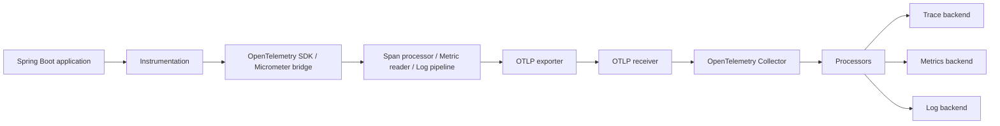

# OTLP là gì?

Một ứng dụng Spring Boot đã tạo spans, metrics và logs trong bộ nhớ. Hệ thống quan sát production thường nằm ngoài process: OpenTelemetry Collector, tracing backend, metrics platform hoặc log backend. Ứng dụng cần giao thức thống nhất để chuyển telemetry tới những thành phần đó. **OTLP (OpenTelemetry Protocol)** là giao thức truyền dữ liệu của OpenTelemetry, định nghĩa cách mã hóa và gửi traces, metrics và logs giữa SDK, Collector và backend tương thích.

OTLP giải quyết phần **vận chuyển telemetry**. Nó không tự tạo span, không quyết định request nào được sampling, không phải trace database và cũng không phải dashboard. Những nhiệm vụ đó thuộc instrumentation, SDK/sampler, Collector và backend. Hiểu ranh giới này giúp chẩn đoán chính xác khi ứng dụng tạo được trace nhưng Collector không nhận, hoặc Collector nhận thành công nhưng backend không hiển thị.

Bài học thuộc chương **OTLP export** của module **SPRING_BOOT_OBSERVABILITY**. Module hướng dẫn thiết lập observability cho Spring Boot bằng Micrometer Observation, metrics, logs và distributed tracing; học propagation ngữ cảnh, tag/cardinality, exporter, sampling và liên kết tín hiệu để điều tra lỗi, độ trễ và hành vi ứng dụng trên môi trường thực. Bài này trình bày OTLP từ data model và transport đến cấu hình exporter, Collector pipeline, bảo mật, vận hành và kiểm chứng.

## Mục tiêu học tập

Sau bài này, bạn có thể:

1. Giải thích OTLP và phân biệt giao thức này với OpenTelemetry API/SDK, exporter, Collector và backend.
2. Nhận biết traces, metrics và logs được truyền qua OTLP.
3. Phân biệt OTLP/gRPC với OTLP/HTTP và hiểu các port/path thường dùng.
4. Giải thích exporter chuyển telemetry ra khỏi ứng dụng và Collector tiếp nhận, xử lý, định tuyến dữ liệu.
5. Hiểu batching, queue, retry, timeout, backpressure và các tình huống telemetry bị drop.
6. Cấu hình endpoint/protocol theo mô hình Spring Boot/Micrometer hoặc OpenTelemetry Java Agent phù hợp.
7. Kiểm tra resource attributes, signal-specific endpoints, TLS và authentication.
8. Phân biệt sampling với export và ingestion/storage.
9. Chẩn đoán lỗi OTLP từ ứng dụng đến Collector/backend.
10. Đưa OTLP export vào production với capacity, privacy, cardinality, monitoring và rollout có kiểm soát.

## 1. OTLP nằm ở đâu trong kiến trúc OpenTelemetry?

Một pipeline phổ biến:



| Thành phần | Trách nhiệm | Ví dụ |
|---|---|---|
| Instrumentation | Tạo telemetry từ code/framework | HTTP span, DB operation, business Observation |
| API/SDK | API và lifecycle, sampling, processing | OTel TracerProvider, MeterProvider |
| Exporter | Chuyển telemetry đã xử lý ra ngoài | OTLP trace exporter |
| OTLP | Định dạng/giao thức truyền telemetry | gRPC hoặc HTTP/protobuf |
| Receiver | Nhận payload OTLP | Collector OTLP receiver |
| Collector processor | Batch, transform, filter, route | batch, memory_limiter |
| Backend exporter | Gửi sang hệ thống đích | Trace/metrics/log exporter |
| Backend | Lưu trữ, truy vấn, dashboard, alerting | Trace store, metrics TSDB |

**OTLP là protocol contract giữa bên gửi và bên nhận.** Exporter sử dụng OTLP để gửi payload; receiver cần hỗ trợ đúng transport và signal. Collector thường giúp tách ứng dụng khỏi chi tiết backend, nhưng exporter cũng có thể gửi trực tiếp tới endpoint OTLP tương thích.

### 1.1. OTLP không phải OpenTelemetry SDK

SDK ghi nhận telemetry và cung cấp processor/reader/exporter. OTLP chỉ là một lựa chọn giao thức để chuyển dữ liệu. Ứng dụng có SDK có thể dùng exporter khác; Collector có thể nhận OTLP rồi xuất sang protocol/backend khác.

### 1.2. OTLP không tạo context propagation

HTTP header traceparent, B3 headers hoặc message headers mang trace context giữa các service. Đó là **context propagation**. OTLP mang dữ liệu telemetry đã được ghi nhận tới Collector/backend. Không nhầm header của request nghiệp vụ với OTLP export request.

## 2. Dữ liệu nào được truyền qua OTLP?

OTLP hỗ trợ ba signal chính.

### 2.1. Traces

Trace data được tổ chức thành resource spans, scope spans và spans. Một span thường có trace ID, span ID, parent span ID hoặc quan hệ phù hợp, tên, kind, thời điểm bắt đầu/kết thúc, attributes, events, links và status.

```text
Resource:
  service.name = checkout-service
  service.version = 1.42.0

Instrumentation scope:
  name = checkout.payment

Span:
  trace_id = 0af765...
  span_id = b7ad6b...
  name = payment.authorize
  kind = INTERNAL
  start_time = ...
  end_time = ...
  attributes:
    payment.provider = provider-a
  status = OK
```

Trace ID/span ID là định danh correlation. Không đưa chúng thành metric labels thông thường vì cardinality tăng nhanh.

### 2.2. Metrics

Metrics data có resource/scope metadata và metric points như sum/counter, gauge, histogram hoặc exponential histogram khi SDK/backend hỗ trợ. Metric point có thể mang attributes, timestamp, aggregation temporality và giá trị theo loại instrument.

OTLP metrics không đồng nghĩa Prometheus scrape. Hệ thống có thể scrape Prometheus endpoint và đồng thời export OTLP metrics, nhưng cần tránh duplicate ingestion hoặc hai nguồn tạo cùng metric name với semantics khác nhau.

### 2.3. Logs

OTel log record có thể mang timestamp, observed timestamp, severity, body, attributes, resource, instrumentation scope và trace ID/span ID khi log được liên kết với context.

Spring Boot có thể tiếp tục dùng Logback/SLF4J. Muốn gửi logs qua OTLP cần logging integration/appender/agent hoặc pipeline phù hợp; thêm trace OTLP exporter không tự động xuất Logback events.

### 2.4. Resource và instrumentation scope

**Resource** mô tả thực thể phát telemetry, thường gồm service name/version, environment hoặc process attributes. **Instrumentation scope** mô tả thư viện/module đã tạo telemetry.

Resource giúp biết service nào phát span và phiên bản deployment nào phát metric; scope giúp nhận biết instrumentation library/version. Không đưa request-specific IDs vào resource vì resource có phạm vi rộng hơn từng request.

## 3. OTLP/gRPC và OTLP/HTTP

OTLP có hai transport phổ biến: gRPC và HTTP với protobuf payload.

| Thuộc tính | OTLP/gRPC | OTLP/HTTP |
|---|---|---|
| Transport | gRPC | HTTP |
| Payload | Protobuf messages | Protobuf theo OTLP/HTTP |
| Port mặc định thường gặp | 4317 | 4318 |
| Signal endpoints | RPC service tương ứng | Path riêng cho từng signal |
| Network | Cần gRPC/HTTP2 phù hợp | Thường dễ đi qua HTTP proxy/gateway |
| Chọn khi | Hạ tầng hỗ trợ gRPC | Mạng/API gateway ưu tiên HTTP |

4317 và 4318 là port mặc định thường gặp của Collector OTLP receiver; deployment có thể đổi port. **Không suy luận protocol chỉ từ port**: kiểm tra receiver thật và exporter đang dùng.

### 3.1. OTLP/HTTP endpoints

Các path signal phổ biến:

```text
/v1/traces
/v1/metrics
/v1/logs
```

Ví dụ endpoint traces:

```text
http://otel-collector:4318/v1/traces
```

Metrics và logs có path riêng nếu export qua OTLP/HTTP. Một số exporter nhận base endpoint và tự thêm signal path; exporter khác yêu cầu endpoint đầy đủ. Hành vi tùy SDK/framework integration.

### 3.2. gRPC services

Với OTLP/gRPC, signals đi qua RPC services tương ứng thay vì HTTP paths ở trên. Exporter thường trỏ tới Collector host/port. Không sao chép path /v1/traces vào gRPC endpoint.

### 3.3. Content type và encoding

OTLP/HTTP protobuf thường dùng content type protobuf, chẳng hạn application/x-protobuf; response/error format và compression tùy protocol/spec/version. Không gửi JSON tùy ý tới protobuf endpoint và kỳ vọng receiver tự hiểu. Muốn kiểm tra bằng HTTP client cần payload protobuf hợp lệ hoặc dùng exporter/test tool phù hợp.

## 4. Exporter làm gì trong ứng dụng?

Exporter là thành phần vận chuyển telemetry từ SDK/framework integration tới đích. Với tracing, span thường được chuyển tới exporter sau khi kết thúc và qua processor; với metrics, reader/scheduler thu thập và export theo chu kỳ; logs có pipeline riêng.

```text
Application creates span
        |
        v
SpanProcessor receives span end
        |
        v
Batch processor queues span
        |
        v
OTLP exporter serializes and sends
        |
        v
Collector receiver accepts request
```

Exporter thường phụ trách serialization OTLP, gửi qua gRPC/HTTP, endpoint, headers, TLS, timeout và tích hợp batch/retry theo SDK. Exporter không đảm bảo backend lưu thành công. HTTP success hoặc gRPC success từ Collector chỉ chứng minh receiver đã chấp nhận request; processors/exporters phía sau vẫn có thể drop hoặc lỗi.

### 4.1. Batch export

Gửi network request cho mỗi span có thể tạo overhead cao. Batch processor gom spans rồi export. Batch giảm request overhead nhưng thêm độ trễ trước khi dữ liệu xuất hiện ở backend.

Tham số cần cân nhắc: batch size, max queue size, scheduled delay, export timeout, retry/backoff nếu hỗ trợ và shutdown/flush timeout. Tên property/default thay đổi theo SDK, Java Agent và framework.

### 4.2. Queue đầy và dữ liệu bị drop

Nếu Collector chậm, network gián đoạn hoặc backend không nhận, exporter queue có thể tăng. Khi chạm giới hạn, dữ liệu mới có thể bị drop tùy policy. Không tăng queue vô hạn: queue lớn chỉ trì hoãn mất dữ liệu và tăng memory pressure.

Quan sát queue utilization, export failures, dropped spans và Collector capacity.

### 4.3. Shutdown và flush

Khi ứng dụng shutdown, SDK/exporter có thể cần flush dữ liệu đang chờ. Container bị kill ngay, shutdown timeout quá ngắn hoặc process crash có thể làm mất batch chưa gửi. Thiết kế termination grace period phù hợp, kiểm tra SDK/Spring lifecycle và không giả định process crash vẫn flush được.

## 5. Cấu hình OTLP export trong Spring Boot

Một cách tích hợp thường gặp là dùng Spring Boot Actuator với Micrometer Tracing OTel bridge và OTLP exporter.

Gradle minh họa:

```groovy
dependencies {
    implementation 'org.springframework.boot:spring-boot-starter-actuator'
    implementation 'io.micrometer:micrometer-tracing-bridge-otel'
    runtimeOnly 'io.opentelemetry:opentelemetry-exporter-otlp'
}
```

Sử dụng version được Spring Boot/Micrometer BOM quản lý. Không thêm Brave bridge cùng OTel bridge tùy tiện. Dependency trên minh họa đường tracing; metrics và logs OTLP cần integration/exporter phù hợp.

### 5.1. Cấu hình Spring Boot properties

Ví dụ cấu hình traces gửi qua OTLP/HTTP:

```yaml
spring:
  application:
    name: checkout-service

management:
  tracing:
    sampling:
      probability: 0.10

  otlp:
    tracing:
      endpoint: http://otel-collector:4318/v1/traces
```

**Property prefix và endpoint semantics phụ thuộc phiên bản Spring Boot/Micrometer**. Đối chiếu reference configuration đúng version. Ví dụ minh họa Spring Boot version có hỗ trợ management.otlp.tracing.endpoint, không phải YAML dùng chung cho mọi OTel SDK.

sampling probability 0.10 là head sampling trong cấu hình Micrometer Tracing hỗ trợ; không phải thành phần OTLP protocol và không quyết định metrics/log sampling.

### 5.2. Cấu hình OpenTelemetry Java Agent

```bash
OTEL_SERVICE_NAME=checkout-service
OTEL_EXPORTER_OTLP_PROTOCOL=http/protobuf
OTEL_EXPORTER_OTLP_ENDPOINT=http://otel-collector:4318
OTEL_TRACES_SAMPLER=parentbased_traceidratio
OTEL_TRACES_SAMPLER_ARG=0.10
java -javaagent:/opt/otel/opentelemetry-javaagent.jar -jar app.jar
```

Đây là mô hình Java Agent/OTel SDK autoconfiguration. Base endpoint có thể được exporter dùng để tạo signal paths; signal-specific endpoint có thể override endpoint chung. Đối chiếu agent version và receiver protocol. Không trộn tên environment variables của OTel Agent với properties Spring Boot mà không xác định nguồn cấu hình.

### 5.3. Resource attributes

```text
service.name=checkout-service
service.version=1.42.0
deployment.environment.name=production
service.instance.id=pod-7f9c
```

Tên semantic convention phụ thuộc phiên bản. Thống nhất resource metadata giữa app, Agent và Collector. Không dùng trace ID, order ID hoặc user ID làm resource attributes.

## 6. Cấu hình OpenTelemetry Collector nhận OTLP

Collector có OTLP receiver cho gRPC và HTTP. Ví dụ khái niệm:

```yaml
receivers:
  otlp:
    protocols:
      grpc:
        endpoint: 0.0.0.0:4317
      http:
        endpoint: 0.0.0.0:4318

processors:
  memory_limiter:
    check_interval: 1s
    limit_mib: 512
  batch:
    timeout: 5s
    send_batch_size: 1024

exporters:
  debug:
    verbosity: basic

service:
  pipelines:
    traces:
      receivers: [otlp]
      processors: [memory_limiter, batch]
      exporters: [debug]
    metrics:
      receivers: [otlp]
      processors: [memory_limiter, batch]
      exporters: [debug]
    logs:
      receivers: [otlp]
      processors: [memory_limiter, batch]
      exporters: [debug]
```

Cấu hình minh họa cho Collector distribution có component tương ứng. Schema thay đổi theo distribution/version. Debug exporter phục vụ kiểm tra, **không phải nơi lưu telemetry lâu dài**.

### 6.1. Receiver, processor và exporter

Receiver lắng nghe protocol/port, nhận payload và chuyển vào pipeline signal. Chỉ mở listener cần thiết và giới hạn network sources.

Processor có thể batch, giới hạn memory, chỉnh resource/attributes, lọc, transform hoặc tail-sample khi cấu hình hỗ trợ. Thứ tự processor ảnh hưởng kết quả; redaction cần chạy trước khi dữ liệu vượt trust boundary.

Collector exporter gửi dữ liệu tới backend. Nếu một pipeline có nhiều exporters, cần quan sát kết quả từng đích riêng.

### 6.2. Pipeline signal riêng

Collector khai báo pipeline độc lập cho traces, metrics và logs. Mỗi pipeline có receivers, processors và exporters. Bật traces pipeline không có nghĩa metrics/logs pipeline tự hoạt động.

## 7. Protocol, endpoint và network troubleshooting

| Triệu chứng | Nguyên nhân có thể | Cách kiểm tra |
|---|---|---|
| Connection refused | Collector chưa chạy hoặc sai port | Listener, DNS, network policy |
| Timeout | Network/proxy chậm hoặc Collector quá tải | Latency, firewall, queue, CPU/memory |
| HTTP 404 | Sai path hoặc dùng UI URL | Signal path và OTLP receiver |
| HTTP 415 | Content type/encoding không hỗ trợ | OTLP/HTTP protobuf config |
| HTTP 401/403 | Credentials sai hoặc thiếu quyền | Auth extension, headers, secret |
| gRPC UNAVAILABLE | Sai endpoint/port hoặc gRPC chưa bật | Receiver protocol, TLS, HTTP/2, DNS |
| TLS handshake failure | Scheme/certificate/trust chain sai | CA, SAN, TLS, mTLS |
| Collector nhận nhưng backend trống | Processor/exporter/storage/query | Collector logs/metrics, backend ingest |
| Chỉ một signal mất | Signal-specific pipeline/endpoint | Traces/metrics/logs exporter riêng |

### 7.1. Không kiểm tra gRPC bằng HTTP path

OTLP/gRPC dùng RPC services, không phải /v1/traces như OTLP/HTTP. Gửi browser request vào gRPC endpoint không phải kiểm tra hợp lệ. Dùng client/tool hỗ trợ protocol hoặc kiểm tra exporter logs và Collector receiver metrics.

### 7.2. Network namespace và proxy

Trong container, localhost trỏ tới chính container/network namespace. Nếu Collector là container hoặc Kubernetes Service khác, dùng DNS/service name đúng mạng.

HTTP proxy có thể hỗ trợ OTLP/HTTP nhưng không hỗ trợ gRPC/HTTP2 theo cách exporter cần. Gateway có thể bỏ auth headers, rewrite path hoặc giới hạn body; kiểm tra từng hop.

## 8. Export, sampling và context propagation là ba việc khác nhau

- **Context propagation:** đưa trace context tới service/thread tiếp theo.
- **Sampling:** quyết định trace/span có được record theo policy.
- **Export:** chuyển telemetry được record tới Collector/backend qua OTLP.
- **Storage:** backend giữ dữ liệu và cho query.

| Tình huống | Diễn giải |
|---|---|
| Outbound HTTP có traceparent nhưng không có span ở backend | Context đã inject; sampling/export/storage vẫn có thể thất bại |
| Span có parent đúng trong in-memory test nhưng backend trống | Propagation hoạt động; kiểm tra exporter/Collector |
| Collector nhận traces nhưng downstream có trace ID mới | Export tới Collector hoạt động; propagation có thể sai |
| Metrics có nhưng traces thiếu | Signal pipelines/sampling/exporter khác nhau |
| Log có trace ID nhưng trace không tìm thấy | Log correlation không chứng minh trace được lưu |

Trace bị sampling drop ở ứng dụng không thể được Collector phục hồi nếu span không được gửi. Ngược lại, trace được record vẫn có thể thất bại ở exporter hoặc backend.

## 9. Batching, retry, timeout và backpressure

OTLP export thường chạy bất đồng bộ/batch để giảm chi phí.

**Batch size và schedule delay:** batch lớn có thể giảm network overhead nhưng tăng bộ nhớ và độ trễ trước export. Schedule delay dài có thể gom batch tốt hơn nhưng trace xuất hiện chậm hơn.

**Timeout:** timeout quá ngắn làm mất lần gửi hợp lệ khi network/backend latency cao; quá dài có thể giữ queue lâu và làm shutdown chậm.

**Retry và backoff:** retry khắc phục lỗi tạm thời nhưng có thể tăng tải khi backend quá tải. Dùng exponential backoff/jitter và giới hạn retry/queue theo exporter thực tế.

**Backpressure:** khi tốc độ tạo telemetry lớn hơn tốc độ export, queue tăng; queue đầy có thể làm telemetry bị drop.

Theo dõi queue utilization, enqueue failure/drop counters, export latency, Collector receiver refused data, exporter send failures và Collector memory. Telemetry loss phải trở thành tín hiệu có thể cảnh báo.

## 10. TLS, authentication và headers

OTLP thường đi qua mạng giữa ứng dụng, Collector và backend. Trong production:

- Dùng TLS hoặc mTLS nếu hạ tầng yêu cầu mutual identity.
- Dùng authentication mechanism Collector/backend hỗ trợ.
- Quản lý API key/token qua secret store; không commit vào source hoặc YAML.
- Giới hạn network receiver chỉ cho workload được phép.
- Cấu hình CA/truststore đúng certificate chain.
- Xác định headers bổ sung cho tenant routing nhưng không nhét credentials vào resource/span attributes.
- Rotation credentials/certificate không làm gián đoạn export ngoài dự kiến.

OTLP exporter headers phục vụ xác thực/routing tới Collector/backend. Baggage là context metadata được propagate qua service calls. Không dùng một cơ chế thay cơ chế kia, và không copy secret vào baggage.

Collector receiver là network surface. Không expose OTLP endpoint rộng hơn nhu cầu; bật auth/TLS phù hợp và theo dõi rate/size để tránh telemetry rác hoặc tăng ingest cost.

## 11. Resource metadata, semantic conventions và cardinality

| Metadata | Ví dụ | Scope |
|---|---|---|
| Resource | service.name=checkout-service | Service/process |
| Instrumentation scope | Library name/version | Instrumentation |
| Span attributes | http.request.method=POST | Một operation |
| Metric attributes | http.route=/orders/{id} | Metric dimension |
| Log attributes | event.name=payment.timeout | Một log record |

Service name phải ổn định. Route nên dùng template, không dùng raw path chứa order ID. Metric attributes cần cardinality thấp; span attributes có thể nhiều hơn nhưng vẫn tốn index/storage và có privacy risk.

Không gắn trace ID vào metric labels để liên kết dữ liệu. Dùng trace/log correlation hoặc exemplar khi backend hỗ trợ.

Semantic conventions có thể thay đổi theo version. Khi nâng OTel instrumentation/agent, so sánh attribute names và instrument changes để dashboard/query không gãy.

## 12. Kiểm chứng OTLP export end-to-end

Một checklist xác minh theo pipeline:

1. **Instrumentation:** ứng dụng tạo span/metric/log cần export?
2. **SDK/provider:** đúng SDK/bridge/provider đang hoạt động?
3. **Sampler:** trace có được chọn record?
4. **Processor/reader:** span đã kết thúc, metric reader đã thu thập, log pipeline đã nhận record?
5. **Exporter:** signal nối với OTLP exporter đúng?
6. **Protocol:** HTTP/protobuf hay gRPC; Collector bật receiver tương ứng?
7. **Endpoint:** hostname, port, path đúng signal?
8. **Security:** TLS, CA, auth headers và network policy đúng?
9. **Collector:** receiver accepted, processors không drop ngoài dự kiến?
10. **Backend exporter:** Collector gửi đi thành công?
11. **Backend:** query đúng service, signal và time range?
12. **Shutdown:** batch pending được flush trong điều kiện shutdown bình thường?

### 12.1. Thử bằng một trace kiểm soát

Trong test:

- Cấu hình sampler deterministic để giữ trace cần kiểm tra.
- Gửi request qua ít nhất hai service.
- Ghi trace ID trong test context.
- Xác nhận client/server spans cùng trace ID.
- Xác nhận Collector nhận OTLP payload.
- Nếu kiểm tra backend, query trace và assert span names/parent relationships.
- Thử lỗi để xác minh exception/status được export khi policy cho phép.

Không cần mọi unit test chạy Collector thật. Dùng in-memory exporter/test tracer cho đa số test; giữ một số E2E test cho protocol/backend.

### 12.2. Signal-by-signal test

Traces export thành công không chứng minh metrics/logs đã export. Nếu metrics thiếu, kiểm tra reader/exporter/pipeline riêng. Nếu logs thiếu, kiểm tra logging integration/appender. Không suy ra ba signal cùng hoạt động từ một signal.

## 13. Tình huống thực tế: ứng dụng ghi trace nhưng Collector không nhận

Một ứng dụng checkout có spans trong in-memory test. Khi chạy trên Kubernetes, backend không thấy trace mới:

- HTTP request thành công.
- Log có trace ID.
- Tracing exporter được cấu hình.
- Backend không tìm thấy trace.
- Collector metrics cho thấy receiver không nhận request từ checkout.

### Quy trình điều tra

**Bước 1 — Xác nhận protocol.** Ứng dụng gửi OTLP/HTTP hay gRPC? Collector đã mở đúng receiver chưa? Exporter gRPC trỏ vào HTTP port có thể thất bại.

**Bước 2 — Xác nhận endpoint.** Service DNS và port có đúng không? localhost trong checkout Pod có thể trỏ tới chính Pod thay vì Collector Service.

**Bước 3 — Xem exporter error.** Kiểm tra connection refused, timeout, UNAVAILABLE, TLS hoặc HTTP status; không chỉ xem logs nghiệp vụ.

**Bước 4 — Kiểm tra network/TLS/auth.** NetworkPolicy, service mesh, certificate SAN/CA hoặc auth header có thể chặn request.

**Bước 5 — Xác nhận receiver.** Khi receiver bắt đầu nhận, kiểm tra accepted/refused telemetry và traces pipeline có được khai báo không.

**Bước 6 — Theo dõi processor/exporter.** Nếu Collector nhận nhưng backend không thấy, kiểm tra batch, memory limiter, filter, routing và backend exporter.

**Bước 7 — Query đúng nơi.** Tìm theo service name/resource và thời gian chính xác; không nhầm Collector debug output với persistent backend storage.

Log có trace ID và in-memory span chỉ chứng minh ứng dụng có context/telemetry tại thời điểm quan sát. Việc Collector không nhận chỉ ra cần kiểm tra transport, endpoint và network trước. Khi receiver đã nhận mới tiếp tục điều tra processors/backend exporter.

## 14. Các anti-pattern cần tránh

| Anti-pattern | Hậu quả | Cách phù hợp |
|---|---|---|
| Coi OTLP là backend | Nhầm protocol với storage/query | Tách exporter, Collector và backend |
| Trỏ gRPC exporter vào HTTP receiver | Protocol mismatch | Khớp exporter và receiver |
| Gửi OTLP/HTTP vào UI path | 404/405 hoặc không ingest | Dùng signal ingestion endpoint |
| Copy /v1/traces vào gRPC endpoint | RPC endpoint sai | Dùng gRPC host/port |
| Dùng localhost trong container cho Collector ngoài | Sai network namespace | Dùng DNS/service name |
| Chỉ cấu hình traces pipeline | Metrics/logs không export | Pipeline riêng từng signal |
| Tăng queue vô hạn | Memory pressure, chỉ trì hoãn drop | Capacity planning và queue limit |
| Retry vô hạn khi backend quá tải | Khuếch đại sự cố | Backoff, timeout và bounded queue |
| Nghĩ HTTP 200 đồng nghĩa backend đã lưu | Bỏ qua Collector processor/exporter | Kiểm tra toàn pipeline |
| Sampling 100% vô thời hạn | Volume/chi phí cao | Policy phù hợp ngân sách |
| Gắn trace ID làm metric label | Cardinality bùng nổ | Exemplar hoặc log correlation |
| Đưa token vào OTLP resource/span | Rò rỉ secret | Auth header/secret store và redaction |
| Chỉ monitor app, không monitor Collector | Mất telemetry âm thầm | Dashboard exporter/Collector drops |
| Không flush khi shutdown bình thường | Mất batch đang chờ | Graceful shutdown và flush timeout |

## 15. Checklist đưa OTLP export vào production

1. **Protocol:** OTLP/gRPC hay OTLP/HTTP đã chọn rõ và tương thích đầu nhận?
2. **Endpoint:** đúng hostname, port và signal path; không nhầm UI URL?
3. **Dependency:** exporter/runtime versions tương thích Spring Boot, Micrometer và OTel SDK?
4. **Signals:** traces, metrics và logs có exporter/integration và Collector pipeline riêng?
5. **Resource:** service name/version/environment thống nhất app, Agent và Collector?
6. **Sampling:** policy có chủ đích và không nhầm với export?
7. **Batching:** batch size, delay và queue phù hợp throughput/latency?
8. **Timeout/retry:** bounded, có backoff và không khuếch đại quá tải?
9. **Shutdown:** ứng dụng có thời gian flush khi termination bình thường?
10. **Network:** DNS, port, proxy, NetworkPolicy và HTTP/2/gRPC được kiểm tra?
11. **Security:** TLS/mTLS, authentication, CA, secret rotation và receiver exposure an toàn?
12. **Collector:** receiver, processors, memory limiter và exporters được quan sát?
13. **Backend:** ingest capacity, persistence, query, retention và access control phù hợp?
14. **Cardinality/privacy:** attributes allowlist; không có trace ID metric labels hoặc PII không cần thiết?
15. **Monitoring:** export failures, queue/drop, Collector refused data và backend failures có alert?
16. **Testing:** test riêng context, sampler, protocol, ingestion và backend query?
17. **Rollout:** canary, rollback endpoint/config và người phụ trách đã rõ?

## 16. Câu hỏi tự đánh giá

**Câu 1.** OTLP là gì?

**Gợi ý:** Giao thức OpenTelemetry dùng để truyền traces, metrics và logs giữa exporter, Collector và backend tương thích.

**Câu 2.** OTLP có tự tạo span trong Spring Boot không?

**Gợi ý:** Không. Instrumentation và API/SDK tạo telemetry; OTLP vận chuyển dữ liệu.

**Câu 3.** OTLP/gRPC và OTLP/HTTP khác nhau thế nào?

**Gợi ý:** Khác transport/encoding envelope và endpoint usage. Port phổ biến là 4317 cho gRPC, 4318 cho HTTP nhưng cần kiểm tra receiver thật.

**Câu 4.** OTLP/HTTP traces endpoint phổ biến là gì?

**Gợi ý:** /v1/traces; metrics và logs dùng /v1/metrics và /v1/logs.

**Câu 5.** Collector nhận HTTP 200 có chứng minh backend đã lưu trace không?

**Gợi ý:** Không. Processor/exporter phía sau có thể lọc, drop hoặc thất bại.

**Câu 6.** Vì sao traces có nhưng metrics không có?

**Gợi ý:** Signals có reader/exporter/pipeline riêng. Kiểm tra metrics instrumentation, exporter, endpoint và Collector metrics pipeline.

**Câu 7.** Sampling trace 10% có phải OTLP export 10% không?

**Gợi ý:** Không hoàn toàn. Sampling là quyết định record trace ở SDK; OTLP export vận chuyển dữ liệu đã record. Pipeline cũng có thể drop ở các tầng khác.

**Câu 8.** Vì sao exporter queue không nên tăng vô hạn?

**Gợi ý:** Queue lớn làm tăng memory pressure và chỉ trì hoãn drop khi tốc độ tạo telemetry vượt tốc độ gửi.

**Câu 9.** Khi dùng OTLP/HTTP trong Kubernetes, vì sao localhost có thể sai?

**Gợi ý:** Localhost trỏ tới network namespace ứng dụng; Collector ở Service/Pod khác cần hostname/port phù hợp.

**Câu 10.** Nên dùng gì để liên kết metric với trace thay trace ID label?

**Gợi ý:** Log correlation hoặc exemplar nếu metrics backend hỗ trợ.

## Kết luận

**OTLP là giao thức vận chuyển telemetry của OpenTelemetry cho traces, metrics và logs.** Trong Spring Boot, instrumentation và Micrometer/OTel SDK tạo dữ liệu; exporter gửi dữ liệu qua OTLP/gRPC hoặc OTLP/HTTP; Collector có thể nhận, xử lý và định tuyến tới backend. Để vận hành đáng tin cậy, cần khớp protocol, endpoint và signal pipeline; quản lý batch/queue/timeout/retry/shutdown; bảo vệ TLS/auth và dữ liệu nhạy cảm; theo dõi drops từ exporter tới Collector/backend. Sampling, context propagation, export và storage là các lớp riêng, cần kiểm chứng độc lập trước khi kết luận telemetry đã đến nơi và có thể dùng để điều tra sự cố.
