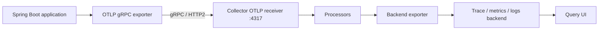
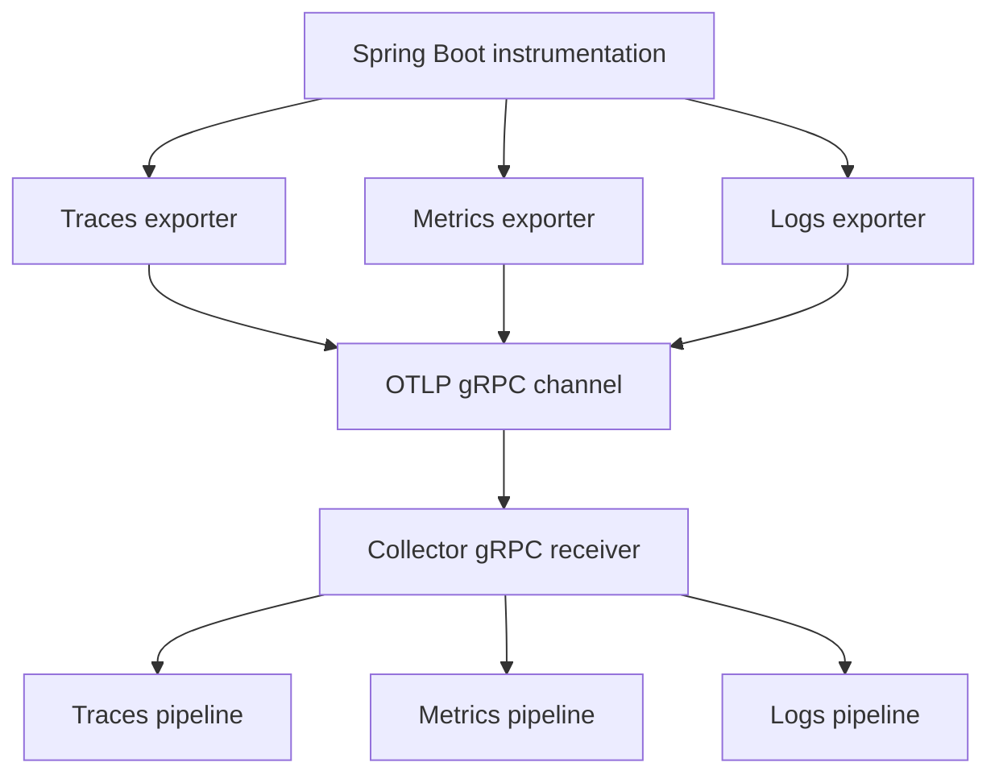

# OTLP gRPC endpoint trong Spring Boot Observability

**OTLP gRPC endpoint** là địa chỉ dịch vụ nhận telemetry qua giao thức gRPC theo OpenTelemetry Protocol (OTLP). Ứng dụng Spring Boot có thể xuất spans, metrics hoặc logs thông qua exporter tương ứng tới OpenTelemetry Collector hay backend có hỗ trợ OTLP/gRPC. Endpoint này thuộc đường vận chuyển dữ liệu; nó không phải giao diện tìm kiếm trace hay dashboard.

Trong module **SPRING_BOOT_OBSERVABILITY**, Micrometer Observation và Micrometer Tracing tạo dữ liệu quan sát ở cấp ứng dụng. Exporter chuyển dữ liệu đó tới nơi nhận. Bài thuộc chương **OTLP export**, tập trung vào cách hiểu và cấu hình endpoint gRPC, sự khác biệt với OTLP/HTTP, cổng và transport, cấu hình Spring Boot/Micrometer tương thích, ví dụ OpenTelemetry Java SDK, Collector, TLS/authentication, Kubernetes networking và cách chẩn đoán khi export thất bại.

## 1. OTLP và endpoint gRPC là gì?

**OpenTelemetry Protocol (OTLP)** là giao thức chuẩn dùng để truyền telemetry từ SDK/exporter tới receiver. OTLP hỗ trợ nhiều signal:

- **Traces:** spans và quan hệ giữa các spans.
- **Metrics:** measurements, aggregation và metadata.
- **Logs:** log records cùng Resource và attributes.

OTLP có thể được truyền qua các transport phổ biến là **gRPC** và **HTTP**. Endpoint OTLP/gRPC là receiver hỗ trợ OTLP gRPC services qua HTTP/2.



Trong sơ đồ, Spring Boot tạo telemetry, exporter gửi dữ liệu, Collector nhận và chuyển tiếp, backend lưu/truy vấn. Backend có thể tự mở OTLP receiver và bỏ qua Collector; kiến trúc cụ thể tùy nền tảng.

**Endpoint ingest không phải query endpoint.** Client exporter gửi telemetry tới receiver; để xem traces hoặc metrics, dùng UI/query API của backend.

## 2. Phân biệt OTLP/gRPC với OTLP/HTTP

Hai transport có cùng mục tiêu truyền OTLP nhưng cách kết nối và chỉ định endpoint khác nhau.

| Tiêu chí | OTLP/gRPC | OTLP/HTTP |
| --- | --- | --- |
| Transport | gRPC trên HTTP/2 | HTTP request/response |
| Cổng mặc định thường gặp | 4317 | 4318 |
| Giao thức | gRPC OTLP services | OTLP/HTTP |
| Traces | gRPC service/method | POST thường tới /v1/traces |
| Metrics | gRPC service/method | POST thường tới /v1/metrics |
| Logs | gRPC service/method | POST thường tới /v1/logs |
| Content type | gRPC framing/protocol | Protobuf hoặc JSON theo cấu hình |
| Proxy/network | Cần HTTP/2 và gRPC passthrough/compatible proxy | Cần HTTP routing phù hợp |
| Debug thủ công | Dùng gRPC-aware tools/SDK | Có thể kiểm tra HTTP status/headers |

Cổng 4317 và 4318 là các cổng OTLP mặc định phổ biến, nhưng có thể thay đổi trong receiver config. Không suy luận một dịch vụ có hỗ trợ gRPC chỉ vì cổng 4317 đang mở; xác nhận receiver thực sự bật protocol đó.

### 2.1. Không gắn /v1/traces vào gRPC endpoint

Ví dụ endpoint gRPC:

```text
otel-collector:4317
```

Ví dụ OTLP/HTTP traces:

```text
http://otel-collector:4318/v1/traces
```

Đây là hai kiểu endpoint khác nhau. OTLP/gRPC chọn service/method theo giao thức gRPC, không dùng path REST /v1/traces của OTLP/HTTP.

Khi SDK yêu cầu endpoint dạng URI, có thể cần scheme như http:// hoặc https:// tùy API và secure channel. Khi SDK yêu cầu hostname/port hoặc target gRPC, truyền đúng dạng mà constructor quy định. Đọc API exporter/version đang dùng, không sao chép chuỗi endpoint HTTP vào cấu hình gRPC.

### 2.2. Protobuf không làm hai transport trở thành một

OTLP thường serialize telemetry bằng Protocol Buffers. Tuy nhiên, **gRPC transport và OTLP/HTTP protobuf transport vẫn là hai cách đóng gói và trao đổi khác nhau**. Không thể lấy protobuf body của OTLP/HTTP rồi gửi thẳng vào gRPC endpoint bằng HTTP POST thông thường.

## 3. Hình dạng endpoint và các thành phần kết nối

Một endpoint gRPC thường phải xác định:

- Hostname hoặc DNS name của receiver.
- Port receiver đang lắng nghe.
- Có dùng TLS hay plaintext trong mạng lab.
- Cơ chế xác thực và metadata/headers nếu backend yêu cầu.
- HTTP/2 connectivity qua service mesh, ingress, proxy hoặc load balancer.

Ví dụ trong mạng container nội bộ:

```text
otel-collector:4317
```

Ví dụ khi dùng TLS và DNS:

```text
https://otel-gateway.example.internal:4317
```

Hostname ở đây là minh họa. Cần dùng DNS name mà ứng dụng phân giải được và certificate có SAN phù hợp với hostname.

### 3.1. Host và port phải nhìn từ phía ứng dụng

Nếu Spring Boot chạy trong container, localhost:4317 thường trỏ vào chính container Spring Boot. Nó không tự trỏ tới container Collector kế bên.

- Docker Compose: dùng service name trong cùng network.
- Kubernetes: dùng Service DNS có thể truy cập trong namespace/network policy.
- VM/host: dùng hostname/IP có route và firewall phù hợp.
- Managed backend: dùng endpoint do nhà cung cấp cấp và kiểm tra yêu cầu TLS/auth.

### 3.2. DNS, authority và TLS name

gRPC sử dụng HTTP/2; TLS có thể xác thực server certificate theo hostname. Khi kết nối qua load balancer hoặc proxy, cần bảo đảm authority/server name được giữ đúng và certificate hợp lệ. Không giải quyết lỗi certificate bằng cách tắt xác minh TLS trong production.

## 4. Dùng OpenTelemetry Collector làm gRPC receiver

Collector giúp tập trung nhận và xử lý telemetry từ nhiều services. Pipeline gồm:

1. **Receiver:** nhận OTLP/gRPC.
2. **Processor:** batch, giới hạn bộ nhớ, filter hoặc xử lý metadata/sampling theo cấu hình.
3. **Exporter:** gửi dữ liệu sang backend.

Ví dụ Collector config lab nhận traces qua gRPC và ghi ra debug output:

```yaml
receivers:
  otlp:
    protocols:
      grpc:
        endpoint: 0.0.0.0:4317

processors:
  batch: {}

exporters:
  debug:
    verbosity: basic

service:
  pipelines:
    traces:
      receivers: [otlp]
      processors: [batch]
      exporters: [debug]
```

Đây là ví dụ lab. Debug exporter cho thấy Collector đã nhận và xử lý spans ở mức pipeline, nhưng **không phải trace storage lâu dài và không cung cấp giao diện truy vấn traces**.

Lưu ý:
- Components phải phù hợp với Collector distribution/version.
- Bind 0.0.0.0 khiến receiver lắng nghe trên mọi network interfaces; cần giới hạn network và bảo vệ receiver.
- Nếu muốn nhận metrics/logs, thêm pipelines tương ứng.
- Theo dõi connections, spans/second và batch size.

### 4.1. Export tiếp đến backend qua OTLP/gRPC

Ví dụ exporter OTLP/gRPC cho backend có receiver tại trace-backend:4317:

```yaml
exporters:
  otlp/traces_backend:
    endpoint: trace-backend:4317
    tls:
      insecure: true  # Lab only

service:
  pipelines:
    traces:
      receivers: [otlp]
      processors: [batch]
      exporters: [otlp/traces_backend]
```

Đây là đoạn cấu hình bổ sung cho file Collector có receiver/processor đã định nghĩa. TLS và exporter fields có thể khác theo Collector version/distribution. insecure: true chỉ minh họa plaintext/lab; production cần TLS và xác thực phù hợp.

Không dùng tên exporter/options của một Collector distribution khác rồi giả định binary đang chạy có component đó. Kiểm tra component inventory và startup logs.

## 5. Spring Boot, Micrometer Tracing và hỗ trợ OTLP/gRPC

Đây là phần cần chú ý nhất khi tích hợp. Spring Boot có thể auto-configure Micrometer Tracing và OTLP exporter, nhưng **không phải mọi cấu hình endpoint OTLP trong Spring Boot đều là gRPC**.

Một số phiên bản/tích hợp Spring Boot cấu hình OTLP tracing bằng thuộc tính endpoint dành cho **OTLP/HTTP**. Vì vậy, không đặt cổng 4317 vào một property HTTP endpoint rồi cho rằng exporter đã chuyển sang gRPC. Phải xác định transport của exporter mà dependency thực tế tạo ra.

### 5.1. Dependencies thường gặp

Ví dụ Spring Boot 3.x dùng Micrometer Tracing bridge với OpenTelemetry:

```xml
<dependencies>
    <dependency>
        <groupId>org.springframework.boot</groupId>
        <artifactId>spring-boot-starter-actuator</artifactId>
    </dependency>
    <dependency>
        <groupId>io.micrometer</groupId>
        <artifactId>micrometer-tracing-bridge-otel</artifactId>
    </dependency>
    <dependency>
        <groupId>io.opentelemetry</groupId>
        <artifactId>opentelemetry-exporter-otlp</artifactId>
    </dependency>
</dependencies>
```

Dùng Spring Boot dependency management/BOM để khóa các version tương thích. Artifact opentelemetry-exporter-otlp cung cấp exporter OTLP của OpenTelemetry; việc Spring Boot tự tạo exporter nào, transport nào và cách lấy cấu hình phải được kiểm tra theo version.

### 5.2. Cấu hình endpoint HTTP không phải cấu hình gRPC

Một ví dụ cấu hình OTLP/HTTP trong Spring Boot có dạng:

```yaml
management:
  otlp:
    tracing:
      endpoint: http://otel-collector:4318/v1/traces
```

Cấu hình trên minh họa **OTLP/HTTP traces**. Không đổi URL thành http://otel-collector:4317 rồi gọi đó là gRPC. gRPC cần exporter/transport gRPC phù hợp và receiver hỗ trợ HTTP/2 gRPC.

Nếu phiên bản Spring Boot được dùng có thuộc tính transport/protocol riêng cho OTLP gRPC, dùng đúng property được tài liệu phiên bản đó công bố. Nếu không có auto-configuration gRPC tương ứng, cấu hình exporter SDK hoặc tích hợp riêng phù hợp với kiến trúc ứng dụng.

### 5.3. Phân biệt Micrometer metrics exporter và tracing exporter

| Dependency/Thành phần | Tín hiệu/chức năng chính |
| --- | --- |
| micrometer-tracing-bridge-otel | Bridge giữa Micrometer Tracing và OpenTelemetry |
| opentelemetry-exporter-otlp | OTLP exporter của OpenTelemetry SDK |
| micrometer-registry-otlp | Export Micrometer metrics theo OTLP |
| micrometer-registry-prometheus | Expose Micrometer metrics theo Prometheus exposition |
| OpenTelemetry Collector | Receiver, processors và exporters độc lập với ứng dụng |

Thêm micrometer-registry-otlp không tự bật distributed tracing. Thêm tracing bridge cũng không có nghĩa metrics đã được gửi OTLP. Xác minh riêng từng signal pipeline.

## 6. Ví dụ OpenTelemetry Java SDK với gRPC span exporter

Khi Spring Boot/Micrometer auto-configuration không cung cấp transport gRPC theo yêu cầu, một lựa chọn là cấu hình OpenTelemetry SDK và gRPC exporter trực tiếp. Đây là tích hợp SDK riêng; phải tránh tạo hai tracing SDK/provider song song với Micrometer Tracing mà không có kế hoạch bridge rõ ràng.

Ví dụ Java minh họa tạo gRPC span exporter và TracerProvider:

```java
import io.opentelemetry.api.trace.propagation.W3CTraceContextPropagator;
import io.opentelemetry.context.propagation.ContextPropagators;
import io.opentelemetry.exporter.otlp.trace.OtlpGrpcSpanExporter;
import io.opentelemetry.sdk.OpenTelemetrySdk;
import io.opentelemetry.sdk.resources.Resource;
import io.opentelemetry.sdk.trace.SdkTracerProvider;
import io.opentelemetry.sdk.trace.export.BatchSpanProcessor;

import java.time.Duration;

public final class OtelGrpcConfiguration {

    private OtelGrpcConfiguration() {
    }

    public static OpenTelemetrySdk create(String endpoint) {
        OtlpGrpcSpanExporter exporter =
                OtlpGrpcSpanExporter.builder()
                        .setEndpoint(endpoint)
                        .setTimeout(Duration.ofSeconds(10))
                        .build();

        SdkTracerProvider tracerProvider =
                SdkTracerProvider.builder()
                        .setResource(Resource.getDefault())
                        .addSpanProcessor(
                                BatchSpanProcessor.builder(exporter).build()
                        )
                        .build();

        return OpenTelemetrySdk.builder()
                .setTracerProvider(tracerProvider)
                .setPropagators(
                        ContextPropagators.create(
                                W3CTraceContextPropagator.getInstance()
                        )
                )
                .build();
    }
}
```

Endpoint truyền cho OtlpGrpcSpanExporter phải theo dạng mà version exporter hỗ trợ, ví dụ target gRPC tương thích như http://otel-collector:4317 trong lab hoặc endpoint TLS phù hợp ở production. Xem API documentation của SDK version để biết chính xác cách cấu hình scheme, channel và certificate.

Đoạn code tạo SDK tracing riêng, không tự thay thế ObservationRegistry/Micrometer Tracing do Spring Boot quản lý. Nếu ứng dụng đã có Micrometer bridge, cần chọn kiến trúc tích hợp thống nhất. Không để Boot exporter lẫn SDK thủ công xuất cùng spans gây duplicate ingestion.

### 6.1. Bảo đảm shutdown và flush

Batch exporter gom spans trước khi gửi. Khi ứng dụng shutdown, cần đóng provider để flush và giải phóng tài nguyên:

```java
tracerProvider.close();
```

Trong Spring, gắn lifecycle vào bean/container để close() được gọi khi context shutdown. Provider/exporter nên sống theo lifecycle ứng dụng, không đóng sau mỗi request.

## 7. Cấu hình TLS và authentication

Trong production, OTLP/gRPC nên chạy qua TLS hoặc mTLS theo topology và policy. Backend/Collector có thể yêu cầu authentication metadata, API key hoặc token.

### 7.1. TLS

TLS giúp client xác thực server và mã hóa đường truyền. Khi bật TLS:
- Dùng hostname có certificate hợp lệ.
- Trust store phải chứa CA cần thiết.
- Kiểm tra certificate expiry và rotation.
- Nếu dùng mTLS, client cũng phải có certificate/key hợp lệ.
- Không disable certificate validation để né lỗi cấu hình.

Collector/exporter TLS config phụ thuộc component và version. Không copy cấu hình TLS HTTP vào exporter gRPC mà không kiểm tra schema.

### 7.2. Authentication metadata

gRPC có thể gửi metadata/headers được exporter hỗ trợ. Cơ chế xác thực phụ thuộc exporter/backend. Nguyên tắc:
- Không hardcode tokens trong source code.
- Đọc secrets từ secret manager/environment injection.
- Không log request metadata chứa credential.
- Giới hạn quyền credential theo signal/tenant.
- Có kế hoạch rotation và expiry.
- Phân biệt TLS với authentication: TLS bảo vệ kênh, authentication nhận diện client.

### 7.3. Lab plaintext và production

Trong mạng lab biệt lập, plaintext có thể dùng để kiểm tra connectivity. Không xem tls.insecure=true là cấu hình production. Nếu receiver mở ra ngoài mạng ứng dụng, cần xác thực, network restriction và TLS phù hợp.

## 8. DNS, Kubernetes và service mesh

OTLP/gRPC thường thất bại do network path hoặc HTTP/2 incompatibility chứ không phải instrumentation.

### 8.1. Kubernetes Service DNS

Ví dụ Collector Service:

```yaml
apiVersion: v1
kind: Service
metadata:
  name: otel-collector
  namespace: observability
spec:
  selector:
    app: otel-collector
  ports:
    - name: otlp-grpc
      port: 4317
      targetPort: 4317
      protocol: TCP
```

Từ pod namespace khác, hostname có thể cần dạng otel-collector.observability.svc.cluster.local. DNS name phụ thuộc cluster domain và namespace. Kiểm tra NetworkPolicy, Service selector, EndpointSlices và Pod readiness.

### 8.2. Service mesh và ingress

Không phải mọi HTTP ingress/proxy đều hỗ trợ gRPC forwarding mặc định. Cần bảo đảm:
- HTTP/2 được hỗ trợ trên tuyến client tới receiver.
- Proxy không chuyển gRPC thành HTTP/1.1.
- Idle timeout và max connection age phù hợp.
- TLS termination/passthrough không xung đột với client TLS.
- Health/readiness không gửi kết nối tới pod chưa sẵn sàng.

Nếu chỉ mở TCP port 4317 nhưng mesh routing sai protocol, client có thể timeout hoặc nhận lỗi handshake.

### 8.3. Load balancing

Một Collector Service có thể phân phối kết nối tới nhiều replicas. Tuy nhiên, gRPC long-lived connections có thể giữ kết nối lâu và phân phối không đều giữa Collectors. Theo dõi ingestion theo replica, giới hạn connections và chọn load-balancing strategy phù hợp.

Với tail sampling, cần bảo đảm spans cùng Trace ID được định tuyến tới cùng bộ xử lý tail-sampling state theo thiết kế; load balancing ngẫu nhiên theo connection có thể làm trace phân mảnh giữa Collectors.

## 9. Exporter batching, timeout và retry

Exporter thường không gửi từng span riêng lẻ. BatchSpanProcessor giữ spans trong queue/buffer rồi gửi batch theo lịch hoặc khi đạt ngưỡng.

| Tham số | Tác động |
| --- | --- |
| Schedule delay | Thời gian chờ trước khi gửi batch theo lịch |
| Max export batch size | Kích thước batch tối đa |
| Max queue size | Số spans có thể chờ trong queue |
| Export timeout | Thời gian exporter chờ một lần gửi |
| Retry/backoff | Cách xử lý lỗi tạm thời nếu exporter hỗ trợ |
| Shutdown flush | Cố gắng gửi dữ liệu còn tồn khi dừng |

Tên property/API và default phụ thuộc OpenTelemetry SDK, exporter và framework. Không giả định cấu hình của Java agent cũng là cấu hình của Micrometer bridge.

### 9.1. Timeout và backpressure

Timeout quá ngắn làm export thất bại khi network chậm. Timeout quá dài giữ thread/resources và làm queue tăng khi receiver không sẵn sàng. Cần theo dõi exporter queue, failed exports, Collector receiver và backend ingest latency.

Không phải exporter nào cũng bảo đảm mọi spans được gửi thành công trong mọi sự cố. Khi receiver gián đoạn lâu hơn retry/queue window, dữ liệu có thể bị drop. Retry không giới hạn có thể tạo backlog, memory pressure hoặc traffic burst sau recovery.

Thiết kế cần xác định mức mất telemetry chấp nhận được, retry budget, queue capacity, Collector persistent queue nếu cần, shutdown timeout và alert khi exporter gửi lỗi.

### 9.2. Graceful shutdown

Trong Kubernetes, pod có thể nhận SIGTERM rồi bị kết thúc sau termination grace period. Cần dành thời gian cho ứng dụng và exporter flush dữ liệu; grace period phải tương thích với thời gian shutdown thực tế.

Không giữ request/worker threads vô thời hạn để flush. Quan sát shutdown logs và kiểm tra số spans được gửi ở lần rollout.

## 10. OTLP/gRPC cho traces, metrics và logs

OTLP/gRPC có thể vận chuyển nhiều signal, nhưng mỗi signal cần exporter/pipeline tương ứng.



Không phải mọi Spring Boot/Micrometer setup đều tự động xuất cả ba signals qua OTLP/gRPC. Kiểm tra từng provider/exporter:

- Micrometer Tracing có span exporter nào?
- Metrics dùng Prometheus registry hay OTLP registry?
- Logs có OpenTelemetry Logs SDK/appender hay chỉ dùng logging backend riêng?
- Collector có receiver/exporters và pipelines cho đúng signal không?

Một ứng dụng có thể push traces qua gRPC nhưng expose metrics theo Prometheus pull và gửi logs qua pipeline khác. Không cần ép mọi signal dùng cùng transport nếu kiến trúc không yêu cầu.

## 11. OTLP/gRPC endpoint và Resource identity

Khi nhiều services gửi telemetry tới cùng Collector, Resource attributes giúp phân biệt nguồn phát.

Ví dụ Resource:

```text
service.name = order-service
service.version = 2.4.1
deployment.environment.name = production
service.namespace = commerce
```

Exporter chuyển Resource cùng telemetry. Collector/backend có thể dùng service.name, version và environment để nhóm dữ liệu. Không đưa request ID, Trace ID hoặc customer ID thành Resource attributes; chúng thay đổi theo request và có thể tạo cardinality cao.

Endpoint gRPC không tự gán service.name. Cấu hình Resource ở SDK/agent/framework phù hợp và xác minh ở backend.

## 12. Bảo mật và giới hạn dữ liệu

OTLP receiver tiếp nhận telemetry từ nhiều ứng dụng. Đây là bề mặt ingest cần bảo vệ.

- Chỉ mở cổng gRPC trên network interfaces cần thiết.
- Dùng TLS/mTLS khi traffic đi qua network không hoàn toàn tin cậy.
- Xác thực client nếu backend/Collector hỗ trợ.
- Dùng NetworkPolicy/firewall để giới hạn nguồn gửi.
- Đặt quotas/rate limits và giới hạn payload theo khả năng nền tảng.
- Bảo vệ Collector UI/health/diagnostic endpoints riêng.

Không xuất password, API keys, bearer token, cookies, dữ liệu thẻ, PII hoặc raw request bodies vào spans/attributes/events. TLS mã hóa đường truyền nhưng không loại bỏ dữ liệu nhạy cảm khỏi storage/backend.

Span attributes nhiều giá trị, events lớn và Resource combinations động làm payload lớn và tăng chi phí indexing. Sampling, filtering và batching phải được thiết kế cùng nhau. Không dùng sampling để che giấu instrumentation tạo dữ liệu không cần thiết.

## 13. Troubleshooting OTLP gRPC endpoint

| Triệu chứng | Nguyên nhân có thể | Cách kiểm tra |
| --- | --- | --- |
| Connection refused | Collector chưa listen hoặc sai host/port | Receiver config, Service endpoints và port |
| Deadline exceeded | DNS/network/timeout hoặc Collector quá tải | Kiểm tra từ pod ứng dụng, receiver latency |
| UNAVAILABLE | Network, proxy, TLS hoặc receiver restart | Channel status, logs và pod health |
| UNAUTHENTICATED | Thiếu/sai credential | Metadata và secret injection |
| PERMISSION_DENIED | Credential không đủ quyền/tenant | Policy phía receiver/backend |
| TLS handshake failure | CA/certificate/SNI/hostname sai | Trust chain, expiry và authority |
| HTTP/2 protocol error | Proxy/ingress không hỗ trợ gRPC | Route protocol và HTTP/2 end-to-end |
| 404/405 khi gọi URL | Dùng HTTP path với gRPC receiver | Transport; gRPC không dùng /v1/traces HTTP POST |
| Collector nhận traces nhưng backend trống | Pipeline/exporter downstream lỗi | Traces pipeline và exporter logs |
| Export queue đầy | Backend chậm hoặc receiver lỗi lâu | Queue size, retry, batch và capacity |
| Chỉ traces tới, metrics không tới | Thiếu metrics exporter/pipeline | MeterRegistry, OTLP metrics exporter |
| Service name sai/unknown | Resource chưa được cấu hình | Resource sau exporter/Collector |
| Traces bị trùng | Nhiều SDK/exporter cùng gửi một spans | Boot auto-config, Java agent và SDK tự tạo |
| Mất spans khi rollout | Flush/shutdown không đủ thời gian | Lifecycle, batch processor và grace period |

### Quy trình kiểm tra theo lớp

1. **Ứng dụng:** exporter gRPC có thật sự được tạo và cấu hình endpoint không?
2. **DNS/network:** hostname có resolve được và TCP port có kết nối từ đúng pod/process không?
3. **Transport:** receiver có mở gRPC/HTTP2 thay vì chỉ OTLP/HTTP không?
4. **Security:** TLS, certificate, authority và auth metadata có đúng không?
5. **Collector:** receiver có nhận spans/metrics/logs và pipeline có xử lý chúng không?
6. **Backend:** exporter downstream có thành công, dữ liệu có ingest/index/query được không?
7. **Lifecycle:** exporter có flush khi shutdown, queue có drop dữ liệu không?

Không coi việc TCP port mở là bằng chứng OTLP/gRPC hoạt động. Cần một request gRPC hợp lệ từ exporter hoặc gRPC-aware diagnostic tool và kiểm tra receiver logs/telemetry.

## 14. Bài thực hành: Spring Boot gửi traces tới Collector qua gRPC

Mục tiêu là kiểm chứng một trace từ Spring Boot được gửi bằng OTLP/gRPC qua Collector và xuất tới trace backend.

### Chuẩn bị

- Spring Boot 3.x application có Actuator và instrumentation cần thiết.
- Micrometer Tracing bridge hoặc OpenTelemetry SDK configuration rõ ràng.
- OTLP gRPC exporter phù hợp version.
- OpenTelemetry Collector có OTLP gRPC receiver.
- Backend/UI hỗ trợ nhận và truy vấn traces.
- Môi trường lab, không dùng secrets/PII thật.

### Bước 1 — Bật Collector receiver

Dùng cấu hình lab có OTLP/gRPC listener tại 0.0.0.0:4317 và debug exporter như phần 4. Khởi động Collector, xác nhận receiver bind cổng thành công trong logs.

### Bước 2 — Xác định exporter của ứng dụng

Kiểm tra ứng dụng đang dùng Spring Boot OTLP auto-configuration, Micrometer Tracing bridge với exporter tương ứng hay OpenTelemetry SDK tự cấu hình. Ghi rõ transport thực sự là gRPC hay HTTP.

### Bước 3 — Cấu hình endpoint gRPC

Với gRPC exporter, dùng địa chỉ receiver theo API của version đó, ví dụ endpoint phù hợp trỏ tới otel-collector:4317. Không thêm path /v1/traces của OTLP/HTTP.

Nếu Boot property đang cấu hình HTTP exporter, giữ nó cho HTTP hoặc chuyển sang cơ chế gRPC được hỗ trợ rõ ràng. Không chỉ đổi port.

### Bước 4 — Tạo traffic

Gửi request HTTP vào Spring Boot endpoint có instrumentation. Đảm bảo server span hoặc business span được tạo và sampler cho phép record/export trong lab.

### Bước 5 — Xác minh Collector nhận

Kiểm tra Collector debug output hoặc metrics receiver. Xác nhận spans có Resource và Trace ID hợp lệ.

### Bước 6 — Nối backend

Thay debug exporter bằng exporter backend tương thích OTLP/gRPC. Bảo đảm TLS/auth theo yêu cầu backend. Mở UI và tìm trace theo service/time range.

### Bước 7 — Kiểm tra lỗi transport

Thử sai hostname, port hoặc tắt receiver trong lab. Ghi nhận lỗi exporter. Khôi phục cấu hình và xác minh export hoạt động trở lại.

### Bước 8 — Kiểm tra HTTP/2/proxy

Nếu có service mesh/ingress, kiểm tra tuyến gRPC end-to-end. So sánh kết nối trực tiếp trong cluster với kết nối qua proxy để cô lập lỗi.

### Bước 9 — Kiểm tra shutdown

Dừng hoặc rollout ứng dụng graceful. Quan sát exporter flush, Collector nhận batch cuối và backend lưu trace. Không giả định queued spans luôn được gửi khi process bị kill cưỡng bức.

### Bước 10 — Đối chiếu signal pipelines

Nếu service còn xuất metrics/logs, kiểm tra từng signal riêng. Xác nhận traces gRPC không có nghĩa metrics và logs cũng đang đi qua cùng endpoint.

### Checklist nghiệm thu

| Điều cần chứng minh | Kết quả mong đợi |
| --- | --- |
| Transport | Phân biệt OTLP/gRPC và OTLP/HTTP |
| Endpoint | Host/port phù hợp receiver gRPC |
| Collector | OTLP receiver bind và nhận spans |
| Exporter | Ứng dụng thực sự dùng gRPC exporter |
| Spring Boot | Không nhầm HTTP endpoint property với gRPC |
| Protocol | HTTP/2/gRPC đi qua network/proxy |
| TLS/auth | Certificate và credential đúng |
| Backend | Trace được ingest và tìm thấy |
| Resource | service.name/version/environment đúng |
| Lifecycle | Queue/flush/shutdown được kiểm chứng |
| Signals | Traces, metrics, logs có pipeline riêng |
| Security | Receiver được giới hạn và metadata an toàn |

## 15. Những nguyên tắc cần ghi nhớ

1. **OTLP/gRPC là transport gRPC chạy trên HTTP/2**, phổ biến dùng cổng 4317; OTLP/HTTP thường dùng 4318.
2. **Không gắn /v1/traces vào gRPC target.** Path này thuộc OTLP/HTTP traces.
3. **Endpoint ingest không phải query UI.** Dùng backend UI/API để tìm trace đã được lưu.
4. **Xác định exporter thực sự được tạo trong Spring Boot.** Property OTLP HTTP không tự chuyển thành gRPC chỉ vì đổi port.
5. **Micrometer metrics, Micrometer Tracing và OpenTelemetry SDK có vai trò khác nhau.** Kiểm tra exporter/pipeline riêng cho từng signal.
6. **Collector có thể nhận, xử lý và chuyển tiếp telemetry**, nhưng debug exporter không phải storage backend.
7. **gRPC cần HTTP/2 và network path tương thích.** Kiểm tra DNS, service mesh, proxy, TLS và authority.
8. **Batching, queue, retry và graceful shutdown ảnh hưởng khả năng giao dữ liệu.** Không giả định mọi spans luôn được gửi khi receiver gián đoạn hoặc process bị kill.
9. **Bảo vệ receiver và metadata.** Dùng TLS/auth, giới hạn network, kiểm soát cardinality và loại bỏ secrets/PII.
10. **Xác minh end-to-end từ app tới backend.** TCP port mở hoặc Collector nhận request chưa chứng minh trace đã được lưu và truy vấn thành công.

OTLP gRPC endpoint cung cấp đường truyền chuẩn để Spring Boot và các service gửi telemetry qua HTTP/2 tới OpenTelemetry Collector hoặc backend tương thích. Khi xác định đúng transport, exporter, receiver, TLS/auth và lifecycle, nhóm vận hành có thể giữ pipeline traces ổn định, phân biệt lỗi kết nối với lỗi instrumentation và kết hợp distributed tracing với metrics/logs để điều tra hệ thống thực tế.
