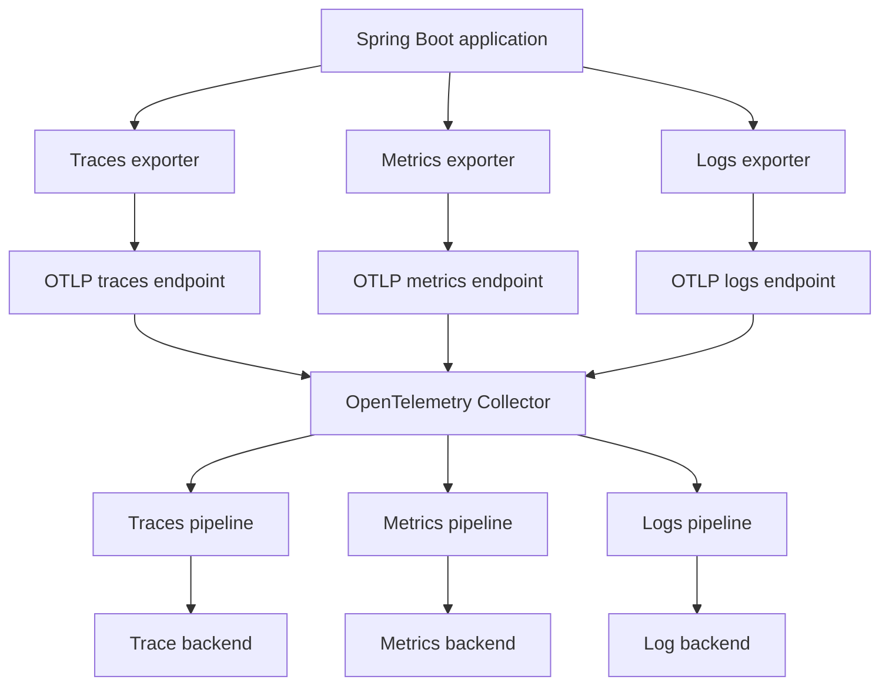

# Signal-specific endpoint trong OTLP export

Một ứng dụng Spring Boot có thể xuất nhiều loại telemetry qua OpenTelemetry Protocol (OTLP): **traces**, **metrics** và **logs**. Cả ba có thể đi tới cùng một OpenTelemetry Collector, nhưng chúng không nhất thiết dùng chung URL path, receiver, pipeline, quyền truy cập hoặc backend. Cấu hình **signal-specific endpoint** cho phép chỉ định đích xuất riêng cho từng loại tín hiệu để định tuyến, bảo mật, mở rộng và xử lý lỗi độc lập.

Bài **Signal-specific endpoint** thuộc chương **OTLP export** của module **SPRING_BOOT_OBSERVABILITY**. Module hướng dẫn thiết lập observability cho Spring Boot bằng Micrometer Observation, metrics, logs và distributed tracing; học context propagation, tags/cardinality, exporter, sampling và liên kết tín hiệu để điều tra lỗi, độ trễ và hành vi ứng dụng trên môi trường thực.

Sau bài này, bạn có thể giải thích endpoint riêng cho từng signal, phân biệt OTLP/HTTP với OTLP/gRPC, cấu hình URL/protocol phù hợp, thiết lập collector receivers và pipelines, hiểu quan hệ giữa Spring Boot/Micrometer với OTel exporters, và kiểm tra từng đường xuất độc lập.

## 1. Signal-specific endpoint là gì?

OTLP định nghĩa cách gửi telemetry qua các giao thức transport. Các tín hiệu phổ biến gồm:

- **Traces:** spans thể hiện đường đi và thời gian của một request/operation.
- **Metrics:** measurements như request count, duration, CPU hoặc queue depth.
- **Logs:** bản ghi sự kiện có timestamp, severity, body và attributes.

Một **signal-specific endpoint** là endpoint được cấu hình cho một loại tín hiệu cụ thể. Với OTLP/HTTP, các URL thường kết thúc bằng /v1/traces, /v1/metrics và /v1/logs tương ứng. Với OTLP/gRPC, các signal đi qua RPC services khác nhau trên cùng một gRPC endpoint; cấu hình client thường dùng host/port, không nối path HTTP vào URL gRPC.

Signal-specific **không bắt buộc** có ba máy chủ hoặc ba hostname. Ba endpoint có thể cùng host và port nhưng khác path; cũng có thể được chia thành các collector/tenant riêng. Chọn cách nào tùy kiến trúc, quy mô, ranh giới bảo mật và chính sách vận hành.

## 2. Phân biệt endpoint, protocol và pipeline

| Khái niệm | Câu hỏi được trả lời | Ví dụ |
| --- | --- | --- |
| **Protocol** | Client nói chuyện bằng transport nào? | OTLP/HTTP, OTLP/gRPC |
| **Endpoint** | Dữ liệu được gửi tới địa chỉ nào? | Collector host, port và signal path |
| **Pipeline** | Collector xử lý và chuyển tiếp signal ra sao? | traces receiver → batch → trace backend |

Endpoint đúng nhưng protocol sai vẫn thất bại. Client gửi HTTP tới cổng gRPC không thể hoạt động chỉ vì hostname giống nhau. Tương tự, collector có receiver nhận traces không có nghĩa logs và metrics cũng tự có pipeline tương ứng.



Sơ đồ là kiến trúc logical: client và collector có thể gom nhiều signal vào một host/port listener, rồi phân loại theo request path hoặc OTLP service. Mỗi pipeline vẫn cần được khai báo rõ.

## 3. OTLP/HTTP: endpoint theo signal

Với OTLP/HTTP protobuf, các path mặc định thường là:

| Signal | HTTP path |
| --- | --- |
| Traces | /v1/traces |
| Metrics | /v1/metrics |
| Logs | /v1/logs |

Ví dụ ba endpoint:

```text
Traces: http://otel-collector:4318/v1/traces
Metrics: http://otel-collector:4318/v1/metrics
Logs:   http://otel-collector:4318/v1/logs
```

Host và port minh họa OTLP/HTTP receiver thông dụng. Collector có thể được cấu hình path/port khác; hãy lấy receiver config thực tế làm nguồn sự thật.

### Base endpoint và full signal endpoint

Một số exporter/configuration cho phép cấu hình **base endpoint**, rồi tự nối path signal. Ví dụ base URL gồm host và port; exporter traces mở rộng thành /v1/traces.

Một số cấu hình khác lại yêu cầu **full URL** đã gồm path signal. Nếu đưa full traces URL vào property được hiểu là base URL, exporter có thể nối path lần nữa và gửi sai tới /v1/traces/v1/traces.

Đọc đúng contract của exporter/property:

- Nếu property endpoint là full endpoint, nhập path tương ứng.
- Nếu property là base URL, nhập host/port và để exporter tạo path.
- Không giả định mọi thư viện OTLP HTTP có cùng semantics.
- Kiểm tra URL request thực tế bằng test receiver hoặc debug logs không chứa secrets.

## 4. OTLP/gRPC: cùng endpoint nhưng signal khác nhau

OTLP/gRPC sử dụng RPC services theo signal. Client cấu hình endpoint gRPC tới collector, thường là cổng 4317 trong setup phổ biến:

```text
OTLP/gRPC endpoint: http://otel-collector:4317
```

Không nối /v1/traces vào endpoint gRPC. Traces, metrics và logs được gửi thông qua các RPC service tương ứng của OTLP. Một gRPC exporter thường có cấu hình riêng ở code/property; protocol phải khớp listener gRPC của receiver.

| Đặc điểm | OTLP/HTTP | OTLP/gRPC |
| --- | --- | --- |
| Transport | HTTP request/response | gRPC over HTTP/2 |
| Cổng thường gặp | 4318 | 4317 |
| Signal routing | HTTP path /v1/{signal} | RPC service theo signal |
| Dễ kiểm tra cơ bản | Dùng HTTP client/test receiver | Dùng gRPC-aware client/server |
| Cấu hình endpoint | Có thể là base/full URL tùy exporter | Thường là gRPC authority/endpoint |

Các cổng là convention phổ biến, không phải điều kiện bắt buộc. Có thể cấu hình receiver lắng nghe cổng khác; client phải trỏ đúng địa chỉ.

## 5. Cấu hình endpoint riêng trong OpenTelemetry SDK

Khi tự quản lý OTel SDK, exporter cho từng signal có thể được cấu hình tách nhau. Ví dụ dưới đây minh họa traces OTLP/HTTP:

```java
OtlpHttpSpanExporter spanExporter =
    OtlpHttpSpanExporter.builder()
        .setEndpoint("http://otel-collector:4318/v1/traces")
        .build();

SdkTracerProvider tracerProvider =
    SdkTracerProvider.builder()
        .addSpanProcessor(
            BatchSpanProcessor.builder(spanExporter).build()
        )
        .build();
```

Tên class/package và dependencies phải theo OpenTelemetry Java SDK version đang dùng. Traces exporter này chỉ cấu hình **traces**. Nó không tự cấu hình metrics reader/exporter hay logs exporter.

Với metrics, OTel SDK dùng metric reader/exporter tương ứng; với logs, SDK dùng logger provider và log record exporter tương ứng. Mỗi signal có lifecycle và pipeline riêng. Không giả định một SdkTracerProvider quản lý cả ba signals.

Nếu dùng exporter API mà setEndpoint yêu cầu full endpoint, hãy cung cấp URL đầy đủ theo signal. Với exporter HTTP mặc định, các signal-specific paths được xác định bởi OTLP specification. Nếu dùng Spring Boot property hoặc thư viện wrapper, kiểm tra documentation của chính property đó, vì có thể nó nhận base endpoint và tự tạo path.

## 6. Cấu hình endpoint theo signal qua environment variables

OpenTelemetry hỗ trợ các biến cấu hình endpoint dành riêng cho từng signal trong cấu hình OTLP phổ biến:

```bash
OTEL_EXPORTER_OTLP_ENDPOINT=http://otel-collector:4318
OTEL_EXPORTER_OTLP_TRACES_ENDPOINT=http://otel-collector:4318/v1/traces
OTEL_EXPORTER_OTLP_METRICS_ENDPOINT=http://metrics-collector:4318/v1/metrics
OTEL_EXPORTER_OTLP_LOGS_ENDPOINT=http://logs-collector:4318/v1/logs
OTEL_EXPORTER_OTLP_PROTOCOL=http/protobuf
```

Các biến trên minh họa cách phân chia cấu hình ở mức OTel SDK/exporter:

- OTEL_EXPORTER_OTLP_ENDPOINT thường là endpoint chung; với OTLP/HTTP exporter, signal path mặc định có thể được nối vào.
- Endpoint theo signal có thể ghi đè endpoint chung cho signal tương ứng.
- Khi signal-specific endpoint là full URL, khai báo đúng path cho signal đó.
- OTEL_EXPORTER_OTLP_PROTOCOL chọn transport theo giá trị được SDK hỗ trợ, ví dụ http/protobuf hoặc grpc.

Hãy kiểm tra support của SDK/agent/bridge đang chạy. Một library có thể chỉ đọc một tập con của các biến chuẩn hoặc cung cấp property riêng. Không trộn endpoint OTLP/HTTP với protocol gRPC.

## 7. Spring Boot và Micrometer: exporter nào đọc cấu hình?

Spring Boot hỗ trợ observability thông qua Actuator, Micrometer Observation và Micrometer Tracing. Tuy nhiên, **không phải mọi Micrometer registry/exporter là OTLP exporter**, và không phải mọi OTel SDK property tự động điều khiển các bean do Spring Boot tạo.

| Trường hợp | Đường cấu hình |
| --- | --- |
| Micrometer metrics OTLP registry | Micrometer OTLP registry/export configuration theo version |
| Micrometer Tracing dùng OTel bridge | Spring Boot/Micrometer tracing config và bridge |
| OpenTelemetry Java SDK tự quản lý | OTel SDK/exporter API hoặc OTel environment variables được hỗ trợ |
| OpenTelemetry Java agent | Agent configuration/environment variables |
| Collector routing | Collector receivers, processors, exporters và pipelines |

Ví dụ cấu hình Spring Boot minh họa khi dùng OTLP metrics exporter được hỗ trợ bởi phiên bản:

```yaml
management:
  otlp:
    metrics:
      export:
        url: http://metrics-collector:4318/v1/metrics
        step: 1m
```

Property names và auto-configuration thay đổi theo Spring Boot/Micrometer version. Một số dòng có thể dùng URL exporter property khác; hãy kiểm tra configuration metadata/tài liệu đúng dependency. Không giả định property metrics trên cũng cấu hình traces và logs.

Với tracing, cấu hình exporter/endpoint là phần riêng. Với logs, cần logging appender/OTel Logs SDK hoặc agent integration phù hợp. Chỉ thêm Micrometer OTLP metrics registry không tự biến logs và spans thành OTLP signals.

## 8. Collector: receiver và pipeline riêng cho từng signal

Một OpenTelemetry Collector config thường khai báo receiver, processors, exporters và service pipelines. Ví dụ tối giản nhận OTLP/HTTP cho cả ba signals:

```yaml
receivers:
  otlp:
    protocols:
      http:
        endpoint: 0.0.0.0:4318

processors:
  batch: {}

exporters:
  debug:
    verbosity: basic

service:
  pipelines:
    traces:
      receivers: [otlp]
      processors: [batch]
      exporters: [debug]
    metrics:
      receivers: [otlp]
      processors: [batch]
      exporters: [debug]
    logs:
      receivers: [otlp]
      processors: [batch]
      exporters: [debug]
```

Ví dụ dùng debug exporter để kiểm tra collector nhận dữ liệu; đây không phải backend lưu trữ production. Collector distribution/version phải có components tương ứng. Một receiver có thể phục vụ nhiều signal, nhưng mỗi pipeline phải khai báo signal receivers/processors/exporters hợp lệ.

### Tách pipeline theo đích

Collector có thể nhận cả ba signals trên một listener rồi route từng signal tới đích khác:

```yaml
service:
  pipelines:
    traces:
      receivers: [otlp]
      processors: [batch]
      exporters: [otlp/traces-backend]
    metrics:
      receivers: [otlp]
      processors: [batch]
      exporters: [otlp/metrics-backend]
    logs:
      receivers: [otlp]
      processors: [batch]
      exporters: [otlp/logs-backend]
```

Đây là phần service pipeline minh họa; các exporter IDs phải được khai báo ở top-level exporters với endpoint/auth thực tế. Không thể chỉ thêm exporter ID vào pipeline nếu chưa khai báo component tương ứng.

Tách pipeline giúp mỗi signal có batch/transform/filter/retention và quyền truy cập khác nhau. Tuy nhiên, collector vẫn cần quản lý tài nguyên chung; một pipeline quá tải có thể ảnh hưởng tiến trình collector, vì vậy cần theo dõi queue, memory, dropped data và scale.

## 9. Định tuyến khác nhau không có nghĩa correlation bị mất

Traces, metrics và logs có thể tới ba backend độc lập mà vẫn liên kết được nếu dữ liệu được chuẩn hóa:

- Traces có traceId/spanId và resource attributes.
- Logs trong lúc span scope hiện hành có thể mang traceId/spanId qua MDC hoặc OTel log context.
- Metrics có resource/service dimensions ổn định, route/status/outcome tags low-cardinality.

Không thêm traceId vào metric labels để tạo liên kết từng request; cardinality sẽ tăng rất nhanh. Có thể dùng trace exemplars hoặc dashboard integration nếu backend và exporter hỗ trợ.

Một dashboard hữu ích cho phép bắt đầu từ metric error rate/latency, khoanh vùng service/time range, mở trace được sample và xem logs liên quan theo trace ID. Sampling có thể làm một request có metrics/logs nhưng không có trace được lưu; đó là hành vi cần hiểu trước khi kết luận pipeline lỗi.

## 10. Authentication, TLS và ranh giới mạng

Endpoint không chỉ là hostname/path. Trong production, cần xác định cách xác thực và mã hóa:

1. **TLS:** dùng HTTPS hoặc gRPC TLS khi telemetry đi qua mạng không tin cậy.
2. **Authentication:** API token, mTLS hoặc workload identity theo chính sách tổ chức.
3. **Authorization:** giới hạn service nào được gửi signal nào tới collector/backend.
4. **Network policy:** chỉ mở listener cho workload được phép.
5. **Tenant routing:** không cho client tự ý chọn tenant backend bằng header không tin cậy.
6. **Secrets:** không commit token/password vào source hoặc compose file.

Có thể tách endpoints để traces đi collector nội bộ, metrics qua gateway có quota, logs qua pipeline đã redaction. Nhưng endpoint riêng không tự tạo ranh giới bảo mật; receiver, gateway và backend phải thực thi authentication/authorization tương ứng.

## 11. Header và metadata theo signal

OTLP exporters có thể hỗ trợ headers hoặc metadata dùng để xác thực/routing. Với HTTP, đây thường là HTTP headers; với gRPC, là metadata. Cách khai báo khác nhau theo exporter và SDK.

Không gửi headers nghiệp vụ không cần thiết như Authorization gốc của request người dùng, cookies hoặc thông tin session sang collector. Telemetry credentials phải riêng với application credentials. Nếu dùng per-signal endpoint, cũng xem xét per-signal auth để logs/traces/metrics có quyền gửi và retention phù hợp.

Một số collector gateway dùng tenant header để route. Hãy gắn tenant do platform/workload identity quyết định, không tin tenant ID tùy ý từ request payload hoặc baggage.

## 12. Kiểm thử signal-specific endpoints

Không nên bắt đầu bằng việc gửi dữ liệu thật lên backend production. Kiểm tra từng tầng:

| Test | Điều cần chứng minh |
| --- | --- |
| Endpoint config test | URL/path/protocol hiệu lực cho từng signal |
| HTTP receiver test | Traces/metrics/logs đến đúng path |
| gRPC receiver test | Exporter dùng RPC tương ứng trên đúng listener |
| Collector pipeline test | Signal vào pipeline và được chuyển tới exporter đúng |
| Auth/TLS test | Request hợp lệ được chấp nhận, request không hợp lệ bị từ chối |
| Signal payload test | Resource attributes và signal data tới nơi cần thiết |
| Failure isolation test | Endpoint lỗi của một signal không bị nhầm với signal khác |
| Shutdown/flush test | Batch cuối được flush trong điều kiện đóng ứng dụng |

### Smoke test HTTP endpoint

Đối với OTLP, payload phải là protobuf theo contract; không gửi JSON tùy ý tới endpoint traces rồi coi HTTP 200/400 như một phép đo sampling. Tốt hơn dùng exporter thật với test collector/receiver, hoặc một OTel SDK in-memory/test exporter để kiểm tra spans trước khi kiểm tra network.

Một test integration có thể khởi động collector test container hoặc fake receiver có khả năng giải mã OTLP, gửi một trace, metric và log riêng, rồi assert từng receiver/pipeline nhận đúng signal. Không chỉ kiểm tra HTTP status; cần xác nhận payload đúng pipeline.

## 13. Lỗi thường gặp và cách xử lý

| Hiện tượng | Nguyên nhân có thể | Hướng kiểm tra |
| --- | --- | --- |
| 404 Not Found ở OTLP/HTTP | Full/base endpoint sai hoặc path bị nối hai lần | Kiểm tra URL request thực tế |
| 415 Unsupported Media Type | Content type/protocol không đúng | Xác minh OTLP protobuf và exporter protocol |
| HTTP request timeout | Collector/network/backend chậm hoặc queue quá tải | Kiểm tra latency, batch queue và receiver |
| gRPC UNAVAILABLE | Sai port, TLS/plaintext mismatch hoặc DNS | Kiểm tra listener gRPC và network |
| Traces đến nhưng metrics không đến | Chỉ cấu hình traces exporter/pipeline | Kiểm tra metrics exporter/reader và pipeline |
| Metrics đến nhưng logs trống | Chưa có logs SDK/appender/agent hoặc pipeline logs | Kiểm tra logging integration |
| Cả ba signals đến cùng backend không mong muốn | Chỉ dùng endpoint chung trong khi cần routing riêng | Cấu hình per-signal endpoints/exporters |
| Collector nhận signal nhưng backend không có | Processor/exporter/backend auth hoặc queue lỗi | Theo dõi received/sent/refused/dropped |
| localhost không kết nối trong container | localhost trỏ về container ứng dụng | Dùng service DNS hoặc endpoint mạng thực |
| Một signal gây nghẽn collector | Pipeline share process/resource | Theo dõi memory/queue, tách collector nếu cần |
| Spring Boot property không tác dụng | Property không thuộc version/exporter đang dùng | Kiểm tra configuration metadata và bean |
| Exporter gửi dữ liệu nhưng backend query trống | Tenant/time range/service/resource filter sai | Kiểm tra query và backend ingestion |

## 14. Tình huống thực tế: traces đúng nhưng logs đi nhầm đích

**Bối cảnh giả định:** checkout-service gửi traces tới trace backend nội bộ, metrics tới gateway tập trung và logs tới một nền tảng log đã có quy tắc redaction. Sau triển khai, traces và metrics hoạt động, nhưng logs không xuất hiện tại log backend.

Quy trình:

1. **Kiểm tra nguồn logs:** ứng dụng có tạo OTel LogRecords không, hay chỉ ghi SLF4J/Logback mà chưa có bridge/appender/agent chuyển sang OTLP?
2. **Kiểm tra endpoint:** logs exporter có dùng full logs path hay base endpoint theo contract của SDK?
3. **Kiểm tra protocol:** exporter chọn OTLP/HTTP hay gRPC, collector listener có hỗ trợ đúng protocol không?
4. **Kiểm tra receiver/pipeline:** collector có cấu hình logs receiver và logs pipeline không?
5. **Kiểm tra redaction:** processor có drop hoặc loại fields theo policy? Không tắt redaction chỉ để làm logs xuất hiện.
6. **Kiểm tra backend exporter:** auth, tenant, queue và rejected payload có lỗi không?
7. **Kiểm tra correlation:** nếu logs có traceId nhưng trace UI không liên kết được, đối chiếu resource/service name và trace IDs; không đưa ID vào metrics labels.

Kết luận: trace exporter thành công không chứng minh logs pipeline đã sẵn sàng. Mỗi signal cần nguồn dữ liệu, exporter, endpoint và collector pipeline riêng; correlation được duy trì nhờ các trường context/resource phù hợp.

## 15. Bài tập tự kiểm tra

**Bài 1.** Vì sao OTLP/HTTP thường dùng ba path /v1/traces, /v1/metrics, /v1/logs?

*Gợi ý:* Đây là các signal-specific HTTP routes theo OTLP/HTTP; collector phân biệt payload theo path.

**Bài 2.** Bạn cấu hình full traces URL làm base URL nhưng exporter lại tự nối path. Có thể xảy ra điều gì?

*Gợi ý:* URL bị lặp path, ví dụ /v1/traces/v1/traces; phải đọc contract base/full endpoint.

**Bài 3.** OTLP/gRPC exporter có cần endpoint /v1/traces không?

*Gợi ý:* Không theo cách cấu hình HTTP. gRPC dùng endpoint gRPC và RPC service theo signal.

**Bài 4.** Trace backend có dữ liệu nhưng logs backend trống. Có thể kết luận collector hỏng?

*Gợi ý:* Không. Kiểm tra logs source/appender, logs exporter, endpoint, receiver và logs pipeline độc lập.

**Bài 5.** Một OTLP receiver nhận cả traces, metrics và logs có cần ba service pipelines không?

*Gợi ý:* Có pipeline theo từng signal trong collector config để gắn processors/exporters đúng signal, dù receiver component có thể dùng chung.

**Bài 6.** Vì sao không nên dùng application Authorization header làm OTLP exporter header?

*Gợi ý:* Credential của người dùng không phải telemetry credential; có nguy cơ rò token và cấp quyền sai.

**Bài 7.** Chỉ thêm Micrometer OTLP metrics registry có làm Spring Boot xuất cả logs và spans không?

*Gợi ý:* Không. Metrics registry chỉ xử lý metrics; tracing và logs có pipeline/SDK integration riêng.

**Bài 8.** Collector nhận 100 spans nhưng backend chỉ tìm thấy 80. Nên kiểm tra đâu?

*Gợi ý:* Collector processors, backend exporter, queue/retry, auth, tenant và backend query/retention.

## 16. Ghi nhớ

- **Signal-specific endpoint** cho phép định tuyến riêng traces, metrics và logs; mỗi signal cần exporter/receiver/pipeline phù hợp.
- Với **OTLP/HTTP**, các path thông dụng là /v1/traces, /v1/metrics, /v1/logs; phân biệt base endpoint với full signal endpoint để tránh nối path hai lần.
- Với **OTLP/gRPC**, cấu hình endpoint gRPC; các signal đi qua RPC services tương ứng, không nối HTTP path.
- Spring Boot/Micrometer property phụ thuộc version và exporter. Metrics registry không tự cấu hình tracing hoặc logging exporter.
- Collector có thể dùng một listener OTLP chung nhưng phải khai báo pipeline riêng theo signal; endpoint riêng không tự tạo backend route hay quyền bảo mật.
- Kiểm tra độc lập nguồn dữ liệu, exporter, protocol, endpoint, collector receiver, processor, exporter cuối và backend query.
- Dùng TLS, telemetry credentials, authorization và allowlist; không chuyển application tokens hoặc dữ liệu nhạy cảm vào headers/baggage/logs.
- Giữ liên kết tín hiệu bằng trace context/resource/log correlation; không thêm trace ID vào metric labels để né sampling hoặc nối dashboard.
