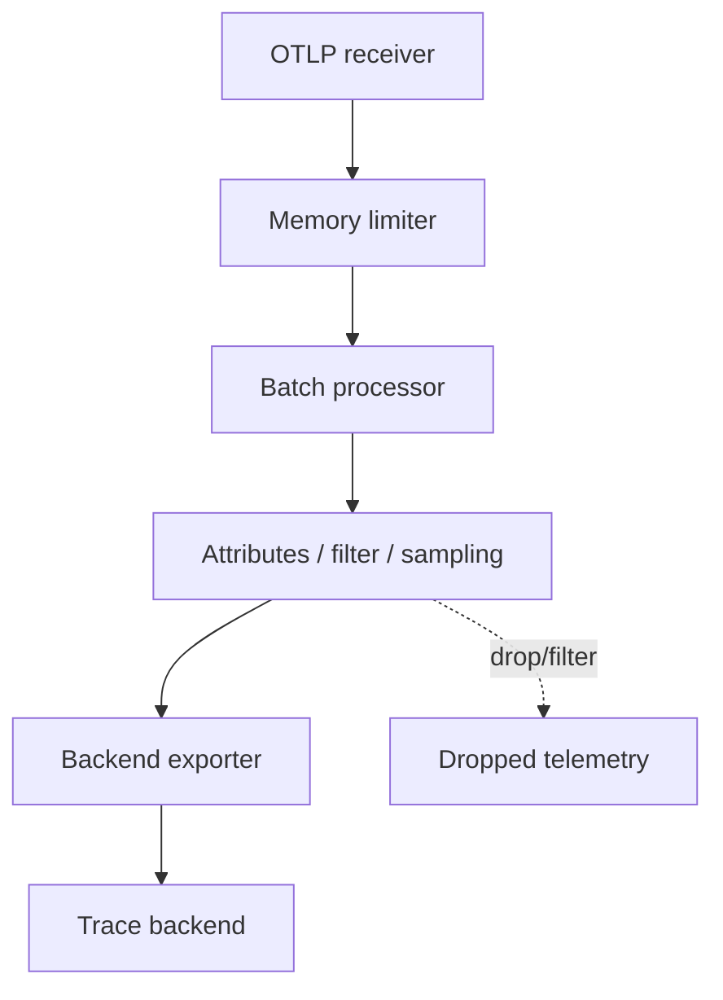

# Kiểm tra exporter connectivity trong Spring Boot

Ứng dụng Spring Boot đã tạo span nhưng trace không xuất hiện trong backend. Log ứng dụng báo timeout khi export, Collector không thấy request đến, hoặc Collector nhận telemetry nhưng backend vẫn trống. Những biểu hiện này đều có thể được gọi chung là “exporter không kết nối”, nhưng nguyên nhân có thể nằm ở địa chỉ OTLP, DNS, TCP, TLS, authentication, protocol, Collector pipeline hoặc backend đích.

**Kiểm tra exporter connectivity** là xác minh toàn bộ đường đi từ telemetry được ứng dụng tạo ra đến nơi nhận cuối cùng, bằng cách kiểm tra từng boundary và bằng chứng tương ứng. Không chỉ kiểm tra host/port có mở hay không: cần biết exporter đã được khởi tạo, sampler có cho phép ghi trace, receiver có nhận đúng protocol, processor có làm rơi dữ liệu và exporter phía Collector có gửi thành công hay không.

Bài **Kiểm tra exporter connectivity** thuộc chương **OTLP export** của module **SPRING_BOOT_OBSERVABILITY**. Module tập trung thiết lập observability cho Spring Boot bằng Micrometer Observation, metrics, logs và distributed tracing; học propagation ngữ cảnh, tag/cardinality, exporter, sampling và liên kết tín hiệu để điều tra lỗi, độ trễ và hành vi ứng dụng trên môi trường thực.

## 1. Mục tiêu học tập

Sau bài học, bạn có thể:

- Mô tả đường đi của span từ Spring Boot/Micrometer Tracing qua OTLP exporter đến Collector và backend.
- Phân biệt OTLP/HTTP và OTLP/gRPC, endpoint, port và path tương ứng.
- Kiểm tra lần lượt DNS, TCP, TLS, chứng chỉ, authentication và protocol compatibility.
- Xác nhận exporter được cấu hình và thực sự được sử dụng bởi tracing implementation.
- Phân biệt lỗi sampling/recording với lỗi kết nối và lỗi Collector/backend.
- Đọc Collector receiver, processor và exporter telemetry để tìm vị trí drop/error.
- Hiểu retry, batch, queue, timeout, backpressure và tác động khi Collector không sẵn sàng.
- Thực hiện kiểm tra end-to-end an toàn mà không làm lộ credentials hoặc telemetry nhạy cảm.

## 2. Đường đi của dữ liệu OTLP

Trong ứng dụng Spring Boot sử dụng Micrometer Tracing với OpenTelemetry bridge, một Observation có thể tạo span. Span được ghi nhận theo sampling policy, sau đó tracing SDK/bridge chuyển span tới exporter. OTLP exporter gửi dữ liệu tới Collector receiver hoặc backend có hỗ trợ OTLP.

```
flowchart LR
    A["Spring Boot<br/>Observation / Tracer"] --> B["OTel bridge / SDK"]
    B --> C["Sampler + SpanProcessor"]
    C --> D["OTLP exporter"]
    D --> E["DNS / TCP / TLS / Auth"]
    E --> F["Collector OTLP receiver"]
    F --> G["Processors"]
    G --> H["Collector exporter"]
    H --> I["Trace backend"]
```

Mỗi mũi tên là một boundary cần xác minh. Nếu backend không có trace, đừng kết luận ngay exporter ở ứng dụng bị lỗi:

1. Request có được instrument và span có được tạo không?
2. Span có được sampler chọn và processor ghi nhận không?
3. OTLP exporter có được khởi tạo và có gửi batch không?
4. Collector receiver có nhận request không?
5. Processor có filter/drop dữ liệu không?
6. Collector exporter có kết nối và gửi tới backend không?
7. Backend có lưu trace và truy vấn theo đúng service/time range không?

### Connectivity không chỉ là TCP

TCP thành công chỉ chứng minh có thể mở kết nối tới địa chỉ/cổng. Nó không chứng minh receiver nói đúng protocol OTLP, HTTP path hoặc gRPC service path đúng, TLS hostname/trust chain hợp lệ, authentication được chấp nhận, payload là OTLP protobuf tương thích, Collector không drop telemetry, hay backend exporter lưu được trace.

Vì vậy cần kiểm tra theo tầng và thu thập bằng chứng ở cả client lẫn server.

## 3. OTLP/HTTP và OTLP/gRPC

OTLP hỗ trợ truyền dữ liệu qua HTTP/protobuf và gRPC. Hai chế độ có cấu hình endpoint khác nhau:

| Đặc điểm | OTLP/HTTP | OTLP/gRPC |
| --- | --- | --- |
| Transport | HTTP | gRPC trên HTTP/2 |
| Port mặc định thường gặp | 4318 | 4317 |
| Trace path | `/v1/traces` | OTLP TraceService RPC |
| Metrics path | `/v1/metrics` | OTLP MetricsService RPC |
| Logs path | `/v1/logs` | OTLP LogsService RPC |
| Kiểm tra mạng | DNS, TCP, TLS, HTTP response | DNS, TCP, TLS, HTTP/2 và gRPC status |
| Lỗi thường gặp | Sai path, HTTP 404/415/401/403 | Sai port, proxy không hỗ trợ HTTP/2, gRPC UNAVAILABLE/UNAUTHENTICATED |

Các cổng 4317 và 4318 là cổng mặc định phổ biến trong triển khai Collector; chúng không tự mở nếu receiver chưa được cấu hình hoặc container/service chưa publish/listen. Luôn xem cấu hình receiver thực tế và service discovery của môi trường.

### Endpoint OTLP/HTTP

Ví dụ endpoint trace:

```text
http://otel-collector.monitoring:4318/v1/traces
```

Endpoint gồm scheme, hostname, port và path. Một số thư viện nhận base endpoint rồi tự thêm signal path; thư viện khác nhận endpoint đầy đủ. Đối chiếu contract của exporter để tránh path lặp như `/v1/traces/v1/traces`.

### Endpoint OTLP/gRPC

Ví dụ target:

```text
otel-collector.monitoring:4317
```

Với gRPC, cấu hình thường là target host/port và exporter dùng OTLP TraceService RPC; không gắn path HTTP `/v1/traces` vào target gRPC. Cần biết exporter dùng plaintext hay TLS và proxy/service mesh có hỗ trợ HTTP/2/gRPC không.

### Không trộn hai protocol

Nếu ứng dụng gửi gRPC vào listener HTTP/OTLP ở port 4318, hoặc gửi HTTP vào gRPC listener ở 4317, kết nối có thể thất bại hoặc phản hồi không đúng giao thức. Hãy thống nhất protocol giữa exporter và receiver; không chỉ thay port mà bỏ qua TLS, path và proxy behavior.

## 4. Cấu hình exporter trong Spring Boot

Với Spring Boot 3.x sử dụng Actuator, Micrometer Tracing và OpenTelemetry bridge, dependency minh họa bằng Gradle Kotlin DSL:

```kotlin
dependencies {
    implementation("org.springframework.boot:spring-boot-starter-actuator")
    implementation("io.micrometer:micrometer-tracing-bridge-otel")
    runtimeOnly("io.opentelemetry:opentelemetry-exporter-otlp")
}
```

Spring Boot BOM nên quản lý version tương thích. Không tự đặt version riêng cho từng Micrometer/OTel dependency nếu chưa xác minh ma trận compatibility. Không thêm Brave bridge cùng lúc chỉ để “thử thêm exporter” nếu ứng dụng đã chọn OTel bridge.

### Ví dụ cấu hình OTLP/HTTP

Trong những phiên bản Spring Boot hỗ trợ management OTLP tracing properties, cấu hình có thể có dạng:

```yaml
spring:
  application:
    name: order-service
management:
  tracing:
    sampling:
      probability: 0.1
  otlp:
    tracing:
      endpoint: http://otel-collector.monitoring:4318/v1/traces
```

**Property group và auto-configuration phụ thuộc phiên bản Spring Boot.** Kiểm tra configuration metadata và tài liệu đúng version; không giả định mọi dòng Boot bind cùng property. Nếu dự án tự cấu hình SDK/exporter hoặc dùng agent, xác định exporter thực tế được tạo ở đâu và tránh đăng ký hai provider/exporter cạnh nhau.

### Exporter và sampling có vai trò khác nhau

- Sampling probability quyết định trace nào được chọn.
- Span processor quyết định cách xử lý span khi start/end.
- Exporter gửi spans đã được processor chuyển tới nó.
- Collector nhận payload và tiếp tục pipeline.

Probability bằng 0 có thể làm không có root trace mới được export dù kết nối khỏe. Ngược lại, sampling 100% không sửa được endpoint sai hoặc TLS handshake thất bại.

### Application name và resource

Tên service nên ổn định, ví dụ `order-service`, và được phản ánh vào resource attribute `service.name` theo cách cấu hình của stack. Khi kiểm tra backend, tìm đúng service name, environment và khoảng thời gian; không nhầm service name/resource với OTLP endpoint.

## 5. Kiểm tra endpoint, DNS và TCP

Bắt đầu từ chính môi trường chạy ứng dụng, chẳng hạn container/pod/VM của Spring Boot. Kiểm tra từ laptop quản trị không chứng minh workload có cùng DNS, route, network policy hoặc service mesh.

### Bước 1: xác nhận endpoint hiệu lực

Ghi lại các thông tin sau từ cấu hình deployment:

- Protocol: HTTP hay gRPC.
- Scheme: HTTP hay HTTPS/TLS.
- Hostname/service DNS.
- Port.
- HTTP path nếu dùng OTLP/HTTP.
- Authentication headers hoặc identity.
- Timeout và cấu hình TLS.

Không in toàn bộ environment/configuration ra log nếu có secret hoặc credentials.

### Bước 2: phân giải DNS

Trong môi trường container hoặc Linux có công cụ phù hợp:

```bash
getent hosts otel-collector.monitoring
```

Nếu không phân giải được, xác nhận tên service/namespace/search domain, DNS policy/resolver của pod, Collector Service/endpoint và hostname trong certificate nếu dùng TLS. Windows có thể dùng `Resolve-DnsName` hoặc `nslookup`. Lệnh phụ thuộc runtime; chạy trong đúng network namespace nếu có thể.

### Bước 3: kiểm tra TCP

Ví dụ PowerShell:

```powershell
Test-NetConnection otel-collector.monitoring -Port 4318
```

Hoặc Linux:

```bash
nc -vz otel-collector.monitoring 4318
```

Nếu TCP thất bại, kiểm tra Collector có listen port không, service/port mapping hoặc Kubernetes targetPort, firewall, NetworkPolicy, security group, egress rules, service mesh và trạng thái ready/restart của Collector.

TCP thành công chỉ là điều kiện ban đầu; tiếp tục kiểm tra protocol và application response.

## 6. Kiểm tra HTTP response với OTLP/HTTP

Nếu dùng OTLP/HTTP, xác minh HTTPS/TLS và HTTP request được receiver chấp nhận. `curl` giúp kiểm tra server/route, nhưng một request GET đơn giản không thay thế lần export OTLP hợp lệ.

### Kiểm tra base connectivity

```bash
curl -v --connect-timeout 3 https://otel-collector.monitoring:4318/
```

Phản hồi 404 ở root path chưa chắc receiver hỏng; receiver có thể chỉ cung cấp signal paths. Lệnh này chủ yếu giúp quan sát DNS, TCP, TLS và HTTP response. Không thêm tùy chọn bỏ xác minh certificate như giải pháp lâu dài.

### Kiểm tra endpoint path

Trace path OTLP/HTTP thường là:

```text
POST /v1/traces
Content-Type: application/x-protobuf
```

GET `/v1/traces` có thể trả 404 hoặc 405 do receiver chờ POST; điều đó không tự chứng minh POST OTLP thất bại. Dùng exporter thật hoặc client OTLP test để gửi payload đúng định dạng.

### Diễn giải HTTP status

| Kết quả | Khả năng cần kiểm tra |
| --- | --- |
| 200/2xx | Receiver chấp nhận request; vẫn kiểm tra processor/exporter/backend |
| 400 | Payload không hợp lệ, encoding hoặc request format sai |
| 401 | Thiếu hoặc sai authentication credentials |
| 403 | Identity được nhận diện nhưng không được phép |
| 404 | Sai path, route hoặc receiver không expose OTLP/HTTP |
| 405 | Method không hỗ trợ; có thể dùng GET thay POST |
| 413 | Payload/batch vượt giới hạn request |
| 415 | Content-Type hoặc encoding không hỗ trợ |
| 429 | Receiver/rate limit/backpressure từ chối tạm thời |
| 5xx | Collector/proxy/server lỗi; xem logs và internal telemetry |
| Timeout | DNS/TCP/TLS, route, queue, server quá tải hoặc request chờ quá lâu |

HTTP 2xx chỉ chứng minh lớp receiver chấp nhận request. Nếu Collector processor drop dữ liệu hoặc downstream exporter lỗi, trace vẫn có thể không xuất hiện ở backend.

## 7. Kiểm tra gRPC và HTTP/2

Với OTLP/gRPC, exporter cần kết nối listener gRPC và sử dụng HTTP/2. Proxy chỉ hỗ trợ HTTP/1.1 có thể cho phép TCP connect nhưng làm gRPC thất bại.

Kiểm tra:

1. Collector có bật OTLP gRPC receiver và listen đúng port không?
2. Exporter target có đúng host/port, không có HTTP path gắn thêm không?
3. TLS mode của client có khớp receiver không?
4. Load balancer/service mesh có hỗ trợ HTTP/2 end-to-end hoặc gRPC tương thích không?
5. Authentication metadata có được forward tới đúng service không?
6. gRPC status có báo UNAVAILABLE, UNAUTHENTICATED, PERMISSION_DENIED, DEADLINE_EXCEEDED hay lỗi khác?

Không dùng một HTTP GET vào port gRPC để kết luận protocol khỏe. Ưu tiên telemetry/logs của exporter và receiver hoặc công cụ gRPC hiểu OTLP service.

## 8. TLS, chứng chỉ và authentication

Kết nối tới Collector qua HTTPS/gRPC TLS cần xác minh cả trust chain và danh tính server:

| Vấn đề | Biểu hiện thường gặp | Hướng xử lý |
| --- | --- | --- |
| CA không được trust | Certificate verify/unknown authority | Cài CA chain hợp lệ vào trust store dùng bởi process |
| Hostname không khớp SAN | Hostname verification failed | Dùng DNS name khớp certificate hoặc cấp certificate đúng |
| Certificate hết hạn | Certificate expired | Gia hạn và phân phối cert mới |
| mTLS thiếu client cert | Handshake rejected | Cấu hình client certificate/key hợp lệ |
| TLS version/cipher không tương thích | Handshake failure | Đối chiếu policy TLS hai đầu |
| Sai scheme | Plaintext tới TLS listener hoặc ngược lại | Đồng bộ HTTP/HTTPS và gRPC TLS/plaintext |
| Authentication thiếu | 401/UNAUTHENTICATED | Cấu hình auth header/token hoặc identity |
| Authorization thiếu quyền | 403/PERMISSION_DENIED | Cấp quyền tối thiểu cho workload identity |

### Không tắt certificate verification để “sửa” kết nối

Tắt hostname/certificate verification có thể làm kết nối chạy trong test nhưng bỏ mất bảo vệ chống giả mạo Collector. Không dùng cấu hình insecure trong production. Sửa CA, hostname/SAN, trust store, cert rotation và mTLS theo kiến trúc bảo mật thực tế.

### Quản lý secret

- Không hardcode bearer token, API key hoặc private key trong source code.
- Dùng Secret Manager/Kubernetes Secret hoặc cơ chế secret delivery đã được tổ chức chấp thuận.
- Không in OTLP headers đầy đủ trong debug logs.
- Rotate token/certificate và xác minh exporter reload/restart theo cơ chế hỗ trợ.
- Cấp quyền export tối thiểu cho workload identity.

## 9. Kiểm tra Collector receiver, processor và exporter

Collector thường có ba nhóm thành phần trong pipeline:

1. **Receiver:** nhận telemetry qua OTLP hoặc protocol khác.
2. **Processor:** batch, memory limiter, attributes, filter, transform hoặc tail sampling.
3. **Exporter:** gửi telemetry tới backend hoặc hệ thống tiếp theo.



Receiver có thể hoạt động nhưng processor filter theo service name/environment làm rơi span. Tail sampling có thể giữ buffer chờ decision; memory limiter có thể từ chối dữ liệu khi vượt ngưỡng. Backend exporter có thể timeout hoặc bị authentication reject.

### Kiểm tra Collector logs

Tìm những nhóm thông tin:

- Receiver start/listening và lỗi bind port.
- Request received, decode/protocol error.
- Queue full, refused spans, memory limiter, dropped data.
- Processor batch/tail sampling warnings.
- Exporter retry, timeout, authentication và backend response.
- Shutdown/restart làm flush queue không hoàn tất.

Không bật debug logs vô hạn trong production nếu chúng có thể chứa payload/metadata hoặc tạo lượng log rất lớn. Dùng thời gian ngắn, scope hẹp và revert sau điều tra.

### Internal telemetry của Collector

Collector có thể expose metrics nội bộ tùy distribution/configuration. Các số liệu và tên meter cụ thể phụ thuộc phiên bản/build; hãy tìm các nhóm:

- Accepted/refused spans ở receiver.
- Sent/failed spans ở exporter.
- Queue size/capacity và enqueue failures.
- Processor dropped data.
- Retry và send latency.
- Process memory/CPU và uptime.

Đối chiếu **receiver accepted** với **exporter sent/failed** để xác định dữ liệu dừng ở đoạn nào. Kiểm tra telemetry thực tế của Collector thay vì dựa vào tên metric cố định giữa các phiên bản.

## 10. Batch, queue, retry, timeout và backpressure

OTLP exporter thường không gửi một HTTP request riêng cho từng span. SDK có thể dùng batch span processor hoặc cơ chế tương đương để gom spans rồi export theo batch. Vì vậy:

- Sau một request, backend có thể chưa thấy trace do batch chưa flush.
- Exporter có thể retry khi lỗi tạm thời.
- Queue có giới hạn; khi Collector chậm hơn tốc độ tạo span, queue có thể đầy.
- Shutdown cần flush/shutdown provider đúng lifecycle để gửi batch còn lại.
- Timeout quá ngắn làm export thất bại; quá dài có thể giữ thread/tài nguyên.

| Tham số/khái niệm | Tác dụng | Rủi ro khi đặt không phù hợp |
| --- | --- | --- |
| Batch size | Số spans tối đa gom trong một lần export | Quá lớn tạo payload lớn; quá nhỏ tăng request overhead |
| Schedule delay | Chu kỳ chờ batch trước khi gửi | Quá dài tăng độ trễ thấy trace |
| Queue size | Dung lượng chờ export | Quá nhỏ dễ drop khi burst; quá lớn tăng memory |
| Export timeout | Thời gian chờ exporter hoàn tất | Quá ngắn gây false failure; quá dài gây backlog |
| Retry/backoff | Cách thử lại sau lỗi tạm thời | Không kiểm soát có thể kéo dài backlog |
| Collector memory limit | Giới hạn tài nguyên receiver/processors | Có thể từ chối dữ liệu khi tải cao |

Giá trị mặc định và property name tùy SDK/exporter/version. Không sao chép tên property từ một phiên bản OTel Java khác vào Spring Boot nếu chưa kiểm chứng. Chỉnh từng tham số dựa trên throughput, p95 export latency, queue occupancy, failed spans và bộ nhớ thực tế.

### Graceful shutdown

Khi Spring Boot dừng, tracing provider/exporter cần được đóng đúng lifecycle để flush batch còn trong queue. Nếu pod bị kill ngay hoặc termination grace period ngắn hơn thời gian shutdown/export, spans cuối có thể không đến backend. Kiểm tra shutdown hooks, provider/exporter lifecycle, timeout, Kubernetes termination grace period và Collector/backend availability.

Không thêm sleep trong business path để đợi export. Dùng lifecycle shutdown và exporter flush APIs phù hợp.

## 11. Tách lỗi sampling khỏi lỗi connectivity

Khi backend không thấy trace, sampling có thể là nguyên nhân trước khi exporter được gọi.

| Quan sát | Diễn giải có thể |
| --- | --- |
| Probability = 0, không có parent sampled | Root trace mới có thể không được sample; chưa có dữ liệu để export |
| Sampling > 0, exporter báo UNAVAILABLE | Có thể lỗi connectivity/receiver |
| Exporter gửi thành công, Collector receiver accepted tăng | Ứng dụng đã kết nối và receiver đã nhận |
| Receiver accepted tăng, exporter failed tăng | Lỗi trong downstream Collector pipeline/exporter |
| Collector exporter sent tăng nhưng backend query trống | Kiểm tra backend ingestion, tenant, auth, service/time filters |
| Log có traceId nhưng backend không có trace | Context có thể còn, recording/sampling/export/backend chưa thành công |

### Parent sampled context

Sampling decision của parent có thể được kế thừa theo sampler semantics. Vì vậy probability bằng 0 không phải lúc nào cũng có nghĩa mọi span downstream chắc chắn không được ghi. Khi test connectivity, dùng request root mới với sampling đã biết và kiểm tra parent context để loại trừ nhầm lẫn.

### Dùng một test request có thể nhận diện

Gửi request thử có route/service name ổn định và correlation marker không nhạy cảm, rồi đối chiếu:

1. Application log cho thấy request đã chạy.
2. Exporter logs/metrics cho thấy batch có được gửi không.
3. Collector receiver accepted/refused counters.
4. Collector processor/exporter sent/failed metrics.
5. Backend tìm trace theo service name và khoảng thời gian chính xác.

Không đưa UUID mỗi request vào metric tags để nhận diện test. Có thể dùng log field hoặc trace attribute có kiểm soát trong môi trường thử nghiệm.

## 12. Quy trình kiểm tra connectivity thực tế

### Bước 1 — Xác nhận sampling và instrumentation

- Xác nhận dependency OTel bridge/exporter đúng.
- Xác nhận HTTP/message/custom operation thực sự được instrument.
- Đặt sampling phù hợp trong môi trường test.
- Tạo request root mới, ghi lại thời điểm.

Nếu không có span được tạo hoặc sampled, connectivity chưa phải điểm lỗi đầu tiên cần điều tra.

### Bước 2 — Xác nhận exporter đang dùng endpoint nào

Kiểm tra cấu hình đã bind sau khi áp dụng profile/environment overrides. Xác nhận protocol, endpoint, path, TLS, auth và signal. Đừng in secret ra terminal/log; chỉ hiển thị host/path đã redact nếu cần.

### Bước 3 — Kiểm tra DNS/TCP/TLS từ workload

Thực hiện lookup DNS và TCP check từ đúng container/pod/VM. Với HTTPS, xác minh certificate chain và hostname. Với gRPC, kiểm tra HTTP/2 và status thông qua client hiểu gRPC.

### Bước 4 — Kiểm tra receiver

Xem Collector có listen đúng endpoint và protocol, có nhận request và có tăng accepted counters không. Nếu không có request đến receiver, điều tra network/client/protocol trước.

### Bước 5 — Kiểm tra processors

Xem filter, attributes processor, tail sampling, memory limiter và batch queue. Xác minh telemetry không bị drop do rule hoặc pressure.

### Bước 6 — Kiểm tra downstream exporter

Nếu receiver nhận nhưng backend trống, xem Collector exporter failed/retry, TLS/auth, tenant/project và backend response.

### Bước 7 — Kiểm tra backend query

Tìm theo resource service name, environment, thời gian và trace ID nếu có. Kiểm tra timezone, retention, ingestion delay, tenant và filter trong UI/query.

## 13. Ví dụ kiểm tra một OTLP/HTTP endpoint

Trong môi trường test, có thể kiểm tra cơ bản DNS/TCP/TLS tới Collector:

```bash
getent hosts otel-collector.monitoring
nc -vz otel-collector.monitoring 4318
curl -v --connect-timeout 3 \
  https://otel-collector.monitoring:4318/
```

Các lệnh trên **không gửi OTLP span hợp lệ**. Chúng chỉ giúp xác minh hostname, TCP và TLS/HTTP response. 404 tại root path không đồng nghĩa `/v1/traces` sai vì receiver có thể không phục vụ root route.

Một phép thử end-to-end đúng phải dùng OTLP exporter/client hoặc gửi payload OTLP protobuf hợp lệ tới đúng `POST /v1/traces`, kèm content type, TLS và auth như môi trường thực. Ưu tiên phát sinh span qua ứng dụng test để kiểm tra cả instrumentation, sampling và exporter integration.

### Không dùng curl với body tùy ý

Một POST JSON tự tạo tới `/v1/traces` không phải payload OTLP hợp lệ chỉ vì URL đúng. Receiver có thể trả 400/415; đây là lỗi payload/protocol, chưa chứng minh TLS/DNS hỏng. Dùng exporter hoặc tool tạo OTLP protobuf đúng schema.

## 14. Security và bảo vệ telemetry

Exporter connectivity cần được xác minh mà không làm lộ thông tin truy cập hoặc dữ liệu telemetry:

- Dùng TLS và hostname verification; sử dụng CA/certificate hợp lệ.
- Dùng workload identity hoặc credential có quyền tối thiểu.
- Không in bearer token, API key, client private key hay toàn bộ request headers.
- Không bật wire-level payload logging vô thời hạn.
- Redact PII/secrets ở instrumentation và Collector processors.
- Giới hạn egress destination để ứng dụng chỉ gửi telemetry tới Collector được phê duyệt.
- Giới hạn Actuator endpoints và Collector receiver bằng network/security policy.
- Theo dõi queue size, retry và dropped data mà không ghi dữ liệu nhạy cảm.

Nếu connectivity chỉ thành công khi bỏ TLS verification hoặc dùng credential admin, policy cần được sửa; không giữ cấu hình đó.

## 15. Troubleshooting

| Triệu chứng | Nguyên nhân thường gặp | Hướng xử lý |
| --- | --- | --- |
| DNS lookup thất bại | Sai service name/namespace, DNS resolver lỗi | Kiểm tra service discovery và DNS từ workload |
| TCP timeout/refused | NetworkPolicy, firewall, port/listener sai | Kiểm tra route, egress, targetPort và Collector listener |
| HTTP 404 | Sai OTLP path hoặc route không được expose | Kiểm tra đúng `/v1/traces` và receiver config |
| HTTP 405 | Dùng GET thay POST | Kiểm tra bằng exporter/client gửi OTLP đúng method |
| HTTP 415 | Content-Type/encoding sai | Dùng OTLP protobuf exporter phù hợp |
| HTTP 401/403 | Authentication/authorization sai | Kiểm tra workload identity, token scope và policy |
| HTTP 413 | Batch vượt giới hạn request | Giảm batch hoặc tăng giới hạn theo năng lực receiver |
| HTTP 429 | Rate limit/backpressure | Kiểm tra throughput, queue và quota |
| HTTP 5xx | Collector/proxy/backend lỗi | Đọc server logs, receiver và exporter telemetry |
| TLS unknown authority | CA chain không được trust | Cấu hình CA hợp lệ vào runtime trust store |
| TLS hostname mismatch | Certificate SAN không khớp hostname | Sửa endpoint hoặc cấp cert đúng hostname |
| gRPC UNAVAILABLE | Sai port, route, HTTP/2 hoặc server down | Xác minh gRPC receiver và proxy end-to-end |
| Exporter queue full | Collector chậm hoặc endpoint unreachable kéo dài | Kiểm tra queue, batch, retry và năng lực receiver |
| Receiver accepted nhưng backend trống | Processor drop hoặc backend exporter lỗi | Kiểm tra Collector processors/exporters |
| Exporter sent tăng nhưng UI không thấy | Sai tenant/service/time range hoặc ingestion delay | Kiểm tra backend query, retention và resource |
| Không có exporter logs | Chưa có span sampled, exporter chưa khởi tạo hoặc log level không phù hợp | Kiểm tra instrumentation, sampling và bean/config |

## 16. Thực hành: tìm điểm đứt trong OTLP pipeline

**Bối cảnh:** `order-service` dùng Spring Boot Actuator, Micrometer Tracing với OTel bridge và OTLP exporter. Collector nhận OTLP/HTTP qua cổng 4318 và xuất tới trace backend. Trace không xuất hiện sau request thử.

### Phần A — Chuẩn bị

1. Xác nhận dependency bridge/exporter tương thích với Spring Boot BOM.
2. Cấu hình sampling probability khác 0 trong test.
3. Xác nhận endpoint OTLP/HTTP, path `/v1/traces`, TLS và authentication.
4. Kiểm tra Collector receiver đang listen đúng port/path.
5. Ghi lại service name và thời điểm bắt đầu test.

### Phần B — Mô phỏng lỗi theo từng tầng

| Ca | Thay đổi trong môi trường test | Bằng chứng mong đợi |
| --- | --- | --- |
| A — DNS sai | Dùng hostname không tồn tại | DNS lookup/exporter resolve error |
| B — Port sai | Dùng port không có listener | TCP refused/timeout |
| C — Path sai | Dùng path không phải OTLP traces endpoint | HTTP 404 hoặc route error |
| D — Content-Type sai | Gửi request không theo OTLP protocol | HTTP 400/415 |
| E — TLS sai | Dùng CA/hostname không hợp lệ trong môi trường test | TLS handshake/verification error |
| F — Auth thiếu | Bỏ credential hợp lệ | 401/UNAUTHENTICATED hoặc 403/PERMISSION_DENIED |
| G — Processor drop | Thêm filter loại service test | Receiver accepted nhưng exporter output giảm/không có |
| H — Backend lỗi | Collector exporter trỏ tới backend test không sẵn sàng | Receiver vẫn nhận; exporter retries/failures tăng |
| I — Sampling 0 | Đặt probability 0 cho root trace mới | Không có trace được gửi; connectivity chưa được chứng minh là lỗi |

Không chạy các ca làm hỏng TLS/auth hoặc backend trên production. Khôi phục cấu hình sau mỗi lần mô phỏng và xác nhận hệ thống trở lại trạng thái ban đầu.

### Phần C — Ghi kết quả

Với từng ca, ghi điểm đầu tiên phát hiện lỗi, client-side/exporter evidence, receiver/Collector evidence, processor/exporter/backend evidence, ảnh hưởng đến metrics/logs và cách khôi phục.

### Câu hỏi tự đánh giá

1. Vì sao TCP connect thành công không chứng minh OTLP export hoạt động?
2. OTLP/HTTP 4318 khác OTLP/gRPC 4317 ở điểm nào?
3. Vì sao GET `/v1/traces` không phải phép thử OTLP export hợp lệ?
4. HTTP 2xx từ Collector chứng minh điều gì và chưa chứng minh điều gì?
5. Khi receiver accepted tăng nhưng backend trống, nên kiểm tra processor hay ứng dụng trước?
6. Tại sao probability bằng 0 không thể dùng để kiểm tra exporter connectivity?
7. Làm thế nào phân biệt TLS hostname mismatch với lỗi authorization?
8. Queue đầy và retry kéo dài ảnh hưởng thế nào đến spans mới?
9. Vì sao không nên tắt certificate verification để xử lý nhanh lỗi TLS?
10. Bằng chứng nào xác nhận trace đã đi qua toàn bộ pipeline tới backend?

## 17. Ghi nhớ

**Kiểm tra exporter connectivity là kiểm tra end-to-end theo từng boundary.** Trước tiên xác nhận operation được instrument và trace được sampled; tiếp đó xác minh exporter, protocol, endpoint, DNS, TCP, TLS, authentication và Collector receiver. Nếu receiver đã nhận, tiếp tục kiểm tra processors, batch/queue, downstream exporter và backend ingestion.

OTLP/HTTP thường dùng cổng 4318 với signal paths như `/v1/traces`; OTLP/gRPC thường dùng cổng 4317 và cần HTTP/2/gRPC tương thích. TCP thành công hoặc HTTP 2xx mới chỉ chứng minh một phần đường đi. Sampling, recording, exporting và backend storage là các giai đoạn riêng, nên cần đối chiếu telemetry của ứng dụng, Collector và backend trước khi kết luận. Giữ TLS/auth an toàn, quản lý batch/timeout/queue theo tải thực tế và kiểm tra từ đúng môi trường workload để observability Spring Boot hoạt động tin cậy mà không lộ secrets hoặc telemetry nhạy cảm.
