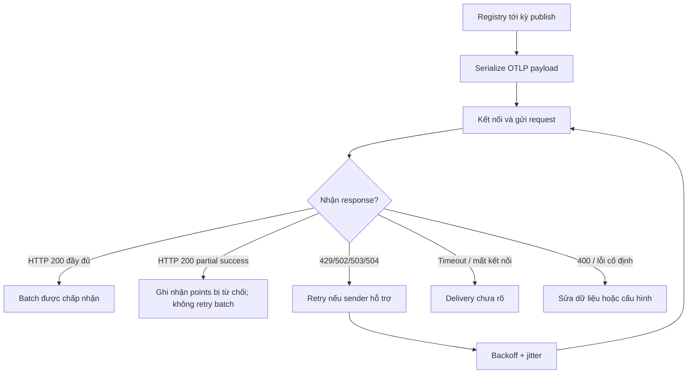

# Exporter retry và timeout trong Spring Boot

Khi Spring Boot xuất metrics qua OTLP, dữ liệu được gửi theo chu kỳ tới Collector hoặc metrics backend. Receiver có thể tạm ngừng, gateway trả 503, DNS không phân giải được, TLS handshake thất bại hoặc xử lý batch quá chậm. Nếu không đặt timeout và chính sách phục hồi phù hợp, exporter có thể chờ quá lâu, làm chậm chu kỳ publish tiếp theo hoặc mất measurements trong lần gửi lỗi.

Bài **“Exporter retry và timeout”** thuộc chương **OTLP export** của module **SPRING_BOOT_OBSERVABILITY**. Module hướng dẫn thiết lập observability cho Spring Boot bằng Micrometer Observation, metrics, logs và distributed tracing; học propagation ngữ cảnh, tag/cardinality, exporter, sampling và liên kết tín hiệu để điều tra lỗi, độ trễ và hành vi ứng dụng trên môi trường thực.

**Timeout và retry là hai cơ chế khác nhau.** Timeout giới hạn thời gian chờ cho một lần gửi. Retry quyết định có gửi lại hay không, gặp lỗi nào, bao nhiêu lần và chờ bao lâu. OTLP specification khuyến nghị retry một số lỗi tạm thời; tuy nhiên, điều đó không chứng minh mọi client library đều triển khai retry. Với Spring Boot dùng Micrometer OtlpMeterRegistry, cấu hình chuẩn có connect/read timeout nhưng Micrometer HTTP sender không có retry tích hợp sẵn theo tài liệu registry.

## 1. Vì sao exporter cần timeout và retry?

Một lần export có thể thất bại ở nhiều giai đoạn:

1. DNS lookup hoặc connection establishment thất bại.
2. TLS handshake không hoàn tất.
3. Request body gửi bị ngắt giữa chừng.
4. Collector nhận request nhưng quá tải và trả 429/503.
5. Gateway trả 502/504 do upstream không sẵn sàng.
6. Receiver xử lý chậm, client vượt read timeout.
7. Receiver chấp nhận một phần data points và từ chối phần còn lại.

Một request thất bại không nhất thiết có nghĩa receiver chưa nhận dữ liệu. Server có thể xử lý xong nhưng kết nối bị đóng trước khi client nhận response. Nếu client gửi lại, dữ liệu có thể trùng; nếu không gửi lại, dữ liệu có thể mất. Đây là bài toán acknowledgement và delivery semantics, không thể giải quyết chỉ bằng tăng timeout.



Exporter ổn định cần timeout hữu hạn, retry có giới hạn, backoff, jitter, batch vừa phải, giám sát lỗi và quy trình khi hết retry.

## 2. Connect timeout và read timeout

Spring Boot cấu hình OTLP metrics qua namespace `management.otlp.metrics.export.*`. Hai timeout thường gặp:

| Property | Ý nghĩa | Ví dụ |
| --- | --- | --- |
| `connect-timeout` | Giới hạn thời gian thiết lập kết nối tới receiver | `1s` |
| `read-timeout` | Giới hạn thời gian chờ response sau khi gửi request | `10s` |

Cấu hình ví dụ:

```yaml
management:
  otlp:
    metrics:
      export:
        url: http://otel-collector:4318/v1/metrics
        connect-timeout: 1s
        read-timeout: 10s
        step: 30s
```

Connect timeout ngắn giúp phát hiện nhanh endpoint/network không thể kết nối. Read timeout cần đủ lớn để Collector xử lý batch trong điều kiện tải bình thường.

Timeout quá ngắn gây lỗi giả khi mạng có jitter hoặc Collector đang bận. Timeout quá dài giữ export worker lâu, làm chậm phát hiện sự cố và có thể chồng lấn các lần publish.

**Timeout không tự bật retry.** Cũng không nên giả định read timeout là deadline end-to-end bao gồm DNS, connect, write, xử lý server và mọi lần retry trong tất cả HTTP sender. Hãy xác định semantics của sender thực tế.

## 3. Deadline tổng và ngân sách một chu kỳ export

Giả sử registry publish mỗi 30 giây, connect timeout 1 giây và read timeout 5 giây. Nếu sender thực hiện ba attempts tuần tự, tổng thời gian có thể vượt đáng kể một chu kỳ.

Một ngân sách đơn giản:

\[
T_{export}=\sum_{i=1}^{N}(T_{connect,i}+T_{response,i})+
\sum_{i=1}^{N-1}T_{backoff,i}
\]

Trong đó N là số attempts tối đa, bao gồm cả lần đầu nếu policy định nghĩa như vậy.

Ví dụ ba attempts, mỗi attempt có thể dùng 1 giây connect và 5 giây response; backoff là 200 ms và 500 ms:

\[
3(1+5)+0.2+0.5=18.7\text{ s}
\]

Đây là trường hợp biên minh họa. Thực tế còn phụ thuộc connection reuse, DNS, TLS, request write, scheduler và giới hạn deadline của implementation. Không chọn retry count nếu chưa tính deadline tổng.

## 4. OTLP quy định lỗi nào nên retry?

Với OTLP/HTTP, specification hiện hành phân biệt retryable và non-retryable response:

| Kết quả | Cách xử lý theo OTLP |
| --- | --- |
| HTTP 429 Too Many Requests | Nên retry |
| HTTP 502 Bad Gateway | Nên retry |
| HTTP 503 Service Unavailable | Nên retry |
| HTTP 504 Gateway Timeout | Nên retry |
| HTTP 400 do payload không hợp lệ | Không retry |
| Các HTTP 4xx/5xx khác ngoài danh sách retryable | Không retry theo bảng response code OTLP |
| Server disconnect không có response | Nên retry với backoff |
| Không thể kết nối | Nên retry với exponential backoff và jitter |
| HTTP 200 có partial_success | Không retry request đó |

Đối với 429/503, response có thể kèm header `Retry-After`. Client nên tôn trọng giá trị này; nó có thể là HTTP date hoặc số giây chờ. Nếu không có header, specification khuyến nghị exponential backoff.

### Partial success là trường hợp đặc biệt

OTLP có thể trả HTTP 200 nhưng response chứa `partial_success`, ví dụ `rejected_data_points` lớn hơn 0. Khi đó một phần payload đã được chấp nhận và phần còn lại bị từ chối. Client **không được retry request partial-success**. Gửi lại cả batch có thể tạo dữ liệu trùng cho phần đã được chấp nhận.

Vì vậy, kiểm tra HTTP status 200 là chưa đủ. Client cần hiểu response body OTLP và ghi nhận rejected points/error message nếu implementation hỗ trợ.

Nguồn: [OpenTelemetry Protocol Specification — OTLP/HTTP response, retryable codes và partial success](https://opentelemetry.io/docs/specs/otlp/).

## 5. Exponential backoff và jitter

Retry ngay sau khi Collector trả 503 có thể làm hệ thống quá tải hơn. Nhiều ứng dụng cùng retry tạo thêm một đợt traffic, gọi là retry storm.

**Exponential backoff** tăng thời gian chờ theo từng attempt:

\[
d_n=\min(d_{max},d_0 \times 2^{n-1})
\]

Trong đó d0 là thời gian chờ ban đầu, n là số thứ tự retry và dmax là giới hạn backoff. Với d0 = 200 ms và dmax = 5 s, thời gian chờ cơ bản lần lượt là 200 ms, 400 ms, 800 ms, 1.6 s, 3.2 s rồi tối đa 5 s.

**Jitter** thêm độ ngẫu nhiên để các client không cùng retry đúng một thời điểm. Full jitter có thể mô tả:

\[
d_{actual}\sim U(0,\min(d_{max},d_0 \times 2^{n-1}))
\]

Nếu receiver gửi `Retry-After`, policy nên tôn trọng thời điểm server yêu cầu thay vì retry sớm hơn. Vẫn cần giới hạn retry count và deadline tổng.

Không dùng backoff vô hạn. Outage dài có thể làm queue tăng, tiêu thụ memory và tăng áp lực lên ứng dụng.

## 6. Những gì một retry policy cần quy định

| Tham số | Ví dụ minh họa | Mục tiêu |
| --- | ---: | --- |
| Max attempts | 3 | Tránh lặp vô hạn |
| Initial backoff | 200 ms | Giảm tải sau lỗi đầu |
| Multiplier | 2 | Tăng khoảng chờ |
| Max backoff | 2 s | Giới hạn độ trễ |
| Jitter | Full jitter | Tránh đồng bộ retries |
| Per-batch deadline | 8 s | Bảo vệ thời gian export |
| Queue limit | Có giới hạn | Ngăn memory tăng không kiểm soát |

Một policy đầy đủ còn phải xác định lỗi được retry, cách xử lý Retry-After, queue/buffer tối đa, hành vi khi queue đầy và metrics/logs để theo dõi attempts, success, failure và exhausted retries.

Các giá trị trên không phải mặc định Spring Boot/Micrometer. Sizing cần căn cứ chu kỳ export, batch size, Collector capacity và SLO.

## 7. Micrometer OtlpMeterRegistry và giới hạn retry tích hợp

Với Spring Boot dùng Micrometer OTLP metrics registry, dependency thường là:

```groovy
dependencies {
    implementation 'org.springframework.boot:spring-boot-starter-actuator'
    runtimeOnly 'io.micrometer:micrometer-registry-otlp'
}
```

Cấu hình cơ bản:

```yaml
management:
  otlp:
    metrics:
      export:
        url: http://otel-collector:4318/v1/metrics
        step: 30s
        connect-timeout: 1s
        read-timeout: 10s
        batch-size: 10000
```

Cần hiểu rõ implementation:

- Spring Boot expose các property timeout và export step.
- Micrometer OtlpMeterRegistry dùng OtlpMetricsSender để gửi batch metrics.
- Sender HTTP mặc định dùng HTTP sender implementation.
- Tài liệu Micrometer nêu rõ HTTP sender không có retry tích hợp sẵn.
- OTLP specification khuyến nghị retry cho OTLP clients; đó không phải bằng chứng registry cụ thể đã cài retry.

Đừng thêm property giả định như `retry.enabled: true` vào `management.otlp.metrics.export`. Nếu phiên bản dự án không công bố property retry, YAML đó không tạo ra retry.

Tham khảo [Micrometer OTLP registry — Customize metrics sender](https://docs.micrometer.io/micrometer/reference/implementations/otlp.html) và [Micrometer HttpSender with Resilience4j Retry](https://docs.micrometer.io/micrometer/reference/1.15/guides/http-sender-resilience4j-retry.html).

## 8. Các cách bổ sung retry

### Cách A — Đặt Collector làm gateway


Ứng dụng gửi tới receiver nội bộ. Collector đảm nhận export tới backend, có thể cấu hình retry, sending queue, persistent storage và timeout theo exporter hỗ trợ.

Ưu điểm là tập trung TLS/auth, routing, retry và telemetry pipeline. Giới hạn là Collector cũng có thể unavailable; queue memory-only có thể mất dữ liệu khi restart; persistent queue cần storage và sizing. Collector nhận dữ liệu cũng chưa đồng nghĩa backend đã lưu dữ liệu.

### Cách B — Tùy biến OtlpMetricsSender/HttpSender

Micrometer định nghĩa abstraction OtlpMetricsSender và hỗ trợ sender tùy biến. Có thể bọc HTTP sender bằng retry decorator, ví dụ dùng Resilience4j.

Adapter nên:

1. Phân loại lỗi transport và HTTP status.
2. Retry 429/502/503/504 và connection failures theo OTLP policy.
3. Đọc Retry-After khi có.
4. Không retry HTTP 400 và không retry partial success.
5. Dùng exponential backoff và jitter.
6. Giới hạn attempts và deadline tổng.
7. Ghi metric retry attempts, permanent failures và exhausted retries.
8. Không giữ lock của registry trong thời gian backoff nếu implementation cho phép.

Không copy decorator cho registry khác rồi giả định hoạt động nguyên trạng với OTLP. OtlpMetricsSender, OtlpHttpMetricsSender và HTTP sender API phải khớp phiên bản Micrometer trong BOM dự án. Kiểm tra API thực tế trước khi triển khai.

### Cách C — Sender riêng hoặc queue bền vững

Một implementation OtlpMetricsSender tùy chỉnh có thể đưa batch vào queue giới hạn, worker gửi bất đồng bộ và retry theo policy. Hướng này cần quyết định khi nào batch được xem là publish, flush lúc shutdown, memory hay persistent queue, duplicate/replay sau restart và drop policy khi queue đầy.

Chỉ xây dựng queue bền vững nếu yêu cầu loss tolerance và chi phí vận hành biện minh. Với nhiều hệ thống, Collector gateway dễ vận hành hơn queue tự viết trong ứng dụng.

## 9. Collector exporter retry và sending queue

Collector exporter có thể cung cấp retry và queue riêng. Ví dụ khung cấu hình minh họa:

```yaml
exporters:
  otlphttp/metrics_backend:
    endpoint: https://metrics.example.com
    timeout: 10s
    retry_on_failure:
      enabled: true
      initial_interval: 1s
      max_interval: 30s
      max_elapsed_time: 5m
    sending_queue:
      enabled: true
      num_consumers: 4
      queue_size: 5000
```

Đây là cấu hình minh họa theo cấu trúc Collector exporter có hỗ trợ retry/queue; fields và khả năng queue phụ thuộc phiên bản Collector và exporter component. Kiểm tra tài liệu component của distribution đang triển khai.

Một sending queue không tự động bền vững qua restart. Nếu bật persistent storage extension, cần cấu hình storage backend và kiểm thử Collector restart khi queue còn dữ liệu, queue đầy, backend trả 429/503 kéo dài, retry hết thời gian, disk full và scale out.

### Retry ở hai tầng có thể khuếch đại tải

Nếu ứng dụng retry ba lần và Collector cũng retry trong nhiều phút, số lần gửi tới downstream có thể tăng mạnh. Quy định rõ retry ownership:

| Tầng | Nhiệm vụ |
| --- | --- |
| Ứng dụng → Collector | Timeout hữu hạn, retry hạn chế nếu sender hỗ trợ |
| Collector → Backend | Retry theo backend, queue và outage window |
| Backend | Rate limit/Retry-After rõ và duplicate handling phù hợp |

Không mặc định retry ở cả hai tầng càng nhiều càng tốt. Tổng thời gian, queue và khả năng chịu tải cần sizing chung.

## 10. Duplicate và delivery semantics

Timeout có thể xảy ra sau khi receiver đã nhận payload nhưng trước khi client đọc được acknowledgement. Client retry sẽ gửi lại batch. OTLP specification thừa nhận duplicate có thể xảy ra trong một số trường hợp network/reconnection.

Hệ quả:

- Không dùng metric export làm hệ thống thanh toán/audit yêu cầu exactly-once.
- Counter có thể bị cộng trùng nếu backend không xử lý duplicate theo semantics nguồn.
- Cumulative points và start timestamps giúp mô tả stream nhưng không phải cam kết exactly-once.
- Delta points cần xử lý replay đúng để tránh double-count.
- Backend/collector có thể có cơ chế deduplication riêng; không giả định mọi hệ thống đều có.

Với retry custom, gửi lại cùng payload batch khi OTLP yêu cầu retry. Không serialize lại dữ liệu mutable thành batch khác sau mỗi lần lỗi nếu điều đó làm thay đổi điểm đo. Khi nhận partial success, không gửi lại toàn bộ batch.

## 11. Queue, backpressure và khi hết retry

Retry chỉ hữu ích khi dữ liệu còn được giữ ở đâu đó. Registry theo step có thể giữ state trong process; nó không mặc nhiên là durable queue.

Nếu backend unavailable kéo dài:

- Queue/buffer tăng tới giới hạn.
- Memory hoặc disk có thể cạn.
- Batch mới có thể bị chậm, gộp hoặc drop tùy implementation.
- Process restart có thể làm mất dữ liệu chưa export.
- Export worker có thể bị backlog sau khi backend phục hồi.

Cần đặt giới hạn queue và xác định policy khi đầy: drop dữ liệu telemetry cũ/mới, block producer hay fail publish. Với metrics, block thread nghiệp vụ thường là lựa chọn rủi ro. Telemetry failure không nên vô tình làm hỏng request nghiệp vụ.

Queue bền vững giúp chịu outage dài hơn nhưng cần capacity planning, disk monitoring, encryption và chính sách replay.

## 12. Cấu hình Spring Boot theo môi trường

Local:

```yaml
# application-local.yml
management:
  otlp:
    metrics:
      export:
        url: http://localhost:4318/v1/metrics
        step: 15s
        connect-timeout: 500ms
        read-timeout: 3s
```

Staging:

```yaml
# application-staging.yml
management:
  otlp:
    metrics:
      export:
        url: http://otel-collector:4318/v1/metrics
        step: 30s
        connect-timeout: 1s
        read-timeout: 10s
```

Production:

```yaml
# application-prod.yml
management:
  otlp:
    metrics:
      export:
        url: https://otel-collector.internal:4318/v1/metrics
        step: 30s
        connect-timeout: 1s
        read-timeout: 10s
```

Các giá trị là ví dụ, không phải khuyến nghị áp dụng trực tiếp. Production cần căn cứ latency p95/p99 của Collector, batch size, ingest SLA và outage budget.

Micrometer registry chuẩn không cung cấp property retry chung chỉ bằng cách thêm YAML. Nếu cần retry tùy biến, triển khai sender/registry theo API của phiên bản hoặc cấu hình Collector exporter. Không nhầm timeout của metrics với tracing OTLP exporter: hai pipeline có thể có property và implementation khác nhau.

## 13. Quan sát exporter

Exporter cũng cần telemetry riêng để phát hiện khi không gửi được dữ liệu. Các chỉ số có ích (tên meter cụ thể tùy implementation):

| Chỉ số | Ý nghĩa |
| --- | --- |
| Export attempts | Số lần gửi batch |
| Export successes | Batch được receiver chấp nhận đầy đủ |
| Export failures | Số lần gửi thất bại |
| Retry attempts | Số lần retry |
| Retry exhausted | Batch hết attempts/deadline |
| Export duration | Thời gian hoàn tất lần gửi |
| Queue depth | Số batch đang chờ |
| Queue dropped | Batch bị drop khi quá tải |
| Rejected data points | Points bị từ chối trong partial success |
| Last successful export | Thời điểm export thành công gần nhất |

Nếu tự tạo metrics cho retry, dùng tag cardinality thấp như `reason=timeout|429|503|connection`, `destination=collector-a` và `outcome=success|exhausted`. Không gắn payload, URL có token hoặc trace ID làm metric labels.

Alert nên kết hợp failure rate, last-success age, queue utilization và business traffic. Một lỗi export đơn lẻ không nhất thiết cần page; exporter mất dữ liệu kéo dài hoặc queue gần đầy cần cảnh báo.

## 14. Chẩn đoán theo lỗi cụ thể

| Triệu chứng | Nguyên nhân có thể | Hành động |
| --- | --- | --- |
| Connection refused | Collector dừng, sai host/port hoặc network policy | Kiểm tra receiver, DNS, port 4318 |
| Connect timeout | Network route, TLS handshake hoặc endpoint quá tải | Kiểm tra connect timeout và network |
| Read timeout | Collector xử lý batch chậm | Giảm batch, kiểm tra collector latency/queue |
| HTTP 429 | Rate limit/throttling | Tôn trọng Retry-After, giảm tốc độ hoặc tăng capacity |
| HTTP 502/503/504 | Gateway/upstream unavailable | Retry có giới hạn và backoff+jitter |
| HTTP 400 | Payload/format không hợp lệ | Không retry; sửa schema hoặc content type |
| HTTP 401/403 | Credential/permission sai | Kiểm tra token, secret và tenant scope |
| HTTP 200 partial success | Receiver từ chối một phần data points | Ghi nhận rejected points; không retry nguyên batch |
| Metrics double-count | Retry sau khi acknowledgement bị mất hoặc replay | Kiểm tra temporality và duplicate handling |
| Queue tăng liên tục | Retry lâu hơn tốc độ drain hoặc backend không phục hồi | Điều chỉnh capacity/input/outage policy |
| Exporter làm chậm ứng dụng | Timeout/decorator blocking trên thread quan trọng | Tách worker, giới hạn concurrency/deadline |

Quy trình điều tra:

1. Xác định lỗi ở ứng dụng → Collector hay Collector → backend.
2. Ghi nhận endpoint, protocol, status code và thời gian lỗi.
3. Kiểm tra retry policy thực sự được triển khai ở tầng đó.
4. Đối chiếu Retry-After, attempt count, backoff và deadline.
5. Kiểm tra queue depth, dropped batches và Collector internal telemetry.
6. Xác minh backend đã nhận batch trước khi client timeout hay chưa.
7. So sánh metrics trong outage với dữ liệu sau phục hồi để tìm thiếu/duplicate.
8. Sau khi sửa, thử lại bằng fault injection ở môi trường test.

## 15. Bài thực hành: thử timeout, retry và phục hồi

Thực hiện trong local/test với dữ liệu giả:

1. Khởi chạy Collector có OTLP/HTTP receiver và exporter debug hoặc backend test.
2. Tạo Counter và Timer trong Spring Boot; đặt step ngắn để quan sát publish.
3. Dừng Collector hoặc dùng port không có listener; quan sát connect timeout.
4. Dùng receiver test phản hồi 429, 502, 503, 504 và 400; xác minh sender retry đúng nhóm lỗi mà policy hỗ trợ.
5. Cho receiver trả 503 kèm Retry-After; đo thời điểm attempt tiếp theo. Sau đó thử không có header để xác nhận backoff/jitter nếu custom sender đã triển khai.
6. Cho receiver trả HTTP 200 partial_success và rejected data points; xác nhận client không retry nguyên batch.
7. Giả lập receiver đã nhận payload nhưng đóng kết nối trước response; quan sát duplicate behavior khi retry.
8. Tạo outage đủ lâu để queue tăng, rồi phục hồi Collector; kiểm tra queue drain, memory, shutdown flush và dropped data.
9. Gửi business requests trong khi Collector lỗi; xác nhận response nghiệp vụ không phụ thuộc đồng bộ vào exporter metrics.

## 16. Câu hỏi tự kiểm tra

1. Connect timeout và read timeout khác nhau ở giai đoạn nào?
2. Vì sao đặt timeout không có nghĩa exporter sẽ retry?
3. OTLP/HTTP quy định status codes nào là retryable?
4. Vì sao HTTP 400 Bad Request không nên retry?
5. Retry-After có thể biểu diễn thời gian theo những dạng nào?
6. Exponential backoff và jitter giảm retry storm thế nào?
7. Vì sao phải đặt deadline tổng ngoài retry count?
8. Micrometer OtlpMeterRegistry có property retry chung trong cấu hình Spring Boot không?
9. OtlpMetricsSender cho phép tùy biến tầng gửi dữ liệu ra sao?
10. Vì sao partial success HTTP 200 không được retry toàn bộ batch?
11. Timeout sau khi server nhận payload có thể tạo duplicate thế nào?
12. Collector sending queue khác retry trong ứng dụng thế nào?
13. Vì sao queue memory-only có thể mất dữ liệu khi Collector restart?
14. Những metrics nào giúp theo dõi exporter health?
15. Làm sao chứng minh telemetry outage không ảnh hưởng request nghiệp vụ?

## Tài liệu tham khảo

- [OpenTelemetry Protocol Specification — OTLP](https://opentelemetry.io/docs/specs/otlp/): retryable HTTP codes, Retry-After, exponential backoff, partial success và duplicate-data caveat.
- [Spring Boot — Metrics](https://docs.spring.io/spring-boot/reference/actuator/metrics.html): OTLP metrics endpoint và Micrometer registry.
- [Spring Boot — Common Application Properties](https://docs.spring.io/spring-boot/appendix/application-properties/): connect-timeout, read-timeout, step và batch properties.
- [Micrometer — OTLP Registry](https://docs.micrometer.io/micrometer/reference/implementations/otlp.html): OtlpMetricsSender, HTTP sender và tùy biến registry.
- [Micrometer — HttpSender with Resilience4j Retry](https://docs.micrometer.io/micrometer/reference/1.15/guides/http-sender-resilience4j-retry.html): ví dụ retry decorator cho HTTP-based meter registry.
- [OpenTelemetry Collector — Resiliency](https://opentelemetry.io/docs/collector/resiliency/): queue, retry, backpressure và bảo vệ pipeline.

## Kết luận

**Exporter retry và timeout cần được thiết kế như hai phần riêng nhưng phối hợp với nhau.** Timeout giới hạn thời gian một lần kết nối/chờ response; retry quyết định có gửi lại hay không, với lỗi nào, bao nhiêu lần và chờ bao lâu. OTLP khuyến nghị retry một số lỗi tạm thời như 429, 502, 503, 504 và connection failures, dùng Retry-After hoặc exponential backoff với jitter; HTTP 400 và partial success không được retry nguyên batch.

Với Spring Boot/Micrometer OTLP metrics, cấu hình connect/read timeout rõ ràng và nhớ HTTP sender của registry không có retry tích hợp sẵn theo tài liệu Micrometer. Nếu cần retry, tùy biến sender có kiểm soát hoặc đặt Collector gateway với retry/queue phù hợp. Giới hạn attempts, deadline và queue; giám sát exporter health; kiểm thử duplicate/loss khi outage; và bảo đảm telemetry failure không làm hỏng request nghiệp vụ.

