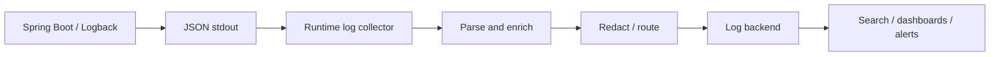

# Structured logging trong Spring Boot

Một dịch vụ checkout ghi log mỗi khi nhận request, gọi cổng thanh toán hoặc gặp lỗi. Khi log chỉ là các dòng văn bản tự do như “payment failed” hay “request took too long”, người vận hành phải tìm theo chuỗi, đoán service phát ra log và tự ghép sự kiện. Cách làm đó khó mở rộng khi nhiều service, nhiều instance và hàng triệu log records cùng hoạt động.

**Structured logging** biến mỗi sự kiện log thành một bản ghi có cấu trúc với các trường được đặt tên và kiểu dữ liệu rõ ràng, chẳng hạn timestamp, severity, service name, event name, trace ID, span ID và các thuộc tính nghiệp vụ được phép ghi. Thay vì chỉ tìm kiếm câu văn, hệ thống log có thể lọc theo trường, tổng hợp số lần xuất hiện và liên kết log record với trace tương ứng.

Trong Spring Boot, ứng dụng thường dùng SLF4J làm logging facade và Logback làm logging implementation mặc định. Structured output có thể được tạo qua JSON encoder/appender hoặc logging integration phù hợp, sau đó chuyển tới collector hoặc log backend. **Chỉ định dạng JSON không tự động làm log có ngữ nghĩa tốt**: schema, field consistency, context propagation, privacy và cách vận hành vẫn cần được thiết kế.

Bài học thuộc chương **Logging** của module **SPRING_BOOT_OBSERVABILITY**. Module hướng dẫn thiết lập observability cho Spring Boot bằng Micrometer Observation, metrics, logs và distributed tracing; học propagation ngữ cảnh, tag/cardinality, exporter, sampling và liên kết tín hiệu để điều tra lỗi, độ trễ và hành vi ứng dụng trên môi trường thực. Bài này tập trung vào structured logging, cách thiết kế event schema và liên kết logs với metrics/traces.

## Mục tiêu học tập

Sau bài này, bạn có thể:

1. Giải thích structured logging và phân biệt log record có cấu trúc với free-text logging.
2. Thiết kế schema gồm timestamp, severity, service identity, event name, trace/span context và attributes.
3. Hiểu vai trò của SLF4J, Logback, JSON encoder/appender và log pipeline trong Spring Boot.
4. Ghi log bằng placeholder và structured key-value mà không tạo chuỗi thủ công thiếu nhất quán.
5. Liên kết log records với traces qua trace ID/span ID và context/MDC.
6. Chọn severity, event name và field names có ý nghĩa vận hành.
7. Kiểm soát cardinality, payload size, privacy, secret redaction và log injection.
8. Thu thập, parse, route và tìm kiếm structured logs trong collector/backend.
9. Kiểm tra logging behavior trong unit/integration tests.
10. Vận hành logging cùng metrics và distributed tracing mà không biến logs thành metric labels hay kho dữ liệu nghiệp vụ.

## 1. Structured logging là gì?

Một log record có cấu trúc biểu diễn một sự kiện bằng các trường có thể máy đọc và truy vấn. Ví dụ log free-text:

```text
2026-11-22 09:10:42 WARN Payment authorization failed for order 84721
```

Dòng này có thông tin, nhưng muốn lọc tất cả sự kiện thanh toán thất bại, hệ thống phải phân tích chuỗi và dựa vào cách viết. Structured log diễn tả cùng sự kiện bằng các trường:

```json
{
  "timestamp": "2026-11-22T02:10:42.384Z",
  "level": "WARN",
  "service": "checkout-service",
  "event": "payment.authorization.failed",
  "message": "Payment authorization failed",
  "order_ref": "ord-84721",
  "payment_provider": "provider-a",
  "trace_id": "0af7651916cd43dd8448eb211c80319c",
  "span_id": "b7ad6b7169203331"
}
```

Đây là JSON minh họa, không phải schema bắt buộc. Trong môi trường thật, order_ref chỉ được log nếu chính sách dữ liệu cho phép; ví dụ không dùng số thẻ, token hoặc dữ liệu cá nhân nhạy cảm.

### 1.1. Free-text và structured log

| Đặc điểm | Free-text logging | Structured logging |
|---|---|---|
| Biểu diễn | Một dòng văn bản | Các field có tên/giá trị |
| Lọc theo event | Tìm kiếm chuỗi, regex | Lọc theo event hoặc field |
| Kiểu dữ liệu | Thường bị coi là text | Có thể giữ number, boolean, timestamp |
| Tính nhất quán | Phụ thuộc cách mỗi developer viết | Có thể áp dụng schema chung |
| Aggregation | Cần parsing thêm | Dễ group/count theo field |
| Tương quan trace | Nhúng ID trong câu | Field trace_id/span_id riêng |
| Thay đổi message | Có thể làm hỏng query chuỗi | Query dựa trên event/field ổn định |

Structured logging không làm message text trở nên vô ích. Field message giúp người đọc hiểu sự kiện, các field khác hỗ trợ máy lọc và phân tích.

### 1.2. Log là sự kiện, không phải bản dump mọi biến

Một structured log hữu ích trả lời: **điều gì đã xảy ra, ở đâu, trong ngữ cảnh nào và có kết quả gì?** Nó không nên chứa tất cả local variables, mọi request headers hoặc toàn bộ object graph. Ghi quá nhiều làm log tốn chi phí, khó đọc, tăng rủi ro bảo mật và có thể lộ dữ liệu ngoài ý muốn.

## 2. Thiết kế schema cho log records

Không có một schema bắt buộc cho mọi ứng dụng, nhưng nên thống nhất bộ trường cốt lõi và quy ước tên. Có thể tham khảo OpenTelemetry Logs Data Model và semantic conventions để tăng khả năng tương tác.

### 2.1. Nhóm trường cốt lõi

| Nhóm | Ví dụ field | Mục đích |
|---|---|---|
| Thời gian | timestamp | Thời điểm sự kiện xảy ra |
| Mức độ | level hoặc severity_text | Mức độ nghiêm trọng |
| Nguồn | service.name, service.version, deployment.environment.name | Service/version/environment |
| Sự kiện | event.name | Tên ổn định của loại sự kiện |
| Nội dung | message hoặc body | Diễn giải cho con người |
| Tracing | trace_id, span_id, trace_flags | Liên kết log với distributed trace |
| Operation | http.request.method, http.route, http.response.status_code | Ngữ cảnh HTTP |
| Kết quả | payment.provider, payment.result | Thuộc tính nghiệp vụ được phép |
| Lỗi | exception type/message/stack fields | Điều tra lỗi có kiểm soát |

Tên field thực tế phụ thuộc encoder, backend và semantic conventions. Ví dụ service.name là resource attribute theo conventions, còn JSON appender có thể cần cấu hình cách render field này. Không đổi tên tùy tiện giữa các service.

### 2.2. Event name phải ổn định

Nên dùng tên sự kiện có cấu trúc và ý nghĩa nhất quán:

```text
checkout.request.received
checkout.payment.authorization.started
checkout.payment.authorization.succeeded
checkout.payment.authorization.failed
inventory.reservation.rejected
```

Tránh đặt event name theo giá trị động:

```text
payment.failed.for.order.84721
payment.failed.for.order.84722
```

Giá trị động nên nằm ở field phù hợp nếu được phép ghi. Event name ổn định giúp query và aggregation không phải biết từng message string cụ thể.

### 2.3. Dùng kiểu dữ liệu phù hợp

Không stringify mọi giá trị:

```json
{
  "retry_count": 2,
  "payment_accepted": false,
  "duration_ms": 184,
  "http_response_status_code": 503
}
```

Nếu encoder xuất tất cả thành chuỗi, truy vấn số học và aggregation khó hơn. Xác nhận log backend nhận đúng kiểu dữ liệu sau parsing.

### 2.4. Phân biệt resource với event attributes

service.name mô tả service phát telemetry; event.name mô tả loại sự kiện; trace_id/span_id gắn record với execution context; payment.provider mô tả operation cụ thể. Không đặt request-specific value vào resource dùng chung cho cả process.

## 3. Spring Boot logging stack: SLF4J và Logback

Spring Boot thường cấu hình SLF4J làm logging facade và Logback làm implementation mặc định khi dùng starter logging. Ứng dụng gọi logger qua SLF4J:

```java
import org.slf4j.Logger;
import org.slf4j.LoggerFactory;

class PaymentService {
    private static final Logger log =
            LoggerFactory.getLogger(PaymentService.class);

    void authorize(String paymentRef) {
        log.info("Payment authorization started");
    }
}
```

SLF4J giúp application code ít phụ thuộc logging implementation. Logback quyết định cách format, filter và ghi log ra console/file/appender. Structured output thường được cấu hình ở Logback encoder/layout hoặc thư viện tích hợp.

### 3.1. Placeholder logging

Dùng placeholder thay vì ghép chuỗi thủ công:

```java
log.info("Payment authorization started for provider={}",
        provider);
```

Cách này giúp logger trì hoãn format khi level không được bật và giảm string concatenation. Tuy nhiên, placeholder đơn thuần vẫn là message text; nó chưa tự biến provider thành một JSON field có schema ổn định.

### 3.2. Structured key-value logging

Các phiên bản SLF4J mới có API key-value logging. Ví dụ:

```java
log.atInfo()
   .addKeyValue("event.name", "payment.authorization.started")
   .addKeyValue("payment.provider", provider)
   .log("Payment authorization started");
```

Cách render key-value phụ thuộc logging provider và encoder/layout. Để chúng xuất thành JSON fields, cần cấu hình Logback encoder/layout hỗ trợ và kiểm tra output. Nếu logging stack không hỗ trợ API này hoặc version cũ, dùng structured arguments tương thích với encoder đang dùng; không tự format JSON bằng nối chuỗi.

### 3.3. Ví dụ service với event success/failure

```java
@Service
class PaymentService {
    private static final Logger log =
            LoggerFactory.getLogger(PaymentService.class);

    private final PaymentGateway gateway;

    PaymentService(PaymentGateway gateway) {
        this.gateway = gateway;
    }

    PaymentResult authorize(String provider, String paymentRef) {
        log.atInfo()
                .addKeyValue("event.name",
                        "payment.authorization.started")
                .addKeyValue("payment.provider", provider)
                .log("Payment authorization started");

        try {
            PaymentResult result = gateway.authorize(paymentRef);

            log.atInfo()
                    .addKeyValue("event.name",
                            "payment.authorization.succeeded")
                    .addKeyValue("payment.provider", provider)
                    .addKeyValue("payment.result", "approved")
                    .log("Payment authorization completed");

            return result;
        } catch (PaymentGatewayException error) {
            log.atWarn()
                    .addKeyValue("event.name",
                            "payment.authorization.failed")
                    .addKeyValue("payment.provider", provider)
                    .addKeyValue("error.type",
                            error.getClass().getSimpleName())
                    .log("Payment authorization failed", error);

            throw error;
        }
    }
}
```

PaymentGateway, PaymentResult và PaymentGatewayException là kiểu nghiệp vụ minh họa. Ví dụ không ghi paymentRef vào log; nếu cần correlation nghiệp vụ, dùng mã tham chiếu đã được phê duyệt và không chứa bí mật. Stack trace chỉ nên ghi một lần ở ranh giới phù hợp để tránh duplicate exception logs.

## 4. Xuất JSON structured logs bằng Logback

Một cách phổ biến là cấu hình JSON encoder cho Logback, ví dụ encoder từ thư viện logstash-logback-encoder. Dependency và cấu hình cần pin theo version tương thích Logback/Spring Boot.

Gradle minh họa:

```groovy
dependencies {
    implementation 'net.logstash.logback:logstash-logback-encoder:<compatible-version>'
}
```

compatible-version là placeholder; chọn version tương thích dependency tree thực tế và quản lý bằng version catalog/BOM nội bộ nếu có.

Ví dụ logback-spring.xml rút gọn:

```xml
<configuration>
    <appender name="JSON_CONSOLE"
              class="ch.qos.logback.core.ConsoleAppender">
        <encoder
          class="net.logstash.logback.encoder.LogstashEncoder">
            <includeContext>false</includeContext>
        </encoder>
    </appender>

    <root level="INFO">
        <appender-ref ref="JSON_CONSOLE"/>
    </root>
</configuration>
```

Đây là ví dụ cơ bản minh họa JSON output. Property encoder cụ thể có thể khác theo version; cấu hình thêm field, MDC inclusion, timestamp format, stack trace, masking và structured arguments cần đối chiếu tài liệu encoder đang dùng.

### 4.1. Structured arguments và field mapping

Encoder có thể hiểu structured arguments hoặc SLF4J key-value pair để phát chúng thành JSON fields. Hãy kiểm tra log thực tế:

- Field name có đúng schema không?
- Value giữ đúng kiểu number/boolean không?
- Timestamp ở UTC và parse được không?
- MDC có field trace/span hay chưa?
- Exception được render ở field riêng hoặc stack trace có giới hạn không?
- Có field trùng do message và encoder cùng thêm không?

Đừng giả định bật encoder là mọi MDC/structured key-value tự hiển thị. Tạo smoke test ghi sự kiện đại diện và parse JSON để xác minh.

### 4.2. Console JSON hay file JSON?

Trong container/Kubernetes, thường nên ghi JSON ra stdout/stderr để runtime log collector thu nhận. File logging có thể cần trong môi trường legacy, nhưng phải xử lý rotation, disk pressure, permissions và log shipping.

Không ghi cùng sự kiện ra console và file rồi forward cả hai nguồn nếu backend không deduplicate; điều đó có thể làm đếm event gấp đôi.

## 5. Correlation với distributed tracing

Structured logs có giá trị hơn khi liên kết được với trace. Khi log được ghi trong span đang active, tracing integration có thể đưa trace_id và span_id vào MDC hoặc log record theo cấu hình.

Ví dụ:

```json
{
  "timestamp": "2026-11-22T02:10:42.384Z",
  "level": "INFO",
  "service.name": "checkout-service",
  "event.name": "payment.authorization.started",
  "trace_id": "0af7651916cd43dd8448eb211c80319c",
  "span_id": "b7ad6b7169203331",
  "message": "Payment authorization started"
}
```

### 5.1. MDC và trace context

MDC (Mapped Diagnostic Context) là cơ chế logging thường gắn key-value theo thread. Tracing integration có thể đưa trace ID/span ID vào MDC để encoder render. Field names mặc định phụ thuộc bridge/logging integration; có stack dùng traceId/spanId, stack khác map thành tên khác.

Không giả định correlation có sẵn chỉ vì ứng dụng dùng Micrometer Tracing hoặc OpenTelemetry. Kiểm tra log output trong request thực tế.

### 5.2. Thread và async boundary

MDC thường gắn với thread; khi task chuyển qua executor hoặc thread mới, context có thể không được truyền. Nếu executor dùng context propagation phù hợp, trace scope và MDC accessor có thể được capture/restore. Chỉ truyền trace ID dưới dạng chuỗi không khôi phục current span hoặc parent-child relationship.

Kiểm thử task A/task B trên cùng worker để bảo đảm context của A không rò sang B. Với async work tồn tại sau request, cân nhắc trace riêng có span link tới producer context thay vì giữ request span mở vô hạn.

### 5.3. Correlation không phải causal proof

Log có cùng trace ID giúp định vị cùng trace context; span ID chỉ ra operation tương ứng. Trace ID không phải business transaction ID và không phải credential. Khi request bị sampling drop, logs vẫn có thể mang trace ID dù backend không có trace tương ứng.

Dùng trace correlation để tìm thêm bằng chứng, không dùng nó thay logic nghiệp vụ hoặc kiểm soát bảo mật.

## 6. Severity và event semantics

| Level | Dùng khi | Ví dụ |
|---|---|---|
| TRACE | Chi tiết rất sâu, thường tắt ngoài debug | Protocol detail đã được làm sạch |
| DEBUG | Thông tin phát triển/điều tra không thường trực | Cache lookup decision |
| INFO | Sự kiện bình thường có giá trị vận hành | Payment authorization completed |
| WARN | Tình huống bất thường nhưng xử lý được hoặc cần chú ý | Provider retry, fallback activated |
| ERROR | Thao tác thất bại cần điều tra | Payment gateway call exhausted retries |

Không log mọi exception ở ERROR nếu caller đã log cùng lỗi ở ranh giới khác. Chọn một nơi sở hữu stack trace để tránh một exception tạo nhiều log records giống nhau.

### 6.1. Event name và severity là hai khái niệm

event.name mô tả loại sự kiện; level biểu thị severity theo chính sách ứng dụng. Không mã hóa severity vào event name như chuỗi động, cũng không dùng mỗi message để suy ra event type.

### 6.2. Tránh log success ở mọi bước vô ích

Nếu mỗi method đều ghi “started”, “entered”, “finished” cho mọi request, log volume tăng nhưng ít thêm giá trị. Chọn event tạo bằng chứng vận hành thực sự: boundary tích hợp, trạng thái nghiệp vụ quan trọng, retry/fallback, lỗi và quyết định cần truy vết.

## 7. Exception logging có cấu trúc

Exception log nên có event name ổn định, error type/class, message an toàn, stack trace khi có ích, trace/span context, service/operation và retry count hoặc dependency đã chuẩn hóa khi cần.

```java
try {
    gateway.authorize(request);
} catch (TimeoutException error) {
    log.atWarn()
            .addKeyValue("event.name", "payment.gateway.timeout")
            .addKeyValue("error.type",
                    error.getClass().getSimpleName())
            .addKeyValue("dependency.name", "payment-gateway")
            .addKeyValue("retryable", true)
            .log("Payment gateway timed out", error);

    throw error;
}
```

Một log stack trace không thay thế span status/error event hoặc metric error counter. Instrumentation có thể ghi exception vào span, metrics đếm kết quả thất bại và structured log giữ chi tiết cho con người. Tránh ba tín hiệu tạo nội dung mâu thuẫn.

### 7.1. Tránh duplicate stack traces

Nếu tầng gateway ghi log stack trace rồi service/controller lại ghi cùng exception, một lỗi có thể tạo nhiều bản ghi. Hãy quyết định boundary chịu trách nhiệm log exception. Các tầng khác có thể throw hoặc map exception mà không ghi stack trace lặp.

## 8. Cardinality và kích thước log

| Field | Cardinality thường gặp | Lưu ý |
|---|---|---|
| service.name | Thấp | Resource/service identity |
| event.name | Thấp nếu ổn định | Tránh giá trị động |
| http.request.method | Thấp | Tập method hữu hạn |
| http.route | Thấp nếu dùng template | Không dùng raw path |
| payment.provider | Thấp nếu allowlist | Danh sách hữu hạn |
| trace_id | Rất cao | Correlation field; cân nhắc index cost |
| order_id | Cao | Chỉ log nếu cần và được phép |
| email | Cao, có PII | Tránh hoặc mask theo policy |

Log backend có thể xử lý high-cardinality fields khác metrics backend, nhưng index tất cả field có thể tăng chi phí và làm query chậm. Chỉ index/searchable những field phục vụ use cases cụ thể.

### 8.1. Giới hạn payload

Không serialize toàn bộ request/response body, entity graph hoặc object lớn vào log. Dùng field allowlist, truncate dữ liệu cần thiết, giới hạn stack trace và loại bỏ binary/payload. Payload lớn làm tăng ingestion cost, queue pressure và rủi ro dữ liệu.

## 9. Bảo mật và privacy trong structured logs

Logs thường được tập trung và nhiều nhóm có thể truy cập; cần coi chúng là dữ liệu có kiểm soát.

Không ghi password, API keys, access/refresh tokens, authorization headers, cookies, số thẻ thanh toán đầy đủ, security code, session credentials, request/response body nhạy cảm hoặc PII không cần thiết.

### 9.1. Allowlist và redaction

Hãy chủ động chọn field có thể ghi. Denylist dễ bỏ sót field mới hoặc nested object chứa secret. Với headers, chỉ log allowlist nhỏ như content type hoặc correlation metadata đã được kiểm soát; không log toàn bộ map headers.

Nếu cần correlation với đối tượng nghiệp vụ, dùng reference đã được thiết kế cho logging, hash/tokenization hoặc mask theo policy. Không tự hash một secret rồi mặc định kết quả an toàn; hash yếu hoặc có thể dò ngược vẫn có rủi ro.

Redaction nên được áp dụng gần nguồn tạo log và có thể bổ sung ở collector. Không dựa duy nhất vào backend filter vì dữ liệu đã đi qua network và có thể tồn tại trong queue/log files trước khi filter.

### 9.2. Log injection

Giá trị người dùng có thể chứa newline, control characters hoặc chuỗi giả mạo log entry. Dùng logging APIs và JSON encoder đúng cách để escape value. Không nối raw input thành một dòng log thủ công. Kiểm thử payload chứa newline, tab và ký tự điều khiển để bảo đảm một input không thể tạo bản ghi giả.

## 10. Thu thập và xuất structured logs



Có thể dùng agent/collector tail file hoặc appender gửi trực tiếp. JSON stdout thường phù hợp container platform vì runtime đã thu log process.

### 10.1. Parse trước khi query

Collector cần nhận biết record là JSON và parse đúng. Nếu JSON nested trong field message, backend có thể chỉ thấy một chuỗi thay vì field riêng. Kiểm tra JSON hợp lệ, timestamp parse được, level mapping đúng, resource metadata giữ nguyên, trace/span fields parse đúng, multiline stack trace được ghép theo quy tắc và parse failures được phát hiện.

### 10.2. Không xuất trùng log

Nếu Logback appender gửi trực tiếp OTLP đồng thời agent/collector đọc stdout và forward lại, cùng record có thể xuất hiện hai lần. Liệt kê tất cả đường log shipping và chọn một đường authoritative cho mỗi source.

### 10.3. Structured logs và OpenTelemetry Logs

OTel Logs Data Model định nghĩa timestamp, observed timestamp, severity, body, attributes, resource và trace context. JSON Logback output là một biểu diễn log structured; không tự động đồng nghĩa đã là OTel LogRecord hoặc được export qua OTLP.

Cần integration/bridge/appender/agent để chuyển log events sang OTel Logs pipeline nếu kiến trúc chọn OTel Logs. Collector receiver/exporter phải có logs pipeline riêng.

## 11. Kiểm thử structured logging

Không chỉ kiểm tra method trả kết quả. Cần test schema và field behavior:

1. Ghi một log event mẫu.
2. Capture output bằng test appender hoặc đọc stdout integration test.
3. Parse JSON thành object.
4. Assert field names, kiểu timestamp, severity và event name.
5. Kiểm tra secret/PII không xuất hiện.
6. Khi có trace context, assert trace/span ID đúng.
7. Test error log có exception type và stack trace theo policy.
8. Kiểm tra input chứa newline được JSON-escape và không tạo record giả.

### 11.1. Ví dụ test ở mức ý tưởng

```java
@Test
void writesStructuredPaymentFailureEvent() {
    // Arrange: gắn ListAppender/TestAppender vào logger test.
    // Act: gọi service với gateway giả ném PaymentGatewayException.
    // Assert:
    // - event.name = payment.authorization.failed
    // - payment.provider có giá trị đã allowlist
    // - error.type là loại exception mong đợi
    // - secret/request body không xuất hiện
    // - exception được ghi đúng một lần tại boundary được chọn
}
```

Đây là pseudocode vì cách gắn appender và đọc structured key-value phụ thuộc Logback/SLF4J/encoder version. Trong test thực, parse JSON emitted by encoder nếu mục tiêu là bảo đảm schema xuất ra; kiểm tra LoggingEvent trực tiếp chỉ xác minh phần event trước encoder.

### 11.2. Trace correlation test

Tạo span context trong test, ghi log khi span active và xác nhận output có trace ID/span ID tương ứng. Sau đó đóng scope, ghi log ngoài context và assert field không mang ID cũ. Thêm test async executor nếu ứng dụng ghi log trong worker thread.

## 12. Liên kết logs, metrics và traces

| Tín hiệu | Dùng để | Ví dụ |
|---|---|---|
| Metrics | Đo quy mô và xu hướng | Payment timeout rate tăng |
| Traces | Hiểu đường đi và latency của request được giữ | Span payment client kéo dài 2 giây |
| Structured logs | Chi tiết sự kiện và lỗi | Provider timeout, retry_count=2 |

Một quy trình điều tra:

1. Dashboard metrics phát hiện payment timeout rate tăng theo provider.
2. Chọn trace đại diện có span payment client dài hoặc lỗi.
3. Từ trace ID/span ID, tìm structured logs trong cùng context.
4. Xem event name, dependency name, retry count và exception type.
5. So sánh với request thành công và metrics dependency.
6. Xác định lỗi provider, network, timeout configuration hay retry behavior.

Không dùng trace ID làm metric label. Dùng exemplar hoặc link/correlation trong log platform khi hỗ trợ. Cũng không giả định mọi log có trace ID sẽ có trace trong backend vì trace có thể bị sampling drop hoặc export thất bại.

## 13. Chẩn đoán lỗi structured logging

| Triệu chứng | Nguyên nhân có thể | Cách kiểm tra |
|---|---|---|
| Log vẫn plain text | Encoder/layout JSON chưa active | Logback config và appender thực tế |
| JSON hợp lệ nhưng fields nằm trong message | Structured arguments không được encoder render | Encoder support/key-value provider |
| Thiếu traceId/spanId | MDC correlation chưa cấu hình hoặc context mất | Tracing integration, scope, executor propagation |
| Worker log mang trace cũ | MDC/context không được restore | Thread pool reuse và TaskDecorator/accessor |
| Timestamp parse sai | Timezone/format hoặc field mapping | UTC, ISO-8601 và parser backend |
| Exception xuất hiện nhiều lần | Nhiều tầng log cùng exception | Chọn boundary sở hữu stack trace |
| Backend có log trùng | Nhiều shipper/appender cùng forward | Logback appender, agent, stdout collector |
| Một request tạo log volume lớn | Ghi mỗi bước quá chi tiết | Giảm event dư thừa, rate limit có kiểm soát |
| Field chứa dữ liệu bí mật | Object/header dump không an toàn | Allowlist, redaction gần nguồn |
| Query không tìm được event | Field mapping/schema không nhất quán | Parse output và chuẩn hóa event/field names |

## 14. Các anti-pattern cần tránh

| Anti-pattern | Hậu quả | Cách phù hợp |
|---|---|---|
| JSON nhưng schema không thống nhất | Query khác nhau giữa service | Chuẩn hóa field/event names |
| Ghép chuỗi JSON thủ công | Escape sai, log injection, JSON invalid | Dùng encoder/structured API |
| Ghi toàn bộ request/response | PII/secrets, payload lớn | Allowlist field cần thiết |
| Mọi lỗi đều log ERROR ở mọi tầng | Duplicate stack traces và alert noise | Chọn owner cho exception logging |
| Dùng message text làm event identifier | Query phụ thuộc wording | event.name ổn định |
| Đặt order ID vào event name | Cardinality cao và schema phân mảnh | Giá trị động thành field có kiểm soát |
| Gắn trace ID vào metric tag | Time series bùng nổ | Log correlation/exemplar |
| Nghĩ JSON tự có trace correlation | Thiếu MDC/context fields | Cấu hình và test integration |
| Chỉ truyền trace ID thủ công vào MDC | Log có ID nhưng span context sai | Context propagation của tracing |
| Nhiều appender forward cùng record | Log duplicate | Một đường shipping authoritative |
| Chỉ filter secret ở backend | Secret đã qua source/queue/network | Redact gần nguồn và collector |
| Không giới hạn stack trace/body | Chi phí và rủi ro dữ liệu | Bounded payload và policy |

## 15. Checklist triển khai structured logging

1. **Schema:** field names, types và event names thống nhất giữa các service?
2. **Service identity:** service name/version/environment nhất quán?
3. **Timestamp:** timezone và format parse được?
4. **Severity:** level phản ánh đúng khả năng cần hành động?
5. **Event semantics:** tên event ổn định, không chứa dynamic IDs?
6. **Message:** dễ đọc nhưng không phải nguồn duy nhất để query?
7. **Tracing:** traceId/spanId lấy từ context đúng?
8. **Async:** MDC/trace context được truyền và cleanup sau task?
9. **Encoder:** JSON hợp lệ, key-value và MDC fields đúng?
10. **Exception:** stack trace một lần ở boundary phù hợp?
11. **Privacy:** allowlist, redaction, masking và secret handling đã kiểm tra?
12. **Injection:** newline/control characters được escape an toàn?
13. **Cardinality:** field high-cardinality được kiểm soát/index có mục đích?
14. **Payload:** body/object/stack trace có giới hạn kích thước?
15. **Shipping:** một record không bị forward trùng qua nhiều pipeline?
16. **Collector/backend:** parse, resource enrichment, retention, access và alerting hoạt động?
17. **Testing:** test JSON output, field types, correlation, secret absence và async cleanup?
18. **Operations:** log volume, drop, parse failures và ingestion latency có dashboard/alert?

## 16. Câu hỏi tự đánh giá

**Câu 1.** Structured logging khác free-text logging ở điểm nào?

**Gợi ý:** Structured logging biểu diễn sự kiện bằng field có tên và kiểu dữ liệu, giúp parser/query/aggregation ổn định hơn.

**Câu 2.** Vì sao JSON log chưa chắc đã là structured logging tốt?

**Gợi ý:** JSON có thể chỉ chứa một chuỗi message; schema không nhất quán, field sai kiểu hoặc thiếu event/context fields.

**Câu 3.** SLF4J và Logback có vai trò gì trong Spring Boot?

**Gợi ý:** SLF4J là facade để code gọi logger; Logback là implementation format, filter và ghi log.

**Câu 4.** Vì sao event.name nên ổn định?

**Gợi ý:** Query/aggregation theo event type không bị hỏng khi message wording thay đổi; dynamic values nằm ở field khác.

**Câu 5.** Làm sao liên kết một log với trace?

**Gợi ý:** Ghi trace ID/span ID từ current tracing context qua integration/MDC và kiểm tra JSON output thực tế.

**Câu 6.** Log có trace ID có chứng minh trace tồn tại trong backend không?

**Gợi ý:** Không. Sampling, span lifecycle, exporter hoặc collector có thể khiến trace không được lưu.

**Câu 7.** Vì sao không nên log toàn bộ HTTP headers?

**Gợi ý:** Headers có thể chứa authorization, cookie, token hoặc dữ liệu nhạy cảm; dùng allowlist.

**Câu 8.** Tại sao cần test task A, B trên cùng worker khi kiểm tra MDC?

**Gợi ý:** Để phát hiện MDC/trace context từ task A còn sót và rò sang task B.

**Câu 9.** Nếu JSON log bị forward hai lần, nên kiểm tra gì?

**Gợi ý:** Logback appenders, Java Agent log bridge, stdout collector và file tailer; chọn một đường shipping authoritative.

**Câu 10.** Nên dùng gì để liên kết metrics với logs/traces thay trace ID metric label?

**Gợi ý:** Log correlation hoặc exemplar nếu backend hỗ trợ; metrics dùng labels cardinality thấp.

## Kết luận

**Structured logging biến log thành các sự kiện có schema ổn định để con người đọc và hệ thống truy vấn.** Trong Spring Boot, SLF4J cung cấp facade, Logback/encoder định dạng và ghi JSON, còn collector/backend parse, enrich, route và lưu records. Thiết kế cần thống nhất event names, field types, service identity và severity; lấy trace/span context từ cơ chế propagation đúng; đồng thời kiểm soát cardinality, payload size, secrets, PII, log injection và duplicate shipping. Khi liên kết structured logs với metrics và traces, nhóm vận hành có thể đi từ tín hiệu bất thường ở dashboard tới trace cụ thể và log event giải thích lỗi, độ trễ hoặc quyết định của ứng dụng.
