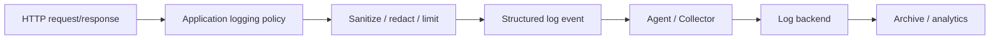

# Log request và response an toàn trong Spring Boot

Khi điều tra một lỗi HTTP, log request và response có thể giúp xác định route, status, độ trễ và nguyên nhân thất bại. Nhưng nếu ghi toàn bộ headers hoặc body, log có thể chứa access token, cookie, mật khẩu, thông tin cá nhân, dữ liệu thanh toán hoặc nội dung nghiệp vụ riêng tư. Log cũng được sao chép tới nhiều hệ thống và được nhiều nhóm truy cập; một lần ghi dư dữ liệu có thể biến log backend thành nơi lưu trữ dữ liệu nhạy cảm ngoài dự định.

Bài **Log request và response an toàn** thuộc chương **Logging** của module **SPRING_BOOT_OBSERVABILITY**. Module hướng dẫn thiết lập observability cho Spring Boot bằng Micrometer Observation, metrics, logs và distributed tracing; học context propagation, tags/cardinality, exporter, sampling và liên kết tín hiệu để điều tra lỗi, độ trễ và hành vi ứng dụng trên môi trường thực.

Sau bài học, bạn có thể thiết kế logging policy theo allowlist, loại bỏ hoặc che dữ liệu nhạy cảm, chọn metadata hữu ích thay vì ghi payload mặc định, hiểu vị trí instrument HTTP trong Spring MVC/WebFlux, tránh đọc body làm cạn stream, giới hạn kích thước log, liên kết logs với trace và kiểm thử rằng dữ liệu cấm không lọt vào log.

## 1. Vì sao phải log request và response có chọn lọc?

HTTP request/response có thể chứa nhiều loại dữ liệu:

| Thành phần | Giá trị chẩn đoán | Rủi ro |
| --- | --- | --- |
| Method và route template | Xác định loại thao tác | Thấp nếu route đã chuẩn hóa |
| Status code và duration | Phân tích lỗi/độ trễ | Thấp |
| Content-Type và Content-Length | Nhận biết loại/kích thước payload | Có thể tiết lộ loại dữ liệu |
| User-Agent hoặc client category | Phân nhóm client | Có thể nhận diện thiết bị/người dùng |
| Authorization, Cookie, Set-Cookie | Thường không cần ghi | Chứa credentials/session |
| Query parameters | Có thể hỗ trợ debug | Có thể chứa email, token, mã tìm kiếm |
| Request/response body | Có thể giúp tái hiện lỗi | Có thể chứa PII, secret, dữ liệu tài chính |
| Exception message | Giúp hiểu lỗi | Có thể chứa SQL, URL, identifiers hoặc payload |

Log access thường cần trả lời: request đến endpoint nào, bằng method nào; kết quả là status nào và mất bao lâu; request bị từ chối, timeout hay lỗi ở bước nào; có thể liên kết sự kiện với trace/span và service instance không; có metadata tối thiểu nào đủ tái hiện lỗi trong môi trường kiểm thử an toàn?

Không cần body đầy đủ để trả lời phần lớn các câu hỏi này. **Mặc định không ghi raw request/response body hoặc toàn bộ headers.** Chỉ thu thập trường đã được phê duyệt, có mục đích, giới hạn và thời gian lưu rõ ràng.

## 2. Threat model: log là một bản sao dữ liệu

Log có thể đi từ ứng dụng sang stdout, agent, collector, log platform, archive và hệ thống phân tích. Mỗi điểm có thể có retention, quyền truy cập và nhà cung cấp khác nhau.



Nếu dữ liệu nhạy cảm được ghi vào stdout trước khi redact, việc che ở dashboard không xóa dữ liệu đã được gửi tới collector hoặc archive. Redaction nên diễn ra **trước khi log event rời ứng dụng**, đồng thời có lớp kiểm soát ở collector/backend nếu cần phòng vệ nhiều tầng.

Rủi ro không chỉ là lộ dữ liệu:

- **Credential exposure:** token/cookie trong log có thể bị dùng để truy cập hệ thống.
- **Privacy breach:** body có thể chứa thông tin cá nhân, định danh, địa chỉ hoặc lịch sử giao dịch.
- **Data retention mismatch:** log tồn tại lâu hơn dữ liệu nguồn hoặc chính sách nghiệp vụ cho phép.
- **Access expansion:** nhiều người có quyền đọc logs hơn quyền đọc hệ thống nghiệp vụ.
- **Injection/forgery:** ký tự xuống dòng hoặc delimiter trong input có thể giả mạo log entries nếu không encode.
- **Cost and noise:** payload lớn và lặp lại làm tăng ingest/storage, gây khó tìm sự kiện quan trọng.

Logging policy phải bao gồm nội dung, người được truy cập, nơi lưu và thời gian retention.

## 3. Allowlist tốt hơn denylist

Có hai cách chọn dữ liệu:

- **Denylist:** ghi mọi thứ, sau đó cố loại các trường nguy hiểm đã biết.
- **Allowlist:** chỉ ghi các trường đã được xác định là cần thiết và an toàn.

Request có thể thay đổi schema, endpoint mới có thể thêm field nhạy cảm, hoặc dịch vụ upstream có thể gửi header chưa từng gặp. Denylist dễ bỏ sót trường mới. Allowlist giới hạn dữ liệu được phép đi vào log ngay từ đầu.

| Trường | Chính sách |
| --- | --- |
| HTTP method | Ghi |
| Route template | Ghi |
| Status code | Ghi |
| Duration | Ghi |
| Content-Type | Ghi nếu cần |
| Content-Length | Ghi theo bucket hoặc số đo giới hạn |
| Trace ID / Span ID | Ghi qua correlation integration |
| Authorization / Proxy-Authorization | Loại bỏ hoàn toàn |
| Cookie / Set-Cookie | Loại bỏ hoàn toàn |
| Password / secret / API key | Loại bỏ hoàn toàn |
| Query parameters | Mặc định không ghi; chỉ allowlist từng key |
| Body | Mặc định không ghi |
| Exception | Ghi loại lỗi và mã phân loại; kiểm tra message/stack theo policy |

Không dùng một regex chung để che mọi loại dữ liệu trong raw body. JSON, multipart, XML, URL-encoded form và binary payload có cấu trúc khác nhau; sanitizer có thể không hiểu đúng encoding hoặc nested fields. Tốt hơn là không ghi body hoặc chỉ log một DTO đã được thiết kế riêng với những trường cho phép.

## 4. Metadata hữu ích thay cho payload

Một log access event có thể dùng schema nhỏ, ổn định:

```json
{
  "event": "http.server.request.completed",
  "service.name": "checkout-service",
  "http.request.method": "POST",
  "http.route": "/checkout",
  "http.response.status_code": 201,
  "event.duration_ms": 84,
  "network.protocol.name": "http",
  "traceId": "4bf92f3577b34da6a3ce929d0e0e4736",
  "spanId": "00f067aa0ba902b7"
}
```

Đây là log event minh họa, không phải schema bắt buộc cho mọi backend. Các field nên có tên thống nhất giữa services và không chứa raw user input.

Metadata thường hữu ích gồm service name/version và environment; HTTP method, route template và status code; duration hoặc latency bucket; error category đã chuẩn hóa; trace ID/span ID theo logging integration; request size/response size dưới dạng số đo hoặc bucket nếu cần.

Hạn chế ghi raw URL. URL có thể mang query string nhạy cảm hoặc identifiers động. Ưu tiên route template như /orders/{orderId} thay vì URL có order ID cụ thể hoặc query string.

## 5. Che dữ liệu nhạy cảm: loại bỏ trước, che một phần khi có lý do

| Cách | Ví dụ | Khi dùng |
| --- | --- | --- |
| **Drop field** | Bỏ hoàn toàn Authorization | Credentials/secrets |
| **Mask** | Thay email bằng giá trị che có chủ đích | Chỉ khi nghiệp vụ thật sự cần nhận diện một phần |
| **Normalize** | Chuyển channel thành web/mobile/partner | Phân nhóm có cardinality thấp |
| **Hash/tokenize** | Dùng identifier giả danh được quản lý | Chỉ khi có threat model, key management và nhu cầu liên kết hợp lệ |
| **Bucket** | Kích thước body: 0–1 KB, 1–10 KB | Phân tích kích thước, tránh giá trị quá chi tiết |

Masking không biến dữ liệu thành vô danh. Email đã che một phần vẫn có thể nhận diện người dùng khi kết hợp với dữ liệu khác. Hash cũng không bảo đảm ẩn danh nếu không gian giá trị nhỏ hoặc giá trị có thể đoán. Không dùng hash tự chế thay chính sách bảo vệ dữ liệu.

Với credentials, lựa chọn đúng thường là **không ghi**. Không ghi prefix/suffix của bearer token để hỗ trợ debug; log mã xác thực hoặc kết quả xác minh đã chuẩn hóa thay thế.

## 6. Vì sao không nên log tất cả headers?

| Header | Chính sách mặc định |
| --- | --- |
| Authorization | Drop |
| Proxy-Authorization | Drop |
| Cookie | Drop |
| Set-Cookie | Drop |
| X-Api-Key | Drop |
| X-Forwarded-For | Chỉ ghi theo nhu cầu và policy; có thể là dữ liệu định danh |
| User-Agent | Chỉ ghi nếu cần; cân nhắc chuẩn hóa thành client family |
| Content-Type | Có thể ghi |
| Content-Length | Có thể ghi dưới dạng số đo |
| Traceparent | Dùng tracing instrumentation; không nhất thiết log raw header |

Không lấy toàn bộ request headers rồi chỉ xóa bốn key đã biết. Hãy chọn vài headers cho phép và chuẩn hóa chúng. Với headers forwarding, chỉ tin giá trị từ proxy/gateway thuộc trust boundary; client Internet có thể giả mạo các header này.

Không ghi toàn bộ response headers vì Set-Cookie, authentication challenges, redirect URLs hoặc vendor-specific metadata có thể chứa thông tin không nên lưu.

## 7. Không log raw body theo mặc định

Request body có thể chứa credentials, dữ liệu thanh toán, thông tin định danh, nội dung trao đổi hoặc file tải lên. Response body có thể trả lại chính dữ liệu đó. Việc ghi body thường tạo thêm rủi ro lớn hơn giá trị chẩn đoán.

Thay vì log body, hãy log kết quả đã chuẩn hóa:

```java
log.info(
    "checkout request completed: channel={}, itemCount={}, outcome={}",
    safeChannel,
    itemCount,
    outcome
);
```

Ví dụ này giả định ba biến đã được xác thực/chuẩn hóa và được policy cho phép. Không truyền raw DTO hoặc object request vào logger rồi dựa vào toString() để quyết định dữ liệu nào xuất hiện.

### Trường hợp debug body có kiểm soát

Một số sự cố tích hợp có thể cần quan sát payload. Khi thật sự cần:

1. Ưu tiên staging hoặc môi trường test với dữ liệu giả.
2. Chỉ bật cho endpoint và thời gian giới hạn.
3. Giới hạn kích thước rất nhỏ.
4. Chỉ parse content type được hỗ trợ; từ chối binary, multipart hoặc stream không thể sanitize an toàn.
5. Dùng schema allowlist; drop trường không rõ hoặc không parse được.
6. Redact trước khi ghi và kiểm thử payload cấm.
7. Kiểm soát người đọc và retention của log.
8. Có cách tắt nhanh và ghi nhận ai bật chế độ debug.

Nếu bất kỳ bước nào không bảo đảm được, không ghi body. Không tạo một filter toàn cục ghi mọi request/response body trong production.

## 8. Spring MVC: filter, interceptor và request wrappers

Trong Spring MVC/Servlet stack, các vị trí thường gặp để ghi access metadata:

- **Servlet Filter:** bao quanh request/response ở tầng servlet, phù hợp để đo thời gian và ghi metadata tổng quát.
- **HandlerInterceptor:** biết handler/controller đã được chọn, có thể lấy route mapping ở mức framework.
- **Controller/service logging:** phù hợp ghi sự kiện nghiệp vụ đã chuẩn hóa, không nên log raw request object.
- **Micrometer Observation/HTTP instrumentation:** thường đã tạo metrics/tracing cho server request; nên tận dụng thay vì tự instrument trùng.

Một filter metadata tối giản:

```java
import jakarta.servlet.FilterChain;
import jakarta.servlet.ServletException;
import jakarta.servlet.http.HttpServletRequest;
import jakarta.servlet.http.HttpServletResponse;
import java.io.IOException;
import org.springframework.web.filter.OncePerRequestFilter;

public final class SafeHttpAccessFilter extends OncePerRequestFilter {
    private static final org.slf4j.Logger log =
        org.slf4j.LoggerFactory.getLogger(SafeHttpAccessFilter.class);

    @Override
    protected void doFilterInternal(
            HttpServletRequest request,
            HttpServletResponse response,
            FilterChain chain) throws ServletException, IOException {
        long started = System.nanoTime();
        try {
            chain.doFilter(request, response);
        } finally {
            long durationMs =
                (System.nanoTime() - started) / 1_000_000;

            String method = safeMethod(request.getMethod());
            String route = safeRoute(request);
            int status = response.getStatus();

            log.info(
                "http request completed method={} route={} status={} durationMs={}",
                method, route, status, durationMs
            );
        }
    }

    private static String safeMethod(String method) {
        return switch (method) {
            case "GET", "POST", "PUT", "PATCH", "DELETE", "OPTIONS", "HEAD" ->
                method;
            default -> "OTHER";
        };
    }

    private static String safeRoute(HttpServletRequest request) {
        Object pattern = request.getAttribute(
            "org.springframework.web.servlet.HandlerMapping.bestMatchingPattern"
        );
        return pattern instanceof String value ? value : "unmatched";
    }
}
```

Đây là ví dụ minh họa cho Servlet/MVC và route attribute cần được kiểm chứng theo cách ứng dụng đăng ký filter. Thứ tự filter so với DispatcherServlet và exception handling ảnh hưởng tới dữ liệu status/route nhìn thấy. Trong ứng dụng đã có access logging/observation instrumentation, tránh ghi thêm một event trùng cho mọi request mà không có mục đích.

Nếu filter chạy trước handler mapping, route attribute có thể chưa tồn tại; khi đó ghi giá trị ổn định như unmatched hoặc lấy route ở tầng thích hợp sau khi mapping hoàn tất. Không fallback sang raw URI chứa path variables.

## 9. Response wrappers và rủi ro đọc body

Response body thường là stream chỉ ghi một lần. Muốn đọc body để log, code phải wrap response và cache bytes rồi ghi lại về client. Cách làm này dễ sai:

- Không ghi lại đủ bytes làm client nhận body rỗng hoặc bị cắt.
- Tăng memory usage khi payload lớn.
- Làm hỏng streaming, SSE, file download hoặc response compression.
- Log dữ liệu trước khi sanitizer chạy.
- Khi exception xảy ra, wrapper không hoàn tất hoặc log sai status.

Request body cũng thường là input stream chỉ đọc một lần. Một logging filter đọc stream trước controller có thể khiến controller không còn dữ liệu. Content caching wrappers có giới hạn; không có nghĩa body đã được đọc đầy đủ hoặc luôn an toàn để log.

**Không wrap và cache mọi body chỉ để ghi log.** Nếu một use case cụ thể thật sự cần body, dùng wrapper được framework hỗ trợ, giới hạn kích thước và content type, xử lý streaming/exceptions đúng, đồng thời chỉ log schema đã sanitize. Với uploads/downloads/SSE, chỉ ghi metadata như content length, media type, status và duration.

## 10. Spring WebFlux: body là reactive stream

WebFlux có thể xử lý body theo dạng reactive DataBuffer stream. Đọc hoặc subscribe body thêm lần nữa để log có thể tiêu thụ stream, gây mất dữ liệu, lỗi reference-count hoặc làm thay đổi backpressure.

Các nguyên tắc:

- Không subscribe thủ công lần thứ hai chỉ để lấy body log.
- Không collect toàn bộ DataBuffers thành byte array cho mọi request.
- Không block event-loop để chờ đọc payload.
- Ưu tiên WebFilter/Observation metadata và logging ở service sau khi đã chuẩn hóa DTO.
- Nếu phải inspect payload trong môi trường kiểm thử, giới hạn size/content type, quản lý DataBuffer lifecycle và viết test cho cancellation/error/backpressure.

Reactive body logging cần hiểu rõ publisher lifecycle. Một log filter quan sát metadata an toàn thường hữu ích hơn việc cố sao chép stream body.

## 11. Giới hạn kích thước, encoding và log injection

Ngay cả field được allowlist cũng cần giới hạn. Một header hợp lệ về tên vẫn có thể chứa hàng trăm kilobytes, và user-agent hoặc error string có thể chứa ký tự điều khiển.

| Thuộc tính | Cách kiểm soát |
| --- | --- |
| Field length | Giới hạn số ký tự/bytes |
| Body size | Không log mặc định; nếu có use case, đặt hard limit thấp |
| Character encoding | Chuẩn hóa UTF-8 và xử lý dữ liệu lỗi encoding |
| Newline/control chars | Encode/escape trước khi ghi text logs |
| Nested JSON | Chỉ lấy field allowlist, giới hạn depth |
| Binary/multipart | Không log payload |
| Truncation | Ghi cờ truncated và byte count, không giả vờ payload đầy đủ |

Không nối raw input trực tiếp vào một dòng log có thể bị xuống dòng. Dùng structured logger và serializer đáng tin cậy; vẫn cần giới hạn field size để tránh log forging hoặc ingestion abuse.

## 12. Structured logging và correlation

Structured logging lưu event dưới dạng các trường có kiểu, giúp truy vấn mà không phải parse message tự do. Ví dụ:

```json
{
  "event": "http.server.request.completed",
  "http.request.method": "POST",
  "http.route": "/checkout",
  "http.response.status_code": 201,
  "event.duration_ms": 84,
  "traceId": "4bf92f3577b34da6a3ce929d0e0e4736",
  "spanId": "00f067aa0ba902b7"
}
```

Trace ID và span ID giúp liên kết log event với distributed trace khi tracing context được giữ trong logging scope. Với Logback, một pattern text có thể tham chiếu MDC fields:

```text
%d{yyyy-MM-dd HH:mm:ss.SSS} %-5level trace=%X{traceId:-} span=%X{spanId:-} %logger - %msg%n
```

MDC thường gắn với ThreadLocal. Khi task chuyển thread hoặc đi qua executor/reactive boundary, phải bảo đảm context được propagate và dọn đúng; nếu không log có thể thiếu ID hoặc mang ID request trước. Dùng Spring/Micrometer integration được hỗ trợ và kiểm thử bằng executor thật.

Không đưa trace ID vào metrics tags để liên kết dashboard vì cardinality rất cao. Metrics giúp phát hiện xu hướng; traces cho thấy đường đi của request được sample; logs cho biết sự kiện chi tiết. Cả ba có thể liên kết bằng trace context mà không cần ghi payload nhạy cảm.

## 13. Exception logging: không log lại mọi thứ ở nhiều tầng

Một exception có thể bị log ở filter, controller advice, service và global handler. Nếu mỗi tầng ghi cùng stack trace, một lỗi tạo nhiều event trùng, làm tăng chi phí và gây khó tìm nguyên nhân.

Chọn một nơi chịu trách nhiệm ghi lỗi cuối cùng, ví dụ global exception handler hoặc boundary của tác vụ. Các tầng bên trong có thể thêm context có chọn lọc hoặc rethrow, không cần ghi lại toàn bộ stack ở mỗi tầng.

Ví dụ response handler ghi metadata đã chuẩn hóa:

```java
@ExceptionHandler(IllegalArgumentException.class)
ResponseEntity<ErrorResponse> handleBadRequest(
        IllegalArgumentException ex) {
    log.warn("request rejected category=validation");
    return ResponseEntity.badRequest()
        .body(new ErrorResponse("INVALID_REQUEST"));
}
```

Đoạn ví dụ cố ý không log exception message hoặc request body. Nếu cần ghi stack trace cho lỗi không mong đợi, giới hạn ở một boundary, phân loại lỗi và kiểm tra message/causes có thể chứa secret hay không. Tránh trả exception message nội bộ cho client.

## 14. Retention, quyền truy cập và môi trường

Logging policy không hoàn chỉnh nếu chỉ nói field nào được ghi. Cần xác định:

- Log event nào được phép lưu ở development, staging và production?
- Ai được xem logs có correlation fields?
- Logs có chứa dữ liệu định danh hoặc giao dịch không; nếu có, căn cứ và retention là gì?
- Collector có redaction/filtering thứ hai không?
- Có thể xóa hoặc hạn chế truy cập dữ liệu khi phát hiện ghi nhầm không?
- Debug logging có tự tắt sau thời gian giới hạn không?

Không dùng dữ liệu production thật để kiểm tra body logging ở local/staging. Dùng fixtures giả, token test và identifiers giả. Tránh bật DEBUG/TRACE toàn hệ thống lâu dài; log volume lớn có thể che lấp sự kiện quan trọng và làm tăng chi phí.

## 15. Kiểm thử logging an toàn

Testing phải xác minh **dữ liệu cho phép có mặt** và **dữ liệu cấm không xuất hiện**. Kiểm tra chỉ bằng việc log event được tạo là chưa đủ.

| Test | Điều cần xác minh |
| --- | --- |
| Allowlist test | Chỉ method, route template, status, duration và field đã duyệt được ghi |
| Secret redaction test | Authorization, cookies, API keys và passwords không xuất hiện |
| PII test | Email, phone, address và body fields cấm được loại bỏ |
| Body-size test | Payload lớn không làm tăng log không giới hạn |
| Stream test | Request/response body đến controller/client không bị tiêu thụ hoặc thay đổi |
| Injection test | Newline/control chars không tạo log entry giả |
| Error-path test | Exception được ghi một lần ở đúng boundary |
| Correlation test | Trace ID/span ID đúng scope và không rò sang request kế tiếp |

### Ví dụ test chuẩn hóa metadata

```java
record SafeAccessEvent(
    String method,
    String route,
    int status,
    long durationMs
) {}

final class AccessEventFactory {
    SafeAccessEvent create(
            String method, String route, int status, long durationMs) {
        String safeMethod = switch (method) {
            case "GET", "POST", "PUT", "PATCH", "DELETE" -> method;
            default -> "OTHER";
        };
        String safeRoute = switch (route) {
            case "/checkout", "/health", "/orders/{id}" -> route;
            default -> "unmatched";
        };
        int safeStatus = status >= 100 && status <= 599 ? status : 500;
        long safeDuration = Math.max(0, Math.min(durationMs, 300_000));
        return new SafeAccessEvent(
            safeMethod, safeRoute, safeStatus, safeDuration);
    }
}
```

```java
import org.junit.jupiter.api.Test;
import static org.junit.jupiter.api.Assertions.*;

class AccessEventFactoryTest {
    private final AccessEventFactory factory = new AccessEventFactory();

    @Test
    void doesNotCopyUntrustedPathOrMethod() {
        SafeAccessEvent event = factory.create(
            "CUSTOM-METHOD",
            "/orders/secret-id?token=abc",
            200,
            45
        );
        assertEquals("OTHER", event.method());
        assertEquals("unmatched", event.route());
        assertEquals(200, event.status());
        assertEquals(45, event.durationMs());
    }

    @Test
    void boundsDuration() {
        SafeAccessEvent event = factory.create(
            "GET", "/health", 200, Long.MAX_VALUE);
        assertEquals(300_000, event.durationMs());
    }
}
```

Đây là test cho event factory, không phải integration test đầy đủ của servlet filter hoặc WebFlux. Cần thêm test bằng MockMvc/WebTestClient để xác minh body vẫn đến controller/client nguyên vẹn, log output không chứa secret sentinel và trace correlation được khôi phục qua async boundary.

## 16. Lỗi thường gặp và cách xử lý

| Hiện tượng | Nguyên nhân có thể | Hướng kiểm tra |
| --- | --- | --- |
| Authorization xuất hiện trong logs | Ghi toàn bộ headers hoặc sanitizer chạy quá muộn | Allowlist trước khi log, test token sentinel |
| Body trong controller bị rỗng | Filter đã đọc request stream | Bỏ body logging hoặc dùng wrapper được kiểm thử |
| Response client nhận body rỗng | Response wrapper không copy body lại | Không cache response tùy tiện; test stream đầy đủ |
| File download/SSE bị chậm hoặc hỏng | Buffer toàn bộ response | Chỉ log metadata với streaming endpoints |
| Logs có query token | Raw URL được ghi | Dùng route template, bỏ query string |
| Email vẫn xuất hiện sau masking | Regex không hiểu schema/encoding | Không log body; schema allowlist hoặc drop field |
| Một request tạo nhiều stack traces | Nhiều tầng cùng log exception | Chọn một error boundary sở hữu event |
| Trace ID của request trước xuất hiện | MDC/ThreadLocal không được restore | Kiểm tra scope và executor reuse |
| Log ingestion tăng đột biến | Body/header lớn hoặc debug level bật rộng | Giới hạn field/size và bật level có thời hạn |
| Dòng log giả xuất hiện | Raw input chứa newline/control characters | Structured logging, encode và giới hạn length |
| Route logs chứa ID người dùng | Ghi raw URI thay vì route template | Lấy mapped route pattern |
| Không liên kết được log với trace | Logging integration hoặc async context thiếu | Kiểm tra MDC, bridge và context propagation |

## 17. Tình huống thực tế: debug lỗi thanh toán mà không ghi dữ liệu thẻ

**Bối cảnh giả định:** payment-service trả 502 khi checkout gọi gateway thanh toán. Đội phát triển cần biết endpoint, status, độ trễ, loại lỗi và lần retry. Request body có tên chủ thẻ, billing address và payment token.

Một cách xử lý:

1. **Ghi metadata HTTP:** method, route template /payments/authorize, status, duration và content type.
2. **Liên kết trace:** ghi trace ID/span ID qua tracing logging integration để tìm client/server spans của lần gọi.
3. **Chuẩn hóa nghiệp vụ:** ghi payment provider name đã allowlist, attempt number, outcome category và error code an toàn.
4. **Loại payload:** không log raw body, token, authorization headers, cookie hoặc response body từ provider.
5. **Ghi lỗi tại boundary:** một handler ghi event payment.authorization.failed với error category đã chuẩn hóa; tầng dưới không log lại cùng stack trace.
6. **Kiểm tra retry:** metrics counter ghi số lần retry và histogram đo duration; không dùng transaction ID làm metric label.
7. **Tái hiện an toàn:** dùng test credentials và payload giả trong staging; chỉ bật debug có thời hạn nếu cần thêm dữ liệu.

Log event có thể cho biết attempt 2 nhận 502 sau 1.2 giây và trace cho thấy dependency span chậm. Không cần lưu số thẻ hoặc payment token để tìm nguyên nhân timeout.

## 18. Bài tập tự kiểm tra

**Bài 1.** Vì sao allowlist an toàn hơn ghi toàn bộ headers rồi denylist vài key?

*Gợi ý:* Header mới và dữ liệu nhạy cảm chưa biết có thể xuất hiện; allowlist chỉ cho những trường đã được duyệt đi vào log.

**Bài 2.** Một filter đọc request body để log rồi controller nhận body rỗng. Nguyên nhân và cách xử lý?

*Gợi ý:* Servlet input stream đã bị tiêu thụ. Không log body mặc định; nếu có use case, dùng caching wrapper đúng cách, giới hạn size và test controller nhận nguyên nội dung.

**Bài 3.** Vì sao không nên ghi raw URL?

*Gợi ý:* Path/query có thể chứa identifiers, token hoặc thông tin cá nhân. Dùng route template và bỏ query parameters không được phê duyệt.

**Bài 4.** Một response dùng Server-Sent Events. Có nên cache toàn bộ body để log?

*Gợi ý:* Không. Đây là stream dài; buffer có thể làm hỏng backpressure/latency và dùng nhiều memory. Chỉ ghi metadata.

**Bài 5.** Log có email đã mask một phần. Có thể coi dữ liệu đã vô danh không?

*Gợi ý:* Không. Field có thể vẫn nhận diện được khi kết hợp với dữ liệu khác. Chỉ log nếu có mục đích và quyền hợp lệ.

**Bài 6.** Một exception xuất hiện ở filter, service và controller advice. Làm sao tránh lặp?

*Gợi ý:* Chọn một error boundary ghi event/stack cuối cùng; các tầng khác phân loại hoặc rethrow mà không log lại.

**Bài 7.** Làm sao xác minh token không lọt vào log?

*Gợi ý:* Dùng token sentinel giả, gửi qua request, capture log output và assert sentinel không xuất hiện ở application logger/collector test.

**Bài 8.** Vì sao trace ID có thể có trong logs nhưng không nên trở thành metric tag?

*Gợi ý:* Trace ID hữu ích để tra request trong logs/traces, nhưng mỗi request có ID mới nên làm metric cardinality tăng rất lớn.

## 19. Ghi nhớ

- **Log request/response an toàn bắt đầu từ mục đích và allowlist**, không phải ghi tất cả rồi cố che các trường đã biết.
- Mặc định chỉ ghi metadata hữu ích như method, route template, status, duration và trace/span IDs; không ghi raw headers hoặc bodies.
- **Drop credentials và secrets** như Authorization, cookies, API keys, passwords và payment tokens. Masking không đồng nghĩa dữ liệu đã vô danh.
- Trong Spring MVC, filter/interceptor có thể ghi metadata nhưng phải hiểu thứ tự handler mapping và vòng đời stream; trong WebFlux, tránh subscribe/consume DataBuffer lần nữa.
- Không buffer toàn bộ request/response body cho logging. Streaming, SSE, file transfers và payload lớn cần được xử lý riêng.
- Dùng structured logs, giới hạn kích thước/encoding, encode control characters và ghi exception tại một boundary để tránh injection và duplicate events.
- Correlate logs với traces qua traceId/spanId và context propagation; không dùng trace IDs làm metric labels.
- Kiểm thử cả **field được phép xuất hiện** và **secret/PII không xuất hiện**, bao gồm error paths, stream integrity, body size và async context cleanup.
