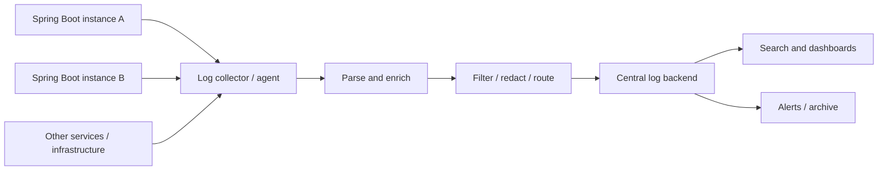
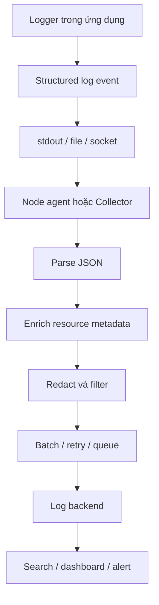
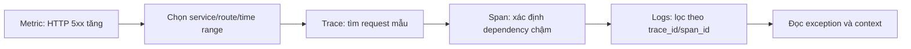
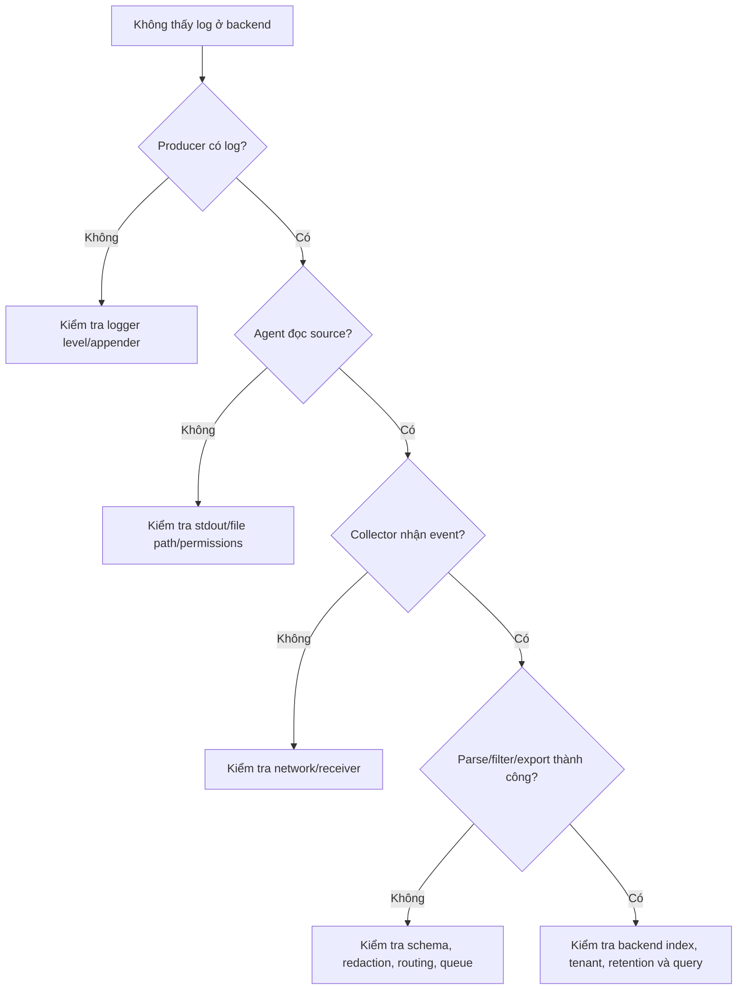

# Log aggregation trong hệ thống Spring Boot

Một ứng dụng Spring Boot thường ghi log ra console hoặc file cục bộ. Cách này đủ để debug một instance trong môi trường local, nhưng khó vận hành khi request đi qua nhiều instance, container hoặc service. Người trực vận hành phải tìm đúng thời gian, ghép các dòng log từ nhiều máy và xác định đâu là cùng một request.

**Log aggregation** thu thập logs từ nhiều nguồn, chuẩn hóa metadata, chuyển chúng tới hệ thống tập trung để tìm kiếm, lọc, lưu trữ và cảnh báo. Khi log được liên kết với trace và metrics, đội vận hành có thể chuyển từ một chỉ số bất thường sang trace cụ thể, rồi đọc log của các service tham gia request đó.

Bài **“Log aggregation”** thuộc chương **Logging** của module **SPRING_BOOT_OBSERVABILITY**. Module hướng dẫn thiết lập observability cho Spring Boot bằng Micrometer Observation, metrics, logs và distributed tracing; học propagation ngữ cảnh, tag/cardinality, exporter, sampling và liên kết tín hiệu để điều tra lỗi, độ trễ và hành vi ứng dụng trên môi trường thực.

**Log aggregation không đơn giản là gom file log vào một nơi.** Một pipeline hiệu quả cần schema thống nhất, service identity, timestamps chính xác, routing, bảo mật dữ liệu, retention và cách liên kết trace. Nó cũng cần chính sách backpressure và xử lý mất dữ liệu khi Collector/backend gián đoạn.

## 1. Vì sao cần log aggregation?

Khi một dịch vụ chạy trên nhiều replicas, mỗi instance có thể ghi log riêng. Trong môi trường container, instance có thể bị tạo mới hoặc xóa sau deploy; file log trong filesystem container có thể biến mất cùng instance.

Một pipeline tập trung mang lại:

- **Tìm kiếm liên dịch vụ:** truy vấn request theo trace ID, service, thời gian hoặc severity.
- **Điều tra sự cố:** ghép sự kiện từ gateway, application, database client và message consumer.
- **Theo dõi triển khai:** so sánh logs theo service version, environment hoặc pod.
- **Cảnh báo:** phát hiện log error tăng, exception lặp lại hoặc thành phần ngừng gửi dữ liệu.
- **Quản trị:** áp dụng access control, retention, redaction và audit tập trung.
- **Tiết kiệm thời gian:** không cần SSH vào từng host để đọc file.



Log aggregation có thể thu thập logs từ ingress, reverse proxy, Kubernetes, database, message broker, operating system và security infrastructure. Mỗi nguồn cần parsing rule và ownership rõ ràng.

## 2. Kiến trúc pipeline log tập trung

Một triển khai thường có bốn lớp:

| Lớp | Trách nhiệm | Ví dụ |
| --- | --- | --- |
| **Producer** | Tạo log event | Spring Boot, Nginx, Kubernetes |
| **Collector/agent** | Đọc stdout/file/socket, buffer và chuyển tiếp | Fluent Bit, Vector, OpenTelemetry Collector |
| **Processing/routing** | Parse, enrich, filter, redact, phân tuyến | Collector processors, gateway |
| **Backend** | Index, lưu trữ, truy vấn, alert | Loki, Elasticsearch/OpenSearch, cloud logging |



Không bắt buộc mọi pipeline có gateway riêng. Hệ thống nhỏ có thể gửi từ agent thẳng tới backend. Với nhiều team, môi trường hoặc backend, gateway giúp quản lý routing và policy tập trung.

### Collector không phải backend

Collector nhận và chuyển tiếp telemetry; backend lưu trữ và truy vấn. Collector báo đã nhận log không chứng minh log đã được index hoặc còn tồn tại sau retention. Kiểm tra receiver, exporter và backend ingestion riêng.

## 3. Chọn cách ứng dụng xuất logs

Spring Boot có thể ghi log qua Logback. Trong container, cách phổ biến là ghi stdout/stderr để runtime hoặc node agent thu thập.

| Cách xuất | Ưu điểm | Cần chú ý |
| --- | --- | --- |
| stdout/stderr | Phù hợp container, agent đọc được stream runtime | Cần structured format và runtime log driver |
| File rolling | Hữu ích trên VM hoặc bare metal | Rotation, disk usage, permissions và file tailing |
| Socket/forwarder | Có thể gửi trực tiếp tới collector | Timeout, queue và outage behavior |
| OTLP Logs | Truyền log records theo OpenTelemetry protocol | Cần SDK/bridge/appender/exporter tương thích |

Không đồng thời ghi một sự kiện qua nhiều appender tới nhiều pipeline nếu chưa có chủ đích. Duplicate logs làm sai count, tăng chi phí và gây khó điều tra.

### stdout phù hợp với container

Cấu hình triển khai thường để Spring Boot ghi console output dạng JSON, sau đó node-level collector đọc container logs. Ứng dụng không cần biết địa chỉ backend và không phải chứa credential của backend.

Với VM, file rolling có thể phù hợp; agent theo dõi file và đọc tiếp sau rotation. Cần định nghĩa format, path, owner, permissions và disk retention.

## 4. Structured logging và JSON schema

Log aggregation hoạt động tốt hơn khi mỗi event có cấu trúc ổn định thay vì chỉ là câu văn tự do.

Log dạng text:

```text
2026-11-22 10:15:30 ERROR [checkout-service] Payment authorization failed for order 8472
```

Log JSON:

```json
{
  "timestamp": "2026-11-22T10:15:30.123Z",
  "severity": "ERROR",
  "message": "Payment authorization failed",
  "service.name": "checkout-service",
  "environment": "production",
  "order.reference": "ord-7f31",
  "error.type": "PaymentTimeoutException"
}
```

JSON giúp Collector parse field rõ ràng, thay vì tách message bằng regex phụ thuộc wording.

Một schema cơ bản nên có:

| Trường | Mục đích | Ví dụ |
| --- | --- | --- |
| timestamp | Thời điểm sự kiện | ISO-8601 UTC |
| severity | Mức log | INFO, WARN, ERROR |
| message | Nội dung dễ đọc | Payment authorization failed |
| service.name | Service tạo log | checkout-service |
| service.version | Phiên bản artifact | 2.4.1 |
| deployment.environment | Môi trường | production |
| service.instance.id | Instance/pod identity | pod-7b9c |
| trace_id | Liên kết trace | 32 ký tự hex |
| span_id | Liên kết span | 16 ký tự hex |
| logger | Logger/category | c.p.checkout.PaymentService |
| thread | Tên thread | http-nio-8080-exec-4 |
| error.type | Loại exception | PaymentTimeoutException |

OpenTelemetry Logs Data Model có các khái niệm Timestamp, ObservedTimestamp, SeverityText, SeverityNumber, Body, Resource, InstrumentationScope, Attributes và TraceId/SpanId. Backend có thể hiển thị tên field khác, nhưng cần giữ semantics tương ứng để tránh mất thông tin khi chuyển đổi.

**Không dùng message làm nơi duy nhất lưu dữ liệu.** Field cần filter/alert nên là structured attribute có type và tên ổn định.

## 5. Timestamp và timezone

Logs có thể đến từ nhiều máy, vùng và runtime. Timestamps nên thống nhất, thường serialize theo ISO-8601 UTC.

```json
{
  "timestamp": "2026-11-22T03:15:30.123Z",
  "observed_timestamp": "2026-11-22T03:15:30.450Z",
  "message": "Order accepted"
}
```

- timestamp là thời điểm producer ghi nhận event.
- observed_timestamp là thời điểm collector/backend quan sát hoặc nhận event.
- Chênh lệch có thể giúp phát hiện clock skew, buffering hoặc network delay.

Đồng bộ clock trên host/pod nodes bằng cơ chế thời gian chuẩn của nền tảng. Nếu producer lệch nhiều phút, truy vấn theo time range có thể bỏ sót log hoặc sắp xếp sai chuỗi sự kiện.

Không thay timestamp nguồn bằng timestamp collector mà không giữ giá trị ban đầu. Nếu phải chuẩn hóa timestamp, giữ cả original và observed time theo schema phù hợp.

## 6. Resource metadata và service identity

Mỗi log cần trả lời: log này đến từ service nào, phiên bản nào, chạy ở môi trường nào và trên instance nào?

```json
{
  "service.name": "checkout-service",
  "service.version": "2.4.1",
  "deployment.environment": "production",
  "service.instance.id": "checkout-7b9c",
  "cloud.region": "ap-southeast-1"
}
```

Resource metadata nên được quản lý qua deployment config, environment variables hoặc Collector enrichment. Không bắt developer tự thêm các field này vào mọi message.

- service.name ổn định qua replicas của cùng service.
- service.version thay đổi theo release.
- deployment.environment dùng tập giá trị thống nhất như dev/staging/prod.
- service.instance.id phân biệt instance; không nhất thiết dùng làm dimension cho mọi metric.
- Kubernetes metadata như namespace, pod, node có thể được agent bổ sung.

Resource mô tả producer; log record attributes mô tả sự kiện cụ thể. Không nhầm hai lớp này.

## 7. Correlation với traces và metrics

Log hữu ích hơn khi có thể mở trace liên quan. Theo OpenTelemetry Logs Data Model, log record có thể mang TraceId và SpanId. Một log phát trong active tracing context có thể liên kết với span hiện hành nếu logging integration hỗ trợ.

Ví dụ:

```json
{
  "timestamp": "2026-11-22T03:15:30.123Z",
  "severity": "ERROR",
  "message": "Payment authorization timed out",
  "service.name": "checkout-service",
  "trace_id": "4bf92f3577b34da6a3ce929d0e0e4736",
  "span_id": "00f067aa0ba902b7",
  "error.type": "PaymentTimeoutException"
}
```

Người vận hành có thể tìm log ERROR, lọc theo service/route, mở trace dựa trên trace ID, xem span chậm hoặc failed, rồi đọc logs của trace để hiểu exception details và đối chiếu metrics để ước lượng phạm vi ảnh hưởng.



### Không nhúng trace ID vào metric labels

Trace ID gần như duy nhất cho mỗi request. Thêm nó vào metric tag sẽ tạo rất nhiều time series. Giữ trace ID trong trace/log context; dùng exemplar hoặc backend correlation để nhảy từ metric sang trace khi hỗ trợ.

Log correlation không đồng nghĩa log sampling. Sampling quyết định trace nào được lưu; log có thể vẫn tồn tại trong khi trace không có ở backend. Trace vắng mặt không có nghĩa request không phát sinh.

## 8. Spring Boot và Logback JSON

Spring Boot thường dùng Logback trong ứng dụng starter thông thường. Có thể dùng JSON encoder bên thứ ba như Logstash Logback Encoder hoặc logging integration khác; cần quản lý dependency và version tương thích.

Ví dụ Logback console appender với JSON encoder (cần dependency encoder tương ứng):

```xml
<configuration>
    <appender name="JSON_CONSOLE" class="ch.qos.logback.core.ConsoleAppender">
        <encoder class="net.logstash.logback.encoder.LogstashEncoder">
            <includeMdc>true</includeMdc>
            <includeContext>true</includeContext>
        </encoder>
    </appender>

    <root level="INFO">
        <appender-ref ref="JSON_CONSOLE"/>
    </root>
</configuration>
```

Đây là ví dụ dựa trên Logstash Logback Encoder; class và option phụ thuộc version. Không đặt cấu hình này khi encoder dependency chưa được thêm. Các dòng Spring Boot mới có thể hỗ trợ structured logging format tích hợp; kiểm tra docs đúng phiên bản trước khi lựa chọn.

Trong container, stdout thường được runtime thu thập sẵn. Nếu vừa ghi JSON ra stdout vừa ghi cùng event vào file mà agent cũng đọc file, backend sẽ nhận duplicate. Nếu cần file cục bộ, tách mục đích và định danh nguồn.

## 9. OpenTelemetry Collector cho logs

OpenTelemetry Collector có thể nhận logs qua OTLP, đọc file hoặc dùng receiver phù hợp với distribution, xử lý rồi export tới backend. Ví dụ pipeline OTLP logs tối giản:

```yaml
receivers:
  otlp:
    protocols:
      grpc:
        endpoint: 0.0.0.0:4317
      http:
        endpoint: 0.0.0.0:4318

processors:
  memory_limiter:
    check_interval: 1s
    limit_mib: 512
  batch:
    timeout: 5s
    send_batch_size: 1024

exporters:
  debug:
    verbosity: basic

service:
  pipelines:
    logs:
      receivers: [otlp]
      processors: [memory_limiter, batch]
      exporters: [debug]
```

Exporter debug phù hợp local/test. Production cần exporter tới log backend, auth/TLS, queue, retry, resource limits và retention. Không phải mọi Collector distribution đều có sẵn mọi component; xác minh binary đang triển khai.

Nếu ứng dụng ghi file, agent cần tail đúng path và xử lý rotation. Nếu ứng dụng ghi stdout, container runtime có thể lưu container log để node agent đọc. Tránh hai collector cùng tail một nguồn. Collector nên parse JSON trước khi enrichment/routing; nếu parse thất bại, giữ raw body hoặc route vào error pipeline.

## 10. Parse, normalize và enrich

Pipeline xử lý logs thường gồm:

1. **Parse:** đọc JSON hoặc format nguồn.
2. **Normalize:** map severity, timestamp, field names và exception representation.
3. **Enrich:** thêm service/environment/host/container metadata.
4. **Redact:** xóa hoặc mask dữ liệu nhạy cảm.
5. **Filter:** bỏ noise có kiểm soát, ví dụ health-check quá nhiều.
6. **Route:** gửi tới backend phù hợp.
7. **Batch/queue:** gom và chịu gián đoạn mạng.
8. **Export:** chuyển log records tới storage.

Ví dụ mapping:

| Nguồn | Chuẩn hóa |
| --- | --- |
| level | severity_text |
| @timestamp | timestamp |
| app | service.name nếu đúng semantics |
| traceId | trace_id hoặc OpenTelemetry TraceId |
| spanId | span_id hoặc OpenTelemetry SpanId |
| exception.class | error.type |
| exception.message | error.message sau khi kiểm soát sensitive data |

Không map field chỉ vì tên giống nhau. Ví dụ app đôi khi là module hoặc logger, không nhất thiết là service identity.

## 11. Filter, routing và phân loại logs

Không phải tất cả logs cần cùng backend, quyền truy cập và retention.

| Loại log | Routing gợi ý | Lưu ý |
| --- | --- | --- |
| Application INFO/WARN | Central application log store | Query theo service/environment |
| Application ERROR | Application store + alert rule | Tránh alert từng event gây noise |
| Security/audit | Security-controlled store | Quyền truy cập và retention riêng |
| Debug/trace logs | Short retention, bật có kiểm soát | Có thể chứa dữ liệu nhạy cảm |
| Access logs | Log platform hoặc analytics store | Chuẩn hóa route/status/latency |
| Health-check noise | Filter hoặc sampling có kiểm soát | Không loại tín hiệu SLO quan trọng |

Không drop mọi log health endpoint nếu nó giúp phát hiện target không healthy. Nếu filter ở ingest, giữ metrics về số events bị loại để phát hiện cấu hình quá rộng.

### Log aggregation không phải audit ledger

Logs có thể được buffer, drop, sample, transform hoặc hết retention. Nếu cần audit record bất biến hoặc delivery guarantee, dùng audit system chuyên dụng với access control và retention tương ứng. Log aggregation hỗ trợ điều tra nhưng không thay transaction ledger.

## 12. Bảo mật, privacy và redaction

Log tập trung có thể được nhiều đội truy cập, replicate và lưu lâu hơn logs cục bộ. Một lỗi logging có thể mở rộng phạm vi rò rỉ dữ liệu.

Không log mặc định:

- Password, API key, bearer token, cookie và session secret.
- Request/response body đầy đủ nếu chứa thông tin cá nhân hoặc thanh toán.
- Authorization headers.
- Private key hoặc connection string có credential.
- Dữ liệu cá nhân chưa có căn cứ và chính sách lưu trữ.
- SQL parameters hoặc exception text chứa secret.

Các biện pháp:

1. Redact ở producer nếu có thể, trước khi dữ liệu rời trust boundary.
2. Có Collector transform/redaction làm lớp phòng thủ bổ sung.
3. Dùng allowlist field cho structured logs.
4. Giới hạn ai được query logs theo team, service, tenant và sensitivity.
5. Mã hóa transport và storage.
6. Áp retention theo loại dữ liệu.
7. Audit truy cập hoặc export logs nhạy cảm.
8. Không đưa baggage/MDC fields vào log mà chưa xét privacy.

Redaction tại backend không thể thu hồi dữ liệu đã gửi tới hệ thống khác trước đó. Xử lý dữ liệu ở producer hoặc collector gần nguồn.

## 13. Cardinality và chi phí lưu trữ

Structured logs cho phép query theo nhiều field, nhưng quá nhiều unique values làm tăng index size và query cost. Một số field có cardinality cao nên giữ ở payload không index hoặc chỉ index khi có nhu cầu.

| Field | Cardinality thường thấy | Chiến lược |
| --- | --- | --- |
| service.name | Thấp | Index/filter |
| deployment.environment | Thấp | Index/filter |
| severity | Rất thấp | Index/filter |
| http.route | Thấp nếu dùng route template | Index/filter |
| http.status_code | Hữu hạn | Index/filter |
| trace_id | Rất cao | Index khi phục vụ correlation, cân nhắc cost |
| user.id | Rất cao và nhạy cảm | Không thu thập mặc định |
| Full URL/query string | Có thể cao và nhạy cảm | Chuẩn hóa route, bỏ query |
| Request body | Không dự đoán được | Không log mặc định |

Chi phí log phụ thuộc ingest bytes, index strategy, storage tier, replication, query và retention. Giảm verbosity của noise, loại field lặp và tránh stack trace không cần thiết có thể giảm chi phí, nhưng không xóa thông tin cần cho incident response.

## 14. Buffering, backpressure và mất log

Nếu backend chậm hoặc unavailable, collector/agent có thể buffer logs nhưng queue luôn có giới hạn.

- Queue đầy và collector drop events.
- Disk buffer hết dung lượng hoặc không có permission.
- Collector restart làm mất memory-only buffer.
- Log rotation xảy ra trước khi agent đọc hết file.
- Network partition làm backlog tăng.
- Backend rate limit hoặc từ chối payload quá lớn.
- Producer ghi nhanh hơn tốc độ đọc của runtime log driver.

Cần xác định delivery expectation cho từng loại log:

| Loại | Mức mất dữ liệu có thể chấp nhận |
| --- | --- |
| Debug noise | Có thể drop có kiểm soát |
| Application INFO | Theo dõi drop rate |
| ERROR/security events | Policy mạnh hơn và alert khi mất |
| Audit/financial records | Không dựa vào best-effort log pipeline |

Không quảng bá log pipeline là zero-loss nếu không có durable queue, acknowledgement và test outage. Dữ liệu quan trọng cần delivery guarantee riêng.

## 15. Truy vấn logs hiệu quả

Một query tốt thường bắt đầu bằng time range và scope nhỏ, rồi drill down. Cú pháp tùy backend:

```text
service.name = "checkout-service"
AND deployment.environment = "production"
AND severity >= "ERROR"
AND timestamp within last 15 minutes
```

Tìm logs của một trace:

```text
trace_id = "4bf92f3577b34da6a3ce929d0e0e4736"
```

Tìm exception theo type:

```text
error.type = "PaymentTimeoutException"
AND service.name = "payment-service"
```

Tránh query toàn bộ index không time range trên hệ thống lớn. Dùng resource/service/environment filters và route template để thu hẹp dữ liệu.

Dashboard hữu ích có thể gồm error logs theo service/version, top exception types, log volume và ingest/drop rate, Collector queue utilization, exporter failures, logs theo trace ID từ trace detail view và release markers.

Không dùng dashboard chỉ đếm ERROR logs làm SLO. Một request có thể ghi nhiều ERROR hoặc không log lỗi; metrics request/error rate phù hợp hơn cho số liệu tổng hợp.

## 16. Cảnh báo từ logs

Log-based alert hữu ích cho exception cụ thể, certificate warning hoặc security event không có metric tương ứng. Nhưng alert theo từng dòng thường gây noise.

- Aggregate theo cửa sổ thời gian.
- Dùng fingerprint/grouping cho cùng exception.
- Phân biệt expected errors và actionable errors.
- Có threshold, cooldown và routing.
- Đính kèm service/environment/version và link query.
- Kiểm tra alert không bị kích hoạt do deploy test hoặc health check.
- Theo dõi ingest failures để biết alert pipeline có còn nhận logs không.

Với SLI request success/latency, metrics hoặc trace-derived metrics phù hợp hơn log count. Logs cung cấp bằng chứng và chi tiết nguyên nhân.

## 17. Chẩn đoán khi logs không xuất hiện ở backend

| Triệu chứng | Nguyên nhân có thể | Cách điều tra |
| --- | --- | --- |
| Log có ở console nhưng backend trống | Agent chưa đọc stdout hoặc route sai | Kiểm tra runtime log driver và agent |
| JSON parse thất bại | Encoder khác parser schema | Xem raw event và parse error pipeline |
| Timestamp lệch | Clock skew hoặc timezone không chuẩn | Kiểm tra UTC và node time sync |
| Thiếu service.name | Resource enrichment thiếu | Kiểm tra env/resource attributes |
| Không link được trace | MDC/OTel correlation chưa hoạt động hoặc trace_id sai | Kiểm tra active context và field mapping |
| Log duplicate | Console + file cùng gửi, hoặc hai agent đọc một nguồn | Kiểm tra input ownership |
| Log trễ | Buffer/queue/backpressure hoặc ingest delay | Kiểm tra queue depth, batch và backend latency |
| Mất log khi restart | Memory-only buffer hoặc file rotation gap | Kiểm tra durable queue và checkpoint |
| Không thấy ERROR alert | Filter loại log hoặc routing sai | Kiểm tra filter order và alert source |
| Query chậm | Time range rộng hoặc index cardinality lớn | Thu hẹp range và tối ưu schema |

Quy trình:

1. Xác nhận ứng dụng phát log ở đúng level.
2. Kiểm tra JSON output và timestamp ở producer.
3. Kiểm tra runtime/agent đọc đúng nguồn.
4. Kiểm tra Collector receiver và parse errors.
5. Kiểm tra filter/redaction/routing có drop log không.
6. Kiểm tra exporter queue, retries và backend status.
7. Tìm theo service/time range trước khi query field cụ thể.
8. Nếu log có trace_id, mở trace và so sánh span context.
9. Kiểm tra drop counters ở từng tầng để xác định ranh giới mất dữ liệu.



## 18. Bài thực hành: tập trung logs của Spring Boot

Thực hiện trong local/test trước khi áp dụng production.

1. **Chuẩn hóa console output:** cấu hình Logback JSON encoder hoặc structured logging support phù hợp với phiên bản Spring Boot. Mỗi event là một JSON object trên một dòng.
2. **Bổ sung service metadata:** thêm service name, version và environment từ deployment config; không hard-code pod ID hoặc credential.
3. **Tạo log có correlation:** gửi request qua HTTP server và outbound HTTP client đã instrument. Kiểm tra trace ID/span ID xuất hiện nếu logging integration được cấu hình; không tự tạo trace ID giả.
4. **Thu thập bằng Collector/agent:** chạy agent local, nhận stdout/file hoặc OTLP Logs; xác nhận JSON parse và resource metadata.
5. **Route tới backend test:** dùng exporter debug hoặc backend local; query theo service, severity và trace ID; kiểm tra duplicate.
6. **Thử redaction:** tạo test log chứa token giả và xác nhận producer/collector xóa hoặc mask trước khi gửi. Không dùng secret thật.
7. **Thử outage/backpressure:** dừng backend hoặc Collector trong test; theo dõi queue, drop counters, disk buffer và recovery.
8. **Xây truy vấn điều tra:** tạo tình huống payment timeout; query ERROR logs, mở trace theo trace ID và đối chiếu Timer/HTTP metrics.

## 19. Câu hỏi tự kiểm tra

1. Log aggregation khác việc ghi log ra file cục bộ thế nào?
2. Pipeline log tập trung thường có những lớp nào?
3. Vì sao Collector nhận log không có nghĩa backend đã lưu/index thành công?
4. Structured JSON giúp parsing và query như thế nào?
5. OpenTelemetry Logs Data Model có những thành phần quan trọng nào?
6. Vì sao phân biệt timestamp nguồn với observed timestamp?
7. Resource metadata khác log record attributes ra sao?
8. TraceId và SpanId giúp correlation thế nào?
9. Vì sao không đưa trace ID vào metric labels?
10. Log correlation có đồng nghĩa trace luôn được sample và lưu không?
11. Khi nào stdout phù hợp hơn file rolling?
12. Collector cần xử lý gì trước khi route logs?
13. Vì sao không dùng log aggregation làm audit ledger?
14. Những dữ liệu nào không nên ghi vào logs?
15. Cardinality của trace ID, user ID và full URL tác động ra sao tới index cost?
16. Queue đầy hoặc Collector restart có thể làm mất logs thế nào?
17. Vì sao log count không phải SLI request error rate đáng tin cậy?
18. Khi logs không tới backend, nên kiểm tra lần lượt những ranh giới nào?

## Tài liệu tham khảo

- [Spring Boot Logging](https://docs.spring.io/spring-boot/reference/features/logging.html): logging system, Logback và cấu hình logging.
- [Spring Boot Structured Logging](https://docs.spring.io/spring-boot/reference/features/logging.html#features.logging.structured): structured log formats và field customization theo phiên bản.
- [OpenTelemetry Logs Data Model](https://opentelemetry.io/docs/specs/otel/logs/data-model/): log record, resource, scope, timestamps, severity và trace correlation.
- [OpenTelemetry Collector](https://opentelemetry.io/docs/collector/): receivers, processors, exporters, pipelines và deployment patterns.
- [OpenTelemetry Collector Resiliency](https://opentelemetry.io/docs/collector/resiliency/): queue, retry, backpressure và mất dữ liệu.
- [Logstash Logback Encoder](https://github.com/logfellow/logstash-logback-encoder): JSON encoder cho Logback và MDC.

## Kết luận

**Log aggregation biến các log events rời rạc thành nguồn dữ liệu có thể tìm kiếm và điều tra xuyên nhiều service.** Để làm tốt, Spring Boot cần xuất logs có cấu trúc và service metadata nhất quán; Collector/agent cần parse, enrich, redact, route và buffer; backend cần index, retention, access control và query phù hợp.

Giữ timestamp và identity chính xác, liên kết log với trace bằng trace/span context, không dùng high-cardinality values làm metric tags, và bảo vệ dữ liệu nhạy cảm trước khi rời trust boundary. Kiểm thử cả luồng bình thường lẫn outage/backpressure để biết logs qua từng tầng ra sao và mất ở đâu. Khi logs, traces và metrics cùng giữ được service identity và correlation, việc điều tra lỗi, độ trễ và hành vi ứng dụng trên môi trường thực rõ ràng hơn.

