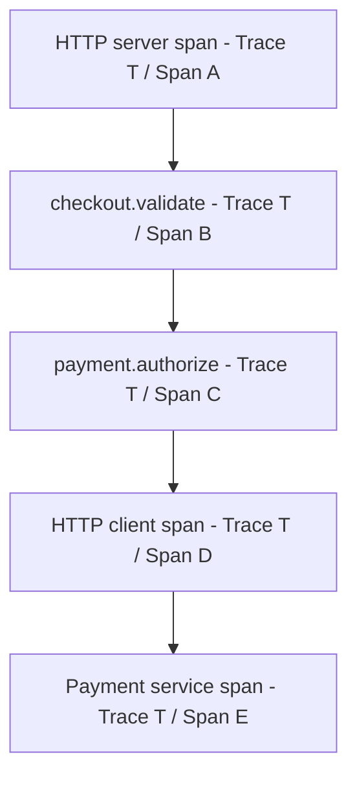
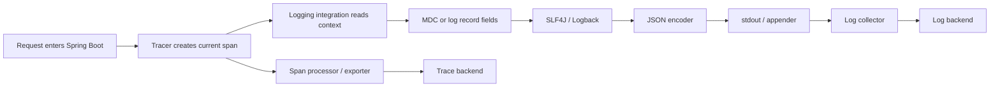

# Liên kết log với trace trong Spring Boot

Khi một request checkout thất bại, trace cho biết request đã đi qua những service nào và span nào mất nhiều thời gian. Nhưng trace không nhất thiết chứa toàn bộ thông tin giải thích lỗi. Log có thể ghi rõ provider trả timeout, số lần retry, mã lỗi đã chuẩn hóa hoặc quyết định fallback. Nếu mỗi log record mang đúng **trace ID** và **span ID**, người vận hành có thể đi từ một span trong trace sang những log được ghi trong cùng execution context.

**Log-trace correlation** là cách gắn một log record với trace context tại thời điểm ghi log. Trace ID nhận diện toàn trace; span ID nhận diện operation hiện hành trong trace. Trong Spring Boot, sự liên kết này thường được tạo bằng tracing integration kết hợp logging context như MDC, rồi được xuất thành các trường riêng trong structured logs. Backend có thể dùng các trường đó để lọc log theo trace hoặc mở trace từ log record.

Sự liên kết chỉ đáng tin khi context được lấy từ tracer hiện hành và truyền đúng qua thread, executor, HTTP hoặc Reactor boundary. Tự thêm một chuỗi trace ID vào MDC không tạo span, không khôi phục quan hệ parent-child và không chứng minh trace đã được export.

Bài học thuộc chương **Logging** của module **SPRING_BOOT_OBSERVABILITY**. Module hướng dẫn thiết lập observability cho Spring Boot bằng Micrometer Observation, metrics, logs và distributed tracing; học propagation ngữ cảnh, tag/cardinality, exporter, sampling và liên kết tín hiệu để điều tra lỗi, độ trễ và hành vi ứng dụng trên môi trường thực. Bài này tập trung vào cách liên kết logs với traces, xác minh correlation và xử lý các giới hạn trong hệ thống thực tế.

## Mục tiêu học tập

Sau bài này, bạn có thể:

1. Phân biệt trace ID, span ID, parent span ID và request/business correlation ID.
2. Giải thích log-trace correlation và cách nó giúp điều tra lỗi xuyên service.
3. Hiểu vai trò của Micrometer Tracing, OpenTelemetry, SLF4J, Logback và MDC.
4. Cấu hình logging output để trace/span context thành JSON fields.
5. Xác minh log lấy context từ span đang active thay vì tự truyền một chuỗi ID.
6. Giữ correlation đúng qua executor, @Async, CompletableFuture và Reactor.
7. Hiểu ảnh hưởng của sampling, span lifecycle và export tới khả năng tìm trace.
8. Truy vấn logs từ trace và truy vấn trace từ log theo backend capabilities.
9. Kiểm thử correlation ở unit/integration/E2E và phát hiện context leakage.
10. Bảo vệ trace/log metadata khỏi cardinality, privacy và trust-boundary risks.

## 1. Trace ID và Span ID là gì?

Một trace mô tả hành trình của một request hoặc operation phân tán. Trace thường gồm nhiều spans; mỗi span đại diện một operation có thời điểm bắt đầu/kết thúc, attributes, events, status và quan hệ với span khác.



- **Trace ID:** định danh toàn bộ trace; các span thuộc cùng trace chia sẻ Trace ID.
- **Span ID:** định danh một span cụ thể; mỗi span có Span ID riêng.
- **Parent Span ID:** tham chiếu span cha khi quan hệ parent-child được dùng.
- **Trace flags/state:** metadata propagation như sampling decision hoặc vendor-specific state.
- **Request ID:** identifier của request trong gateway/application; không nhất thiết là Trace ID.
- **Business ID:** định danh nghiệp vụ như order reference; có vòng đời và chính sách khác trace.

Một trace có thể bắt đầu ở service A rồi qua service B/C. Log trong span A có Trace ID chung và Span ID A; log trong span C có cùng Trace ID nhưng Span ID C. Nhờ đó operator vừa tìm được mọi log của trace vừa phân biệt log phát sinh ở operation nào.

### 1.1. Trace ID không phải Span ID

Không dùng một field duy nhất tên correlation_id để chứa lẫn trace ID, request ID và order ID. Khi cần business correlation, ghi field riêng được phê duyệt như order_ref; khi cần tracing, ghi trace_id và span_id theo schema nhất quán.

### 1.2. Trace ID không chứng minh toàn bộ trace tồn tại

Trace ID có thể xuất hiện trong log ngay cả khi trace bị sampler loại, exporter lỗi hoặc backend không lưu. Correlation cho biết log được tạo trong execution context có trace identity; nó không bảo đảm trace đã đến backend.

## 2. Log-trace correlation giải quyết điều gì?

Metrics có thể báo error rate tăng, trace cho thấy payment call chậm, và log có exception chi tiết. Khi ba tín hiệu có khóa chung, quy trình điều tra sẽ ngắn hơn.

1. Dashboard metrics cảnh báo payment timeout tăng.
2. Operator mở trace của một request bị lỗi.
3. Chọn span payment.authorize và lấy Trace ID/Span ID.
4. Tìm structured logs theo Trace ID để xem mọi sự kiện cùng request.
5. Lọc tiếp theo Span ID để chỉ xem log của payment operation.
6. Đọc error type, retry count, provider và fallback event.
7. So sánh với trace thành công và metrics dependency để khoanh vùng nguyên nhân.

| Hướng điều tra | Hành động |
|---|---|
| Trace → Logs | Mở span, lấy trace/span ID và truy vấn log records tương ứng |
| Logs → Trace | Dùng trace ID mở trace và span ID định vị operation |

Không phải backend nào cũng có link tự động hai chiều. Một số backend cần cấu hình field names hoặc derived fields; một số cần link template trong UI. Kiểm tra khả năng thực tế của nền tảng đang dùng.

## 3. Kiến trúc correlation trong Spring Boot

| Thành phần | Trách nhiệm |
|---|---|
| Micrometer Observation | Mô hình hóa operation và lifecycle |
| Micrometer Tracing | Quản lý span abstraction và trace context |
| Tracing bridge (Brave/OTel) | Kết nối abstraction với tracer implementation |
| OpenTelemetry SDK hoặc Brave | Cung cấp span/context runtime |
| SLF4J | Logging facade mà application code gọi |
| Logback | Logging implementation và appender/encoder |
| MDC | Context map để đưa field vào log event |
| JSON encoder | Render field thành structured JSON |
| Collector/log backend | Thu nhận, parse, index và query logs |
| Trace backend | Lưu/query spans khi export thành công |



Logs và spans thường đi qua hai pipeline khác nhau. Chúng được liên kết bởi định danh context, không nhất thiết export bằng cùng exporter hoặc lưu cùng backend.

## 4. MDC và tracing integration

MDC (Mapped Diagnostic Context) là cơ chế logging để gắn key-value vào log event. Trong Logback, MDC thường gắn với thread và được pattern/encoder đọc khi render event.

```java
MDC.put("request.channel", "web");
try {
    log.info("Checkout request accepted");
} finally {
    MDC.remove("request.channel");
}
```

Tracing integration có thể đưa trace ID và span ID của span hiện hành vào MDC trước khi log event được tạo. Tên field phụ thuộc integration/version; một số stack dùng traceId/spanId, số khác map thành trace_id/span_id.

**Ưu tiên integration chính thức của tracer/bridge** để đọc current context và điền MDC. Không tự tạo interceptor đặt trace ID cố định hoặc tự truyền ID qua mọi method nếu framework đã cung cấp cơ chế correlation.

### 4.1. MDC không phải tracer context

MDC chỉ là map dành cho logging. Nó không thay thế SpanContext và không tự tạo span. Nếu code chỉ chép giá trị từ inbound header vào MDC thì log có thể chứa chuỗi đó, nhưng tracer có thể không có current span tương ứng. Header bên ngoài cũng cần validate theo propagator và trust policy.

Không dùng MDC để tạo trace identity, parent-child relationship hoặc quyết định sampling. Dùng tracer API/context propagation; để logging integration đọc từ context đó.

### 4.2. MDC cleanup rất quan trọng

Thread pool tái sử dụng worker. Nếu MDC không được restore/clear đúng, log của request B có thể mang trace ID của request A. Khi dùng context propagation, bảo đảm MDC accessor được capture/restore và context cũ được khôi phục sau task. Không gọi MDC.clear() tùy tiện trong mọi callback vì có thể xóa MDC thuộc scope bên ngoài; dùng wrapper/integration quản lý scope.

## 5. Cấu hình trace/span fields trong structured logs

Tên và cách bật correlation phụ thuộc Spring Boot, Micrometer Tracing, bridge, logging stack và phiên bản. Một số phiên bản/tích hợp Spring Boot có thể tự đưa trace/span ID vào MDC khi tracing được cấu hình. Kiểm tra JSON output thực tế trước khi thêm cơ chế tùy chỉnh.

### 5.1. Logback pattern

```xml
<configuration>
    <appender name="CONSOLE"
              class="ch.qos.logback.core.ConsoleAppender">
        <encoder>
            <pattern>
                %d{yyyy-MM-dd'T'HH:mm:ss.SSSXXX}
                %-5level [%thread]
                trace=%X{traceId:-}
                span=%X{spanId:-}
                %logger{36} - %msg%n
            </pattern>
        </encoder>
    </appender>
    <root level="INFO">
        <appender-ref ref="CONSOLE"/>
    </root>
</configuration>
```

traceId và spanId chỉ là tên MDC minh họa. Đối chiếu key mà bridge thực sự cung cấp; pattern phải dùng đúng tên.

### 5.2. JSON output

```json
{
  "timestamp": "2026-11-22T03:20:15.042Z",
  "level": "WARN",
  "service.name": "checkout-service",
  "event.name": "payment.authorization.failed",
  "trace_id": "0af7651916cd43dd8448eb211c80319c",
  "span_id": "b7ad6b7169203331",
  "message": "Payment authorization failed"
}
```

Tên field là schema đề xuất; encoder/backend có thể dùng traceId/spanId hoặc mapping khác. Điều quan trọng là field được parse riêng và nhất quán giữa service.

### 5.3. Kiểm tra field output

Ghi một log trong request có active span rồi parse JSON. Xác nhận Trace ID bằng trace hiện hành, Span ID bằng span hiện hành, format hợp lệ, log ngoài span không mang ID cũ, service metadata nhất quán và không có secret được thêm qua MDC. File cấu hình tồn tại không chứng minh encoder đã load hoặc integration đã populate MDC.

## 6. Liên kết log trong một span

Log nên được ghi trong phạm vi operation mà nó mô tả. Khi current span là payment authorization, log failure được ghi lúc span active sẽ mang Trace ID chung và Span ID của operation.

```java
@Service
class PaymentAuthorizationService {
    private static final Logger log =
            LoggerFactory.getLogger(PaymentAuthorizationService.class);

    PaymentResult authorize(PaymentRequest request) {
        log.atInfo()
                .addKeyValue("event.name",
                        "payment.authorization.started")
                .addKeyValue("payment.provider",
                        request.provider())
                .log("Payment authorization started");

        try {
            PaymentResult result = callProvider(request);
            log.atInfo()
                    .addKeyValue("event.name",
                            "payment.authorization.succeeded")
                    .addKeyValue("payment.provider",
                            request.provider())
                    .log("Payment authorization succeeded");
            return result;
        } catch (PaymentTimeoutException error) {
            log.atWarn()
                    .addKeyValue("event.name",
                            "payment.authorization.timeout")
                    .addKeyValue("error.type",
                            error.getClass().getSimpleName())
                    .log("Payment authorization timed out", error);
            throw error;
        }
    }

    private PaymentResult callProvider(PaymentRequest request) {
        // Gọi dependency đã được instrument.
        throw new UnsupportedOperationException("example");
    }
}
```

Đây là ví dụ structured event. Các domain types là minh họa. Trong ứng dụng thật, method nên chạy bên trong server span/Observation hiện hành hoặc span payment.authorize được tạo có chủ đích. Không tự tạo trace ID trong business service.

### 6.1. Span ID định vị operation

Một trace chứa nhiều spans. Chỉ ghi trace ID giúp tìm mọi log của trace nhưng khó biết log thuộc operation nào. Span ID bổ sung khả năng định vị. Nếu backend hỗ trợ, nên giữ cả hai.

### 6.2. Log trước và sau span

Log ghi trước khi tạo span có thể không có span ID hoặc được gắn parent span. Log ghi sau khi scope đóng có thể không còn child span context. Đặt log trong đúng scope của operation mà nó mô tả.

## 7. Micrometer Tracing và OpenTelemetry

Spring Boot có thể dùng Micrometer Tracing với bridge Brave hoặc OpenTelemetry. Logging correlation phụ thuộc bridge và integration đang hoạt động.

**Micrometer Tracing:** cung cấp abstraction tracer/span cho ứng dụng Spring. Khi bridge và logging integration được cấu hình, trace/span context có thể đưa vào MDC; application code vẫn dùng SLF4J.

**OpenTelemetry:** SDK cung cấp Span.current() và current Context. Logging appender/bridge hoặc agent integration có thể đưa trace context vào log record. Chỉ có OTel SDK chưa chắc làm Logback JSON tự xuất trace ID; cần integration tương ứng.

Nếu Java Agent đã inject trace context vào MDC và custom filter khác tự ghi cùng field, có thể xuất hiện field trùng hoặc giá trị không nhất quán. Chọn một integration làm nguồn authoritative. Khi migrate Brave sang OTel bridge, kiểm tra MDC field names và output schema.

## 8. Context propagation qua async boundaries

MDC và current span thường phụ thuộc execution context. Khi request chuyển qua executor, raw thread hoặc scheduler, log trong callback có thể mất trace/span ID.

### 8.1. Executor và TaskDecorator

Với Spring Framework phiên bản hỗ trợ Micrometer Context Propagation, ContextPropagatingTaskDecorator có thể capture/restore context khi task được submit và chạy:

```java
@Configuration
class AsyncConfiguration {
    @Bean
    ThreadPoolTaskExecutor applicationTaskExecutor() {
        ThreadPoolTaskExecutor executor =
                new ThreadPoolTaskExecutor();
        executor.setCorePoolSize(4);
        executor.setMaxPoolSize(16);
        executor.setTaskDecorator(
                new ContextPropagatingTaskDecorator());
        executor.initialize();
        return executor;
    }
}
```

API phụ thuộc Spring Framework version và cần accessor tương ứng cho context cần capture. Test executor thật và log output trong callback; assert bean có decorator chưa đủ.

### 8.2. @Async và CompletableFuture

Method @Async cần được gọi qua Spring proxy/executor đã cấu hình. Với CompletableFuture, callback thenApplyAsync, thenComposeAsync hoặc handleAsync có thể chạy trên executor khác. Context cần được truyền tới từng callback async boundary. Không giả định MDC tự đi theo CompletableFuture chỉ vì callback thuộc cùng chain.

### 8.3. Reactor và WebFlux

Trong Reactor, context gắn với subscription; thread có thể đổi qua publishOn/subscribeOn. Dùng integration context propagation phù hợp cho Reactor và Spring Boot version. Test log tại operator thực thi và xác nhận trace context vẫn đúng. Không dựa vào ThreadLocal đọc trực tiếp trong operator nếu chưa có bridge hỗ trợ.

### 8.4. Context cleanup và leakage

Một kiểm thử tốt chạy task A có trace A, task B có trace B, cuối cùng task C không có trace trên cùng worker. Kỳ vọng log A mang A, log B mang B, log C không có trace ID. Thử cả nhánh exception/cancellation để chứng minh context được restore ngay cả khi task không kết thúc bình thường.

Với background task kéo dài sau khi request trả response, cân nhắc root/consumer span riêng có link tới producer context. Giữ request scope mở vô hạn chỉ để log có cùng trace ID có thể làm sai lifecycle và giữ context quá lâu.

## 9. Sampling và giới hạn correlation

Sampling quyết định trace nào được record/export, còn logging có thể ghi record độc lập.

- Log có trace ID nhưng không tìm thấy trace có thể do trace bị sampling drop.
- Trace được sample nhưng log không có trace ID có thể do MDC integration/context scope lỗi.
- Log và trace cùng có ID nhưng span không thấy có thể do export/lifecycle/backend issue.
- Log và trace có thể có retention khác nhau nên một bên hết hạn trước.

Không dùng số log có trace ID để ước tính số trace được lưu. Không dùng số trace backend làm mẫu số error-rate của toàn bộ request.

### 9.1. Trace sampling không phải log sampling

Logging framework hoặc collector có thể có chính sách lọc/rate limit riêng. Sampling traces không tự động sample logs theo cùng tỷ lệ trừ khi pipeline được thiết kế như vậy. Nếu cần giảm log volume, định nghĩa policy riêng theo event/level và bảo đảm lỗi quan trọng vẫn được quan sát.

### 9.2. Khi trace bị drop

Log vẫn có thể giữ trace ID để correlation nội bộ hoặc đối chiếu upstream/downstream logs. Nhưng UI không thể mở trace nếu backend không có span. Operator vẫn có thể tìm theo business correlation đã được phê duyệt, service, timestamp và dependency.

## 10. Truy vấn hai chiều trong observability backend

Field mapping khác nhau giữa các backend. Query dưới đây là pseudocode, cần chuyển cú pháp theo nền tảng đang dùng.

### 10.1. Từ trace sang logs

```text
trace_id = "0af7651916cd43dd8448eb211c80319c"
```

Lọc log records mang Trace ID. Muốn thu hẹp vào operation:

```text
trace_id = "0af7651916cd43dd8448eb211c80319c"
AND span_id = "b7ad6b7169203331"
```

Thêm service name, time range và event name để giới hạn kết quả.

### 10.2. Từ logs sang trace

Khi mở log record, UI có thể dùng trace_id làm link tới trace và span_id làm vị trí/span highlight. Để link hoạt động cần field được parse/index hoặc map thành trace correlation field, ID cùng format với trace backend, backend query theo ID và UI có derived field/link template nếu không tự cung cấp.

### 10.3. Time range và retention

Không tìm được trace có thể do time range sai hoặc trace retention ngắn hơn log retention. ID đúng không giúp query nếu trace đã hết hạn. Giữ clocks đồng bộ (NTP), timestamp format rõ và retention phù hợp điều tra.

### 10.4. Quyền truy cập

Trace ID là identifier kỹ thuật, nhưng business correlation field như account/order ID có thể nhạy cảm. Chỉ cho phép người có quyền query phù hợp; không đưa dữ liệu cá nhân vào URL/link dashboard nếu có thể bị expose.

## 11. Kiểm thử log-trace correlation

| Tầng test | Mục tiêu | Kỹ thuật |
|---|---|---|
| Unit | Logger ghi đúng event/attributes | Test appender hoặc mock logging boundary |
| Integration | Trace/span context trong log output | Tạo span test, capture Logback event/JSON |
| Async integration | Context/MDC được truyền và cleanup | Single-thread executor, TaskDecorator |
| HTTP integration | Log ở hai service mang trace ID chung | Request qua client/server instrumentation |
| E2E | Link log ↔ trace trong backend | Export thật, query theo trace ID, kiểm tra UI link |

### 11.1. Test current span

Tạo span/Observation trong test, mở scope, ghi log, parse JSON và assert Trace ID/Span ID bằng ID của test span. Đóng scope rồi ghi log kế tiếp và assert field không mang ID cũ. Log ngoài context không được điền ID giả hoặc ID từ request trước.

### 11.2. Test worker reuse

Chạy ba task tuần tự trên cùng worker: A có context, B có context khác, C không có context. Capture JSON logs và so sánh field. Lặp lại với task A ném exception. Test này phát hiện cleanup lỗi mà test tạo thread mới mỗi lần có thể bỏ sót.

### 11.3. Test không phụ thuộc exporter

Unit/integration test correlation nên đọc log output và current context tại chỗ. Không cần backend tracing để chứng minh MDC đúng. E2E riêng mới xác minh trace được export và query.

## 12. Bảo mật và privacy

Trace IDs thường không phải bí mật, nhưng logs có thể chứa thuộc tính nhạy cảm. Correlation không phải lý do để ghi thêm mọi metadata.

- Không ghi authorization headers, cookies, access/refresh tokens, API keys.
- Không đưa payment credentials, full card numbers hoặc payload nhạy cảm vào logs/spans.
- Không dùng email/phone/account identifier làm event name hoặc metric label.
- Bảo vệ log backend và trace backend bằng access control, TLS và audit.
- Giới hạn ai có thể mở trace từ log record và ngược lại.
- Đặt retention cho logs và traces theo nhu cầu vận hành/privacy policy.
- Kiểm soát baggage vì baggage có thể được propagate qua service boundaries.

Trace ID có cardinality gần như một giá trị mỗi trace. Không thêm trace ID/span ID làm metric tags. Nếu backend hỗ trợ exemplar, dùng exemplar để liên kết metric observation với trace mà không tạo time series riêng cho từng ID.

Nếu client gửi X-Request-ID hoặc header tương tự, không mặc định tin giá trị đó. Validate độ dài/character set, áp dụng trust policy và tạo identifier nội bộ nếu cần. Đừng ghi raw header nếu có thể mang dữ liệu không mong muốn hoặc log injection.

## 13. Chẩn đoán lỗi correlation

| Triệu chứng | Nguyên nhân có thể | Cách kiểm tra |
|---|---|---|
| Log không có trace ID | Không có active span hoặc integration chưa bật | Current span và MDC tại thời điểm log |
| Trace ID đúng nhưng span ID thiếu | MDC mapping chỉ thêm trace ID hoặc log ngoài child span | Integration/field names/current span |
| Mọi log mang cùng trace ID | MDC không restore hoặc tự gắn ID cố định | Single-thread worker test và scope cleanup |
| Async log mất trace ID | Context không truyền tới executor/scheduler | TaskDecorator/context wrapper/Reactor integration |
| Log có trace ID nhưng backend không có trace | Sampling/export/retention/query | Sampler, exporter, Collector và trace retention |
| Trace có span nhưng log không tìm được | Log shipping/parse/index/field mapping | JSON output, parser và index |
| Link log mở sai trace | Field mapping hoặc ID normalization sai | Raw ID, mapping và link config |
| Một request có hai trace ID | Boundary tạo root trace mới hoặc header không extract | Propagator và HTTP/messaging headers |
| Worker task sau mang context task trước | Context/MDC leakage | Cleanup success/error/cancel |
| Trace UI có span nhưng không logs | Không phải mọi span đều ghi log hoặc log path lỗi | Logging policy và log shipping |

### Quy trình điều tra

1. Tạo request test có trace context đã biết.
2. Kiểm tra current Trace ID/Span ID tại điểm log được ghi.
3. Capture Logback event trước encoder để xác định MDC có field.
4. Kiểm tra JSON sau encoder để xác định mapping/format.
5. Kiểm tra log collector parse và index field đúng.
6. Query log backend theo Trace ID.
7. Query trace backend theo cùng ID và time range.
8. Nếu thiếu trace, kiểm tra sampling, span end, exporter và Collector.
9. Nếu chỉ mất ở async code, kiểm tra propagation và worker reuse.
10. Kiểm tra privacy/redaction trước khi thay đổi schema.

## 14. Các anti-pattern cần tránh

| Anti-pattern | Hậu quả | Cách phù hợp |
|---|---|---|
| Tự tạo trace ID trong MDC | Log không gắn với tracer/span thực | Lấy context qua tracing integration |
| Chỉ log trace ID, không span ID | Khó định vị operation | Ghi cả trace_id và span_id khi có |
| Gọi traceId là requestId | Nhầm semantics | Field riêng, mô tả nguồn |
| Hard-code MDC field names không kiểm tra bridge | JSON thiếu hoặc sai correlation | Kiểm tra MDC/output theo version |
| Chỉ test request thread | Bỏ sót lỗi async/thread reuse | Test executor/async/reactive |
| Chỉ thêm TaskDecorator nhưng thiếu accessor | Context không được capture như mong đợi | Xác minh accessor/current span |
| Xem log có ID là trace đã export | Kết luận sai khi sampling/export drop | Query trace backend riêng |
| Thêm trace ID thành metric label | Cardinality bùng nổ | Log link/exemplar |
| Baggage chứa secret | Rò rỉ qua service headers | Allowlist, không chứa secret |
| Giữ request span mở cho background task | Lifecycle sai, context sống quá lâu | Span/consumer riêng có link |
| Nhiều integration ghi trace fields trùng | Field duplicate/không nhất quán | Một nguồn authoritative |
| Dùng log thay span events cho mọi thứ | Mất timeline/causality | Chọn signal theo mục tiêu |

## 15. Checklist triển khai log-trace correlation

1. **Tracing runtime:** tracer/bridge hoạt động và có current span tại điểm cần log?
2. **Field semantics:** trace ID, span ID, request ID và business ID được phân biệt?
3. **MDC integration:** context được đưa vào logging context từ nguồn authoritative?
4. **Encoder:** JSON output parse được, field names/type nhất quán?
5. **Scope:** log được ghi trong span mô tả operation?
6. **Async:** executor, @Async, CompletableFuture và Reactor giữ context?
7. **Cleanup:** MDC/context restore cả khi exception, cancellation và worker reuse?
8. **Sampling:** hiểu trace có thể không tồn tại dù log có ID?
9. **Export:** trace exporter và log shipper được kiểm tra như hai pipeline riêng?
10. **Backend links:** query trace→logs và logs→trace hoạt động?
11. **Time/retention:** clocks đồng bộ, time range và retention phù hợp?
12. **Privacy:** logs/baggage không chứa token, PII hoặc payload nhạy cảm?
13. **Cardinality:** trace ID không trở thành metric label?
14. **Testing:** có unit/integration/async/E2E tests cho correlation?
15. **Operations:** cảnh báo khi log pipeline parse/drop hoặc trace exporter mất dữ liệu?

## 16. Câu hỏi tự đánh giá

**Câu 1.** Trace ID và Span ID khác nhau thế nào?

**Gợi ý:** Trace ID định danh toàn trace; Span ID định danh một operation trong trace. Các spans cùng trace chia sẻ trace ID.

**Câu 2.** Log có trace ID có chứng minh trace đã được lưu ở backend không?

**Gợi ý:** Không. Sampling, span lifecycle, exporter, Collector hoặc retention có thể khiến trace không xuất hiện.

**Câu 3.** MDC là gì?

**Gợi ý:** Map context phục vụ logging, thường gắn với thread; tracing integration có thể populate trace/span ID để encoder render.

**Câu 4.** Vì sao không tự đặt trace ID từ inbound header vào MDC rồi kết luận correlation đúng?

**Gợi ý:** Header có thể chưa được validate/extract; MDC string không tạo current span hoặc parent relationship.

**Câu 5.** Vì sao cần span ID khi đã có trace ID?

**Gợi ý:** Một trace có nhiều spans; span ID cho biết log phát sinh từ operation nào.

**Câu 6.** Tại sao log trong async worker mất trace ID?

**Gợi ý:** Context/MDC không được capture/restore qua executor hoặc scheduler.

**Câu 7.** Vì sao cần task không context sau task có context trong test?

**Gợi ý:** Phát hiện context cũ còn sót trên worker thread được tái sử dụng.

**Câu 8.** Có nên thêm trace ID vào metric tags để dashboard click tới trace không?

**Gợi ý:** Không. Cardinality tăng rất cao; dùng exemplar hoặc log-trace link.

**Câu 9.** Log query theo trace ID thành công nhưng trace backend không có kết quả. Cần làm gì?

**Gợi ý:** Kiểm tra sampling, span end, exporter/Collector, backend retention và time range; logs vẫn có thể hỗ trợ điều tra.

**Câu 10.** Ai nên chịu trách nhiệm đưa trace/span ID vào log?

**Gợi ý:** Tracing/logging integration đọc current context; application code ghi event và field nghiệp vụ được phép, không tự tạo trace identity.

## Kết luận

**Log-trace correlation liên kết một log record với trace và span đang active tại thời điểm ghi log.** Trong Spring Boot, tracing integration cung cấp context, MDC hỗ trợ logging context, SLF4J/Logback ghi event và JSON encoder xuất trace/span fields để backend truy vấn hai chiều. Độ tin cậy phụ thuộc context propagation qua thread/async/reactive boundary, cleanup khi worker được tái sử dụng và schema nhất quán giữa các service. Log có trace ID không bảo đảm trace đã được sampling, export hoặc lưu; vì vậy cần kiểm tra log pipeline và trace pipeline riêng, đồng thời bảo vệ dữ liệu nhạy cảm và tránh đưa trace ID vào metric labels.
