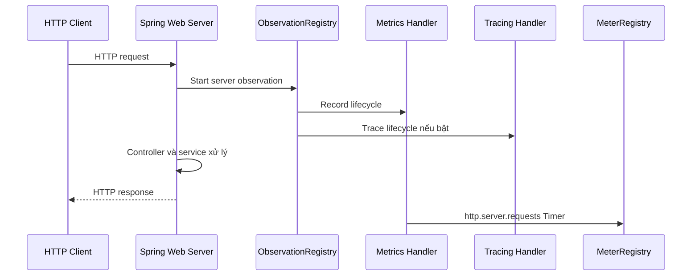
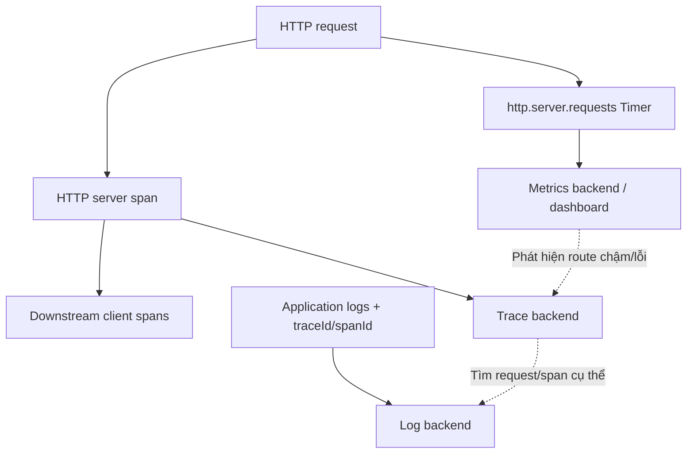

# http.server.requests trong Spring Boot

Một API Spring Boot nhận hàng nghìn HTTP requests mỗi phút. Người vận hành cần biết route nào chậm, tỷ lệ lỗi có tăng không, endpoint nào nhận nhiều traffic và độ trễ thay đổi sau khi triển khai phiên bản mới. Meter **`http.server.requests`** của Micrometer cung cấp điểm quan sát tiêu chuẩn cho thời lượng và số lượng HTTP server requests, thường được tạo tự động khi Actuator/Micrometer tích hợp với web stack.

`http.server.requests` là một Timer: nó ghi nhận thời lượng xử lý request và số lần ghi nhận. Tùy registry/configuration, Timer còn xuất tổng thời gian, histogram buckets hoặc percentile distributions. Các tags như method, status, outcome và URI route template giúp phân nhóm số liệu. Tag URI cần dùng route template ổn định; nếu đưa raw URL chứa ID/query vào, số time series có thể tăng theo từng request.

Bài **http.server.requests** thuộc chương **HTTP server observability** của module **SPRING_BOOT_OBSERVABILITY**. Module tập trung thiết lập observability cho Spring Boot bằng Micrometer Observation, metrics, logs và distributed tracing. Học propagation ngữ cảnh, tag/cardinality, exporter, sampling và liên kết tín hiệu để điều tra lỗi, độ trễ và hành vi ứng dụng trên môi trường thực.

## 1. Mục tiêu học tập

Sau bài học, bạn có thể:

- Giải thích meter `http.server.requests` được tạo và ghi nhận trong Spring MVC/WebFlux.
- Đọc count, total time, max, histogram và percentile của HTTP server Timer.
- Hiểu các tags phổ biến như method, uri, status, outcome và exception.
- Phân biệt route template với raw request path và tránh high-cardinality tags.
- Cấu hình histogram/percentiles và export metrics phù hợp.
- Tạo hoặc điều chỉnh HTTP observations theo cơ chế Micrometer/Spring Boot.
- Liên kết HTTP metrics với traces/logs để điều tra latency và errors.
- Chẩn đoán meter không xuất hiện, tag không như kỳ vọng hoặc metrics backend có cardinality tăng bất thường.

## 2. `http.server.requests` là gì?

Spring Boot tích hợp Micrometer với web server để quan sát HTTP requests đi vào ứng dụng. Với Spring MVC và Spring WebFlux được hỗ trợ, instrumentation tạo Observation cho vòng đời server request. Metrics ObservationHandler ghi Timer tương ứng vào MeterRegistry; tracing handler có thể tạo server span nếu Micrometer Tracing được cấu hình.



Sơ đồ diễn tả luồng khái quát. Tên meter, tags và thời điểm record phụ thuộc Spring Boot, web stack và phiên bản Micrometer. Instrumentation chuẩn giúp ứng dụng có số liệu nền mà không cần tự viết Timer cho mọi controller.

### Timer ghi nhận những gì?

`http.server.requests` thường là Timer với các measurements:

| Measurement | Ý nghĩa | Cách sử dụng |
| --- | --- | --- |
| `COUNT` | Số lần request được ghi nhận | Request volume trong khoảng thời gian |
| `TOTAL_TIME` | Tổng thời gian xử lý tích lũy | Tổng latency; chia cho count để ra trung bình |
| `MAX` | Thời lượng lớn nhất trong cửa sổ/chu kỳ registry báo cáo | Phát hiện request rất chậm; không thay thế histogram |
| Histogram buckets | Phân phối observations theo ngưỡng thời gian | Tính quantile ở backend hỗ trợ histogram |
| Percentiles | Quantiles được tính theo cấu hình Micrometer ở process | Quan sát p50/p95/p99 cục bộ; không cộng gộp tùy ý giữa instances |

Đơn vị hiển thị của Actuator thường là seconds cho Timer, nhưng cách export/naming và đơn vị trong backend tùy registry. Hãy đọc metadata của meter và convention exporter thay vì giả định mọi backend biểu diễn giống nhau.

## 3. Các tags thường gặp

| Tag | Ví dụ | Ý nghĩa |
| --- | --- | --- |
| `method` | `GET`, `POST` | HTTP method |
| `uri` | `/orders/{orderId}`, `/actuator/health` | Route/path template đã chuẩn hóa |
| `status` | `200`, `404`, `500` | HTTP response status |
| `outcome` | `SUCCESS`, `CLIENT_ERROR`, `SERVER_ERROR` | Nhóm kết quả theo status |
| `exception` | `None`, tên exception | Exception theo convention |

Danh sách chính xác có thể thay đổi theo Spring Boot version, MVC/WebFlux, custom convention và filters. Một số tag chỉ xuất hiện khi có giá trị phù hợp.

### Vì sao uri phải là route template?

Giả sử API nhận các request:

```text
GET /orders/10001
GET /orders/10002
GET /orders/10003
```

Chúng thuộc cùng route template:

```text
GET /orders/{orderId}
```

Route template gom requests cùng endpoint vào một time-series dimension. Nếu metrics ghi raw path, mỗi order ID có thể tạo tag value khác nhau. Khi traffic lớn, series count tăng nhanh.

Không đưa query string hoặc identifier vào URI tag. Các path như `/search?q=some-free-text`, `/users/alice@example.com` hoặc `/download?token=...` có thể chứa cardinality lớn, PII hoặc secrets. Dùng route template và low-cardinality business category đã được policy cho phép.

## 4. Đọc số liệu trong Actuator

Khi ứng dụng có `spring-boot-starter-actuator`, web server metrics được đăng ký; endpoint metrics cần được expose theo cấu hình:

```http
GET /actuator/metrics
GET /actuator/metrics/http.server.requests
```

Để lọc một tag, gửi query parameter:

```http
GET /actuator/metrics/http.server.requests?tag=method:GET
GET /actuator/metrics/http.server.requests?tag=status:200
GET /actuator/metrics/http.server.requests?tag=uri:/orders/{orderId}
```

Encoding ký tự ngoặc nhọn trong URI query tùy HTTP client. Dùng URL encoding hoặc chức năng urlencode của client khi gọi từ terminal. Thay giá trị minh họa bằng tag thực tế mà meter báo cáo.

### Ví dụ response khái quát

```json
{
  "name": "http.server.requests",
  "measurements": [
    {"statistic": "COUNT", "value": 1200},
    {"statistic": "TOTAL_TIME", "value": 18.4},
    {"statistic": "MAX", "value": 0.82}
  ],
  "availableTags": [
    {"tag": "method", "values": ["GET", "POST"]},
    {"tag": "status", "values": ["200", "400", "500"]}
  ]
}
```

Đây là response minh họa, không phải số đo thực tế. Giá trị, tags và đơn vị do meter/registry cung cấp.

### Tính average latency

\[
\text{Average latency}=\frac{\text{TOTAL\_TIME}}{\text{COUNT}}
\]

Ví dụ `TOTAL_TIME = 18.4` seconds và `COUNT = 1200`, average xấp xỉ 0.0153 seconds, tức 15.3 milliseconds. Average hữu ích cho tổng quan nhưng có thể che giấu tail latency: một tỷ lệ nhỏ requests rất chậm bị trung bình làm mờ.

### MAX không phải p99

`MAX` là maximum được ghi nhận trong cửa sổ/chu kỳ mà meter/registry báo cáo; nó không phải percentile. p95/p99 cần histogram hoặc percentile configuration phù hợp. Đừng diễn giải MAX thành “99% request nhanh hơn giá trị này”.

## 5. Bật histogram và percentile

Micrometer Timer có thể publish histogram buckets hoặc percentile values. Histogram hữu ích khi cần tổng hợp quantiles qua nhiều instances trong backend hỗ trợ histogram. Client-side percentiles được tính riêng trong từng process và không nên cộng/trung bình giữa replicas để suy ra p95/p99 toàn cụm.

Ví dụ cấu hình histogram:

```yaml
management:
  metrics:
    distribution:
      percentiles-histogram:
        http.server.requests: true
```

Percentiles cục bộ:

```yaml
management:
  metrics:
    distribution:
      percentiles:
        http.server.requests: 0.5,0.95,0.99
```

SLA/explicit bucket boundaries:

```yaml
management:
  metrics:
    distribution:
      slo:
        http.server.requests: 50ms,100ms,250ms,500ms,1s
```

Tên property và cách registry sử dụng histogram/SLO cần khớp version. Với Prometheus, histogram buckets có thể được truy vấn để tính quantile; backend khác có cú pháp và support khác nhau.

### Histogram có chi phí

Histogram sinh thêm series cho mỗi tổ hợp meter tags và bucket boundaries. Trước khi bật ở production:

1. Giới hạn tag values và chuẩn hóa route.
2. Chọn bucket boundaries phù hợp SLA/latency thực tế.
3. Ước lượng số routes × methods × outcomes × buckets × instances.
4. Kiểm tra ingestion/storage quota và dashboard queries.
5. Theo dõi series count sau rollout.

## 6. Export http.server.requests ra metrics backend

Actuator `/actuator/metrics` đọc meter trong process. Để lưu time series bên ngoài, cần registry/exporter hoặc cơ chế scrape phù hợp.

### Prometheus scrape

```kotlin
dependencies {
    implementation("org.springframework.boot:spring-boot-starter-actuator")
    runtimeOnly("io.micrometer:micrometer-registry-prometheus")
}
```

Expose endpoint:

```yaml
management:
  endpoints:
    web:
      exposure:
        include: health,metrics,prometheus
```

Prometheus scrape ứng dụng tại `/actuator/prometheus`. Đây là metrics pipeline; nó không xuất distributed traces.

### OTLP metrics hoặc registry khác

Nếu metrics backend nhận OTLP, cấu hình Micrometer registry/exporter hỗ trợ OTLP theo version của ứng dụng. OTel tracing bridge không tự bảo đảm Micrometer meters được gửi dưới dạng OTLP metrics. Tracing exporter và metrics registry là hai pipeline cần xác minh riêng.

Tên meter có thể được chuyển đổi theo naming convention của registry. Prometheus thường chuyển dấu chấm thành dấu gạch dưới và biểu diễn Timer bằng các series như count, sum, max hoặc bucket, tùy registry/configuration.

## 7. Observation và custom HTTP server metrics

Với phần lớn ứng dụng Spring MVC/WebFlux, nên tận dụng HTTP server instrumentation có sẵn. Không thêm Timer trong mọi controller chỉ để đo cùng request; việc đó có thể tạo số liệu trùng hoặc đo một phần lifecycle khác với server request.

Nếu cần dimension nghiệp vụ cardinality thấp, dùng Observation convention/filter được hỗ trợ bởi phiên bản. Ví dụ có thể phân nhóm luồng hữu hạn như `channel=web|partner`, nếu thật sự cần và policy cho phép.

### Custom Observation cho operation nghiệp vụ khác

`order.validation` là operation nội bộ, không thay thế `http.server.requests`:

```java
import io.micrometer.observation.Observation;
import io.micrometer.observation.ObservationRegistry;
import org.springframework.stereotype.Service;

@Service
public class OrderValidationService {
    private final ObservationRegistry registry;

    public OrderValidationService(ObservationRegistry registry) {
        this.registry = registry;
    }

    public void validate(Order order) {
        Observation observation = Observation
            .createNotStarted("order.validation", registry)
            .lowCardinalityKeyValue("operation", "validate")
            .start();

        try (Observation.Scope scope = observation.openScope()) {
            try {
                performValidation(order);
                observation.lowCardinalityKeyValue("outcome", "success");
            } catch (RuntimeException ex) {
                observation.lowCardinalityKeyValue("outcome", "error");
                observation.error(ex);
                throw ex;
            }
        } finally {
            observation.stop();
        }
    }

    private void performValidation(Order order) {
        // Business validation
    }
}

record Order(String id) {}
```

Nếu metrics và tracing handlers hoạt động, observation có thể đóng góp meter/span theo cấu hình. Không gắn `order.id` làm low-cardinality key; ID từng đơn có thể làm metrics cardinality tăng mạnh.

Spring Boot cho phép tùy biến HTTP server observations qua extension points tùy stack/version, chẳng hạn ObservationConvention hoặc ObservationFilter. Khi tùy biến, giữ tên meter ổn định, giữ route template, chỉ thêm dimension có tập hữu hạn, không xóa tags chuẩn cần cho diagnostics và kiểm tra stack đang dùng. API cụ thể phải khớp phiên bản.

## 8. Liên kết HTTP metrics với distributed tracing

`http.server.requests` trả lời câu hỏi tổng hợp: endpoint nào chậm, tỷ lệ 5xx của route tăng hay giảm, traffic của từng method/route phân bố thế nào. Distributed trace trả lời câu hỏi theo từng request được sample: request đi qua service nào, span nào chiếm phần lớn latency, dependency/database call nào chậm và exception phát sinh ở boundary nào.



Metrics cho tín hiệu tổng hợp; trace hỗ trợ điều tra request cụ thể; logs cung cấp chi tiết nghiệp vụ/lỗi có kiểm soát. Sampling làm trace backend chỉ chứa một tập requests, nên metrics vẫn quan trọng để biết xu hướng toàn bộ traffic.

Không dùng trace ID làm metric tag. Trace ID có giá trị riêng cho mỗi trace; thêm nó vào `http.server.requests` tags có thể tạo một series cho mỗi request. Dùng trace/span IDs trong logs hoặc tracing backend correlation; giữ metric tags low-cardinality.

## 9. Phân tích latency và error rate

### Latency

Đối chiếu latency theo route template, method và status/outcome:

- Average latency tăng: phần lớn hoặc một nhóm requests có thể chậm hơn.
- p95 tăng nhưng average ổn định: tail latency xấu đi với nhóm requests chậm.
- p99 tăng mạnh: điều tra outliers, queueing, connection pools, GC và downstream calls.
- Max tăng nhưng p95 ổn định: có thể chỉ có outliers; cần histogram/trace để hiểu thêm.

### Error rate

Có thể tính error ratio từ số requests thuộc nhóm status/outcome lỗi chia tổng requests trong cùng thời gian và cùng phạm vi tags:

\[
\text{Error ratio}=\frac{\text{Error requests}}{\text{All requests}}
\]

Phân loại 4xx và 5xx theo mục tiêu vận hành. 4xx có thể phản ánh input/client behavior; 5xx thường đáng chú ý hơn với server reliability, nhưng một số API có contract riêng. Đừng coi mọi 4xx là lỗi server.

HTTP response 500 có thể do exception; response 400 có thể do validation; request có thể trả 2xx nhưng business result vẫn thất bại theo semantics riêng. Tags status, outcome và exception mô tả các góc nhìn khác nhau. Dashboard cần định nghĩa error rõ ràng, không chỉ đếm mọi response không phải 2xx mà không xét contract.

## 10. Cardinality, security và dữ liệu request

| Dữ liệu | Có nên là metric tag? | Lý do |
| --- | --- | --- |
| HTTP method | Có | Tập giá trị nhỏ |
| Route template | Có | Tập route hữu hạn và ổn định |
| Status code | Có | Tập giá trị tương đối giới hạn |
| Outcome | Có | Nhóm kết quả hữu hạn |
| Exception class | Cân nhắc | Có thể tăng nếu exception types sinh động |
| Raw URL/query string | Không | Cardinality và privacy risk |
| User ID/order ID/email | Không | Gần như duy nhất và có thể là PII |
| Trace ID/span ID | Không | Cardinality gần bằng số request |
| Authorization header/cookie | Không | Secrets và dữ liệu nhạy cảm |
| Client IP | Thường không | Cardinality, privacy và policy |

Request/response payload không thuộc metric tag. Nếu cần điều tra payload cụ thể, dùng logging/tracing có redaction, access control và retention phù hợp. Không ghi token, mật khẩu, payment card data hoặc personal data vào Observation key-values.

Metrics endpoint có thể để lộ internal route names, meter names và workload patterns. Expose tối thiểu và bảo vệ bằng network policy/Spring Security. Không expose toàn bộ Actuator endpoints công khai chỉ để đọc `http.server.requests`.

## 11. Kiểm tra cấu hình và troubleshooting

| Triệu chứng | Nguyên nhân có thể | Cách kiểm tra |
| --- | --- | --- |
| Không thấy `http.server.requests` | Thiếu Actuator/Micrometer web instrumentation hoặc web stack/configuration khác | Kiểm tra dependency, server stack và MeterRegistry |
| Endpoint `/actuator/metrics` trả 404 | Chưa expose metrics, thiếu Actuator hoặc management path/port khác | Kiểm tra endpoint exposure và management server |
| Count không tăng | Chưa có request sau startup, meter không record hoặc đang xem instance khác | Gửi request test và kiểm tra đúng process |
| Thiếu tag `uri` | Route chưa resolve, request chưa match handler hoặc stack convention khác | Xem availableTags và request mapping |
| `uri` có raw ID/query | Custom convention/tag provider không normalize route | Dùng route template và bỏ query values |
| Có count nhưng không có percentile | Histogram/percentile chưa bật hoặc registry không hỗ trợ | Kiểm tra distribution config/export format |
| Actuator có meter nhưng backend trống | Chưa cấu hình registry/exporter hoặc scrape target | Kiểm tra metrics pipeline |
| Latency metrics thấp nhưng user thấy chậm | Đoạn chậm nằm ngoài server observation hoặc ở downstream/queue/client | Xem trace và thời gian ở client/load balancer |
| Duplicate HTTP timers | Instrumentation trùng hoặc custom Timer bọc cùng request | Rà soát filters/observations |
| Metrics cardinality tăng đột biến | URI/exception/custom tag có nhiều giá trị | Kiểm tra series count và tag samples |
| p95 giữa replicas không khớp | Percentiles cục bộ hoặc lượng request khác nhau | Dùng histogram buckets và backend aggregation |

### Checklist điều tra

1. Xác nhận ứng dụng đang chạy MVC hay WebFlux và version tương ứng.
2. Kiểm tra Actuator, MeterRegistry và web instrumentation dependency.
3. Gửi một request có route template đã biết.
4. Đọc `/actuator/metrics/http.server.requests` và xem availableTags.
5. Xác nhận `uri` là template, không phải raw path/query.
6. Kiểm tra histogram/percentile config và registry backend.
7. Đối chiếu count/latency với access logs, traces và load balancer metrics.
8. Kiểm tra custom timer/filter tạo duplicate hay không.
9. Ước lượng cardinality và kiểm tra privacy trước khi deploy tag/convention mới.

## 12. Bài thực hành: phân tích HTTP server requests

**Bối cảnh:** `order-service` có các routes GET collection, GET item và POST order. Nhóm vận hành muốn theo dõi request count, latency p95 và tỷ lệ server errors theo route.

### Phần A — Chuẩn bị

1. Thêm Actuator và cấu hình MeterRegistry phù hợp.
2. Expose health và metrics trong môi trường test.
3. Bật histogram cho `http.server.requests` theo cấu hình tương thích.
4. Gửi requests thành công và requests tạo 4xx/5xx có kiểm soát.
5. Đọc meter qua Actuator và ghi lại available tags.

### Phần B — Phân tích

| Ca | Thao tác | Kết quả cần quan sát |
| --- | --- | --- |
| A — GET collection | Gọi route collection nhiều lần | Count của route template tăng |
| B — GET item | Gọi nhiều order IDs | Requests được gom theo cùng route template |
| C — POST success | Tạo order hợp lệ | Status/outcome phản ánh success |
| D — Client error | Gửi payload validation sai | 4xx và outcome tương ứng |
| E — Server error | Tạo lỗi test ở handler | 5xx, exception và latency |
| F — Histogram | Query backend có buckets | Có thể tính quantile theo backend query |
| G — Cardinality | Thử raw path IDs ở custom tag trong test cô lập | Nhận ra series tăng và loại bỏ tag sai |

### Phần C — Câu hỏi tự đánh giá

1. `http.server.requests` là Counter hay Timer? Nó đo những gì?
2. Vì sao COUNT và TOTAL_TIME dùng để tính average latency?
3. MAX khác p99 như thế nào?
4. Vì sao route template tốt hơn raw path chứa order ID?
5. Khi nào cần histogram thay vì chỉ dùng percentile cục bộ?
6. Vì sao không đưa traceId hoặc userId vào metric tags?
7. Nếu Actuator có meter nhưng Prometheus không có dữ liệu, cần kiểm tra pipeline nào?
8. Tại sao response 2xx vẫn có thể đại diện cho business failure?
9. Làm thế nào kết hợp `http.server.requests` với trace để tìm dependency gây latency?
10. Vì sao không nên tạo Timer thủ công trong mỗi controller nếu web instrumentation đã đo toàn request?

## 13. Ghi nhớ

**`http.server.requests` là Timer tiêu chuẩn để quan sát HTTP server requests trong Spring Boot/Micrometer.** Nó cung cấp số lượng và thời lượng request; tùy cấu hình có thể có max, histogram buckets hoặc percentile. Tags như method, route template, status, outcome và exception giúp phân tích traffic, latency và errors theo chiều có giới hạn.

Hãy đọc meter qua Actuator để xác minh instrumentation, sau đó export/scrape bằng registry phù hợp để lưu time series. Dùng histogram khi cần quantiles tổng hợp qua nhiều instances; không xem MAX là p99 và không gộp percentile cục bộ tùy tiện. Giữ URI ở dạng route template, tránh raw IDs/query/PII và không đưa trace ID vào metric tags. Metrics cho biết xu hướng toàn bộ traffic; traces và logs giúp điều tra request cụ thể. Kết hợp các tín hiệu này giúp vận hành HTTP services có căn cứ mà vẫn kiểm soát cardinality, bảo mật và chi phí observability.
