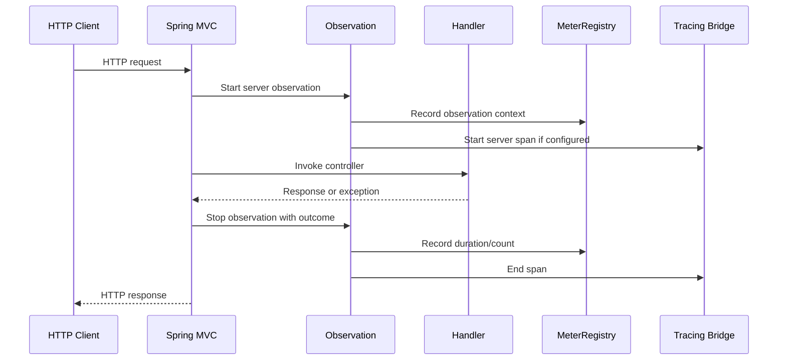
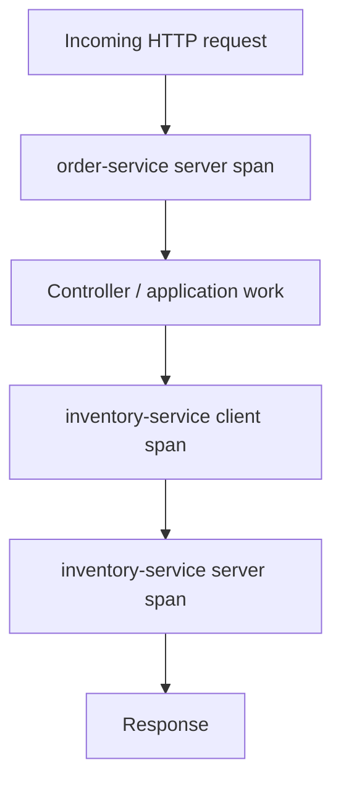

# HTTP server observation trong Spring Boot

**HTTP server observation** mô tả vòng đời một request HTTP khi đi vào ứng dụng Spring Boot và được xử lý ở phía server. Observation cung cấp ngữ cảnh để ghi nhận thời gian xử lý, kết quả request, route và lỗi. Khi Micrometer Tracing được tích hợp, observation có thể tạo span; khi MeterRegistry phù hợp được cấu hình, cùng observation có thể đóng góp vào metrics như số lượng request và thời gian xử lý.

Trong module **SPRING_BOOT_OBSERVABILITY**, logging, metrics và distributed tracing tạo góc nhìn bổ sung về hành vi ứng dụng. Bài thuộc chương **HTTP server observability**, trình bày observation trong Spring MVC, lifecycle, key values, route template và cardinality, xử lý lỗi/async, tùy biến convention và troubleshooting.

## 1. HTTP server observation là gì?

Khi client gửi request, Spring MVC tiếp nhận request, tìm handler, chạy controller/service, tạo response rồi trả kết quả về client. HTTP server observation bao quanh phần xử lý request phía server để ghi nhận những thuộc tính cần thiết cho observability.

Observation giúp trả lời: request nào đang được xử lý; route logic nào được gọi; HTTP method và status là gì; request mất bao lâu; có exception không; request thuộc service/trace nào; metrics tổng hợp thay đổi ra sao theo route/status.

Observation không thay thế request handling hay business transaction. Nó là lớp instrumentation bao quanh hoạt động để ứng dụng đo lường và liên kết dữ liệu.

### Luồng tổng quan



Sơ đồ diễn tả vai trò khái niệm. Điểm bắt đầu/kết thúc cụ thể phụ thuộc Spring Boot/Spring Framework version, Servlet stack và async lifecycle. Không giả định mọi custom filter đều chạy bên trong cùng observation scope.

## 2. Observation, metrics và tracing liên kết thế nào?

Micrometer Observation là abstraction để instrument một hoạt động và kết nối với các handler tương ứng. Một observation có thể được xử lý bởi:

- **Meter observation handler:** ghi metrics như Timer/Counter.
- **Tracing observation handler:** tạo span và liên kết trace context.
- **Logging/correlation integration:** cung cấp trace/span context cho log correlation nếu cấu hình hỗ trợ.

| Signal | Dữ liệu điển hình | Câu hỏi |
| --- | --- | --- |
| Metrics | Request count, duration, method, route, status | Bao nhiêu request? Route nào chậm? |
| Trace | Server span, Trace ID, Span ID, parent context | Request đi qua service nào? |
| Logs | Sự kiện ứng dụng, exception, Trace ID/Span ID | Điều gì xảy ra trong lúc xử lý? |

Các signal có pipeline export và retention riêng. Observation không đảm bảo mọi signal đều tự động được export: cần registry, tracing bridge, exporter và logging integration tương ứng.

### 2.1. Observation khác span

Observation là abstraction của Micrometer; span là khái niệm distributed tracing. Khi tracing handler hoạt động, observation có thể tạo span. Nếu tracing chưa cấu hình, observation vẫn có thể ghi metrics mà không có span.

### 2.2. Observation khác metric riêng

Timer thủ công có thể đo thời gian một method. HTTP server observation có ngữ nghĩa ở cấp request, thường bao gồm method, route, status và outcome theo convention. Tránh tạo Timer thủ công trùng lặp cho cùng request nếu metrics mặc định đã đủ.

## 3. HTTP server observation trong Spring MVC

Với Spring Boot dùng Spring MVC và Actuator/Micrometer tương thích, framework có thể instrument request để tạo server observation mặc định. Observation thường xuất hiện dưới tên metric như `http.server.requests`; tên span và convention phụ thuộc version, tracing bridge và instrumentation.

Để automatic instrumentation hoạt động, kiểm tra:
- Ứng dụng dùng stack Servlet/Spring MVC tương ứng.
- Dependency actuator/observation cần thiết có mặt và version tương thích.
- Spring Boot cấu hình ObservationRegistry.
- MeterRegistry được cấu hình nếu cần metrics.
- Micrometer Tracing bridge/exporter được cấu hình nếu cần spans.
- Không có filter/custom instrumentation loại bỏ hoặc tạo trùng observation.

Không suy luận chỉ thêm starter web là mọi metrics/traces đã được export tới backend. Auto instrumentation, signal handler và exporter là những phần khác nhau.

### 3.1. Dependencies

Ví dụ ứng dụng Spring Boot dùng Actuator và Spring MVC:

```xml
<dependencies>
    <dependency>
        <groupId>org.springframework.boot</groupId>
        <artifactId>spring-boot-starter-web</artifactId>
    </dependency>
    <dependency>
        <groupId>org.springframework.boot</groupId>
        <artifactId>spring-boot-starter-actuator</artifactId>
    </dependency>
</dependencies>
```

Spring Boot BOM/parent nên quản lý version. Tracing bridge và exporter chỉ cần thêm khi ứng dụng cần distributed traces. Không thêm dependency tracing tùy tiện nếu platform đã cung cấp instrumentation khác.

### 3.2. Controller minh họa

```java
package com.example.orders;

import org.springframework.http.ResponseEntity;
import org.springframework.web.bind.annotation.GetMapping;
import org.springframework.web.bind.annotation.RequestMapping;
import org.springframework.web.bind.annotation.RestController;

@RestController
@RequestMapping("/api/orders")
public class OrderController {

    @GetMapping("/{orderId}")
    public ResponseEntity<String> findOrder() {
        return ResponseEntity.ok("order found");
    }
}
```

Ví dụ bỏ qua việc lấy orderId để tập trung vào endpoint. Trong ứng dụng thật, route có path variable; observation nên dùng route template thay raw URI có ID cụ thể.

## 4. Lifecycle của HTTP server observation

Observation thường bắt đầu khi request được tiếp nhận và kết thúc khi framework xác định response đã được xử lý xong theo semantics của request. Các bước khái niệm:

1. Nhận HTTP request.
2. Extract trace context từ headers nếu propagation/tracing được bật.
3. Tạo server observation và span nếu tracing handler hoạt động.
4. Xác định handler/route và thực thi controller.
5. Ghi nhận response status, exception/outcome.
6. Kết thúc observation, ghi duration và kết thúc span.

Thời điểm cụ thể của route resolution, status capture và stop event phụ thuộc framework version và kiểu dispatch. Với async request, xử lý có thể tiếp tục sau khi thread ban đầu trả về; observation phải theo lifecycle async mà framework hỗ trợ.

### 4.1. Exception và response status

Nếu handler ném exception, framework có thể chuyển exception qua exception resolver, tạo response status tương ứng và ghi nhận outcome. Lỗi nghiệp vụ được mapping thành HTTP 4xx không nhất thiết có ý nghĩa như lỗi server 5xx. Quan sát cả status và exception semantics, tránh xem mọi non-2xx là lỗi hệ thống.

### 4.2. Async request

Với Servlet async hoặc deferred result, request có thể hoàn tất sau lần dispatch đầu tiên. Không tự đóng observation trong filter ngay sau khi controller trả về một async handle nếu framework còn tiếp tục xử lý. Dùng integration/lifecycle hooks được Spring hỗ trợ để observation dừng đúng thời điểm hoàn tất.

## 5. Low-cardinality và high-cardinality key values

Observation có thể gắn key values để mô tả hoạt động. Micrometer phân biệt:

- **Low-cardinality key values:** tập giá trị nhỏ, ổn định, phù hợp cho metric tags.
- **High-cardinality key values:** giá trị có thể đa dạng lớn, thường phù hợp hơn với span attributes nếu thực sự cần.

| Key | Ví dụ | Phân loại |
| --- | --- | --- |
| method | GET, POST | Low cardinality |
| status | 200, 404, 500 | Low cardinality |
| outcome | SUCCESS, CLIENT_ERROR, SERVER_ERROR | Low cardinality |
| uri | /api/orders/{orderId} | Low cardinality nếu dùng route template |
| Raw request URI | /api/orders/8f2... | High cardinality |
| Trace ID | Một giá trị mỗi trace | High cardinality |
| User ID | Nhiều giá trị | High cardinality, có thể nhạy cảm |

Tên key cụ thể phụ thuộc convention/framework version. Bảng mô tả ngữ nghĩa thường gặp; kiểm tra measurements/traces thực tế của phiên bản đang chạy.

### 5.1. Vì sao route template quan trọng?

Nếu dùng raw URI làm metric tag, mỗi order ID có thể tạo một time series khác nhau:

```text
/api/orders/101
/api/orders/102
/api/orders/103
```

Đây là các URI khác nhau nhưng cùng route logic:

```text
/api/orders/{orderId}
```

Route template giúp nhóm metrics theo endpoint logic và tránh cardinality tăng theo số tài nguyên. Không tự thay uri bằng raw path trong custom convention.

### 5.2. Không đưa request identity vào metric tags

Tránh gắn Trace ID, request ID, user ID, email, order ID hoặc raw query string thành metric tag. Dùng Trace ID để tìm trace, log correlation để liên kết logs với trace, và business identifiers đã được bảo vệ trong hệ thống phù hợp khi cần.

## 6. HTTP server metrics

Metric phổ biến cho request server là `http.server.requests`, thường được biểu diễn bằng Timer. Timer có thể cung cấp số lần ghi nhận và tổng thời gian; histogram/percentiles phụ thuộc cấu hình registry.

Các dimension thường gặp:
- HTTP method.
- Route/URI template.
- Response status.
- Outcome.
- Exception nếu convention có và giá trị được kiểm soát.

Ví dụ tags minh họa:

```text
http.server.requests{
  method="GET",
  uri="/api/orders/{orderId}",
  status="200",
  outcome="SUCCESS"
}
```

Output thực tế có thể có thêm/bớt tags, khác kiểu metric theo registry và framework version. Không coi ví dụ là output chính xác của mọi ứng dụng.

### 6.1. Đọc metric qua Actuator

Nếu endpoint metrics được expose:

```http
GET /actuator/metrics
```

Xem request metric:

```http
GET /actuator/metrics/http.server.requests
```

Có thể filter theo tag nếu metric và endpoint hỗ trợ:

```http
GET /actuator/metrics/http.server.requests?tag=method:GET
```

Actuator metrics endpoint hữu ích để kiểm tra measurements tại ứng dụng. Nó không thay thế Prometheus/Grafana hay backend metrics có retention, alerting và query mạnh hơn. Chỉ expose management endpoints theo security policy.

### 6.2. Timer, histogram và percentiles

Timer cơ bản cung cấp count và total time. Histogram giúp backend tính phân phối/quantiles theo cách của registry. Cấu hình histogram và percentiles phụ thuộc meter type, registry và backend.

Không so sánh percentile giữa hai backend nếu semantics bucket/aggregation khác nhau. Với Prometheus, thiết kế histogram buckets có kiểm soát để tránh tăng series quá mức.

## 7. HTTP server tracing và distributed context

Khi Micrometer Tracing bridge được cấu hình, HTTP server observation có thể tạo server span. Nếu client gửi W3C Trace Context và server instrumentation extract được headers, server span có thể nối vào trace hiện có.

Ví dụ request:

```http
GET /api/orders/42 HTTP/1.1
Host: order-service
traceparent: 00-4bf92f3577b34da6a3ce929d0e0e4736-00f067aa0ba902b7-01
```

Trace ID và parent span ID được dùng theo propagation protocol để thiết lập quan hệ. Server span có span ID riêng. Không tự xử lý traceparent thủ công nếu instrumentation đã quản lý propagation.

### 7.1. Server span và downstream spans

Nếu controller gọi inventory service qua HTTP client được instrument, outgoing client span có thể là child của server span. Nếu client không instrumented hoặc context không được truyền, trace có thể bị tách.



Sơ đồ thể hiện quan hệ khái niệm. Thực tế có thể có spans cho database, messaging và operations nội bộ khác.

### 7.2. Sampling

Server observation có thể tạo span nhưng span chỉ được export theo sampling policy. Không tìm thấy trace không chứng minh request không được xử lý. Dùng metrics để theo dõi toàn traffic và traces như mẫu request đã được giữ.

## 8. Resource, baggage và correlation

Phân biệt các loại metadata:
- **Resource:** định danh service, version, environment, instance.
- **Observation low-cardinality values:** method, route template, status, outcome.
- **Span attributes:** thuộc tính của operation/request cụ thể nếu được phép.
- **Baggage:** key-value được truyền theo trace context qua service.
- **Log correlation:** Trace ID/Span ID và fields cần thiết trong logs.

Không nhầm service.name với route, không đưa request ID thành Resource và không copy mọi baggage field sang metric tags.

Server observation hữu ích khi route và status values ổn định. Custom fields cần được phân loại low/high cardinality và kiểm tra data privacy.

## 9. Tùy biến HTTP server observation convention

Spring Framework cung cấp observation convention để định nghĩa tên observation và key values theo HTTP server context. Trong Spring MVC, integration có thể dùng convention mặc định; ứng dụng có thể cung cấp convention tùy chỉnh khi cần thêm dimension nghiệp vụ có tập giá trị nhỏ.

Ví dụ mở rộng convention mặc định:

```java
import io.micrometer.common.KeyValue;
import io.micrometer.common.KeyValues;
import org.springframework.http.server.observation.DefaultServerRequestObservationConvention;
import org.springframework.http.server.observation.ServerRequestObservationContext;

public class ApplicationServerObservationConvention
        extends DefaultServerRequestObservationConvention {

    @Override
    public KeyValues getLowCardinalityKeyValues(
            ServerRequestObservationContext context) {

        return super.getLowCardinalityKeyValues(context)
                .and(KeyValue.of("application", "orders"));
    }
}
```

Ví dụ dùng API Spring Framework observation; kiểm tra package/API đúng với version Spring Framework được Spring Boot quản lý. Convention cần được đăng ký theo cơ chế cấu hình mà version đang dùng hỗ trợ; không chỉ tạo instance rồi kỳ vọng framework tự sử dụng.

### 9.1. Chỉ thêm tags có giá trị vận hành

Custom low-cardinality key value nên có tập giá trị nhỏ, ý nghĩa khi nhóm metrics, không phụ thuộc request ID/dữ liệu client tùy ý, không chứa PII/secrets/raw query strings và có contract rõ ràng.

Ví dụ application=orders chỉ hữu ích nếu thực sự cần phân biệt component logic. Nếu đã có service.name trong Resource, tag lặp lại có thể không cần thiết.

### 9.2. Giữ convention mặc định

Khi override convention, kế thừa và mở rộng convention mặc định thường giúp giữ key values framework cung cấp. Nếu thay toàn bộ convention bằng implementation rút gọn, metrics có thể mất method/route/status hoặc đổi tên observation ngoài dự kiến.

Kiểm tra effective observation name và low/high-cardinality values sau khi thay convention.

## 10. Observation filters và handlers

Convention quyết định tên và key values của observation cụ thể. Filter có thể điều chỉnh observation context theo API Micrometer hỗ trợ; handlers nhận lifecycle events và chuyển thành metrics/tracing hoặc tích hợp khác.

| Thành phần | Vai trò |
| --- | --- |
| ObservationRegistry | Registry quản lý observations |
| ObservationConvention | Đặt tên và key values theo context |
| ObservationFilter | Biến đổi observation context theo policy |
| ObservationHandler | Xử lý lifecycle của observation |
| MeterRegistry | Lưu/đẩy metrics |
| Tracing bridge | Chuyển observation sang spans/context |

Không tự thêm handler tạo Timer nếu handler mặc định đã ghi Timer. Instrumentation trùng có thể làm request count/duration bị đếm hai lần.

### 10.1. Ignore một số request

Health check hoặc endpoint nội bộ có thể tạo nhiều observations và gây noise. Có thể có cơ chế filter/ignore tùy integration/version, hoặc dùng quy tắc routing/management metrics phù hợp.

Đừng loại bỏ mọi health checks một cách mù quáng: chúng quan trọng để phân biệt traffic người dùng và tình trạng hạ tầng. Đặt policy rõ ràng và ưu tiên route template thay vì raw URI động.

## 11. Exception, status và kết quả nghiệp vụ

HTTP status là tín hiệu về kết quả protocol, nhưng không đủ để hiểu mọi lỗi nghiệp vụ.

- 200: request thành công ở cấp HTTP, nhưng response có thể mô tả business decline theo contract.
- 400: client gửi request không hợp lệ.
- 401/403: authentication/authorization không thành công.
- 404: resource/route không tìm thấy theo semantics endpoint.
- 409: conflict nghiệp vụ hoặc tài nguyên.
- 429: rate limited.
- 5xx: server/gateway gặp lỗi.

Không chuyển mọi business rejection thành exception ERROR nếu nghiệp vụ biểu diễn bằng 4xx bình thường. Ngược lại, internal failure bị mapping thành 200 cần business/log/metric signal riêng nếu điều tra yêu cầu.

Convention framework thường ghi nhận status/outcome và exception theo cơ chế riêng. Kiểm tra ControllerAdvice/resolver: exception được bắt và chuyển response có thể không được thể hiện như exception thoát khỏi handler.

## 12. Async processing và thread context

Một HTTP request có thể khởi tạo async work hoặc trả response sau xử lý không đồng bộ. Trace context và observation lifecycle cần được truyền đúng qua executor/async framework.

Nguyên tắc:
- Dùng context propagation integration phù hợp với Spring/Micrometer.
- Không giữ scope observation/span mở trên thread ngoài lifecycle.
- Không tự kết thúc observation khi async response chưa hoàn tất.
- Đảm bảo callback/error path cũng kết thúc context.
- Kiểm tra worker thread được restore/cleanup sau task.

Nếu công việc nền tiếp tục sau HTTP response, nên tạo observation/span riêng cho công việc nền và liên kết với trace ban đầu theo cơ chế phù hợp, thay vì kéo dài server span vô hạn.

## 13. Bảo mật và quyền riêng tư

HTTP request có thể chứa dữ liệu nhạy cảm trong path, query, headers, cookies và body. Không ghi toàn bộ request vào observation attributes hoặc logs mặc định.

Tránh:
- Raw query strings có access token hoặc email.
- Authorization/Cookie headers.
- Raw URI có customer/order IDs trong metric tags.
- Request/response body có PII hoặc dữ liệu thanh toán.
- User identity không được phê duyệt trong low-cardinality tags.

Ưu tiên route template thay raw URI, method/status/outcome, error category đã chuẩn hóa, custom dimensions có allowlist và redaction tại nguồn. HTTPS bảo vệ dữ liệu trên đường truyền nhưng không xóa dữ liệu nhạy cảm khỏi telemetry đã lưu.

## 14. Troubleshooting HTTP server observation

| Triệu chứng | Nguyên nhân có thể | Cách kiểm tra |
| --- | --- | --- |
| Không có http.server.requests | Thiếu Actuator/Micrometer auto-configuration hoặc registry | Kiểm tra dependency và MeterRegistry |
| Metrics có nhưng không có server span | Chưa có tracing bridge/handler hoặc sampling drop | Kiểm tra bridge, sampler và exporter |
| Span có nhưng route UNKNOWN | Route chưa resolved khi capture hoặc convention khác | Kiểm tra MVC mapping và version |
| Tất cả route thành raw URI | Custom convention/filter dùng request URI | Chuyển sang route template |
| Cardinality tăng đột biến | Raw IDs/query strings/custom tags động | Kiểm tra tags/attributes |
| Request duration quá ngắn | Observation kết thúc trước async completion | Kiểm tra async lifecycle và filter ordering |
| Exception không xuất hiện | Exception được resolver xử lý hoặc handler không ghi error | Kiểm tra ControllerAdvice/status |
| Request đếm hai lần | Custom filter/handler tạo observation trùng | Kiểm tra instrumentation/manual Timer |
| Trace ID không nối từ client | traceparent mất/sai hoặc server không extract | Kiểm tra headers và propagator |
| Logs thiếu Trace ID | MDC/correlation hoặc async context chưa đúng | Kiểm tra logging integration |
| Actuator không thấy metric | Endpoint chưa expose, sai meter name hoặc chưa có request | Kiểm tra exposure và gọi request test |
| Metrics không tới backend | Registry/exporter/Collector pipeline lỗi | Kiểm tra metrics pipeline |
| Status/outcome không chính xác | Exception resolver/status mapping khác mong đợi | Kiểm tra response và convention |
| Dữ liệu nhạy cảm trong traces/logs | Custom attributes hoặc raw request logging | Redact tại nguồn |

### Quy trình điều tra

1. Gửi request test tới route đã biết.
2. Kiểm tra metric http.server.requests hoặc meter tương đương.
3. Kiểm tra tags: method, route template, status và outcome.
4. Nếu cần trace, xác minh Micrometer Tracing bridge và exporter.
5. Kiểm tra traceparent inbound và downstream context propagation.
6. Kiểm tra sampling trước khi kết luận server span bị mất.
7. Đối chiếu response status, exception resolver và observation lifecycle.
8. Nếu dùng async, kiểm tra duration và context ở callback.
9. Kiểm tra Collector/exporter/backend riêng theo từng signal.
10. Rà soát cardinality và dữ liệu nhạy cảm sau khi thêm custom convention/filter.

## 15. Bài thực hành: kiểm chứng HTTP server observation

Mục tiêu là gửi request vào Spring Boot, xác minh observation tạo metrics và nếu tracing được cấu hình thì server span nối với incoming trace context.

### Chuẩn bị

- Spring Boot 3.x application dùng Spring MVC.
- spring-boot-starter-actuator.
- Controller có endpoint GET/POST.
- MeterRegistry phù hợp.
- Micrometer Tracing bridge/exporter nếu cần trace backend.
- Actuator metrics endpoint expose an toàn trong lab.

### Bước 1 — Tạo endpoint

Dùng controller ở phần 3. Thêm route path variable để kiểm tra route template.

### Bước 2 — Bật metrics endpoint trong lab

```yaml
management:
  endpoints:
    web:
      exposure:
        include:
          - health
          - metrics
```

Chỉ expose endpoints cần cho lab. Trong production, bảo vệ management endpoints bằng security policy.

### Bước 3 — Tạo requests

Gửi request tới endpoint, gồm response 2xx, một response 4xx có chủ ý và một lỗi 5xx test-only nếu cần. Không gây lỗi trên production.

### Bước 4 — Xem metrics

Đọc /actuator/metrics/http.server.requests và kiểm tra count/duration theo method, URI template, status và outcome nếu tags đó có trong version hiện tại.

### Bước 5 — Kiểm tra route cardinality

Gọi /api/orders/101, /api/orders/102 và /api/orders/103. Xác nhận metrics gom về route template thay vì tạo ba tag URI riêng. Nếu không, tìm custom convention/filter đã thay đổi URI.

### Bước 6 — Bật tracing

Cấu hình tracing bridge và exporter tới backend lab. Gửi request có traceparent hợp lệ. Xác minh server span xuất hiện và có Trace ID tương ứng khi sampling giữ trace.

### Bước 7 — Gọi downstream

Từ controller gọi service khác qua HTTP client được instrument. Xác nhận client span và downstream server span nối cùng trace.

### Bước 8 — Thử custom convention

Mở rộng default server request observation convention để thêm low-cardinality field ổn định. Kiểm tra field xuất hiện đúng trong metric tags và không làm mất keys mặc định.

### Bước 9 — Thử async hoặc exception mapping

Nếu ứng dụng có async route, kiểm tra observation duration kết thúc khi response hoàn tất. Nếu có ControllerAdvice, kiểm tra status và exception theo semantics thực tế.

### Bước 10 — Kiểm tra privacy/cardinality

Xem tags/attributes ở metric và trace. Xác nhận không có order ID, raw query string, cookie, token hoặc PII ngoài allowlist.

### Checklist nghiệm thu

| Điều cần chứng minh | Kết quả mong đợi |
| --- | --- |
| Observation lifecycle | Hiểu start/stop và async caveat |
| Metrics | Request count/duration xuất hiện |
| Tags | Method, route template, status/outcome hợp lý |
| Trace | Server span xuất hiện khi tracing và sampling cho phép |
| Propagation | Incoming trace context nối đúng |
| Downstream | Client/server spans liên kết cùng trace |
| Cardinality | Path variable không thành raw metric tag |
| Convention | Custom value không làm mất defaults |
| Exception | Phân biệt HTTP status với business failure |
| Security | Không có tokens/PII trong attributes/logs |
| Export | Kiểm tra từng signal pipeline |
| Runtime | Actuator endpoint expose/bảo vệ đúng |

## 16. Những nguyên tắc cần ghi nhớ

1. **HTTP server observation mô tả vòng đời request phía server**, giúp đo duration, kết quả và gắn context observability.
2. **Micrometer Observation là abstraction; metrics và spans là output của handlers tương ứng.** Không mặc định một observation luôn được export thành mọi signal.
3. **Spring MVC/Actuator có thể cung cấp instrumentation mặc định**, nhưng dependency, registry, tracing bridge và exporter cần được cấu hình đúng.
4. **Dùng route template cho low-cardinality metrics.** Không dùng raw URI, IDs hoặc query strings làm metric tags.
5. **Server observation, span và log correlation có liên quan nhưng khác nhau.** Trace ID nối spans, metrics mô tả xu hướng, logs giải thích sự kiện.
6. **Parent context và sampling ảnh hưởng trace export.** Không thấy trace không chứng minh request không xảy ra.
7. **Async lifecycle cần được xử lý đúng.** Observation phải sống đến khi request hoàn tất và context phải được propagate/cleanup.
8. **Custom convention nên mở rộng defaults**, chỉ thêm key values ổn định, có ý nghĩa vận hành và cardinality thấp.
9. **Không tạo instrumentation trùng.** Manual Timer/filter/handler có thể đếm hai lần nếu framework đã đo request.
10. **Bảo vệ dữ liệu request.** Không đưa tokens, cookies, raw bodies, PII hoặc identifiers động vào metric tags/telemetry metadata.
11. **Xác minh end-to-end từng signal.** Kiểm tra observation, registry/tracing handler, exporter, Collector và backend.

HTTP server observation là nền tảng để hiểu request đi qua Spring Boot ở phía server. Khi framework observation được cấu hình nhất quán, route được chuẩn hóa và context truyền đúng, metrics cho thấy xu hướng của traffic, traces cung cấp timeline của request được lấy mẫu và logs bổ sung sự kiện cần điều tra. Kiểm soát cardinality, async lifecycle và dữ liệu nhạy cảm giúp telemetry hữu ích trong production mà vẫn giữ chi phí và rủi ro phù hợp.
