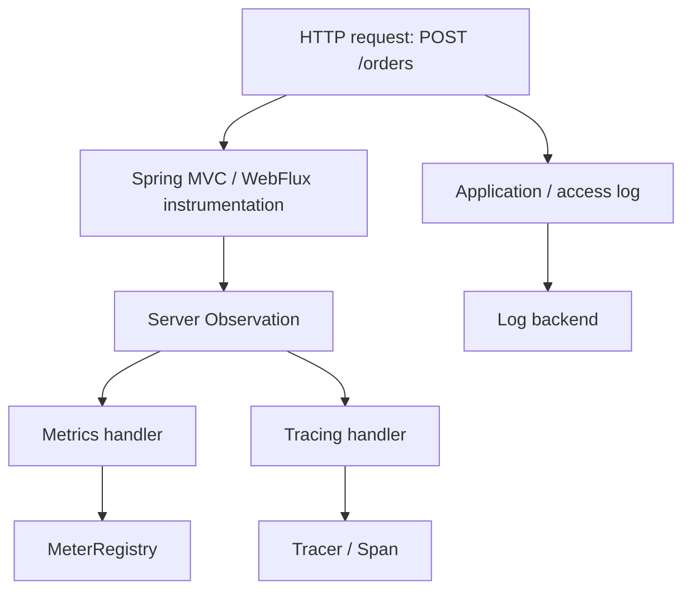

# Request method trong HTTP server observability

Khi một Spring Boot service nhận lưu lượng HTTP, đội vận hành thường muốn biết request nào đang chậm hoặc lỗi: GET đọc dữ liệu có khác POST tạo giao dịch không, endpoint nào nhận nhiều DELETE, hay một client đang gửi method lạ? HTTP request method là một dimension hữu ích để phân tích hành vi của server. Nếu ghi nhận đúng cách, metrics có thể so sánh latency/error rate theo method; traces và logs cung cấp bối cảnh của từng request.

Bài **Request method** thuộc chương **HTTP server observability** của module **SPRING_BOOT_OBSERVABILITY**. Module hướng dẫn thiết lập observability cho Spring Boot bằng Micrometer Observation, metrics, logs và distributed tracing; học context propagation, tags/cardinality, exporter, sampling và liên kết tín hiệu để điều tra lỗi, độ trễ và hành vi ứng dụng trên môi trường thực.

Sau bài học, bạn có thể giải thích ý nghĩa của HTTP method trong server telemetry, hiểu cách Spring MVC/WebFlux ghi nhận request, phân biệt method với route/URI, thiết kế dimension có cardinality thấp, chuẩn hóa method không phổ biến, và kiểm thử method được phản ánh nhất quán trong metrics/traces/logs.

## 1. HTTP request method biểu thị điều gì?

HTTP method mô tả ngữ nghĩa của thao tác mà client yêu cầu server thực hiện:

| Method | Ý nghĩa khái quát | Ví dụ |
| --- | --- | --- |
| GET | Lấy representation của resource | Đọc danh sách đơn hàng |
| HEAD | Tương tự GET nhưng không trả response content | Kiểm tra metadata của resource |
| POST | Gửi dữ liệu để resource xử lý; thường tạo hành động hoặc resource con | Tạo đơn hàng, gửi lệnh thanh toán |
| PUT | Tạo hoặc thay thế trạng thái resource tại URI đích theo semantics của PUT | Thay nội dung hồ sơ |
| PATCH | Áp dụng thay đổi một phần lên resource | Cập nhật một vài trường |
| DELETE | Yêu cầu xóa resource | Xóa địa chỉ đã lưu |
| OPTIONS | Hỏi các tùy chọn giao tiếp được hỗ trợ | Kiểm tra capability/CORS preflight |
| TRACE | Dùng cho chẩn đoán đường đi HTTP; thường bị tắt vì lý do an toàn | Kiểm tra hành vi trung gian |
| CONNECT | Thiết lập tunnel tới đích | Proxy tunnel |

Method có semantics theo HTTP specification. Không suy ra toàn bộ logic nghiệp vụ chỉ từ method: POST không luôn có nghĩa tạo mới, PUT không nhất thiết được ứng dụng triển khai theo đúng semantics, và GET không nên dùng để thay đổi trạng thái nghiệp vụ.

Trong observability, method trả lời câu hỏi **client yêu cầu kiểu thao tác nào?** Nó bổ sung cho route, status, duration và service name.

## 2. Request method xuất hiện ở đâu trong telemetry?

Một HTTP server request thường được đo bằng server request Observation. Từ Observation đó, các handlers có thể tạo metrics và tracing data. Logging integration cũng có thể ghi method như structured field.



Method có thể được biểu diễn khác nhau tùy signal:

| Signal | Biểu diễn method | Mục đích |
| --- | --- | --- |
| Metrics | Tag/dimension như `method=POST` | Tổng hợp count, duration, error rate theo method |
| Trace | Span attribute theo HTTP semantic conventions | Lọc và phân tích một request cụ thể |
| Structured log | Field như `http.request.method` | Tra cứu log events và đối chiếu traces |

Không phải mọi ứng dụng tự cấu hình đều ghi cùng một key. Hãy kiểm tra convention và schema đang dùng thay vì giả định field name của Micrometer metrics phải giống hệt attribute trong OTel spans.

## 3. Spring Boot ghi nhận request method như thế nào?

Trong Spring Boot, Actuator và Micrometer cung cấp HTTP server instrumentation cho các stack được hỗ trợ. Với cấu hình phù hợp, server requests được ghi nhận dưới Observation/Meter có tên phổ biến `http.server.requests`. Method là một trong các dimensions có thể dùng để phân tích số lượng và thời gian xử lý.

Ví dụ số liệu giả định:

| method | status | count | p95 duration |
| --- | --- | ---: | ---: |
| GET | 200 | 18,420 | 42 ms |
| POST | 201 | 2,180 | 95 ms |
| POST | 400 | 130 | 31 ms |
| DELETE | 204 | 260 | 28 ms |

Các con số trên chỉ minh họa cách đọc. COUNT và percentile phụ thuộc meter type, histogram configuration và backend query.

### Không đo cùng request hai lần

Nếu Spring Boot đã instrument HTTP server requests, không nên thêm một Filter hoặc WebFilter khác chỉ để tạo Timer thứ hai cho cùng request. Hai timers có thể có lifecycle, route, exception và status khác nhau, khiến dashboard đếm gấp đôi hoặc không thể so sánh.

Trước khi custom:

1. Xác minh Actuator/Observation instrumentation đã hoạt động.
2. Xác định meter/observation name và các tags hiện có.
3. Kiểm tra framework có thể bổ sung field qua convention hay không.
4. Chỉ tạo instrumentation riêng khi có một thao tác thực sự khác hoặc một dimension chưa được hỗ trợ.

## 4. Method khác route và URI

HTTP method không thay thế route. Một request thường được mô tả bởi nhiều thuộc tính:

| Thuộc tính | Ví dụ | Trả lời câu hỏi |
| --- | --- | --- |
| Method | POST | Client yêu cầu loại thao tác nào? |
| Route template | `/orders/{id}` | Handler/resource pattern nào xử lý? |
| Raw URI | `/orders/ORD-9238` | Request cụ thể dùng path nào? |
| Status | 201 | Server trả kết quả HTTP nào? |
| Duration | 84 ms | Server xử lý trong bao lâu? |

Metrics nên dùng route template thay cho raw URI. Nếu dùng raw URI, mỗi order ID có thể tạo một time series riêng. Method có tập giá trị hữu hạn hơn, vì vậy thường là dimension phù hợp cho metrics.

Một số endpoint có chung route nhưng khác method:

- `GET /orders/{id}` đọc đơn hàng.
- `PUT /orders/{id}` thay thế nội dung đơn hàng.
- `DELETE /orders/{id}` xóa đơn hàng.

Khi nhóm theo route mà không có method, ta có thể trộn các hoạt động có latency và tỷ lệ lỗi khác nhau. Kết hợp method + route template giúp hiểu hành vi cụ thể mà vẫn giữ cardinality được kiểm soát.

## 5. Method và cardinality

**Cardinality** là số giá trị khác nhau của một dimension hoặc số tổ hợp dimension có thể xuất hiện trong metrics. HTTP method chuẩn thường có tập giá trị nhỏ, nên có thể là low-cardinality tag.

Ví dụ nếu service có 6 method category, 20 route templates và 5 status categories, số tổ hợp lý thuyết từ ba dimensions là:

\[
6 \times 20 \times 5 = 600
\]

Khi thêm một field có hàng chục nghìn giá trị như raw URL hoặc request ID, số series có thể tăng đột biến.

Nên:

- Giữ method dưới dạng tập giá trị có kiểm soát.
- Dùng route template, không dùng path chứa resource ID.
- Dùng status code/category theo convention phù hợp.
- Không gắn user ID, order ID, trace ID hoặc raw query string vào metric tags.
- Chuẩn hóa method tùy ý thành một giá trị bounded như `_OTHER`.

Method có tập giá trị hữu hạn **không có nghĩa mọi method input đều an toàn**. Client có thể gửi method extension tùy ý hoặc chuỗi rất dài; nếu đưa nguyên văn vào metrics, kẻ tấn công có thể tạo cardinality cao và log noise.

## 6. Chuẩn hóa method lạ và method mở rộng

HTTP cho phép token method và hệ thống có thể triển khai extension methods. Trong telemetry, không nhất thiết giữ mọi giá trị hiếm thành một tag mới. Có thể giữ các method được hỗ trợ/phổ biến và gom phần còn lại thành `_OTHER`.

Ví dụ hàm chuẩn hóa cho service chỉ muốn một tập method xác định trong metrics:

```java
final class HttpMethodTag {
    private HttpMethodTag() {}

    static String normalize(String rawMethod) {
        if (rawMethod == null || rawMethod.isBlank()) {
            return "_OTHER";
        }

        String normalized = rawMethod.toUpperCase(
            java.util.Locale.ROOT);
        return switch (normalized) {
            case "GET", "HEAD", "POST", "PUT",
                 "PATCH", "DELETE", "OPTIONS" -> normalized;
            default -> "_OTHER";
        };
    }
}
```

Hàm minh họa này phù hợp khi hệ thống chỉ muốn các method phổ biến trong metric dimensions. Nó không quyết định request có hợp lệ hay không và không thay thế method validation của server/security layer. Không sửa method thực tế của request để phù hợp metrics; chỉ chuẩn hóa **giá trị telemetry**.

Nếu hệ thống chủ ý hỗ trợ extension method, hãy đưa chúng vào allowlist/configuration có kiểm soát. OTel HTTP semantic conventions định nghĩa cách biểu diễn method không nhận diện được, trong đó `_OTHER` là giá trị chuẩn hóa hữu ích; kiểm tra semantic convention/version và instrumentation cụ thể đang dùng.

### Giữ thông tin chi tiết ở nơi thích hợp

Metrics có thể dùng normalized method để hạn chế cardinality. Nếu cần điều tra một method extension cụ thể, ghi raw method đã giới hạn kích thước trong log event có kiểm soát hoặc trace attribute theo policy. Không vì cần debug mà đưa mọi chuỗi raw vào metric labels.

## 7. Method trong metrics của Micrometer

Một server request Observation có thể tạo Timer với các low-cardinality key-values. Trong các cấu hình Spring Boot phổ biến, method được biểu diễn bằng tag `method`, bên cạnh tags như `uri`, `status`, `outcome` và `exception` tùy phiên bản/convention.

Ví dụ query khái niệm:

```promql
sum by (method) (
  rate(http_server_requests_seconds_count[5m])
)
```

Tên metric và label thực tế phụ thuộc registry/exporter naming convention. Một số hệ Prometheus dùng tên `http_server_requests_seconds_count`; backend khác có thể đổi tên hoặc biểu diễn Timer khác. Kiểm tra series thật trong registry trước khi copy query.

Ví dụ so sánh latency theo method:

```promql
histogram_quantile(
  0.95,
  sum by (le, method) (
    rate(http_server_requests_seconds_bucket[5m])
  )
)
```

Query chỉ hoạt động nếu Timer được publish dưới dạng histogram buckets với naming/labels tương ứng. Nếu chưa bật histogram, percentile có thể cần cấu hình Micrometer histogram hoặc tính ở phía client/backend theo cách phù hợp.

### Method là low-cardinality, nhưng không phải tag nào cũng vậy

Một bộ tag như method + route template + status category thường có thể kiểm soát được. Tuy nhiên:

- Raw path biến thiên theo ID là high-cardinality.
- Query string có thể có gần như vô hạn giá trị.
- Exception message không phải dimension ổn định.
- Header do client gửi không nên tự động trở thành tag.

Tagging policy cần xem cả **từng tag** và **tổ hợp của tất cả tags**.

## 8. Method trong tracing và HTTP semantic conventions

Trong distributed tracing, server span thường mô tả một inbound HTTP request. HTTP semantic conventions chuẩn hóa các thuộc tính của span, trong đó có request method, route, response status và server/network metadata.

Một tập attributes minh họa:

```json
{
  "http.request.method": "POST",
  "http.route": "/orders/{id}",
  "http.response.status_code": 201,
  "url.scheme": "https",
  "server.address": "orders.internal"
}
```

Tên và tập attributes có thể khác theo version semantic conventions và instrumentation. Không tự gắn cùng một field vào span nhiều lần bằng các key gần giống nhau nếu framework đã ghi nhận.

Method giúp trace UI lọc các thao tác POST chậm hoặc GET lỗi. Nhưng sampling có thể làm chỉ một phần requests có trace được lưu. Metrics vẫn cần cho xu hướng tổng thể, còn traces hỗ trợ điều tra từng request được chọn.

## 9. Method trong logs và correlation

Structured log có thể ghi method cùng route, status, duration, service name và trace context:

```json
{
  "event": "http.server.request.completed",
  "service.name": "orders-service",
  "http.request.method": "DELETE",
  "http.route": "/orders/{id}",
  "http.response.status_code": 204,
  "event.duration_ms": 37,
  "traceId": "4bf92f3577b34da6a3ce929d0e0e4736",
  "spanId": "00f067aa0ba902b7"
}
```

Không ghi raw URI hoặc request body chỉ để biết thao tác nào đã xảy ra. Method + route template + status thường đủ để nhóm access events. Trace ID/span ID giúp nối log với trace, nhưng không nên đưa chúng vào metrics tags.

Nếu tự log tại Filter, tránh tạo log event trùng với access logger hoặc framework instrumentation đã bật. Cần thống nhất event ownership để mỗi request không bị ghi nhiều lần ở nhiều tầng.

## 10. Spring MVC và WebFlux

Spring MVC và WebFlux có mô hình thực thi khác nhau, nhưng cả hai đều có thể cung cấp HTTP server observations khi dùng starter/instrumentation phù hợp.

### Spring MVC

Request đi qua Servlet container, filters, DispatcherServlet và handler mapping. Framework instrumentation có khả năng thu thập method và metadata của request. Nếu custom observation convention, hãy dùng đúng context/extension point theo version Spring Boot/Micrometer.

Tránh:

- Ghi raw URI làm metric tag.
- Tạo Timer thứ hai cho cùng inbound request.
- Lấy method từ header tự đặt thay vì request method thực tế.
- Dùng filter order khiến route/status chưa sẵn sàng rồi suy diễn giá trị khác.

### Spring WebFlux

WebFlux chạy trên reactive stack; request method vẫn là metadata của server request, nhưng không nên block hoặc subscribe body để lấy method. Method có thể đọc từ server request context mà instrumentation cung cấp. Dùng Observation/WebFilter extension point được hỗ trợ và không làm thay đổi reactive chain.

Với cả hai stack, ưu tiên framework instrumentation. Khi customization, xác nhận một request chỉ tạo đúng một server observation/span chính, có method và route đúng.

## 11. Tùy chỉnh Observation convention

Khi cần thay đổi cách method được biểu diễn, hãy tùy chỉnh convention/instrumentation ở extension point của stack đang dùng thay vì tạo metrics trùng. Mục đích customization có thể là:

- Chuẩn hóa method lạ thành `_OTHER`.
- Bổ sung metadata đã được allowlist.
- Giữ tag set ổn định giữa nhiều services.
- Không gắn raw method có độ dài tùy ý vào metrics.

Ví dụ dưới đây là pseudocode mô tả logic, không phải chữ ký API cố định cho mọi phiên bản Micrometer:

```java
String rawMethod = requestContext.getMethod();
String methodTag = HttpMethodTag.normalize(rawMethod);

// Dùng methodTag làm low-cardinality Observation value.
// Để framework tiếp tục quản lý server request lifecycle.
```

Với Micrometer, low-cardinality values được dùng cho dimensions phù hợp của metrics và thường có thể xuất hiện trong tracing; high-cardinality values chủ yếu dành cho tracing theo convention/handler. Không chuyển user-supplied values tùy ý vào low-cardinality set.

## 12. Các tình huống vận hành theo method

### POST có latency cao hơn GET

POST thường thực hiện validation, ghi database hoặc gọi downstream services. Hãy phân tích p95/p99 theo method, sau đó drill down theo route template và dependency spans. Đừng kết luận POST luôn chậm; so sánh cùng route/traffic profile khi có thể.

### DELETE trả nhiều 404

Một tỷ lệ 404 cao trên DELETE có thể là client gọi lặp hoặc resource đã bị xóa. Kết hợp method + route + status/outcome và business logs đã chuẩn hóa. Không cần log toàn bộ ID/resource body.

### Xuất hiện method lạ

Nếu method tag có giá trị bất thường, có thể client/proxy gửi extension method, scanner dò endpoint hoặc instrumentation ghi raw input. Chuẩn hóa dimension, theo dõi số lượng unknowns bằng counter riêng có tag hữu hạn, rồi xem log an toàn để điều tra trong time window.

## 13. Kiểm thử request method observability

Một test tốt nên xác minh method ở đúng các lớp:

| Test | Điều cần xác minh |
| --- | --- |
| Normalization unit test | Method phổ biến được giữ; method lạ thành giá trị OTHER |
| MVC integration test | GET/POST/DELETE tạo server observation có method đúng |
| WebFlux integration test | Reactive server instrumentation ghi method đúng |
| Metrics test | Meter có tag method theo convention mong đợi |
| Route test | Các IDs khác nhau cùng route template, không tạo series riêng |
| Trace test | Server span có method/route/status attributes hợp lệ |
| Security/cardinality test | Raw method dài/tùy ý không tạo metric tag không giới hạn |
| Regression test | Không có hai timers/server spans trùng cho cùng request |

### Ví dụ unit test cho chuẩn hóa

```java
import org.junit.jupiter.api.Test;
import static org.junit.jupiter.api.Assertions.assertEquals;

class HttpMethodTagTest {
    @Test
    void keepsKnownMethods() {
        assertEquals("GET", HttpMethodTag.normalize("GET"));
        assertEquals("POST", HttpMethodTag.normalize("post"));
        assertEquals("DELETE", HttpMethodTag.normalize("DELETE"));
    }

    @Test
    void boundsUnknownMethods() {
        assertEquals("_OTHER", HttpMethodTag.normalize("CUSTOM"));
        assertEquals("_OTHER", HttpMethodTag.normalize("X-VERY-LONG-METHOD"));
        assertEquals("_OTHER", HttpMethodTag.normalize(null));
    }
}
```

Đây là unit test cho hàm chuẩn hóa, chưa chứng minh Spring Boot gắn tag đó vào server metrics. Cần thêm integration test với MeterRegistry thật (ví dụ SimpleMeterRegistry) và request được thực thi qua MockMvc/WebTestClient để assert meter/tag thực tế.

## 14. Lỗi thường gặp

| Hiện tượng | Nguyên nhân có thể | Hướng kiểm tra |
| --- | --- | --- |
| Metrics không có method tag | Instrumentation/convention khác version hoặc server observation chưa bật | Kiểm tra meter và observation configuration |
| Mọi request có method OTHER | Method bị normalize quá sớm hoặc mapping sai | Đối chiếu request method thật với tag builder |
| Cardinality tăng bất thường | Raw method tùy ý được dùng làm tag | Allowlist/normalize method trước khi tạo metric |
| POST latency bị tính hai lần | Framework và custom filter cùng tạo Timer | Xác định instrumentation ownership |
| Metrics method khác trace attribute | Hai convention/semantic schemas khác nhau | Chuẩn hóa naming và so sánh mapping |
| Route tag có order ID | Raw URI được dùng thay route template | Lấy route template từ handler mapping |
| WebFlux request bị chậm | Custom instrumentation block/subscribe chain | Loại blocking và dùng reactive extension point |
| Không thấy method trong logs | Structured event chưa có field hoặc access logger khác | Kiểm tra logger config và event schema |
| Trace backend chỉ thấy một phần method | Sampling | Dùng metrics cho phân bố toàn traffic |
| Method lạ không xuất hiện trong metric | Chuẩn hóa thành OTHER | Điều tra raw value trong test/log an toàn nếu được phép |

## 15. Tình huống thực tế: POST /orders tăng lỗi 5xx

**Bối cảnh giả định:** orders-service có metric HTTP server request. Trong 15 phút, error rate tăng; dashboard cho thấy 5xx tập trung ở POST, trong khi GET ổn định.

Quy trình điều tra:

1. **Phân nhóm theo method:** xác nhận 5xx tập trung ở POST hay mọi method.
2. **Drill down theo route template:** xác định POST /orders hay POST /orders/{id} bị ảnh hưởng; không dùng raw URI làm metric tag.
3. **So sánh duration:** kiểm tra p95/p99 và request count theo time window để xem lỗi đi cùng latency hay xuất hiện nhanh.
4. **Mở traces được sample:** kiểm tra spans database/dependency và exception category của một số requests POST đại diện.
5. **Đối chiếu logs:** tìm log events theo trace ID, method, route, status và error category; không đọc raw body nếu payload có dữ liệu khách hàng.
6. **Kiểm tra client behavior:** xác minh retries, request volume và method semantics; client retry POST có thể làm tăng tải nếu idempotency chưa được thiết kế.
7. **Xác minh sau sửa:** dùng metrics để theo dõi toàn traffic, traces để xem requests lỗi được sample và logs để kiểm tra event nghiệp vụ đã chuẩn hóa.

Method giúp xác định nhóm thao tác bị ảnh hưởng. Nó không tự chỉ ra nguyên nhân lỗi; route, status, timing, spans và logs cung cấp phần bằng chứng còn lại.

## 16. Bài tập tự kiểm tra

**Bài 1.** Vì sao method thường phù hợp làm metric tag hơn raw URI?

*Gợi ý:* Method thường có tập giá trị nhỏ; raw URI có thể chứa resource IDs/query values làm cardinality tăng.

**Bài 2.** GET và POST cùng route /orders/{id} có nên gộp chung trong dashboard latency không?

*Gợi ý:* Chỉ khi mục tiêu phân tích không cần phân biệt thao tác. Method giúp tách semantics và workload khác nhau.

**Bài 3.** Client gửi method extension tùy ý. Có nên dùng raw string làm low-cardinality tag?

*Gợi ý:* Không. Normalize/allowlist thành OTHER hoặc tập method được hỗ trợ.

**Bài 4.** Spring Boot đã tạo http.server.requests. Vì sao thêm Timer trong Filter có thể gây vấn đề?

*Gợi ý:* Có thể đếm trùng cùng request với lifecycle/tags/route khác nhau.

**Bài 5.** Metrics chỉ cho thấy POST 5xx tăng, nhưng không có đủ traces. Điều tra tiếp bằng gì?

*Gợi ý:* Dùng logs/correlation, metrics theo route/status và sampling policy; không kết luận rằng request không có trace là không xảy ra.

**Bài 6.** Vì sao route template quan trọng khi kết hợp với method?

*Gợi ý:* Nó phân biệt handler/resource pattern nhưng tránh tạo series cho từng ID trên path.

**Bài 7.** Hàm chuẩn hóa method có được phép thay đổi request method thật không?

*Gợi ý:* Không. Chỉ chuẩn hóa giá trị telemetry; server/security/routing vẫn xử lý method gốc theo HTTP semantics.

**Bài 8.** Method tag trong metrics tên method, còn trace attribute là http.request.method. Có nhất thiết phải ép hai key giống nhau?

*Gợi ý:* Không nhất thiết. Tôn trọng convention của từng signal, nhưng cần mapping/documentation rõ để người vận hành hiểu chúng biểu diễn cùng một dimension.

## 17. Ghi nhớ

- **Request method** cho biết kiểu thao tác HTTP mà client yêu cầu và là dimension hữu ích để phân tích request count, latency và error rate.
- Trong Spring Boot, tận dụng HTTP server Observation/instrumentation có sẵn trước khi tạo Filter/Timer riêng để tránh đo trùng.
- Kết hợp method với **route template**, status và duration; raw URI/query string không phù hợp làm metric dimensions.
- Chuẩn hóa method không phổ biến thành một giá trị bounded như OTHER; không để input tùy ý tạo metric series.
- Metrics, traces và logs có schema/key khác nhau. Giữ mapping nhất quán về ngữ nghĩa thay vì giả định tên field phải giống hệt.
- Metrics cho phân bố toàn traffic; tracing có thể bị sampling; logs hỗ trợ tra sự kiện theo method và trace context.
- Kiểm thử cả method phổ biến, method lạ, cardinality, route template và việc không tạo instrumentation trùng.
