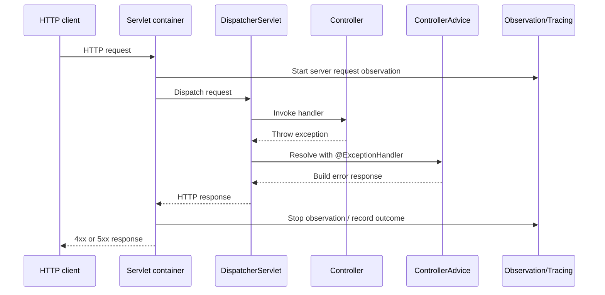

# Exception trong HTTP server observability của Spring Boot

## 1. Mục tiêu và bối cảnh

Một HTTP request có thể thất bại ở validation, controller, service, repository, downstream call hoặc serialization. Chỉ biết response là 500 chưa đủ: đội vận hành còn cần biết exception nào xảy ra, lỗi có được xử lý hay không, request thuộc trace nào và lỗi có lặp lại trên nhiều request hay không.

**Exception observability** là cách theo dõi exception trong vòng đời xử lý HTTP bằng logs, metrics và distributed tracing. Spring Boot kết hợp Spring MVC/WebFlux, Micrometer Observation và Micrometer Tracing để tạo context cho HTTP server request; ứng dụng bổ sung error handling và logging ở các boundary phù hợp.

Bài thuộc chương **HTTP server observability** của module **SPRING_BOOT_OBSERVABILITY**. Module hướng dẫn thiết lập observability cho Spring Boot bằng Micrometer Observation, metrics, logs và distributed tracing; học context propagation, tag/cardinality, exporter, sampling và liên kết tín hiệu để điều tra lỗi, độ trễ và hành vi ứng dụng trên môi trường thực.

Sau bài học, bạn có thể:
1. Giải thích exception đi qua HTTP server observation như thế nào.
2. Phân biệt exception được ném, được xử lý, được chuyển thành response và HTTP status.
3. Hiểu thông tin exception/error được dùng trong request metrics và tracing.
4. Thiết kế @ControllerAdvice/@ExceptionHandler mà vẫn giữ đủ thông tin quan sát.
5. Chọn nơi ghi stack trace và tránh log trùng.
6. Liên kết exception logs với traceId/spanId, status, route và metrics.
7. Giữ cardinality thấp, bảo vệ dữ liệu nhạy cảm.
8. Kiểm thử success, handled exception, unhandled exception, async failure và error response.

**Baseline:** Spring Boot 3.5.x, Java 17+, Spring MVC, Actuator và Micrometer Tracing. Property/configuration và backend có thể thay đổi theo phiên bản. Bài tập trung servlet stack; WebFlux có lifecycle reactive riêng.

## 2. Exception trong HTTP request

Exception là tín hiệu cho biết execution flow không thể tiếp tục theo đường chạy bình thường. Trong HTTP server, exception có thể:
- Được ném từ controller/service/repository và lan lên DispatcherServlet.
- Được Spring MVC resolver hoặc @ExceptionHandler xử lý.
- Được chuyển thành response 4xx/5xx.
- Bị bắt và xử lý hoàn toàn bên trong một service.
- Xảy ra sau khi response đã commit, khi server không thể đổi status/body.

Không phải mọi response 4xx/5xx đều bắt nguồn từ exception. Controller có thể chủ động trả 404 hoặc 503 như kết quả nghiệp vụ. Ngược lại, exception có thể được bắt và chuyển thành fallback hoặc response theo contract. Vì vậy cần phân biệt **exception lifecycle**, **HTTP status** và **application outcome**.

### 2.1. Luồng xử lý điển hình trong Spring MVC



Đây là sơ đồ khái niệm. Instrumentation hook cụ thể có thể khác giữa Servlet, Spring MVC, WebFlux và phiên bản framework. Observation bao quanh HTTP server operation; exception resolver quyết định exception được xử lý và response được tạo như thế nào.

### 2.2. Các khái niệm cần phân biệt

| Khái niệm | Câu hỏi | Ví dụ |
| --- | --- | --- |
| Exception | Điều gì đã ném trong code? | DataAccessException |
| Error/cause | Lỗi nào gắn với operation/span? | SQLException |
| HTTP status | Server trả mã nào? | 404, 500 |
| Outcome | Nhóm kết quả request | SUCCESS, CLIENT_ERROR, SERVER_ERROR |
| Exception class | Loại exception được quan sát | OrderNotFoundException |
| Trace/span | Request và thao tác liên quan nào? | traceId/spanId |
| Application outcome | Nghiệp vụ hoàn tất thế nào? | rejected, fallback, retry scheduled |

Status không phải tên khác của exception. Không suy exception class từ status code, cũng không suy status cuối cùng chỉ từ exception ban đầu.

## 3. HTTP server Observation

Spring Boot Actuator và Micrometer tạo observation cho HTTP server requests được instrument. Với Spring MVC, observation phổ biến có tên **http.server.requests**.

Observation mô tả vòng đời một request và có thể cung cấp:
- HTTP method.
- URI/route template đã chuẩn hóa.
- Response status.
- Outcome nhóm theo status.
- Exception classification theo convention.
- Thời gian xử lý request.

Khi tracing handler được cấu hình, cùng observation có thể tạo server span. Observation convention và handlers quyết định values nào được dùng cho metrics hoặc trace.

### 3.1. Metrics và exception

HTTP server request timer thường được expose với meter name **http.server.requests**.

Các tags mặc định thường bao gồm method, status, outcome, uri và exception; tập tags cụ thể phụ thuộc convention, phiên bản và framework integration.

| Tag | Ví dụ | Ý nghĩa |
| --- | --- | --- |
| method | GET | HTTP method |
| uri | /orders/{id} | Route template, không phải raw ID |
| status | 500 | Response status |
| outcome | SERVER_ERROR | Nhóm status |
| exception | DataAccessException | Loại exception nếu observation ghi nhận |

Request không có exception có thể dùng giá trị như **none** cho exception tag tùy convention. Kiểm tra series thực tế trước khi viết query/dashboard; đừng giả định mọi phiên bản đều có giá trị giống nhau.

Exception tag là **low-cardinality classification**. Không thêm exception message, request ID, order ID, SQL hoặc stack trace vào metric tags.

### 3.2. Exception đã handle được quan sát thế nào?

Khi exception được bắt bởi @ExceptionHandler, HTTP request vẫn có thể hoàn tất ở góc nhìn của DispatcherServlet và trả response đã tạo. Việc observation ghi nhận exception class/error phụ thuộc điểm instrumentation nhìn thấy exception và cách resolver đánh dấu error trong framework version.

Vì vậy:
- Không giả định mọi exception đã handle sẽ tự động xuất hiện trong exception tag như nhau ở mọi version.
- Không giả định response 500 luôn có exception tag tương ứng.
- Nếu cần metric về business rejection/validation failure, tạo counter riêng với outcome hữu hạn.
- Dùng integration test xác nhận tag thật cho handled và unhandled exception trong stack đang chạy.

## 4. Tracing và span error

Khi Micrometer Tracing được cấu hình, HTTP server observation thường được liên kết với server span. Span giúp thấy request xảy ra ở đâu, mất bao lâu và operation nào gặp lỗi.

Thông tin liên quan có thể gồm:
- traceId/spanId để liên kết log và trace backend.
- Span name và HTTP attributes theo semantic conventions.
- Error status hoặc exception event tùy tracing bridge/instrumentation.
- Parent context nhận từ inbound propagation headers.
- Resource attributes như service name và deployment environment.

Không phải mỗi exception cần một span riêng. Exception thường là event/error gắn với span đại diện operation. Child span riêng phù hợp khi có thao tác độc lập cần đo, ví dụ gọi payment provider hoặc query database.

### 4.1. HTTP status và span status không giống nhau

Ví dụ:
- Request không hợp lệ trả 400. Đây có thể là lỗi đầu vào dự kiến; policy tracing không nhất thiết xem đây là lỗi hệ thống.
- Service lỗi database rồi trả 500. Server span thường cần phản ánh error để truy vấn/alert.
- Downstream timeout được fallback thành response 200. Parent operation có thể thành công theo contract nhưng child span gọi downstream vẫn nên phản ánh timeout.
- Exception được handle để trả 404. Log có thể ghi event nghiệp vụ WARN mà không cần full stack trace.

Không tự đánh dấu span OK chỉ vì controller đã tạo được response. Phản ánh cả operation outcome và error thực tế theo semantics đã chọn.

## 5. Xử lý exception bằng @ControllerAdvice

Global exception handler chuyển exception thành response nhất quán và là boundary phù hợp để log lỗi request chưa xử lý.

Domain exception:

```java
public class OrderNotFoundException extends RuntimeException {
    public OrderNotFoundException(String orderId) {
        super("Order not found");
    }
}
```

Handler:

```java
import org.slf4j.Logger;
import org.slf4j.LoggerFactory;
import org.springframework.http.HttpStatus;
import org.springframework.http.ProblemDetail;
import org.springframework.web.bind.annotation.ExceptionHandler;
import org.springframework.web.bind.annotation.RestControllerAdvice;

@RestControllerAdvice
public class ApiExceptionHandler {
    private static final Logger log =
            LoggerFactory.getLogger(ApiExceptionHandler.class);

    @ExceptionHandler(OrderNotFoundException.class)
    ProblemDetail handleNotFound(OrderNotFoundException ex) {
        log.warn("Order lookup did not find a resource");

        ProblemDetail body =
                ProblemDetail.forStatus(HttpStatus.NOT_FOUND);
        body.setTitle("Order not found");
        body.setDetail("The requested order does not exist.");
        return body;
    }

    @ExceptionHandler(Exception.class)
    ProblemDetail handleUnexpected(Exception ex) {
        log.error("Unhandled HTTP request failure", ex);

        ProblemDetail body =
                ProblemDetail.forStatus(HttpStatus.INTERNAL_SERVER_ERROR);
        body.setTitle("Internal server error");
        body.setDetail("The request could not be completed.");
        return body;
    }
}
```

Thiết kế:
- Not-found có thể là kết quả dự kiến; log WARN ngắn thường đủ.
- Lỗi bất ngờ được ghi một lần ở boundary với throwable để giữ stack trace.
- Response không trả class nội bộ, SQL, token hay stack trace.
- Service/repository chỉ log khi có context riêng; không log đầy đủ rồi rethrow.

### 5.1. Ghi nhận lỗi trong Observation nghiệp vụ

Nếu exception được xử lý nội bộ và không truyền tới HTTP observation, nhưng ứng dụng vẫn cần ghi nhận lỗi operation, có thể tạo Observation riêng ở boundary nghiệp vụ.

```java
import io.micrometer.observation.Observation;
import io.micrometer.observation.ObservationRegistry;

public class InventoryService {
    private final ObservationRegistry registry;

    public InventoryService(ObservationRegistry registry) {
        this.registry = registry;
    }

    public void reserve(String sku) {
        Observation.createNotStarted("inventory.reserve", registry)
                .contextualName("reserve inventory")
                .observe(() -> doReserve(sku));
    }

    private void doReserve(String sku) {
        // Thực hiện nghiệp vụ; exception được phép propagate.
    }
}
```

Observation.observe quản lý lifecycle và ghi nhận exception được ném khỏi callback qua handlers đã đăng ký. Không tạo observation thứ hai chỉ để log lại exception đã được ghi ở HTTP boundary; tạo observation khi có operation độc lập cần đo.

Với reactive code hoặc async work, dùng API/instrumentation theo subscription/task lifecycle. Không bao một Mono hoặc CompletableFuture bằng callback đồng bộ rồi kết luận exception tương lai đã được ghi nhận.

## 6. Không nuốt exception hoặc làm mất cause

Một lỗi phổ biến là catch exception rồi trả fallback mà không ghi trạng thái lỗi nào:

```java
public Receipt loadReceipt(String orderId) {
    try {
        return gateway.fetch(orderId);
    } catch (GatewayException ex) {
        return Receipt.empty();
    }
}
```

HTTP request có thể trả 200, metrics chỉ thấy success và trace có thể không cho biết downstream đã lỗi nếu exception bị nuốt trước instrumentation.

Nếu fallback là hành vi có chủ đích, ghi nhận lỗi dependency:
- Đánh dấu child span/dependency observation là lỗi.
- Tăng counter với tags hữu hạn như dependency và outcome.
- Ghi structured log nếu sự kiện cần điều tra.
- Parent operation có thể trả fallback success theo contract nhưng không che lỗi child operation.

Ví dụ minh họa:

```java
public Receipt loadReceipt(String orderId) {
    try {
        return gateway.fetch(orderId);
    } catch (GatewayException ex) {
        Counter.builder("application.dependency.failures")
                .tag("dependency", "receipt-provider")
                .tag("failure", "timeout")
                .register(meterRegistry)
                .increment();
        log.warn("Receipt provider failed; fallback will be used", ex);
        return Receipt.empty();
    }
}
```

Counter trong ví dụ cần được inject từ meter đã cấu hình, với tag values hữu hạn. Nếu lỗi retry thường xuyên tạo quá nhiều stack traces, cân nhắc sampling/rate limit nhưng vẫn giữ metrics và final failure.

Khi wrap exception, giữ cause:

```java
catch (DataAccessException ex) {
    throw new OrderStorageException(
            "Order storage operation failed", ex);
}
```

Không tạo exception mới chỉ với message rồi bỏ cause, vì boundary sẽ mất root cause và stack trace gốc.

## 7. Liên kết logs với exception và trace context

Khi Micrometer Tracing hoạt động, Spring Boot thường đưa traceId và spanId vào MDC để log correlation.

Ví dụ log có cấu trúc:

```json
{
  "timestamp": "2026-11-22T10:20:30Z",
  "level": "ERROR",
  "service": "order-service",
  "traceId": "4bf92f3577b34da6a3ce929d0e0e4736",
  "spanId": "00f067aa0ba902b7",
  "httpMethod": "POST",
  "route": "/orders",
  "status": 500,
  "exception": "OrderStorageException",
  "event": "http.request.failed",
  "message": "Unhandled HTTP request failure"
}
```

Đây là schema minh họa, không phải output mặc định bắt buộc của Spring Boot. Cấu hình JSON encoder/structured logging và kiểm tra output thực tế.

### 7.1. Field nên ghi

- Service name, environment và instance/pod khi có ích.
- traceId/spanId do tracing integration cung cấp.
- HTTP method và route template đã chuẩn hóa.
- Response status và exception class.
- Event code ổn định như http.request.failed.
- Error category, dependency name hoặc attempt khi có ý nghĩa.
- Request/correlation ID nếu có contract và quyền log phù hợp.

Không ghi raw request body, Authorization header, cookie, password, token, thông tin cá nhân hoặc exception message có thể chứa dữ liệu người dùng. Stack trace cần có access controls và retention phù hợp.

### 7.2. Tránh duplicate exception logs

Chọn một nơi ghi full stack trace cho cùng lỗi trong call path:
- Service/repository propagate hoặc wrap exception, không log lại đầy đủ.
- ControllerAdvice ghi lỗi chưa xử lý ở HTTP boundary.
- Access log ghi method/status/duration, không cần stack trace.
- Log từ gateway hoặc downstream service có thể là record của boundary khác, không mặc định là duplicate.

## 8. Metrics cho HTTP exceptions

HTTP request timer giúp phân tích latency, status, outcome, route và exception classification. Meter phổ biến là **http.server.requests**.

Ứng dụng có thể thêm counter cho lỗi nghiệp vụ/dependency mà request timer không diễn đạt đủ:

```java
Counter.builder("application.operation.failures")
        .tag("operation", "order.reserve")
        .tag("failure", "storage")
        .register(meterRegistry)
        .increment();
```

Tags ở trên có giá trị hữu hạn. Không thêm exception message, stack trace, raw URL có path variable, request/correlation ID, order ID, customer ID hoặc SQL statement động.

Nếu cần phân loại exception, dùng class/category đã kiểm soát hoặc default exception classification của HTTP observation. Không tạo metric series theo từng message/cause.

### 8.1. Không đếm một lỗi nhiều lần

Một exception có thể được quan sát ở nhiều layer. Nếu mỗi layer tăng cùng counter, một lỗi có thể bị đếm nhiều lần. Định nghĩa rõ semantics:
- Request failure counter: tăng một lần tại HTTP boundary theo policy.
- Dependency failure counter: tăng một lần tại dependency call boundary.
- Business rejection counter: tăng tại business operation boundary.
- Retry attempt counter: tăng cho mỗi attempt thực sự.

Tên meter và event definition phải nói rõ đang đếm request, operation hay attempt.

## 9. Exception trong async và reactive HTTP handlers

### 9.1. Servlet async

Nếu controller trả Callable/DeferredResult hoặc dùng @Async, phần xử lý có thể chạy trên thread khác. Request observation và servlet async lifecycle có thể kéo dài tới khi response hoàn tất, nhưng ThreadLocal/MDC không tự truyền qua worker thread.

Dùng executor có ContextPropagatingTaskDecorator hoặc cơ chế phù hợp; bảo đảm exception của task nối vào completion/error path để boundary biết kết quả. Nếu task failure bị bắt và chỉ log ở worker, HTTP observation có thể không thấy exception. Cần quyết định đó là lỗi request hay lỗi background job độc lập.

### 9.2. WebFlux

Với WebFlux, lỗi là terminal signal trong Reactor pipeline (onError); exception có thể được xử lý bằng onErrorResume hoặc WebExceptionHandler. Không giả định mọi exception đi qua cùng servlet HandlerExceptionResolver lifecycle.

Khi có fallback:
- Ghi nhận lỗi child operation trước khi chuyển fallback nếu cần.
- Tránh ghi cùng lỗi ở onErrorResume rồi lại ghi tại global WebExceptionHandler.
- Dùng Reactor Context/context propagation để trace/log context còn đúng khi scheduler đổi thread.
- Kiểm tra cancellation riêng; cancel không nhất thiết là application error.

Không dùng Observation đồng bộ quanh lúc tạo Mono nếu công việc thật chỉ chạy khi subscribe. Dùng instrumentation reactive-aware hoặc kiểm tra lifecycle subscription.

## 10. Exception và response được chủ động tạo

| Tình huống | Có exception? | HTTP status | Điều cần quan sát |
| --- | --- | --- | --- |
| Request hợp lệ, hoàn tất | Không | 2xx | Latency, route, span |
| Controller chủ động trả 404 | Không nhất thiết | 404 | Status/outcome; business counter nếu cần |
| @ExceptionHandler đổi NotFoundException thành 404 | Có exception được ném/handle | 404 | Lifecycle và status theo instrumentation |
| Unhandled NullPointerException | Có | Thường 500 | Error span/log, status, stack trace ở boundary |
| Dependency timeout, parent dùng fallback | Có ở child operation | Parent có thể 200 | Child error, dependency counter, fallback event |
| Client disconnect/cancel | Không nhất thiết | Có thể response không hoàn tất | Client abort/cancellation theo server behavior |

Status code không thể thay thế exception classification. Mỗi tình huống cần event semantics và test riêng.

## 11. Bảo mật và cardinality

Exception message, cause và stack trace có thể chứa SQL, table/column names, file paths, internal URLs, user input hoặc thông tin hạ tầng. Vì vậy:
- Không trả stack trace cho client.
- Redact hoặc bỏ exception message không an toàn khỏi structured fields.
- Lưu full throwable ở logging backend có access controls.
- Dùng exception class/category thay cho message làm metric tag.
- Dùng route template thay raw path.
- Không gắn request/correlation ID vào metric tags.
- Đặt retention/quyền truy cập cho error logs và traces.
- Không log toàn bộ HTTP headers để chẩn đoán một exception.

## 12. Kiểm thử exception observability

Test nên xác nhận đồng thời response, log, metrics và trace behavior của đúng stack đang chạy.

### 12.1. Test cases

1. Success request: status 2xx, request timer được ghi, không có exception classification bất ngờ.
2. Controller chủ động trả 404: xác nhận status/outcome và không giả định exception tồn tại.
3. Domain exception được @ExceptionHandler chuyển thành 404: xác nhận response và exception tags/error events theo phiên bản.
4. Unexpected exception không được handle: 500, một boundary error log có throwable, error trace/span nếu tracing được cấu hình.
5. Dependency exception được wrap: cause chain còn đầy đủ.
6. Exception chuyển thành fallback: parent outcome, child operation error và counter phản ánh semantics.
7. Async failure: exception tới đúng completion handler; trace/log context không bị trộn.
8. WebFlux onErrorResume: xác nhận lỗi được ghi nhận trước fallback nếu policy yêu cầu.
9. Client abort/cancel: không tự phân loại thành server exception nếu framework không phát application error.
10. Cardinality: metric tags không chứa request ID, raw URL hoặc exception message.

### 12.2. Kiểm tra metrics

Dùng Actuator metrics endpoint trong môi trường dev/test để xem meter và tag keys được expose; không công khai endpoint này tùy tiện trong production.

Kiểm tra:
- Meter http.server.requests có được tạo.
- Tags method, uri, status, outcome và exception có tập giá trị mong đợi.
- Route template dùng template thay ID cụ thể.
- Exception tag có giá trị trong tình huống expected.
- Custom error counter chỉ tăng đúng một lần theo semantics.
- Một request không sinh hàng loạt time series do dynamic tags.

### 12.3. Kiểm tra traces và logs

- Tìm server span theo traceId.
- Kiểm tra span status/error event và exception attributes theo bridge.
- Tìm logs cùng traceId/spanId.
- Đảm bảo chỉ có một full stack trace cho cùng lỗi trong call path.
- So sánh parent span với child dependency span khi lỗi downstream.
- Trace bị sample-out không có nghĩa exception không xảy ra; dùng logs/metrics độc lập.

## 13. Troubleshooting

| Triệu chứng | Nguyên nhân có thể | Cách xử lý |
| --- | --- | --- |
| Response 500 nhưng không có exception tag | Resolver/filter đã xử lý exception trước hook observation hoặc convention khác | Kiểm tra version, lifecycle và test tags thực tế |
| Response 404 nhưng exception tag có giá trị | NotFound exception đã được ném rồi resolver xử lý | Phân biệt handled exception và status |
| Có ERROR log nhưng span status OK | Exception bị bắt/fallback trước tracing handler hoặc bridge policy khác | Ghi nhận child operation error và kiểm tra bridge |
| Span error nhưng log thiếu stack trace | Boundary không log throwable | Kiểm tra exception handler và appender |
| Stack trace lặp nhiều lần | Nhiều layer log rồi rethrow | Chọn một owner ở boundary |
| Error counter tăng gấp đôi | Cùng exception bị đếm ở service và controller | Định nghĩa metric theo request/dependency/attempt |
| Metrics cardinality tăng | Exception message/request ID/raw URI thành tags | Dùng class/category và route template |
| Async request thiếu traceId | Context không propagate qua executor | Kiểm tra TaskDecorator/Context Propagation |
| WebFlux error mất sau fallback | onErrorResume nuốt lỗi mà không record child failure | Record operation error trước fallback theo policy |
| HTTP 2xx nhưng dependency span báo lỗi | Parent dùng fallback; child dependency thất bại | Có thể đúng semantics; quan sát cả parent và child |
| Không thấy span ở backend | Sampling/exporter/collector issue | Kiểm tra tracing pipeline riêng |
| Client disconnect tạo stack trace hàng loạt | Abort bị log như application failure | Phân loại client abort riêng |

## 14. Checklist production

- [ ] Hiểu framework/server instrumentation bắt đầu và kết thúc HTTP observation ở đâu.
- [ ] Phân biệt exception, HTTP status, outcome và business result.
- [ ] Có một owner ghi full stack trace cho exception request chưa xử lý.
- [ ] Exception được wrap vẫn giữ cause.
- [ ] Exception handled/fallback vẫn được ghi nhận nếu operation error cần điều tra.
- [ ] Không log cùng exception ở mọi layer.
- [ ] HTTP metrics dùng tags low-cardinality và route templates.
- [ ] Error counters phân biệt request, dependency, retry attempt và business rejection.
- [ ] Span/error semantics được xác nhận qua integration tests.
- [ ] Async/reactive có context và error lifecycle đúng.
- [ ] TraceId/spanId được liên kết với logs khi tracing bật.
- [ ] Không trả stack trace, secret hoặc PII cho client.
- [ ] Sampling/exporter failure không làm mất metrics và error logs quan trọng.
- [ ] Tests bao gồm handled, unhandled, fallback, retry, cancellation và concurrency.

## 15. Câu hỏi tự luyện

1. Vì sao HTTP 500 không cho biết chính xác exception class?
2. Một response 404 có thể xuất hiện mà không có exception không?
3. Khi @ControllerAdvice handle exception, vì sao cần test exception tag thay vì đoán?
4. HTTP server request observation theo dõi những khía cạnh nào?
5. Vì sao exception message không phù hợp làm metric tag?
6. Dependency timeout được fallback thành 200 nên được quan sát ở parent và child thế nào?
7. Nên log full stack trace ở service hay HTTP boundary?
8. Vì sao cần giữ cause khi wrap exception?
9. Điều gì xảy ra nếu catch exception rồi trả fallback mà không record child error?
10. Làm thế nào tránh tăng counter hai lần cho cùng request failure?
11. Vì sao MDC không tự theo worker thread của @Async?
12. WebFlux onErrorResume khác Spring MVC exception resolver ở lifecycle nào?
13. Client abort có luôn là application exception không?
14. Trace sampling có làm mất HTTP request metrics không?

## Tài liệu tham khảo

- [Spring Boot 3.5 — HTTP Server Observations](https://docs.spring.io/spring-boot/3.5/reference/actuator/metrics.html)
- [Spring Boot 3.5 — Tracing](https://docs.spring.io/spring-boot/3.5/reference/actuator/tracing.html)
- [Spring Framework — Observability Support](https://docs.spring.io/spring-framework/reference/integration/observability.html)
- [Spring Framework — MVC Exceptions](https://docs.spring.io/spring-framework/reference/web/webmvc/mvc-controller/ann-exceptionhandler.html)
- [Micrometer Observation — Concepts](https://docs.micrometer.io/micrometer/reference/observation.html)
- [Micrometer Tracing — API](https://docs.micrometer.io/tracing/reference/api.html)
- [OpenTelemetry — Trace API](https://opentelemetry.io/docs/specs/otel/trace/api/)
- [OpenTelemetry — HTTP Semantic Conventions](https://opentelemetry.io/docs/specs/semconv/http/)

