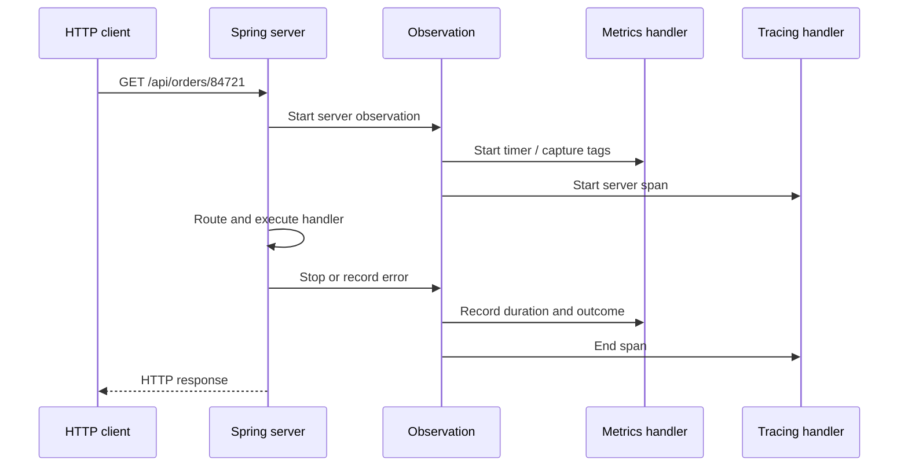

# Server request convention trong Spring Boot

Một API Spring Boot nhận request GET /api/orders/84721, xác thực người gọi, truy vấn dữ liệu rồi trả response 200. Khi hệ thống tăng tải, đội vận hành muốn đo số request, latency, tỷ lệ lỗi và phân biệt endpoint nào đang chậm. Nếu mỗi request được ghi nhận bằng URI nguyên bản, order ID, user ID hoặc query string, metrics backend có thể tạo ra hàng triệu time series. Nếu mọi request chỉ có một nhãn chung, dashboard lại không đủ thông tin để khoanh vùng.

**Server request convention** định nghĩa cách một HTTP server observation mô tả request đến bằng tên observation, contextual name và các key-value có quy ước. Trong Spring Boot, Micrometer Observation dùng convention để chuẩn hóa cách ứng dụng ghi nhận inbound HTTP operations. Convention tốt cung cấp dimensions ổn định cho metrics và tên/attributes hữu ích cho tracing, đồng thời kiểm soát cardinality và dữ liệu nhạy cảm.

Convention không chỉ là cách đặt tên span. Nó là hợp đồng giữa instrumentation, metrics, tracing và hệ thống truy vấn: cùng một request cần được mô tả nhất quán để operator biết request nào xảy ra, thuộc route nào, method/status ra sao và có kết quả thế nào.

Bài học thuộc chương **HTTP server observability** của module **SPRING_BOOT_OBSERVABILITY**. Module hướng dẫn thiết lập observability cho Spring Boot bằng Micrometer Observation, metrics, logs và distributed tracing; học propagation ngữ cảnh, tag/cardinality, exporter, sampling và liên kết tín hiệu để điều tra lỗi, độ trễ và hành vi ứng dụng trên môi trường thực. Bài này tập trung vào convention cho request đi vào HTTP server và cách tùy biến có kiểm soát.

## Mục tiêu học tập

Sau bài này, bạn có thể:

1. Giải thích vai trò của server request observation convention trong Spring Boot.
2. Phân biệt observation name, contextual name, low-cardinality keys và high-cardinality keys.
3. Hiểu các dimension HTTP phổ biến như method, route, status, outcome và exception.
4. Giải thích vì sao URI route template cần được dùng thay raw path chứa ID.
5. Tùy biến server request convention mà không phá semantics mặc định.
6. Phân biệt convention của Spring MVC và WebFlux, đồng thời nhận biết nơi instrumentation được tạo.
7. Hiểu convention ảnh hưởng tới metrics, traces và log correlation như thế nào.
8. Thiết kế tag an toàn, tránh cardinality explosion, PII và secret leakage.
9. Kiểm thử convention cho success, not-found, exception, async và unmatched route.
10. Chẩn đoán khi metric tags hoặc span attributes không như mong đợi.

## 1. Server request observation là gì?

Server request observation đại diện cho một inbound HTTP operation mà ứng dụng tiếp nhận và xử lý. Với Spring MVC, observation thường bao quanh quá trình xử lý request qua servlet stack; với WebFlux, observation bao quanh reactive HTTP handling theo integration của framework.

Observation cung cấp lifecycle start/stop/error và context chứa thông tin request/response. Các ObservationHandler đã đăng ký có thể chuyển observation thành metrics, tracing spans hoặc tích hợp khác.



Convention trả lời các câu hỏi:

- Observation có tên kỹ thuật ổn định nào?
- Contextual name mô tả operation theo cách đọc được ra sao?
- Key-value nào có cardinality thấp?
- Attributes nào chỉ phù hợp ở tracing/high-cardinality context?
- Dữ liệu nào không được ghi vì privacy hoặc cardinality?

### 1.1. Convention và instrumentation

Instrumentation xác định vị trí bắt đầu/kết thúc observation và tạo context từ request. Convention quy định cách diễn giải context thành tên và key-values.

Nếu request không đi qua instrumentation, thêm convention bean không tự tạo observation. Ngược lại, nếu observation đã có nhưng convention không phù hợp, metric có thể ghi URI không an toàn hoặc span name khó truy vấn.

## 2. Observation name, contextual name và key-values

| Thành phần | Ý nghĩa | Ví dụ |
|---|---|---|
| Observation name | Tên kỹ thuật ổn định của loại observation | http.server.requests |
| Contextual name | Tên dễ đọc gắn với operation/route | GET /api/orders/{id} |
| Low-cardinality key-values | Dimensions có tập giá trị giới hạn | method=GET, status=200, outcome=SUCCESS |
| High-cardinality key-values | Giá trị thay đổi theo request | URL đầy đủ hoặc exception detail theo policy |
| Observation context | Request/response và dữ liệu framework liên quan | ServerRequestObservationContext |

Tên cụ thể có thể khác theo Spring Framework/Micrometer version và integration. Khi vận hành, kiểm tra observation thực tế do framework tạo thay vì giả định mọi stack dùng cùng tên.

### 2.1. Observation name nên ổn định

Observation name biểu thị loại operation, không biểu thị từng URL cụ thể hoặc ID request. Nếu mỗi route tạo observation name động, metrics registry có thể coi mỗi tên là meter khác nhau và gây phân mảnh.

Giữ tên tổng quát như HTTP server requests; đưa route template và method vào key-value dimensions.

### 2.2. Contextual name nên dễ đọc

Contextual name có thể giúp span tree dễ đọc, ví dụ GET /api/orders/{id}. Không dùng raw path như GET /api/orders/84721 vì mỗi request có thể tạo tên khác, gây khó truy vấn và để lộ dữ liệu theo URL.

## 3. Low-cardinality keys cho HTTP server

Low-cardinality key-values có thể trở thành metric tags. Giá trị của chúng cần có tập hữu hạn hoặc giới hạn thực tế. Các dimension HTTP thường gặp:

| Key | Ví dụ | Ý nghĩa |
|---|---|---|
| method | GET, POST, PUT, DELETE | HTTP method |
| uri / route | /api/orders/{id} | Route template đã chuẩn hóa |
| status | 200, 404, 500 | HTTP response status |
| outcome | SUCCESS, CLIENT_ERROR, SERVER_ERROR | Nhóm kết quả |
| exception | None hoặc tên exception theo quy ước | Thông tin lỗi đã giới hạn |

Danh sách chính xác phụ thuộc phiên bản Micrometer/Spring integration. Không copy tag set của một phiên bản rồi giả định mọi framework stack phát cùng key.

### 3.1. Method

HTTP method thường có cardinality thấp và hữu ích cho dashboard. Với method extension/custom, có thể xuất hiện giá trị ngoài danh sách phổ biến; cần quyết định cách chuẩn hóa để client không thể gửi method tùy ý tạo vô hạn values.

### 3.2. URI phải là route template

Đây là dimension quan trọng nhất. Dùng route pattern mà framework resolve được:

- Tốt: /api/orders/{id}
- Tốt: /api/customers/{customerId}/invoices/{invoiceId}
- Xấu: /api/orders/84721
- Xấu: /api/customers/0938123456/invoices/998122
- Xấu: /download/report?token=secret

Raw path có thể chứa ID, email, số điện thoại hoặc slug tùy ý. Nếu đưa vào metrics tag, mỗi giá trị tạo một time series mới; nếu đưa vào trace/log, giá trị có thể tiết lộ dữ liệu cá nhân.

Nếu request không match route đã biết, dùng giá trị fallback ổn định theo convention của framework và phiên bản, thay raw URI. Kiểm tra behavior cho unmatched route trong test.

### 3.3. Status và outcome

Status code có cardinality giới hạn trong miền HTTP. Outcome thường nhóm status thành các lớp như INFORMATIONAL, SUCCESS, REDIRECTION, CLIENT_ERROR hoặc SERVER_ERROR, tùy implementation.

Dùng status để xem chi tiết HTTP code; outcome để tổng hợp nhóm kết quả. Cần hiểu thời điểm observation lấy status: lỗi có thể được xử lý thành response 4xx/5xx hoặc ném exception trước khi response hoàn tất.

### 3.4. Exception

Exception có thể được ghi vào tracing/high-cardinality context hoặc map sang nhóm ổn định. Đưa exception message đầy đủ vào metric tags là sai: message có thể chứa IDs, input và nội dung động. Nếu cần phân loại metrics, dùng exception class hoặc error category đã kiểm soát và giới hạn cardinality.

## 4. High-cardinality keys và giới hạn sử dụng

High-cardinality key-value có thể hữu ích trong traces khi cần điều tra một request cụ thể, nhưng phải cân nhắc payload, index cost và privacy.

| Giá trị | Metrics tags? | Trace attributes? | Ghi chú |
|---|---|---|---|
| Route template | Thường phù hợp | Phù hợp | Route đã chuẩn hóa |
| Raw URL | Tránh | Chỉ khi có lý do và đã làm sạch | Có thể chứa query/PII |
| Request ID | Tránh | Có thể theo policy | Thường gần như unique |
| User/account ID | Tránh | Rất thận trọng | Dữ liệu định danh |
| Trace ID | Không | Đã là trường context riêng | Không cần copy thành custom tag |
| Exception message | Không | Cân nhắc và sanitize | Có thể chứa input/secret |
| Query string | Không | Tránh hoặc lọc allowlist | Có thể chứa token |
| Client IP | Không mặc định | Chỉ theo policy | Có thể là dữ liệu cá nhân |

Low/high cardinality trong Micrometer Observation là chỉ dẫn quan trọng cho handler. High-cardinality không có nghĩa có thể ghi tất cả; trace backend cũng giới hạn index, storage và quyền truy cập.

### 4.1. Không biến high-cardinality thành metrics qua đường vòng

Một high-cardinality value có thể được gắn vào context rồi vô tình chuyển thành meter tag bởi handler tùy chỉnh. Kiểm tra mapping của custom ObservationHandler; không chỉ dựa vào tên method để giả định handler sẽ lọc an toàn.

## 5. Convention mặc định của Spring Boot

Spring Boot dùng Spring Framework HTTP instrumentation và Micrometer Observation để ghi nhận inbound requests khi dependency/configuration phù hợp được bật. Trong nhiều cấu hình MVC, observation mặc định có tên http.server.requests và convention cung cấp method, URI template, status và outcome. Chi tiết key names và behavior phụ thuộc version và stack.

Điều quan trọng là hiểu **default convention là nền tảng**; không cần tạo observation thủ công cho mọi controller. Trước khi tùy biến, hãy quan sát:

1. Observation name thực tế.
2. Route template có được resolve đúng không.
3. Method và status tags được ghi thế nào.
4. Outcome mapping cho success/error.
5. Request không match route được xử lý ra sao.
6. Server spans có trace context đúng và không bị duplicate.

### 5.1. MVC và WebFlux

Spring MVC dựa trên Servlet stack; WebFlux dựa trên reactive stack. Cả hai có server request instrumentation, nhưng request context và lifecycle khác nhau. Không giả định một bean convention áp dụng cho cả hai nếu dự án có nhiều application context hoặc stack riêng.

Kiểm thử đúng server runtime được triển khai. Với WebFlux, lifecycle có thể phụ thuộc subscription/cancellation; không đánh giá bằng test chỉ chạy controller function đồng bộ.

### 5.2. Request routing và route pattern

Convention tốt cần nhận route template sau khi framework chọn handler. Nếu chỉ lấy request URI từ servlet/request object, code có thể nhận raw path thay vì pattern. Dùng dữ liệu route đã resolve của framework khi có, và kiểm tra behavior cho static resources, actuator endpoints, error dispatch và unmatched route.

## 6. Tùy biến ServerRequestObservationConvention

Khi cần dimension riêng, Spring Framework cung cấp extension point cho server request observation convention. Tên interface/context cụ thể phụ thuộc version; với Servlet/MVC, API thường có loại ServerRequestObservationConvention và ServerRequestObservationContext.

Một chiến lược an toàn:

1. Bắt đầu từ default convention của framework.
2. Bảo toàn các key-values chuẩn.
3. Chỉ thêm thuộc tính cần thiết cho vận hành.
4. Chọn low-cardinality hay high-cardinality đúng semantics.
5. Không override route bằng raw URL.
6. Viết integration test cho request path của ứng dụng.

### 6.1. Ví dụ ý tưởng custom convention

Đoạn sau minh họa cách bổ sung một low-cardinality key vào convention mặc định. API import/constructor và extension point phải khớp Spring Framework version của dự án:

```java
@Bean
ServerRequestObservationConvention serverRequestObservationConvention() {
    return new DefaultServerRequestObservationConvention() {
        @Override
        public KeyValues getLowCardinalityKeyValues(
                ServerRequestObservationContext context) {

            return super.getLowCardinalityKeyValues(context)
                    .and(KeyValue.of("api.tier", "public"));
        }
    };
}
```

Đây là ví dụ khái niệm; kiểm tra constructor, class extensibility và imports của phiên bản đang dùng. Giá trị public là cố định nên cardinality thấp. Nếu phân biệt version, chỉ thêm khi version thuộc tập nhỏ đã kiểm soát như v1/v2.

### 6.2. Khi nào nên thêm custom key?

Thêm key khi nó trả lời câu hỏi vận hành mà dimensions chuẩn chưa trả lời, ví dụ API tier, channel đã chuẩn hóa hoặc tenant class được gom nhóm. Không thêm customer ID, order ID, request parameter hoặc mọi header vì tiện.

### 6.3. Không thay đổi semantics chuẩn

Nếu custom convention bỏ method/status/route/outcome mặc định, dashboard chung và instrumentation khác có thể mất khả năng tương thích. Hãy nối thêm key vào KeyValues của default convention khi có thể, thay vì viết lại toàn bộ.

## 7. Liên kết server observation với metrics

Metrics handler chuyển low-cardinality key-values thành meter tags. Một timer cho HTTP server requests có thể cho biết count và duration theo route/method/status/outcome.

Ví dụ khái niệm:

```text
http.server.requests{
  method="GET",
  uri="/api/orders/{id}",
  status="200",
  outcome="SUCCESS"
}
```

Tên metric/tags chính xác phụ thuộc Micrometer registry và naming convention. Prometheus registry có thể đổi dấu chấm thành underscore; exporter khác có thể trình bày khác.

Dashboard dimensions hữu ích gồm route template, method, status/outcome, API tier/channel đã chuẩn hóa và service version. Tránh group theo trace ID, user ID hoặc raw URL. Khi điều tra request riêng, dùng traces/logs.

Timer có thể export count/total time và histogram nếu registry hỗ trợ. p95/p99 chỉ có ý nghĩa nếu histogram buckets/aggregation được bật và backend tính đúng. Convention quyết định tags; nó không tự bật histogram distribution cho mọi meter.

Metrics HTTP thường ghi nhận request theo instrumentation độc lập với tracing sampler. Nếu trace sampling chỉ giữ 10%, server request metrics vẫn phải đo toàn traffic theo cấu hình. Không suy ra request count từ số spans export.

## 8. Liên kết server observation với tracing

Tracing handler tạo server span từ observation context. Span có thể mang method, route, status và attributes khác theo semantic conventions/integration.

- Observation name là loại operation.
- Span name là tên operation trong trace.
- Span attributes là metadata của request cụ thể.
- Trace ID/Span ID được quản lý bởi tracer, không do convention tự sinh.
- Parent context được extract từ inbound headers theo propagator.

Span name nên dùng route template hoặc operation name ổn định thay raw path. HTTP 500 có thể đến từ exception chưa xử lý hoặc response tạo có chủ đích. Không giả định mọi 4xx là server exception hoặc mọi 5xx đều có exception object.

## 9. Liên kết logs với server request context

Log ghi khi server observation/span active có thể mang trace ID/span ID qua logging integration và MDC. Log record cũng có thể có method/route/event fields nếu application code hoặc integration cung cấp.

```json
{
  "event.name": "http.request.completed",
  "http.request.method": "GET",
  "http.route": "/api/orders/{id}",
  "http.response.status_code": 200,
  "trace_id": "0af7651916cd43dd8448eb211c80319c",
  "span_id": "b7ad6b7169203331"
}
```

Đây là schema minh họa. Không ghi raw query string hoặc toàn bộ headers. Trace/span IDs phải lấy từ current tracing context; không tự điền từ user-supplied header vào MDC rồi coi đó là correlation hợp lệ.

## 10. Các tình huống request cần kiểm thử

| Tình huống | Kết quả convention cần xác minh |
|---|---|
| GET route thành công | Method, route template, 2xx status, success outcome |
| POST tạo resource | Method POST, route template, status phù hợp |
| Route không tồn tại | URI fallback ổn định; không chứa raw ID/path động |
| Validation error | Status 4xx và outcome đúng |
| Unhandled exception | Status 5xx, error mapping và span lifecycle |
| Async request | Observation/span kết thúc theo lifecycle thực |
| WebFlux cancellation | Observation lifecycle phù hợp cancellation |
| Actuator/static resource | Có/không instrument theo policy |
| HTTP method không phổ biến | Value được chuẩn hóa/giới hạn |
| Query string có token | Không xuất hiện trong tags/attributes ngoài allowlist |

## 11. Kiểm thử server request convention

Một bộ test nên xác minh cả metrics và tracing view của convention.

### 11.1. Test route template

Gửi hai request:

- GET /api/orders/1001
- GET /api/orders/1002

Cả hai phải tạo cùng route tag /api/orders/{id}, không tạo hai meter series riêng. Đây là kiểm tra trực tiếp chống cardinality do ID động.

### 11.2. Test method/status/outcome

Gửi request thành công, validation failure và server error; xác nhận method, status, outcome khớp response thực. Kiểm tra cả exception được handle thành 4xx và exception thực sự trả 5xx.

### 11.3. Test custom convention

Nếu có custom key api.tier, xác nhận value nằm ở low-cardinality set và có tập giá trị nhỏ. Đồng thời kiểm tra các keys chuẩn vẫn hiện diện. Nếu convention chỉ tác động tracing high-cardinality attributes, xác nhận custom value không bị chuyển thành metric tag.

### 11.4. Test MVC và WebFlux

Chạy test theo web application type thực tế. Với MVC, dùng MockMvc hoặc random-port test phù hợp. Với WebFlux, dùng WebTestClient và kiểm tra lifecycle reactive. Không dùng test MVC để kết luận behavior WebFlux.

### 11.5. Test route không match và dữ liệu nhạy cảm

Gửi raw URL có ID, query token giả lập và header chứa dữ liệu nhạy cảm. Xác nhận metrics tags dùng fallback/route template ổn định, không xuất token hoặc header ngoài allowlist. Kiểm tra logs/traces lẫn metrics vì mỗi signal có thể có đường xử lý riêng.

## 12. Cardinality, privacy và security

HTTP request data là nguồn cardinality và dữ liệu nhạy cảm phổ biến:

- Raw URL path có thể chứa account/order IDs.
- Query string có thể chứa token hoặc search terms.
- Headers có thể chứa Authorization, Cookie hoặc tenant identifiers.
- Exception messages có thể chứa request values hoặc SQL fragments.
- Client IP có thể là dữ liệu cá nhân theo chính sách tổ chức.

Các nguyên tắc:

1. Metrics tags chỉ dùng dimensions có tập giá trị giới hạn.
2. Dùng route template thay raw path.
3. Không log/record toàn bộ query string hoặc request headers.
4. Không thêm user/order ID vào low-cardinality key.
5. Chỉ ghi high-cardinality trace attributes khi có nhu cầu và policy phù hợp.
6. Redact gần nguồn tạo telemetry; filter downstream chỉ là lớp bổ sung.
7. Giới hạn quyền truy cập backend và retention.
8. Kiểm tra inbound headers không thể ép convention tạo values tùy ý không giới hạn.

Route template làm giảm cardinality nhưng không tự giải quyết privacy. Một custom pattern vẫn có thể nhúng thông tin tenant/user. Đảm bảo pattern được chuẩn hóa từ route definition, không nối raw request input.

## 13. Chẩn đoán convention không đúng

| Triệu chứng | Nguyên nhân có thể | Cách điều tra |
|---|---|---|
| Metrics có raw URI | Convention lấy request URI thay route pattern | Kiểm tra framework context và route resolver |
| Mỗi ID tạo một time series | URI tag có path variable đã resolve | Query series cardinality và sửa route template |
| Không thấy status/outcome | Observation stop trước response hoặc handler/config sai | Kiểm tra lifecycle và context |
| Custom key không xuất hiện | Bean không được chọn hoặc auto-config override | Kiểm tra application context và convention selection |
| Key xuất hiện trong trace nhưng không metric | Key chỉ ở high-cardinality set | Kiểm tra handler mapping |
| Key gây bùng cardinality | Giá trị động được thêm low-cardinality | Thống kê values và normalize |
| Có hai server spans | Agent và Spring instrumentation cùng active | Xác định instrumentation owner |
| MVC đúng, WebFlux sai | Khác stack/context/lifecycle | Test và cấu hình riêng |
| Trace name chứa IDs | Contextual/span name dùng raw path | Dùng route template |
| Query token xuất hiện trong telemetry | Header/URL capture không được lọc | Allowlist/redaction ở nguồn |

### Quy trình điều tra

1. Xác định request runtime là MVC hay WebFlux.
2. Kiểm tra observation name và convention được chọn.
3. Gửi request với route parameter có hai giá trị khác nhau.
4. Đọc metric tags và trace span name/attributes.
5. Kiểm tra key nào low-cardinality và key nào high-cardinality.
6. Tìm custom ObservationConvention/ObservationHandler có thể thay default.
7. Kiểm tra Java Agent hoặc instrumentation khác có tạo span trùng.
8. Kiểm tra exception/status và observation end lifecycle.
9. Kiểm tra raw path, query, headers và privacy redaction.
10. Theo dõi series count/export drops sau khi điều chỉnh.

## 14. Các anti-pattern cần tránh

| Anti-pattern | Hậu quả | Cách phù hợp |
|---|---|---|
| Raw URI làm low-cardinality tag | Mỗi ID tạo time series | Route template |
| Mỗi request tạo observation name động | Meter/span naming phân mảnh | Tên ổn định, dimensions qua keys |
| Ghi mọi query parameter | Secret/PII và cardinality cao | Allowlist hoặc bỏ query |
| Ghi user ID/order ID vào metric tags | Cardinality explosion | Trace/log correlation theo policy |
| Thay convention mặc định và bỏ method/status | Mất dashboard semantics | Kế thừa và bổ sung default keys |
| Coi high-cardinality là an toàn để ghi mọi thứ | Storage/index/privacy risk | Allowlist và retention |
| Tự tạo server observation trong controller khi framework đã có | Duplicate measurements/spans | Dùng instrumentation chuẩn |
| Chỉ test một route parameter | Không phát hiện cardinality issue | Hai request ID khác nhau, cùng route template |
| Gộp MVC và WebFlux assumptions | Lifecycle/route mismatch | Test stack thực tế |
| Coi HTTP 4xx nào cũng là exception | Error semantics sai | Phân biệt response outcome và exception |
| Chỉ kiểm tra metrics, bỏ traces | Span name/attributes có thể sai | Assert từng signal |
| Nghĩ thêm convention tự tạo instrumentation | Không có observation ở boundary | Kiểm tra instrumentation trước |

## 15. Checklist trước khi merge custom server convention

1. **Observation:** inbound HTTP request được instrument đúng boundary?
2. **Name:** observation name ổn định và contextual name dễ đọc?
3. **Route:** URI dimension dùng route template, không raw path?
4. **Method:** method được ghi và có giới hạn giá trị?
5. **Status:** response status được thu thập sau xử lý?
6. **Outcome:** mapping phản ánh response/exception đúng semantics?
7. **Exception:** exception data không bị đưa nguyên văn vào metric tags?
8. **Cardinality:** low-cardinality keys có tập giá trị giới hạn?
9. **High cardinality:** tracing-only data có mục đích và privacy policy?
10. **Defaults:** custom convention giữ các key chuẩn cần thiết?
11. **Stack:** MVC/WebFlux runtime được test đúng integration?
12. **Duplicate:** agent và Spring không instrument trùng boundary?
13. **Correlation:** server span và logs có trace/span context đúng?
14. **Security:** query/header/PII/token không rò vào telemetry?
15. **Testing:** có success, 4xx, 5xx, unmatched route và parameter variation?
16. **Operations:** series count, request latency/error và exporter drops có thể theo dõi?

## 16. Câu hỏi tự đánh giá

**Câu 1.** Server request convention có nhiệm vụ gì?

**Gợi ý:** Chuẩn hóa observation name, contextual name và key-values mô tả inbound HTTP operation; các handler dùng dữ liệu đó cho metrics/tracing.

**Câu 2.** Vì sao URI tag nên dùng route template?

**Gợi ý:** Route template giữ dimension ổn định; raw path tạo value theo từng order và làm cardinality tăng.

**Câu 3.** Observation name có nên chứa order ID không?

**Gợi ý:** Không. Tên observation cần ổn định; dữ liệu động không thuộc tên operation.

**Câu 4.** Method/status/outcome có ích gì?

**Gợi ý:** Phân tích request theo HTTP method, response code và nhóm kết quả.

**Câu 5.** Low-cardinality key-value khác high-cardinality key-value thế nào?

**Gợi ý:** Low-cardinality có tập value giới hạn, phù hợp làm metric tags; high-cardinality biến thiên rộng và chỉ ghi theo policy phù hợp.

**Câu 6.** Custom convention nên bắt đầu từ đâu?

**Gợi ý:** Bảo toàn default convention rồi bổ sung dimension có giá trị vận hành, thay vì viết lại và bỏ semantics chuẩn.

**Câu 7.** Có nên thêm user ID vào metric tags để điều tra request?

**Gợi ý:** Không. Dùng log/trace correlation hoặc công cụ nghiệp vụ được bảo vệ; user ID gây cardinality và privacy risk.

**Câu 8.** Vì sao MVC test không chứng minh WebFlux convention hoạt động?

**Gợi ý:** Hai stack có request context và lifecycle khác; cần test bằng runtime/client phù hợp.

**Câu 9.** Nếu log có trace ID nhưng metric route là raw URI, lỗi nằm ở đâu?

**Gợi ý:** Correlation có thể đúng nhưng server convention/route resolution hoặc mapping metric tags sai.

**Câu 10.** Làm sao kiểm tra custom low-cardinality key không gây bùng series?

**Gợi ý:** Xác định tập value hợp lệ, gửi request với nhiều input và assert series/tag values vẫn trong tập giới hạn.

## Kết luận

**Server request convention chuẩn hóa cách Spring Boot mô tả mỗi inbound HTTP request cho metrics và tracing.** Observation name nên ổn định; contextual/span name và URI dimension nên dùng route template; low-cardinality keys như method, status và outcome hỗ trợ dashboard; high-cardinality attributes phải được giới hạn theo nhu cầu và privacy policy. Khi tùy biến, hãy bắt đầu từ default convention, giữ semantics chuẩn và chỉ thêm dimensions có giá trị vận hành. Kiểm thử nhiều route parameters, status, exception, MVC/WebFlux và async lifecycle để bảo đảm route tags không làm bùng cardinality, log/span correlation đúng và telemetry phản ánh request thực tế.
