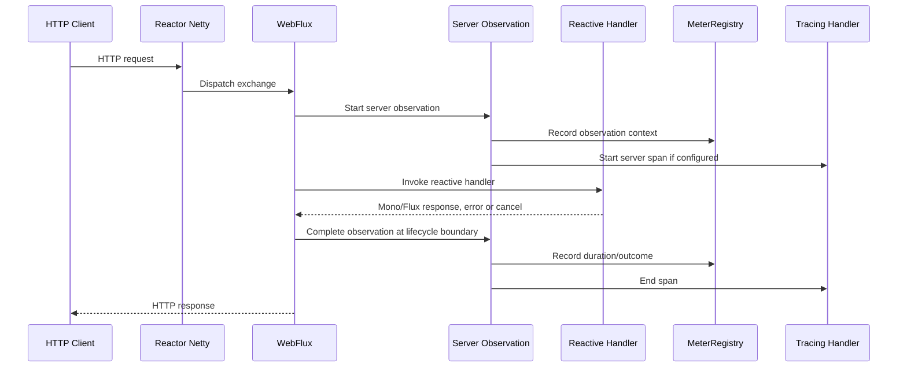
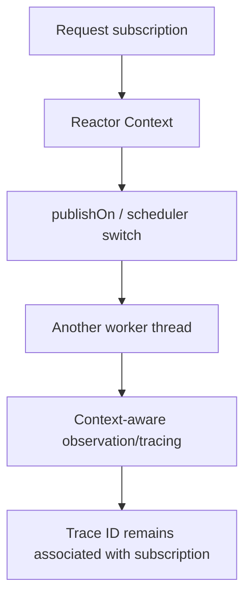
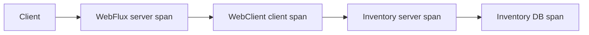

# Reactive server instrumentation trong Spring Boot

**Reactive server instrumentation** là việc đo lường và tạo telemetry cho request được xử lý bởi reactive web stack của Spring, thường là Spring WebFlux chạy trên Reactor Netty. Instrumentation quan sát vòng đời request, ghi nhận metrics như số request và thời gian xử lý, đồng thời có thể tạo server span khi Micrometer Tracing được cấu hình. Vì reactive execution có thể chuyển qua nhiều thread và dựa trên Reactor Context, việc truyền observation/tracing context cần theo đúng mô hình reactive.

Trong module **SPRING_BOOT_OBSERVABILITY**, reactive server instrumentation nối HTTP server với metrics, logs và distributed tracing. Bài thuộc chương **HTTP server observability**, trình bày kiến trúc WebFlux, lifecycle của server observation, sự khác nhau giữa Reactor Context và ThreadLocal, route/status/cardinality, async boundaries, custom convention, kiểm thử và troubleshooting.

## 1. Reactive server instrumentation là gì?

Trong Spring MVC truyền thống, request thường được xử lý theo mô hình Servlet. Trong Spring WebFlux, request được xử lý theo reactive pipeline, thường sử dụng Reactor Netty và các publishers như Mono/Flux.

Instrumentation quan sát request trong quá trình:
1. Server nhận HTTP request.
2. WebFlux tạo exchange và tìm handler.
3. Reactive chain được thực thi.
4. Response được ghi ra network hoặc kết thúc bằng lỗi/cancel.
5. Observation được dừng và metrics/tracing handlers ghi nhận kết quả.

Instrumentation phải theo lifecycle thực sự của publisher. Việc một method trả về Mono không có nghĩa request đã hoàn tất; publisher có thể chưa subscribe hoặc vẫn đang xử lý.

### Luồng tổng quan



Sơ đồ mang tính khái niệm. Điểm start/stop cụ thể phụ thuộc Spring Boot, Spring Framework, Reactor Netty và instrumentation version. Cancellation và client disconnect cần được hiểu theo semantics framework; không giả định mọi request kết thúc bằng response bình thường.

## 2. WebFlux và Reactor Netty

Spring Boot WebFlux là reactive web framework. Embedded server mặc định trong nhiều ứng dụng WebFlux là Reactor Netty; Spring WebFlux cũng có thể chạy trên runtime server khác được hỗ trợ.

Instrumentation cần phù hợp với stack:
- WebFlux server observation tích hợp ở tầng framework.
- Reactor Netty cung cấp network/server runtime.
- Micrometer Observation quản lý observation lifecycle.
- MeterRegistry nhận metrics.
- Micrometer Tracing bridge chuyển observation sang spans nếu được cấu hình.

Không thêm Servlet filter để instrument WebFlux request như thể ứng dụng đang chạy Spring MVC. WebFlux không dùng Servlet filter chain theo cách tương tự; dùng WebFilter hoặc extension points reactive phù hợp khi cần tùy biến.

### 2.1. Dependencies cơ bản

Ví dụ ứng dụng WebFlux có Actuator:

```xml
<dependencies>
    <dependency>
        <groupId>org.springframework.boot</groupId>
        <artifactId>spring-boot-starter-webflux</artifactId>
    </dependency>
    <dependency>
        <groupId>org.springframework.boot</groupId>
        <artifactId>spring-boot-starter-actuator</artifactId>
    </dependency>
</dependencies>
```

Spring Boot dependency management quản lý các version tương thích. Thêm tracing bridge và exporter nếu cần distributed tracing. Không đưa đồng thời starter MVC và WebFlux vào ứng dụng nếu chưa hiểu cơ chế lựa chọn application type và server stack; dependency combination có thể khiến ứng dụng khởi động theo stack khác mong đợi.

## 3. Reactive server observation lifecycle

Observation cho reactive HTTP server phải bắt đầu khi framework tiếp nhận request và kết thúc khi quá trình xử lý reactive tương ứng hoàn tất. Các kết quả có thể gồm:

- **Complete:** publisher hoàn tất bình thường và response được ghi.
- **Error:** reactive chain phát sinh exception.
- **Cancel:** subscription bị hủy, ví dụ downstream/client disconnect hoặc operator cancel.
- **Timeout:** timeout operator hoặc server timeout kết thúc quá trình.

Cancellation không nhất thiết tương đương HTTP 5xx. Client ngắt kết nối có thể khiến server không gửi được response; cần phân biệt cancellation với lỗi nghiệp vụ và server failure.

### 3.1. Vì sao không đo thời gian quanh method invocation?

Controller có thể trả Mono gần như ngay lập tức:

```java
@GetMapping("/{id}")
public Mono<Order> find(@PathVariable String id) {
    return orderService.findById(id);
}
```

Thời gian thực thi method chỉ đo việc tạo publisher. Công việc lấy dữ liệu và tạo response có thể xảy ra sau đó khi publisher được subscribe. Nếu tự đặt Timer quanh lời gọi method, kết quả không phản ánh toàn bộ request latency.

Dùng instrumentation reactive-aware của framework hoặc đo publisher bằng cơ chế Micrometer/Reactor phù hợp, đảm bảo Timer hoàn tất theo terminal signal thực tế.

## 4. Observation, metrics và tracing trong WebFlux

Micrometer Observation là abstraction chung. Observation handlers có thể chuyển lifecycle thành metrics hoặc spans:

| Signal | Ví dụ dữ liệu | Ý nghĩa |
| --- | --- | --- |
| Metrics | Request count, duration, method, route, status | Theo dõi xu hướng toàn traffic |
| Trace | Server span, Trace ID, parent context | Điều tra request cụ thể được giữ |
| Logs | Exception, business event, Trace ID/Span ID | Bổ sung sự kiện trong request |

Observation có thể hoạt động mà không có tracing exporter. Metrics có thể vẫn được ghi khi sampling loại trace. Ngược lại, có server span không có nghĩa logs đã được chuyển tới backend.

### 4.1. Server metrics

Metric phổ biến là http.server.requests, được biểu diễn bằng Timer theo convention của Spring/Micrometer. Tags thường gồm method, URI template, status, outcome và exception đã chuẩn hóa. Tên/tag cụ thể phụ thuộc version và stack.

Kiểm tra metric tại Actuator nếu được expose:

```http
GET /actuator/metrics/http.server.requests
```

Không coi danh sách tags trong một version là contract bất biến. Xem output thực tế của ứng dụng và registry.

### 4.2. Server span

Khi Micrometer Tracing bridge được cấu hình, server observation có thể tạo server span. Nếu inbound traceparent được extract đúng, span có thể là child của remote parent span. Sampling policy quyết định span/trace có được record/export hay không.

## 5. Reactive Context khác ThreadLocal

Đây là điểm cốt lõi của reactive instrumentation.

Trong mô hình imperative, nhiều thư viện lưu request context vào ThreadLocal hoặc MDC. Trong reactive pipeline, một request có thể chạy qua nhiều threads; một thread cũng có thể xử lý nhiều request khác nhau theo thời điểm. Vì vậy ThreadLocal không phải nơi đáng tin cậy để lưu context xuyên suốt reactive chain.

**Reactor Context** gắn metadata với subscription, cho phép context đi theo reactive pipeline dù execution chuyển thread.



### 5.1. Context propagation

Micrometer Context Propagation cung cấp cơ chế bridge giữa context mechanisms như Reactor Context và ThreadLocal accessors. Spring Boot/Reactor integration có thể cấu hình propagation tùy version và properties.

Không tự copy mọi Reactor Context entry sang ThreadLocal. Chỉ đăng ký accessor cho context cần thiết và kiểm soát lifecycle/cleanup để tránh rò context giữa requests.

### 5.2. MDC và logging

MDC truyền thống dựa trên ThreadLocal. Trong reactive app, log line ở thread khác có thể không thấy MDC nếu context propagation không được tích hợp. Khi cần Trace ID/Span ID trong logs:
- Dùng tracing/logging integration được hỗ trợ.
- Bảo đảm context được khôi phục trong scope xử lý.
- Kiểm tra log output sau scheduler switch.
- Không đặt MDC một lần ở đầu request rồi giả định mọi callback dùng cùng thread.
- Đảm bảo cleanup để context request trước không rò sang request khác.

## 6. Truyền trace context qua reactive boundaries

Khi controller gọi downstream service bằng WebClient đã được instrument, tracing context có thể được inject vào outgoing request. Server downstream extract context và tạo span thuộc cùng trace.

Ví dụ controller reactive:

```java
@RestController
@RequestMapping("/api/orders")
class OrderController {

    private final WebClient webClient;

    OrderController(WebClient.Builder builder) {
        this.webClient = builder.baseUrl("http://inventory-service").build();
    }

    @GetMapping("/{id}")
    Mono<String> find(@PathVariable String id) {
        return webClient.get()
                .uri("/api/inventory/{id}", id)
                .retrieve()
                .bodyToMono(String.class);
    }
}
```

Trong Spring Boot, nên dùng WebClient.Builder được auto-configure khi cần customizers/observation instrumentation của Boot. Tạo WebClient bằng factory tĩnh hoặc builder riêng có thể bỏ qua customizers đã đăng ký.

### 6.1. Trace topology



Nếu downstream call không có span, kiểm tra WebClient instrumentation, builder được dùng và context propagation. Không tự tạo Trace ID mới cho mỗi service call nếu mục tiêu là nối cùng distributed trace.

## 7. Route template và cardinality

Reactive server metrics cần low-cardinality tags. Route template nên được dùng thay raw path chứa identifier.

```text
GET /api/orders/1001
GET /api/orders/1002
GET /api/orders/1003
```

Cùng một route logic:

```text
GET /api/orders/{id}
```

Nếu raw path được dùng làm metric tag, mỗi ID có thể tạo một time series mới.

| Field | Phân loại | Hướng dẫn |
| --- | --- | --- |
| HTTP method | Low | Dùng trực tiếp |
| Route template | Low nếu chuẩn hóa | Dùng thay raw URI |
| Status code | Low | Dùng HTTP status |
| Outcome | Low | Tập giá trị hữu hạn |
| Trace ID | High | Giữ ở trace/log correlation |
| User/order ID | High, có thể nhạy cảm | Không dùng làm metric tag |
| Raw query string | Có thể high/sensitive | Không đưa vào metrics |

## 8. Status, exception và cancellation

Reactive chain có thể kết thúc bằng complete, error hoặc cancel. Các kết quả này không nên bị đánh đồng.

- HTTP 2xx thường biểu thị response thành công ở protocol layer.
- HTTP 4xx có thể là lỗi đầu vào hoặc từ chối theo nghiệp vụ.
- HTTP 5xx thường biểu thị server-side failure.
- Error signal có thể được xử lý bởi onErrorResume và chuyển thành response bình thường.
- Cancellation có thể xảy ra khi client disconnect hoặc operator hủy subscription.

Ví dụ:

```java
return orderService.findById(id)
        .onErrorResume(OrderNotFoundException.class,
                error -> Mono.empty());
```

Sau khi xử lý lỗi, HTTP response thực tế phụ thuộc controller/handler mapping. Observation nhìn thấy kết quả theo lifecycle/framework hooks; nếu exception được chuyển thành response, không nhất thiết nó còn được báo như exception thoát ra ngoài.

Khi điều tra, đối chiếu response status, exception logs, observation outcome và cancellation metrics nếu có. Không tự chuyển mọi cancel thành ERROR.

## 9. Tùy biến reactive server observation

Spring Framework cung cấp observation conventions cho HTTP server context. Có thể mở rộng convention để thêm low-cardinality values có ích, ví dụ nhóm API ổn định hoặc traffic class được kiểm soát.

Nguyên tắc:
- Kế thừa default convention khi muốn giữ key values framework.
- Chỉ thêm tập giá trị nhỏ.
- Không dùng request ID, user ID, raw URL hoặc query string làm metric tags.
- Kiểm tra convention được đăng ký theo đúng cơ chế của Spring Boot/Framework version.
- Tránh tạo convention khác nhau không chủ ý giữa replicas.

Custom WebFilter không nên tạo observation thứ hai cho cùng request nếu WebFlux đã instrument request mặc định. Nếu cần filter để gắn metadata, dùng extension point phù hợp để bổ sung context thay vì tạo duplicate timer/span.

### 9.1. ObservationRegistry và handlers

ObservationRegistry quản lý observation scopes và handlers. MeterRegistry ghi metrics; tracing handler/bridge chuyển observation thành spans. Khi custom handler được thêm, xác định rõ event nó xử lý và liệu nó có chạy song song với default handler không.

Đừng thêm handler tự tạo Timer nếu handler mặc định đã ghi cùng request duration; request count và latency có thể bị đếm hai lần.

## 10. Filter, WebFilter và loại trừ endpoint

WebFlux dùng WebFilter cho request/response processing ở reactive stack. Filter phù hợp để xác thực, thêm headers hoặc cross-cutting logic. Tuy nhiên filter không tự động là cách đúng để instrument observation.

Khi cần loại trừ health/internal endpoints:
- Kiểm tra cơ chế ignore/filter của instrumentation.
- Xem endpoint có cần thiết cho vận hành và SLO không.
- Giữ phân loại traffic rõ ràng.
- Tránh loại bỏ tất cả probes mà không đánh giá.
- Không dùng raw path chứa ID để quyết định metric tags.

Một số endpoint management có thể chạy trên management context/port riêng. Kiểm tra chúng có dùng cùng WebFlux server và observation pipeline không.

## 11. Async boundaries và Reactor schedulers

Reactive chain có thể chuyển scheduler qua publishOn, subscribeOn, parallel hoặc scheduler tùy chỉnh. Context cần theo subscription, không dựa trên giả định thread không đổi.

Ví dụ:

```java
Mono.deferContextual(contextView -> {
    String requestKey = contextView.getOrDefault("requestKey", "unknown");
    return Mono.just("processed");
})
.publishOn(Schedulers.boundedElastic());
```

Ví dụ cho thấy Reactor Context được đọc từ subscription context; không có nghĩa mọi context key tự động trở thành trace attributes hoặc log fields.

Lưu ý:
- Không block event-loop threads.
- Dùng scheduler phù hợp cho blocking work.
- Propagate context khi rời Reactor sang callback API khác.
- Restore/clear ThreadLocal khi quay lại thread pool.
- Kiểm tra context sau retry, timeout, cancellation và nested publishers.
- Tránh giữ request context trong singleton mutable fields.

Nếu công việc nền tiếp tục sau HTTP response, nên tạo observation/span riêng cho công việc nền và liên kết với trace ban đầu theo cơ chế phù hợp, thay vì kéo dài server span vô hạn.

### 11.1. Blocking code trong reactive handler

Gọi JDBC/blocking SDK trực tiếp trên event-loop có thể làm suy giảm request latency và throughput. Đưa blocking work sang scheduler phù hợp hoặc dùng reactive client/driver. Instrumentation có thể cho thấy server span dài nhưng không tự xác định nguyên nhân là blocking; cần kết hợp thread/CPU profiling và downstream spans.

## 12. Sampling và server observation

Observation có thể được tạo cho mọi request, nhưng tracing sampler có thể chỉ giữ một phần spans. Metrics request thường có phạm vi rộng hơn trace sampling.

Ví dụ:
- 10.000 request được metrics đếm.
- 10% traces được sampler chọn.
- Một số requests lỗi có thể không có trace nếu head sampling loại từ đầu.
- Logs INFO/WARN/ERROR vẫn có thể được ghi độc lập.

Không suy luận request không tồn tại chỉ vì không tìm thấy trace. Dùng metrics để đánh giá traffic tổng thể và logs để kiểm tra sự kiện liên quan.

## 13. Bảo mật và quyền riêng tư

Reactive instrumentation không nên ghi toàn bộ request headers/body. Tránh đưa vào attributes:
- Authorization và Cookie headers.
- Access tokens hoặc API keys.
- Raw query string có PII.
- Raw URI có customer/order identifiers.
- Request/response body nhạy cảm.
- User identity không được phê duyệt.

Dùng route template, method, status và dimension allowlist. Redact dữ liệu tại nguồn; TLS chỉ bảo vệ đường truyền, không xóa dữ liệu khỏi backend.

Với baggage và custom context, coi dữ liệu từ client là không tin cậy. Không dùng baggage hoặc observation tags làm cơ sở authorization.

## 14. Kiểm thử reactive server instrumentation

Kiểm thử nên xác minh response behavior lẫn telemetry. Có thể dùng WebTestClient để gửi request đến WebFlux application context hoặc server đang chạy.

Ví dụ test:

```java
@WebFluxTest(OrderController.class)
class OrderControllerTest {

    @Autowired
    WebTestClient client;

    @Test
    void returnsOrder() {
        client.get()
                .uri("/api/orders/42")
                .exchange()
                .expectStatus().isOk();
    }
}
```

Đây là ví dụ kiểm thử HTTP behavior. @WebFluxTest có thể không khởi tạo đầy đủ exporter/registry pipeline production; nếu cần kiểm tra observation end-to-end, dùng integration test với application context phù hợp và test registry/exporter.

### 14.1. Kiểm tra metrics

Sau khi gửi request, kiểm tra MeterRegistry có timer/meter server request và tags đúng. Không phụ thuộc duy nhất vào tên tag của một version; xác nhận output thực tế.

### 14.2. Kiểm tra tracing

Dùng in-memory/test exporter hoặc Collector lab để xác nhận server span được tạo, Trace ID được giữ và context truyền qua WebClient. Đặt sampling phù hợp để test không thất bại ngẫu nhiên do sampler loại trace.

### 14.3. Kiểm tra context propagation

Tạo test có publishOn để pipeline chuyển scheduler. Xác minh trace/log correlation đúng trong callback và không rò context giữa hai requests độc lập.

## 15. Troubleshooting reactive server instrumentation

| Triệu chứng | Nguyên nhân có thể | Cách kiểm tra |
| --- | --- | --- |
| Không có server request metric | Thiếu Actuator/registry hoặc instrumentation không áp dụng | Kiểm tra dependencies, MeterRegistry và WebFlux stack |
| Metrics có nhưng không có span | Thiếu tracing bridge hoặc sampling drop | Kiểm tra handler, bridge, sampler và exporter |
| Duration quá ngắn | Đo method trả publisher thay vì publisher lifecycle | Dùng framework instrumentation/reactive-aware timer |
| Trace ID mất sau publishOn | Context propagation chưa cấu hình | Kiểm tra Reactor Context và accessor integration |
| MDC thiếu Trace ID trên worker thread | ThreadLocal không theo reactive subscription | Dùng context-aware logging integration |
| Trace bị tách khi gọi downstream | WebClient không instrument hoặc context không inject | Dùng auto-configured WebClient.Builder và kiểm tra headers |
| Cardinality tăng | Raw URI hoặc ID thành metric tag | Dùng route template và loại dynamic tags |
| Request đếm hai lần | WebFilter/custom handler tạo observation trùng | Kiểm tra auto instrumentation và custom filters |
| Error không thấy trong span | onErrorResume chuyển thành response hoặc exception được xử lý | Đối chiếu response/status/error handling |
| Cancellation bị ghi như server error | Custom handler đồng nhất cancel với error | Kiểm tra terminal signal semantics |
| Async duration sai | Observation stop sai lifecycle boundary | Kiểm tra async handling và response completion |
| Event-loop latency cao | Blocking work trên event-loop | Kiểm tra thread dump, scheduler và downstream call |
| Metrics không export | Registry/exporter/Collector pipeline lỗi | Kiểm tra metrics pipeline riêng |
| Logs không có correlation | MDC/context integration chưa hoạt động | Kiểm tra logging integration và scheduler switch |

### Quy trình điều tra

1. Xác định ứng dụng thực sự chạy WebFlux hay MVC.
2. Xác minh Actuator, ObservationRegistry và MeterRegistry.
3. Gửi request test và kiểm tra server request metric.
4. Kiểm tra route template, method, status và cardinality.
5. Xác minh tracing bridge, sampler và exporter.
6. Thử inbound traceparent và downstream WebClient propagation.
7. Chèn scheduler boundary trong test để kiểm tra Reactor Context.
8. Kiểm tra complete/error/cancel riêng biệt.
9. Nếu duration bất thường, kiểm tra blocking calls và event-loop.
10. Kiểm tra metrics, traces và logs export theo từng pipeline.

## 16. Bài thực hành: kiểm chứng WebFlux server instrumentation

Mục tiêu là chạy ứng dụng WebFlux, tạo request và xác minh observation, metrics, server span và context propagation.

### Chuẩn bị

- Spring Boot 3.x application dùng spring-boot-starter-webflux.
- Actuator và MeterRegistry.
- Micrometer Tracing bridge/exporter nếu cần traces.
- Endpoint trả về Mono hoặc Flux.
- WebClient.Builder được Spring Boot auto-configure.
- Collector/backend lab hoặc test exporter.

### Bước 1 — Tạo endpoint reactive

Tạo controller GET trả Mono và endpoint có path variable. Tránh blocking call trên event-loop.

### Bước 2 — Bật Actuator metrics trong lab

```yaml
management:
  endpoints:
    web:
      exposure:
        include:
          - health
          - metrics
```

Expose chỉ endpoints cần cho lab; bảo vệ management endpoints trong môi trường dùng chung.

### Bước 3 — Gửi request

Dùng WebTestClient hoặc HTTP client gọi endpoint nhiều lần. Tạo response thành công và một lỗi test-only.

### Bước 4 — Kiểm tra server metrics

Đọc /actuator/metrics/http.server.requests hoặc meter tương ứng. Kiểm tra count, duration, method, route template và status.

### Bước 5 — Kiểm tra cardinality

Gọi cùng route với nhiều path variable. Xác nhận metrics nhóm theo template thay vì mỗi ID tạo một series.

### Bước 6 — Bật tracing

Cấu hình Micrometer Tracing bridge/exporter và sampling phù hợp trong lab. Gửi request có trace context. Xác nhận server span được tạo khi trace được chọn.

### Bước 7 — Gọi downstream bằng WebClient

Dùng auto-configured WebClient.Builder gọi service giả lập. Kiểm tra client span và downstream server span nối cùng Trace ID.

### Bước 8 — Thử scheduler boundary

Dùng publishOn trong pipeline test. Kiểm tra Reactor Context, Trace ID và log correlation vẫn đúng sau khi đổi thread.

### Bước 9 — Thử error và cancellation

Tạo publisher phát error và test cancel/disconnect có kiểm soát. Quan sát response, observation outcome và span status; không giả định cancel tương đương 5xx.

### Bước 10 — Kiểm tra privacy

Rà soát tags/attributes/logs, loại bỏ raw IDs, tokens, cookies và PII. Xác nhận chỉ có dimensions được allowlist.

### Checklist nghiệm thu

| Điều cần chứng minh | Kết quả mong đợi |
| --- | --- |
| Stack | Xác định WebFlux/Reactor Netty |
| Lifecycle | Observation theo reactive terminal signal |
| Metrics | Server request count/duration được ghi |
| Tracing | Server span xuất hiện khi sampling cho phép |
| Context | Reactor Context đi qua scheduler boundary |
| MDC | Log correlation không dựa vào thread cố định |
| WebClient | Downstream span nối cùng trace |
| Cardinality | Dùng route template, không raw ID |
| Error/cancel | Phân biệt error, complete và cancellation |
| Performance | Không block event-loop |
| Security | Không export tokens/PII |
| Export | Xác minh từng signal pipeline |

## 17. Những nguyên tắc cần ghi nhớ

1. **Reactive server instrumentation phải theo lifecycle của publisher**, không chỉ đo thời gian controller method tạo Mono/Flux.
2. **WebFlux và Spring MVC có execution model khác nhau.** Dùng extension points reactive như WebFilter khi cần, không áp dụng Servlet filter máy móc.
3. **Micrometer Observation kết nối metrics và tracing handlers**, nhưng exporter/pipeline của từng signal vẫn phải được cấu hình.
4. **Reactor Context là nền tảng truyền context theo subscription.** ThreadLocal/MDC không tự theo request khi scheduler thay đổi.
5. **Dùng WebClient.Builder được auto-configure** khi cần observation/tracing customizers của Spring Boot.
6. **Phân biệt complete, error và cancel.** Client disconnect không nhất thiết là server-side 5xx.
7. **Dùng route template và low-cardinality values** cho metrics; không dùng raw URI, IDs hoặc query strings.
8. **Không tạo instrumentation trùng.** Custom WebFilter/handler cần phối hợp với observation mặc định.
9. **Không block event-loop.** Blocking work làm suy giảm throughput và latency dù instrumentation vẫn ghi duration.
10. **Sampling chỉ ảnh hưởng trace được giữ**, không phải bằng chứng request đã hoặc chưa xảy ra.
11. **Bảo vệ metadata.** Redact secrets/PII tại nguồn và không dùng baggage làm authorization.
12. **Kiểm tra end-to-end.** Xác minh request, observation, metrics, spans, logs, exporter và Collector/backend theo từng signal.

Reactive server instrumentation giúp quan sát request WebFlux mà vẫn tôn trọng execution model không đồng bộ. Khi observation theo đúng publisher lifecycle, context được truyền qua Reactor Context, route tags có cardinality thấp và downstream calls được instrument, metrics cho thấy hành vi toàn traffic trong khi traces/logs cung cấp chi tiết để điều tra. Đây là nền tảng để vận hành ứng dụng reactive Spring Boot ổn định và có thể giải thích được trong môi trường thực.
