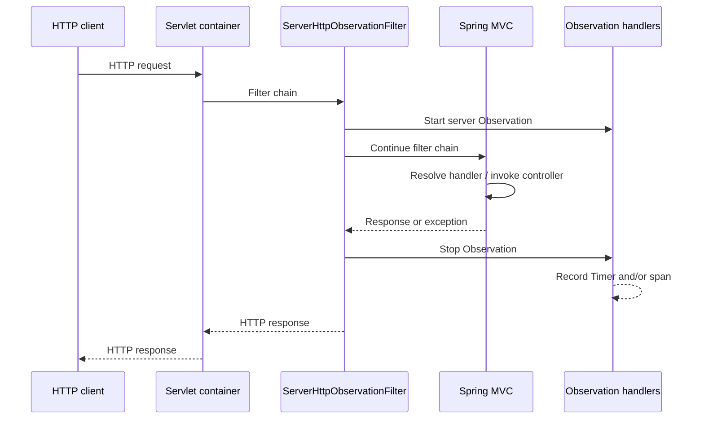
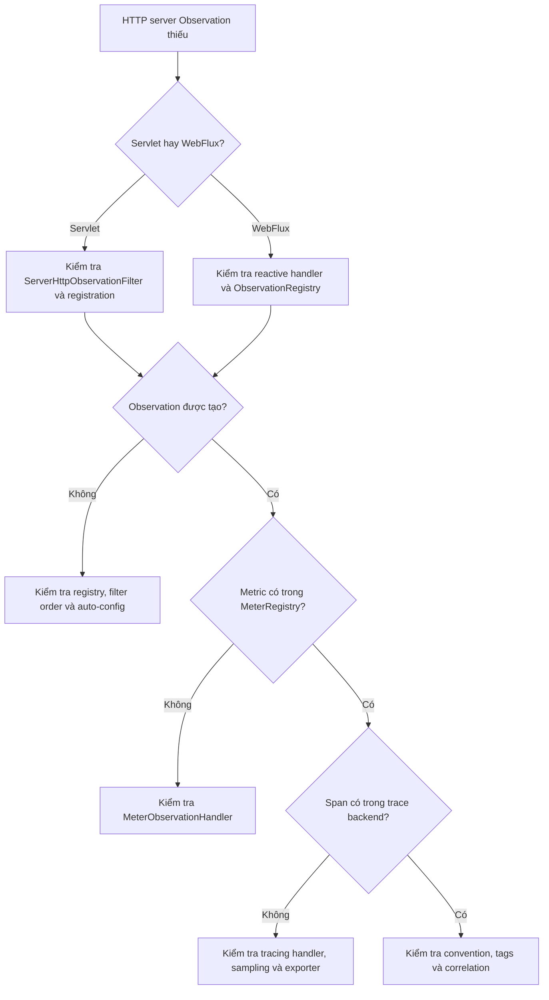

# Server observation filter trong Spring Boot

HTTP server là ranh giới đầu tiên để quan sát một request đi vào ứng dụng. Tại đây, hệ thống cần đo thời gian xử lý, nhận biết method/status/route, tạo trace span và giữ context trong suốt vòng đời request. Spring Framework cung cấp cơ chế HTTP server Observation; với ứng dụng Servlet/MVC, thành phần trung tâm là ServerHttpObservationFilter. Filter này đặt Observation quanh quá trình xử lý request, để các ObservationHandler có thể tạo metrics và tracing data.

Bài **“Server observation filter”** thuộc chương **HTTP server observability** của module **SPRING_BOOT_OBSERVABILITY**. Module hướng dẫn thiết lập observability cho Spring Boot bằng Micrometer Observation, metrics, logs và distributed tracing; học propagation ngữ cảnh, tag/cardinality, exporter, sampling và liên kết tín hiệu để điều tra lỗi, độ trễ và hành vi ứng dụng trên môi trường thực.

Cần phân biệt hai việc: **server observation filter ghi nhận một HTTP exchange**, còn ObservationRegistry/handlers quyết định dữ liệu đó sinh ra metrics, traces hay cả hai. Bật filter nhưng registry không có handler phù hợp thì không tự động tạo đầy đủ signals.

## 1. Server Observation Filter làm gì?

Trong Servlet stack, ServerHttpObservationFilter là một OncePerRequestFilter của Spring Framework. Nó tạo một Observation cho HTTP request/response exchange và lưu context liên quan vào request attributes để web framework hoặc thành phần phía sau có thể đóng góp thêm metadata.

Vòng đời khái quát:



Filter giúp ghi nhận khoảng xử lý ở tầng Servlet filter. Observation có thể tạo:

- Timer metric cho thời gian xử lý HTTP server exchange.
- Span server cho distributed trace nếu tracing handler được cấu hình.
- Metadata như method, route, status, outcome và error.
- Context để log correlation hoặc instrumentation khác đọc khi request đang được xử lý.

Filter không thay thế web server access log, không phải security filter và không gửi dữ liệu trực tiếp tới backend. Nó phát Observation; MeterRegistry, tracing bridge và exporter xử lý các bước tiếp theo.

## 2. Phân biệt Servlet/MVC và WebFlux

Tên ServerHttpObservationFilter chỉ một Servlet filter. Không áp dụng trực tiếp nó cho reactive stack.

| Stack | Cơ chế instrumentation | Ranh giới quan sát |
| --- | --- | --- |
| Spring MVC / Servlet | ServerHttpObservationFilter | Servlet filter chain và request handling phía sau filter |
| Spring WebFlux | Reactive HTTP server observation tích hợp với WebHttpHandlerBuilder và ObservationRegistry | Reactive HTTP handler/exchange |
| Jersey | Jersey observation instrumentation của Spring Boot | Jersey request processing |
| Custom server/framework | Tích hợp ObservationRegistry và convention phù hợp | Theo adapter của framework |

Với Spring Boot, auto-configuration có thể bật HTTP server instrumentation cho các web stack được hỗ trợ. Trong ứng dụng Spring Framework standalone, cần cấu hình filter/handler cùng ObservationRegistry theo tài liệu framework. Vì thế, trước khi tự tạo filter, hãy xác minh framework và Boot version đã đăng ký instrumentation hay chưa; tránh tạo hai server observations cho cùng một request.

### WebFlux không dùng Servlet filter

Với WebFlux, observation được cấu hình ở reactive HTTP handler. Spring Framework cho phép tạo HttpHandler qua WebHttpHandlerBuilder và gắn ObservationRegistry. Trong Spring Boot, auto-configuration thường thực hiện phần này cho ứng dụng WebFlux thông thường.

Context trong reactive chain cần đi theo Reactor Context và Micrometer Context Propagation. Không giả định ThreadLocal trong một Servlet filter có thể bao phủ reactive processing.

## 3. Tên Observation và các KeyValues mặc định

HTTP server Observation tiêu chuẩn thường có tên:

```text
http.server.requests
```

Tên metric có thể được chuyển đổi theo naming convention của registry/backend. ObservationConvention mặc định tạo các low-cardinality và high-cardinality key values.

Các low-cardinality values thường được dùng cho metrics và traces:

| Key | Ý nghĩa | Ví dụ |
| --- | --- | --- |
| error | Tên exception nếu có; nếu không thường là none | PaymentTimeoutException |
| method | HTTP method | GET, POST |
| outcome | Nhóm kết quả theo response status | SUCCESS, CLIENT_ERROR, SERVER_ERROR |
| status | HTTP status | 200, 404, 500 |
| uri | Route pattern hoặc fallback URI category | /orders/{id} |

Một high-cardinality value như http.url có thể chứa URI đầy đủ và được dành cho trace metadata, không phải metric tags.

Fallback URI có thể là giá trị như NOT_FOUND, REDIRECTION, root hoặc UNKNOWN khi không có route template phù hợp. Vì vậy, nếu mọi request đều gắn uri=UNKNOWN, hãy kiểm tra route mapping/instrumentation trước khi tự đưa raw path vào metric.

Tên keys cụ thể thay đổi theo Spring Framework version và convention đang dùng. Một số phiên bản cũ dùng key exception; phiên bản mới có key error và đánh dấu exception là deprecated. Hãy kiểm tra output thực tế khi nâng framework.

## 4. Low cardinality và high cardinality

Đây là một quyết định quan trọng của server observation:

- **Low cardinality** có số giá trị hữu hạn và ổn định, phù hợp cho metrics aggregation.
- **High cardinality** có thể có vô số giá trị, phù hợp hơn với span attributes hoặc log records tùy nhu cầu.

Ví dụ:

| Metadata | Phân loại | Nơi sử dụng phù hợp |
| --- | --- | --- |
| HTTP method | Low | Metric tag và span |
| Status code/outcome | Low/hữu hạn | Metric tag và span |
| URI template | Low nếu route mapping ổn định | Metric tag và span |
| Full URL | High | Span/log nếu được phép |
| User ID | High và có thể nhạy cảm | Không dùng làm metric tag; hạn chế log |
| Trace ID | Gần như duy nhất mỗi trace | Trace/log correlation, không phải metric tag |
| Query string | Có thể high và chứa dữ liệu nhạy cảm | Không đưa mặc định vào metric |

Không ghi raw request URI làm metric tag. Với một endpoint /orders/{id}, route template có thể giữ một time series đại diện; raw /orders/1, /orders/2, /orders/3 tạo ra series riêng và làm cardinality tăng theo lượng order.

## 5. Spring Boot tự cấu hình và khi nào cần đăng ký filter?

Trong ứng dụng Spring Boot MVC thông thường, actuator/observability auto-configuration có thể đăng ký server instrumentation cho request. Spring Boot documentation mô tả mặc định tất cả requests được xử lý; nếu cần tùy chỉnh đăng ký filter, có thể cung cấp FilterRegistrationBean<ServerHttpObservationFilter>.

Trong ứng dụng Spring Framework không dùng Boot, cần đăng ký ServerHttpObservationFilter với ObservationRegistry:

```java
import io.micrometer.observation.ObservationRegistry;
import org.springframework.web.filter.ServerHttpObservationFilter;

import jakarta.servlet.Filter;

public class ServletObservationConfiguration {

    public Filter serverObservationFilter(ObservationRegistry registry) {
        return new ServerHttpObservationFilter(registry);
    }
}
```

Đoạn này minh họa việc tạo filter trong cấu hình Servlet độc lập; cách đăng ký thực tế phụ thuộc container/framework configuration. Không thêm filter này vào Spring Boot trước khi kiểm tra auto-configuration hiện tại, vì đăng ký trùng có thể tạo Observation/metrics spans lặp hoặc scope lồng nhau không mong muốn.

### Tùy chỉnh phạm vi filter

Nếu chỉ muốn filter chạy trên một số URL hoặc cần điều chỉnh dispatcher types/order, cấu hình FilterRegistrationBean cho filter mà Boot cung cấp. Không dùng include/exclude URL patterns để thay thế security authorization; filter observability không phải hàng rào bảo mật.

Ví dụ khái niệm:

```java
@Bean
FilterRegistrationBean<ServerHttpObservationFilter> observationFilterRegistration(
        ServerHttpObservationFilter filter) {

    FilterRegistrationBean<ServerHttpObservationFilter> registration =
            new FilterRegistrationBean<>(filter);

    registration.addUrlPatterns("/api/*");
    registration.setOrder(Ordered.HIGHEST_PRECEDENCE + 1);
    return registration;
}
```

Chỉ sử dụng dạng tùy chỉnh này khi phiên bản Boot cung cấp filter bean phù hợp và mục tiêu thật sự là giới hạn phạm vi/order. Kiểm tra auto-configuration conditions và không tạo một filter instance thứ hai song song.

## 6. ObservationRegistry và handlers

Server filter tạo Observation thông qua ObservationRegistry. Registry giữ cấu hình và các handlers tham gia vòng đời Observation.

Một số handler phổ biến:

| Handler | Kết quả |
| --- | --- |
| MeterObservationHandler | Ghi metrics vào MeterRegistry |
| TracingObservationHandler | Tạo span thông qua Micrometer Tracing bridge |
| ObservationFilter | Chỉnh sửa Observation context/key values sau khi convention đã đóng góp dữ liệu |
| ObservationPredicate | Quyết định Observation có được tạo/ghi nhận hay không, theo predicate |

Nếu registry không được cấu hình với handler thích hợp, Observation có thể thành no-op hoặc chỉ tạo một loại signal. Không đánh đồng việc endpoint /actuator/metrics tồn tại với việc tracing đã được cấu hình.

Với Spring Boot, ưu tiên ObservationRegistry auto-configured và MeterRegistry/Tracer do Boot quản lý. Tạo registry riêng mà không gắn đúng handlers có thể làm các Observation của framework không đi tới backend.

## 7. Định nghĩa custom ServerRequestObservationConvention

ObservationConvention quyết định tên Observation và các KeyValues rút ra từ ServerRequestObservationContext. Đây là điểm mở rộng chính thức khi muốn bổ sung metadata từ request.

Để thêm tags mà vẫn giữ metadata mặc định, có thể extends DefaultServerRequestObservationConvention:

```java
import io.micrometer.common.KeyValue;
import io.micrometer.common.KeyValues;

import org.springframework.http.server.observation.DefaultServerRequestObservationConvention;
import org.springframework.http.server.observation.ServerRequestObservationContext;

public class ExtendedServerRequestObservationConvention
        extends DefaultServerRequestObservationConvention {

    @Override
    public KeyValues getLowCardinalityKeyValues(
            ServerRequestObservationContext context) {

        return super.getLowCardinalityKeyValues(context)
                .and(KeyValue.of("api.channel", channel(context)));
    }

    private String channel(ServerRequestObservationContext context) {
        Object value = context.getCarrier().getAttribute("api.channel");
        return value != null ? value.toString() : "unknown";
    }
}
```

Đăng ký convention qua bean theo cơ chế hỗ trợ của phiên bản/framework đang dùng:

```java
@Bean
ServerRequestObservationConvention serverRequestObservationConvention() {
    return new ExtendedServerRequestObservationConvention();
}
```

Khi custom convention được áp dụng, giữ lại default low-cardinality keys nếu vẫn cần các dashboard/alerts hiện có. Nếu thay hoàn toàn convention, metric queries có thể mất các dimensions mặc định như method, status, outcome và uri.

### Convention không phải nơi để nhét mọi request field vào metrics

Chỉ thêm key có tập giá trị nhỏ và được kiểm soát. Không lấy email, customer ID, raw path, query string hoặc token từ request để tạo low-cardinality tags. Dữ liệu có giá trị phân tích nhưng high-cardinality nên cân nhắc span attributes/logs theo policy privacy.

## 8. Bổ sung exception đã được xử lý

Một chi tiết dễ gây nhầm: filter ghi nhận exception khi exception bubble tới filter; các exception đã được controller xử lý thành response không nhất thiết được ghi là Observation error.

Trong Spring MVC:

- Exception không được xử lý và bubble lên filter có thể được ghi nhận là lỗi.
- Server errors 5xx mà Spring MVC xử lý, gồm một số response qua ProblemDetail, được xử lý theo convention framework.
- Client errors 4xx hoặc exception được @ExceptionHandler xử lý thường không tự động được ghi là lỗi của Observation.

Nếu muốn ghi nhận exception cụ thể đã được xử lý, dùng API của filter:

```java
import jakarta.servlet.http.HttpServletRequest;
import org.springframework.http.ResponseEntity;
import org.springframework.stereotype.Controller;
import org.springframework.web.bind.annotation.ExceptionHandler;
import org.springframework.web.filter.ServerHttpObservationFilter;

@Controller
public class UserController {

    @ExceptionHandler(MissingUserException.class)
    ResponseEntity<Void> handleMissingUser(
            HttpServletRequest request,
            MissingUserException exception) {

        ServerHttpObservationFilter.recordHandledException(
                request, exception);

        return ResponseEntity.notFound().build();
    }
}
```

Đoạn code chỉ minh họa cách gắn exception đã xử lý vào request Observation. Việc này không có nghĩa response 404 nhất thiết phải được tính là 5xx; status và error là hai dimensions riêng. Quyết định có đánh dấu một exception nghiệp vụ 4xx thành error phải theo định nghĩa SLI và chính sách vận hành của service.

Với WebFlux, dùng ServerRequestObservationContext.recordHandledException(...) trên exchange attributes theo API tương ứng; không gọi Servlet filter API trong reactive controller.

## 9. Filter order và vùng được quan sát

Vì instrumentation chạy tại Servlet filter level, Observation scope bao phủ các filter được thực thi phía sau ServerHttpObservationFilter cùng quá trình handling request. Các filter chạy trước nó có thể không nằm trong scope; container-level error handling cũng có thể xảy ra ngoài scope này.

Cần cân nhắc vị trí tương đối với:

- Spring Security filter chain.
- Custom authentication/authorization filters.
- Request logging/correlation filters.
- CORS, compression và other infrastructure filters.
- Các filter thay đổi request attributes hoặc response status.

Ví dụ, nếu custom authentication filter chạy trước observation filter, thời gian xác thực có thể không được tính trong Observation. Nếu chạy sau, các hoạt động đó thường nằm trong observation scope nhưng cũng cần xem xét context/trust boundaries.

Không thay đổi filter order một cách ngẫu nhiên. Vẽ chuỗi filter, xác định chính xác phần công việc cần đo, rồi kiểm tra trace/timer duration sau khi thay đổi.

## 10. ObservationFilter khác ServerHttpObservationFilter

Hai thành phần có tên gần giống nhưng vai trò khác nhau:

| Thành phần | Vai trò |
| --- | --- |
| ServerHttpObservationFilter | Servlet filter tạo Observation cho HTTP request/response |
| ObservationFilter | Hook hậu xử lý Observation.Context để thêm/bớt/chỉnh metadata |
| ObservationPredicate | Lọc quyết định Observation có được tạo hay không |
| ServerRequestObservationConvention | Định nghĩa tên và KeyValues của HTTP server Observation |

Micrometer ObservationFilter không thay thế Servlet filter. Nó nhận context đã được tạo và map context đó, thường để bổ sung hoặc điều chỉnh tags:

```java
import io.micrometer.common.KeyValue;
import io.micrometer.observation.Observation;
import io.micrometer.observation.ObservationFilter;

import org.springframework.http.server.observation.ServerRequestObservationContext;

public class ServerRequestMetadataFilter implements ObservationFilter {

    @Override
    public Observation.Context map(Observation.Context context) {
        if (context instanceof ServerRequestObservationContext serverContext) {
            Object channel = serverContext.getCarrier().getAttribute("api.channel");
            if (channel != null) {
                context.addLowCardinalityKeyValue(
                        KeyValue.of("api.channel", channel.toString()));
            }
        }
        return context;
    }
}
```

Đăng ký ObservationFilter trên ObservationRegistry theo cơ chế cấu hình registry của ứng dụng. Khi convention đã tạo một key cùng tên, tránh thêm duplicate hoặc tạo giá trị mâu thuẫn.

## 11. Context, trace propagation và log correlation

Server Observation tạo scope tracing quanh request nếu tracing handler được cấu hình. Trace context từ request inbound có thể được tracing instrumentation extract và sử dụng làm parent. Khi gọi downstream bằng HTTP client đã instrument, context tiếp tục được inject.

Logs trong request có thể liên kết bằng traceId/spanId nếu logging integration/MDC được cấu hình. Filter không tự bảo đảm mọi log line có correlation fields; log phải được phát trong đúng context và logging backend phải encode các field đó.

Không đọc hoặc ghi trace ID thủ công để thay thế propagator. Không đưa trace ID thành metric tag. Dùng trace/span context cho correlation, metrics low-cardinality cho aggregation, logs cho chi tiết sự kiện.

## 12. Metrics và tracing được tạo từ server Observation

Metric name thông dụng là http.server.requests. Các tags mặc định cung cấp cách tổng hợp request:

```text
http.server.requests
  method=GET
  uri=/orders/{id}
  status=200
  outcome=SUCCESS
  error=none
```

Metric backend có thể chuẩn hóa tên theo convention, ví dụ dấu chấm thành underscore. Tracing backend hiển thị span attributes phù hợp với tracing bridge và ObservationConvention.

Một Timer có thể cho biết count, total time và histogram/percentiles nếu distribution config được bật. Trace cung cấp waterfall và relationship giữa các spans. Hai signal hỗ trợ nhau nhưng không thay thế nhau.

Ví dụ:

- Metrics cho thấy p95 của route /orders/{id} tăng.
- Traces cho thấy database span hoặc outbound call chiếm phần lớn duration.
- Logs theo trace ID hiển thị exception/context tương ứng.

## 13. Tùy chỉnh tên Observation và convention

Spring Boot cho phép đổi observation name HTTP server bằng property tương ứng của phiên bản, thường là:

```yaml
management:
  observations:
    http:
      server:
        requests:
          name: http.server.requests
```

Giữ tên chuẩn nếu không có lý do tương thích cụ thể. Đổi tên có thể ảnh hưởng meter queries, dashboard, alerts và conventions của tracing backend.

Nếu sử dụng OpenTelemetry semantic convention cho HTTP, Spring Framework có OpenTelemetryServerRequestObservationConvention để tạo metadata theo OpenTelemetry HTTP metrics/spans conventions. Lựa chọn convention phải phù hợp schema backend và các service khác. Không pha trộn key names giữa conventions mà không có migration plan.

## 14. Bỏ qua một số request có chủ đích

Có những request không cần ghi như static assets hoặc một số health probes, tùy mục tiêu. Có thể áp dụng filter registration URL patterns, ObservationPredicate hoặc filter logic phù hợp.

Tuy nhiên:

- Đừng loại liveness/readiness checks nếu chúng là tín hiệu quan trọng cho vận hành.
- Đừng loại toàn bộ 4xx chỉ vì đó là client errors; 404 tăng có thể chỉ ra routing regression.
- Nếu bỏ static routes, giữ một metric/nguồn khác nếu vẫn cần biết traffic hoặc lỗi của chúng.
- Bảo đảm quyết định drop có thể được giải thích, đo và kiểm thử.
- Không dùng observation filtering để thực hiện authorization.

Khi loại theo path, dùng route patterns rõ ràng thay vì raw URI chứa path parameters và query strings. Tính đến context path và servlet mappings.

## 15. Kiểm thử Server observation filter

Một integration test nên xác minh Observation được tạo và dừng đúng vòng đời, không chỉ kiểm tra ứng dụng startup.

Các trường hợp quan trọng:

1. HTTP 2xx bình thường có method, route, status và outcome đúng.
2. HTTP 4xx được trả về có status và outcome client error.
3. Exception bubble tới filter được ghi nhận phù hợp.
4. Exception được @ExceptionHandler xử lý có hành vi error đúng theo policy.
5. 5xx do framework xử lý được phản ánh đúng.
6. Async request/dispatch không tạo duplicate observations hoặc kết thúc quá sớm.
7. Security/filter ordering bao phủ phần processing dự kiến.
8. Trace ID/parent span đúng qua inbound và outbound calls.
9. Low-cardinality tags không chứa raw URL, user ID hoặc trace ID.
10. WebFlux path được kiểm thử riêng bằng reactive handler, không dùng Servlet filter.

Có thể test observation bằng test registry/ObservationHandler spy hoặc kiểm tra Timer sau request. Tránh chỉ kiểm tra endpoint Actuator trả về HTTP 200; điều đó không chứng minh meter đã được ghi.

## 16. Chẩn đoán khi HTTP server Observation không xuất hiện

| Triệu chứng | Nguyên nhân có thể | Cách kiểm tra |
| --- | --- | --- |
| Không có http.server.requests | Thiếu Actuator/registry, filter hoặc ObservationRegistry không được cấu hình | Kiểm tra dependency, auto-config và registry |
| Metric có nhưng không có span | Chưa có tracing handler/bridge hoặc trace không được sampled | Kiểm tra Micrometer Tracing và sampling |
| Mỗi request tạo hai timers | Filter đăng ký trùng hoặc có instrumentation khác cùng đo | Kiểm tra FilterRegistrationBean và auto-config |
| URI tag luôn UNKNOWN | Handler mapping không cung cấp route pattern hoặc request không được resolve | Kiểm tra MVC mappings và request path |
| 404 không có route tag như mong đợi | Request không match handler | Kiểm tra fallback URI convention |
| Exception đã xử lý không hiện trong error key | Exception handler đã chuyển thành response | Ghi handled exception nếu policy yêu cầu |
| Filter không bao phủ security work | Filter order đặt sau/trước không đúng mong đợi | Xem thứ tự chain thực tế |
| Log thiếu trace ID | MDC/logging correlation chưa cấu hình hoặc scope bị mất | Kiểm tra active trace và encoder |
| WebFlux không có Observation | ObservationRegistry chưa gắn với reactive handler | Kiểm tra Boot auto-config/WebHttpHandlerBuilder |
| Metrics cardinality tăng đột biến | Convention thêm raw URL hoặc ID thành low-cardinality key | Kiểm tra KeyValues và tag values |

Quy trình điều tra:

1. Xác định ứng dụng đang chạy Servlet/MVC, WebFlux hay framework khác.
2. Kiểm tra HTTP server instrumentation có được auto-configure/đăng ký đúng một lần.
3. Kiểm tra ObservationRegistry và MeterRegistry/Tracing handlers.
4. Gọi endpoint test và xem meter http.server.requests.
5. Kiểm tra tags, route fallback và error semantics.
6. Nếu tracing thiếu, kiểm tra tracing bridge, sampler, exporter và parent propagation riêng.
7. Kiểm tra filter order và exception handling.
8. So sánh log correlation với trace context.



## 17. Bài thực hành: quan sát request trong Spring MVC

Thực hiện trong local/test:

1. Tạo ứng dụng Spring MVC có Spring Boot Actuator và cấu hình MeterRegistry.
2. Xác minh Boot đã đăng ký server observation filter; không tạo filter thứ hai.
3. Tạo endpoint GET trả 200, endpoint trả 404 và endpoint ném exception.
4. Gửi request và xác minh http.server.requests tăng đúng count, tags method/uri/status/outcome đúng.
5. Tạo custom convention extends DefaultServerRequestObservationConvention, thêm một field có tập giá trị hữu hạn như api.channel.
6. Thử @ExceptionHandler trả 404; so sánh error field trước/sau khi gọi recordHandledException.
7. Thêm Micrometer Tracing bridge và xác minh server span được tạo nếu trace được sampled.
8. Dùng HTTP client đã instrument gọi downstream, xác minh trace relationship và log correlation.
9. Kiểm tra tag values không chứa raw IDs, raw URLs hoặc query strings.

Với WebFlux, lặp lại test trên reactive application bằng instrumentation WebFlux tương ứng và xác minh context qua scheduler boundary.

## 18. Câu hỏi tự kiểm tra

1. ServerHttpObservationFilter thuộc Servlet hay WebFlux stack?
2. Filter tạo Observation ở ranh giới nào của HTTP request?
3. Observation khác MeterRegistry và tracing exporter thế nào?
4. Vì sao một Observation có thể tạo metrics, traces hoặc cả hai?
5. Tên Observation HTTP server mặc định thường là gì?
6. Low-cardinality KeyValues khác high-cardinality values ở đâu?
7. Vì sao raw URL không nên trở thành metric tag?
8. Filter order ảnh hưởng phạm vi request được quan sát thế nào?
9. Spring Boot auto-configuration ảnh hưởng việc đăng ký filter ra sao?
10. Vì sao cần kiểm tra trước khi tự đăng ký filter bổ sung?
11. Exception được @ExceptionHandler xử lý có tự động xuất hiện như Observation error không?
12. recordHandledException dùng để làm gì?
13. ObservationFilter khác ServerHttpObservationFilter thế nào?
14. ServerRequestObservationConvention dùng để tùy chỉnh điều gì?
15. Vì sao WebFlux cần reactive handler/ObservationRegistry thay cho Servlet filter?
16. Có HTTP metric nhưng không có span có thể do nguyên nhân nào?
17. Làm sao tránh duplicate timer do filter registration trùng?
18. Những test cases nào chứng minh server Observation hoạt động đúng?

## Tài liệu tham khảo

- [Spring Framework — Observability Support](https://docs.spring.io/spring-framework/reference/integration/observability.html): HTTP server instrumentation, ServerHttpObservationFilter, conventions, handled exceptions và reactive applications.
- [Spring Framework — ServerHttpObservationFilter Javadoc](https://docs.spring.io/spring-framework/docs/current/javadoc-api/org/springframework/web/filter/ServerHttpObservationFilter.html): filter lifecycle, request context và API ghi nhận handled exception.
- [Spring Boot — Metrics](https://docs.spring.io/spring-boot/reference/actuator/metrics.html): HTTP server metrics, auto-configuration và convention customization.
- [Spring Boot — Observability](https://docs.spring.io/spring-boot/reference/actuator/observability.html): ObservationRegistry, metrics/tracing handlers và instrumentation.
- [Micrometer Observation](https://docs.micrometer.io/micrometer/reference/observation.html): Observation, ObservationRegistry, handlers, conventions, filters và predicates.
- [OpenTelemetry HTTP semantic conventions](https://opentelemetry.io/docs/specs/semconv/http/http-metrics/): HTTP metrics attributes và semantics.

## Kết luận

**Server observation filter tạo điểm ghi nhận nhất quán cho HTTP request trong Servlet stack.** Nó mở Observation quanh request/response và cung cấp context cho convention, MeterObservationHandler và tracing handler. Trong Spring Boot, auto-configuration thường quản lý việc đăng ký; với Spring Framework standalone cần cấu hình filter cùng ObservationRegistry. WebFlux dùng reactive HTTP instrumentation riêng.

Để vận hành tốt, hãy xác minh filter được đăng ký đúng một lần, hiểu phạm vi theo filter order, giữ low-cardinality tags ổn định và xử lý rõ exception được controller bắt lại. Metrics cho biết xu hướng toàn traffic, traces cho thấy đường đi của request được sample, logs bổ sung chi tiết theo trace/span context. Khi ba tín hiệu giữ được cùng service identity và context, đội vận hành có thể điều tra lỗi và độ trễ xuyên các thành phần dễ dàng hơn.

