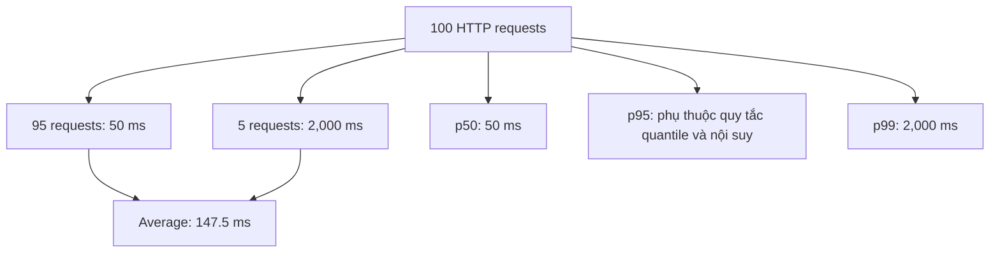
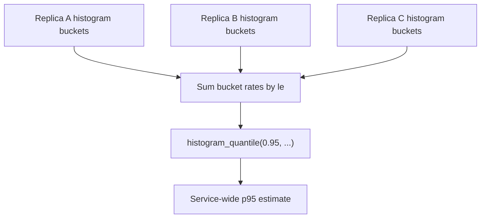

# Theo dõi latency phân vị trong Spring Boot

Một endpoint có thể trả lời phần lớn requests rất nhanh nhưng vẫn khiến một nhóm người dùng phải chờ lâu. Average latency có thể trông ổn dù một số requests bị chậm nghiêm trọng. Để nhìn thấy phần đuôi của phân bố thời gian phản hồi, đội vận hành theo dõi các **phân vị latency** như p50, p90, p95 và p99. Đây là cách đọc hiệu năng từ trải nghiệm của nhiều requests thay vì chỉ nhìn một giá trị trung bình.

Bài **Theo dõi latency phân vị** thuộc chương **HTTP server observability** của module **SPRING_BOOT_OBSERVABILITY**. Module hướng dẫn thiết lập observability cho Spring Boot bằng Micrometer Observation, metrics, logs và distributed tracing; học context propagation, tag/cardinality, exporter, sampling và liên kết tín hiệu để điều tra lỗi, độ trễ và hành vi ứng dụng trên môi trường thực.

Sau bài học, bạn có thể diễn giải p50/p90/p95/p99, phân biệt histogram với summary/client-side quantile, cấu hình Micrometer Timer để xuất histogram, truy vấn percentile trong Prometheus, tổng hợp đúng qua nhiều instances, và dùng percentile để theo dõi SLO mà không nhầm percentile với maximum hoặc average.

## 1. Latency phân vị là gì?

**Latency** là thời gian một thao tác cần để hoàn tất theo điểm bắt đầu/kết thúc đã định nghĩa. Với HTTP server, thường đo từ lúc server bắt đầu xử lý request đến lúc response hoàn tất theo instrumentation. Cần xác định rõ metric đo thời gian server xử lý, thời gian dependency, hay thời gian người dùng thực sự nhìn thấy response.

**Percentile** (phân vị) cho biết ngưỡng mà một tỷ lệ phần trăm observations nằm tại hoặc thấp hơn ngưỡng đó:

| Phân vị | Cách diễn giải |
| --- | --- |
| p50 | 50% requests có latency không vượt quá giá trị này; gần median |
| p90 | 90% requests không vượt quá giá trị này |
| p95 | 95% requests không vượt quá giá trị này |
| p99 | 99% requests không vượt quá giá trị này; nhấn mạnh tail latency |
| p99.9 | 99,9% requests không vượt quá giá trị này; nhạy với tail rất dài và cần nhiều dữ liệu |

Ví dụ p95 = 420 ms có nghĩa khoảng 95% observations trong tập và time window được chọn hoàn tất trong không quá 420 ms; khoảng 5% còn lại lâu hơn. Nó **không** có nghĩa mọi request đều mất 420 ms, cũng không cho biết request chậm nhất.

## 2. Vì sao average latency chưa đủ?

Giả sử có 100 requests: 95 requests mất 50 ms, 5 requests mất 2.000 ms.

\[
\text{Average} =
\frac{95 \times 50 + 5 \times 2000}{100}
= 147.5\text{ ms}
\]

Average là 147,5 ms, nhưng 5% requests mất tới 2 giây. Chỉ nhìn average sẽ che khuất nhóm người dùng gặp latency cao.



Giá trị percentile chính xác phụ thuộc định nghĩa quantile, cách nội suy và bucket boundaries; sơ đồ chỉ minh họa sự khác nhau giữa trung tâm và tail. Với dữ liệu production, hãy dùng histogram/quantile implementation nhất quán và đủ observations.

Nên xem ít nhất average, p50, p95, p99 và request count. Percentile không thay thế throughput, error rate hoặc saturation. Một service có p95 tốt nhưng chỉ xử lý một nửa traffic vì errors vẫn đang có vấn đề.

## 3. Đọc percentile từ một mẫu dữ liệu

Giả sử latency của 10 requests sau khi sắp xếp tăng dần (ms):

```text
20, 22, 25, 28, 30, 35, 40, 55, 90, 500
```

Ta thấy median nằm quanh vùng 30–35 ms, trong khi request cuối mất 500 ms. Các thuật toán quantile có thể tính p50/p90 theo quy tắc nội suy khác nhau; vì thế không nên tự tính percentile từ vài giá trị rồi kỳ vọng nó khớp chính xác Prometheus, Micrometer hay backend.

Khi đọc dashboard:

1. Xem tên metric và đơn vị (seconds, milliseconds hay microseconds).
2. Xem time window và số observations.
3. Xác định percentile được tính trên từng instance hay toàn service.
4. Xác định metric là histogram hay summary.
5. So sánh cùng route/method/status group để tránh trộn workload khác nhau.

Một p99 từ 20 requests không có độ tin cậy tương đương p99 từ hàng triệu requests. Tail percentile đặc biệt nhạy khi sample count nhỏ.

## 4. Micrometer Timer và distribution statistics

Trong Spring Boot, HTTP server requests thường được đo bằng Micrometer Observation và Timer. Timer ghi nhận số lần, tổng thời gian và có thể cung cấp distribution statistics tùy cấu hình registry.

Timer thường có count, totalTime và max theo semantics của implementation. Histogram buckets hoặc percentile statistics chỉ xuất hiện khi được bật. Ví dụ cấu hình Spring Boot/Micrometer minh họa:

```yaml
management:
  metrics:
    distribution:
      percentiles-histogram:
        http.server.requests: true
      slo:
        http.server.requests:
          - 100ms
          - 250ms
          - 500ms
          - 1s
```

Đây là cấu hình minh họa cho meter HTTP server request; kiểm tra property binding và meter name theo Spring Boot/Micrometer version. SLO boundaries được chọn theo yêu cầu dịch vụ, không nên copy nguyên ngưỡng ví dụ nếu chưa xác định latency objective.

### Percentiles và histogram khác nhau

- **Percentiles/quantiles phía client:** SDK/registry tính percentile trong từng process hoặc meter instance. Chúng tiện hiển thị cục bộ nhưng thường không thể tổng hợp chính xác qua nhiều instances bằng cách lấy trung bình các percentile.
- **Histogram:** ghi nhận phân bố vào các bucket. Backend có thể cộng bucket counts giữa instances rồi tính quantile gần đúng trên tập tổng hợp.
- **Summary:** thường ghi count/sum và có thể xuất quantile đã tính tại client; quantile đó không thể cộng gộp như histogram buckets.

Với service chạy nhiều replicas, histogram thường phù hợp hơn nếu cần percentile tổng hợp toàn service.

## 5. Histogram buckets và quantile

Histogram chia latency thành các khoảng. Ví dụ bucket boundaries:

```text
le=0.1   seconds
le=0.25  seconds
le=0.5   seconds
le=1.0   seconds
le=+Inf
```

Bucket là **cumulative**: bucket le=0.5 đếm tất cả observations có latency không quá 0,5 giây, bao gồm các bucket nhỏ hơn. Bucket +Inf chứa toàn bộ observations.

Ví dụ count minh họa:

| Bucket boundary | Cumulative count |
| --- | ---: |
| le=0.1 | 700 |
| le=0.25 | 900 |
| le=0.5 | 970 |
| le=1.0 | 995 |
| le=+Inf | 1.000 |

Từ histogram, backend ước lượng vị trí percentile bên trong bucket. Nếu p95 nằm trong bucket 0,25–0,5 giây, quantile có thể được nội suy trong khoảng đó. Độ chính xác phụ thuộc boundaries và phân bố thực bên trong bucket.

Chọn bucket boundaries quanh latency objectives/SLO để có độ phân giải ở vùng quan trọng. Nếu mọi bucket đều quá rộng, percentile ước lượng thô; nếu quá nhiều bucket, cardinality và chi phí tăng.

## 6. Prometheus: tính p95 bằng histogram_quantile

Với histogram được export sang Prometheus, query p95 tổng hợp theo service hoặc route có thể dùng histogram_quantile:

```promql
histogram_quantile(
  0.95,
  sum by (le) (
    rate(http_server_requests_seconds_bucket[5m])
  )
)
```

Query trên tính p95 gần đúng từ bucket rates của tất cả series trong phạm vi chọn. Tên metric có thể khác theo registry naming convention; xác minh metric thực tế trước khi sử dụng.

### p95 theo route và method

```promql
histogram_quantile(
  0.95,
  sum by (le, uri, method) (
    rate(http_server_requests_seconds_bucket[5m])
  )
)
```

Giữ các dimensions cần thiết cho mục tiêu phân tích. Nếu thêm status, outcome hoặc service, số nhóm tăng. Đừng dùng raw URI có ID hoặc query string làm label; dùng route template như /orders/{id}.

### p99 theo service instance

```promql
histogram_quantile(
  0.99,
  sum by (le, instance) (
    rate(http_server_requests_seconds_bucket[5m])
  )
)
```

Query này cho biết p99 riêng từng instance nếu label instance tồn tại. Hữu ích tìm một replica có vấn đề, nhưng không phải p99 toàn service. Để xem toàn service, bỏ instance khỏi grouping.

## 7. Tổng hợp percentile qua nhiều instances

Giả sử service có ba replicas với p95 lần lượt là 100 ms, 200 ms và 800 ms. Không thể lấy trung bình (100+200+800)/3 = 366,7 ms rồi gọi đó là p95 toàn service.

Percentile là một hàm phi tuyến của phân bố. Quantile của hợp các tập dữ liệu không bằng trung bình quantile của từng tập. Để có percentile tổng hợp, cần tổng hợp histogram bucket counts trước rồi tính quantile:



Query Prometheus tổng hợp theo le (và giữ các dimensions mong muốn) rồi gọi histogram_quantile. Với summary quantiles đã tính ở client, không thể thực hiện phép tổng hợp tương đương bằng cách average các p95.

Nếu cần percentile chính xác hơn hoặc nhiều chiều phân tích, chọn histogram implementation và bucket scheme phù hợp. Native histograms trong Prometheus có cơ chế riêng; query cần tương thích với loại histogram đang lưu.

## 8. Percentile client-side và distribution summary

Micrometer có thể cấu hình percentiles trực tiếp cho meter. Ví dụ:

```yaml
management:
  metrics:
    distribution:
      percentiles:
        http.server.requests: 0.5, 0.9, 0.95, 0.99
```

Property và cách xuất percentile phụ thuộc registry/version. Percentile được tính trong từng meter/process thường tiện cho dashboard instance-level. Khi có nhiều instances, không lấy trung bình p95 của từng replica để tạo p95 service-wide.

| Cấu hình | Kết quả | Có thể aggregate giữa instances? |
| --- | --- | --- |
| Client-side percentile | Quantile đã tính ở process | Không theo cách cộng/average quantile |
| Histogram buckets | Counts theo bucket boundaries | Có, cộng buckets tương ứng rồi tính quantile |
| Count/sum | Số observations và tổng duration | Có thể tính average tổng hợp |
| Max | Giá trị lớn nhất theo semantics/window | Không suy ra percentile |

Nếu backend là Prometheus, histogram thường là lựa chọn tự nhiên cho quantile tổng hợp. Với backend/registry khác, cần đọc rõ semantics trước khi xây dashboard.

## 9. Latency percentile và SLO

SLO (Service Level Objective) mô tả mục tiêu chất lượng dịch vụ. Một SLO latency có thể được diễn đạt bằng percentile, ví dụ p95 của request thuộc nhóm được định nghĩa không vượt quá 300 ms trong cửa sổ đánh giá. Tuy nhiên, percentile SLO và threshold-based event SLO là hai cách định nghĩa khác nhau; cần thống nhất với đội sản phẩm/vận hành.

Một cách phổ biến khác là **good event ratio**:

\[
\text{Good ratio} =
\frac{\text{requests with latency} \leq T}
{\text{eligible requests}}
\]

Ví dụ 99% requests đủ điều kiện hoàn tất trong 500 ms. Cách này có thể biểu diễn bằng histogram bucket count và request count, rồi dùng error budget để theo dõi.

Ví dụ query PromQL minh họa tỷ lệ requests hoàn tất không quá 0,5 giây:

```promql
sum(rate(http_server_requests_seconds_bucket{le="0.5"}[5m]))
/
sum(rate(http_server_requests_seconds_count[5m]))
```

Query cần filter đúng service/route/status và xử lý requests lỗi theo định nghĩa SLO. Nếu numerator và denominator bao gồm các tập requests khác nhau, kết quả không có ý nghĩa. Hãy xác định rõ request nào là eligible và liệu lỗi HTTP có được tính là bad event độc lập hay latency-only objective.

### Chọn p95 hay p99?

- p50 phản ánh trải nghiệm trung tâm.
- p95 phù hợp theo dõi phần lớn traffic và thường ít nhiễu hơn p99.
- p99 nhạy với tail latency và giúp phát hiện ảnh hưởng tới nhóm nhỏ, nhưng cần đủ volume và bucket resolution.
- p99.9 chỉ hữu ích khi traffic đủ lớn, instrumentation ổn định và có khả năng lưu trữ/đọc phân bố ở độ phân giải cần thiết.

Không chọn percentile cao nhất chỉ vì nó có vẻ nghiêm ngặt hơn. Chọn theo mức ảnh hưởng người dùng, traffic, SLO và khả năng đo.

## 10. Chọn time window và sample count

Percentile luôn gắn với một tập observations và khoảng thời gian. p95 trong 1 phút có thể dao động mạnh nếu traffic ít; p95 trong 1 giờ có thể làm mờ một incident ngắn.

Nên xem nhiều cửa sổ:

- 5 phút: phát hiện thay đổi nhanh, nhưng sample count có thể nhỏ.
- 15–30 phút: cân bằng giữa phản ứng và độ ổn định.
- 1 giờ hoặc 1 ngày: xu hướng dài hơn, nhưng che khuất spike ngắn.

Dashboard nên hiển thị request rate/count cạnh percentile để người đọc biết độ lớn mẫu. Khi traffic giảm gần zero, percentile có thể không có dữ liệu hoặc query trả về giá trị khó diễn giải.

Đừng so sánh p99 giữa hai routes có traffic chênh lệch lớn mà không xét sample count. Một route có 20 requests trong window không cung cấp bằng chứng mạnh về p99.

## 11. Cardinality và chi phí histogram

Histogram tạo nhiều series hơn một Timer chỉ có count/sum. Số series tăng theo số meter names, tổ hợp tags (method, route, status, outcome, instance), số bucket boundaries và số service/instances.

Ví dụ 30 route templates × 7 method categories × 5 status categories × 12 bucket series đã có thể tạo hàng nghìn series cho một metric trước khi tính các dimensions khác.

Giữ cardinality có kiểm soát:

- Dùng route template, không dùng raw URI.
- Không thêm user ID, order ID, trace ID hoặc query string vào tags.
- Chỉ giữ method/status/outcome cần thiết.
- Chọn bucket boundaries theo SLO, không thêm quá nhiều bucket tùy tiện.
- Kiểm tra series count sau khi triển khai và đặt giới hạn/alert cho cardinality growth.

Histogram là một đánh đổi: nhiều dữ liệu hơn để có quantile tổng hợp tốt hơn. Hãy chọn đúng độ phân giải cho vùng latency cần theo dõi.

## 12. Truy vấn theo route, method và status

Một dashboard HTTP server hữu ích thường cho phép lọc theo route template và method. Ví dụ:

```promql
histogram_quantile(
  0.95,
  sum by (le, uri, method) (
    rate(http_server_requests_seconds_bucket{
      application="orders-service",
      status=~"2.."
    }[5m])
  )
)
```

Tên label application, status và uri chỉ là ví dụ; metric thực tế có thể dùng service, status_code, http_route hoặc tên khác. Trước khi dùng query, kiểm tra label names, route values và exporter naming.

Khi điều tra latency, không nên chỉ nhìn p95 của mọi status gộp chung. Error responses thường kết thúc nhanh, có thể kéo percentile tổng xuống dù request thành công chậm. Có thể tách successful responses, client errors, server errors và dependency timeout/retry theo metrics riêng.

Định nghĩa nhóm status phải phù hợp với mục tiêu; đừng loại 5xx khỏi mọi dashboard vì chúng cũng là trải nghiệm người dùng xấu.

## 13. Liên kết percentile với traces và logs

Metrics percentile cho thấy **khi nào và nhóm nào** chậm; trace cho thấy **một request được chọn đã đi qua đâu**; logs cung cấp sự kiện chi tiết trong từng bước.

Quy trình:

1. Dashboard báo p95 của POST /orders tăng.
2. Lọc route/method và time window để xác định service/instance.
3. Mở traces được sample trong cùng cửa sổ, tìm spans database hoặc dependency có duration cao.
4. Dùng trace ID/span ID để tra logs tương ứng.
5. Đối chiếu retry, status và error category.

Sampling có thể khiến request gây percentile xấu không có trace được lưu. Đó là lý do metrics histogram cần bao phủ traffic theo instrumentation policy; không suy ra percentile từ các traces đã sample.

Không đưa trace ID vào metric labels để nối dashboard. Dùng trace exemplars nếu registry/backend hỗ trợ hoặc liên kết qua logs/traces theo trace context.

## 14. Kiểm thử percentile và histogram

| Test | Điều cần chứng minh |
| --- | --- |
| Timer unit test | Count/total time tăng đúng khi record observations |
| Histogram configuration test | Meter xuất bucket boundaries mong đợi |
| Registry integration test | Exported meter/labels đúng naming convention |
| Multi-instance query test | Bucket counts được cộng trước khi tính quantile |
| Low-traffic test | Dashboard xử lý no-data/low sample hợp lý |
| SLO test | Numerator/denominator cùng eligible population |
| Cardinality test | Raw URI/IDs không tạo series riêng |

Ví dụ kiểm tra Timer với SimpleMeterRegistry:

```java
import io.micrometer.core.instrument.simple.SimpleMeterRegistry;
import io.micrometer.core.instrument.Timer;
import java.time.Duration;

SimpleMeterRegistry registry = new SimpleMeterRegistry();
Timer timer = Timer.builder("http.server.requests")
    .tag("method", "GET")
    .tag("uri", "/orders")
    .register(registry);

timer.record(Duration.ofMillis(40));
timer.record(Duration.ofMillis(80));

assert timer.count() == 2;
assert timer.totalTime(java.util.concurrent.TimeUnit.MILLISECONDS) == 120;
```

Ví dụ minh họa record count/total time, không chứng minh histogram đã được publish. Với histogram, tạo registry/configuration hỗ trợ distribution statistics và assert bucket counts/measurements thực tế.

Không dùng test percentile với hai observations rồi yêu cầu p99 phải khớp một giá trị production. Percentile implementation có quy tắc riêng; test nên xác minh cấu hình và semantics của registry/backend.

## 15. Lỗi thường gặp

| Hiện tượng | Nguyên nhân có thể | Hướng kiểm tra |
| --- | --- | --- |
| Chỉ có average, không có p95 | Histogram/percentile chưa bật | Kiểm tra distribution configuration |
| p95 toàn service thấp bất thường | Đang average client-side quantiles hoặc gộp error responses nhanh | Dùng histogram aggregate và phân nhóm status |
| p99 nhảy thất thường | Sample count thấp hoặc window quá ngắn | Hiển thị request count và tăng window hợp lý |
| p95 giữa replicas khác nhau | Một instance chậm, traffic không đều hoặc resource khác nhau | Query per-instance rồi so với service-wide histogram |
| Histogram có quá nhiều series | Quá nhiều tags/buckets | Giảm dimensions, chuẩn hóa route/method và bucket |
| Query histogram_quantile trả no data | Metric/bucket name hoặc label le sai | Kiểm tra series thực tế |
| Percentile không khớp trace durations | Khác time window, sampling, scope hoặc unit | Xác minh metric scope/unit và sampling |
| p95 giảm nhưng errors tăng | Error responses nhanh làm tổng latency thấp | Tách success/error và theo dõi error rate |
| SLO ratio vượt 100% hoặc không hợp lý | Numerator/denominator khác tập requests | Đồng bộ filters và eligible population |
| Không thấy histogram sau deploy | Config sai meter name hoặc profile chưa active | Kiểm tra effective configuration và registry |
| p99.9 không ổn định | Không đủ observations hoặc bucket quá thưa | Chọn percentile phù hợp traffic và tăng độ phân giải |

## 16. Tình huống thực tế: p95 tăng nhưng average gần như không đổi

**Bối cảnh giả định:** orders-service xử lý 8.000 requests/phút. Average latency vẫn quanh 90 ms, nhưng p95 tăng từ 180 ms lên 750 ms và p99 lên 1,8 giây. Error rate gần như ổn định.

Quy trình điều tra:

1. **Xác nhận metric:** kiểm tra Timer có histogram và query đang tính p95 trên bucket counts, không average quantiles giữa instances.
2. **Xác định population:** tách method/route/status; xem spike có tập trung ở POST /orders hay cả GET.
3. **Kiểm tra replicas:** query p95 theo instance để tìm một pod có tail latency bất thường.
4. **Kiểm tra sample count:** xác nhận traffic được phân bổ đủ cho nhóm route đang xem.
5. **Mở traces được sample:** tìm spans database, inventory hoặc payment có duration cao; nhớ rằng không phải mọi request chậm đều có trace.
6. **Đối chiếu logs:** tra trace correlation và retry/error category, tránh đọc raw payload.
7. **Kiểm tra hạ tầng:** CPU throttling, connection pool, thread/event-loop saturation, GC pause và dependency latency.
8. **Đánh giá SLO:** xem tỷ lệ requests hoàn tất trong ngưỡng mục tiêu thay vì chỉ dựa p95; xác định error budget burn nếu có.

Average có thể không đổi nhiều khi chỉ một phần nhỏ requests bị chậm. p95/p99 làm lộ nhóm đó, giúp đội vận hành tìm bottleneck trước khi nó ảnh hưởng rộng hơn.

## 17. Bài tập tự kiểm tra

**Bài 1.** p95 = 300 ms có nghĩa gì?

*Gợi ý:* Khoảng 95% observations trong tập/time window đã chọn không vượt quá 300 ms; khoảng 5% lâu hơn.

**Bài 2.** Vì sao không lấy trung bình p95 của ba replicas để tính p95 toàn service?

*Gợi ý:* Quantile không tuyến tính. Cần cộng histogram buckets tương ứng rồi tính quantile trên phân bố tổng.

**Bài 3.** Khi nào histogram phù hợp hơn client-side percentile?

*Gợi ý:* Khi cần tổng hợp latency distribution qua nhiều instances hoặc query quantile theo dimensions ở backend.

**Bài 4.** Histogram bucket là cumulative nghĩa là gì?

*Gợi ý:* Bucket le=0.5 chứa tất cả observations <= 0.5 giây, gồm các bucket nhỏ hơn.

**Bài 5.** Vì sao p99 từ 20 requests không đáng tin như p99 từ hàng triệu requests?

*Gợi ý:* Tail quantile rất nhạy với sample count; ít observations không đủ mô tả phần đuôi.

**Bài 6.** p95 giảm nhưng 5xx tăng. Có thể giải thích thế nào?

*Gợi ý:* Error responses có thể kết thúc nhanh và kéo percentile tổng xuống; tách status groups và theo dõi error rate.

**Bài 7.** Muốn theo dõi 99% requests hoàn tất trong 500 ms, có thể dùng gì?

*Gợi ý:* Good-event ratio từ histogram bucket count tại 0,5 giây chia eligible request count, theo đúng định nghĩa SLO.

**Bài 8.** Vì sao không đưa raw URI vào histogram tags?

*Gợi ý:* IDs/query tạo cardinality cao, làm tăng series và chi phí backend.

## 18. Ghi nhớ

- **Percentile latency** mô tả ngưỡng thời gian mà một tỷ lệ requests hoàn tất; p50 là median, p95/p99 làm rõ tail latency.
- Average không thể hiện đầy đủ trải nghiệm của nhóm request chậm. Luôn đọc percentile cùng request count, error rate và time window.
- Micrometer Timer ghi count/total time; muốn tính quantile cần cấu hình histogram hoặc percentile statistics phù hợp registry.
- **Histogram** cho phép cộng bucket counts giữa instances rồi tính quantile tổng hợp; không average p95 client-side của từng replica.
- Prometheus histogram_quantile cần bucket series và label le; query phải giữ đúng dimensions, units và time range.
- Chọn bucket boundaries quanh latency objectives/SLO; histogram quá thưa làm quantile thô, quá dày làm tăng cardinality/cost.
- Dùng metrics để phát hiện xu hướng, traces được sample để điều tra đường đi, logs để xem sự kiện; sampling khiến trace percentile không đại diện toàn traffic.
- Kiểm thử histogram, query aggregation, no-data, SLO population và cardinality; không đòi p99 ổn định từ mẫu nhỏ.
