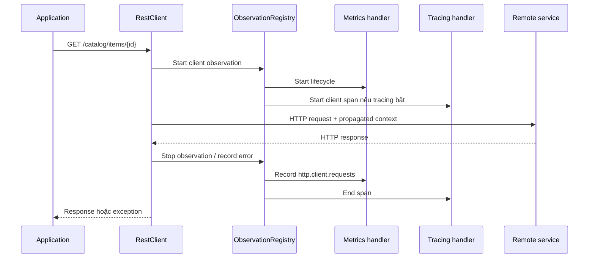
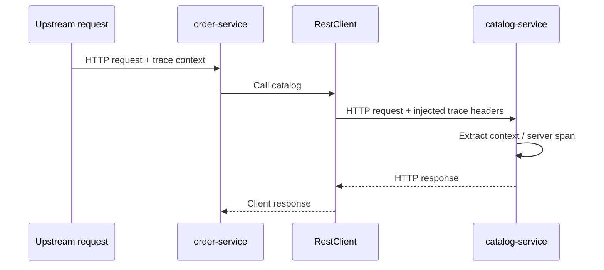

# RestClient observation trong Spring Boot

Một service Spring Boot gọi sang payment-service, inventory-service hoặc API đối tác. Khi request đi ra chậm, đội vận hành cần biết client nào mất thời gian, HTTP status trả về là gì, lỗi xảy ra ở DNS/connect/TLS hay ở response, và trace có nối được từ service gọi sang service nhận hay không. **RestClient observation** giúp quan sát vòng đời HTTP client calls bằng Micrometer Observation, từ đó tạo metrics và distributed tracing khi các handlers tương ứng được cấu hình.

`RestClient` được Spring Framework giới thiệu ở dòng 6.1 và là synchronous HTTP client API. Trong các ứng dụng Spring Boot 3.2 trở lên, builder do Boot auto-configure có thể tích hợp với Micrometer Observation. Khi dùng đúng builder và instrumentation, client calls có thể tạo meter `http.client.requests` và tracing spans. Tự tạo client/builder riêng hoặc bỏ qua builder do Boot quản lý có thể làm mất customizers và observation configuration.

Bài **RestClient observation** thuộc chương **HTTP client observability** của module **SPRING_BOOT_OBSERVABILITY**. Module tập trung thiết lập observability cho Spring Boot bằng Micrometer Observation, metrics, logs và distributed tracing; học context propagation, tag/cardinality, exporter, sampling và liên kết tín hiệu để điều tra lỗi, độ trễ và hành vi ứng dụng trên môi trường thực.

## 1. Mục tiêu học tập

Sau bài học, bạn có thể:

- Giải thích RestClient observation và vai trò của ObservationRegistry.
- Dùng RestClient.Builder được Spring Boot cấu hình để giữ observation integration.
- Hiểu meter `http.client.requests` và các tags thường gặp.
- Phân biệt client request latency với server request latency.
- Theo dõi status, exception, timeout và lỗi kết nối qua metrics/traces.
- Giữ URI template ổn định để tránh high-cardinality metric tags.
- Hiểu cách trace context được propagate từ client sang server.
- Tùy biến observation ở mức phù hợp và kiểm thử instrumentation.

## 2. RestClient là gì và observation hoạt động ở đâu?

`RestClient` là API HTTP client đồng bộ, fluent và được xây dựng quanh request/response exchange. Ứng dụng tạo request, gửi tới remote server, chờ response và đọc body. Observation bao quanh quá trình exchange để đo thời gian và ghi nhận các thuộc tính liên quan.

Micrometer Observation cung cấp lifecycle thống nhất. Một `ObservationRegistry` điều phối các handlers đã đăng ký:

- Metrics handler ghi Timer/meter cho client exchange.
- Tracing handler tạo client span nếu Micrometer Tracing được cấu hình.
- Observation conventions quyết định tên và key-values của operation.



Sơ đồ mô tả luồng khái quát. Chi tiết tags, thời điểm kết thúc và exception mapping phụ thuộc Spring Framework, Boot, Micrometer và request factory.

### Client observation khác server observation

| Observation | Nơi được đo | Câu hỏi trả lời |
| --- | --- | --- |
| `http.server.requests` | Ứng dụng nhận HTTP request | Server xử lý route mất bao lâu? |
| `http.client.requests` | Ứng dụng gửi HTTP request | Gọi remote dependency mất bao lâu? |

Một request inbound có thể tạo server observation. Trong quá trình xử lý, ứng dụng gọi RestClient tạo client observation riêng. Hai measurements mô tả hai đoạn khác nhau của request path; không cộng một cách máy móc vì có thể có overlap và overhead.

## 3. Dùng RestClient.Builder do Spring Boot quản lý

Với Spring Boot 3.2+ và Spring Framework 6.1+, có thể inject `RestClient.Builder` do Boot auto-configure:

```java
import org.springframework.stereotype.Service;
import org.springframework.web.client.RestClient;

@Service
public class CatalogClient {
    private final RestClient restClient;

    public CatalogClient(RestClient.Builder builder) {
        this.restClient = builder
            .baseUrl("https://catalog.internal")
            .build();
    }

    public CatalogItem getItem(String itemId) {
        return restClient.get()
            .uri("/catalog/items/{id}", itemId)
            .retrieve()
            .body(CatalogItem.class);
    }
}

record CatalogItem(String id, String name) {}
```

Khi builder được Boot auto-configure với observation support, RestClient có thể dùng ObservationRegistry và conventions do framework cung cấp. Các customizers khác như message converters, request factory, interceptors hoặc SSL settings cũng có thể được Boot/application áp dụng.

### Vì sao không nên tự tạo builder tùy tiện?

Ví dụ sau tạo builder độc lập:

```java
RestClient client = RestClient.builder()
    .baseUrl("https://catalog.internal")
    .build();
```

Builder độc lập không nhất thiết nhận customizers/observation settings mà Spring Boot đã cấu hình. Nếu dùng cách này, phải tự đảm bảo observation registry, conventions, interceptors và request factory được cấu hình đúng. Ưu tiên inject `RestClient.Builder` trong Spring-managed components.

### Cấu hình ObservationRegistry thủ công

Ở ứng dụng tự quản lý RestClient ngoài auto-configuration, Spring Framework cho phép gắn registry vào builder:

```java
RestClient client = RestClient.builder()
    .baseUrl("https://catalog.internal")
    .observationRegistry(observationRegistry)
    .build();
```

Đây là ví dụ tích hợp thủ công; cần có `ObservationRegistry` phù hợp và các handlers đã đăng ký. Đừng tạo registry mới trống nếu muốn dùng chung metrics/tracing handlers của Spring Boot.

## 4. Meter http.client.requests

Khi observation metrics handler hoạt động, client exchange được ghi nhận thành Timer có tên phổ biến `http.client.requests`. Timer đo thời lượng của request/response exchange theo convention và registry.

| Measurement | Ý nghĩa |
| --- | --- |
| `COUNT` | Số lần client exchange được ghi nhận |
| `TOTAL_TIME` | Tổng thời gian các exchange |
| `MAX` | Maximum trong cửa sổ/chu kỳ registry |
| Histogram buckets | Phân phối latency theo ngưỡng, nếu bật |
| Percentiles | Quantiles cục bộ nếu cấu hình |

Đơn vị Actuator cho Timer thường biểu diễn bằng seconds; backend exporter có thể chuyển đổi tên/đơn vị. Kiểm tra metadata của registry thực tế.

### Tags phổ biến

Các tags thường dùng cho HTTP client observations gồm:

| Tag | Ví dụ | Ý nghĩa |
| --- | --- | --- |
| `method` | `GET`, `POST` | HTTP method |
| `uri` | `/catalog/items/{id}` | URI template hoặc path đã chuẩn hóa |
| `client.name` | `catalog.internal` | Host/client destination theo convention |
| `status` | `200`, `404`, `503` | Response status nếu có |
| `outcome` | `SUCCESS`, `CLIENT_ERROR`, `SERVER_ERROR` | Nhóm kết quả |
| `exception` | `None`, exception class | Lỗi theo convention |

Tag set cụ thể có thể thay đổi theo Spring Boot/Spring Framework version, request factory và custom observation convention. Hãy xem availableTags thay vì giả định mọi tag luôn xuất hiện.

### Đọc meter qua Actuator

Expose metrics endpoint theo policy:

```yaml
management:
  endpoints:
    web:
      exposure:
        include: health,metrics
```

Sau đó kiểm tra:

```http
GET /actuator/metrics/http.client.requests
GET /actuator/metrics/http.client.requests?tag=method:GET
```

Actuator trả measurements và available tags trong process. Để xem time series lịch sử, cần registry/exporter hoặc scrape backend phù hợp.

## 5. URI template và cardinality

RestClient hỗ trợ URI template variables:

```java
restClient.get()
    .uri("/catalog/items/{id}", itemId)
    .retrieve()
    .body(CatalogItem.class);
```

Dùng URI template giúp instrumentation có cơ hội ghi route dạng `/catalog/items/{id}` thay vì từng item ID. Nếu custom code truyền raw URI có giá trị động, tag URI có thể trở nên high-cardinality.

Không dùng order ID, customer ID, email, query string chứa free text/token, full URL có session identifier, trace ID/span ID, Authorization header hoặc cookie làm metric tags. Những dữ liệu này gây cardinality cao và có thể lộ thông tin nhạy cảm.

### Client name nên ổn định

Tag client destination nên phân biệt dependency ở mức hữu hạn, ví dụ `catalog`, `payment`, `inventory`. Nếu tag chứa host động, IP ephemeral hoặc tenant URL tự do, cardinality sẽ tăng. Với service discovery, dùng logical service name nếu convention hỗ trợ.

## 6. HTTP errors, status và timeout

HTTP client call có thể kết thúc theo nhiều cách:

| Tình huống | Kết quả có thể quan sát |
| --- | --- |
| Response 2xx | Status thành công, outcome success |
| Response 4xx | Client error; tùy API/error handler có thể trả response hoặc throw exception |
| Response 5xx | Server error; `retrieve()` mặc định có thể ném exception cho error status |
| DNS/connect failure | Không có HTTP response status; exception kết nối |
| TLS handshake failure | Không có response status; SSL exception |
| Read timeout | Client exchange kết thúc bằng timeout exception |
| Connection pool/acquire timeout | Request chờ lấy connection rồi thất bại trước khi gửi |

Một request lỗi không nhất thiết có tag `status`: nếu không nhận được response, status có thể không tồn tại. Đọc `exception` và `outcome` cùng nhau để hiểu nguyên nhân.

### Timeout cần cấu hình ở request factory

`RestClient` sử dụng `ClientHttpRequestFactory` để thực hiện HTTP I/O. Connect timeout, read/response timeout và connection pool settings phụ thuộc implementation (JDK, Apache HttpComponents, Jetty hoặc request factory khác) và version.

Ví dụ khái quát với request factory hỗ trợ timeout:

```java
var requestFactory = new JdkClientHttpRequestFactory(
    HttpClient.newBuilder()
        .connectTimeout(Duration.ofSeconds(2))
        .build()
);
requestFactory.setReadTimeout(Duration.ofSeconds(5));

RestClient client = builder
    .requestFactory(requestFactory)
    .baseUrl("https://catalog.internal")
    .build();
```

Ví dụ cần imports `java.net.http.HttpClient`, `java.time.Duration` và `JdkClientHttpRequestFactory`. API timeout cụ thể có thể khác theo Spring Framework version. Đặt timeout dựa trên SLO/dependency behavior; timeout quá dài giữ request threads và tăng latency, quá ngắn gây lỗi giả.

### Đo latency ở đâu?

Client Timer thường bao quanh exchange mà RestClient quan sát. Nó có thể bao gồm thời gian chờ response body theo lifecycle implementation, nhưng không nhất thiết gồm toàn bộ business processing trước/sau call. Đọc convention và version đang dùng; không mặc định nó giống thời gian end-to-end mà người dùng cảm nhận.

## 7. Trace context propagation qua RestClient

Khi Micrometer Tracing và tracing bridge được cấu hình, client observation có thể tạo client span. Propagator inject trace context vào HTTP headers; server phía nhận extract context để tạo server span con trong cùng trace.



Để propagation hoạt động:

1. Dùng tracing bridge/propagator được cấu hình nhất quán.
2. Dùng RestClient builder có observation integration.
3. Đảm bảo request factory/interceptors không xóa hoặc ghi đè tracing headers.
4. Server phía nhận phải có instrumentation và propagator tương thích.
5. Giữ trust boundary rõ ràng; không tin trace headers như thông tin xác thực.

Nếu metrics có `http.client.requests` nhưng trace không xuất hiện, có thể tracing handler chưa bật, sampling từ chối trace, exporter lỗi hoặc context không được propagate. Đây là các vấn đề khác nhau.

## 8. Custom observation convention

Observation convention quyết định tên và key-values gắn vào observation. Với HTTP client, Spring cung cấp convention mặc định. Chỉ tùy biến khi cần dimension hữu ích và ổn định mà convention mặc định chưa đáp ứng.

Nguyên tắc:

- Giữ metric name ổn định để dashboard/alerts không bị vỡ.
- Chỉ thêm low-cardinality values.
- Không đưa full URL, ID, token, request body hoặc user data vào tags.
- Không bỏ tags chuẩn nếu dashboards đang phụ thuộc.
- Xác minh behavior với response thành công và exception.

Nếu cần phân loại client theo nhóm nghiệp vụ, dùng logical dependency name có tập giá trị hữu hạn, thay vì hostname được tạo động.

### Không tạo Timer thủ công trùng với HTTP observation

Nếu đã có `http.client.requests`, thêm Timer khác bọc toàn bộ RestClient call có thể hữu ích nếu đo business operation khác, nhưng không nên đặt tên/ý nghĩa trùng rồi cộng cả hai. Ví dụ `payment.authorization` có thể đo operation nghiệp vụ gồm nhiều HTTP calls; `http.client.requests` đo từng exchange.

## 9. Kiểm thử RestClient observation

Có thể dùng MockRestServiceServer hoặc HTTP test server phù hợp để kiểm tra request mà không phụ thuộc API thật. Mục tiêu không chỉ là response đúng mà còn xác minh Observation được tạo với tags phù hợp.

### Kiểm thử integration bằng ObservationRegistry

Ví dụ dùng registry test với handler quan sát lifecycle:

```java
ObservationRegistry registry = ObservationRegistry.create();

List<String> started = new ArrayList<>();
registry.observationConfig().observationHandler(
    new ObservationHandler<Observation.Context>() {
        @Override
        public boolean supportsContext(Observation.Context context) {
            return true;
        }

        @Override
        public void onStart(Observation.Context context) {
            started.add(context.getName());
        }
    }
);

RestClient client = RestClient.builder()
    .observationRegistry(registry)
    .baseUrl("http://localhost:8089")
    .build();
```

Đây là khung minh họa phần registry/handler; test hoàn chỉnh cần khởi động mock server, thực hiện request và assert response cũng như observation name. Trong Spring Boot integration test, nên inject builder đã auto-configure để kiểm tra cấu hình thật của ứng dụng.

### Ma trận kiểm thử

| Ca | Mock response/điều kiện | Điều cần xác minh |
| --- | --- | --- |
| A — Success | HTTP 200 | Observation start/stop, Timer count tăng |
| B — Client error | HTTP 404 | Status/outcome/exception theo error handler |
| C — Server error | HTTP 503 | Error được ghi nhận và exception mapping đúng |
| D — Connect failure | Port không listen | Exception có mặt, status có thể không có |
| E — Timeout | Server trì hoãn response | Duration/exception phản ánh timeout |
| F — URI template | Gọi nhiều item IDs | Tag URI vẫn có dạng template |
| G — Tracing | Bật OTel/Brave bridge phù hợp | Client span và propagation headers được tạo |
| H — Builder | Dùng Boot-injected builder | Observation customizers được áp dụng |

## 10. Troubleshooting

| Triệu chứng | Nguyên nhân có thể | Hướng kiểm tra |
| --- | --- | --- |
| Không có `http.client.requests` | Builder không có observation registry, thiếu metrics handler hoặc không dùng Boot builder | Kiểm tra builder bean, ObservationRegistry và MeterRegistry |
| Meter có nhưng trace không có | Tracing handler chưa cấu hình, sampling off hoặc exporter lỗi | Kiểm tra bridge, sampler và exporter |
| Dùng Boot builder vẫn không thấy meter | Observation/metrics integration không được auto-configure hoặc version khác | Kiểm tra dependencies và auto-configuration report |
| Tags URI chứa ID | Raw URI/custom convention không dùng template | Dùng URI template variables |
| Client name có nhiều giá trị | Host động hoặc tenant host gắn vào tag | Dùng logical dependency name |
| Không có status tag khi lỗi | DNS/TLS/connect/read timeout trước response | Đọc exception/outcome thay vì mong status |
| Latency cao bất thường | Remote server, DNS, TLS, connection pool hoặc timeout | Xem client span, request factory và remote service |
| Trace bị đứt ở remote service | Header propagation bị tắt/strip hoặc server không instrument | Kiểm tra inject/extract và tracing bridge hai đầu |
| Duplicate client spans | Agent instrumentation và Micrometer observation cùng instrument | Rà soát agent, bridge và client instrumentation |
| Timeout không có hiệu lực | Request factory khác với factory đang cấu hình | Xác nhận RestClient dùng đúng request factory |

### Checklist điều tra

1. Xác định Spring Boot/Spring Framework version; RestClient yêu cầu Spring Framework 6.1 trở lên.
2. Xác nhận dependency Actuator/Micrometer Tracing cần thiết.
3. Inject RestClient.Builder do Boot quản lý hoặc gắn đúng ObservationRegistry thủ công.
4. Gửi request test và đọc `http.client.requests` qua Actuator.
5. Kiểm tra availableTags, URI template và client destination.
6. Tạo response 4xx/5xx, connect failure và timeout để xem error semantics.
7. Nếu tracing bật, kiểm tra client span, injected headers và server span.
8. Kiểm tra metrics exporter/backend riêng nếu Actuator có meter nhưng backend trống.

## 11. Bài thực hành: quan sát lời gọi Catalog API

**Bối cảnh:** `order-service` dùng RestClient gọi `catalog-service` để đọc thông tin sản phẩm. Nhóm muốn đo số lần gọi, latency, lỗi remote và trace correlation.

### Phần A — Chuẩn bị

1. Dùng Spring Boot 3.2+ với Spring Framework 6.1+.
2. Thêm Actuator và metrics registry; cấu hình OTel/Brave bridge nếu cần tracing.
3. Inject RestClient.Builder vào CatalogClient.
4. Dùng URI template cho catalog item ID.
5. Expose Actuator metrics endpoint trong môi trường test.

### Phần B — Gửi các loại request

| Ca | Hành động | Kết quả cần quan sát |
| --- | --- | --- |
| A — Success | Catalog trả 200 | `http.client.requests` count tăng, status success |
| B — Not found | Catalog trả 404 | Client error/status/exception theo handler |
| C — Remote failure | Catalog trả 503 | Server error và latency được ghi |
| D — Connect error | Tắt mock server | Exception kết nối, không nhất thiết có status |
| E — Slow response | Mock server delay | Duration tăng hoặc timeout theo cấu hình |
| F — Many IDs | Gọi nhiều item IDs qua URI template | URI tag không tạo một giá trị cho mỗi ID |
| G — Trace | Gọi catalog trong inbound trace | Client span nối với server span nếu hai phía instrument |

### Phần C — Câu hỏi tự đánh giá

1. RestClient observation tạo loại tín hiệu nào khi handlers tương ứng hoạt động?
2. Vì sao dùng Boot-injected RestClient.Builder quan trọng hơn tự gọi RestClient.builder()?
3. `http.client.requests` khác `http.server.requests` như thế nào?
4. Vì sao connect failure có thể không có status tag?
5. Làm thế nào URI template hạn chế cardinality?
6. Timeout nên được cấu hình ở lớp nào của RestClient?
7. Nếu metrics có nhưng trace không có, cần kiểm tra thành phần nào?
8. Trace context được inject/extract qua client/server boundary ra sao?
9. Khi nào nên tạo Observation nghiệp vụ riêng thay vì Timer trùng với HTTP client timer?
10. Vì sao không nên đưa customer ID hoặc trace ID vào client metric tags?

## 12. Ghi nhớ

**RestClient observation** dùng Micrometer Observation để quan sát HTTP exchanges đi ra từ ứng dụng Spring. Trong Spring Boot 3.2+ với Spring Framework 6.1+, ưu tiên builder được Boot auto-configure để nhận ObservationRegistry, metrics/tracing handlers và customizers phù hợp. Meter phổ biến `http.client.requests` là Timer cho client exchange; tags như method, URI template, client destination, status, outcome và exception giúp phân tích dependency latency và errors.

Dùng URI template để giữ tag cardinality thấp, cấu hình timeout ở request factory đúng implementation và đọc exception khi không có HTTP response status. Khi tracing được bật, client span và propagated context giúp nối request tới server span phía remote; metrics vẫn cung cấp xu hướng tổng hợp cho cả traffic. Xác minh response thành công, 4xx/5xx, connect failure và timeout; giữ tags ổn định, bảo vệ dữ liệu request và kiểm tra builder thực sự đang được dùng. Điều đó giúp RestClient calls trở thành một phần quan sát được của hệ thống Spring Boot mà không làm tăng cardinality hoặc tạo instrumentation trùng lặp.
