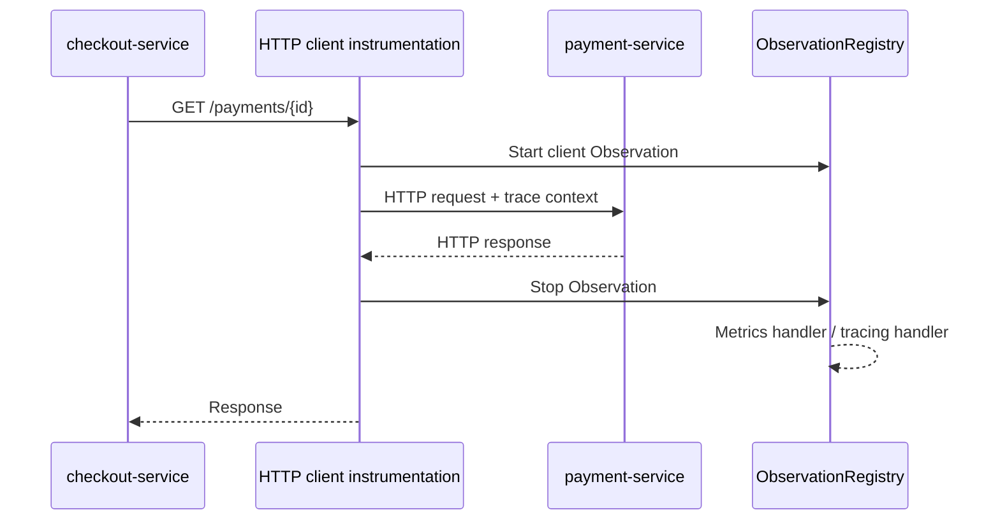
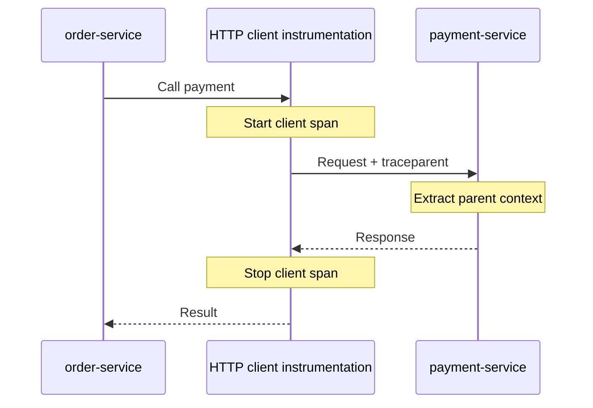
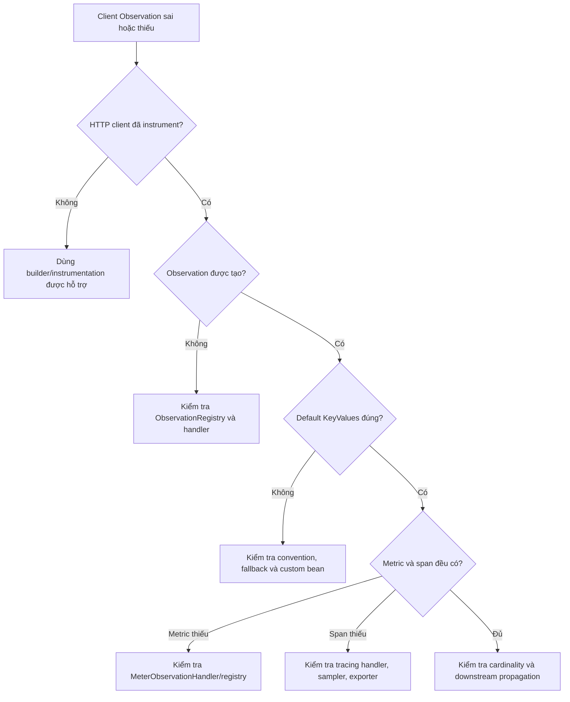

# Client request convention trong Spring Boot

Khi một ứng dụng Spring Boot gọi HTTP service khác, client instrumentation có thể tạo một Observation bao quanh outbound request. Observation cung cấp thời gian gọi, method, destination, status, outcome và thông tin lỗi; tracing handler có thể tạo client span, còn metrics handler ghi nhận thời gian và số lần gọi. **Client request convention** quyết định tên Observation và các KeyValues được gắn vào nó, từ đó ảnh hưởng trực tiếp tới metric dimensions và span attributes.

Bài **“Client request convention”** thuộc chương **HTTP client observability** của module **SPRING_BOOT_OBSERVABILITY**. Module hướng dẫn thiết lập observability cho Spring Boot bằng Micrometer Observation, metrics, logs và distributed tracing; học propagation ngữ cảnh, tag/cardinality, exporter, sampling và liên kết tín hiệu để điều tra lỗi, độ trễ và hành vi ứng dụng trên môi trường thực.

Convention không tự instrument HTTP client và không gửi dữ liệu tới backend. HTTP client instrumentation tạo Observation; convention mô tả Observation; ObservationRegistry handlers chuyển nó thành metrics/traces. Cần hiểu cả ba lớp để tùy chỉnh đúng điểm mở rộng.

## 1. Client request Observation là gì?

Một outbound HTTP call có thể bao gồm DNS, connection pool wait, TCP/TLS setup, request write, remote processing và response read. Client Observation đo thời gian theo phạm vi mà instrumentation bao quanh, thường bắt đầu trước khi gửi request và kết thúc khi response/error được xử lý theo client API.

Ví dụ checkout-service gọi payment-service:



Client Observation giúp trả lời service nào gọi dependency nào, method/route nào chậm, status/outcome là gì, lỗi kết nối/timeout nào xảy ra và client span có nối với trace hiện hành hay không.

Tên Observation phổ biến là http.client.requests. Metric registry có thể chuyển tên này sang format riêng. Không dùng tên meter đã chuẩn hóa ở backend để suy ra tên Observation gốc.

## 2. Vai trò của ClientRequestObservationConvention

Trong Micrometer Observation, convention định nghĩa tên Observation, low-cardinality KeyValues và high-cardinality KeyValues. Spring Framework cung cấp ClientRequestObservationConvention và implementation mặc định DefaultClientRequestObservationConvention cho HTTP client observations.

| Thành phần | Trách nhiệm |
| --- | --- |
| HTTP client instrumentation | Tạo Observation quanh outbound exchange |
| ClientRequestObservationContext | Giữ request/response và trạng thái client exchange |
| ClientRequestObservationConvention | Định nghĩa tên và KeyValues |
| ObservationRegistry | Điều phối Observation lifecycle |
| MeterObservationHandler | Ghi metrics |
| TracingObservationHandler | Tạo client span qua tracing bridge |

Convention không thực hiện request, không retry và không quyết định HTTP connection timeout. Các chính sách đó thuộc HTTP client/transport.

## 3. Low-cardinality và high-cardinality KeyValues

Client request convention cần phân biệt metadata phục vụ aggregation với metadata chi tiết cho tracing.

Các low-cardinality values thường gặp:

| Key | Ý nghĩa | Ví dụ |
| --- | --- | --- |
| method | HTTP method | GET, POST |
| uri | URI template hoặc destination category | /payments/{id} |
| client.name | Tên host/service đích đã chuẩn hóa | payment-service |
| status | HTTP response status | 200, 404, 503 |
| outcome | Nhóm kết quả | SUCCESS, CLIENT_ERROR, SERVER_ERROR |
| error | Tên exception hoặc none | SocketTimeoutException |

Key cụ thể và fallback values phụ thuộc Spring Framework version/convention implementation. Kiểm tra convention của phiên bản ứng dụng thay vì giả định mọi release dùng cùng schema.

High-cardinality value có thể bao gồm URL đầy đủ, query parameters hoặc định danh request. Chúng không nên trở thành metric tags. Tracing convention có thể giữ dữ liệu chi tiết ở span attributes nếu semantics và privacy policy cho phép.

### Vì sao URI template quan trọng?

Giả sử client gọi:

```text
https://payment.internal/payments/1001
https://payment.internal/payments/1002
https://payment.internal/payments/1003
```

Nếu metric tag lưu raw URL, mỗi payment ID có thể tạo một series riêng. Dùng template /payments/{id} sẽ gom các calls vào cùng dimension. Nếu client instrumentation không có route template, convention có thể chỉ nhận URI/destination fallback; không tự suy ra template bằng cách cắt chuỗi tùy tiện.

Không đưa user ID, order ID, token hoặc raw query string vào low-cardinality tags.

## 4. DefaultClientRequestObservationConvention

Spring Framework cung cấp default convention để đặt tên Observation và đóng góp KeyValues phổ biến. Khi không cần metadata riêng, hãy giữ default convention để có schema nhất quán giữa các service.

Convention mặc định thường giữ method, URI/destination, status, outcome và error. Tên key, low/high classification và fallback behavior có thể thay đổi theo version.

Có thể tùy chỉnh khi cần chuẩn hóa dimensions theo taxonomy nội bộ, bổ sung logical dependency name ổn định, map destination host thành service alias, thêm operation category hữu hạn hoặc điều chỉnh fallback URI.

Không thay đổi tên/key mặc định nếu dashboard, alert hoặc query đang phụ thuộc vào chúng mà chưa có migration plan.

## 5. HTTP client instrumentation trong Spring Boot

Spring Boot có thể cấu hình Observation cho các HTTP clients được hỗ trợ. Instrumentation phụ thuộc loại client, cách tạo instance và builder có được auto-configure hay không.

| Client API | Cách dùng nên ưu tiên | Lưu ý |
| --- | --- | --- |
| RestClient | Dùng RestClient.Builder do Boot cung cấp | Builder có thể được customize để gắn observation registry |
| WebClient | Dùng WebClient.Builder do Boot cung cấp | Reactive Observation cần giữ context qua Reactor |
| RestTemplate | Dùng builder/observation configuration do Boot quản lý | Instance tự tạo có thể thiếu customizers |
| Apache HttpClient/OkHttp | Dùng instrumentation phù hợp | Không tự động instrument chỉ vì Actuator có mặt |
| Java HttpClient | Kiểm tra hỗ trợ theo version/adapter | Có thể cần integration riêng |

Ví dụ WebClient:

```java
import org.springframework.stereotype.Component;
import org.springframework.web.reactive.function.client.WebClient;

@Component
public class PaymentClient {
    private final WebClient client;

    public PaymentClient(WebClient.Builder builder) {
        this.client = builder
                .baseUrl("http://payment-service")
                .build();
    }
}
```

Ví dụ RestClient:

```java
import org.springframework.stereotype.Component;
import org.springframework.web.client.RestClient;

@Component
public class InventoryClient {
    private final RestClient client;

    public InventoryClient(RestClient.Builder builder) {
        this.client = builder
                .baseUrl("http://inventory-service")
                .build();
    }
}
```

Nếu tự khởi tạo client hoặc custom builder, hãy xác minh observation registry/customizer được áp dụng. Request thành công không chứng minh client Observation đã được tạo.

## 6. Tùy chỉnh convention bằng bean

Có thể extends DefaultClientRequestObservationConvention để giữ KeyValues mặc định rồi bổ sung metadata có kiểm soát.

Ví dụ thêm logical dependency group:

```java
import io.micrometer.common.KeyValue;
import io.micrometer.common.KeyValues;
import org.springframework.http.client.observation.ClientRequestObservationContext;
import org.springframework.http.client.observation.DefaultClientRequestObservationConvention;

public class ServiceClientObservationConvention
        extends DefaultClientRequestObservationConvention {

    @Override
    public KeyValues getLowCardinalityKeyValues(
            ClientRequestObservationContext context) {

        return super.getLowCardinalityKeyValues(context)
                .and(KeyValue.of("dependency.group", dependencyGroup(context)));
    }

    private String dependencyGroup(ClientRequestObservationContext context) {
        String host = context.getCarrier().getURI().getHost();

        if (host == null) {
            return "unknown";
        }
        if (host.endsWith(".internal")) {
            return "internal";
        }
        return "external";
    }
}
```

Đây là ví dụ minh họa. Logic phân loại host cần phù hợp naming và trust model; không dùng raw host do caller tùy ý điều khiển làm metric tag có cardinality không giới hạn.

Đăng ký convention:

```java
import org.springframework.context.annotation.Bean;
import org.springframework.context.annotation.Configuration;
import org.springframework.http.client.observation.ClientRequestObservationConvention;

@Configuration(proxyBeanMethods = false)
public class ClientObservationConfiguration {

    @Bean
    ClientRequestObservationConvention clientRequestObservationConvention() {
        return new ServiceClientObservationConvention();
    }
}
```

Kiểm tra extension point trong Spring Boot version đang dùng để chắc chắn bean áp dụng cho đúng client instrumentation. Nếu có nhiều loại client với conventions khác nhau, có thể cần customizer/registry riêng theo từng client thay vì một convention global.

## 7. Giữ default KeyValues khi mở rộng

Một lỗi phổ biến là implement interface từ đầu rồi chỉ trả về tag mới. Điều này có thể làm mất method, uri, status, outcome và error mà dashboard đang dùng.

Nếu mục tiêu chỉ là thêm tag, extends default convention và gọi super.getLowCardinalityKeyValues(context) thường giúp giữ schema mặc định.

Nếu thay hoàn toàn convention, cần liệt kê keys bị bỏ và consumers bị ảnh hưởng; cập nhật dashboard/alerts/query; bảo đảm key names ổn định; kiểm thử fallback values khi thiếu response/URI; lập migration plan nếu đổi observation name.

Không thêm cùng một key hai lần với values khác nhau. Duplicate KeyValues có thể dẫn tới kết quả không mong đợi tùy registry/handler.

## 8. Exception, HTTP status và outcome

Client call có thể kết thúc bằng response 2xx, response 4xx/5xx, timeout/connection reset, DNS/TLS failure hoặc cancellation.

HTTP 4xx/5xx là response status, không nhất thiết là exception ở mọi client API. Một số client trả response object để application tự xử lý; client khác có thể ném exception khi status không thành công. Convention phản ánh trạng thái instrumentation thực sự thấy.

| Kết quả | Metadata cần xem |
| --- | --- |
| 2xx | status và outcome success |
| 3xx | status/outcome theo convention |
| 4xx | status/client error; nghiệp vụ có thể xem là expected |
| 5xx | status/server error |
| Connect/read timeout | error type nếu exception được ghi nhận |
| DNS/TLS failure | error type và destination |
| Cancellation | Semantics phụ thuộc client |

Không tự gán mọi 4xx là exception hoặc mọi 5xx là lỗi của chính client service. Tách lỗi dependency khỏi lỗi do caller gửi request không hợp lệ.

Nếu muốn metric đo dependency failure, định nghĩa rõ status/error classes theo SLI. Giữ status tag hữu hạn; không ghi exception message làm metric tag.

## 9. Destination naming và service identity

Client Observation cần xác định dependency đích ổn định. Raw host có thể chứa tenant subdomain hoặc ephemeral host. Đưa raw host thành metric tag có thể tạo cardinality lớn.

| Raw destination | Logical name |
| --- | --- |
| payment-v2.internal.svc.cluster.local | payment-service |
| inventory.prod.internal | inventory-service |
| auth.example.net | identity-provider |
| partner-123.example.net | external-partner |

Mapping nên dựa trên client configuration hoặc allowlist, không dựa trên string parsing tùy tiện. Nếu cần phân biệt operation, thêm tag hữu hạn như dependency.operation.

Không đưa full URL hoặc query string vào metric dimensions. URL chi tiết có thể được lưu ở span/log theo policy và redaction.

## 10. ObservationFilter và convention khác nhau thế nào?

Convention tạo tên và KeyValues từ request context. ObservationFilter xử lý context đã được tạo để bổ sung hoặc điều chỉnh metadata sau khi convention đóng góp.

| Extension point | Mục tiêu |
| --- | --- |
| ClientRequestObservationConvention | Tạo observation name và KeyValues cho HTTP client |
| ObservationFilter | Hậu xử lý Observation.Context |
| ObservationPredicate | Quyết định Observation có được tạo hay không |
| ObservationHandler | Chuyển lifecycle thành metrics/tracing |

Dùng convention khi metadata phụ thuộc HTTP request/response context. Dùng ObservationFilter cho policy hậu xử lý chung trên nhiều loại Observation. Không nhầm convention với handler; convention không export dữ liệu.

## 11. Correlation và propagation tới downstream

Client instrumentation kết hợp tracing handler để tạo client span. Khi trace context hiện hành có mặt, propagator inject header W3C traceparent vào outbound request. Downstream server instrumentation extract context để tạo server span liên quan.



Convention quyết định attributes của client Observation; propagator quyết định context headers; exporter gửi span đã kết thúc tới backend. Ba cơ chế phối hợp nhưng không thay thế nhau.

Nếu metrics có client request count nhưng trace không có client span, kiểm tra tracing handler, sampler, client instrumentation và exporter. Nếu downstream tạo trace mới, kiểm tra inject/extract và propagation format.

## 12. Sampling và metrics

Trace sampling không có nghĩa client metrics cũng bị sample theo cùng xác suất. MeterObservationHandler có thể ghi metrics cho Observations được tạo, trong khi tracing handler áp dụng sampling decision riêng cho spans.

Client Timer/Counter có thể phản ánh toàn bộ calls được instrument; trace backend chỉ có spans được giữ; log correlation có thể có trace ID dù trace không được export. Không dùng số client spans trong backend làm tổng outbound requests.

Dùng metrics đo dependency request rate/error rate/latency; traces điều tra request cụ thể.

## 13. URI template và custom metadata an toàn

Các field phù hợp nếu tập giá trị nhỏ:

- dependency.group: internal/external/partner.
- dependency.operation: authorize/capture/refund.
- api.version: v1/v2.
- client.name: logical dependency name.

Không dùng customerId/orderId/userId, authorization token/session ID, full URL có path/query động, exception message hoặc trace ID làm low-cardinality values.

Nếu cần giá trị chi tiết, cân nhắc high-cardinality span attribute hoặc log record sau redaction và access control. High-cardinality không đồng nghĩa luôn an toàn để thu thập.

## 14. Kiểm thử ClientRequestObservationConvention

Integration test cần xác minh request thật được instrument và convention thực sự áp dụng.

1. Dùng MockWebServer/WireMock hoặc HTTP server test làm downstream.
2. Tạo RestClient/WebClient từ builder auto-configured.
3. Gửi request với nhiều method/route/status.
4. Quan sát MeterRegistry hoặc dùng test ObservationHandler.
5. Xác minh observation name mong đợi.
6. Xác minh low-cardinality values method, uri, status, outcome và error.
7. Xác minh custom dependency.group có giá trị hữu hạn.
8. Gửi URL có ID/query khác nhau và xác nhận metric series không nhân theo từng ID.
9. Thử connect timeout, read timeout và connection refused; xác minh error semantics.
10. Bật tracing test và kiểm tra client span, traceparent outbound và parent relationship phía server.
11. Thử cancellation với WebClient để hiểu lifecycle.
12. Xác minh không có hai Observations cho cùng request do custom instrumentation trùng.

Không chỉ kiểm tra HTTP response thành công. Test phải xác minh Observation được tạo, stop và có đúng KeyValues.

## 15. Chẩn đoán khi client Observation thiếu hoặc sai

| Triệu chứng | Nguyên nhân có thể | Cách điều tra |
| --- | --- | --- |
| Không có http.client.requests | Client chưa instrument hoặc thiếu registry/handler | Kiểm tra builder và auto-configuration |
| Có metrics nhưng không có client span | Tracing handler/bridge chưa cấu hình hoặc trace unsampled | Kiểm tra tracing pipeline |
| URI tag quá nhiều values | Raw URL/path/query trong low-cardinality | Kiểm tra convention và URI template |
| Destination tag thay đổi liên tục | Raw host/ephemeral hostname | Map logical dependency name |
| Custom tag không xuất hiện | Convention bean chưa được áp dụng | Kiểm tra context/configuration |
| Default tags biến mất | Custom convention không gọi super | So sánh KeyValues mặc định |
| Mỗi request có hai observations | Instrumentation đăng ký trùng hoặc wrapper tạo thêm | Kiểm tra builders/interceptors |
| 5xx không hiện error | Client trả response bình thường và app tự xử lý | Kiểm tra status/outcome/error semantics |
| Timeout không có error tag | Exception không gắn vào Observation context | Kiểm tra client instrumentation/version |
| Downstream trace bị tách | Không inject/extract hoặc format mismatch | Kiểm tra traceparent và propagator |
| WebClient mất context sau async | Reactor context propagation chưa đúng | Kiểm tra Reactor/Micrometer bridge |

Quy trình điều tra:

1. Xác định client API và version.
2. Kiểm tra client dùng auto-configured builder hay custom instance.
3. Kiểm tra ObservationRegistry và MeterRegistry.
4. Gửi request test và xem Observation name/KeyValues.
5. Kiểm tra URI/destination cardinality.
6. Nếu thiếu span, kiểm tra tracing bridge, sampling và exporter.
7. Nếu downstream không nối trace, kiểm tra propagation headers.
8. Nếu custom tags mất, kiểm tra convention bean và thứ tự customizers.
9. So sánh behavior với default convention trước khi sửa.



## 16. Bài thực hành: custom client request convention

Thực hiện trong local/test:

1. Tạo Spring Boot application có Actuator và HTTP client phù hợp.
2. Tạo downstream mock server trả lần lượt 200, 404, 503 và delay gây timeout.
3. Gửi request bằng RestClient.Builder hoặc WebClient.Builder do Boot quản lý.
4. Xác minh Observation http.client.requests và KeyValues mặc định.
5. Implement convention extends DefaultClientRequestObservationConvention.
6. Thêm dependency.group với tập giá trị internal/external/unknown.
7. Gửi URL có nhiều path IDs và query values; xác minh metric cardinality không tăng theo từng giá trị.
8. Bật Micrometer Tracing bridge và kiểm tra client span/traceparent.
9. Kiểm tra timeout và connection failure được biểu diễn phù hợp.
10. So sánh output trước/sau custom convention; bảo đảm không mất default keys.
11. Kiểm tra backend metric query và trace attributes sau export.

Kết quả mong đợi: metrics tổng hợp theo logical dependency và route pattern; trace cho phép drill down tới request cụ thể; không có raw identifier trong metric tags.

## 17. Câu hỏi tự kiểm tra

1. Client request Observation bao quanh phần nào của outbound HTTP call?
2. ClientRequestObservationConvention khác HTTP client instrumentation thế nào?
3. DefaultClientRequestObservationConvention cung cấp điều gì?
4. Low-cardinality KeyValues khác high-cardinality values ở đâu?
5. Vì sao raw URL và query string không phù hợp làm metric tags?
6. Spring Boot auto-configured builders giúp gì cho RestClient/WebClient?
7. Khi nào custom HTTP client có thể không tạo Observation?
8. Vì sao extends default convention thường an toàn hơn implement lại từ đầu?
9. Status 404 khác exception connect timeout thế nào?
10. Logical destination name giúp kiểm soát cardinality ra sao?
11. ObservationFilter khác ClientRequestObservationConvention thế nào?
12. Convention, propagator và exporter có nhiệm vụ gì?
13. Trace sampling có tự giảm client request metrics không?
14. Vì sao metrics có thể đầy đủ nhưng trace backend thiếu client spans?
15. Cần test gì để xác minh convention thực sự được áp dụng?

## Tài liệu tham khảo

- [Spring Framework — HTTP Client Observations](https://docs.spring.io/spring-framework/reference/integration/observability.html): client request Observation, context và convention.
- [Spring Framework — ClientRequestObservationConvention Javadoc](https://docs.spring.io/spring-framework/docs/current/javadoc-api/org/springframework/http/client/observation/ClientRequestObservationConvention.html): contract của convention.
- [Spring Framework — DefaultClientRequestObservationConvention Javadoc](https://docs.spring.io/spring-framework/docs/current/javadoc-api/org/springframework/http/client/observation/DefaultClientRequestObservationConvention.html): default naming và KeyValues.
- [Spring Boot — HTTP Client Metrics](https://docs.spring.io/spring-boot/reference/actuator/metrics.html): client instrumentation và builder customization.
- [Micrometer Observation](https://docs.micrometer.io/micrometer/reference/observation.html): ObservationRegistry, conventions, filters và handlers.
- [OpenTelemetry HTTP semantic conventions](https://opentelemetry.io/docs/specs/semconv/http/http-spans/): HTTP client span attributes và semantics.

## Kết luận

**Client request convention định nghĩa cách outbound HTTP calls được mô tả trong Micrometer Observation.** HTTP client instrumentation tạo Observation; convention đặt tên và KeyValues; ObservationRegistry handlers biến lifecycle đó thành metrics và spans. Spring Framework cung cấp default convention để giữ dimensions phổ biến, còn ứng dụng có thể mở rộng bằng convention tùy chỉnh.

Trong Spring Boot, hãy ưu tiên HTTP client builders được auto-configure, giữ low-cardinality values ổn định như method, route template, status, outcome và logical dependency. Không đưa raw URL, query, user/order ID hoặc trace ID vào metric tags. Kiểm thử response, timeout, error, custom tags và propagation qua downstream để metrics, traces và logs cùng hỗ trợ điều tra dependency latency và failure trên môi trường thực.

