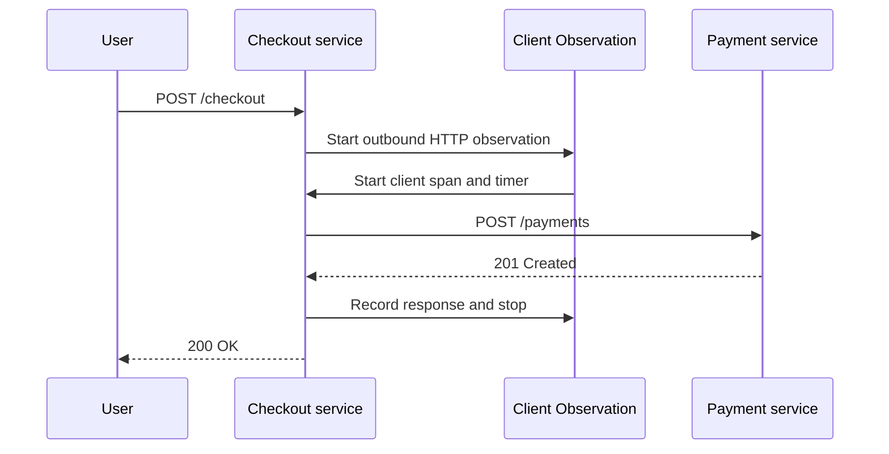
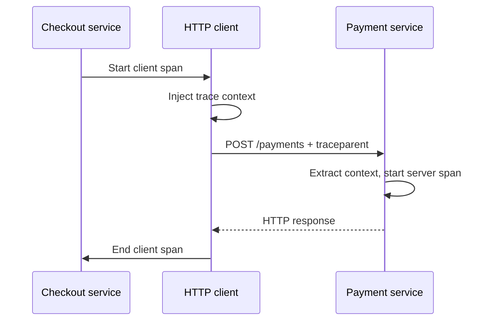

# HTTP client method trong Spring Boot

Một dịch vụ checkout gọi HTTP tới payment service, inventory service và API đối tác. Khi checkout chậm, đội vận hành cần biết client call nào mất thời gian, dependency nào lỗi và request có được liên kết với trace phía server hay không. Nếu chỉ đo tổng thời gian controller, độ trễ của từng outbound call sẽ bị che khuất.

**HTTP client method observation** ghi nhận một outbound HTTP operation từ ứng dụng tới dependency. Observation có thể tạo metrics về số lần gọi và thời lượng; tracing handler có thể tạo client span để biểu diễn dependency call trong distributed trace. Method, URI template, status, outcome và exception cung cấp ngữ cảnh để phân tích. Trong Spring Boot, instrumentation phụ thuộc HTTP client API, phiên bản Spring Framework, Micrometer và cách client được cấu hình.

Bài học thuộc chương **HTTP client observability** của module **SPRING_BOOT_OBSERVABILITY**. Module hướng dẫn thiết lập observability cho Spring Boot bằng Micrometer Observation, metrics, logs và distributed tracing; học propagation ngữ cảnh, tag/cardinality, exporter, sampling và liên kết tín hiệu để điều tra lỗi, độ trễ và hành vi ứng dụng trên môi trường thực. Bài này giải thích HTTP client method observation, ranh giới instrumentation và cách đo outbound dependency calls an toàn.

## Mục tiêu học tập

1. Giải thích HTTP client observation và vai trò của nó.
2. Phân biệt server observation với client observation.
3. Hiểu instrumentation của RestClient, WebClient và RestTemplate theo phiên bản.
4. Phân biệt method, URI template, status, outcome và exception.
5. Dùng URI template thay URL động để kiểm soát cardinality.
6. Hiểu client span, parent context và propagation sang downstream.
7. Nhận biết ảnh hưởng của retry, timeout, redirect và exception.
8. Tùy biến client convention mà vẫn giữ semantics mặc định.
9. Kiểm thử metrics, traces, propagation và failure paths.
10. Chẩn đoán khi outbound calls không xuất hiện hoặc bị đo sai.

## 1. HTTP client observation là gì?

HTTP client observation đại diện cho một lần ứng dụng gửi outbound HTTP request và nhận response hoặc kết thúc do lỗi/timeout. Nó thường bắt đầu khi client thực hiện request và kết thúc khi response được xử lý hoặc operation thất bại theo lifecycle của client integration.



Observation handlers có thể:
- Ghi count/duration với low-cardinality tags.
- Tạo client span và inject trace context vào outbound headers.
- Bổ sung correlation/logging theo cấu hình.

Nếu client không được instrument, gọi HTTP vẫn hoạt động nhưng không có observation/span tương ứng. Thêm custom convention không tự tạo instrumentation cho client không được hỗ trợ.

### 1.1. Client observation khác server observation

| Khía cạnh | Server observation | Client observation |
|---|---|---|
| Hướng request | Request đi vào ứng dụng | Request rời ứng dụng |
| Boundary | Server connector/framework | HTTP client execution |
| Span kind | SERVER | CLIENT |
| URI | Route template do server resolve | URI template/target outbound |
| Status | Response do ứng dụng trả | Response từ dependency |
| Propagation | Extract context từ inbound headers | Inject context vào outbound headers |

Một request end-to-end thường có server span ở service nhận request và client span ở service gọi dependency. Downstream tạo server span kế tiếp khi extract cùng trace context.

## 2. Các HTTP client API trong Spring

Instrumentation availability phụ thuộc framework version, client implementation và auto-configuration.

| Client API | Kiểu sử dụng | Lưu ý observability |
|---|---|---|
| RestClient | API đồng bộ hiện đại | Có observation integration trong Spring Framework version hỗ trợ |
| RestTemplate | API đồng bộ truyền thống | Cần request factory/observation configuration phù hợp |
| WebClient | API reactive, non-blocking | Observation/tracing gắn với reactive context |
| Java HttpClient/Apache/OkHttp | Client thư viện riêng | Cần instrumentation tương ứng, agent hoặc wrapper |

Không giả định chỉ cần Actuator là mọi HTTP library trong JVM tự động được instrument. Kiểm tra client bean, request factory/connector, ObservationRegistry và Java Agent.

### 2.1. RestClient

```java
RestClient restClient = RestClient.builder()
        .baseUrl("https://payment.internal")
        .build();

PaymentResponse response = restClient.post()
        .uri("/payments")
        .body(paymentRequest)
        .retrieve()
        .body(PaymentResponse.class);
```

Đây là ví dụ lời gọi API. Để có observation, client cần observation support tương ứng phiên bản Spring. Trong Spring Boot, ưu tiên builder được auto-configured khi framework cung cấp để nhận customizers, message converters, registry và tracing propagation.

### 2.2. RestTemplate

```java
RestTemplate restTemplate = new RestTemplate();

PaymentResponse response = restTemplate.postForObject(
        "https://payment.internal/payments",
        paymentRequest,
        PaymentResponse.class);
```

Đoạn code chỉ minh họa lời gọi. RestTemplate tạo bằng constructor trực tiếp không bảo đảm nhận mọi customizer của Spring Boot. Dùng builder/customizer do Boot cung cấp hoặc cấu hình registry/request factory phù hợp phiên bản.

### 2.3. WebClient

```java
Mono<PaymentResponse> response = webClient.post()
        .uri("/payments")
        .bodyValue(paymentRequest)
        .retrieve()
        .bodyToMono(PaymentResponse.class);
```

Observation và span lifecycle cần theo dõi lúc publisher được subscribe và hoàn tất/cancel/error, không chỉ lúc tạo Mono. Nếu code tạo publisher nhưng không subscribe, request chưa chắc đã được gửi.

## 3. Client observation convention

Client convention chuẩn hóa cách mô tả outbound request. Tùy phiên bản, các thành phần thường gồm:

| Thành phần | Ví dụ | Mục đích |
|---|---|---|
| Observation name | http.client.requests | Loại operation ổn định |
| Contextual name | POST payment | Tên dễ đọc cho span |
| Method | POST | HTTP method |
| URI/target | payment endpoint | Destination/URI dimension |
| Status | 201 | Response status |
| Outcome | SUCCESS | Nhóm kết quả |
| Exception | TimeoutException | Thông tin lỗi giới hạn |

Tên observation và tag keys phụ thuộc Micrometer/Spring version. Kiểm tra meter/spans thực tế trước khi tạo dashboard hoặc custom convention.

### 3.1. Observation name và contextual name

Observation name mô tả loại HTTP client operation, không chứa URL hoặc ID động. Contextual name giúp trace dễ đọc, ví dụ POST payment. Tránh raw URL có order ID hoặc query token vì trace search bị phân mảnh và có thể lộ dữ liệu.

## 4. Method, URI và cardinality

Outbound client URI dễ làm cardinality bùng nổ vì URL thường được dựng từ business identifiers hoặc query parameters.

| URI | Đánh giá |
|---|---|
| https://payment.internal/payments | Ổn định |
| https://inventory.internal/items/{id} | Template ổn định nếu instrumentation nhận template |
| https://inventory.internal/items/84721 | Raw ID động |
| https://partner/search?q=customer-email | Có thể chứa PII và giá trị động |
| https://api.example.com/orders?token=secret | Không được đưa token vào telemetry |

### 4.1. URI template khác URI thực tế

URI template mô tả cấu trúc endpoint, ví dụ /items/{id}. URI thực tế sau khi expand chứa giá trị của một request. Một số client API cho phép truyền template và variables riêng; nếu code chỉ dựng sẵn String URL, instrumentation có thể chỉ thấy URI đã expand.

Dùng API hỗ trợ template/variables khi có, và kiểm tra output convention. Nếu không có template, dùng dependency label ổn định đã allowlist thay vì raw URL.

### 4.2. Host và dependency identity

Có thể cần phân biệt payment, inventory và identity service. Dùng dependency name ổn định như payment hoặc inventory nếu convention/project hỗ trợ và tập giá trị được kiểm soát. Không dùng arbitrary hostname do người dùng truyền vào làm metric tag.

### 4.3. Không ghi query string mặc định

Query parameters có thể chứa search terms, email, tokens hoặc dữ liệu cá nhân. Chỉ ghi allowlisted parameters nếu có nhu cầu và policy; tốt hơn là ghi operation name hoặc endpoint template.

## 5. Status, outcome và exception

Client observation thường kết thúc với response status hoặc lỗi. Cần phân biệt:

- **Status:** HTTP status code nhận từ remote server.
- **Outcome:** nhóm kết quả như SUCCESS, CLIENT_ERROR, SERVER_ERROR hoặc UNKNOWN theo implementation.
- **Exception:** lỗi transport/client như connect timeout, read timeout, DNS failure hoặc connection reset.

| Kết quả | Status | Diễn giải |
|---|---:|---|
| Payment accepted | 201 | Thành công theo HTTP |
| Resource không tồn tại | 404 | Client error response; có thể là nghiệp vụ hợp lệ |
| Remote server lỗi | 503 | Server error response |
| Connect timeout | Không có response | Exception/transport failure |
| DNS resolution failure | Không có response | Exception/transport failure |
| Response 500 | 500 | Client API có thể ném exception hoặc trả response tùy method |

Không giả định mọi 4xx là lỗi hệ thống. Tách HTTP outcome khỏi business success/failure.

### 5.1. Error mapping

Client API có thể ném exception khi nhận 4xx/5xx tùy cách gọi. retrieve/status handler và exchange API có behavior khác nhau. Convention cần phản ánh response status thực; business code quyết định kết quả có phải lỗi nghiệp vụ không.

### 5.2. Exception message không phải metric tag

Exception message có thể chứa URL, host, query, input hoặc nội dung động. Không đưa nguyên văn vào low-cardinality metrics. Dùng exception class/error category đã kiểm soát; stack details chỉ ghi trong tracing/logging theo privacy policy.

## 6. Cấu hình observability cho HTTP clients

Spring Boot có thể cung cấp builders/customizers để gắn ObservationRegistry và tracing integration vào HTTP clients. Cách cấu hình thay đổi theo phiên bản.

### 6.1. Ưu tiên auto-configured builder

Khi Spring Boot cung cấp RestClient.Builder hoặc WebClient.Builder bean, inject builder đó thay vì tự tạo client độc lập:

```java
@Configuration
class HttpClientConfiguration {
    @Bean
    RestClient paymentRestClient(RestClient.Builder builder) {
        return builder
                .baseUrl("https://payment.internal")
                .build();
    }
}
```

Ví dụ phụ thuộc Spring Boot version có auto-configured builder. Nếu tự tạo client bên ngoài application context hoặc thay request factory sau khi builder cấu hình, observation/tracing customizers có thể không còn áp dụng.

### 6.2. ObservationRegistry

HTTP client integration cần ObservationRegistry để tạo observation. Trong Spring Boot, registry thường được auto-configured và gắn handlers phù hợp. Với client tự tạo, bảo đảm nó dùng registry đúng; không tạo registry mới rỗng rồi kỳ vọng metrics/tracing handlers xuất hiện.

### 6.3. Tracing bridge và exporter

Để client observation tạo span, cần tracing implementation/bridge tương thích và exporter pipeline. Để metrics được ghi, cần metrics handler và registry/exporter. Một observation có thể tạo metrics nhưng không span nếu tracing handler không có, và ngược lại.

## 7. Client spans và context propagation

Client span mô tả outbound request. Tracer thường inject trace context vào headers trước khi gửi request, ví dụ W3C traceparent hoặc B3 tùy propagator.



Nếu upstream server span đang active, client span thường là child span của nó. Downstream server span tiếp tục trace khi extract context đúng.

### 7.1. Kiểm tra propagation

Gửi request từ service A tới service B và xác nhận client span có trace ID mong đợi, outbound request có propagator header, server span ở B có cùng trace ID, span IDs khác nhau và parent relationship hợp lý. Không có hai root traces do header bị drop hoặc propagator không tương thích.

Không tự thêm trace ID vào header bằng business code nếu tracing integration đã inject. Header thủ công có thể tạo trace giả hoặc làm hỏng context.

### 7.2. Trust boundary

Inbound trace headers từ client bên ngoài cần được xử lý theo trust policy. Không để người dùng tùy ý ép sampling hoặc đưa baggage nhạy cảm qua hệ thống. Propagator và sampler cần được cấu hình theo boundary.

## 8. Retry, redirect và timeout

Một logical business operation có thể tạo nhiều HTTP attempts. Cần biết instrumentation đặt ở tầng nào.

- Retry ở application layer có thể tạo một client observation/span cho mỗi attempt hoặc một observation bao ngoài operation.
- Retry ở HTTP client middleware có thể tạo spans theo từng attempt nếu instrumentation hỗ trợ.
- Redirect có thể tạo thêm network exchanges và spans tùy client.
- Connect/read/response timeout kết thúc call bằng exception hoặc timeout signal.
- Circuit breaker có thể short-circuit trước khi gửi HTTP request; khi đó không nhất thiết có HTTP client span.

Phân biệt **logical operation** với **network attempt**. Metrics về attempt giúp đo dependency load; metrics về logical operation giúp đo business flow.

Timeout cần được cấu hình rõ theo HTTP client implementation. Ghi timeout category/dependency ổn định để phân tích, không đưa exception message động vào tags. Retry POST có thể gây side effects nếu remote đã xử lý request nhưng response bị mất; cần idempotency key và retry policy phù hợp.

## 9. Metrics từ HTTP client observations

Metrics handler có thể tạo timer/counter theo low-cardinality tags:

```text
http.client.requests{
  method="POST",
  uri="/payments",
  client_name="payment.internal",
  status="201",
  outcome="SUCCESS"
}
```

Tên metric/tag thực tế phụ thuộc Micrometer version, registry và convention. Kiểm tra meter registry trước khi tạo dashboard.

Dimensions hữu ích gồm HTTP method, URI template/operation template, dependency name allowlisted, status/outcome và error category ổn định. Tránh raw URL, request ID, trace ID, user ID hoặc query string trong metric tags.

Timer có thể ghi count và duration. Histogram/percentiles cần cấu hình registry/backend phù hợp. Phân biệt latency mỗi attempt với latency toàn logical operation có retries. Tracing có thể sample 10% trong khi client metrics vẫn đo toàn bộ outbound requests; dùng metrics cho throughput/error rate toàn traffic.

## 10. Liên kết client observations với logs

Log trong khi client span active có thể mang trace ID/span ID qua MDC hoặc structured logging integration:

```json
{
  "event.name": "dependency.payment.response",
  "dependency.name": "payment",
  "http.request.method": "POST",
  "http.response.status_code": 503,
  "trace_id": "0af7651916cd43dd8448eb211c80319c",
  "span_id": "b7ad6b7169203331"
}
```

Không ghi Authorization, Cookie, token hoặc raw response body. Trace/span fields phải lấy từ current context. Log có trace ID không chứng minh client span đã export.

## 11. Custom client observation convention

Khi cần dimension riêng, có thể tùy biến convention cho HTTP client observations theo extension point của Spring Framework/Micrometer version. API có thể có interface kiểu ClientRequestObservationConvention và context tương ứng.

Chiến lược:

1. Kiểm tra default convention và tag set thực tế.
2. Giữ observation name, method, URI/status/outcome chuẩn.
3. Thêm dependency label ổn định, allowlisted.
4. Không thêm URL, user ID hoặc query parameter vào low-cardinality values.
5. Không override contextual name thành raw URI.
6. Test metrics và spans sau khi custom.

Ví dụ khái niệm bổ sung low-cardinality dependency label:

```java
@Bean
ClientRequestObservationConvention clientObservationConvention() {
    return new DefaultClientRequestObservationConvention() {
        @Override
        public KeyValues getLowCardinalityKeyValues(
                ClientRequestObservationContext context) {
            return super.getLowCardinalityKeyValues(context)
                    .and(KeyValue.of("dependency.name", "payment"));
        }
    };
}
```

Class/interface, method signature và cách Spring chọn convention phụ thuộc phiên bản. Đây là minh họa cho nguyên tắc kế thừa default convention rồi bổ sung giá trị cố định. Đối chiếu API dependency thực tế trước khi dùng.

## 12. Kiểm thử HTTP client observability

| Tình huống | Điều cần xác minh |
|---|---|
| HTTP 200/201 | Observation kết thúc, status/outcome đúng |
| HTTP 404 | Status đúng; business code có thể coi là hợp lệ |
| HTTP 500 | Error/status đúng theo client API |
| Connect timeout | Exception category và span lifecycle |
| Read/response timeout | Duration và timeout classification |
| DNS/connect failure | Không có status; exception được ghi |
| Retry | Số attempt và logical operation semantics |
| Redirect | Behavior/span count phù hợp client |
| Circuit breaker open | Short-circuit không bị hiểu nhầm là HTTP request |
| Request qua hai service | Trace context được propagate |
| URI variables khác nhau | URI tag vẫn template/ổn định |
| WebClient cancellation | Observation/span kết thúc theo lifecycle |

Dùng mock HTTP server để trả status, delay và lỗi có kiểm soát. Assert request headers khi kiểm tra propagation; capture meter registry và test span exporter để xác nhận observations.

Unit/integration test có thể dùng in-memory meter registry và in-memory span exporter/test observation handler. E2E test riêng xác minh OTLP Collector/backend. Không bắt mọi test cần observability backend đang chạy.

Để test cardinality, gọi cùng endpoint template với hai ID khác nhau và xác nhận metric series không tách theo ID. Nếu client API chỉ nhận raw URL, kiểm tra convention có thể chuẩn hóa hoặc dùng explicit dependency label; không giả định template tự động được nhận biết.

## 13. Chẩn đoán HTTP client observation bị thiếu hoặc sai

| Triệu chứng | Nguyên nhân có thể | Cách kiểm tra |
|---|---|---|
| Outbound call không có metric/span | Client không instrument hoặc tạo ngoài Boot builder | Client bean, request factory/connector, registry |
| Chỉ metrics có, không có client span | Tracing handler/bridge không active | Tracer, bridge, span exporter |
| Có span nhưng không metric | Metrics handler/registry hoặc meter filter | Observation handlers và registry |
| Client span không có parent | Current context mất hoặc async sai | Context propagation/executor/Reactor |
| Downstream trace ID khác | Header inject/extract lỗi hoặc proxy drop | Propagator và outbound headers |
| URI tag chứa ID động | Expanded URL thay template | URI builder/convention |
| 4xx bị coi là exception | Client API status handling | retrieve/status handler/exchange semantics |
| Không có status khi timeout | Không có HTTP response | Exception/timeout classification |
| Span duration chỉ đo submit Mono | Lifecycle reactive bị hiểu sai | Subscribe/terminal signal |
| Nhiều spans cho một logical call | Retry/redirect hoặc duplicate instrumentation | Attempt-level instrumentation và agent |
| Metrics count thấp hơn traffic | Sampling nhầm với metrics hoặc filter | Meter registry, observation handler |
| Host tag có nhiều giá trị | Raw arbitrary host | Logical dependency mapping |

### Quy trình điều tra

1. Xác định client API và phiên bản Spring Boot/Spring Framework.
2. Kiểm tra client instance có được tạo từ auto-configured builder/customizer không.
3. Xác minh ObservationRegistry và handlers được gắn vào client.
4. Gửi request test thành công và request timeout.
5. Đọc meter tags và span name/attributes.
6. Kiểm tra URI template, method, status, outcome và exception.
7. Kiểm tra outbound propagation headers và downstream context.
8. Kiểm tra retry/redirect/circuit breaker để hiểu số attempts.
9. Kiểm tra exporter/Collector riêng nếu spans được tạo nhưng backend không thấy.
10. Kiểm tra cardinality và dữ liệu nhạy cảm trong output.

## 14. Các anti-pattern cần tránh

| Anti-pattern | Hậu quả | Cách phù hợp |
|---|---|---|
| Tự new HTTP client ngoài Boot config rồi mong có observation | Thiếu registry/customizers | Dùng auto-configured builder hoặc cấu hình rõ |
| Nghĩ mọi Java HTTP library tự instrument | Call không có spans/metrics | Kiểm tra integration/agent |
| Raw URL làm metric tag | Cardinality tăng theo ID/query | URI template/logical dependency |
| Ghi query string/token | Rò secret và PII | Allowlist và redaction |
| Coi mọi 4xx là lỗi hệ thống | Sai error rate | Tách HTTP outcome và business result |
| Đếm retry attempt như logical request | Sai SLI/throughput | Định nghĩa metric theo attempt/operation |
| Bật agent và framework instrumentation trùng | Duplicate client spans | Chọn instrumentation owner |
| Tạo Observation thủ công quanh client đã instrument | Double timing/spans | Dùng observation sẵn có hoặc boundary rõ |
| Dùng trace count tính outbound request rate | Sampling bias | Dùng client metrics |
| Chỉ test response 200 | Bỏ sót timeout/5xx/cancel | Test nhiều failure modes |
| Giữ span mở sau khi Mono chưa subscribe | Lifecycle sai | Hiểu reactive execution |
| Thêm raw hostname thành tag | Cardinality tùy ý | Dependency name allowlist |

## 15. Checklist production

1. **Client API:** RestClient, RestTemplate, WebClient hay client khác đã được xác định?
2. **Instrumentation:** client instance có observation support và đúng registry?
3. **Version:** Spring Boot/Spring Framework/Micrometer integration tương thích?
4. **Convention:** observation name và contextual/span name ổn định?
5. **URI:** dùng URI template hoặc dependency identity đã chuẩn hóa?
6. **Method/status:** giá trị được ghi đúng và giới hạn?
7. **Outcome:** phân biệt HTTP response, transport exception và business result?
8. **Cardinality:** không có raw URL, IDs, query hoặc arbitrary host làm metric tags?
9. **Tracing:** client span được tạo và có parent context đúng?
10. **Propagation:** outbound headers và downstream extraction hoạt động?
11. **Async/reactive:** context/lifecycle đúng với executor và Reactor?
12. **Retry/timeout:** attempt-level và logical-operation metrics được phân biệt?
13. **Logs:** trace/span correlation đúng, không ghi secret/body?
14. **Export:** metrics/traces pipelines được kiểm tra riêng?
15. **Testing:** có success, 4xx, 5xx, timeout, DNS, retry, redirect, cancel và URI variable tests?
16. **Capacity:** overhead, span volume, meter cardinality và exporter drops được theo dõi?
17. **Operations:** dependency latency/error dashboards và alerts chỉ ra service/operation bị ảnh hưởng?

## 16. Câu hỏi tự đánh giá

**Câu 1.** HTTP client observation đo boundary nào?

**Gợi ý:** Một outbound HTTP operation từ ứng dụng tới dependency, từ lúc thực hiện request tới response/error theo client lifecycle.

**Câu 2.** Client observation khác server observation thế nào?

**Gợi ý:** Client mô tả outbound call và tạo CLIENT span; server mô tả inbound request và tạo SERVER span.

**Câu 3.** Vì sao nên inject RestClient.Builder do Spring Boot quản lý?

**Gợi ý:** Builder có thể nhận auto-configured customizers, observation registry, message converters và tracing support.

**Câu 4.** URI template khác expanded URI ra sao?

**Gợi ý:** Template dùng placeholder như /items/{id}; expanded URI chứa ID cụ thể và có thể gây cardinality cao.

**Câu 5.** HTTP 404 có luôn là lỗi hệ thống không?

**Gợi ý:** Không. Đây là HTTP client error response nhưng có thể là kết quả nghiệp vụ hợp lệ.

**Câu 6.** Timeout có status code không?

**Gợi ý:** Thường không có response status vì chưa nhận HTTP response; ghi exception/timeout category.

**Câu 7.** Vì sao client span không có parent?

**Gợi ý:** Current context mất qua async boundary hoặc client được gọi ngoài request/trace context.

**Câu 8.** Retry ảnh hưởng spans và metrics thế nào?

**Gợi ý:** Một logical operation có thể tạo nhiều network attempts; phân biệt attempt count với operation count.

**Câu 9.** Có thể dùng số client spans đã export để tính dependency request rate không?

**Gợi ý:** Không nếu sampling/filtering có thể bỏ spans; dùng metrics độc lập.

**Câu 10.** Làm sao kiểm tra client propagation end-to-end?

**Gợi ý:** Xác nhận client span, outbound trace header và downstream server span cùng trace ID, span IDs khác và parent relationship hợp lý.

## Kết luận

**HTTP client method observation giúp Spring Boot đo và truy vết outbound HTTP calls tới dependency.** Observation có thể tạo timer/counter với low-cardinality dimensions và client span để biểu diễn dependency trong distributed trace. Cần xác nhận đúng client API và phiên bản được instrument, dùng builder/registry phù hợp, chuẩn hóa URI template và dependency identity, phân biệt response status với transport exception, đồng thời hiểu retry/timeout/redirect và reactive lifecycle. Kiểm thử propagation tới downstream, giữ metrics độc lập với trace sampling, và bảo vệ URL, query, headers cùng identifiers nhạy cảm để telemetry phản ánh đúng dependency behavior mà không làm bùng cardinality.
