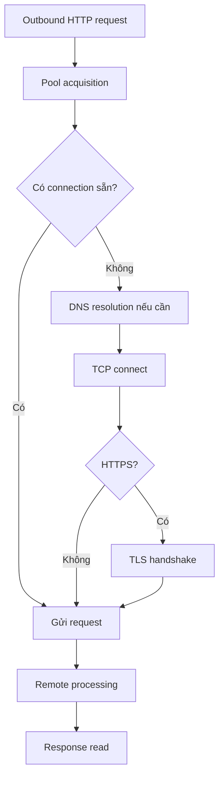
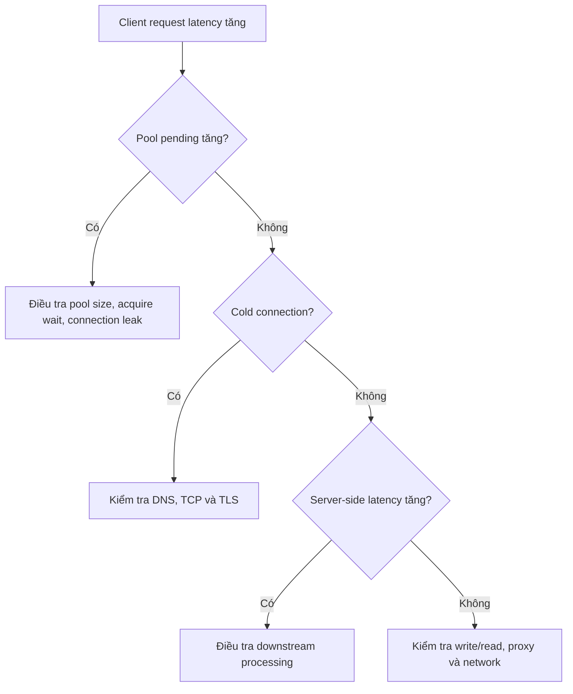

# Connection establishment time trong HTTP client Spring Boot

Khi một ứng dụng Spring Boot gọi một HTTP service, request có thể phải chờ trước khi gửi byte đầu tiên: tìm địa chỉ IP, lấy một connection từ pool, mở TCP connection và thương lượng TLS. Tổng thời gian này thường được gọi chung là connection establishment time, nhưng mỗi thành phần có nguyên nhân và cách quan sát khác nhau.

Phân tích đúng connection establishment time giúp phân biệt dependency xử lý chậm với client không thể thiết lập kết nối. Một request có latency cao có thể do pool cạn connection, DNS chậm, TCP handshake bị retry, TLS handshake tốn thời gian hoặc remote endpoint không accept connection. HTTP client Observation thông thường đo toàn bộ outbound exchange; nó không mặc nhiên cung cấp một metric độc lập cho từng pha DNS/TCP/TLS.

Bài **“Connection establishment time”** thuộc chương **HTTP client observability** của module **SPRING_BOOT_OBSERVABILITY**. Module hướng dẫn thiết lập observability cho Spring Boot bằng Micrometer Observation, metrics, logs và distributed tracing; học propagation ngữ cảnh, tag/cardinality, exporter, sampling và liên kết tín hiệu để điều tra lỗi, độ trễ và hành vi ứng dụng trên môi trường thực.

## 1. Connection establishment time gồm những gì?

Một outbound HTTP request có thể trải qua các giai đoạn:

1. **DNS resolution:** chuyển hostname thành một hoặc nhiều địa chỉ IP.
2. **Connection pool acquisition:** lấy connection khả dụng từ pool; nếu pool cạn, request có thể phải chờ.
3. **TCP connect:** thiết lập kết nối TCP tới địa chỉ đích.
4. **TLS handshake:** thương lượng TLS, xác minh certificate và tạo session bảo mật nếu dùng HTTPS.
5. **Request write:** gửi request headers/body.
6. **Remote processing:** server xử lý request.
7. **Response read:** nhận response headers/body.

Không phải request nào cũng thực hiện đủ mọi bước. Nếu connection pool tái sử dụng một connection đang mở, request có thể bỏ qua DNS/TCP/TLS. TLS session resumption, DNS cache và connection reuse cũng thay đổi chi phí.



### Connection establishment khác request latency

- **Connection establishment time** tập trung vào việc có được một connection dùng được hay không.
- **HTTP client request duration** thường đo rộng hơn, gồm exchange tới khi response hoàn tất theo instrumentation.
- **Remote server processing time** là thời gian server xử lý; client không thể suy ra chính xác chỉ từ tổng duration.
- **Pool pending time** là thời gian chờ connection từ pool; nó không phải TCP connect time.

Không gọi toàn bộ http.client.requests duration là TCP connect latency. Muốn tách pha cần instrumentation của HTTP client/connection pool hoặc tracing spans/events chuyên biệt.

## 2. Connection pool acquisition time

HTTP client thường tái sử dụng connection để tránh mở TCP/TLS cho mỗi request. Pool quản lý connection đang rảnh, đang sử dụng và request đang chờ.

Khi pool có connection khả dụng, acquisition thường nhanh. Khi pool đạt giới hạn, request có thể phải đợi cho tới khi connection được trả về hoặc acquisition timeout xảy ra.

Các dấu hiệu pool pressure:

- Pending acquisition tăng.
- Pending acquire time tăng.
- Active connections gần max connections.
- Idle connections bằng 0 trong thời gian dài.
- Pool acquire timeout xuất hiện.
- Request latency tăng dù server-side latency ổn định.

Với Reactor Netty, ConnectionProvider quản lý connection pool. Các pool metrics có thể được bật và quan sát qua Micrometer integration tùy version/configuration. Các measurements thường hữu ích gồm active, idle, pending connections, max connections, pending acquire time và acquire failures. Tên meter cụ thể cần xác minh trong phiên bản Reactor Netty/Micrometer đang dùng.

### Ví dụ cấu hình ConnectionProvider

```java
import java.time.Duration;

import reactor.netty.resources.ConnectionProvider;

ConnectionProvider provider = ConnectionProvider.builder("payment-pool")
        .maxConnections(100)
        .pendingAcquireMaxCount(500)
        .pendingAcquireTimeout(Duration.ofSeconds(2))
        .maxIdleTime(Duration.ofSeconds(30))
        .build();
```

Đây là ví dụ cấu hình pool riêng. Các giới hạn phải được sizing theo concurrency, response time, downstream capacity và số connection được phép. Không tăng maxConnections vô hạn để che giấu pool wait; điều đó có thể làm quá tải dependency hoặc cạn ephemeral ports/file descriptors.

Khi tạo WebClient dùng Reactor Netty HttpClient với ConnectionProvider tùy chỉnh, cần gắn provider vào connector và bảo đảm lifecycle/disposal của provider được quản lý khi ứng dụng shutdown.

## 3. TCP connection establishment

TCP connect bao gồm handshake giữa client và server. Latency có thể tăng do:

- Network route dài hoặc congestion.
- Packet loss và retransmission.
- Firewall/security group drop packet.
- Server backlog hoặc accept queue quá tải.
- Endpoint IP không reachable.
- NAT, proxy hoặc service mesh thêm hop.
- Connection limit hoặc ephemeral port exhaustion ở client.

Nếu TCP connect timeout xảy ra, thường chưa có HTTP response status. Đây là transport failure, không phải HTTP 5xx từ downstream.

Phân biệt:

| Triệu chứng | Khả năng |
| --- | --- |
| Connection refused | Đích reachable nhưng không có listener hoặc bị reject |
| Connect timeout | Packet bị drop, route không reachable hoặc endpoint không phản hồi |
| Unknown host | DNS resolution thất bại |
| Too many open files | File descriptor/resource exhaustion |
| No route to host | Routing/network policy |
| Connection reset | Peer/proxy reset connection trong quá trình thiết lập hoặc sử dụng |

Không kết luận server xử lý chậm chỉ từ connection timeout. Cần xem network, client pool và server accept metrics.

## 4. DNS resolution time

DNS có thể ảnh hưởng rõ rệt tới lần kết nối đầu tiên hoặc khi cache hết hạn. Trong container/Kubernetes, DNS query có thể đi qua resolver nội bộ, CoreDNS hoặc upstream DNS.

Các yếu tố:

- Resolver latency và retry.
- DNS cache TTL.
- Nhiều A/AAAA records.
- Search domains trong container.
- DNS timeout/retry configuration.
- Service discovery và endpoint churn.

Connection reuse làm giảm số lần DNS lookup; vì vậy chỉ đo một request trên connection mới có thể khác đáng kể so với steady-state traffic.

Để điều tra, so sánh cold connection với reused connection, xem resolver metrics/logs và kiểm tra DNS lookup ở đúng runtime/container. Không hard-code IP để né DNS trừ khi kiến trúc có cơ chế service discovery và failover tương ứng.

## 5. TLS handshake time

Với HTTPS, TLS handshake xảy ra sau khi TCP connection được thiết lập. Thời gian phụ thuộc certificate chain, thuật toán, CPU, network round trips, OCSP/revocation checks nếu có và TLS session resumption.

Các dấu hiệu:

- HTTPS connection chậm hơn HTTP trong cùng môi trường.
- Cold connection chậm nhưng keep-alive request nhanh.
- CPU tăng khi mở nhiều TLS connections đồng thời.
- Certificate validation hoặc trust store lỗi.
- Proxy/service mesh kết thúc TLS rồi thiết lập TLS khác tới upstream.

Connection pool và keep-alive giảm số lần handshake. Tuy nhiên, certificate rotation, connection max lifetime và idle timeout có thể khiến connection phải tạo lại định kỳ.

Không tắt certificate validation để giảm handshake latency. Cần profiling và cấu hình trust/certificate đúng.

## 6. Timeout nào kiểm soát connection establishment?

Timeout của HTTP client có nhiều lớp, không phải tất cả đều có nghĩa giống nhau.

| Timeout | Giai đoạn | Ý nghĩa |
| --- | --- | --- |
| DNS timeout | Name resolution | Giới hạn thời gian phân giải hostname; thường thuộc resolver |
| Pool acquire timeout | Connection pool | Giới hạn thời gian chờ connection khả dụng |
| Connect timeout | TCP connect | Giới hạn thời gian thiết lập TCP connection |
| TLS handshake timeout | TLS | Giới hạn thời gian thương lượng TLS nếu client expose riêng |
| Response/read timeout | Response | Giới hạn thời gian chờ dữ liệu/response theo client semantics |
| Overall request timeout | Toàn exchange | Giới hạn tổng thời gian request nếu client/operator hỗ trợ |

Connect timeout không bao gồm pool acquisition hoặc DNS trong mọi implementation. Đọc tài liệu HTTP client connector đang dùng và test từng pha.

### Ví dụ Reactor Netty HttpClient

```java
import java.time.Duration;

import reactor.netty.http.client.HttpClient;

HttpClient httpClient = HttpClient.create()
        .option(
                io.netty.channel.ChannelOption.CONNECT_TIMEOUT_MILLIS,
                2_000)
        .responseTimeout(Duration.ofSeconds(5));
```

Đây là ví dụ đặt TCP connect timeout và response timeout. Response timeout không phải overall deadline cho mọi pha. Nếu cần pool acquire timeout, cấu hình ConnectionProvider. Nếu cần TLS handshake timeout, dùng API phù hợp với phiên bản Reactor Netty và kiểm tra semantics.

### Gắn connector vào WebClient

```java
import org.springframework.http.client.reactive.ReactorClientHttpConnector;
import org.springframework.web.reactive.function.client.WebClient;
import reactor.netty.http.client.HttpClient;

HttpClient httpClient = HttpClient.create()
        .option(
                io.netty.channel.ChannelOption.CONNECT_TIMEOUT_MILLIS,
                2_000);

WebClient client = WebClient.builder()
        .clientConnector(new ReactorClientHttpConnector(httpClient))
        .baseUrl("https://payment-service")
        .build();
```

Trong Spring Boot, nếu cần giữ auto-configuration và Observation customizers, hãy tích hợp connector qua cơ chế builder/customizer của Boot version đang dùng. Đừng thay thế builder bean một cách vô tình và làm mất instrumentation.

## 7. Quan sát tổng request latency bằng Micrometer Observation

Spring Boot và Micrometer có HTTP client Observation phổ biến tên http.client.requests. Observation này thường cung cấp duration toàn exchange và dimensions như method, URI, status, outcome và error theo convention.

Ví dụ metrics:

```text
http.client.requests
  method=POST
  uri=/payments/{id}
  client.name=payment-service
  status=200
  outcome=SUCCESS
```

Metric giúp thấy latency và error rate tổng thể của dependency. Nó không nhất thiết tách riêng DNS, pool acquire, TCP connect và TLS handshake.

Nếu request latency tăng nhưng downstream server metrics không tăng tương ứng, nguyên nhân có thể nằm ở client-side pool, DNS, network hoặc TLS. So sánh client observation duration với server-side observation và pool metrics để khoanh vùng.

Không thêm raw URL, remote IP, payment ID hoặc trace ID làm low-cardinality tags. Dùng logical destination name và URI template.

## 8. Connection pool metrics trong Reactor Netty

Reactor Netty có metrics cho connection provider/pool khi metrics được bật và Micrometer integration phù hợp có trên classpath. Cấu hình thường được thực hiện ở ConnectionProvider:

```java
ConnectionProvider provider = ConnectionProvider.builder("payment-pool")
        .metrics(true)
        .maxConnections(100)
        .build();
```

Tên API và meter names phụ thuộc version. Hãy kiểm tra metrics được đăng ký trong MeterRegistry thay vì dựa vào tên lấy từ một version khác.

Các measurements cần quan sát:

| Measurement | Câu hỏi vận hành |
| --- | --- |
| Active connections | Bao nhiêu connection đang được sử dụng? |
| Idle connections | Có connection rảnh để tái sử dụng không? |
| Pending connections | Bao nhiêu request đang chờ pool? |
| Max connections | Pool đang chạm giới hạn không? |
| Pending acquire time | Chờ lấy connection mất bao lâu? |
| Acquire failures | Bao nhiêu lần không lấy được connection? |

Pool metrics giải thích phần chờ trước khi có connection. Chúng không thay thế TCP connect timing cho connection mới; hãy kết hợp với network/connector instrumentation.

## 9. Tách pha bằng tracing hoặc connector instrumentation

HTTP client span tiêu chuẩn thường bao quanh outbound request. Để đo chính xác DNS, pool acquisition, TCP connect và TLS handshake, cần instrumentation ở mức connector, resolver hoặc connection pool.

Có thể sử dụng:

- Reactor Netty connection provider metrics.
- Netty channel lifecycle instrumentation.
- HTTP client connector instrumentation hoặc event hooks.
- JVM/network diagnostics và packet capture trong môi trường được phép.
- Service mesh/proxy metrics nếu kết nối đi qua sidecar.
- Distributed traces để so sánh client span và downstream server span.

Không giả định mọi pha sẽ tự xuất hiện thành child spans. Nếu tự tạo spans cho connection phases, đặt tên và parent relationship rõ ràng, tránh double-count duration với client span tổng.

## 10. Cold connection và connection reuse

Hai request giống nhau có thể có latency khác nhau:

- Cold connection: DNS, TCP và TLS có thể phải thực hiện.
- Reused connection: lấy connection từ pool rồi gửi request.
- Expired connection: connection cũ bị đóng, client phải thiết lập lại.
- Pool saturated: request chờ connection dù server vẫn khỏe.

Khi benchmark, tách cold-start tests khỏi steady-state tests. Một phép đo duy nhất sau khi pool đã warm không phản ánh latency của lần kết nối đầu. Ngược lại, chỉ đo cold connections sẽ phóng đại chi phí so với traffic có keep-alive tốt.

Kiểm tra idle timeout, max life time, server keep-alive timeout và proxy timeout để tránh connection bị đóng bất ngờ rồi tạo lại liên tục.

## 11. Tính ngân sách latency

Tổng client-observed duration có thể hình dung:

\[
T_{client} =
T_{pool} + T_{dns} + T_{tcp} + T_{tls} +
T_{write} + T_{remote} + T_{read}
\]

Đây là mô hình phân rã khái niệm. Một số pha không xảy ra ở mỗi request; có thể có overlap, retries hoặc connection reuse. Không cộng các metrics không cùng boundary như thể chúng luôn là các khoảng tuần tự.

Ví dụ:

| Pha | Thời gian minh họa |
| --- | ---: |
| Pool acquire | 4 ms |
| DNS | 2 ms |
| TCP connect | 8 ms |
| TLS handshake | 15 ms |
| Request write | 1 ms |
| Remote processing | 40 ms |
| Response read | 5 ms |
| Tổng | 75 ms |

Nếu reused connection, DNS/TCP/TLS có thể gần như không phát sinh trong request đó. Nếu pool saturated, pool wait có thể chiếm phần lớn latency dù connect time và server processing vẫn bình thường.

Dùng histogram/percentiles thay vì chỉ average. Một tỷ lệ nhỏ connection establishment chậm có thể làm p99 tăng mà average vẫn thấp.

## 12. Chẩn đoán theo triệu chứng

| Triệu chứng | Nguyên nhân có thể | Cách kiểm tra |
| --- | --- | --- |
| Client latency cao, server latency bình thường | Pool wait, DNS, TCP hoặc TLS | So sánh client duration, pool metrics và connector timings |
| Pending acquire tăng | Pool cạn hoặc connection giữ quá lâu | Active/idle/pending, max connections, response time |
| Connect timeout | Network route, firewall hoặc endpoint không phản hồi | TCP diagnostics, connect timeout, network policy |
| Unknown host | DNS resolver lỗi | DNS lookup từ đúng container/pod |
| HTTPS chậm hơn HTTP | TLS handshake/certificate/proxy | TLS timing, session reuse, certificate chain |
| Cold request chậm, request sau nhanh | DNS/TCP/TLS setup và connection warm-up | So sánh cold vs reused connection |
| Acquire timeout | Pool wait vượt giới hạn | Pool sizing, pending queue và downstream latency |
| Connection reset | Peer/proxy đóng connection | Keep-alive/idle timeout và proxy logs |
| Latency tăng khi concurrency tăng | Pool saturation hoặc downstream capacity | Load test, active/pending connections |
| Nhiều TCP connections mới | Keep-alive không hoạt động hoặc pool churn | Connection reuse, max life/idle settings |

Quy trình:

1. Xác định client API và connector thực tế.
2. Đo tổng client Observation duration.
3. Đọc active/idle/pending connection metrics.
4. Phân biệt request dùng reused connection hay cold connection.
5. Kiểm tra DNS lookup và resolver logs.
6. Đo TCP connect và TLS handshake nếu connector/tooling hỗ trợ.
7. So sánh với downstream server Observation duration.
8. Kiểm tra timeout, retry, proxy và service mesh.
9. Thử load test có kiểm soát để tìm ngưỡng pool saturation.



## 13. Bài thực hành: đo connection establishment

Thực hiện trong local/test:

1. Tạo WebClient dùng Reactor Netty connector.
2. Cấu hình ConnectionProvider có giới hạn max connections và pending acquire timeout.
3. Bật pool metrics và xác minh active/idle/pending measurements trong MeterRegistry.
4. Đặt TCP connect timeout và response timeout.
5. Gọi một endpoint HTTPS lần đầu để quan sát cold connection.
6. Gọi lặp lại cùng endpoint để quan sát connection reuse.
7. Tạo concurrency cao hơn max connections để quan sát pending acquisition và acquire timeout.
8. Thử hostname không phân giải được và port không có listener để phân biệt DNS với TCP failure.
9. So sánh client Observation duration với server-side Observation duration.
10. Ghi lại giới hạn: pha nào có metric riêng, pha nào chỉ được quan sát qua tổng duration hoặc công cụ network diagnostics.
11. Chạy lại với TLS và keep-alive; không tắt certificate validation để thay đổi latency.

Kết quả mong đợi: xác định được pool wait, connect timeout, DNS/TCP failure và phần latency do downstream xử lý; không nhầm tổng request duration với connection establishment.

## 14. Câu hỏi tự kiểm tra

1. Connection establishment time gồm những pha nào?
2. Pool acquisition khác TCP connect thế nào?
3. Vì sao request dùng reused connection có thể không phát sinh DNS/TCP/TLS?
4. DNS latency được quan sát ở đâu?
5. TCP connection refused khác connect timeout ra sao?
6. TLS handshake xảy ra ở giai đoạn nào?
7. Connect timeout có luôn bao gồm DNS và pool wait không?
8. Response timeout khác overall request timeout thế nào?
9. Vì sao http.client.requests duration không phải TCP connect latency?
10. Reactor Netty ConnectionProvider quản lý những gì?
11. Pending connections tăng báo hiệu điều gì?
12. Làm sao phân biệt pool saturation với downstream processing chậm?
13. Vì sao không nên tăng maxConnections vô hạn?
14. Cold connection benchmark khác steady-state benchmark thế nào?
15. Cần kết hợp những metrics/traces/network diagnostics nào để phân rã latency?

## Tài liệu tham khảo

- [Spring Boot — HTTP Client Metrics](https://docs.spring.io/spring-boot/reference/actuator/metrics.html): HTTP client observations và metrics.
- [Spring Framework — HTTP Client Observations](https://docs.spring.io/spring-framework/reference/integration/observability.html): client Observation lifecycle và conventions.
- [Reactor Netty — HTTP Client](https://projectreactor.io/docs/netty/release/reference/http-client.html): HttpClient, connection provider, timeouts và pool metrics.
- [Reactor Netty — Connection Pool](https://projectreactor.io/docs/netty/release/reference/http-client.html#_connection_pool): pool configuration và measurements.
- [Micrometer Observation](https://docs.micrometer.io/micrometer/reference/observation.html): ObservationRegistry, handlers và conventions.
- [OpenTelemetry HTTP semantic conventions](https://opentelemetry.io/docs/specs/semconv/http/http-spans/): HTTP client span semantics.

## Kết luận

**Connection establishment time là phần chi phí trước khi HTTP client có thể trao đổi dữ liệu trên một connection dùng được.** Nó có thể gồm pool acquisition, DNS, TCP connect và TLS handshake; mỗi pha có timeout, metrics và nguyên nhân sự cố khác nhau. Connection reuse giúp bỏ qua nhiều bước, trong khi pool saturation có thể làm request chờ lâu dù network và downstream server vẫn khỏe.

Trong Spring Boot, dùng WebClient instrumentation để đo tổng outbound exchange và Reactor Netty connection pool metrics để nhận diện pool pressure. Khi cần tách DNS/TCP/TLS, bổ sung connector/network instrumentation phù hợp. Đừng xem http.client.requests là connect latency; kết hợp client/server observations, pool metrics và network diagnostics để xác định đúng nơi phát sinh độ trễ.

