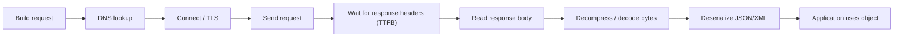

# Body deserialization time trong HTTP client observability

## 1. Mục tiêu và bối cảnh

Một HTTP client có thể nhận response headers rất nhanh nhưng vẫn mất nhiều thời gian trước khi ứng dụng sử dụng được dữ liệu. Body có thể lớn, nén, chứa JSON sâu hoặc nhiều object; quá trình đọc bytes, giải nén, parse JSON và chuyển đổi thành Java objects có thể tiêu tốn CPU, memory và thời gian.

**Body deserialization time** là thời gian cần để chuyển response body từ dạng bytes/text sang kiểu dữ liệu mà ứng dụng sử dụng. Khi điều tra latency của outbound HTTP call, cần phân biệt thời gian chờ network với thời gian đọc và decode body. Nếu chỉ nhìn một con số tổng, đội vận hành có thể nhầm một dependency chậm với ứng dụng đang parse payload tốn CPU.

Bài thuộc chương **HTTP client observability** của module **SPRING_BOOT_OBSERVABILITY**. Module hướng dẫn thiết lập observability cho Spring Boot bằng Micrometer Observation, metrics, logs và distributed tracing; học context propagation, tag/cardinality, exporter, sampling và liên kết tín hiệu để điều tra lỗi, độ trễ và hành vi ứng dụng trên môi trường thực.

Sau bài học, bạn có thể:
1. Phân rã latency của HTTP client thành các giai đoạn network, body transfer và deserialization.
2. Hiểu ý nghĩa và giới hạn của http.client.requests timer.
3. Nhận diện vai trò của HttpMessageConverter và WebClient Codec.
4. Đo riêng thời gian decode bằng Micrometer Observation/Timer khi cần.
5. Phân biệt decode eager, reactive body consumption và streaming.
6. Ghi nhận payload size/decode outcome mà không làm tăng cardinality.
7. Xử lý decode error, timeout, cancellation và memory pressure.
8. Thiết kế test/benchmark để xác định bottleneck thật.

**Baseline:** Spring Boot 3.5.x, Java 17+, Micrometer Observation, Actuator. Ví dụ blocking dùng RestClient; reactive dùng WebClient. Chi tiết lifecycle phụ thuộc client connector, message converter/codec và phiên bản framework.

## 2. Deserialization nằm ở đâu trong HTTP exchange?

Một outbound HTTP request có nhiều giai đoạn:



Các giai đoạn có thể overlap hoặc được thực hiện lazy tùy client:
- DNS/connect/TLS: thiết lập đường truyền và bảo mật.
- Request write: gửi headers và body.
- TTFB: thời gian từ khi gửi request tới khi nhận response headers/byte đầu tiên.
- Body transfer: đọc các bytes của response.
- Decompression: giải nén gzip/br nếu connector thực hiện.
- Deserialization: parse JSON/XML và tạo object.
- Application processing: validate, map hoặc tính toán tiếp sau decode.

Không phải mọi client đều expose riêng từng giai đoạn này. Một timer bao quanh exchange thường cho thời gian tổng theo lifecycle instrumentation; nó không tự cho biết phần trăm dành riêng cho JSON parsing.

### 2.1. Vì sao cần phân biệt các giai đoạn?

Ví dụ hai request đều mất khoảng 900 ms:

| Giai đoạn | Request A | Request B |
| --- | ---: | ---: |
| DNS + connect + TLS | 80 ms | 70 ms |
| Chờ headers/TTFB | 650 ms | 180 ms |
| Đọc body | 120 ms | 150 ms |
| Decode body | 30 ms | 500 ms |
| Tổng minh họa | 880 ms | 900 ms |

Request A chủ yếu chờ dependency phản hồi; request B nhận headers sớm nhưng decode nặng. Cách khắc phục khác nhau: A cần điều tra downstream/network; B cần tối ưu payload, codec, object mapping hoặc CPU.

Đây là phân rã minh họa, không phải các sub-timers mặc định mà Spring Boot tự xuất.

## 3. http.client.requests đo điều gì?

Spring Boot/Micrometer instrument các HTTP clients phổ biến bằng observation có tên **http.client.requests** khi ứng dụng dùng auto-configured builders và dependencies phù hợp.

Timer phản ánh thời gian của HTTP client exchange theo lifecycle mà client instrumentation quản lý. Với client blocking, response body thường được đọc và chuyển đổi trước khi lời gọi đồng bộ hoàn tất, do đó decode có thể nằm trong khoảng thời gian quan sát. Với reactive client, body có thể được consume sau khi method tạo Mono/Flux trả về; observation cần theo dõi reactive lifecycle thay vì chỉ đo thời điểm tạo publisher.

Không nên kết luận chung rằng timer chỉ đo network hoặc luôn đo chính xác riêng deserialization. Hành vi thực tế phụ thuộc:
- RestClient/RestTemplate hay WebClient.
- Connector và execution model.
- Body được materialize hay stream.
- Response body được consume hết hay bị bỏ.
- Observation instrumentation của version đang chạy.
- Error handler và cách application subscribe/consume body.

### 3.1. Kiểm tra client observation

Một meter thường có tên http.client.requests. Các low-cardinality tags có thể gồm method, uri, client.name, status, outcome và error tùy version/convention.

Dùng auto-configured builder:

```java
@Component
public class CatalogClient {
    private final RestClient client;

    public CatalogClient(RestClient.Builder builder) {
        this.client = builder
                .baseUrl("https://catalog.internal")
                .build();
    }

    public CatalogItem find(String id) {
        return client.get()
                .uri("/v1/items/{id}", id)
                .retrieve()
                .body(CatalogItem.class);
    }
}
```

Với lời gọi blocking, body(CatalogItem.class) yêu cầu client đọc body và convert thành CatalogItem trước khi method trả về. Timer của HTTP client observation có thể bao gồm công việc này theo lifecycle instrumentation; xác nhận bằng test với đúng connector/version.

### 3.2. WebClient và reactive lifecycle

```java
@Component
public class ReactiveCatalogClient {
    private final WebClient client;

    public ReactiveCatalogClient(WebClient.Builder builder) {
        this.client = builder
                .baseUrl("https://catalog.internal")
                .build();
    }

    public Mono<CatalogItem> find(String id) {
        return client.get()
                .uri("/v1/items/{id}", id)
                .retrieve()
                .bodyToMono(CatalogItem.class);
    }
}
```

Method find trả về Mono ngay; HTTP call và body decoding xảy ra khi publisher được subscribe. Nếu đo duration quanh dòng tạo Mono, kết quả chỉ phản ánh thời gian dựng pipeline, không phải thời gian request/decode.

Để đo đúng reactive operation, dùng instrumentation do Spring Boot/WebClient cung cấp và đo trong reactive chain hoặc qua Observation API reactive-aware. Không tự subscribe lần thứ hai chỉ để lấy timer, vì điều đó có thể gửi request thêm lần nữa.

## 4. HttpMessageConverter và Codec

### 4.1. RestClient/RestTemplate: HttpMessageConverter

RestClient và RestTemplate dùng Spring HTTP message converters để chuyển body sang Java type. Ví dụ:
- MappingJackson2HttpMessageConverter đọc JSON và tạo object qua Jackson.
- StringHttpMessageConverter đọc text.
- ByteArrayHttpMessageConverter trả byte array.
- ResourceHttpMessageConverter xử lý Resource/stream theo cách phù hợp.

Đối với JSON, chi phí decode phụ thuộc:
- Kích thước payload và số lượng records.
- Độ sâu/nesting và số fields.
- Custom deserializers, polymorphic mapping và validation.
- Object graph, collection và allocation.
- Jackson configuration, modules và target Java type.

Nếu payload có 50.000 objects, thời gian parse và allocation có thể đáng kể ngay cả khi server phản hồi nhanh.

### 4.2. WebClient: codecs

WebClient dùng codec infrastructure:
- Decoder đọc bytes và chuyển thành target type.
- Jackson2JsonDecoder thường xử lý JSON.
- StringDecoder xử lý text.
- ByteArrayDecoder xử lý byte arrays.
- DataBuffer và reactive operators ảnh hưởng cách body được đọc/stream.

Reactive decoding có thể xử lý theo buffers và emit objects theo demand. Không phải mọi bodyToMono/Flux đều materialize toàn bộ payload theo cùng cách. Mono<Order> thường cần một object hoàn chỉnh; Flux<Order> có thể decode nhiều phần tử theo stream nếu media type/decoder hỗ trợ.

## 5. Đo riêng thời gian deserialization

Nếu HTTP client timer tổng không trả lời được câu hỏi “decode mất bao lâu?”, có thể tạo observation/timer riêng quanh bước chuyển đổi. Giữ tên operation ổn định và tags có cardinality thấp.

### 5.1. Đo decode blocking bằng Timer

Ví dụ decoder service nhận payload đã đọc:

```java
import com.fasterxml.jackson.databind.ObjectMapper;
import io.micrometer.core.instrument.MeterRegistry;
import io.micrometer.core.instrument.Timer;
import org.springframework.stereotype.Component;

@Component
public class CatalogPayloadDecoder {
    private final ObjectMapper objectMapper;
    private final MeterRegistry registry;

    public CatalogPayloadDecoder(
            ObjectMapper objectMapper,
            MeterRegistry registry) {
        this.objectMapper = objectMapper;
        this.registry = registry;
    }

    public CatalogResponse decode(byte[] body) throws IOException {
        Timer.Sample sample = Timer.start(registry);
        String outcome = "success";
        try {
            return objectMapper.readValue(body, CatalogResponse.class);
        } catch (IOException ex) {
            outcome = "failure";
            throw ex;
        } finally {
            sample.stop(Timer.builder("http.client.body.decode")
                    .description("Time spent deserializing an HTTP response body")
                    .tag("format", "json")
                    .tag("target", "catalog-response")
                    .tag("outcome", outcome)
                    .register(registry));
        }
    }
}
```

Ví dụ giả định body đã được materialize thành byte[]. Timer chỉ đo Jackson readValue, không đo network read, decompression trước đó hoặc xử lý nghiệp vụ sau decode.

Các tags format, target và outcome là giá trị hữu hạn. Không gắn raw URL, ID, payload, exception message hoặc content hash làm metric tag.

Nếu dùng RestClient body(CatalogResponse.class) trực tiếp, converter decode bên trong framework. Để đo riêng bước đó, có thể:
- Tách response thành byte[]/String rồi decode ở component do ứng dụng quản lý, nếu payload size cho phép.
- Cấu hình custom HttpMessageConverter có instrumentation.
- Dùng observation/timer quanh bước mapping do ứng dụng thực hiện sau khi body được đọc.
- Dùng profiler/JFR/benchmark để xác định CPU allocation của converter.

Không đọc body hai lần và không buffer payload lớn chỉ để đo timer.

### 5.2. Dùng Observation cho decode operation

Nếu muốn cả timer và tracing span cho decode operation, có thể tạo Observation riêng:

```java
import io.micrometer.observation.Observation;
import io.micrometer.observation.ObservationRegistry;

public CatalogResponse decode(
        byte[] body,
        ObjectMapper mapper,
        ObservationRegistry registry) throws IOException {

    return Observation.createNotStarted("http.client.body.decode", registry)
            .lowCardinalityKeyValue("format", "json")
            .lowCardinalityKeyValue("target", "catalog-response")
            .observe(() -> {
                try {
                    return mapper.readValue(body, CatalogResponse.class);
                } catch (IOException ex) {
                    throw new UncheckedIOException(ex);
                }
            });
}
```

Observation.observe quản lý lifecycle và ghi nhận exception được ném khỏi callback qua handlers đã đăng ký. Chuyển IOException thành UncheckedIOException trong lambda cần cân nhắc theo exception contract của caller; tầng gọi có thể unwrap hoặc giữ cause phù hợp.

Observation name phải ổn định, không ghép target class động hoặc URL vào tên observation. Chỉ thêm low-cardinality values có tập hữu hạn.

## 6. Đo body consumption trong WebClient

Với WebClient, body decode nằm trong reactive pipeline. Có thể đặt timing quanh publisher được consume, ví dụ:

```java
public Mono<CatalogItem> findMeasured(String id) {
    return client.get()
            .uri("/v1/items/{id}", id)
            .retrieve()
            .bodyToMono(CatalogItem.class)
            .transformDeferred(publisher ->
                    measuredDecode(publisher, "catalog-item"));
}

private <T> Mono<T> measuredDecode(
        Mono<T> source,
        String target) {
    return Mono.defer(() -> {
        long started = System.nanoTime();
        return source
                .doOnSuccess(value -> recordDecodeDuration(
                        target, "success", started))
                .doOnError(error -> recordDecodeDuration(
                        target, "failure", started))
                .doOnCancel(() -> recordDecodeDuration(
                        target, "cancelled", started));
    });
}
```

Đoạn trên minh họa thời gian từ lúc subscription bắt đầu tới khi body publisher kết thúc. Nó **không phải phép đo thuần Jackson CPU**: khoảng thời gian có thể gồm body transfer, decoder, scheduler queue và downstream operators tùy vị trí đặt transform.

recordDecodeDuration cần ghi Timer với tags cố định như target/outcome. Trong production, bảo đảm chỉ record đúng một lần cho mỗi terminal signal; cân nhắc doFinally với state per subscription để không double-record giữa success/error/cancel. Không dùng một biến timestamp dùng chung giữa subscribers.

Nếu cần đo riêng decoder CPU, instrument codec/decoder hoặc tách payload thành bytes rồi đo decode độc lập trong benchmark. Buffering có thể làm tăng memory và thay đổi backpressure.

### 6.1. Flux và streaming

Với bodyToFlux(Item.class), publisher có thể emit nhiều items. Cần quyết định timer đo:
- Thời gian tới item đầu tiên.
- Thời gian decode từng item.
- Tổng thời gian tới khi stream complete.
- Thời gian consumer xử lý item sau decode.

Đây là các câu hỏi khác nhau. Timer quanh toàn bộ Flux có thể bị chi phối bởi consumer demand và thời gian downstream xử lý, không chỉ decoder. Nếu đo từng item, ghi số liệu tổng hợp và tránh một metric series cho mỗi item.

Với streaming lớn, không gom toàn bộ Flux thành List chỉ để lấy duration; cách đó làm mất lợi ích backpressure và có thể gây memory pressure.

## 7. Phân biệt body decode với application processing

Một pipeline thực tế:

```text
HTTP response bytes
    -> decompress
    -> deserialize JSON
    -> validate schema
    -> map DTO to domain model
    -> business calculation
    -> persist result
```

Đoạn decode nên dừng sau khi DTO được tạo. Validation, mapping, business calculation và persistence nên có operation/timer riêng nếu cần phân tích.

Nếu timer tên body.decode lại bao cả database write, tên metric gây hiểu nhầm và quyết định tối ưu sẽ sai.

Đặt tên operation chính xác:
- http.client.body.decode: parse body thành target representation.
- catalog.response.validate: validate dữ liệu đã parse.
- catalog.response.map: map DTO sang domain model.
- catalog.sync.persist: ghi dữ liệu vào storage.

Tên và tags cần ổn định qua phiên bản để dashboard/query không bị phân mảnh.

## 8. Payload size và các chỉ số hỗ trợ

Decode time thường tăng theo kích thước và cấu trúc payload. Có thể theo dõi:
- Response body size theo bytes, nếu connector/application đo được an toàn.
- Decode duration timer.
- Decoded item count.
- Decode failure count theo format/target.
- JVM CPU, allocation rate và GC pause.
- HTTP client total duration và response status.
- Timeout/cancel counts.

Không dùng byte size chính xác của từng request làm tag. Nếu cần phân nhóm, dùng bucket hữu hạn như:
- lt_64_kb
- 64_kb_to_1_mb
- gt_1_mb

Nếu histogram/percentile được bật, dùng timer distribution phù hợp. Bucket boundaries dựa trên payload thực tế và mục tiêu vận hành; không tạo hàng trăm buckets tùy tiện.

Đừng giả định response Content-Length luôn có mặt hoặc chính xác: body có thể chunked, compressed, streaming hoặc header không được gửi. Nếu đo bytes thực đọc, phân biệt compressed bytes với decompressed bytes.

## 9. Lỗi decode và timeout

Decode có thể thất bại dù HTTP status là 200:
- JSON malformed.
- Schema/field type không tương thích.
- Payload bị cắt giữa chừng.
- Charset không hợp lệ.
- Payload quá lớn gây memory pressure.
- Custom deserializer ném exception.

Đây là **client-side body processing failure**, khác với HTTP 5xx. Trong observability:
- HTTP status có thể vẫn là 200 vì server đã trả response thành công.
- Client observation có thể ghi error/exception nếu lỗi decode phát sinh trong lifecycle được instrument.
- Custom decode timer nên có outcome failure.
- Logs ghi exception class và context an toàn, không log toàn bộ body.
- Metrics đếm decode failures riêng với HTTP response failures.

Timeout cũng cần phân biệt:
- Connect timeout: không thiết lập được kết nối.
- Response/read timeout: body không được nhận đủ trong giới hạn.
- Decode CPU quá lâu: có thể không phải network timeout; thread bị chiếm bởi parser.
- Reactive cancellation: subscriber hủy stream, không nhất thiết là lỗi server.

## 10. Payload security và memory

Response body có thể chứa dữ liệu cá nhân, token hoặc thông tin nghiệp vụ. Không ghi body thô vào logs để đo decode.

Nguyên tắc:
- Không log payload, Authorization, cookie hoặc query nhạy cảm.
- Chỉ ghi body size/bucket nếu được phép.
- Giới hạn maximum in-memory buffer theo client/codec configuration.
- Với WebClient, chú ý DataBuffer lifecycle và release khi custom xử lý buffers.
- Tránh block reactive event-loop để parse payload lớn hoặc chạy CPU-heavy mapping.
- Chuyển công việc CPU-bound sang scheduler phù hợp nếu cần, nhưng bảo toàn context propagation.
- Kiểm tra GC/allocation khi payload lớn.
- Không giữ byte arrays/DTO references lâu hơn cần thiết.

## 11. Kiểm thử và benchmark

### 11.1. Integration test với payload cố định

Dùng mock HTTP server hoặc test server:
1. Trả JSON nhỏ hợp lệ; xác nhận DTO đúng và decode timer được ghi.
2. Trả JSON lớn; đo duration/bytes nhưng không assert ngưỡng cứng phụ thuộc máy.
3. Trả JSON malformed với HTTP 200; xác nhận decode failure và exception classification.
4. Trả HTTP 500; phân biệt HTTP status failure với decode failure.
5. Trả body chậm/chunked; xác nhận body transfer ảnh hưởng total exchange timer.
6. Với WebClient, subscribe và consume publisher; không chỉ gọi method tạo Mono.
7. Hủy subscription; xác nhận cancellation không bị đếm nhầm là decode success.
8. Kiểm tra metric tags không có URL, payload, ID hoặc exception message.

### 11.2. Benchmark parser riêng

Khi nghi Jackson/codec là bottleneck:
- Benchmark parser với payload representative và target DTO thật.
- Warm up JVM trước khi đo.
- Dùng nhiều iterations và phân phối kết quả, không chỉ một lần chạy.
- Theo dõi allocation/GC và CPU.
- So sánh mapper/module/custom deserializer.
- Tránh payload tổng hợp quá đơn giản so với production.

JMH phù hợp để đo microbenchmark parser riêng. End-to-end HTTP test phù hợp để đo exchange và body lifecycle. Hai phép đo trả lời hai câu hỏi khác nhau.

## 12. Troubleshooting

| Triệu chứng | Nguyên nhân có thể | Cách kiểm tra |
| --- | --- | --- |
| http.client.requests cao nhưng server phản hồi nhanh | Decode hoặc body consumption phía client chậm | Đo riêng decode, profiler CPU và allocation |
| RestClient chậm với JSON lớn | Message converter/Jackson parse và object allocation | Benchmark payload representative |
| WebClient timer dừng quá sớm trong custom metric | Đo quanh lúc tạo Mono thay vì subscription | Đặt timing trong reactive chain |
| WebClient timer dài hơn decode thực | Timer bao gồm network, backpressure hoặc downstream operators | Tách body transfer/decode/consumer timing |
| HTTP 200 nhưng client call báo lỗi | Deserialization hoặc body processing thất bại | Kiểm tra converter exception và client logs |
| Decode timer có hai samples cho một request | Record ở cả success/error/finally hoặc nhiều subscription | Dùng per-subscription state, ghi một terminal outcome |
| Memory tăng khi nhận payload lớn | Buffering toàn body hoặc giữ DTO/byte array | Giới hạn buffer, stream và profile heap |
| CPU cao, network bình thường | Parser/custom deserializer hoặc mapping CPU-bound | JFR/profiler/JMH |
| Metrics cardinality tăng theo payload | Dùng URL, target class động, ID làm tags | Map format/target về allowlist |
| Decode error bị nhầm HTTP failure | Chỉ dựa vào status code | Có metric riêng cho body decode outcome |
| Không có body size | Content-Length vắng hoặc body chunked | Đếm bytes thực đọc nếu cần |
| Reactive cancellation bị đếm là failure | Không phân biệt cancel với onError | Record outcome cancelled riêng |
| Event-loop bị block | Parse hoặc mapping CPU-heavy chạy đồng bộ trên event-loop | Chuyển tác vụ CPU-bound theo reactive design |

## 13. Checklist production

- [ ] Hiểu http.client.requests bao quanh lifecycle nào của client đang dùng.
- [ ] Phân biệt DNS/connect/TLS, TTFB, body transfer, decompression, decode và business processing.
- [ ] Dùng auto-configured builders để client observation hoạt động.
- [ ] Không đo reactive request bằng thời gian tạo Mono/Flux.
- [ ] Nếu cần, có timer riêng cho body decode với tên và tags ổn định.
- [ ] Không đo network rồi gọi đó là parser CPU time.
- [ ] Phân biệt body decode failure với HTTP status failure.
- [ ] Với Flux/streaming, xác định timer đo first item, per item hay full stream.
- [ ] Không buffer toàn bộ payload lớn chỉ để đo.
- [ ] Không log payload hoặc đưa dynamic values vào metric tags.
- [ ] Theo dõi payload size bucket, allocation, GC và decode failure khi phù hợp.
- [ ] Test success, malformed payload, slow body, cancellation và high concurrency.
- [ ] Dùng profiler/JMH khi cần xác định parser bottleneck.

## 14. Câu hỏi tự luyện

1. Body deserialization time khác TTFB và body transfer time như thế nào?
2. Vì sao http.client.requests không mặc định là phép đo thuần network?
3. RestClient/RestTemplate dùng cơ chế nào để chuyển response body thành Java object?
4. WebClient bodyToMono thực thi decode ở thời điểm nào?
5. Vì sao đo duration quanh lúc tạo Mono cho kết quả sai?
6. Khi nào cần custom Timer riêng cho body decode?
7. Vì sao không nên buffer toàn bộ Flux chỉ để đo duration?
8. HTTP 200 nhưng deserialization lỗi nên được phân loại ra sao?
9. Tags nào phù hợp cho decode timer và tags nào gây cardinality cao?
10. Làm thế nào phân biệt parser CPU-bound với network-bound latency?
11. Vì sao Content-Length không luôn phản ánh bytes thực được decode?
12. Cần kiểm thử cancellation và malformed payload như thế nào?

## Tài liệu tham khảo

- [Spring Boot 3.5 — HTTP Client Metrics](https://docs.spring.io/spring-boot/3.5/reference/actuator/metrics.html)
- [Spring Framework — REST Clients](https://docs.spring.io/spring-framework/reference/integration/rest-clients.html)
- [Spring Framework — WebClient](https://docs.spring.io/spring-framework/reference/web/webflux-webclient.html)
- [Spring Framework — HTTP Message Conversion](https://docs.spring.io/spring-framework/reference/web/webmvc/message-converters.html)
- [Spring Framework — WebFlux Codecs](https://docs.spring.io/spring-framework/reference/web/webflux/reactive-spring.html)
- [Micrometer Observation — Concepts](https://docs.micrometer.io/micrometer/reference/observation.html)
- [Micrometer — Timers](https://docs.micrometer.io/micrometer/reference/concepts/timers.html)
- [OpenTelemetry — HTTP Semantic Conventions](https://opentelemetry.io/docs/specs/semconv/http/)

