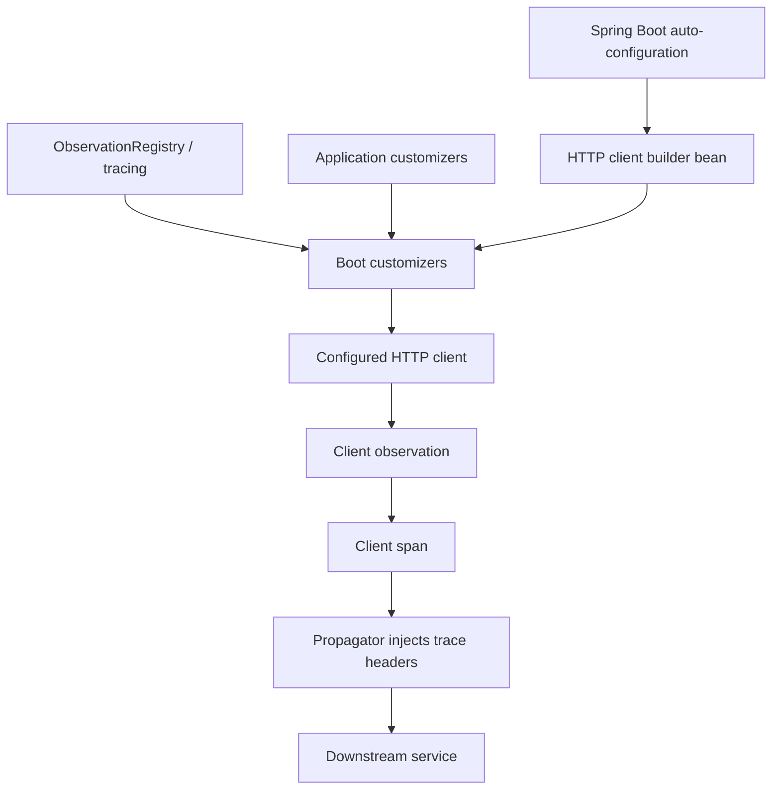
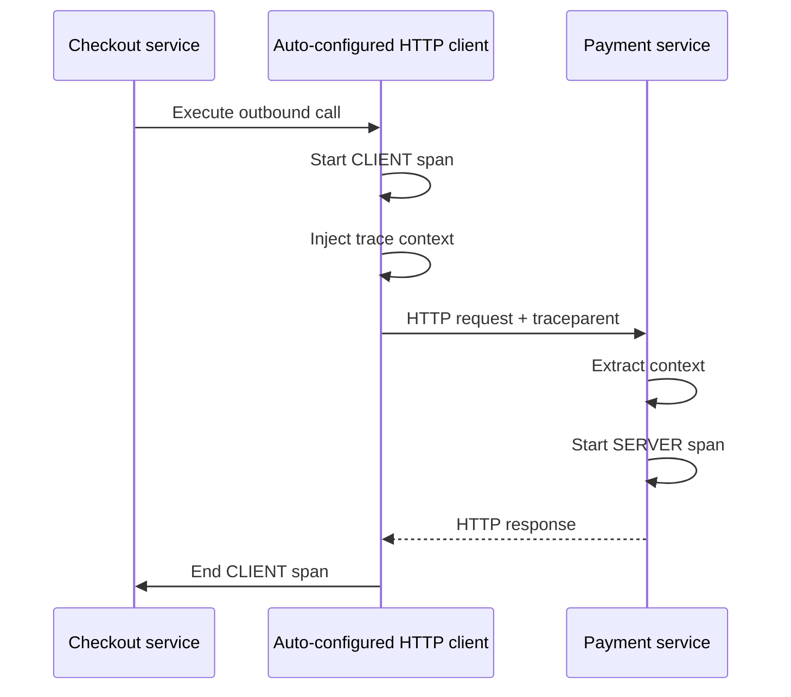

# Giữ propagation bằng auto-configured builder

Một request đi vào checkout-service với trace context, sau đó ứng dụng gọi payment-service qua HTTP client. Để trace thể hiện được cả hai service, client phải tạo client span và truyền trace context trong outbound headers. Trong Spring Boot, các auto-configured HTTP client builders có thể nhận những customizers do framework và ứng dụng đăng ký, bao gồm observation, tracing propagation, codecs, connector và các thiết lập chung. Nếu ứng dụng tự tạo một client độc lập hoặc vô tình thay thế các thành phần đã được cấu hình, outbound request có thể mất client span hoặc không inject trace headers.

**Giữ propagation bằng auto-configured builder** nghĩa là xây dựng HTTP client từ builder do Spring Boot quản lý để bảo toàn các tích hợp observability đã được cấu hình trong application context. Builder là điểm mở rộng để ứng dụng bổ sung base URL, timeout hoặc authentication mà vẫn giữ observation registry, tracing customizers và các cấu hình framework cần thiết.

Đây không phải bảo đảm rằng mọi client tự động có tracing. Cần đúng phiên bản Spring Boot/Spring Framework, đúng builder bean, đúng client connector và tracing implementation. Sau khi cấu hình, phải kiểm chứng client span, outbound propagation header và downstream server span.

Bài học thuộc chương **HTTP client observability** của module **SPRING_BOOT_OBSERVABILITY**. Module hướng dẫn thiết lập observability cho Spring Boot bằng Micrometer Observation, metrics, logs và distributed tracing; học propagation ngữ cảnh, tag/cardinality, exporter, sampling và liên kết tín hiệu để điều tra lỗi, độ trễ và hành vi ứng dụng trên môi trường thực. Bài này tập trung vào cách dùng auto-configured builders để giữ nguyên các tích hợp observation và trace context trên outbound HTTP calls.

## Mục tiêu học tập

Sau bài này, bạn có thể:

1. Giải thích vai trò của auto-configured HTTP client builder trong Spring Boot.
2. Phân biệt builder do Spring Boot quản lý với client được tự khởi tạo độc lập.
3. Hiểu ObservationRegistry, tracing bridge và client instrumentation được gắn vào client như thế nào.
4. Cấu hình RestClient và WebClient từ builder được inject.
5. Nhận biết cách customizer, request factory/connector và thứ tự cấu hình ảnh hưởng tới propagation.
6. Tránh vô tình thay thế interceptor/filter hoặc observation support.
7. Kiểm chứng trace ID, span ID, outbound headers và downstream parent relationship.
8. Xử lý propagation qua async/reactive boundaries.
9. Kiểm thử success, error, timeout và client configuration.
10. Chẩn đoán khi outbound request không có client span hoặc trace context.

## 1. Vì sao builder ảnh hưởng đến observability?

Một HTTP client không chỉ là đối tượng có thể gửi request. Nó còn là nơi framework gắn các thành phần xuyên suốt request lifecycle:

- Observation instrumentation bắt đầu/kết thúc client observation.
- Tracing handler tạo client span.
- Propagator inject trace context vào outbound headers.
- Interceptor/filter thực hiện authentication, correlation hoặc policy.
- Connector/request factory thực hiện I/O.
- Timeout, redirect và retry configuration quyết định hành vi call.

Spring Boot có thể cung cấp builder đã được cấu hình và áp dụng các customizers trong application context. Khi ứng dụng inject builder này rồi cấu hình thêm, các thành phần đã gắn có thể tiếp tục hoạt động.



### 1.1. Builder và client instance khác nhau

Builder là đối tượng cấu hình để tạo client. Client instance là đối tượng được dùng để thực hiện request. Khi builder đã nhận customizers, tạo client từ builder đó có thể giữ các cấu hình đã áp dụng. Tự gọi constructor tạo client khác không tự kế thừa cấu hình trong Spring application context.

### 1.2. Auto-configured không có nghĩa mọi thứ đều tự động

Ứng dụng vẫn cần dependency và configuration phù hợp. Ví dụ, client span chỉ xuất hiện nếu observation/tracing integration đang hoạt động; trace context được export nếu sampler giữ trace và exporter pipeline thành công. Builder giúp nối client vào cấu hình đã có, không thay thế SDK, bridge hoặc exporter.

## 2. Những thành phần cần được giữ

| Thành phần | Vai trò | Dấu hiệu khi bị mất |
|---|---|---|
| ObservationRegistry | Nhận và điều phối observations | Không có client observation/metrics |
| Observation handlers | Chuyển observation thành metrics/tracing | Chỉ có một signal hoặc không có span |
| Tracing bridge | Nối Micrometer Tracing với Brave/OTel | Không tạo client span |
| Propagator | Inject/extract trace context | Downstream tạo trace mới |
| Client interceptor/filter | Thêm headers hoặc xử lý request | Thiếu policy/correlation headers |
| Request factory/connector | Thực hiện network I/O | Behavior timeout/TLS khác cấu hình |
| Boot customizers | Áp dụng cấu hình framework/app | Client không đồng nhất với các client khác |

Không phải mọi interceptor đều là tracing interceptor. Observation có thể được gắn ở client infrastructure, còn propagator chạy trong tracing instrumentation. Khi thay một thành phần, cần xác minh toàn bộ chuỗi.

## 3. Dùng auto-configured RestClient.Builder

Với Spring Boot version cung cấp bean RestClient.Builder, inject builder thay vì tạo client builder độc lập. Ví dụ:

```java
@Configuration
class PaymentClientConfiguration {

    @Bean
    RestClient paymentRestClient(RestClient.Builder builder) {
        return builder
                .baseUrl("https://payment.internal")
                .build();
    }
}
```

Builder được inject có thể đã được Boot customizers cấu hình cho observation và các thành phần khác. Ứng dụng chỉ bổ sung base URL rồi build client.

### 3.1. Inject builder vào service configuration

Nên tập trung cấu hình client theo dependency để có thể quản lý base URL, timeout, authentication và metrics/tracing một cách nhất quán.

```java
@Configuration
class RemoteClientsConfiguration {

    @Bean
    RestClient inventoryRestClient(RestClient.Builder builder) {
        return builder
                .baseUrl("https://inventory.internal")
                .build();
    }

    @Bean
    RestClient paymentRestClient(RestClient.Builder builder) {
        return builder
                .baseUrl("https://payment.internal")
                .build();
    }
}
```

Tùy cách Spring Boot tạo builder bean và scope, cần hiểu việc inject nhiều lần có tạo builder riêng hay dùng cùng bean. Không mutate một builder dùng chung sau khi đã tạo client ở nhiều nơi. Nếu cần các cấu hình độc lập, dùng builder clone/copy mechanism được phiên bản hỗ trợ hoặc customizer có scope rõ ràng.

### 3.2. Không tự tạo builder mới

Ví dụ cần thận trọng:

```java
RestClient client = RestClient.builder()
        .baseUrl("https://payment.internal")
        .build();
```

Đoạn này tạo builder trực tiếp từ API. Nó không tự nhận những Boot customizers đã áp dụng cho bean được auto-configured. Nếu muốn dùng builder trực tiếp, ứng dụng phải tự cấu hình đầy đủ observation/tracing và các thành phần khác; thường nên inject builder do Boot cung cấp.

### 3.3. Tránh cấu hình làm mất customizers

Không thay thế toàn bộ request factory sau khi Boot đã cấu hình builder nếu không hiểu các customizers phụ thuộc vào factory. Khi cần custom connector, hãy cấu hình qua builder/customizer đúng extension point và kiểm tra observation vẫn được gắn.

## 4. Dùng auto-configured WebClient.Builder

WebClient là reactive client. Với Spring Boot version cung cấp WebClient.Builder bean, inject builder:

```java
@Configuration
class PaymentWebClientConfiguration {

    @Bean
    WebClient paymentWebClient(WebClient.Builder builder) {
        return builder
                .baseUrl("https://payment.internal")
                .build();
    }
}
```

Builder có thể nhận codec configuration, connector, observation và tracing customizers của Boot. Request chỉ thực sự chạy khi publisher được subscribe; client observation/span lifecycle theo reactive execution.

### 4.1. Không tự new WebClient.Builder

```java
WebClient client = WebClient.builder()
        .baseUrl("https://payment.internal")
        .build();
```

Builder tạo trực tiếp không tự kế thừa Boot customizers. Nếu dùng cách này, cần tự gắn observation registry, filters, connector và tracing propagation tương thích. Ưu tiên builder được inject nếu muốn giữ cấu hình chung.

### 4.2. Builder và reactive context

WebClient instrumentation cần liên kết current observation/trace context với subscription và outbound exchange. Không chỉ kiểm tra client object đã được tạo; hãy thực hiện request thật trong active server span và xác nhận downstream nhận cùng trace ID.

## 5. RestTemplate và client cũ

RestTemplate là API đồng bộ truyền thống. Spring Boot có thể cung cấp builder/customization phù hợp phiên bản; cách wiring khác với RestClient.Builder và WebClient.Builder.

Khi dùng RestTemplate:

1. Dùng builder do Boot cung cấp nếu phiên bản có.
2. Xác minh request factory được cấu hình đúng.
3. Kiểm tra observation registry và client instrumentation được áp dụng.
4. Tránh thay interceptors list bằng một list mới mà bỏ interceptor hiện có.
5. Kiểm tra outbound trace headers và downstream span.

Một RestTemplate được tạo bằng constructor trực tiếp không tự nhận customizers của Boot. Đối với client library khác như Apache HttpClient, OkHttp hoặc Java HttpClient, cần integration/agent tương ứng; không giả định Spring builder có thể instrument mọi thư viện.

## 6. Customizer và thứ tự cấu hình

Spring Boot cho phép các customizer tác động lên builder. Một customizer có thể cấu hình base URL, default headers, connector, timeout hoặc observation support. Thứ tự áp dụng và API cụ thể phụ thuộc version và loại builder.

### 6.1. Thêm cấu hình mà không thay thế cấu hình hiện hữu

Ví dụ customizer chỉ bổ sung default header:

```java
@Bean
RestClientCustomizer paymentHeadersCustomizer() {
    return builder -> builder
            .defaultHeader("X-Client-Application", "checkout");
}
```

Đây là ví dụ theo các phiên bản Spring Boot có RestClientCustomizer. Header là metadata của client; không dùng cách này để tự tạo traceparent nếu tracing integration đã đảm nhiệm propagation.

### 6.2. Cẩn trọng với interceptor/filter replacement

Một số API dùng danh sách interceptors hoặc filters. Nếu customizer gọi setter với danh sách mới, có thể thay toàn bộ danh sách đã được cấu hình trước đó. Điều này có thể loại bỏ instrumentation, authentication hoặc correlation logic.

Khi cần thêm interceptor, ưu tiên API append/add hoặc compose chain theo version. Sau thay đổi, kiểm tra cả interceptor cũ lẫn mới và trace propagation.

### 6.3. Thứ tự customizer

Nếu một customizer thay connector sau customizer khác đã cấu hình observation, kết quả có thể khác dự kiến. Tránh phụ thuộc vào thứ tự không được đảm bảo. Tập trung cấu hình client trong một nơi hoặc dùng các extension point có contract rõ. Kiểm tra builder cuối cùng bằng request test.

## 7. ObservationRegistry và tracing integration

Micrometer ObservationRegistry là trung tâm nhận observations. HTTP client integration cần dùng registry đã được Spring Boot cấu hình với handlers tương ứng.

Một registry tự tạo mà không có handlers có thể tạo observation nhưng không export metrics hoặc spans. Tương tự, client builder không nhận observation support sẽ không phát client observations.

### 7.1. Metrics và tracing là handlers riêng

Một client observation có thể được xử lý bởi metrics handler và tracing handler. Nếu metrics xuất hiện nhưng trace không có, kiểm tra tracing bridge/handler/exporter. Nếu trace có nhưng metrics không, kiểm tra meter registry/filter. Không dùng sự xuất hiện của một signal để kết luận signal khác hoạt động.

### 7.2. Brave và OpenTelemetry

Micrometer Tracing có thể nối tới Brave hoặc OpenTelemetry bridge tùy kiến trúc. Chọn implementation phù hợp với dependency tree. Không thêm hai bridge đồng thời rồi kỳ vọng chúng tự đồng bộ. Kiểm tra tracer hiện hành, propagator và exporter đang dùng.

## 8. Trace propagation qua outbound HTTP

Khi current span tồn tại, client instrumentation tạo client span và inject context theo propagator đã cấu hình, thường là W3C Trace Context hoặc B3.



Kỳ vọng:

- Client span thuộc trace đang active tại checkout-service.
- Outbound header mang trace context hợp lệ.
- Payment service extract cùng Trace ID.
- Downstream server span có quan hệ parent phù hợp.
- Client span kết thúc khi outbound operation hoàn tất.

Không tự set traceparent bằng business code. Header thủ công có thể ghi đè context thật hoặc làm đứt quan hệ trace.

### 8.1. Propagator và trust boundary

Nếu inbound request đến từ Internet, quyết định có tin parent context/sampling flags cần theo trust policy. Auto-configured builder chỉ inject context hiện hành; policy cho inbound context được xử lý ở server instrumentation/propagator/sampler.

### 8.2. Export là bước khác

Client span được tạo không có nghĩa backend đã lưu. Sampling có thể drop trace; exporter hoặc Collector có thể thất bại. Kiểm tra current span, outbound header, collector ingestion và backend query riêng.

## 9. Timeout, connector và TLS configuration

Tùy biến connector là nhu cầu phổ biến, nhưng phải bảo đảm observation instrumentation vẫn hoạt động.

Các thiết lập thường cần quản lý:

- Connect timeout.
- Response/read timeout.
- Connection pool.
- TLS trust material/client certificate.
- Proxy và DNS.
- Redirect behavior.
- Retry policy.

Ví dụ, cấu hình connector mới có thể thay thế connector đã được Boot customizer gắn. Không chỉ test request có thành công; cần kiểm tra metrics/span vẫn xuất hiện sau khi thay connector.

### 9.1. Authentication và headers

Default headers cho client có thể được thêm qua builder. Secret nên lấy từ secret manager/configuration an toàn, không hard-code trong source. Không tự thêm trace ID hoặc traceparent vào default headers; tracing integration phải tạo giá trị mới theo từng operation.

### 9.2. Retry và client span

Retry có thể tạo một span cho logical call hoặc spans cho từng attempt tùy vị trí instrumentation. Khi thay connector/retry filter, xác minh span count và duration không thay đổi ngoài ý muốn. Định nghĩa rõ metrics attempt-level và operation-level.

## 10. Kiểm thử propagation end-to-end

Kiểm thử quan trọng nhất không phải builder có tồn tại, mà là request được tạo từ builder đó có giữ context không.

Một integration test nên:

1. Khởi chạy Spring Boot application với tracing implementation.
2. Tạo một inbound request có trace context đã biết hoặc tạo root span trong test.
3. Gọi endpoint sử dụng auto-configured RestClient/WebClient.
4. Dùng mock server/downstream service để capture outbound headers.
5. Xác nhận traceparent/B3 header theo propagator.
6. Xác nhận client span được tạo trong cùng trace.
7. Xác nhận downstream server span extract cùng Trace ID.
8. Kiểm tra metrics client observation được ghi.
9. Thử timeout/5xx và xác nhận span kết thúc đúng.
10. Kiểm tra không có duplicate spans do agent và framework instrumentation cùng active.

### 10.1. Test với in-memory exporter

Trong unit/integration tests, có thể dùng test span exporter hoặc in-memory tracing implementation phù hợp stack để assert span names, kinds, trace IDs và parent relationship. Không cần backend production để xác minh instrumentation tại application boundary.

### 10.2. Test bằng mock HTTP server

Mock server có thể ghi lại headers nhận được. Assert trace context header được inject, không phải tự gắn một giá trị cố định trong test client. Nếu test cả downstream extraction, chạy một server Spring Boot test có instrumentation tương ứng.

### 10.3. Test WebClient subscription

Tạo Mono không đồng nghĩa gửi request. Test phải subscribe/block hoặc dùng WebTestClient/reactive test utilities để kích hoạt pipeline, sau đó chờ terminal signal và assert span đã end. Tránh assert ngay sau khi chỉ tạo publisher.

## 11. Chẩn đoán khi propagation bị mất

| Triệu chứng | Nguyên nhân có thể | Cách kiểm tra |
|---|---|---|
| Không có client span | Client tạo ngoài auto-configured builder hoặc thiếu instrumentation | Kiểm tra bean, registry, bridge |
| Có metrics nhưng không trace | Tracing handler/bridge không hoạt động | Tracer, handler và exporter |
| Client span có nhưng thiếu traceparent | Propagator hoặc client instrumentation bị thay | Inspect outbound headers |
| Downstream tạo trace ID mới | Header bị drop hoặc không extract | Proxy, propagator và server instrumentation |
| Một client có trace, client khác không | Builder/customizer không đồng nhất | So sánh bean creation paths |
| Mất propagation sau khi đổi connector | Connector replacement bỏ integration | Kiểm tra request factory/connector và customizers |
| Mất sau khi thêm interceptor | Danh sách interceptor bị replace | Kiểm tra thứ tự và chain |
| WebClient không có span | Publisher chưa subscribe hoặc context mất | Subscription/reactive context |
| Span không end | Request pending/cancel/timeout lifecycle | Terminal signal và client timeout |
| Có duplicate client spans | Java Agent và framework instrumentation cùng active | Chọn instrumentation owner |
| Trace có nhưng backend không thấy | Sampling/export/Collector/storage | Kiểm tra pipeline sau khi span end |

### Quy trình điều tra

1. Xác định Spring Boot và Spring Framework versions.
2. Xác nhận client bean được tạo từ builder nào.
3. Kiểm tra ObservationRegistry và tracing bridge đang dùng.
4. So sánh builder/customizer/interceptor/connector trước và sau thay đổi.
5. Capture outbound headers tại mock server.
6. Kiểm tra client span trong test exporter.
7. Kiểm tra downstream Trace ID và parent relationship.
8. Kiểm tra retry/timeout/redirect và reactive subscription.
9. Nếu span có nhưng backend không có, kiểm tra sampler/exporter/Collector.
10. Xác nhận không có raw URL, token hoặc dữ liệu nhạy cảm trong telemetry.

## 12. Các anti-pattern cần tránh

| Anti-pattern | Hậu quả | Cách phù hợp |
|---|---|---|
| Tự tạo builder độc lập rồi kỳ vọng Boot customizers | Thiếu observation/tracing | Inject builder auto-configured |
| Tự tạo ObservationRegistry rỗng | Observation không tới handlers | Dùng registry do Boot quản lý |
| Replace toàn bộ interceptors/filters | Mất tracing/auth/correlation | Append/compose theo API |
| Thay connector mà không test | Mất instrumentation hoặc timeout behavior | Test request sau thay đổi |
| Tự set traceparent mặc định | Context sai hoặc trùng giữa requests | Để propagator inject |
| Dùng cùng builder mutable tùy tiện | Cấu hình client phụ thuộc thứ tự | Cấu hình tập trung/clone theo API |
| Giả định mọi HTTP client được instrument | Thiếu spans/metrics ở thư viện khác | Dùng integration/agent phù hợp |
| Chỉ assert builder bean tồn tại | Không chứng minh propagation | Test outbound headers và downstream |
| Tạo WebClient publisher nhưng không subscribe | Không có request/span | Kích hoạt reactive pipeline trong test |
| Nghĩ client span có nghĩa backend đã lưu | Bỏ qua sampling/export | Kiểm tra collector/backend |
| Bật agent và framework instrumentation trùng | Duplicate spans | Chọn instrumentation owner |
| Gắn token vào default header rồi log toàn headers | Rò rỉ secret | Allowlist/redaction |

## 13. Checklist production

1. **Builder:** client được tạo từ builder do Spring Boot quản lý?
2. **Version:** Boot/Framework/Micrometer API tương thích?
3. **Registry:** ObservationRegistry đúng được gắn vào client?
4. **Handlers:** metrics và tracing handlers hoạt động?
5. **Bridge:** chỉ có tracing implementation chủ đạo rõ ràng?
6. **Customizers:** customizer không thay thế cấu hình cần thiết?
7. **Interceptors:** filter/interceptor chain giữ các thành phần cũ?
8. **Connector:** request factory/connector có observation support?
9. **Propagation:** outbound headers và downstream extraction đúng?
10. **Async:** WebClient subscription và reactive context đúng?
11. **Timeout/retry:** semantics và span lifecycle được xác minh?
12. **Security:** secret không bị đưa vào headers/logs/attributes ngoài policy?
13. **Cardinality:** URI/host dimensions được chuẩn hóa?
14. **Testing:** có mock server, test exporter và downstream integration test?
15. **Export:** sampling, OTLP exporter, Collector và backend được kiểm tra riêng?
16. **Operations:** client latency, error rate, span drops và dependency identity có thể theo dõi?

## 14. Câu hỏi tự đánh giá

**Câu 1.** Vì sao auto-configured builder giúp giữ propagation?

**Gợi ý:** Builder được Spring Boot customizers cấu hình để gắn observation/tracing và các thành phần client cần thiết. Tạo client từ builder đó giúp giữ cấu hình đã áp dụng.

**Câu 2.** Tự gọi RestClient.builder() khác inject RestClient.Builder thế nào?

**Gợi ý:** Builder tạo trực tiếp không tự nhận Boot customizers trong application context; builder được inject có thể đã được auto-configure.

**Câu 3.** ObservationRegistry có vai trò gì?

**Gợi ý:** Nhận observations và chuyển chúng qua handlers để tạo metrics/tracing hoặc tích hợp khác.

**Câu 4.** Vì sao không nên tự thêm traceparent vào default headers?

**Gợi ý:** Trace context thay đổi theo operation; propagator phải inject context hiện hành và quản lý flags/state.

**Câu 5.** Thay request factory có thể gây vấn đề gì?

**Gợi ý:** Có thể bỏ customizer hoặc instrumentation đã gắn vào client; cần kiểm tra observation/span sau thay đổi.

**Câu 6.** Có client metrics nhưng không có client span thì kiểm tra gì?

**Gợi ý:** Tracing handler, bridge, tracer và exporter; metrics handler hoạt động không chứng minh tracing handler hoạt động.

**Câu 7.** Vì sao WebClient cần subscribe trong test?

**Gợi ý:** Reactive publisher lazy; request và client observation thường chỉ chạy khi subscription được kích hoạt.

**Câu 8.** Làm sao chứng minh downstream nhận cùng trace?

**Gợi ý:** Capture outbound propagation header và kiểm tra downstream server span có cùng Trace ID, parent relationship đúng.

**Câu 9.** Client span có chứng minh trace đã được lưu không?

**Gợi ý:** Không. Sampling, exporter, Collector hoặc backend có thể drop/fail.

**Câu 10.** Khi thêm interceptor mới, cần xác minh điều gì?

**Gợi ý:** Interceptor cũ vẫn còn, thứ tự chain đúng, headers được inject và client observation/span vẫn được tạo.

## Kết luận

**Dùng auto-configured HTTP client builder giúp Spring Boot giữ các customizers và tích hợp observability đã được cấu hình cho outbound requests.** Hãy inject RestClient.Builder hoặc WebClient.Builder do application context cung cấp, bổ sung cấu hình dependency theo extension point phù hợp và tránh thay thế interceptor, connector hoặc registry một cách vô tình. Propagation chỉ được xác nhận khi client span, outbound trace header và downstream server span cùng thể hiện đúng trace context. Cuối cùng, kiểm thử cả reactive subscription, timeout, retry và failure paths; kiểm tra sampling/export riêng để phân biệt lỗi instrumentation với lỗi vận chuyển telemetry.
