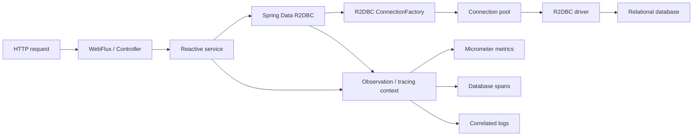
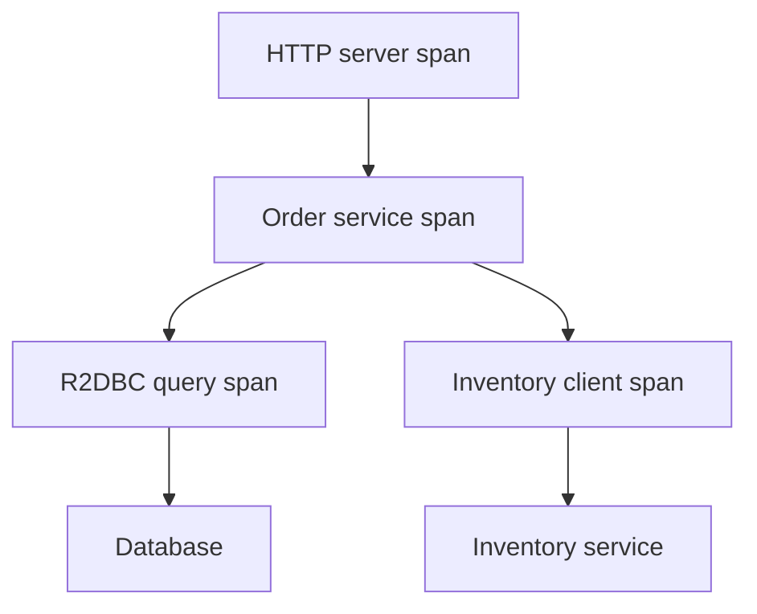

# R2DBC observability trong Spring Boot

**R2DBC observability** là việc đo lường và theo dõi hoạt động truy cập cơ sở dữ liệu theo mô hình reactive trong Spring Boot. Với Spring Data R2DBC và driver tương thích, ứng dụng thực hiện database I/O không chặn theo reactive streams. Observability giúp xác định connection pool có cạn không, thao tác database mất bao lâu, query nào thường lỗi và thời gian chờ nằm ở ứng dụng, pool hay database.

Trong module **SPRING_BOOT_OBSERVABILITY**, R2DBC observability kết nối database với Micrometer Observation, metrics, logs và distributed tracing. Bài thuộc chương **Database observability**, tập trung vào instrumentation R2DBC, khác biệt với JDBC, connection pool metrics, query spans, Reactor Context, transaction lifecycle, kiểm soát cardinality/PII, kiểm thử và troubleshooting.

## 1. R2DBC là gì và vì sao cần observability?

R2DBC (Reactive Relational Database Connectivity) là API truy cập relational database theo reactive streams. Thay vì mô hình JDBC đồng bộ, R2DBC cho phép thao tác database trả về publishers như Mono và Flux, để ứng dụng compose các hoạt động I/O theo reactive pipeline.

R2DBC observability giúp trả lời:
- Connection pool có đủ connection hay request phải chờ?
- Query/statement mất bao lâu?
- Database operation lỗi vì timeout, constraint hay connectivity?
- Transaction có được commit/rollback đúng không?
- Database span có nối với HTTP server span không?
- Tải database tăng có đi cùng request rate/latency của ứng dụng không?

Không phải mọi database driver hoặc API đều cung cấp cùng mức instrumentation. Kiểm tra R2DBC driver, Spring Data R2DBC, connection pool và Micrometer integration theo version thực tế.

### 1.1. R2DBC và JDBC khác nhau

| Tiêu chí | R2DBC | JDBC |
| --- | --- | --- |
| Execution model | Reactive, non-blocking nếu driver hỗ trợ | Blocking API |
| Kết quả | Publisher như Mono/Flux | ResultSet/return value |
| Context | Reactor Context và context propagation | Thường dựa trên thread/request scope |
| Connection usage | Reactive connection lifecycle | Connection giữ trong blocking operation |
| Instrumentation | Reactive-aware observation | JDBC instrumentation/datasource metrics |
| Phù hợp | Reactive application | Imperative application |

R2DBC không tự động làm query nhanh hơn. Nó giúp quản lý I/O theo mô hình non-blocking; hiệu năng vẫn phụ thuộc query plan, index, database capacity, pool sizing và cách ứng dụng sử dụng publishers.

## 2. Kiến trúc R2DBC trong Spring Boot

Một request có thể đi qua WebFlux controller, service reactive, Spring Data R2DBC repository, R2DBC driver và database server.



Instrumentation có thể xuất hiện ở nhiều lớp: repository/DatabaseClient, driver, pool và application service. Tránh đo trùng cùng operation ở mọi lớp mà không phân biệt ý nghĩa.

### 2.1. Dependencies cơ bản

Ví dụ dependencies cho Spring Boot WebFlux và Spring Data R2DBC:

```xml
<dependencies>
    <dependency>
        <groupId>org.springframework.boot</groupId>
        <artifactId>spring-boot-starter-webflux</artifactId>
    </dependency>
    <dependency>
        <groupId>org.springframework.boot</groupId>
        <artifactId>spring-boot-starter-data-r2dbc</artifactId>
    </dependency>
    <dependency>
        <groupId>org.springframework.boot</groupId>
        <artifactId>spring-boot-starter-actuator</artifactId>
    </dependency>
</dependencies>
```

Thêm driver R2DBC tương ứng, ví dụ PostgreSQL hoặc MariaDB, và connection pool nếu kiến trúc cần pooling. Dùng Spring Boot BOM để quản lý version tương thích.

### 2.2. Auto-configuration và exporter

Có dependency Actuator không đồng nghĩa query spans tự động được gửi tới tracing backend. Cần xác định:
- Micrometer Observation handlers có được cấu hình không?
- R2DBC instrumentation của version đang dùng có phát observation không?
- MeterRegistry nào nhận metrics?
- Micrometer Tracing bridge và span exporter nào được cấu hình?
- Connection pool có expose metrics hay chưa?

Một pipeline metrics có thể hoạt động trong khi tracing chưa được bật, và ngược lại.

## 3. R2DBC Observation và Micrometer

Micrometer Observation cung cấp abstraction để mô tả một operation. Khi integration hỗ trợ R2DBC được kích hoạt, thao tác database có thể được instrument để ghi metrics và/hoặc spans thông qua handlers.

Một observation có thể bao quanh:
- Tạo hoặc thực thi statement.
- Thời gian hoàn thành query.
- Kết quả thành công hoặc lỗi.
- Database system/operation metadata có trong convention.

Chi tiết observation name, tag keys và cách instrument phụ thuộc Spring Boot/Spring Framework/Spring Data R2DBC và Micrometer version. Không giả định mọi phiên bản tự tạo span cho từng câu SQL.

### 3.1. Observation không phải query logger

Observation chủ yếu cung cấp metadata có cấu trúc và timing. Nó không yêu cầu ghi raw SQL hoặc toàn bộ bind parameters vào logs. Query text/parameters cần được kiểm soát vì có thể chứa dữ liệu nhạy cảm.

### 3.2. Metrics và spans có phạm vi khác nhau

| Signal | Phạm vi | Dùng để |
| --- | --- | --- |
| Pool metrics | Connection pool | Capacity, acquired/idle/pending |
| Query metrics | Operation database | Count, duration, error |
| Database span | Một thao tác trong trace | Điều tra latency của request |
| Application logs | Sự kiện/lỗi cụ thể | Hiểu exception và business context |

Không dùng trace sampling để thay thế pool metrics. Pool metrics thường cần theo dõi liên tục để phát hiện saturation.

## 4. Connection pool observability

R2DBC connection pool quản lý việc cấp phát và tái sử dụng connections. Nếu pool bão hòa, request có thể chờ lấy connection dù database query thực tế nhanh.

Các chỉ số hữu ích tùy pool implementation/version:

| Metric concept | Ý nghĩa |
| --- | --- |
| Allocated | Tổng connection đã cấp phát trong pool |
| Acquired | Connection đang được ứng dụng sử dụng |
| Idle | Connection sẵn sàng được cấp |
| Pending | Request đang chờ connection |
| Max allocated | Giới hạn connection pool |
| Acquire time | Thời gian chờ lấy connection nếu được instrument |
| Creation/validation errors | Lỗi tạo hoặc kiểm tra connection |

Tên metric chính xác và tags phụ thuộc R2DBC pool/Micrometer integration. Không copy tên metric từ version khác mà chưa kiểm tra registry.

### 4.1. Vì sao pending connections quan trọng?

Nếu pending tăng trong khi acquired gần max, ứng dụng có thể bị pool saturation. Query latency ở tầng repository có thể bao gồm cả thời gian chờ connection; cần tách acquire time và execution time nếu instrumentation cung cấp.

Nguyên nhân có thể:
- Pool max size quá nhỏ so với concurrency.
- Connection bị giữ quá lâu.
- Transaction scope dài.
- Database chậm hoặc hết capacity.
- Reactive chain không subscribe/cancel đúng cách.
- Connection leak do custom code không giải phóng resource đúng lifecycle.

Tăng max pool size ngay lập tức không phải lúc nào cũng tốt. Database có giới hạn connection; mở quá nhiều connection có thể làm database quá tải.

### 4.2. Cấu hình pool

Cấu hình R2DBC pool qua URL hoặc properties phụ thuộc driver/Boot version. Xác minh prefix property và pool implementation đang dùng trước khi áp dụng.

Không trộn cấu hình HikariCP/JDBC với R2DBC pool. HikariCP là pool phổ biến cho JDBC; R2DBC dùng connection factory/pool reactive riêng.

## 5. Query spans và trace correlation

Khi tracing integration instrument database operation, span có thể nằm dưới HTTP server span hoặc application span đang active. Nhờ đó có thể xem thời gian database chiếm bao nhiêu trong tổng request latency.



Tên span và database semantic attributes phụ thuộc instrumentation/version. Span có thể mô tả operation như SELECT/INSERT và database system, nhưng không nhất thiết chứa nguyên văn SQL.

### 5.1. Truyền context trong reactive pipeline

R2DBC operation thường chạy trong Reactor chain. Trace context phải theo subscription qua repository/service boundaries. Reactor Context và Micrometer Context Propagation giúp duy trì context khi scheduler thay đổi.

Không dựa vào ThreadLocal như thể request luôn chạy trên một thread. Nếu custom code chuyển sang executor/callback API ngoài Reactor, cần bridge context phù hợp.

### 5.2. Parent/child relationship

Database span thường là child của span đang active khi query được gọi. Nếu context mất, database span có thể thành root hoặc tách khỏi trace. Khi điều tra, kiểm tra Trace ID và parent span ID, không chỉ dựa trên timestamp gần nhau.

## 6. Spring Data R2DBC và DatabaseClient

Spring Data R2DBC cung cấp repositories reactive; DatabaseClient cho phép thực thi SQL trực tiếp. Cả hai dùng R2DBC infrastructure, nhưng observation/instrumentation thực tế phụ thuộc integration.

Ví dụ repository:

```java
@Table("orders")
public class Order {
    @Id
    private Long id;
    private String status;

    // getters/setters omitted
}

public interface OrderRepository
        extends ReactiveCrudRepository<Order, Long> {
}
```

Ví dụ service:

```java
@Service
class OrderQueryService {

    private final OrderRepository repository;

    OrderQueryService(OrderRepository repository) {
        this.repository = repository;
    }

    Mono<Order> findOrder(Long id) {
        return repository.findById(id);
    }
}
```

Method trả Mono chưa có nghĩa query đã hoàn tất. Query thường thực thi khi publisher được subscribe. Không đo thời gian chỉ quanh việc gọi findById nếu muốn biết database operation latency.

### 6.1. DatabaseClient

Ví dụ query với DatabaseClient:

```java
@Repository
class OrderLookup {

    private final DatabaseClient databaseClient;

    OrderLookup(DatabaseClient databaseClient) {
        this.databaseClient = databaseClient;
    }

    Mono<String> findStatus(Long id) {
        return databaseClient.sql(
                "SELECT status FROM orders WHERE id = :id")
                .bind("id", id)
                .map((row, metadata) -> row.get("status", String.class))
                .one();
    }
}
```

Ví dụ dùng bind parameter thay vì nối chuỗi SQL. Không log bind value hoặc customer/order data vào span/metric tags.

## 7. Transaction observability

Reactive transaction thường được quản lý bằng TransactionalOperator hoặc annotation integration phù hợp với reactive transaction manager. Transaction context được truyền theo Reactor Context thay vì giả định thread-bound transaction như JDBC imperative.

Ví dụ:

```java
@Service
class TransferService {

    private final DatabaseClient databaseClient;
    private final TransactionalOperator tx;

    TransferService(DatabaseClient databaseClient,
                    TransactionalOperator tx) {
        this.databaseClient = databaseClient;
        this.tx = tx;
    }

    Mono<Void> transfer(long fromId, long toId, BigDecimal amount) {
        return debit(fromId, amount)
                .then(credit(toId, amount))
                .as(tx::transactional);
    }
}
```

Đây là ví dụ cấu trúc; debit/credit cần kiểm tra số dư, concurrency và business invariants. TransactionalOperator quản lý reactive transaction lifecycle theo transaction manager được cấu hình.

### 7.1. Transaction duration

Transaction quá dài có thể giữ connection và lock lâu, làm pool pending tăng. Theo dõi duration transaction/operation, lỗi commit/rollback và database lock waits nếu backend cung cấp.

Không đưa transaction ID hoặc account ID làm metric tags nếu chúng tạo cardinality cao hoặc lộ dữ liệu.

### 7.2. Rollback và exception

Reactive chain có thể phát error dẫn đến rollback; nếu lỗi được onErrorResume chuyển thành kết quả bình thường trước ranh giới transaction, semantics có thể khác. Kiểm tra transaction boundary và terminal signal thực tế, tránh swallow exception trước khi transaction manager nhìn thấy lỗi cần rollback.

## 8. Query duration, timeout và error classification

Database operation có thể thất bại vì:
- Connection acquisition timeout.
- Network/connect timeout.
- Query execution timeout.
- Deadlock hoặc lock timeout.
- Constraint violation.
- Authentication/permission failure.
- Database unavailable hoặc failover.

Phân biệt các nhóm lỗi:
- Pool acquisition: capacity hoặc connection lifecycle.
- Driver/network: connectivity, DNS, TLS.
- Database execution: query plan, locks, CPU/IO, database capacity.
- Application: query sai, mapping lỗi, transaction boundary.

Không gộp mọi exception thành tag chứa exception message. Message có thể chứa SQL, values hoặc dữ liệu nhạy cảm và tạo cardinality rất cao. Dùng error category ổn định như timeout, constraint, connectivity, unknown nếu convention cho phép.

## 9. Cardinality và semantic attributes

Database telemetry cần giữ metadata đủ hữu ích mà không tạo hàng triệu tag combinations.

| Attribute/dimension | Khuyến nghị |
| --- | --- |
| db.system | Low cardinality, hữu ích |
| db.operation.name | Operation chuẩn hóa như SELECT/INSERT |
| db.namespace | Database/schema logic, cần kiểm soát |
| Query summary/name | Template hoặc normalized query name |
| Raw SQL | Không đưa vào metric tags; cân nhắc cả traces |
| Bind parameters | Không export nếu có dữ liệu nhạy cảm |
| Connection ID | Không dùng làm metric tag |
| Customer/account ID | Không dùng làm metric tag |
| Exception class/category | Chuẩn hóa thành tập hữu hạn nếu cần |

OpenTelemetry database semantic conventions thay đổi theo thời gian; tên key cũ/mới có thể khác theo instrumentation version. Dùng convention/schema phù hợp và không tự đặt key gần giống nhưng khác nghĩa.

### 9.1. Query normalization

Nếu cần phân biệt query shape, dùng query name/template ổn định thay raw SQL có literal values.

```text
SELECT status FROM orders WHERE id = ?
```

thay cho:

```text
SELECT status FROM orders WHERE id = 982734
```

Template giúp nhóm các lần thực thi cùng loại query. Không đưa raw query string vào metrics labels.

## 10. Actuator và kiểm tra database metrics

Actuator có thể expose metrics endpoint trong lab:

```yaml
management:
  endpoints:
    web:
      exposure:
        include:
          - health
          - metrics
```

Liệt kê metrics:

```http
GET /actuator/metrics
```

Kiểm tra một metric sau khi xác định tên thực tế:

```http
GET /actuator/metrics/r2dbc.pool.acquired
```

Tên r2dbc.pool.acquired chỉ là ví dụ minh họa; metric names phụ thuộc pool implementation/version. Trước tiên đọc danh sách metrics được expose, sau đó kiểm tra meter tồn tại.

Actuator endpoint giúp xem measurements trong process. Prometheus/OTLP exporter và backend mới cung cấp retention, dashboards, alerts và phân tích lịch sử. Bảo vệ management endpoints trong môi trường dùng chung/production.

## 11. Kết hợp database spans với logs

Khi trace context được propagate, log events trong request có thể mang Trace ID/Span ID để tìm đúng trace. Database errors nên được log với operation category, transaction outcome và error class phù hợp.

Không log:
- Password hoặc connection string có credentials.
- Raw SQL bind parameters chứa PII.
- Authorization tokens/cookies.
- Full customer/account records.
- Raw exception messages nếu chúng chứa query/values nhạy cảm.

Ưu tiên structured fields có allowlist, ví dụ db.operation, error.type, service.name và Trace ID. Giữ metric tags ít giá trị; trace/log fields có thể chi tiết hơn nhưng vẫn cần privacy review.

## 12. Kiểm thử R2DBC observability

Kiểm thử cần xác minh query behavior lẫn telemetry. Có thể dùng Testcontainers với database phù hợp và R2DBC driver tương ứng, hoặc test database riêng cho integration tests.

### 12.1. Test reactive repository

Ví dụ dùng StepVerifier:

```java
@Test
void loadsOrder() {
    Mono<Order> result = repository.findById(1L);

    StepVerifier.create(result)
            .expectNextMatches(order -> order.getId().equals(1L))
            .verifyComplete();
}
```

Test này kiểm tra publisher result, không tự chứng minh observation/export pipeline hoạt động. Để kiểm tra telemetry, cần test MeterRegistry, observation handler hoặc in-memory span exporter.

### 12.2. Kiểm tra metrics

Sau khi subscribe và query hoàn tất, xác minh:
- Query/request counter hoặc timer tăng.
- Duration được ghi.
- Tags không chứa raw IDs.
- Pool acquired/idle/pending phản ánh trạng thái kỳ vọng.

Tên metrics cụ thể tùy integration.

### 12.3. Kiểm tra tracing

Dùng in-memory/test exporter hoặc Collector lab để xác minh:
- Database span được tạo nếu instrumentation hỗ trợ.
- Span thuộc đúng Trace ID.
- Parent span là server/application span phù hợp.
- Error status/attributes phản ánh operation failure.
- Raw SQL/bind parameters không bị export ngoài policy.

## 13. Troubleshooting R2DBC observability

| Triệu chứng | Nguyên nhân có thể | Cách kiểm tra |
| --- | --- | --- |
| Không có database metrics | Thiếu registry/pool instrumentation hoặc meter chưa được tạo | Kiểm tra dependencies và MeterRegistry |
| Không có database spans | Chưa có tracing bridge hoặc R2DBC observation integration | Kiểm tra version/instrumentation |
| Pool pending tăng | Pool saturation, connection giữ lâu hoặc DB chậm | So sánh acquired/idle/max và query latency |
| Acquire timeout | Pool hết connection hoặc database không tạo connection mới | Kiểm tra pool metrics và driver logs |
| Query span duration cao | Query chậm, lock wait hoặc acquire time nằm trong span | Đối chiếu database monitoring và pool metrics |
| Trace ID bị mất | Reactor Context propagation lỗi | Kiểm tra context sau scheduler boundary |
| Transaction không rollback | Error bị swallow hoặc transaction boundary sai | Kiểm tra terminal signal và TransactionalOperator |
| Metrics cardinality cao | Query/raw IDs thành tags | Chuẩn hóa operation/query names |
| SQL/PII xuất hiện trong traces | Instrumentation capture statement/parameters | Redact/filter tại nguồn |
| Đếm query hai lần | Custom instrumentation trùng default integration | Kiểm tra Observation handlers |
| Connection không release | Lifecycle publisher/custom code sai | Kiểm tra cancel/dispose và resource cleanup |
| Không thấy meter trên Actuator | Endpoint chưa expose hoặc sai tên metric | Liệt kê /actuator/metrics |
| Metrics không đến backend | Exporter/Collector pipeline lỗi | Kiểm tra metrics export riêng |
| Query error không phân loại | Exception mapping hoặc handler thiếu | Kiểm tra error type/status conventions |

### Quy trình điều tra

1. Xác nhận ứng dụng thực sự dùng R2DBC, không phải JDBC fallback.
2. Xác định driver và connection pool implementation/version.
3. Kiểm tra MeterRegistry và danh sách meters sau khi query chạy.
4. Kiểm tra pool acquired/idle/pending/max trước khi kết luận database chậm.
5. Nếu cần traces, xác minh Micrometer Tracing bridge và R2DBC instrumentation tương thích.
6. Gửi request có trace context và kiểm tra parent-child spans.
7. Kiểm tra transaction boundary, error và cancellation.
8. Đối chiếu query latency với database-side metrics/slow query/lock waits.
9. Rà soát raw SQL, bind values, IDs và cardinality.
10. Kiểm tra exporter/Collector/backend riêng cho metrics và traces.

## 14. Bài thực hành: quan sát một R2DBC query

Mục tiêu là chạy ứng dụng Spring Boot reactive, truy vấn database và kiểm chứng pool metrics, query observation và trace correlation.

### Chuẩn bị

- Spring Boot 3.x dùng WebFlux và Spring Data R2DBC.
- R2DBC driver và database lab.
- R2DBC connection pool nếu cần.
- Actuator và MeterRegistry.
- Micrometer Tracing bridge/exporter nếu cần spans.
- Testcontainers hoặc database lab có thể reset.

### Bước 1 — Cấu hình R2DBC

Cấu hình connection URL và credentials qua secret/environment phù hợp. Không commit password vào source. Xác nhận driver đúng database.

### Bước 2 — Tạo reactive repository

Tạo entity và repository reactive. Thêm service gọi findById hoặc DatabaseClient query.

### Bước 3 — Tạo HTTP endpoint

Tạo WebFlux endpoint trả về Mono từ service. Không block bằng block() trong controller.

### Bước 4 — Gọi query

Gửi request HTTP nhiều lần để tạo database activity. Xác nhận kết quả trả về đúng.

### Bước 5 — Kiểm tra pool metrics

Liệt kê Actuator metrics và tìm pool meters được registry expose. Kiểm tra acquired/idle/pending/max khi có tải lab.

### Bước 6 — Kiểm tra query timing

Xác định database operation metrics/observation mà stack version hỗ trợ. So sánh latency khi query nhanh và khi dùng test query chậm có kiểm soát.

### Bước 7 — Bật tracing

Cấu hình tracing bridge/exporter và gửi request có trace context. Xác minh database span xuất hiện dưới server/application span nếu instrumentation hỗ trợ.

### Bước 8 — Thử transaction rollback

Tạo transaction test có một operation lỗi. Xác nhận rollback và kiểm tra observation/error logs. Không dùng dữ liệu production.

### Bước 9 — Thử pool pressure

Trong lab, giới hạn pool size và tạo concurrency có kiểm soát. Quan sát pending/acquired/acquire latency. Khôi phục pool settings sau test.

### Bước 10 — Kiểm tra privacy/cardinality

Rà soát metric tags, span attributes và logs. Xác nhận không có raw bind values, credentials, account IDs hoặc PII.

### Checklist nghiệm thu

| Điều cần chứng minh | Kết quả mong đợi |
| --- | --- |
| R2DBC stack | Phân biệt R2DBC với JDBC |
| Instrumentation | Xác định integration/version tạo observation |
| Pool metrics | Theo dõi acquired/idle/pending/max nếu hỗ trợ |
| Query timing | Đo operation latency theo reactive lifecycle |
| Tracing | Database span nối đúng trace nếu được hỗ trợ |
| Context | Reactor Context không mất qua reactive boundaries |
| Transactions | Commit/rollback phản ánh đúng outcome |
| Cardinality | Không dùng raw IDs/SQL literals làm metric tags |
| Privacy | Không export credentials/PII/bind values |
| Testing | Phân biệt test query với test telemetry |
| Export | Xác minh metrics và traces pipeline riêng |
| Diagnosis | Phân biệt pool wait, driver/network và DB execution |

## 15. Những nguyên tắc cần ghi nhớ

1. **R2DBC observability phải theo reactive lifecycle.** Method trả Mono/Flux chưa có nghĩa query đã hoàn tất.
2. **Phân biệt pool wait với database execution time.** Pool pending/acquire latency có thể là nguyên nhân chính của request chậm.
3. **Micrometer Observation, metrics và tracing là các lớp liên quan nhưng khác nhau.** Export từng signal cần registry/bridge/exporter tương ứng.
4. **Reactor Context giúp truyền trace context qua reactive chain.** Không dựa vào ThreadLocal cố định như mô hình imperative.
5. **Transaction reactive gắn với Reactor Context.** Kiểm tra commit/rollback, error handling và cancellation theo đúng boundary.
6. **Dùng query/operation names chuẩn hóa.** Không đưa raw SQL, bind parameters, connection IDs hoặc business IDs vào metric tags.
7. **Không nhầm R2DBC pool với HikariCP/JDBC.** Dùng metrics và configuration đúng pool implementation.
8. **Không instrument trùng.** Xác minh framework integration trước khi tự tạo Timer/span cho cùng query.
9. **Bảo vệ dữ liệu database.** Redact credentials, SQL values và PII trước khi export telemetry.
10. **Dùng pool metrics cùng query spans và database-side metrics.** Một duration không đủ để xác định điểm nghẽn.
11. **Kiểm tra end-to-end.** Xác minh query, observation, registry, exporter, Collector và backend theo từng signal.

R2DBC observability giúp phân biệt thời gian chờ connection, thời gian thực thi query và lỗi phát sinh trong reactive transaction. Khi instrumentation theo đúng publisher lifecycle, context được truyền qua Reactor, pool metrics được theo dõi và query metadata được chuẩn hóa, nhóm vận hành có thể liên kết database activity với HTTP requests mà vẫn kiểm soát cardinality và dữ liệu nhạy cảm.
