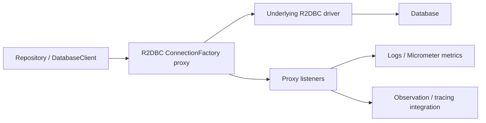
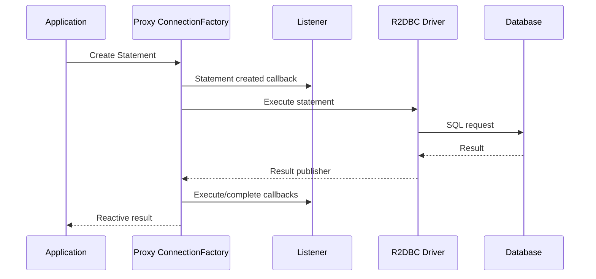
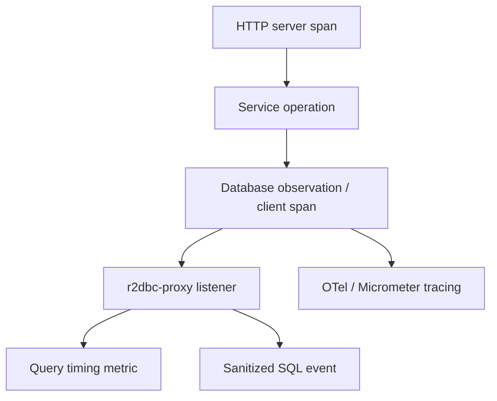

# r2dbc-proxy trong Spring Boot

Ứng dụng Spring WebFlux dùng R2DBC để truy cập PostgreSQL theo mô hình reactive. Khi API chậm, đội vận hành cần phân biệt thời gian chờ connection, thời gian thực thi SQL, thời gian fetch rows và thời gian xử lý ở tầng service. HTTP metrics cho biết endpoint chậm nhưng không chỉ ra câu SQL nào đang chiếm thời gian. **r2dbc-proxy** cung cấp lớp proxy quanh R2DBC Connection/Statement/Result để quan sát các thao tác database mà không phải sửa từng repository.

r2dbc-proxy có thể ghi nhận lifecycle của các thao tác R2DBC và phát ra listener callbacks. Ứng dụng có thể dùng listener để log SQL execution, đếm query, đo thời gian hoặc nối thông tin với observability pipeline. Tuy nhiên, proxy không tự thay thế Micrometer Observation, connection pool metrics hay distributed tracing; cần chọn integration và listener phù hợp với version.

Bài **r2dbc-proxy** thuộc chương **Database observability** của module **SPRING_BOOT_OBSERVABILITY**. Module tập trung thiết lập observability cho Spring Boot bằng Micrometer Observation, metrics, logs và distributed tracing; học context propagation, tag/cardinality, exporter, sampling và liên kết tín hiệu để điều tra lỗi, độ trễ và hành vi ứng dụng trên môi trường thực.

## 1. Mục tiêu học tập

Sau bài học, bạn có thể:

- Giải thích r2dbc-proxy đứng ở đâu trong R2DBC connection pipeline.
- Phân biệt query execution time, connection acquisition time và HTTP request latency.
- Thêm proxy datasource/connection factory vào ứng dụng Spring Boot reactive.
- Dùng listener callbacks để quan sát query lifecycle và lỗi.
- Đưa database timings vào Micrometer metrics/Observation theo cách có kiểm soát.
- Tránh metric cardinality cao do raw SQL, bind parameters và dynamic values.
- Hiểu cách liên kết query observations với Reactor context và distributed tracing.
- Bảo vệ SQL, bind values và dữ liệu nhạy cảm trong logs/telemetry.

## 2. r2dbc-proxy là gì?

R2DBC định nghĩa SPI để ứng dụng reactive truy cập relational databases. Driver cung cấp `ConnectionFactory`, tạo connections, statements và results. r2dbc-proxy bọc các R2DBC interfaces để quan sát thao tác mà application thực hiện.

Proxy có thể phát callback cho các sự kiện như:

- Connection được tạo hoặc đóng.
- Statement được tạo và execute.
- Query/batch execution bắt đầu và kết thúc.
- Result được consume.
- Lỗi xảy ra trong thao tác R2DBC.

Tên callback và API chính xác phụ thuộc r2dbc-proxy version. Đối chiếu tài liệu/version đang dùng trước khi copy listener code.



r2dbc-proxy nằm giữa application và driver. Nó quan sát lời gọi đi qua proxy; nếu component tạo connection trực tiếp từ factory khác, thao tác đó có thể không được quan sát.

## 3. Khi nào nên dùng r2dbc-proxy?

Spring Boot và Micrometer đã có metrics cho connection pool hoặc database-related instrumentation tùy stack. r2dbc-proxy hữu ích khi cần quan sát chi tiết hơn ở R2DBC API boundary:

| Nhu cầu | Tín hiệu phù hợp |
| --- | --- |
| API endpoint nào chậm? | `http.server.requests` |
| HTTP client dependency nào chậm? | `http.client.requests` và client spans |
| Connection pool đang cạn? | Pool metrics: active, idle, pending, acquire time |
| Statement execute mất bao lâu? | r2dbc-proxy listener timing |
| SQL nào phát sinh lỗi? | Listener error event và sanitized logs |
| Request nào gọi database operation? | Observation/tracing context propagation |

Không dùng r2dbc-proxy thay database slow query log hoặc database-native query plan. Proxy quan sát hành vi qua R2DBC client; database server mới có thông tin sâu về query plan, lock waits, I/O và execution internals.

## 4. Thêm r2dbc-proxy vào Spring Boot

Dependency artifact và cách tích hợp có thể thay đổi theo release. Ví dụ Gradle khai báo module r2dbc-proxy tương thích với R2DBC SPI của ứng dụng:

```kotlin
dependencies {
    implementation("org.springframework.boot:spring-boot-starter-data-r2dbc")
    implementation("io.r2dbc:r2dbc-proxy:<compatible-version>")
}
```

Placeholder version cần được thay bằng version tương thích đã xác minh trong dependency management của dự án. Không tự chọn version mới nhất nếu nó thay đổi R2DBC SPI hoặc API listener.

### Bọc ConnectionFactory

Ý tưởng cấu hình là lấy driver ConnectionFactory do Spring Boot/R2DBC configuration tạo, rồi bọc bằng proxy factory trước khi repositories/DatabaseClient sử dụng:

```java
import io.r2dbc.spi.ConnectionFactory;
import org.springframework.context.annotation.Bean;
import org.springframework.context.annotation.Configuration;

@Configuration
class R2dbcProxyConfiguration {

    @Bean
    ConnectionFactory observedConnectionFactory(
            ConnectionFactory target) {
        return ProxyConnectionFactory.builder(target)
            .build();
    }
}
```

Đây là pseudo-code về wiring; constructor/builder imports và bean arrangement phải khớp phiên bản r2dbc-proxy. Không đăng ký một bean ConnectionFactory tự tham chiếu chính nó. Trong Spring Boot, dùng customizer/bean wrapping pattern phù hợp để bọc factory gốc đúng một lần và tránh circular dependency.

### Tránh proxy hai lần

Nếu auto-configuration hoặc starter đã bọc ConnectionFactory, không bọc thêm proxy khác mà chưa có lý do. Proxy lồng nhau có thể làm listener chạy trùng, query timings bị nhân đôi và log SQL lặp. Xác minh object graph và số callback trên một request test.

## 5. Listener callbacks và query lifecycle

r2dbc-proxy cung cấp listener APIs để nhận thông tin khi thao tác xảy ra. Một listener có thể thu thập metadata như operation type, SQL text, execution duration, success/failure và connection identifiers tùy API.



Với reactive APIs, execution và result consumption có thể diễn ra khi Publisher được subscribe, không nhất thiết ngay lúc tạo Statement. Vì vậy listener timing cần hiểu chính xác nó đo thời gian tạo statement, execute publisher, nhận result, consume toàn bộ rows hay toàn bộ lifecycle từ subscribe tới terminal signal.

Không gọi tất cả khoảng thời gian này là “SQL server execution time”. Chúng có thể bao gồm network latency, driver processing, backpressure và consumer behavior.

## 6. Đo query duration và đưa vào Micrometer

Có thể dùng listener ghi nhận thời gian và tạo Timer. Pseudocode dưới đây minh họa cách thiết kế, không phải chữ ký API cố định của mọi phiên bản r2dbc-proxy:

```java
Timer queryTimer = meterRegistry.timer(
    "db.client.operation",
    "system", "postgresql",
    "operation", "select"
);

long startedAt = System.nanoTime();

// Trong callback hoàn tất tương ứng của proxy:
long elapsedNanos = System.nanoTime() - startedAt;
queryTimer.record(elapsedNanos, TimeUnit.NANOSECONDS);
```

Trong implementation thực tế, start time phải được lưu theo từng execution context/statement; không dùng biến dùng chung cho concurrent requests. Với reactive flows, bảo đảm Timer được record đúng một lần ở terminal signal, kể cả error/cancel nếu semantics cần tính các trường hợp đó.

### Tên meter và tags

Một meter database client có thể dùng dimensions ổn định:

| Tag | Ví dụ | Mục đích |
| --- | --- | --- |
| `system` | `postgresql` | Database engine |
| `operation` | `select`, `insert`, `update`, `delete` | Nhóm thao tác |
| `name` | `orders.findById` | Logical repository/query name |
| `outcome` | `success`, `error` | Kết quả |

Đây là naming design minh họa. Nếu dự án đã có naming convention của Micrometer/SemConv, hãy giữ convention đó thay vì tạo meter trùng nghĩa.

### Không dùng raw SQL làm metric tag

Không đặt các giá trị sau vào metric labels:

- SQL đầy đủ có literal values.
- Bind parameters như customer ID/order ID/email.
- Query string động hoặc generated SQL chứa tenant identifiers.
- Connection URL có username/password.
- Trace ID/span ID.

Mỗi câu SQL khác nhau có thể tạo một time series mới; bind values có thể chứa PII/secrets. Dùng logical query name hoặc operation type có tập giá trị hữu hạn.

## 7. SQL logging và bind parameter redaction

SQL logs hữu ích khi debug nhưng có thể làm lộ dữ liệu. Ví dụ query:

```sql
SELECT * FROM customers WHERE email = ?
```

Giữ placeholder trong log thường an toàn hơn ghi giá trị email thực tế. Tuy nhiên, tùy listener/configuration, proxy có thể cung cấp expanded SQL hoặc bind values; cần chủ động tắt hoặc redact.

Nguyên tắc:

1. Không log password, token, email, phone, address hoặc payment data.
2. Không ghi full connection URL/credentials.
3. Dùng query name/operation cho metrics.
4. Giới hạn log level và thời gian bật SQL debug.
5. Có access control và retention phù hợp cho database logs.
6. Kiểm tra exception messages để chắc chắn chúng không chứa parameter values.

Không giả định r2dbc-proxy tự động mask mọi bind parameter. Redaction phải được cấu hình và kiểm thử bằng dữ liệu test có thể nhận diện.

## 8. Kết hợp với Micrometer Observation và tracing

Database operation thường nằm bên trong HTTP request hoặc message consumer. Khi Observation/tracing context được truyền đúng, listener có thể liên kết operation với trace hiện hành hoặc tạo child observation/span tùy integration.



Có hai cách thiết kế:

- Dùng instrumentation/integration đã có để tạo database spans, sau đó dùng r2dbc-proxy chủ yếu cho query listener/logging.
- Tự tạo Observation/span từ listener nếu stack chưa có instrumentation phù hợp.

Không tạo duplicate database spans nếu agent hoặc framework đã instrument cùng operation. Kiểm tra trace graph với query mẫu để xác định có bao nhiêu spans và mỗi span đo đoạn nào.

### Reactor Context

R2DBC là reactive. Context có thể gắn với Reactor Context và được Micrometer context propagation bridge sử dụng. Không dựa vào ThreadLocal thuần túy vì callbacks có thể chạy trên thread khác. Khi listener tạo asynchronous observations, phải giữ scope/context theo reactive execution và restore đúng sau terminal signal.

Không tự giữ mutable Observation hoặc Span trong field singleton dùng chung giữa requests. Context phải thuộc về từng subscription/execution.

## 9. Connection pool metrics khác query metrics

Một API database chậm có thể do chờ connection chứ không phải SQL execution. Với R2DBC pool, các metrics phổ biến có thể gồm:

| Metric concept | Ý nghĩa |
| --- | --- |
| Acquired/active connections | Connections đang được ứng dụng sử dụng |
| Idle connections | Connections sẵn sàng trong pool |
| Pending acquire | Requests đang chờ connection |
| Acquire duration | Thời gian chờ lấy connection |
| Allocation/creation | Tạo connection mới |
| Validation/idle eviction | Kiểm tra và quản lý connection |

Tên meter chính xác phụ thuộc R2DBC pool và version. Đối chiếu pool metrics với query duration:

- Acquire duration cao, query duration thấp: pool capacity hoặc connection lifecycle là nghi vấn.
- Acquire duration thấp, query duration cao: database/network/query plan có thể là nguyên nhân.
- Cả hai cao: tải hệ thống, saturation hoặc database contention có thể ảnh hưởng đồng thời.
- Pending acquire tăng liên tục: pool có thể bão hòa hoặc connections không được release đúng cách.

Không kết luận query chậm chỉ từ HTTP latency hoặc connection pool saturation.

## 10. Error handling và reactive lifecycle

R2DBC operations trả về Reactive Streams Publishers. Lỗi có thể xuất hiện khi subscribe/execute hoặc trong quá trình consume result. Listener cần phân biệt lỗi tạo connection, execute statement, decode/map row, consume result, cancellation từ downstream và timeout do driver/database/network.

Một query có thể execute thành công nhưng row mapping thất bại ở application layer. Nếu listener chỉ quan sát execute callback, nó có thể không nhìn thấy lỗi mapping. Ngược lại, nếu timing kéo dài đến khi consume toàn bộ result, thời gian có thể bao gồm backpressure và application consumption.

### Record timing đúng một lần

Với reactive execution, dùng terminal callbacks phù hợp để ghi Timer một lần cho mỗi subscription. Xem xét cancellation riêng: tùy mục tiêu, cancellation có thể được ghi thành outcome `cancelled`, không nhất thiết là database error.

Không subscribe thủ công thêm lần nữa chỉ để đo query; mỗi subscription có thể thực sự thực thi query thêm lần nữa. Gắn listener vào lifecycle hiện có thay vì tạo side subscription.

## 11. Cấu hình và vận hành an toàn

Trước khi đưa r2dbc-proxy vào production:

1. Xác nhận version tương thích với Spring Boot, Spring Data R2DBC, R2DBC SPI và driver.
2. Bọc ConnectionFactory gốc đúng một lần.
3. Giới hạn listener callbacks và tránh logging mọi query ở traffic cao.
4. Chọn meter names/tags low-cardinality.
5. Redact SQL literals và bind values.
6. Theo dõi listener overhead và memory allocations.
7. Kiểm tra cancellation/error semantics trong reactive flows.
8. Bảo vệ metrics endpoints và log destinations.
9. Có feature flag/profile để giảm verbosity khi incident kết thúc.

Listener chạy trên đường xử lý database nên callback nặng có thể ảnh hưởng latency. Tránh blocking I/O, synchronous remote calls hoặc serialize payload lớn bên trong callback. Nếu cần gửi log/event ra ngoài, dùng logging/queue mechanism phù hợp và có giới hạn.

## 12. Troubleshooting

| Triệu chứng | Nguyên nhân có thể | Hướng kiểm tra |
| --- | --- | --- |
| Không có callback | ConnectionFactory đang dùng không đi qua proxy | Kiểm tra bean thực tế được DatabaseClient/repositories inject |
| Callback chạy hai lần | ConnectionFactory bị proxy nhiều lớp hoặc listener đăng ký trùng | Kiểm tra wiring và callback count |
| Timer luôn bằng 0 | Start/stop timing đặt sai callback hoặc record sai đơn vị | Kiểm tra nanoTime, TimeUnit và lifecycle |
| Timer tăng gấp đôi | Một query bị ghi ở nhiều callback/subscribe lặp | Xác định một điểm record duy nhất |
| Query timing cao nhưng DB log nhanh | Timing bao gồm network/driver/row consumption | So sánh phạm vi đo và database-native duration |
| HTTP chậm, query nhanh | Pool acquire, application processing hoặc downstream khác | Đối chiếu pool metrics và trace |
| Pending acquire tăng | Pool bão hòa hoặc connection không release | Kiểm tra concurrency, pool sizing và cancellation |
| SQL log lộ bind values | Listener/configuration log expanded SQL | Tắt bind logging hoặc redact trước khi ghi |
| Metrics cardinality tăng | SQL/raw parameter được dùng làm tags | Thay bằng query name/operation hữu hạn |
| Trace thiếu database span | Listener chưa tạo span hoặc instrumentation chưa cấu hình | Kiểm tra tracing bridge và integration |
| Trace có duplicate DB spans | Agent/framework và listener cùng instrument | Loại instrumentation trùng |
| Context sai trong reactive callback | Dựa vào ThreadLocal hoặc chia sẻ mutable state | Dùng Reactor/Micrometer context propagation đúng cách |

### Checklist điều tra

1. Xác định request chậm và trace ID trong môi trường được phép.
2. Đối chiếu HTTP server span, service span và database span.
3. Kiểm tra pool acquire/pending/active/idle metrics.
4. Xác định query operation và duration theo listener.
5. So sánh thời gian proxy với database-native slow query logs.
6. Kiểm tra exception, timeout và cancellation.
7. Xác nhận SQL/bind values đã được redact.
8. Kiểm tra proxy/listener có bị đăng ký trùng không.

## 13. Thực hành: đo R2DBC query mà không lộ dữ liệu

**Bối cảnh:** `order-service` dùng Spring WebFlux, Spring Data R2DBC và PostgreSQL. Một endpoint đọc order có latency tăng; cần xác định thời gian chờ pool hay thời gian database exchange.

### Phần A — Chuẩn bị

1. Xác nhận Spring Boot/R2DBC/driver versions.
2. Thêm r2dbc-proxy version tương thích.
3. Bọc ConnectionFactory gốc một lần.
4. Đăng ký listener chỉ ghi operation, duration và outcome; không ghi bind values.
5. Bật pool metrics và HTTP metrics.
6. Cấu hình tracing trong môi trường test.

### Phần B — Kiểm chứng

| Ca | Thao tác | Kết quả cần quan sát |
| --- | --- | --- |
| A — Query nhanh | Chạy SELECT theo primary key | Timer ghi duration và success |
| B — Query chậm | Dùng query test có độ trễ có kiểm soát | Query duration tăng |
| C — Pool pressure | Giảm pool size trong test và tạo concurrency | Pending acquire/acquire time tăng |
| D — DB error | Dùng statement lỗi trong database test | Listener nhận error outcome |
| E — Cancellation | Cancel reactive subscription | Callback/outcome phản ánh cancellation theo thiết kế |
| F — Redaction | Truy vấn với dữ liệu test nhạy cảm | Logs không chứa bind values |
| G — Trace correlation | Gọi endpoint qua database operation | DB observation/span nối đúng trace nếu integration bật |
| H — Cardinality | Chạy cùng query với nhiều IDs | Metric series vẫn dùng operation/query name hữu hạn |

### Phần C — Câu hỏi tự đánh giá

1. r2dbc-proxy nằm ở đâu trong R2DBC pipeline?
2. Vì sao query execution time khác connection acquire time?
3. Vì sao reactive query timing phải xét subscription và result consumption?
4. Làm thế nào tránh ghi Timer nhiều lần cho một execution?
5. Tại sao raw SQL và bind values không phù hợp làm metric tags?
6. Khi nào nên dùng database-native slow query log thay vì proxy timing?
7. Làm sao phân biệt pool saturation với query plan chậm?
8. Vì sao ThreadLocal thuần túy có thể làm mất context trong reactive flows?
9. Cách phát hiện proxy/listener đăng ký trùng?
10. Những dữ liệu nào cần redact trước khi log database events?

## 14. Ghi nhớ

**r2dbc-proxy** bọc R2DBC ConnectionFactory/Statement/Result để phát listener callbacks cho các thao tác database. Nó giúp quan sát query lifecycle, timing và errors tại phía ứng dụng; Micrometer có thể ghi các measurements này thành metrics, còn tracing integration có thể liên kết database operations với HTTP request context.

Phân biệt thời gian lấy connection, execute statement và consume result; chúng đo các đoạn khác nhau. Đối chiếu query timings với pool metrics, HTTP metrics và database-native diagnostics để tìm nguyên nhân. Giữ metric tags ở mức operation/query name có cardinality thấp, redact SQL/bind values và không blocking trong listener callbacks. Trong reactive flows, gắn timing/context theo subscription lifecycle, xử lý error/cancel đúng một lần và không dựa vào ThreadLocal thuần túy. Cấu hình proxy đúng một lớp và kiểm tra version compatibility giúp quan sát R2DBC hữu ích mà không làm tăng latency, rò rỉ dữ liệu hoặc tạo telemetry trùng lặp.
