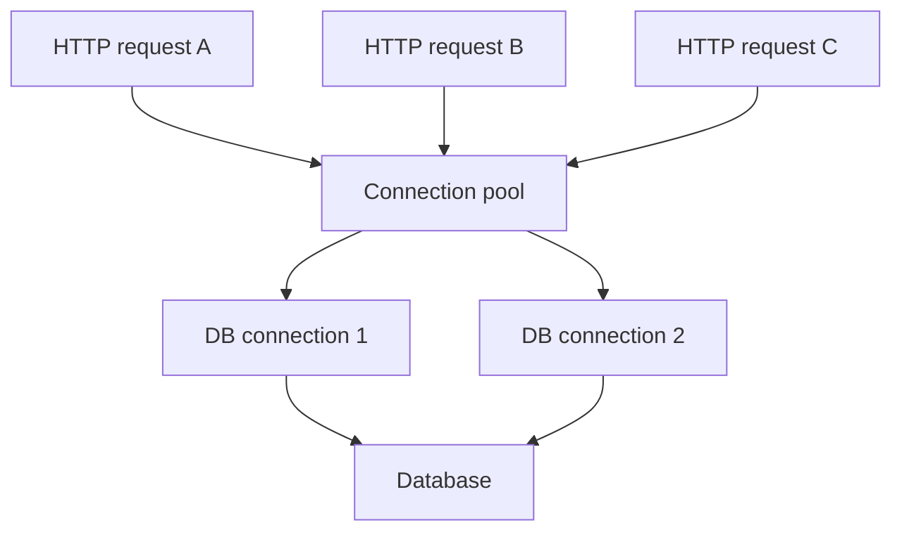
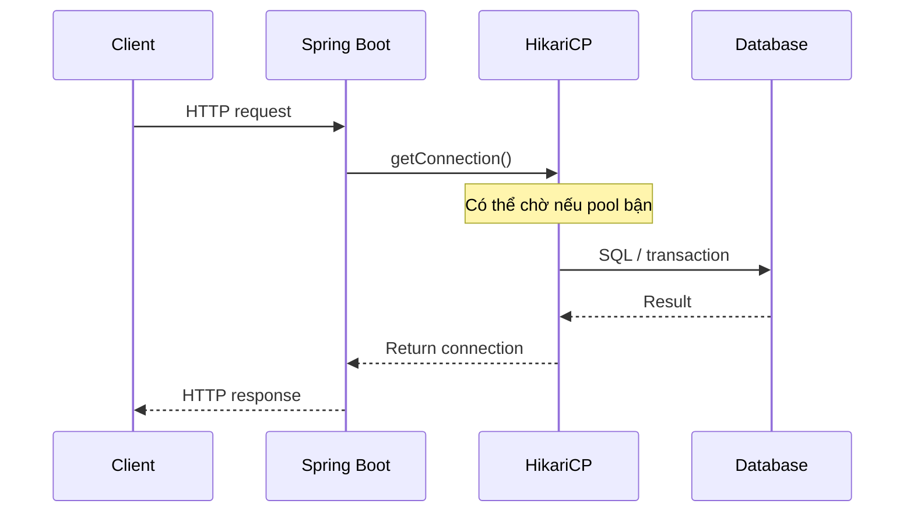

# Connection pool metrics trong Spring Boot

Một ứng dụng Spring Boot có thể có nhiều request đồng thời cùng cần truy cập database. Mỗi request thường phải mượn một connection từ connection pool, thực hiện SQL rồi trả connection về pool. Nếu pool hết connection khả dụng, request phải chờ; khi thời gian chờ tăng, latency HTTP có thể tăng theo dù câu SQL không thay đổi. Theo dõi **connection pool metrics** giúp nhận ra pool bão hòa, phân biệt thiếu connection với database query chậm, và điều chỉnh cấu hình dựa trên số liệu.

Bài **Connection pool metrics** thuộc chương **Database observability** của module **SPRING_BOOT_OBSERVABILITY**. Module hướng dẫn thiết lập observability cho Spring Boot bằng Micrometer Observation, metrics, logs và distributed tracing; học context propagation, tag/cardinality, exporter, sampling và liên kết tín hiệu để điều tra lỗi, độ trễ và hành vi ứng dụng trên môi trường thực.

Sau bài học, bạn có thể đọc active/idle/pending/max connections, hiểu các chỉ số HikariCP, quan sát metrics qua Actuator và Prometheus, nhận biết pool saturation, thiết kế dashboard/alert, và đối chiếu pool metrics với database-side telemetry trước khi tăng pool size.

## 1. Connection pool giải quyết vấn đề gì?

Mở một kết nối database có chi phí: thiết lập TCP/TLS, xác thực, tạo session và cấp phát tài nguyên ở database. Nếu mỗi HTTP request tự mở rồi đóng connection, ứng dụng sẽ lặp lại chi phí này và có thể tạo quá nhiều sessions cùng lúc.

Connection pool giữ một tập connection đã được tạo sẵn. Khi cần truy cập database, ứng dụng mượn một connection; sau khi hoàn tất, connection được trả lại để request khác sử dụng.



Pool giới hạn số connection đồng thời và tái sử dụng connection. Nó cũng tạo ra một hàng đợi chờ khi tất cả connection đang bận. Hàng đợi giúp điều tiết tải trong một giới hạn, nhưng nếu chờ kéo dài thì request latency và timeout sẽ tăng.

Spring Boot thường dùng HikariCP làm connection pool mặc định khi có JDBC starter và driver phù hợp. Nếu ứng dụng dùng R2DBC, cơ chế pooling và metrics khác; bài này tập trung vào JDBC/HikariCP.

## 2. Các metrics quan trọng của HikariCP

HikariCP có thể cung cấp pool metrics qua Micrometer khi tích hợp với registry/binder phù hợp. Các tên meter thường có prefix hikaricp.connections, với các trạng thái phổ biến:

| Metric | Ý nghĩa | Cách đọc |
| --- | --- | --- |
| active | Số connection đang được mượn | Cao kéo dài có thể báo hiệu pool bận |
| idle | Số connection sẵn sàng | Bằng 0 trong lúc tải cao là dấu hiệu cần xem thêm |
| pending | Số thread đang chờ connection | Tăng liên tục là tín hiệu pool không đáp ứng nhu cầu |
| connections | Tổng số connection hiện có trong pool | So sánh với max và trạng thái active/idle |
| max | Giới hạn connection tối đa | Mốc để đánh giá saturation |
| min | Mức connection tối thiểu được cấu hình | Cho biết baseline pool được duy trì |
| acquire | Thời gian lấy connection | Tăng có thể do chờ pool hoặc tạo connection |
| usage | Thời gian connection được sử dụng | Cao có thể do query/transaction giữ connection lâu |
| creation | Thời gian tạo connection | Tăng có thể do database/network/auth chậm |

Tên meter và statistic có thể thay đổi theo HikariCP/Micrometer version, registry naming convention và binder. Hãy khám phá metrics thực tế thay vì coi bảng tên là contract bất biến.

Ba trạng thái dễ hiểu nhất:

- **Active:** connection đã được cấp cho code ứng dụng và chưa trả lại.
- **Idle:** connection đang sẵn sàng để mượn.
- **Pending:** thread đang chờ pool cấp connection.

Nếu active chạm max, idle bằng 0 và pending lớn hơn 0 trong một khoảng thời gian, pool có thể đang bão hòa.

## 3. Đọc active, idle, pending và max cùng nhau

| Quan sát | Diễn giải có thể |
| --- | --- |
| Active thấp, idle cao, pending = 0 | Pool còn dư năng lực tại thời điểm đo |
| Active cao, idle = 0, pending = 0 | Pool đang bận nhưng chưa có hàng đợi; cần theo dõi xu hướng |
| Active = max, idle = 0, pending > 0 | Có request đang chờ connection; dấu hiệu saturation rõ |
| Pending tăng cùng acquire latency | Pool không cấp connection đủ nhanh cho tải hiện tại |
| Active thấp nhưng pending cao | Có thể đang tạo connection, pool bị giới hạn, hoặc metrics không cùng thời điểm/scope |
| Active cao kéo dài, usage duration tăng | Connection bị giữ lâu; xem query, transaction và code giữ connection |

Ví dụ snapshot giả định:

```text
active  = 20
idle    = 0
pending = 14
max     = 20
```

Pool đã dùng hết 20 connections và 14 threads đang chờ tại thời điểm lấy mẫu. Điều này chưa chứng minh database chậm; cần kiểm tra acquire time, usage time, query latency và database saturation.

Một snapshot đơn lẻ có thể chỉ là spike ngắn. Dashboard nên hiển thị time series và thời gian kéo dài của trạng thái thay vì chỉ cảnh báo từ một điểm đo.

## 4. HikariCP metrics trong Spring Boot

Với Spring Boot Actuator, Micrometer và HikariCP được cấu hình phù hợp, pool metrics có thể được bind vào MeterRegistry. Các điều kiện thường gặp:

1. Ứng dụng có JDBC DataSource do Spring Boot quản lý hoặc HikariDataSource được cấu hình đúng.
2. Actuator/Micrometer registry được đưa vào classpath.
3. HikariCP metrics binding được kích hoạt qua auto-configuration hoặc binder.
4. Pool có tên ổn định để phân biệt khi ứng dụng có nhiều DataSources.

Ví dụ dependencies Gradle:

```groovy
dependencies {
    implementation 'org.springframework.boot:spring-boot-starter-actuator'
    implementation 'org.springframework.boot:spring-boot-starter-jdbc'
    runtimeOnly 'org.postgresql:postgresql'
    runtimeOnly 'io.micrometer:micrometer-registry-prometheus'
}
```

Phiên bản dependency nên được quản lý bởi Spring Boot BOM. Không thêm phiên bản Micrometer độc lập nếu không có yêu cầu tương thích cụ thể.

### Kiểm tra qua Actuator

Khi endpoint metrics được expose và bảo vệ phù hợp, có thể truy vấn:

```text
GET /actuator/metrics
GET /actuator/metrics/hikaricp.connections.active
GET /actuator/metrics/hikaricp.connections.pending
```

Tên meter cần khớp registry đang chạy. Endpoint metrics có thể trả về available tag names/measurements cho meter cụ thể. Nếu có nhiều pools, xem tag pool để phân biệt.

Không expose tất cả Actuator endpoints công khai. Bảo vệ endpoint bằng network policy/authentication và chỉ expose những gì monitoring cần.

## 5. Cấu hình tên pool và nhiều DataSources

Một service có thể có nhiều DataSources, ví dụ database chính và reporting database. Khi đó dashboard cần biết pool nào đang bão hòa.

HikariCP có thuộc tính pool name. Ví dụ:

```yaml
spring:
  datasource:
    hikari:
      pool-name: orders-primary
      maximum-pool-size: 20
      minimum-idle: 5
```

Tên pool nên ổn định và không chứa instance ID hoặc request-specific value. Với nhiều DataSources, mỗi pool cần một tên rõ nghĩa và metrics tags phù hợp.

Các giá trị trên chỉ minh họa. maximum-pool-size không nên được tăng tùy tiện; giới hạn tổng connection của tất cả replicas phải nằm trong khả năng database.

## 6. Prometheus queries cho connection pool

Tên metric Prometheus thường được chuẩn hóa từ Micrometer meter names, ví dụ:

```promql
hikaricp_connections_active
hikaricp_connections_idle
hikaricp_connections_pending
hikaricp_connections_max
```

Tên series thật phụ thuộc registry/version và scrape configuration. Hãy mở Prometheus expression browser hoặc /actuator/prometheus để xác nhận.

### Pool utilization

Tỷ lệ active trên max:

```promql
hikaricp_connections_active
/
hikaricp_connections_max
```

Query này cho biết phần capacity đang được sử dụng. Có thể nhóm theo pool/instance nếu labels tồn tại. Utilization cao không tự động là lỗi; cần kết hợp pending và acquire latency.

### Pending threads

```promql
max by (pool, instance) (
  hikaricp_connections_pending
)
```

Pending lớn kéo dài là tín hiệu đáng quan tâm hơn một spike ngắn. Nếu metric không có label pool hoặc instance, thay bằng labels thực tế.

### Active và max theo pool

```promql
sum by (pool) (hikaricp_connections_active)
/
sum by (pool) (hikaricp_connections_max)
```

Query này tính utilization tổng của pool cùng tên trên nhiều instances, nhưng phải bảo đảm labels và pool naming phản ánh đúng cùng một loại DataSource. Nếu các replicas có max khác nhau, tổng active chia tổng max vẫn là utilization có trọng số theo capacity.

## 7. Acquire time, usage time và connection creation

Active/pending cho biết pool đang bận đến đâu; các timer giúp giải thích vì sao:

- **Acquire time:** thời gian ứng dụng chờ lấy connection từ pool. Tăng mạnh khi pool hết connection hoặc connection mới khó tạo.
- **Usage time:** thời gian connection được giữ từ lúc cấp đến lúc trả. Tăng có thể do SQL chậm, transaction dài, code làm việc khác trong khi vẫn giữ connection, hoặc lock contention.
- **Creation time:** thời gian mở connection mới. Tăng có thể do database accept chậm, DNS/network/TLS/auth hoặc DB đang quá tải.

| Active | Pending | Acquire p95 | Usage p95 | Khả năng cần điều tra |
| --- | --- | --- | --- | --- |
| Cao | Cao | Cao | Bình thường | Pool size/capacity hoặc burst concurrency |
| Cao | Cao | Cao | Cao | Query/transaction giữ connection lâu |
| Thấp | Cao | Cao | Thấp | Connection creation hoặc pool configuration |
| Cao | 0 | Thấp | Cao | Operations giữ connection lâu nhưng chưa tạo queue |
| Thấp | 0 | Thấp | Thấp | Pool không có dấu hiệu saturation trong window |

Các timer percentile cần histogram/distribution statistics phù hợp. Không phải mọi registry đều xuất p95 mặc định.

## 8. Connection pool saturation và HTTP latency

Một request có thể mất thời gian ở nhiều giai đoạn:



Nếu pool hết connection, thời gian chờ xảy ra trước khi SQL bắt đầu. Vì vậy, HTTP server latency tăng có thể xuất phát từ acquire wait chứ không phải database execution time.

Để phân biệt:

1. So sánh HTTP request latency với Hikari acquire time.
2. So sánh acquire time với connection usage time.
3. Xem database query latency, lock waits và active sessions.
4. Kiểm tra transaction boundaries và connection leak detection.
5. Đối chiếu traces: thời gian trước DB client span có thể phản ánh chờ connection tùy instrumentation.

Không phải mọi JDBC instrumentation đều tạo span riêng cho thời gian chờ lấy connection. Dùng Hikari metrics để quan sát pool và DB instrumentation để quan sát câu SQL.

## 9. Pool size không phải càng lớn càng tốt

Tăng maximumPoolSize có thể giảm pending trong ngắn hạn, nhưng mỗi connection là một session/tài nguyên ở database. Nếu có 10 replicas và mỗi replica max 30, tổng capacity lý thuyết có thể lên tới 300 connections, chưa tính job workers, migration tools và các services khác.

\[
\text{Potential connections}
= \text{replicas} \times \text{pool max per replica}
\]

Ví dụ 8 replicas × 20 connections = 160 connections tối đa từ service này.

Trước khi tăng pool:

- Xác nhận database max connections và phần dành cho admin/maintenance.
- Tính tổng pool max của mọi replicas/services.
- Đo query/transaction duration và lock contention.
- Kiểm tra CPU, I/O, active sessions và throughput của DB.
- Xem có connection bị giữ khi không thực hiện SQL không.
- Cân nhắc giảm concurrency hoặc tối ưu query thay vì tăng pool.

Pool quá lớn có thể làm database tranh chấp CPU, memory, locks và context switching, khiến query chậm hơn và toàn hệ thống xấu đi.

## 10. Alerting: kết hợp nhiều tín hiệu

Không nên alert chỉ vì active/max vượt 80% trong vài giây. Một pool có utilization cao nhưng không có pending và acquire latency vẫn thấp có thể đang hoạt động bình thường.

Alert nên kết hợp pending > 0 kéo dài, active gần max và idle = 0, acquire latency p95/p99 tăng, connection timeout/error xuất hiện, HTTP latency/error rate tăng cùng thời điểm.

Ví dụ rule Prometheus:

```yaml
groups:
  - name: database-pool
    rules:
      - alert: HikariPoolWaitingForConnections
        expr: hikaricp_connections_pending > 0
        for: 2m
        labels:
          severity: warning
        annotations:
          summary: Hikari pool has waiting threads
```

Đây là rule đơn giản; production nên thêm labels để xác định service/pool, loại trừ pool không phục vụ traffic và cân nhắc ngưỡng dựa trên baseline. Pending > 0 kéo dài cần được đối chiếu acquire time và request impact trước khi escalation.

## 11. Cardinality và naming cho pool metrics

Pool metrics thường có tag pool. Tag này nên có số giá trị nhỏ, ổn định. Không đặt pool name theo request ID, tenant ID hoặc pod UUID thay đổi liên tục.

Nếu có nhiều instances, instance label do scrape target quản lý là hợp lý để phân biệt nguồn, nhưng dashboard service-wide có thể aggregate bỏ instance. Tránh đưa SQL text, connection URL chứa credentials, database user hoặc customer identifiers vào tags.

Một dashboard cơ bản nên có active/idle/pending/max theo pool, utilization và acquire latency, usage/creation duration nếu có, connection timeout count, HTTP latency/error rate, database-side sessions/locks/CPU/query latency.

## 12. Kiểm thử connection pool metrics

| Test | Điều cần chứng minh |
| --- | --- |
| Binder test | Hikari pool tạo các meters mong đợi |
| Active/idle test | Mượn/trả connection làm state thay đổi |
| Pending test | Khi pool bị giữ hết, thread thứ hai chờ và pending tăng |
| Timeout test | Acquire vượt timeout trả lỗi phù hợp |
| Multi-pool test | Pool names phân biệt đúng DataSources |
| Registry export test | Prometheus endpoint xuất series và labels dự kiến |
| Lifecycle test | Pool shutdown và metrics cleanup đúng |

Test pending nên dùng database/test pool giới hạn rất nhỏ, giữ connection bằng latch/barrier và giải phóng deterministically. Tránh dùng sleep cố định hoặc database production để tạo saturation.

Ví dụ pseudocode cho test logic:

```java
// Tạo HikariDataSource với maximumPoolSize = 1.
// Thread A mượn connection và giữ bằng CountDownLatch.
// Thread B gọi getConnection() và phải chờ.
// Đọc MeterRegistry, xác minh pending tăng.
// Release latch, xác minh B nhận connection và pending giảm.
```

Đây là test strategy, không phải test hoàn chỉnh có thể chạy nguyên trạng. Integration test thật cần quản lý thread, timeout và cleanup trong finally để không treo suite.

## 13. Lỗi thường gặp

| Hiện tượng | Nguyên nhân có thể | Hướng kiểm tra |
| --- | --- | --- |
| Không thấy Hikari meters | Binder/registry chưa hoạt động hoặc pool không được bind | Kiểm tra DataSource, Actuator và meters |
| Active luôn bằng max | Tải cao, transaction giữ connection lâu hoặc leak | So sánh usage time, query/transaction và leak logs |
| Pending tăng | Pool không cấp connection kịp | Acquire time, usage time, DB capacity |
| Acquire time cao nhưng usage thấp | Connection creation hoặc pool contention | Creation time, network, maxLifetime/minIdle/config |
| Idle luôn bằng 0 | Pool bận hoặc minimum idle/capacity nhỏ | Xem active, pending và traffic |
| Connection timeout | Chờ quá connectionTimeout hoặc DB không nhận connection | Pool state, DB availability và network |
| Tăng pool làm DB chậm hơn | Quá nhiều sessions/DB contention | DB CPU, locks, I/O, active sessions |
| Metrics không phân biệt nhiều DataSources | Pool names trùng hoặc tag thiếu | Đặt pool-name ổn định |
| PromQL trả no data | Series name/labels khác convention | Kiểm tra actuator prometheus output |
| Pending không phản ánh request wait | Đọc sai pool hoặc scrape window | Đối chiếu đúng DataSource và timestamp |

## 14. Tình huống thực tế: API chậm do pool bão hòa

**Bối cảnh giả định:** orders-service có p95 HTTP latency tăng từ 120 ms lên 1,4 giây. Database CPU không cao, query duration trong DB dashboard gần như ổn định.

Số liệu pool trong cùng thời gian:

```text
active  = 30
idle    = 0
pending = 42
max     = 30
acquire p95 = 1.1 s
usage p95   = 85 ms
```

Các dấu hiệu cho thấy request chờ connection phần lớn thời gian; thời gian giữ connection chỉ khoảng 85 ms ở p95. Cần kiểm tra:

1. **Traffic/concurrency:** request rate hoặc worker concurrency có tăng đột ngột không?
2. **Transaction scope:** code có giữ connection trong khi gọi HTTP service khác hoặc xử lý file không?
3. **Pool budget:** tổng pool max của replicas có phù hợp DB capacity không?
4. **Connection lifecycle:** có leak hoặc code không đóng resource đúng không?
5. **Query/lock:** usage duration và database lock waits có tăng theo route cụ thể không?
6. **Remediation:** tối ưu transaction scope, giảm concurrency hoặc điều chỉnh pool trong ngân sách DB.
7. **Verification:** theo dõi pending/acquire p95 và HTTP p95 sau thay đổi; xác nhận DB không bị quá tải.

Nếu chỉ tăng max từ 30 lên 60 mà không kiểm tra tổng capacity, 8 replicas có thể tạo tới 480 connections. Database có thể bị quá tải và latency tăng thêm.

## 15. Bài tập tự kiểm tra

**Bài 1.** Active = max, idle = 0, pending = 0 có chứng minh pool lỗi không?

*Gợi ý:* Chưa. Pool đang bận nhưng chưa có thread chờ; cần xem duration, pending trend và traffic.

**Bài 2.** Pending tăng cùng acquire p95, trong khi usage p95 thấp. Bạn nghi ngờ điều gì?

*Gợi ý:* Pool capacity/concurrency, connection creation hoặc pool configuration; kiểm tra thêm creation time và DB/network.

**Bài 3.** Vì sao không average p95 acquire time giữa các replicas?

*Gợi ý:* Quantile không tuyến tính. Dùng histogram buckets aggregate nếu cần percentile toàn service.

**Bài 4.** Có 10 replicas, mỗi pool max 25. Tổng potential connections của service là bao nhiêu?

*Gợi ý:* 10 × 25 = 250, chưa tính các client khác.

**Bài 5.** Database CPU thấp nhưng HTTP latency cao và pending lớn. Điều tra ở đâu?

*Gợi ý:* Connection acquisition, transaction scope, connection leak, pool sizing và network/connection creation.

**Bài 6.** Vì sao tăng pool size có thể làm tình hình tệ hơn?

*Gợi ý:* Nhiều sessions hơn có thể gây DB contention, memory/CPU pressure và lock competition.

**Bài 7.** Metric pending bằng 0 có nghĩa không có request nào đang chờ database?

*Gợi ý:* Chỉ nói không có thread chờ connection trong pool tại thời điểm đo; request vẫn có thể chờ lock/query/network sau khi đã có connection.

**Bài 8.** Nên kết hợp pool metrics với tín hiệu nào để xác định nguyên nhân?

*Gợi ý:* HTTP latency/error, acquire/usage/creation time, database query latency, locks, active sessions, CPU và I/O.

## 16. Ghi nhớ

- Connection pool tái sử dụng và giới hạn database connections; khi hết connection, request phải chờ.
- Theo dõi **active, idle, pending, max** cùng nhau. Active chạm max, idle bằng 0 và pending tăng kéo dài là dấu hiệu saturation.
- HikariCP/Micrometer có thể cung cấp pool state và timer metrics; tên meter/labels cần xác minh theo version và registry.
- **Acquire time** đo thời gian lấy connection; **usage time** đo thời gian giữ connection; **creation time** giúp phát hiện vấn đề tạo connection.
- HTTP latency cao không nhất thiết do SQL chậm: request có thể đang chờ connection trước khi query bắt đầu.
- Không tăng pool size theo cảm tính. Tính tổng connections của tất cả replicas/services và so với ngân sách database.
- Alert nên kết hợp pending, utilization, acquire latency, timeout và HTTP impact; tránh cảnh báo chỉ từ một snapshot.
- Dùng pool metrics cùng traces, logs và database-side metrics để phân biệt pool saturation, query latency, lock contention và connection lifecycle problems.
