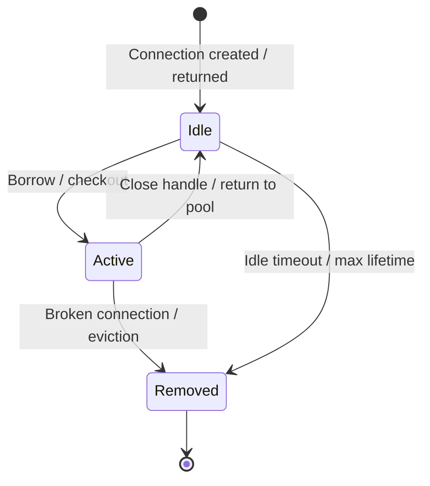

# Active và idle connection trong Spring Boot

Một ứng dụng Spring Boot dùng connection pool để tái sử dụng kết nối tới database. Khi request cần truy vấn, ứng dụng mượn một connection từ pool; sau transaction hoặc khi đóng connection handle, connection thường được trả về pool để request khác sử dụng. Tại một thời điểm, pool có thể có connection đang được ứng dụng mượn và connection đang rảnh chờ được mượn tiếp.

**Active connection** là connection đang được checkout khỏi pool và thuộc quyền sử dụng của caller. **Idle connection** là connection đang nằm trong pool, sẵn sàng cấp cho caller tiếp theo. Hai trạng thái này giúp hiểu mức sử dụng pool, phát hiện thiếu capacity, connection bị giữ quá lâu và cấu hình pool phù hợp.

Trong Spring Boot, HikariCP là connection pool phổ biến khi dùng JDBC starter và không thay thế bằng pool khác. Spring Boot Actuator/Micrometer có thể expose pool metrics như active, idle, pending và max connections tùy pool/version. Cần đọc các metrics này cùng request latency, transaction duration và database-side session metrics để xác định vấn đề nằm ở ứng dụng, pool hay database.

Bài học thuộc chương **Database observability** của module **SPRING_BOOT_OBSERVABILITY**. Module hướng dẫn thiết lập observability cho Spring Boot bằng Micrometer Observation, metrics, logs và distributed tracing; học propagation ngữ cảnh, tag/cardinality, exporter, sampling và liên kết tín hiệu để điều tra lỗi, độ trễ và hành vi ứng dụng trên môi trường thực. Bài này tập trung vào active/idle connections, cách đo lường, diễn giải và xử lý tình trạng connection pool.

## Mục tiêu học tập

Sau bài này, bạn có thể:

1. Phân biệt active, idle, total và maximum connections trong connection pool.
2. Mô tả lifecycle mượn, sử dụng và trả connection về pool.
3. Đọc HikariCP pool metrics trong Spring Boot Actuator/Micrometer.
4. Phân biệt pool saturation với database overload hoặc query chậm.
5. Nhận biết connection bị giữ lâu, leak và transaction scope quá rộng.
6. Hiểu minimum-idle, maximum-pool-size và timeout ảnh hưởng active/idle.
7. Thiết kế dashboard/alert cho pool utilization, pending borrowers và acquire latency.
8. Kết hợp pool metrics với database sessions, traces, logs và transaction metrics.
9. Kiểm thử pool behavior dưới tải và khi database chậm/ngắt kết nối.
10. Chẩn đoán thiếu connection mà không tăng pool size một cách mù quáng.

## 1. Connection pool quản lý connection như thế nào?

Mở kết nối database mới có chi phí: TCP handshake, TLS nếu có, authentication, session initialization và tài nguyên phía database. Connection pool giữ một nhóm kết nối đã tạo để tái sử dụng.

Một request thường đi qua các bước:

1. Code yêu cầu connection từ DataSource.
2. Pool cấp một connection idle nếu có.
3. Nếu không có idle và pool còn capacity, pool có thể tạo connection mới.
4. Caller thực hiện SQL/transaction.
5. Caller đóng connection handle.
6. Pool nhận lại connection và chuyển nó về idle nếu còn hợp lệ.



Trong JDBC pool, Connection.close() thường không đóng physical database session ngay. Nó trả logical connection handle về pool; pool có thể giữ physical connection mở để tái sử dụng.

### 1.1. Active connection

Một connection được tính active khi caller đã mượn nó và chưa trả về pool. Caller có thể đang chạy SQL, chờ database trả kết quả, giữ transaction giữa nhiều câu SQL, mapping dữ liệu trong khi giữ connection, hoặc không làm việc hữu ích nhưng quên close connection.

Vì vậy, active không đồng nghĩa database đang CPU-bound hoặc connection đang chạy query. Connection có thể active khi ứng dụng chờ network, lock hoặc code nghiệp vụ.

### 1.2. Idle connection

Idle connection đã được trả về pool và có thể cấp cho caller khác. Idle không nhất thiết là lãng phí: pool giữ sẵn connection giúp giảm latency tạo kết nối mới.

Idle connection có thể bị pool đóng theo minimum idle, idle timeout, maximum lifetime hoặc validation policy. Database/proxy cũng có thể đóng session idle; pool cần nhận biết và loại connection không còn hợp lệ.

### 1.3. Total, minimum idle và maximum pool size

Với HikariCP:

- **Active:** connection đang được mượn.
- **Idle:** connection đang rảnh trong pool.
- **Total:** tổng connection pool quản lý, thường bằng active + idle.
- **Maximum pool size:** giới hạn số connection pool có thể quản lý.
- **Minimum idle:** mục tiêu số idle connections pool cố gắng duy trì; nếu không cấu hình riêng, HikariCP thường vận hành fixed-size với minimum idle mặc định liên quan maximum pool size.

Giá trị thực tế phụ thuộc cấu hình và lifecycle. Không dùng snapshot đơn lẻ để kết luận pool đang hoạt động tối ưu.

## 2. HikariCP metrics trong Spring Boot

Spring Boot thường auto-configure HikariCP khi có JDBC DataSource và HikariCP trên classpath. Actuator/Micrometer có thể bind pool metrics vào MeterRegistry.

Các metric names thường gặp:

| Metric | Ý nghĩa |
|---|---|
| hikaricp.connections.active | Số connection đang được mượn |
| hikaricp.connections.idle | Số connection đang rảnh |
| hikaricp.connections | Tổng số connection pool quản lý |
| hikaricp.connections.max | Maximum pool size |
| hikaricp.connections.min | Minimum idle target |
| hikaricp.connections.pending | Số caller đang chờ connection |
| hikaricp.connections.acquire | Thời gian lấy connection |
| hikaricp.connections.usage | Thời gian connection được caller sử dụng |
| hikaricp.connections.creation | Thời gian tạo connection |
| hikaricp.connections.timeout | Số lần acquire timeout |

Tên/availability và unit phụ thuộc Micrometer, HikariCP và registry version. Kiểm tra meter names thực tế trong Actuator hoặc registry; không giả định tất cả metric đều có ở mọi phiên bản.

### 2.1. Xem metrics qua Actuator

Ví dụ expose metrics endpoint trong môi trường được bảo vệ:

```yaml
management:
  endpoints:
    web:
      exposure:
        include: health,info,metrics
  endpoint:
    metrics:
      access: read-only
```

Quyền truy cập và property semantics thay đổi theo Spring Boot version. Chỉ expose endpoint qua network/auth policy phù hợp; không mở metrics endpoint công khai nếu chứa metadata vận hành.

Có thể xem danh sách meter qua /actuator/metrics, sau đó xem một meter cụ thể như /actuator/metrics/hikaricp.connections.active nếu meter đã được bind.

### 2.2. Pool name và nhiều DataSource

Một ứng dụng có thể có nhiều DataSource/pool. Micrometer thường gắn tag pool để phân biệt. Dashboard cần group theo pool name và database role; không gộp tất cả pool nếu chúng phục vụ workloads khác nhau.

Không đưa JDBC URL chứa credentials hoặc tenant IDs động vào tags. Pool name nên ổn định, ví dụ primary, reporting hoặc inventory.

## 3. Đọc active và idle cùng nhau

```text
total_connections = active_connections + idle_connections
pool_capacity = maximum_pool_size
available_capacity = idle_connections
```

Ví dụ pool maximum 20:

| Trạng thái | Active | Idle | Pending | Diễn giải |
|---|---:|---:|---:|---|
| Bình thường | 5 | 15 | 0 | Còn nhiều connection rảnh |
| Tải tăng | 15 | 5 | 0 | Pool đang được sử dụng nhiều |
| Gần saturation | 19 | 1 | 0 | Gần chạm capacity |
| Saturated | 20 | 0 | 8 | Caller phải chờ connection |
| Idle-heavy | 2 | 18 | 0 | Nhiều capacity chưa dùng |

Các con số là ví dụ, không phải ngưỡng khuyến nghị phổ quát.

### 3.1. Active cao chưa chắc là lỗi

Active cao có thể phản ánh throughput cao và transaction ngắn. Nếu pending bằng 0, acquire latency thấp và database còn capacity, pool có thể hoạt động tốt.

Quan sát xu hướng theo thời gian và so sánh với request rate, latency, database CPU/locks và connection limits.

### 3.2. Idle cao chưa chắc là cấu hình sai

Idle cao có thể do pool giữ warm capacity để xử lý burst. Tuy nhiên, nhiều service replicas mỗi service giữ pool lớn có thể làm tổng database sessions vượt giới hạn. Tính tổng connections trên toàn deployment.

### 3.3. Pool metrics và database sessions

Pool metrics mô tả connection pool quản lý. Database-side sessions có thể còn có kết nối từ migration, admin, batch jobs, monitoring hoặc pool khác. So sánh pool metrics với database session views để tìm chênh lệch.

## 4. Pending và acquire latency

Active/idle chỉ cho biết trạng thái hiện tại. Hai metric quan trọng để phát hiện caller bị chặn:

- **Pending borrowers:** số thread/caller đang chờ connection.
- **Acquire latency:** thời gian từ lúc yêu cầu tới lúc được cấp connection.

Nếu active chạm max, idle bằng 0 và pending tăng, pool đang contention/saturation. Nếu pending bằng 0 nhưng acquire latency tăng, có thể connection creation chậm, scheduling delay hoặc snapshot không bắt được queue ngắn.

### 4.1. Pending tăng kéo dài

Pending tăng kéo dài có thể khiến request latency tăng trước khi SQL bắt đầu chạy. Trace có thể cho thấy thời gian lớn nằm ở đoạn lấy connection nếu instrumentation bao quanh acquire. Không mặc định toàn bộ latency là database query time.

### 4.2. Acquire timeout

HikariCP có connectionTimeout: caller chờ tối đa khoảng thời gian cấu hình để lấy connection trước khi pool báo lỗi. Request có thể fail trước khi thực hiện SQL.

Log exception kiểu connection unavailable cần liên kết với active/idle/pending và transaction usage. Tăng connectionTimeout chỉ làm caller chờ lâu hơn, không tạo thêm capacity.

## 5. Connection usage time và connection leak

Connection usage time phản ánh khoảng thời gian connection được caller giữ sau khi mượn. Usage time kéo dài có thể đến từ SQL chậm/lock, transaction bao quanh quá nhiều logic, caller đọc response chậm, code thực hiện network call khi transaction còn mở, connection handle không được đóng hoặc thread bị block trong khi giữ connection.

### 5.1. Connection leak

Leak xảy ra khi caller mượn connection nhưng không trả lại pool đúng cách. Active count có thể tăng dần và không giảm, cuối cùng pending tăng và pool timeout.

Dùng try-with-resources cho JDBC connection/statement/result set hoặc transaction management của Spring. Với JPA/JdbcTemplate, framework quản lý nhiều lifecycle, nhưng custom code vẫn có thể giữ resource ngoài ý muốn.

### 5.2. Leak detection threshold

HikariCP có leakDetectionThreshold để log cảnh báo khi connection được giữ lâu hơn ngưỡng. Đây là heuristic, không chứng minh chắc chắn có leak: transaction hợp lệ nhưng dài cũng có thể vượt threshold.

```yaml
spring:
  datasource:
    hikari:
      maximum-pool-size: 20
      minimum-idle: 5
      connection-timeout: 30000
      idle-timeout: 600000
      max-lifetime: 1800000
      leak-detection-threshold: 60000
```

Các giá trị tính bằng milliseconds trong HikariCP. Đây là cấu hình minh họa; chọn ngưỡng dựa trên transaction duration thực tế và timeout của database/proxy. Tránh bật leak detection quá thấp gây log noise.

## 6. Pool sizing và tổng connection budget

Không chọn maximum pool size chỉ dựa trên số CPU hoặc công thức phổ quát. Database có giới hạn sessions, workload khác nhau và thời gian giữ connection khác nhau.

```text
total_possible_connections =
    application_replicas
    * pool_maximum_per_replica
    + non_application_connections
```

Ví dụ 8 replicas, mỗi replica pool max 20, có thể mở tới 160 connections từ ứng dụng, chưa kể admin, migrations, batch workers và service khác.

### 6.1. Pool quá nhỏ

Pool quá nhỏ so với concurrency có thể tạo pending queue và tăng acquire latency dù database còn capacity. Nhưng tăng pool cần đo database utilization, query latency, lock waits và session capacity trước.

### 6.2. Pool quá lớn

Pool quá lớn có thể làm database tranh chấp CPU, memory, locks và scheduler. Nhiều concurrent queries không nhất thiết tăng throughput; đôi khi giảm pool size giúp database ổn định hơn.

### 6.3. Minimum idle và maximum pool

Minimum idle giữ sẵn connection cho burst nhưng tăng số session idle. Fixed-size pool giảm biến động connection creation nhưng tốn sessions hơn. Chọn dựa trên traffic pattern, database connection limit và chi phí thiết lập session.

## 7. Idle timeout, max lifetime và validation

Idle connection không nhất thiết tồn tại mãi:

- idleTimeout: thời gian connection có thể idle trước khi pool loại bỏ, trong điều kiện pool có thể giảm xuống minimum idle.
- maxLifetime: tuổi tối đa của physical connection trước khi pool retire nó.
- keepaliveTime: chu kỳ kiểm tra/giữ sống connection idle nếu được hỗ trợ/cấu hình.
- Validation: xác định connection còn hợp lệ trước khi cấp hoặc khi pool kiểm tra.

HikariCP có quy tắc và giới hạn cụ thể cho từng property; idle timeout chỉ có tác dụng khi minimum idle nhỏ hơn maximum pool size. Đối chiếu version docs trước khi thay đổi.

### 7.1. Phối hợp với database/proxy timeout

Nếu database, firewall hoặc proxy đóng connection sau một khoảng thời gian, maxLifetime/keepalive nên được thiết kế phù hợp để pool retire/kiểm tra trước khi connection bị server đóng bất ngờ. Không đặt keepalive quá dày gây tải không cần thiết.

### 7.2. Connection validation và stale connection

Idle connection có thể đã bị database đóng khi pool không biết. Khi cấp lại, query đầu tiên có thể thất bại. Pool/driver cần phát hiện và loại connection lỗi; quan sát connection creation failures, validation errors và SQL exceptions sau idle periods.

## 8. Kết hợp pool metrics với database metrics

| Application pool | Database side |
|---|---|
| Active/idle/pending | Sessions active/idle |
| Acquire latency | Connection accept/auth latency |
| Usage duration | Query duration/transaction duration |
| Timeout count | Max sessions/connection errors |
| Connection creation | Authentication/session creation cost |
| Pool saturation | CPU, locks, I/O, memory, worker saturation |

Nếu active/pending cao và query duration cao, database hoặc query/lock có thể là nguyên nhân. Nếu pending cao nhưng database sessions/CPU thấp, connection có thể bị giữ trong application code hoặc transaction scope không hợp lý.

Không kết luận chỉ từ một phía. Dùng cùng time range và đồng bộ clocks.

## 9. Liên kết pool metrics với traces và logs

Một request trace có thể cho thấy nhận HTTP request, bắt đầu transaction, chờ connection, thực hiện SQL, map kết quả và trả response.

Không phải mọi JDBC stack đều tạo span riêng cho pool acquisition. Nếu cần phân biệt acquire wait và SQL execution, dùng HikariCP metrics và instrumentation phù hợp; không giả định JDBC span bao gồm chính xác thời gian chờ pool trong mọi implementation.

Log hữu ích khi pool timeout/leak detection xảy ra: pool name, exception class/category, operation name đã chuẩn hóa và trace ID/span ID nếu có. Không log JDBC URL credentials, SQL parameters nhạy cảm hoặc connection object.

Dùng trace ID tìm logs cùng request, rồi đối chiếu active/idle/pending theo timestamp. Pool metrics thường tổng hợp theo pool, không có tag cho từng request.

## 10. Dashboard và alert cho active/idle connections

Dashboard pool nên có active, idle, total, maximum, pending, acquire latency, connection usage duration, acquire timeout count/rate, connection creation failures, database sessions, CPU, locks và query latency.

### 10.1. Pool utilization

```text
pool_utilization = active_connections / maximum_pool_size
```

Đây là tỷ lệ sử dụng capacity tại thời điểm đo. Không dùng riêng tỷ lệ này làm alert: active 95% nhưng pending 0 và acquire latency thấp có thể bình thường trong workload ổn định.

### 10.2. Alert theo nhiều tín hiệu

Alert hữu ích hơn khi kết hợp utilization cao kéo dài, pending borrowers lớn hơn 0 hoặc tăng liên tục, acquire latency vượt SLO, timeout rate tăng và request latency/error rate tăng cùng thời điểm.

Threshold phụ thuộc pool size, traffic và database. Dùng baseline và SLO thực tế thay ngưỡng cố định cho mọi service.

### 10.3. Tránh high-cardinality tags

Pool name là dimension ổn định; request ID, trace ID, SQL literal hoặc user ID không nên là metric tags. Dashboard tách theo pool/service/database role với tập values nhỏ.

## 11. Ví dụ quan sát qua Actuator

Sau khi ứng dụng có Actuator và metrics registry, có thể query meter:

```http
GET /actuator/metrics/hikaricp.connections.active
GET /actuator/metrics/hikaricp.connections.idle
GET /actuator/metrics/hikaricp.connections.pending
GET /actuator/metrics/hikaricp.connections.acquire
```

Actuator trả measurement và available tags tùy meter. Có thể lọc theo tag pool nếu meter cung cấp. Endpoint access/exposure cần được bảo vệ.

Đối với Prometheus, scrape endpoint phù hợp và kiểm tra tên đã được chuyển theo naming convention, ví dụ dấu chấm thành underscore. Không giả định Actuator metric name và Prometheus exposition name luôn giống nhau.

## 12. Kiểm thử active/idle behavior

Kiểm thử pool cần kiểm soát concurrency và database behavior. Có thể dùng Testcontainers hoặc database test phù hợp.

1. **Idle baseline:** khởi động ứng dụng, quan sát minimum idle và total.
2. **Borrow connection:** giữ connection trong test scope, xác nhận active tăng.
3. **Return connection:** close handle, xác nhận active giảm và idle tăng.
4. **Pool saturation:** đặt pool nhỏ, giữ tất cả connections và tạo borrower tiếp theo; xác nhận pending tăng.
5. **Timeout:** giữ connection quá connectionTimeout và xác nhận acquisition thất bại.
6. **Leak warning:** giữ connection vượt threshold trong test kiểm soát, xác minh warning.
7. **Database unavailable:** ngắt DB, quan sát creation/validation failures.
8. **Concurrent workload:** kiểm tra acquire/usage latency và request latency dưới tải.

Không assert metric ngay lập tức mà không đợi scrape/update cycle hoặc đồng bộ test. Dùng timeout có giới hạn để tránh test treo.

### 12.1. Test trả connection trong exception path

Đảm bảo connection được trả về pool khi SQL ném exception. Với raw JDBC, dùng try-with-resources; với Spring transaction, xác minh rollback/cleanup. Sau test, active count phải quay về baseline.

## 13. Chẩn đoán active/idle bất thường

| Triệu chứng | Nguyên nhân có thể | Cách điều tra |
|---|---|---|
| Active luôn bằng max | Query/transaction dài, leak hoặc pool nhỏ | Usage duration, pending, thread dump |
| Idle bằng 0 và pending tăng | Pool saturation | Acquire latency, DB load, transaction scope |
| Active cao nhưng pending bằng 0 | Tải cao nhưng pool vẫn đáp ứng | Throughput, acquire latency, query duration |
| Idle cao kéo dài | Pool giữ warm capacity hoặc traffic thấp | Min idle, replicas, DB session budget |
| Acquire latency cao, DB CPU thấp | Connection bị giữ trong app hoặc creation chậm | Usage duration, thread dump, creation |
| Timeout count tăng | Pool hết capacity hoặc DB/network lỗi | Active/idle/pending, DB sessions, logs |
| Active không giảm sau request | Leak hoặc transaction scope rộng | Leak detection, thread dump, transaction lifecycle |
| Connection lỗi sau idle | DB/proxy đóng stale session | maxLifetime, keepalive, validation |
| Pool metrics khác DB session count | Sessions ngoài pool hoặc timing khác | Database session views và clients khác |
| Một pool quá tải, pool khác nhàn | Workload/transaction routing lệch | Datasource usage và pool tags |

### Quy trình điều tra

1. Xác định pool name và maximum/minimum configuration.
2. Xem active, idle, total và pending theo cùng time range.
3. Kiểm tra acquire latency và usage duration.
4. Đối chiếu request latency, transaction duration và SQL spans.
5. Kiểm tra database sessions, CPU, locks và connection limit.
6. Xem logs timeout, leak detection, connection creation/validation.
7. Lấy thread dump khi pending/active kéo dài để tìm caller đang giữ connection.
8. Kiểm tra connection close/transaction cleanup ở success và exception paths.
9. Tính tổng connection budget trên tất cả replicas/services.
10. Điều chỉnh pool/timeouts sau khi xác định bottleneck, rồi load test lại.

## 14. Các anti-pattern cần tránh

| Anti-pattern | Hậu quả | Cách phù hợp |
|---|---|---|
| Coi active connection là query đang chạy | Chẩn đoán sai khi caller đang chờ/network/code | Kết hợp usage, SQL và thread metrics |
| Tăng max pool ngay khi pending cao | Database overload hơn | Đo DB capacity/query/lock trước |
| Coi idle connection là lãng phí | Pool tạo lại connections, tăng latency | Cân bằng min idle và session budget |
| Chỉ nhìn active/idle snapshot | Bỏ qua queue và wait time | Theo dõi pending/acquire latency |
| Giữ transaction qua HTTP call | Connection bị giữ khi chờ network | Thu hẹp transaction scope |
| Bỏ close JDBC resources | Connection leak | try-with-resources/transaction manager |
| Đặt leak threshold quá thấp | Log noise và false positive | Dựa trên usage duration baseline |
| Pool max mỗi replica không tính tổng | Vượt database connection limit | Tính budget toàn deployment |
| Gắn request/trace ID vào pool metric tags | Cardinality explosion | Metrics theo pool name ổn định |
| Tăng connectionTimeout để che saturation | Request chờ lâu hơn, không tăng capacity | Xử lý bottleneck và concurrency |
| Chỉ theo dõi application pool | Bỏ sót sessions ngoài pool/DB overload | Dashboard cả hai phía |

## 15. Checklist production cho active/idle connections

1. **Pool identity:** mọi DataSource/pool có tên ổn định?
2. **Capacity:** maximum/minimum idle phù hợp traffic và DB session budget?
3. **Replica budget:** tổng max connections trên deployment đã tính?
4. **Metrics:** active, idle, total, max, pending và timeout được export?
5. **Latency:** acquire và usage duration có dashboard?
6. **Database side:** sessions, CPU, locks và query latency được đối chiếu?
7. **Transactions:** scope ngắn, không giữ connection qua network calls không cần thiết?
8. **Cleanup:** connection trả về cả khi exception/cancel?
9. **Leak detection:** threshold dựa trên baseline và không tạo log noise?
10. **Timeouts:** connectionTimeout, idleTimeout, maxLifetime, keepalive khớp DB/proxy?
11. **Validation:** stale connections được phát hiện và loại bỏ?
12. **Security:** Actuator metrics được bảo vệ; không export JDBC credentials?
13. **Cardinality:** tags chỉ gồm pool/service/dimensions ổn định?
14. **Alerts:** pending, acquire latency, timeout rate và utilization có alert?
15. **Load test:** pool behavior được kiểm tra dưới concurrency thực tế?
16. **Incident runbook:** có quy trình đối chiếu pool metrics, thread dump, DB sessions, traces và logs?

## 16. Câu hỏi tự đánh giá

**Câu 1.** Active connection là gì?

**Gợi ý:** Connection đã được caller mượn khỏi pool và chưa trả lại; không nhất thiết đang chạy SQL.

**Câu 2.** Idle connection là gì?

**Gợi ý:** Connection đang ở trong pool, không được caller sử dụng và sẵn sàng cấp cho request khác.

**Câu 3.** Active bằng maximum và pending bằng 0 có luôn là lỗi không?

**Gợi ý:** Không. Pool có thể bận nhưng vẫn đáp ứng; cần xem pending và acquire latency kéo dài hay không.

**Câu 4.** Vì sao pending và acquire latency quan trọng?

**Gợi ý:** Chúng cho biết caller đang chờ connection và thời gian chờ trước khi truy vấn bắt đầu.

**Câu 5.** Connection.close() trong JDBC pool thường có nghĩa gì?

**Gợi ý:** Trả logical connection handle về pool; physical database connection có thể vẫn mở để tái sử dụng.

**Câu 6.** Active tăng dần không giảm có thể chỉ ra điều gì?

**Gợi ý:** Connection leak, transaction dài hoặc caller giữ connection khi bị block.

**Câu 7.** Vì sao không nên tăng pool size ngay khi pending tăng?

**Gợi ý:** Database có thể đã quá tải; thêm concurrent sessions làm tăng CPU, lock và memory contention.

**Câu 8.** Pool max 20 trên 8 replicas có thể tạo tối đa bao nhiêu connections từ ứng dụng?

**Gợi ý:** 160 connections, chưa tính các clients/services khác.

**Câu 9.** Leak detection threshold có chứng minh leak chắc chắn không?

**Gợi ý:** Không. Transaction hợp lệ nhưng dài cũng có thể vượt threshold.

**Câu 10.** Cần kết hợp dữ liệu nào để phân biệt pool saturation với DB overload?

**Gợi ý:** Active/idle/pending/acquire/usage metrics cùng database sessions, CPU, locks, query duration và application traces/logs.

## Kết luận

**Active và idle connections cho biết connection pool đang được sử dụng và còn bao nhiêu capacity sẵn sàng.** Active là connection đã được caller mượn; idle là connection đã trả về pool để tái sử dụng. Trong Spring Boot, HikariCP/Micrometer metrics như active, idle, total, max, pending, acquire và usage giúp quan sát pool theo thời gian. Để chẩn đoán đúng, đọc chúng cùng database sessions, query/transaction latency, thread state và timeout/leak logs. Không tăng pool size chỉ vì active cao; hãy xác định pending/acquire wait, connection usage và database capacity, tính tổng budget trên mọi replicas rồi kiểm thử lại sau khi điều chỉnh.
