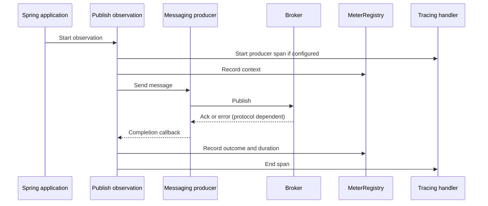
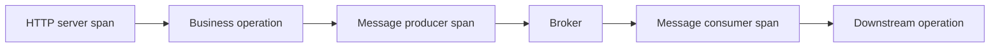

# Message publish observation trong Spring Boot

**Message publish observation** là observation mô tả hoạt động gửi message từ ứng dụng tới message broker. Ở phía producer, observation giúp ghi nhận thời điểm bắt đầu publish, kết quả gửi, thời gian hoàn tất, lỗi và metadata cần thiết để liên kết message với trace hiện tại. Với Micrometer Observation và tracing integration phù hợp, một lần publish có thể tạo metrics và producer span.

Trong module **SPRING_BOOT_OBSERVABILITY**, messaging observation bổ sung góc nhìn cho HTTP, database và background tasks. Bài thuộc chương **Messaging và task observability**, tập trung vào publisher-side observation: lifecycle của thao tác gửi, phân biệt publish invocation với broker acknowledgement, metrics/tracing, context propagation qua message headers, retry/error, cardinality, bảo mật và kiểm thử.

## 1. Message publish observation là gì?

Khi ứng dụng gửi message, producer thường gọi API của Kafka, RabbitMQ hoặc messaging abstraction. Lời gọi có thể trả về ngay một future/publisher, trong khi việc gửi thực tế và xác nhận từ broker diễn ra sau đó.

Message publish observation bao quanh thao tác gửi để trả lời:
- Ứng dụng đã yêu cầu gửi message chưa?
- Broker/client đã xác nhận kết quả ở mức nào?
- Publish mất bao lâu?
- Có lỗi serialization, connection, timeout hoặc broker rejection không?
- Message được gửi tới destination nào?
- Publish có thuộc trace của HTTP request hoặc task đang xử lý không?

Observation là instrumentation metadata, không thay thế delivery guarantee của broker. Một span thành công cần được hiểu theo semantics của client callback/ack được instrumentation quan sát.

### 1.1. Luồng khái niệm



Điểm kết thúc thực tế phụ thuộc messaging client và integration. Có API chỉ cho biết message đã được enqueue vào client buffer; API khác hoàn tất khi nhận broker acknowledgement. Phải đọc semantics cụ thể trước khi diễn giải duration hoặc success.

## 2. Publish invocation khác broker acknowledgement

Đây là khác biệt quan trọng khi đọc producer telemetry.

| Giai đoạn | Điều đã xảy ra | Có thể kết luận |
| --- | --- | --- |
| Method invocation | Ứng dụng gọi send/publish | Producer đã yêu cầu gửi |
| Client enqueue | Client nhận message vào buffer nội bộ | Message được nhận vào client buffer |
| Network send | Client gửi request tới broker | Message đã được truyền trên network |
| Broker acknowledgement | Broker phản hồi theo protocol/config | Broker xác nhận theo mức ack được chọn |
| Consumer processing | Consumer nhận và xử lý message | Không thể suy ra chỉ từ producer ack |

Một producer span có duration kết thúc tại callback ack có ý nghĩa khác span kết thúc ngay khi API trả về. Với Kafka, acknowledgement phụ thuộc producer configuration như acks và semantics của broker. Với RabbitMQ, publisher confirms là cơ chế xác nhận publish riêng; việc gửi qua channel không tự chứng minh broker đã confirm.

Không gọi một publish là end-to-end delivered chỉ vì producer nhận ack. Consumer có thể chưa nhận, xử lý thất bại hoặc chưa commit offset/ack.

## 3. Micrometer Observation trong messaging

Micrometer Observation cung cấp abstraction để instrumentation tạo observation một lần và kết nối với handler cho metrics/tracing. Spring ecosystem có nhiều integration khác nhau cho messaging; khả năng tự động instrument phụ thuộc Spring Boot, Spring Kafka, Spring AMQP, Micrometer và client version.

Cần xác định:
- Producer API được dùng là Spring abstraction hay native client.
- Integration có tạo observation cho publish không.
- Observation kết thúc khi method trả về, future hoàn tất hay broker confirm.
- MeterRegistry có handler tương ứng không.
- Micrometer Tracing bridge và exporter có hoạt động không.
- Custom instrumentation có đang đo trùng không.

Không giả định mọi message broker hoặc mọi phiên bản Spring Boot tự tạo cùng một observation name/tag set.

### 3.1. Observation có thể tạo metrics và spans

| Signal | Ví dụ | Dùng để |
| --- | --- | --- |
| Metrics | Publish count, duration, result, destination | Theo dõi tỷ lệ lỗi và xu hướng |
| Producer span | Send operation, destination, messaging system | Điều tra publish trong một trace |
| Logs | Serialization error, broker failure, retry | Hiểu sự kiện chi tiết |
| Resource | Service, version, environment | Xác định producer service |

Metrics và tracing có pipeline riêng. Có metrics không chứng minh spans đã được export; có producer span không chứng minh consumer đã xử lý message.

## 4. Kafka producer observation

Spring Kafka và Kafka client cung cấp các cơ chế instrumentation tùy version. Một số phiên bản hỗ trợ Micrometer Observation cho listener/producer khi được bật bằng cấu hình tương ứng; hãy kiểm tra đúng API/property của Spring Kafka đang dùng.

Với Kafka producer, cần phân biệt:
- Gửi qua KafkaTemplate hoặc KafkaProducer.
- Completion callback/future.
- Producer acknowledgement theo cấu hình acks.
- Retry nội bộ producer và delivery timeout.
- Serialization/partition selection errors.

Ví dụ sử dụng KafkaTemplate:

```java
@Service
class OrderPublisher {

    private final KafkaTemplate<String, OrderCreated> kafkaTemplate;

    OrderPublisher(KafkaTemplate<String, OrderCreated> kafkaTemplate) {
        this.kafkaTemplate = kafkaTemplate;
    }

    CompletableFuture<SendResult<String, OrderCreated>> publish(
            OrderCreated event) {
        return kafkaTemplate.send("orders.created", event);
    }
}
```

Ví dụ minh họa API asynchronous của Spring Kafka ở các version hỗ trợ CompletableFuture. Kiểu return và API có thể khác ở version cũ. Trả future cho caller giúp quan sát completion/error; không bỏ qua future nếu cần xử lý acknowledgement hoặc lỗi gửi.

### 4.1. Bật observation theo version

Spring Kafka có tùy chọn bật observation cho template/producer ở các version hỗ trợ. Tên property/method và default cần kiểm tra trong tài liệu đúng version. Khi bật, instrumentation có thể tạo producer observation/span và propagation headers theo integration.

Không tự đặt tên property theo suy đoán. Nếu version không có auto observation, có thể instrument ở application boundary, nhưng cần xác định rõ span kết thúc ở invocation hay callback và tránh tạo span trùng với native instrumentation.

## 5. RabbitMQ publisher observation

Với RabbitMQ, cần phân biệt việc publish tới exchange, routing tới queue và publisher confirms/returns. Publish method có thể không chờ confirm trừ khi publisher confirms được bật và xử lý đúng.

Spring AMQP cung cấp RabbitTemplate và các cơ chế observation tùy version/configuration. Kiểm tra integration có instrument publish và cách xử lý confirms/returns.

Ví dụ:

```java
@Service
class NotificationPublisher {

    private final RabbitTemplate rabbitTemplate;

    NotificationPublisher(RabbitTemplate rabbitTemplate) {
        this.rabbitTemplate = rabbitTemplate;
    }

    void publish(Notification message) {
        rabbitTemplate.convertAndSend(
                "notifications.exchange",
                "notification.created",
                message);
    }
}
```

Ví dụ minh họa publish invocation. Nếu cần xác nhận broker nhận message, cấu hình publisher confirms và theo dõi confirm callback theo Spring AMQP version. Return callback có thể báo message không được route theo mandatory publishing semantics; confirm và routing return trả lời các câu hỏi khác nhau.

## 6. Producer span và trace context propagation

Producer span thường là child của span hiện tại khi message được publish. Instrumentation có thể inject trace context vào message headers để consumer extract và tạo consumer span nối cùng trace.



W3C Trace Context thường sử dụng traceparent và tracestate; messaging integration chuyển context vào carrier phù hợp, thường là message headers. Không tự serialize toàn bộ tracing context vào payload business.

### 6.1. Producer context không phải message identity

Trace ID xác định trace; message key/correlation ID có semantics ứng dụng hoặc broker. Không dùng chúng thay thế nhau. Một trace có thể publish nhiều messages; một message có thể được redeliver hoặc xử lý trong nhiều attempts.

### 6.2. Context propagation và async callback

Producer send thường hoàn tất ở callback/future trên thread khác. Tracing integration phải khôi phục context đúng trong callback. Nếu custom callback ghi log hoặc tạo child span, kiểm tra context propagation; không giả định ThreadLocal luôn được giữ khi callback đổi thread.

## 7. Destination, partition và cardinality

Producer telemetry cần destination metadata để phân tích publish theo broker/topic/queue. Destination nên là tên ổn định, không phải giá trị do request tùy ý cung cấp.

| Dimension | Hướng dẫn |
| --- | --- |
| Messaging system | Giá trị hữu hạn như kafka/rabbitmq |
| Destination/topic/queue | Tên logic ổn định, kiểm soát số lượng |
| Operation | publish/send theo convention |
| Result | success/error hoặc category hữu hạn |
| Partition | Có thể nhiều giá trị; chỉ dùng khi cần |
| Message key | Không dùng làm metric tag nếu có cardinality lớn |
| Message ID | Không dùng làm metric tag |
| User/order ID | Không dùng làm metric tag |
| Raw payload | Không đưa vào telemetry metadata |

Topic hoặc queue do tenant/client tạo động có thể gây cardinality tăng. Dùng allowlist/normalization hoặc nhóm destination theo logical category nếu kiến trúc cho phép.

## 8. Retry, timeout và lỗi publish

Publish có thể thất bại ở nhiều tầng:
- Serialization hoặc message conversion.
- Client buffer đầy.
- DNS/network/TLS/connectivity.
- Broker unavailable hoặc throttling.
- Timeout chờ acknowledgement.
- Authorization hoặc topic/queue permission.
- Routing failure/mandatory return.
- Application cancellation hoặc timeout.

Retry có thể nằm ở producer client, Spring retry layer hoặc application code. Mỗi retry attempt có thể tạo nhiều spans hoặc nhiều log entries. Cần phân biệt logical publish operation với từng attempt nếu integration hỗ trợ.

Không retry mọi lỗi vô hạn. Lỗi serialization hoặc authorization thường không tự hết; retry liên tục chỉ tăng tải và noise. Dùng retry policy có giới hạn, backoff và classification.

### 8.1. Duration có thể bao gồm retry

Nếu observation bao trùm toàn bộ send operation và client retry nội bộ, duration có thể bao gồm thời gian retry. Nếu application retry tạo nhiều lần gọi send, có thể thấy một span cho mỗi attempt hoặc một parent operation cùng các child attempts tùy instrumentation.

Khi đọc latency, kiểm tra span boundaries và producer configuration. Không so sánh durations giữa hai service nếu semantics ack/retry khác nhau.

## 9. Message headers và metadata an toàn

Message headers thường chứa routing metadata, correlation fields và trace context. Không đưa secrets hoặc dữ liệu cá nhân vào headers một cách tùy tiện.

Tránh:
- Access token/API key.
- Cookie/Authorization headers.
- Email, số điện thoại, địa chỉ.
- Raw customer/order identifiers nếu không cần.
- Payload fragments hoặc SQL/query values.
- Toàn bộ baggage từ client không được lọc.

Chỉ propagate các baggage fields đã được allowlist. Headers có thể được lưu trong broker, dead-letter queue hoặc log; cần retention/access policy tương ứng.

## 10. Custom Observation cho publisher

Khi messaging integration không cung cấp đủ metadata hoặc ứng dụng dùng custom producer, có thể tạo observation ở application boundary. Observation nên bao quanh đúng async lifecycle.

Ví dụ minh họa với Observation API:

```java
Observation observation = Observation.createNotStarted(
        "orders.publish",
        observationRegistry);

observation.lowCardinalityKeyValue("messaging.system", "kafka");
observation.lowCardinalityKeyValue("messaging.destination.name", "orders.created");

return observation.observe(() -> kafkaTemplate.send(
        "orders.created", event));
```

Đoạn ví dụ trên chỉ bao quanh việc gọi send và trả về future; nó có thể kết thúc observation trước khi future hoàn tất. Với async publish, cần dùng async observation lifecycle hoặc completion callback để stop observation khi operation đạt terminal result theo semantics cần đo.

Ví dụ khái niệm:

```java
Observation observation = Observation.start(
        "orders.publish", observationRegistry);

CompletableFuture<SendResult<String, OrderCreated>> future;
try {
    future = kafkaTemplate.send("orders.created", event);
}
catch (Throwable error) {
    observation.error(error);
    observation.stop();
    throw error;
}

return future.whenComplete((result, error) -> {
    if (error != null) {
        observation.error(error);
    }
    observation.stop();
});
```

Đây là pseudocode minh họa lifecycle, cần điều chỉnh theo API Observation/Micrometer version và bảo đảm scope/context được quản lý đúng trong callback. Không dùng chung một mutable Observation cho nhiều publish operations. Nếu native integration đã instrument producer, không bọc thêm observation thứ hai cho cùng operation.

### 10.1. Low-cardinality và high-cardinality values

Đặt system, operation, destination ổn định ở low-cardinality khi semantics và policy cho phép. Message ID, key, correlation ID hoặc raw payload nếu cần chỉ nên ở span/log context đã được kiểm soát; không đưa vào metric tags.

## 11. Metrics cho producer

Metrics producer giúp theo dõi:
- Số lần publish.
- Số lần publish lỗi.
- Thời gian publish/ack theo semantics integration.
- Retry count.
- Pending/in-flight sends nếu client expose.
- Broker/client errors.
- Destination-level throughput nếu cardinality kiểm soát.

Tên metric cụ thể phụ thuộc Spring integration, client library và Micrometer version. Không mặc định mọi producer có một meter tên giống nhau.

### 11.1. Actuator metrics

Trong lab, có thể expose metrics endpoint:

```yaml
management:
  endpoints:
    web:
      exposure:
        include:
          - health
          - metrics
```

Liệt kê meters:

```http
GET /actuator/metrics
```

Sau khi xác định meter name thực tế, truy vấn meter đó. Endpoint Actuator phục vụ kiểm tra trong process; Prometheus/OTLP registry và backend cung cấp retention/alerting. Bảo vệ management endpoints trong môi trường dùng chung.

## 12. Kiểm thử publish observation

Test cần phân biệt business method gọi publish, client completion và broker acknowledgement. Unit test có thể mock producer/template để kiểm tra error handling, nhưng không chứng minh broker confirm hoặc propagation end-to-end.

### 12.1. Unit test với future

Dùng future hoàn tất thành công/thất bại để kiểm tra application behavior và observation lifecycle. Xác minh observation không stop trước completion nếu mục tiêu là đo ack latency.

### 12.2. Integration test với broker

Dùng Kafka/RabbitMQ test broker hoặc Testcontainers phù hợp. Kiểm tra:
- Producer gửi message tới destination đúng.
- Callback/confirm được nhận theo cấu hình.
- Producer span được tạo nếu instrumentation hỗ trợ.
- Trace context xuất hiện trong headers.
- Error path và timeout được phản ánh.
- Consumer span có thể nối cùng trace nếu consumer instrumentation được bật.

Không dùng một mock đơn thuần để kết luận broker đã nhận hoặc lưu message.

## 13. Troubleshooting message publish observation

| Triệu chứng | Nguyên nhân có thể | Cách kiểm tra |
| --- | --- | --- |
| Không có producer metrics | Chưa bật integration/registry hoặc chưa phát sinh publish | Kiểm tra dependencies, config và MeterRegistry |
| Không có producer span | Thiếu tracing bridge hoặc sampling drop | Kiểm tra tracing handler, sampler, exporter |
| Span kết thúc quá sớm | Observation stop khi API trả future | Đo theo callback/ack lifecycle |
| Duration tăng bất thường | Retry, broker latency hoặc ack mode khác | Kiểm tra producer config và broker metrics |
| Publish thành công nhưng consumer không nhận | Routing/topic/subscription/consumer offset | Kiểm tra broker destination và consumer group |
| Rabbit confirm không xuất hiện | Publisher confirms chưa bật hoặc callback chưa đăng ký | Kiểm tra channel/template configuration |
| Rabbit returned message | Không route được theo exchange/binding/mandatory config | Kiểm tra exchange, routing key, queue binding |
| Kafka send timeout | Broker/network/acks/retries/metadata | Kiểm tra client logs và broker health |
| Trace context mất ở consumer | Headers không inject/extract hoặc custom serializer bỏ headers | Kiểm tra carrier propagation |
| Trace ID sai trong callback logs | Async context không được khôi phục | Kiểm tra callback context propagation |
| Cardinality tăng | Dynamic destination, message key hoặc ID thành metric tag | Chuẩn hóa destination và bỏ dynamic tags |
| Spans bị duplicate | Native instrumentation và custom observation cùng hoạt động | Kiểm tra integration và custom code |
| Message header lộ PII/token | Propagate toàn bộ metadata không lọc | Allowlist và redact tại nguồn |
| Metrics không tới backend | Registry/exporter/Collector pipeline lỗi | Kiểm tra metrics pipeline riêng |

### Quy trình điều tra

1. Xác định broker, client library và Spring integration/version.
2. Xác minh producer observation được bật và có handler tương ứng.
3. Kiểm tra observation stop boundary: invocation, client completion hay broker ack.
4. Kiểm tra producer metrics và tracing bridge riêng.
5. Xác minh endpoint/topic/exchange/routing key.
6. Kiểm tra retry, timeout, acks/confirm semantics và client errors.
7. Kiểm tra trace context injection trong message headers.
8. Đối chiếu consumer receipt/processing riêng với producer acknowledgement.
9. Rà soát destination cardinality và metadata privacy.
10. Kiểm tra exporter/Collector/backend theo từng signal.

## 14. Bài thực hành: instrument một message publish

Mục tiêu là tạo một producer gửi message và kiểm chứng metrics, producer span, context propagation và async completion.

### Chuẩn bị

- Spring Boot application.
- Kafka hoặc RabbitMQ broker lab.
- Integration tương ứng như Spring Kafka hoặc Spring AMQP.
- Actuator và MeterRegistry.
- Micrometer Tracing bridge/exporter nếu cần traces.
- Consumer lab để xác minh message receipt.

### Bước 1 — Tạo publisher

Tạo service dùng KafkaTemplate hoặc RabbitTemplate. Trả future/callback nếu API hỗ trợ để quan sát completion/error.

### Bước 2 — Bật producer observation

Dùng property/API được tài liệu Spring integration version hiện tại hỗ trợ. Xác nhận producer observation thực sự được tạo qua registry hoặc tracing test exporter.

### Bước 3 — Gửi message

Gửi một message test tới topic/queue cố định. Ghi nhận destination, result và thời gian theo semantics của client.

### Bước 4 — Xác minh broker acknowledgement

Với Kafka, kiểm tra send future và acks configuration. Với RabbitMQ, bật publisher confirms nếu muốn xác nhận broker nhận publish; kiểm tra returns nếu cần xác minh routing.

### Bước 5 — Kiểm tra metrics

Liệt kê Actuator meters và xác định producer meters của integration. Kiểm tra count/duration/error sau nhiều publish operations.

### Bước 6 — Kiểm tra producer span

Gửi message trong một HTTP request có trace. Xác nhận producer span thuộc cùng Trace ID nếu sampling giữ trace.

### Bước 7 — Kiểm tra message headers

Xem headers trong consumer test và xác minh trace context được inject. Không ghi token/PII vào headers.

### Bước 8 — Thử error/retry

Tắt broker trong lab hoặc cấu hình lỗi có kiểm soát. Quan sát error callback, timeout, retry và observation outcome. Khôi phục broker sau test.

### Bước 9 — Xác minh consumer receipt

Consumer nhận message và tạo consumer span nếu được instrument. Phân biệt producer ack với consumer processing completion.

### Bước 10 — Kiểm tra cardinality/privacy

Rà soát destination tags, message IDs, keys, headers và span attributes. Chỉ giữ metadata cần thiết, ổn định và được phép.

### Checklist nghiệm thu

| Điều cần chứng minh | Kết quả mong đợi |
| --- | --- |
| Publish lifecycle | Hiểu invocation, enqueue, send và ack |
| Observation | Producer operation được instrument đúng version |
| Metrics | Count/duration/error được ghi nếu integration hỗ trợ |
| Tracing | Producer span xuất hiện khi sampling cho phép |
| Async completion | Observation stop theo callback/ack semantics |
| Propagation | Trace context đi qua message headers |
| Broker semantics | Phân biệt Kafka acks và Rabbit publisher confirms |
| Retry | Nhận diện attempts và timeout |
| Cardinality | Không dùng message ID/key động làm metric tags |
| Privacy | Không propagate secrets/PII |
| Consumer | Phân biệt producer ack với consumer processing |
| Export | Xác minh metrics/traces pipeline riêng |

## 15. Những nguyên tắc cần ghi nhớ

1. **Message publish observation mô tả thao tác gửi ở phía producer.** Nó không chứng minh consumer đã xử lý message.
2. **Phân biệt invocation, client enqueue, network send và broker acknowledgement.** Duration và success phụ thuộc observation stop boundary.
3. **Micrometer Observation có thể kết nối metrics và tracing**, nhưng integration phụ thuộc Spring Kafka/AMQP/client version và cấu hình.
4. **Kafka acks và Rabbit publisher confirms có semantics riêng.** Không coi lời gọi publish thông thường là broker confirmation.
5. **Async callback cần context propagation đúng.** Không dựa vào ThreadLocal khi completion chạy trên thread khác.
6. **Trace context được truyền qua message headers**, không phải payload business; chỉ propagate fields được phép.
7. **Retry có thể tạo nhiều attempts và kéo dài duration.** Dùng policy giới hạn, backoff và phân loại lỗi.
8. **Destination phải ổn định và cardinality thấp.** Không dùng message ID, key, user/order ID hoặc payload làm metric tags.
9. **Không tạo instrumentation trùng.** Kiểm tra native integration trước khi tự bọc thêm observation.
10. **Bảo vệ headers và telemetry.** Không export tokens, cookies, PII hoặc raw payload.
11. **Xác minh producer và consumer riêng.** Broker ack, consumer receipt và business processing là các mốc khác nhau.

Message publish observation giúp đo lường hoạt động gửi message ở đúng ranh giới của producer. Khi observation theo completion semantics của broker/client, trace context được truyền qua headers và metrics giữ cardinality thấp, nhóm phát triển có thể phân biệt lỗi publish, lỗi routing, retry và độ trễ broker. Kết hợp producer spans với consumer spans tạo đường đi xuyên messaging mà vẫn giữ rõ ranh giới acknowledgement và xử lý nghiệp vụ.
