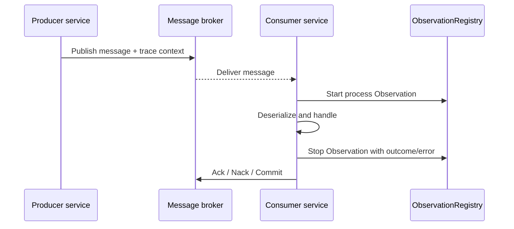
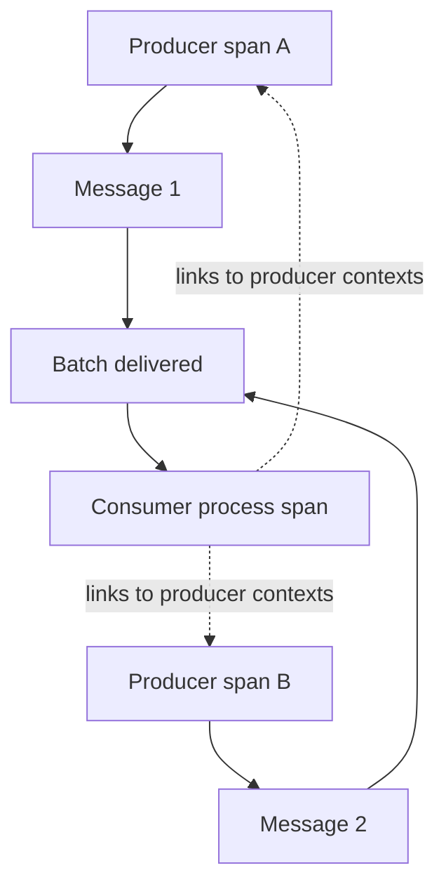
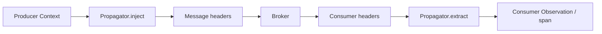
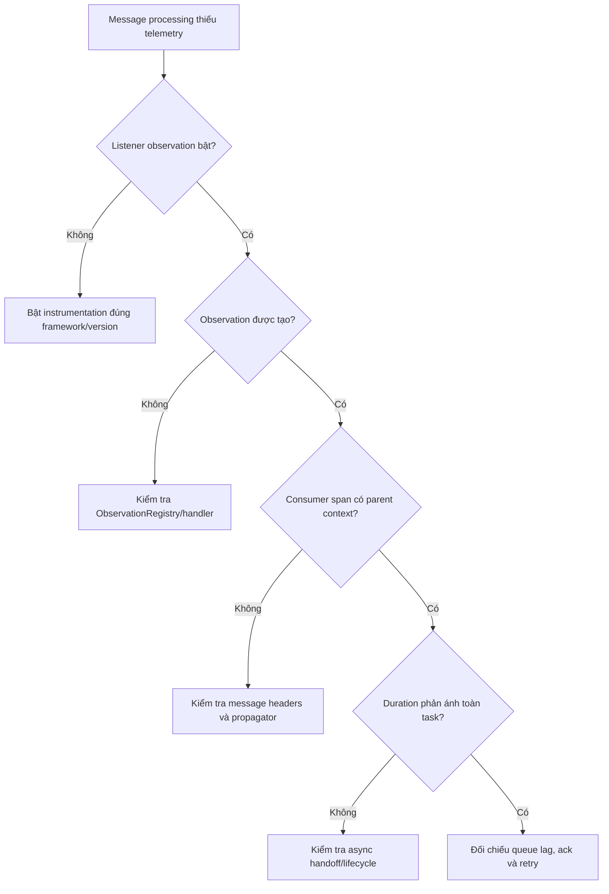

# Message process observation trong Spring Boot

Trong hệ thống messaging, producer gửi message vào broker và consumer xử lý message ở một thời điểm khác, có thể trên process, thread hoặc service khác. Nếu chỉ quan sát HTTP request, ta bỏ qua phần quan trọng của luồng bất đồng bộ: message được nhận lúc nào, handler xử lý mất bao lâu, kết quả ack/nack ra sao và retry có tạo ra vòng lặp hay không.

**Message process observation** là Observation bao quanh quá trình consumer xử lý một message hoặc một batch. Nó ghi nhận thời gian xử lý, destination, operation, outcome và exception; tracing handler có thể tạo consumer span, metrics handler có thể ghi duration/count, còn logs có thể liên kết với trace context.

Bài **“Message process observation”** thuộc chương **Messaging và task observability** của module **SPRING_BOOT_OBSERVABILITY**. Module hướng dẫn thiết lập observability cho Spring Boot bằng Micrometer Observation, metrics, logs và distributed tracing; học propagation ngữ cảnh, tag/cardinality, exporter, sampling và liên kết tín hiệu để điều tra lỗi, độ trễ và hành vi ứng dụng trên môi trường thực.

Cần tách rõ **thời gian xử lý message** khỏi **thời gian message nằm trong broker**. Observation quanh listener thường đo thời gian consumer handler thực thi theo instrumentation; nó không tự động đo toàn bộ queue residence time nếu producer timestamp/enqueue metadata không được ghi nhận và so sánh.

## 1. Message processing là một vòng đời bất đồng bộ

Một message thường đi qua các bước:

1. Producer tạo và publish message.
2. Broker nhận, lưu hoặc route message.
3. Message nằm trong queue/topic chờ consumer.
4. Consumer nhận message và tạo process/consumer Observation.
5. Handler deserialize và thực hiện nghiệp vụ.
6. Consumer ack/nack/commit hoặc để broker retry theo semantics của transport.
7. Message có thể kết thúc, được retry hoặc chuyển sang dead-letter queue.



Observation thường tập trung vào consumer-side processing. Producer publish Observation là operation riêng. Queue residence time là khoảng từ enqueue/publish tới delivery/start processing; muốn đo nó cần timestamp hoặc broker metrics phù hợp.

## 2. Process Observation đo điều gì?

Message process Observation có thể mô tả destination hoặc logical queue/topic, operation như process/consume/handle, consumer group/subscription, processing duration, outcome, exception type, batch size và trace context.

| Đại lượng | Câu hỏi được trả lời |
| --- | --- |
| Process duration | Handler mất bao lâu? |
| Processing count | Bao nhiêu lần message được xử lý? |
| Error count | Bao nhiêu lần xử lý thất bại? |
| Retry count | Message phải thử lại bao nhiêu lần? |
| Queue residence/lag | Message chờ trong broker bao lâu? |
| Consumer lag | Consumer group tụt sau producer bao nhiêu? |
| Batch size | Mỗi lần poll/handle xử lý bao nhiêu records? |

Tên Observation cụ thể phụ thuộc Spring Integration, Spring Kafka, Spring AMQP hoặc instrumentation đang dùng. Không giả định tất cả framework dùng chung tên, convention hoặc key set. Kiểm tra tài liệu đúng version và ObservationRegistry thực tế.

Không suy queue lag từ process duration. Consumer có thể xử lý message trong 5 ms nhưng message đã nằm trong queue 20 phút.

## 3. Producer Observation và consumer Observation

Producer và consumer là hai operations độc lập, thường xảy ra ở hai thời điểm khác nhau.

| Producer side | Consumer side |
| --- | --- |
| Tạo message | Nhận message |
| Serialize/publish | Deserialize/process |
| Publish duration | Handler duration |
| Broker send result | Ack/nack/commit result |
| Producer span | Consumer/process span |
| Inject context vào message headers | Extract context từ message headers |

Một trace có thể liên kết producer và consumer spans. Tuy nhiên, không phải lúc nào consumer span cũng nên là child trực tiếp của producer span; điều đó phụ thuộc messaging semantics, batching và thời gian xử lý.

## 4. Parent-child và span links trong messaging

Nếu một message được gửi rồi consumer xử lý ngay, consumer span có thể dùng producer context làm remote parent. Với batch processing, một consumer operation có thể nhận nhiều messages từ nhiều producer traces. Một span không thể có nhiều parent; trong trường hợp đó, span links phù hợp hơn để liên kết consumer span với nhiều producer contexts.



Single message có thể dùng parent relationship khi semantics thể hiện causal continuation. Batch nhiều messages cân nhắc links tới từng producer context. Với long-running delayed work, producer trace có thể hết retention trước khi consumer chạy; link vẫn mô tả quan hệ mà không buộc một trace tree dài bất thường. Redelivery có thể tạo nhiều attempts và cần metadata phân biệt.

Không ép mọi consumer span thành child nếu batch có nhiều parent contexts.

## 5. Context propagation qua message headers

HTTP thường dùng traceparent/tracestate headers. Messaging systems thường có message headers/properties hoặc record headers. Producer instrumentation inject trace context vào carrier; consumer instrumentation extract nó khi nhận message.



Không serialize toàn bộ runtime Context vào message. Chỉ propagate các trường propagator định nghĩa, như trace context và baggage được cho phép. Baggage cần allowlist, giới hạn kích thước và không chứa credential hoặc dữ liệu cá nhân nhạy cảm.

Nếu producer và consumer dùng format khác nhau (W3C/B3), cần cấu hình propagator tương thích hoặc normalize ở boundary. Kiểm tra trace ID, sampled decision và span relationship qua từng hop.

## 6. Spring Kafka: observation cho listener processing

Spring Kafka hỗ trợ Micrometer Observation cho template và listener container ở các phiên bản tương ứng. Khi bật observation trên listener container, framework có thể tạo Observation quanh listener invocation; producer observation có thể được bật riêng trên KafkaTemplate.

Ví dụ cấu hình container factory:

```java
import org.springframework.context.annotation.Bean;
import org.springframework.context.annotation.Configuration;
import org.springframework.kafka.config.ConcurrentKafkaListenerContainerFactory;
import org.springframework.kafka.core.ConsumerFactory;

@Configuration(proxyBeanMethods = false)
public class KafkaListenerConfiguration {

    @Bean
    ConcurrentKafkaListenerContainerFactory<String, String> kafkaListenerContainerFactory(
            ConsumerFactory<String, String> consumerFactory) {

        var factory =
                new ConcurrentKafkaListenerContainerFactory<String, String>();
        factory.setConsumerFactory(consumerFactory);
        factory.getContainerProperties().setObservationEnabled(true);
        return factory;
    }
}
```

Đây là ví dụ cho Spring Kafka version có API setObservationEnabled. Kiểm tra API theo dependency version của dự án; không giả định method này tồn tại ở mọi release.

Listener:

```java
import org.springframework.kafka.annotation.KafkaListener;
import org.springframework.stereotype.Component;

@Component
public class OrderEventsListener {

    @KafkaListener(topics = "orders", groupId = "billing-service")
    public void onOrder(String payload) {
        // Validate and process the event
    }
}
```

Khi observation được bật, Spring Kafka có thể cung cấp listener observation và tracing integration theo cấu hình. Đảm bảo ObservationRegistry/handlers do Spring Boot quản lý được sử dụng; không tự tạo registry rời khiến listener observations không tới metrics/tracing backend.

### Producer observation

Với KafkaTemplate, producer observation có thể được bật riêng:

```java
KafkaTemplate<String, String> template = new KafkaTemplate<>(producerFactory);
template.setObservationEnabled(true);
```

Trong Spring Boot, ưu tiên KafkaTemplate đã auto-configure và cấu hình observation qua builder/customizer/property được hỗ trợ trong version hiện hành. Tạo thêm template bean có thể thay thế bean auto-configured; dùng đúng cơ chế customization của ứng dụng.

## 7. Spring AMQP: observation cho RabbitMQ listener

Spring AMQP hỗ trợ Micrometer Observation cho RabbitTemplate và listener containers ở các phiên bản tương ứng. Producer và consumer observations là hai cấu hình riêng; kiểm tra version Spring AMQP để biết property/API chính xác.

Ví dụ listener container factory:

```java
import org.springframework.amqp.rabbit.config.SimpleRabbitListenerContainerFactory;
import org.springframework.amqp.rabbit.connection.ConnectionFactory;

SimpleRabbitListenerContainerFactory factory =
        new SimpleRabbitListenerContainerFactory();
factory.setConnectionFactory(connectionFactory);
factory.setObservationEnabled(true);
```

Listener:

```java
import org.springframework.amqp.rabbit.annotation.RabbitListener;
import org.springframework.stereotype.Component;

@Component
public class PaymentEventsListener {

    @RabbitListener(queues = "payments")
    public void onPayment(String payload) {
        // Validate and process the event
    }
}
```

Đây là ví dụ API cho version hỗ trợ observation-enabled listener containers. Trong ứng dụng Boot, cân nhắc customize factory auto-configured thay vì tạo factory mới thiếu converters, advice, retry interceptors hoặc error handlers.

## 8. Tùy chỉnh process observation convention

Convention tốt dùng logical destination và operation ổn định. Extension point cụ thể khác nhau giữa Spring Kafka, AMQP và Micrometer instrumentation; hãy dùng API đúng framework/version.

| Dimension | Giá trị gợi ý |
| --- | --- |
| messaging.system | kafka, rabbitmq |
| messaging.destination.name | orders, payments |
| messaging.operation.type | process, receive |
| consumer.group | billing-service |
| outcome | success, failure |
| error.type | Exception class/category có kiểm soát |

Không dùng message key, payload, customer ID, order ID hoặc exception message làm metric tags. Destination do deployment config quản lý thường có cardinality thấp; dynamic tenant-specific topic có thể không còn low-cardinality.

Nếu thêm metadata, giữ default attributes cần cho dashboards và semantic conventions. Không thay toàn bộ schema chỉ để thêm một tag.

## 9. Error, ack/nack và retry semantics

Consumer processing có thể thành công nhưng ack thất bại; handler có thể ném exception trước ack; broker có thể redeliver sau timeout; framework có thể retry trong process trước khi gửi lại broker.

Phân biệt:

- **Processing outcome:** handler nghiệp vụ thành công hay thất bại.
- **Acknowledgement outcome:** broker đã nhận ack/commit hay chưa.
- **Retry outcome:** message được xử lý lại hay chuyển sang recovery flow.
- **Delivery attempt:** lần broker giao message hiện tại.

Observation quanh listener invocation không tự chứng minh message đã được commit/ack thành công. Tùy container semantics, Observation có thể stop trước hoặc sau một phần acknowledgement lifecycle. Kiểm tra boundary instrumentation và framework version.

| Loại | Hành vi | Tác động quan sát |
| --- | --- | --- |
| In-memory retry/interceptor | Handler được gọi lại trong cùng consumer flow | Có thể có attempt metadata hoặc nhiều handler invocations |
| Broker redelivery | Message được broker giao lại sau nack/timeout/requeue | Có delivery count/redelivered flag tùy broker |
| Dead-letter routing | Message chuyển sang DLQ sau policy | Cần metric riêng cho DLQ/recovery |
| Retry topic/queue | Ứng dụng publish message sang destination retry | Có producer và consumer observations mới |

Không gộp mọi retry thành một metric error duy nhất. Tách initial failure, retry attempt, final failure và recovery success để không đánh giá sai reliability.

## 10. Batch processing

Một listener có thể nhận một message hoặc một batch. Với batch, duration là thời gian xử lý toàn batch; không thể suy ra mỗi message có cùng latency.

- Ghi batch size như dimension/measurement phù hợp.
- Không dùng từng message ID làm tag.
- Cân nhắc span links tới producer contexts của records trong batch.
- Nếu một record lỗi làm cả batch fail, ghi rõ error policy và partial processing semantics.
- Tránh retry toàn batch nếu một số records đã xử lý thành công mà không có idempotency.

Batch observation hữu ích để đo throughput và handler duration; per-record metrics/traces cần thiết kế cẩn thận để tránh telemetry volume quá lớn.

## 11. Async task và context propagation

Consumer có thể hand off công việc sang executor hoặc scheduler. Khi đó process Observation ban đầu có thể kết thúc trước khi task thực sự hoàn tất, nếu handler chỉ submit task rồi return.

Ví dụ:

```java
@KafkaListener(topics = "orders")
public void onOrder(String payload) {
    executor.execute(() -> process(payload));
}
```

Observation listener có thể chỉ đo thời gian submit task. Nó không nhất thiết đo process(payload) hoàn tất.

Nếu muốn đo task riêng, tạo Observation cho task execution và propagate context phù hợp qua executor bằng Micrometer Context Propagation hoặc executor decorator. Không giữ một Observation scope mở xuyên thread bằng ThreadLocal thủ công.

```java
import io.micrometer.observation.Observation;
import io.micrometer.observation.ObservationRegistry;

public class OrderTask {

    private final ObservationRegistry registry;

    public OrderTask(ObservationRegistry registry) {
        this.registry = registry;
    }

    public void process(String payload) {
        Observation.createNotStarted("order.task.process", registry)
                .lowCardinalityKeyValue("task.type", "order")
                .observe(() -> performWork(payload));
    }

    private void performWork(String payload) {
        // Execute task logic
    }
}
```

Đây là ví dụ tạo Observation riêng cho task. Nếu task cần tiếp tục trace context từ message, tạo Observation khi context đã được propagate/extract đúng; không tự copy trace ID vào metric tag.

## 12. Queue residence time và consumer lag

Process Observation thường đo thời gian handler chạy, không đo thời gian message chờ broker. Để biết message bị trễ trước khi xử lý, cần producer/enqueue timestamp hoặc broker metrics:

- Producer event timestamp hoặc enqueue timestamp.
- Broker queue age/oldest message age.
- Kafka consumer lag theo partition/group.
- Delivery timestamp nếu broker/client cung cấp.
- Timestamp lúc consumer bắt đầu process.

Có thể tính gần đúng:

\[
T_{queue}=T_{consumer\_start}-T_{enqueue}
\]

Công thức chỉ đúng khi timestamps đồng bộ và cùng semantics. Nếu producer clock lệch, kết quả có thể âm hoặc sai. Ưu tiên broker-native queue age/lag metrics khi có.

Latency end-to-end có thể gồm publish, broker residence, consumer processing và downstream calls. Không cộng các metrics ở boundary khác nhau nếu chúng overlap hoặc không cùng correlation.

## 13. Cardinality, payload và privacy

Không đưa nội dung message vào metric tags hoặc span attributes một cách mặc định. Payload có thể chứa dữ liệu cá nhân, credentials, payment information hoặc business secrets.

Tránh raw message body, message key có định danh khách hàng, order/customer/payment ID làm metric dimensions, exception message chứa payload, baggage external không validate và dynamic topic/queue names theo tenant.

Có thể dùng destination name, consumer group và operation type nếu ổn định. Nếu cần message identity để điều tra, dùng log/span attribute sau redaction và kiểm soát access/retention.

## 14. Kiểm thử message process Observation

Một test tốt xác minh cả Observation lifecycle, outcome và broker semantics:

1. Tạo test broker/container cho Kafka hoặc RabbitMQ.
2. Bật listener observation trên container/template tương ứng.
3. Publish message có trace context.
4. Xác minh consumer Observation được tạo và dừng sau processing.
5. Kiểm tra metrics count/duration và destination/group dimensions.
6. Kiểm tra consumer span và trace relationship với producer span.
7. Ném exception từ handler; xác minh error metadata và retry behavior.
8. Thử ack/nack/requeue hoặc offset commit theo semantics broker.
9. Thử redelivery và xác minh attempt metadata.
10. Gửi batch và kiểm tra batch size/links nếu instrumentation hỗ trợ.
11. Hand off task sang executor và xác minh task Observation/context propagation.
12. Kiểm tra payload/ID không lọt vào metric tags hoặc log fields trái policy.
13. Dừng broker tạm thời để kiểm tra recovery và telemetry gaps.

Không chỉ kiểm tra listener được gọi. Test phải phân biệt handler success với broker acknowledgement và retry/recovery.

## 15. Chẩn đoán khi message process Observation thiếu hoặc sai

| Triệu chứng | Nguyên nhân có thể | Cách kiểm tra |
| --- | --- | --- |
| Listener xử lý nhưng không có Observation | Chưa bật observation hoặc version chưa hỗ trợ | Kiểm tra listener container/template configuration |
| Có process metrics nhưng không có span | Tracing handler/bridge chưa cấu hình hoặc trace unsampled | Kiểm tra Micrometer Tracing |
| Consumer trace không nối producer | Message headers không inject/extract hoặc format mismatch | Kiểm tra propagator và broker headers |
| Duration quá ngắn | Handler submit async task rồi return | Tạo task Observation riêng |
| Duration tăng nhưng queue lag thấp | Consumer handler/downstream chậm | Xem process span và downstream spans |
| Queue age cao nhưng process duration thấp | Consumer lag, concurrency hoặc broker backlog | Xem broker-native lag/queue metrics |
| Retry tạo error count lớn | Mỗi attempt đều tính như final failure | Tách attempt và terminal outcome |
| Ack fail nhưng Observation success | Observation kết thúc trước ack/commit | Kiểm tra lifecycle boundary và container logs |
| Batch tạo trace rời rạc | Nhiều producer contexts nhưng chỉ một parent | Dùng span links nếu phù hợp |
| Metrics cardinality tăng | Message ID/key hoặc dynamic destination thành tag | Kiểm tra convention/tag values |
| Async task mất trace context | Executor không propagate context | Dùng Micrometer Context Propagation |
| Duplicate processing | Redelivery hoặc retry policy | Kiểm tra delivery count/idempotency |

Quy trình điều tra:

1. Xác định broker/framework và version.
2. Kiểm tra observation-enabled listener/template.
3. Xác nhận ObservationRegistry và handlers.
4. Theo dõi một message qua producer, broker và consumer.
5. Kiểm tra trace headers/context tại broker boundary.
6. Đối chiếu process duration với queue age/consumer lag.
7. Kiểm tra ack/nack/commit và redelivery.
8. Nếu async, kiểm tra Observation lifecycle và executor context.
9. Kiểm tra tags, payload redaction và cardinality.



## 16. Bài thực hành: quan sát Kafka message processing

Thực hiện trong local/test:

1. Tạo Spring Boot application có Spring Kafka và Micrometer Observation.
2. Bật observation cho Kafka listener container và producer template theo version.
3. Tạo producer gửi event vào topic orders.
4. Tạo consumer xử lý message và ghi log trong handler.
5. Kiểm tra producer/consumer observations, metrics và trace spans.
6. Xác minh trace context đi qua Kafka headers.
7. Làm handler ném exception để thử retry, recovery và DLQ.
8. So sánh process duration với consumer lag/broker queue age.
9. Cho listener hand off task sang executor; quan sát khác biệt giữa listener duration và task duration.
10. Tạo batch consumer nếu dùng; kiểm tra span links/parent semantics.
11. Kiểm tra tags không chứa payload hoặc message IDs.
12. Dừng broker tạm thời và quan sát recovery, dropped telemetry và duplicate processing.

Kết quả mong đợi: xác định thời gian handler, queue lag, retry và acknowledgement behavior; trace liên kết producer/consumer; async task có Observation riêng khi cần.

## 17. Câu hỏi tự kiểm tra

1. Message process Observation đo phần nào trong vòng đời message?
2. Process duration khác queue residence time thế nào?
3. Producer Observation và consumer Observation có vai trò gì?
4. Khi nào consumer span nên dùng parent relationship?
5. Vì sao batch consumer có thể cần span links?
6. Trace context được truyền qua message broker bằng cách nào?
7. Spring Kafka bật observation cho listener container ra sao?
8. Vì sao producer và consumer observation cần cấu hình riêng?
9. Handler success có bảo đảm broker đã ack/commit không?
10. In-memory retry khác broker redelivery thế nào?
11. Vì sao batch retry cần idempotency/partial processing policy?
12. Khi listener submit task rồi return, Observation duration phản ánh điều gì?
13. Micrometer Context Propagation giúp async task thế nào?
14. Làm sao đo queue residence time và consumer lag?
15. Metadata nào không nên trở thành metric tags?
16. Làm sao phân biệt process latency với downstream service latency?
17. Vì sao không dùng message payload làm span/metric attributes mặc định?
18. Kiểm thử end-to-end cần xác minh những tầng nào?

## Tài liệu tham khảo

- [Spring Kafka — Micrometer Observation](https://docs.spring.io/spring-kafka/reference/kafka/micrometer.html): producer/listener observations, enabling observation và convention.
- [Spring AMQP — Micrometer Observation](https://docs.spring.io/spring-amqp/reference/amqp/receiving-messages/micrometer-observation.html): RabbitTemplate và listener container observations.
- [Spring Framework — Micrometer Observation](https://docs.spring.io/spring-framework/reference/integration/observability.html): Observation lifecycle, conventions và handlers.
- [Micrometer Observation](https://docs.micrometer.io/micrometer/reference/observation.html): ObservationRegistry, handlers, conventions và filters.
- [Micrometer Context Propagation](https://docs.micrometer.io/context-propagation/reference/): context propagation qua ThreadLocal, Reactor và executor.
- [OpenTelemetry Messaging Semantic Conventions](https://opentelemetry.io/docs/specs/semconv/messaging/): messaging spans, attributes và links.
- [OpenTelemetry Context Propagation](https://opentelemetry.io/docs/concepts/context-propagation/): inject/extract context qua carrier.

## Kết luận

**Message process Observation giúp quan sát phần consumer thực sự xử lý message trong hệ thống bất đồng bộ.** Nó cung cấp duration, outcome, error và context để tạo metrics/traces; producer publish, broker queue residence, consumer processing và acknowledgement là những boundary riêng cần phân biệt.

Trong Spring Boot, bật observation đúng trên Kafka/Rabbit listener containers và producer templates, giữ context qua message headers, dùng span links khi batch có nhiều producer contexts và tạo Observation riêng cho task async nếu listener chỉ submit công việc. Kết hợp process duration với broker lag, ack/retry/DLQ metrics và logs có trace correlation để xác định message chậm ở queue, handler hay dependency downstream.

