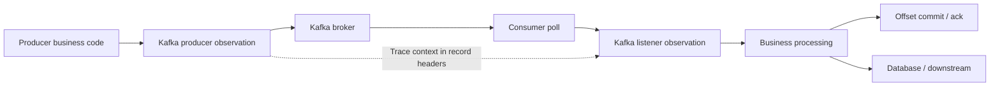
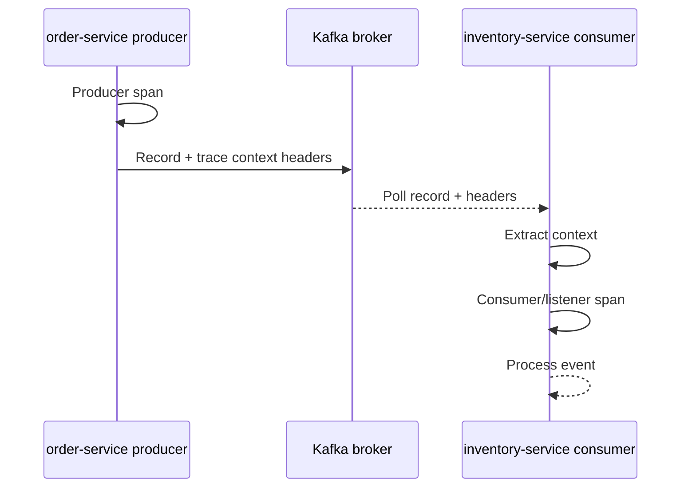
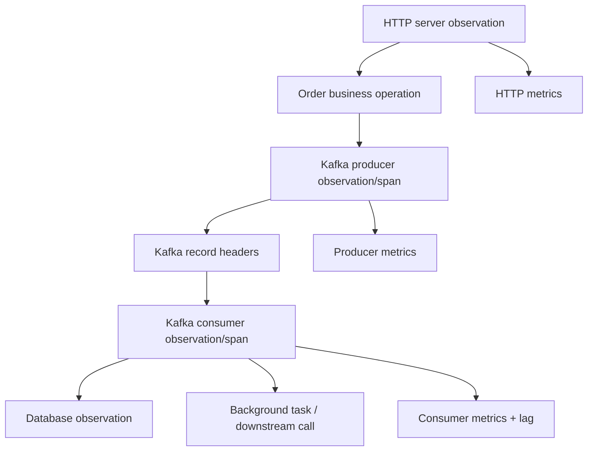

# Kafka instrumentation boundary trong Spring Boot

Một HTTP request được xử lý trong order-service, sau đó phát Kafka event để inventory-service cập nhật tồn kho. Request HTTP có thể trả về thành công trước khi consumer xử lý message. Nếu chỉ quan sát HTTP request, đội vận hành không biết message đã được gửi tới broker chưa, consumer có nhận được không, thời gian xử lý bao lâu hay retry đang làm message bị lặp. **Kafka instrumentation boundary** giúp đặt quan sát đúng tại các ranh giới producer, broker và consumer để hiểu toàn bộ luồng bất đồng bộ.

Trong Spring Boot, Spring for Apache Kafka cung cấp các điểm tích hợp Micrometer Observation cho Kafka producer và listener khi được bật/cấu hình phù hợp. Observation có thể tạo metrics và tracing spans thông qua handlers đã đăng ký. Tuy nhiên, producer send, broker acknowledgement, listener execution và offset commit là các giai đoạn khác nhau; không nên coi một span hoặc một metric là bằng chứng cho toàn bộ message lifecycle.

Bài **Kafka instrumentation boundary** thuộc chương **Messaging và task observability** của module **SPRING_BOOT_OBSERVABILITY**. Module tập trung thiết lập observability cho Spring Boot bằng Micrometer Observation, metrics, logs và distributed tracing; học context propagation, tag/cardinality, exporter, sampling và liên kết tín hiệu để điều tra lỗi, độ trễ và hành vi ứng dụng trên môi trường thực.

## 1. Mục tiêu học tập

Sau bài học, bạn có thể:

- Phân biệt producer, broker, consumer listener và offset commit boundaries.
- Bật Micrometer Observation cho Kafka trong Spring Boot.
- Hiểu metrics và tracing được tạo ở producer/consumer như thế nào.
- Phân biệt send completion, broker acknowledgement và business processing completion.
- Theo dõi consumer lag, processing duration, retry và dead-letter flow.
- Hiểu trace context được truyền trong Kafka record headers.
- Tránh high-cardinality tags và không đưa payload/PII vào telemetry.
- Chẩn đoán message duplication, missing spans, retry storms và commit failures.

## 2. Kafka có những instrumentation boundaries nào?

Một message qua Kafka đi qua nhiều giai đoạn:

1. **Producer application:** tạo event và gọi KafkaTemplate/producer API.
2. **Producer client:** serialize record, gửi request và nhận broker acknowledgement theo producer configuration.
3. **Broker:** nhận, append và lưu record theo partition/replication policy.
4. **Consumer client:** poll records từ broker.
5. **Listener:** deserialize và chạy business handler.
6. **Offset management:** commit offset theo ack mode/transaction semantics.
7. **Downstream work:** có thể phát thêm event, gọi database hoặc HTTP service.



Producer observation và listener observation đo hai phần khác nhau. Khoảng thời gian broker giữ message trước khi consumer xử lý không nhất thiết nằm trong duration của span producer hoặc listener. Muốn đo end-to-end event age, cần timestamp/lag measurements hoặc cơ chế correlation rõ ràng.

## 3. Bật Kafka observations trong Spring Boot

Với Spring Boot và Spring for Apache Kafka version hỗ trợ Micrometer Observation, cấu hình listener observation và template observation theo property tương ứng:

```yaml
spring:
  kafka:
    template:
      observation-enabled: true
    listener:
      observation-enabled: true
```

Tên property và auto-configuration thay đổi theo Spring Boot/Spring Kafka version. Kiểm tra configuration metadata của ứng dụng; nếu cấu hình factory/container thủ công, cần bật observation ở đúng KafkaTemplate hoặc listener container factory thay vì giả định property toàn cục tự áp dụng cho mọi instance.

### Dependencies

Một ứng dụng Spring Boot Kafka thường có starter:

```kotlin
dependencies {
    implementation("org.springframework.boot:spring-boot-starter-actuator")
    implementation("org.springframework.kafka:spring-kafka")
}
```

Spring Boot BOM quản lý phiên bản tương thích. Nếu ứng dụng dùng tracing, thêm một tracing bridge phù hợp (Brave hoặc OpenTelemetry) và exporter tương ứng theo kiến trúc. Không thêm đồng thời hai bridge chỉ để tạo spans trùng nhau.

### ObservationRegistry và handlers

Kafka integration sử dụng Micrometer Observation khi được bật. ObservationRegistry điều phối metrics/tracing handlers:

- Metrics handler ghi producer/consumer observations vào MeterRegistry.
- Tracing handler tạo spans qua Micrometer Tracing bridge.
- Propagator inject/extract trace context qua record headers nếu integration được cấu hình.

Nếu có ObservationRegistry riêng hoặc cấu hình thủ công, hãy đảm bảo Kafka components sử dụng registry có handlers của ứng dụng. Registry trống có thể khiến observation không tạo metrics/traces như mong đợi.

## 4. Producer boundary: gửi message không đồng nghĩa consumer đã xử lý

Ví dụ producer gửi event:

```java
import org.springframework.kafka.core.KafkaTemplate;
import org.springframework.stereotype.Service;

@Service
public class OrderEventPublisher {
    private final KafkaTemplate<String, OrderCreated> kafkaTemplate;

    public OrderEventPublisher(
            KafkaTemplate<String, OrderCreated> kafkaTemplate) {
        this.kafkaTemplate = kafkaTemplate;
    }

    public void publish(OrderCreated event) {
        kafkaTemplate.send("orders.created", event.orderId(), event);
    }
}

record OrderCreated(String orderId, String customerTier) {}
```

KafkaTemplate.send() trả về future cho kết quả gửi. Producer observation thường bao quanh việc gửi và completion callback tương ứng. Hành vi chính xác phụ thuộc version và producer configuration.

Phân biệt:

| Mốc | Điều nó chứng minh |
| --- | --- |
| Business code gọi send() | Ứng dụng đã yêu cầu gửi record |
| Producer future hoàn tất thành công | Producer nhận kết quả gửi thành công theo semantics/acks đã cấu hình |
| Broker acknowledgement | Broker xác nhận theo acks và replication policy hiện tại |
| Consumer listener hoàn tất | Listener đã xử lý record theo semantics ứng dụng |
| Offset commit thành công | Consumer progress được ghi nhận theo commit/transaction strategy |

Producer span kết thúc thành công không chứng minh consumer đã xử lý event. Nếu business workflow cần biết consumer hoàn tất, phải có acknowledgement/event response hoặc trạng thái nghiệp vụ riêng.

### Producer configuration ảnh hưởng semantics

Các cấu hình như acks, retries, idempotence, delivery timeout và transaction settings ảnh hưởng thời điểm send được xem là thành công và khả năng duplicate. Metrics/tracing phải được đọc cùng cấu hình producer; không diễn giải span success thành bảo đảm exactly-once cho toàn business workflow.

## 5. Consumer boundary: poll, listener và commit

Ví dụ listener:

```java
import org.springframework.kafka.annotation.KafkaListener;
import org.springframework.stereotype.Component;

@Component
public class OrderCreatedListener {

    @KafkaListener(topics = "orders.created", groupId = "inventory-service")
    public void handle(OrderCreated event) {
        reserveInventory(event.orderId());
    }

    private void reserveInventory(String orderId) {
        // Business operation
    }
}
```

Khi listener observation được bật, Spring Kafka có thể tạo observation/span cho quá trình listener xử lý record. Consumer processing duration thường đo phần listener callback/observation scope theo integration; nó không nhất thiết bao gồm toàn bộ thời gian record nằm trong broker trước khi poll.

### Offset commit khác listener completion

Listener return thành công và offset commit là hai mốc có quan hệ nhưng không đồng nhất trong mọi ack mode:

- Với auto/manual ack, thời điểm commit khác nhau.
- Batch listener có thể xử lý nhiều records trong một callback.
- Transactional listener có thể commit offset cùng Kafka transaction.
- Retry/error handler có thể seek, pause, republish hoặc chuyển record sang DLT.

Khi điều tra duplicate hoặc mất message, cần xem ack mode, transaction boundary, retry policy và idempotency của business handler.

## 6. Metrics producer và consumer

Micrometer/Spring Kafka có thể cung cấp metrics cho producer, consumer và listener observations. Tên meter cụ thể phụ thuộc Spring Kafka, Kafka client, Micrometer và registry version.

| Nhóm | Câu hỏi vận hành |
| --- | --- |
| Kafka client metrics | Producer throughput, request latency, retries, buffer exhaustion, consumer fetch/poll behavior |
| Observation-derived metrics | Thời lượng producer/consumer operation, số lần, outcome và low-cardinality dimensions |

Một số observation meter có thể có tên theo convention như spring.kafka.template và spring.kafka.listener; xác minh meter names thực tế qua Actuator hoặc registry thay vì hardcode tên từ phiên bản khác.

### Đọc metrics qua Actuator

Expose metrics endpoint theo policy:

```yaml
management:
  endpoints:
    web:
      exposure:
        include: health,metrics
```

Kiểm tra danh sách meters:

```http
GET /actuator/metrics
```

Sau đó truy vấn meter cụ thể theo tên thực tế:

```http
GET /actuator/metrics/spring.kafka.listener
```

Đây là ví dụ tên để minh họa; tên có thể khác theo version/configuration. Actuator trả số liệu hiện có trong process, không phải lịch sử time series của toàn cluster.

### Consumer lag

Consumer lag phản ánh chênh lệch giữa vị trí consumer group đã commit và log end offset của partition. Đây là chỉ số quan trọng để biết consumer có theo kịp producer không. Lag có thể được cung cấp bởi Kafka client/exporter/monitoring platform; không nên suy ra chỉ từ listener duration.

Lag tăng có thể do arrival rate cao hơn processing throughput, consumer concurrency/partition assignment không phù hợp, handler chậm do database/HTTP dependencies, consumer rebalance thường xuyên, retry/pause/error handling làm giảm throughput hoặc consumer không commit offset/bị stuck.

## 7. Tracing qua Kafka record headers

Distributed tracing cần truyền trace context từ producer sang consumer. Với Spring Kafka observation/tracing integration phù hợp, propagator có thể inject context vào Kafka record headers khi gửi và extract khi nhận.



Record headers mang context, không phải payload business. Trace ID có thể giữ nguyên qua producer/consumer boundary; span IDs thay đổi theo operation. Tùy integration, consumer span có thể liên kết theo parent-child hoặc span link, nhất là khi batch consumption hoặc nhiều records có nhiều parent contexts.

### Kiểm tra headers

1. Xác nhận producer observation/tracing đã bật.
2. Gửi một record có thể nhận diện bằng business key test không nhạy cảm.
3. Xem headers đã được inject (ví dụ W3C traceparent) qua tooling an toàn.
4. Xác nhận consumer nhận cùng context và trace backend hiển thị đúng liên kết.

Không tự serialize trace ID vào JSON payload hoặc tạo header tracing thủ công nếu framework propagator đã làm việc đó. Không dùng trace context làm identity hoặc authorization credential.

## 8. Batch consumption và span links

Consumer có thể nhận một record hoặc một batch. Trong batch, records có thể đến từ nhiều traces khác nhau. Một span listener duy nhất không thể luôn có một parent span duy nhất đại diện đúng tất cả records.

Tracing integrations có thể dùng span links để liên kết consumer processing span với nhiều producer contexts. Hành vi cụ thể phụ thuộc Spring Kafka/Micrometer Tracing version và batch listener instrumentation.

Khi đọc trace:

- Một consumer span có parent đơn giản có thể phù hợp với single-record processing.
- Batch consumer có thể dùng links tới nhiều producer spans.
- Không kết luận trace propagation sai chỉ vì batch span không có parent-child tree như trường hợp một record.
- Kiểm tra integration documentation và trace graph semantics của backend.

## 9. Retry, error handler và Dead Letter Topic

Message processing có thể thất bại do database timeout, validation, dependency unavailable hoặc bug. Retry có thể thực hiện trong listener container hoặc republish message. Khi quan sát, cần phân biệt lần thử ban đầu và các lần retry.

| Giai đoạn | Câu hỏi |
| --- | --- |
| Listener attempt | Một lần xử lý mất bao lâu và kết quả gì? |
| Retry | Có bao nhiêu lần thử, delay bao lâu? |
| Recovery | Record được xử lý bằng recoverer hay chuyển DLT? |
| DLT consumer | Message lỗi được đọc/điều tra lại ra sao? |
| Offset commit | Offset được commit ở thời điểm nào? |

Retry có thể làm một event được xử lý nhiều lần. Business handler nên idempotent hoặc dùng deduplication strategy phù hợp. Không dùng metric tag messageId làm dimension nếu mỗi message có ID riêng.

### Trace continuity khi retry

Tùy retry mechanism, retry có thể tiếp tục context cũ, tạo operation mới hoặc republish record với headers được giữ/biến đổi. Hãy kiểm tra thực tế headers và spans. Nếu chuyển DLT, trace có thể cần liên kết với lần xử lý ban đầu để điều tra.

## 10. Cardinality và bảo vệ dữ liệu message

Không đưa các giá trị có cardinality cao hoặc nhạy cảm vào metric tags:

- Message key có thể là order/customer ID.
- Message ID hoặc correlation ID duy nhất.
- Full topic name nếu topic được tạo động theo tenant.
- Payload fields, email, phone, address hoặc payment data.
- Trace ID/span ID.
- Exception message chứa SQL/credentials/payload.

Dimensions phù hợp thường là:

| Dimension | Ví dụ |
| --- | --- |
| Topic (tập hữu hạn) | orders.created, inventory.updated |
| Consumer group | inventory-service |
| Operation | send, receive, process |
| Outcome | success, error, retry, recovered |
| Partition | Cân nhắc; partition count hữu hạn nhưng có thể tăng theo cluster |

Topic/group/partition vẫn cần kiểm soát nếu được tạo động. Payload logging nên tắt hoặc redact theo schema; chỉ log metadata cần thiết và có access control/retention.

## 11. Correlate Kafka với HTTP, database và task observations

Một request có thể tạo Kafka event rồi kết thúc; consumer xử lý sau đó trong process khác. Để điều tra end-to-end, cần liên kết:



HTTP response có thể hoàn tất trước consumer processing. Nếu nghiệp vụ cần xác nhận hoàn tất, tạo trạng thái/event acknowledgement riêng hoặc theo dõi workflow state; đừng suy luận từ producer span.

Với scheduled/background tasks không bắt đầu từ Kafka, cần tạo observation ở task boundary riêng và propagate context nếu có parent workflow. Tránh dùng một span kéo dài hàng giờ; dùng workflow/run identifiers có policy phù hợp và span links/events nếu tracing model cần.

## 12. Troubleshooting Kafka instrumentation

| Triệu chứng | Nguyên nhân có thể | Hướng kiểm tra |
| --- | --- | --- |
| Producer metrics có nhưng không có producer span | Tracing handler/bridge chưa bật hoặc sampling từ chối | Kiểm tra ObservationRegistry, bridge và sampler |
| Producer span kết thúc nhưng consumer chưa xử lý | Span chỉ đo send/ack boundary | Kiểm tra consumer lag và listener observations |
| Consumer span là root trace mới | Headers không được inject/forward/extract | Kiểm tra record headers và propagator |
| Không có listener observation | Observation chưa bật trên container factory | Kiểm tra property và factory custom |
| Listener duration tăng | Business handler/dependency chậm hoặc batch lớn | Xem child spans, database/client timings |
| Lag tăng nhưng listener duration thấp | Arrival rate, partition assignment, poll/commit/rebalance | Kiểm tra consumer group metrics |
| Duplicate business events | Retry, redelivery, offset commit hoặc producer retry semantics | Kiểm tra idempotency và commit strategy |
| DLT tăng nhanh | Handler lỗi kéo dài hoặc recovery policy | Kiểm tra exception classes, retry count và downstream health |
| Trace context mất ở retry/DLT | Headers không được giữ hoặc custom republish | Kiểm tra headers từng hop |
| Batch trace graph khó đọc | Nhiều parent contexts, span links | Kiểm tra batch instrumentation semantics |
| Metrics cardinality tăng | Message key/ID hoặc payload field thành tag | Bỏ high-cardinality tags |
| SQL/payload lộ trong logs | Listener debug logging quá chi tiết | Redact và giới hạn log scope |

### Checklist điều tra

1. Xác nhận producer và listener observations được bật trên đúng beans/factories.
2. Gửi một record test với topic/group xác định.
3. Kiểm tra producer send result và broker acknowledgement semantics.
4. Xem consumer group lag, poll và listener execution.
5. Kiểm tra trace headers được inject và extract.
6. Đối chiếu listener completion với offset commit/transaction.
7. Kiểm tra retries, DLT, duplicate handling và idempotency.
8. Kiểm tra metrics tags, payload redaction và exporter pipeline.

## 13. Thực hành: theo dõi order event qua Kafka

**Bối cảnh:** order-service phát orders.created; inventory-service consume và reserve stock. Cần biết event được gửi, nhận, xử lý và commit offset như thế nào.

### Phần A — Chuẩn bị

1. Cấu hình Spring Kafka và broker test.
2. Bật template/listener observation theo property hỗ trợ của version.
3. Cấu hình MeterRegistry và tracing bridge/exporter nếu cần.
4. Tạo producer và listener theo ví dụ.
5. Expose Actuator metrics ở môi trường test.

### Phần B — Kiểm chứng

| Ca | Thao tác | Kết quả cần quan sát |
| --- | --- | --- |
| A — Producer success | Gửi event hợp lệ | Producer observation/send result thành công |
| B — Consumer success | Listener xử lý record | Listener observation duration được ghi |
| C — Broker delay | Tạm dừng consumer | Producer vẫn gửi; consumer lag tăng |
| D — Handler failure | Ném exception có kiểm soát | Error/retry observations và retry count |
| E — DLT | Retry hết giới hạn | Record được recover/DLT theo policy |
| F — Context | Bật tracing và gửi record | Trace context có trong headers, consumer liên kết đúng |
| G — Offset | Dùng ack/transaction mode đã chọn | Commit behavior khớp cấu hình |
| H — Cardinality | Gửi nhiều order IDs | Metric series không tạo tag cho từng ID |

### Phần C — Câu hỏi tự đánh giá

1. Vì sao producer send success không đồng nghĩa consumer business processing đã hoàn tất?
2. Broker acknowledgement phụ thuộc những cấu hình producer nào?
3. Listener completion khác offset commit ở điểm nào?
4. Consumer lag cho biết điều gì mà listener duration không cho biết?
5. Trace context được truyền qua Kafka record bằng cách nào?
6. Khi batch consume nhiều records, vì sao span links có thể phù hợp hơn một parent duy nhất?
7. Retry và redelivery có thể tạo duplicate business effects như thế nào?
8. Vì sao message key/message ID không nên làm metric tag?
9. Làm thế nào giữ trace correlation qua retry và DLT?
10. Nếu HTTP request đã thành công nhưng consumer lag tăng, cần điều tra boundary nào?

## 14. Ghi nhớ

**Kafka instrumentation boundary** phân biệt producer send, broker acknowledgement, consumer listener execution và offset commit. Spring Kafka có thể tích hợp Micrometer Observation ở KafkaTemplate và listener container khi được bật đúng theo version. Metrics handlers ghi measurements; tracing handlers tạo spans và propagator có thể truyền trace context qua record headers.

Producer span thành công không chứng minh consumer đã xử lý message. Hãy đối chiếu producer results, broker/client metrics, consumer lag, listener duration, retries, DLT và offset commit. Với batch processing, trace links có thể mô tả nhiều producer contexts; với retry, kiểm tra headers và idempotency. Giữ tags low-cardinality, không log payload nhạy cảm và không dùng message IDs làm metric labels. Quan sát đúng từng boundary giúp liên kết HTTP, Kafka, database và background tasks, đồng thời phân biệt độ trễ broker, xử lý consumer và lỗi workflow.
