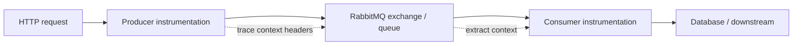
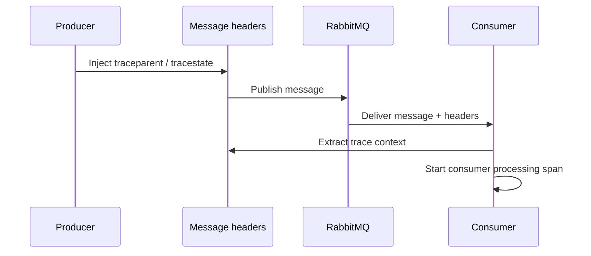

# RabbitMQ instrumentation boundary trong Spring Boot

Trong một ứng dụng Spring Boot dùng RabbitMQ, một thao tác nghiệp vụ có thể bắt đầu ở HTTP request, được publish thành message, rồi tiếp tục xử lý trong consumer ở một process khác. Nếu chỉ instrument HTTP server, ta nhìn thấy request ban đầu nhưng không thấy message đi qua broker và consumer xử lý ra sao. **RabbitMQ instrumentation boundary** xác định nơi tạo telemetry ở phía producer, nơi inject/extract context, và nơi consumer bắt đầu/kết thúc processing span để nối các bước bất đồng bộ thành một luồng có thể điều tra.

Bài **RabbitMQ instrumentation boundary** thuộc chương **Messaging và task observability** của module **SPRING_BOOT_OBSERVABILITY**. Module hướng dẫn thiết lập observability cho Spring Boot bằng Micrometer Observation, metrics, logs và distributed tracing; học context propagation, tag/cardinality, exporter, sampling và liên kết tín hiệu để điều tra lỗi, độ trễ và hành vi ứng dụng trên môi trường thực.

Sau bài học, bạn có thể phân biệt producer, broker và consumer boundaries; hiểu Spring AMQP observation support; cấu hình context propagation qua message headers; phân tích ack/retry/DLQ và batch processing; tránh tạo spans trùng; và kiểm thử trace continuity cùng messaging metrics.

## 1. Vì sao cần instrumentation cho RabbitMQ?

HTTP request thường kết thúc trước khi consumer xử lý message. Nếu API chỉ ghi nhận thời gian publish, ta chưa biết message nằm trong queue bao lâu, consumer nào nhận message, consumer mất bao lâu để xử lý, có retry/reject/DLQ không, lỗi xuất hiện ở producer/broker/handler, và message có liên hệ với trace bắt đầu từ HTTP request hay không.

Instrumentation cần quan sát ít nhất ba ranh giới:

1. **Producer:** ứng dụng tạo và gửi message.
2. **Broker transport:** message được route, lưu trong queue và chuyển tới consumer. Thời gian ở broker thường được đo gián tiếp bằng timestamps/queue metrics, không phải một span nội bộ của ứng dụng.
3. **Consumer:** ứng dụng nhận message, thực hiện business handler và ack/reject/nack.



Producer và consumer thường chạy ở thời điểm khác nhau, thậm chí ở process/host khác nhau. Trace context phải được inject vào message headers và extract ở consumer nếu muốn tạo quan hệ trace đúng.

## 2. Xác định boundary nào thuộc ứng dụng?

| Boundary | Ai thực hiện | Telemetry phù hợp |
| --- | --- | --- |
| Business event creation | Producer application | Business Observation/span |
| Message publish | RabbitTemplate / producer client | Producer span, publish outcome, duration |
| Exchange routing | RabbitMQ broker | Broker metrics, topology và queue metrics |
| Queue waiting | Broker | Queue depth, ready/unacked, enqueue/consume timestamps nếu có |
| Message delivery | Broker + consumer client | Consumer receive/delivery instrumentation |
| Business processing | Consumer application | Process span/Observation, result/error |
| Ack/reject/nack | Consumer client/protocol | Delivery outcome, retry/DLQ metrics |

Một span producer thường đo thao tác publish qua client API, không phải toàn bộ thời gian message ở queue. Consumer span đo thời gian từ khi consumer nhận/dispatch message tới lúc xử lý theo semantics của instrumentation. Để biết queue delay, cần thêm timestamp/queue metrics; không suy diễn queue latency bằng cách trừ timestamps nếu clocks giữa hosts không được đồng bộ.

## 3. Spring AMQP Observation support

Spring AMQP hỗ trợ Micrometer Observation cho các thành phần như RabbitTemplate và listener containers ở các phiên bản phù hợp. Khi bật observation, producer và consumer operations có thể tạo Observation; tracing handler có thể chuyển chúng thành spans, metrics handler có thể tạo meters.

Với Spring Boot, cấu hình thường nằm ở properties của Spring AMQP và phụ thuộc version. Ví dụ minh họa:

```yaml
spring:
  rabbitmq:
    template:
      observation-enabled: true
    listener:
      simple:
        observation-enabled: true
      direct:
        observation-enabled: true
```

Tên property, listener container type và default values thay đổi theo Spring Boot/Spring AMQP version. Kiểm tra configuration metadata của dependency đang dùng. Nếu framework đã bật Observation tự động, không thêm custom instrumentation tạo cùng producer/consumer spans lần nữa.

Observation có thể tạo metrics ngay cả khi tracing sampling không ghi span. Ngược lại, exporter/backend chỉ nhận được trace nếu tracing handler, sampler, processor và exporter được cấu hình đúng.

## 4. Producer boundary: ghi nhận publish

Producer instrumentation nên mô tả thao tác publish có tên ổn định và metadata hữu ích: messaging system RabbitMQ, destination/exchange hoặc queue theo convention phù hợp, operation publish/send, routing key nếu cần và đã kiểm soát cardinality, outcome success/failure, và duration của publish call.

Ví dụ business code dùng RabbitTemplate:

```java
import org.springframework.amqp.rabbit.core.RabbitTemplate;
import org.springframework.stereotype.Component;

@Component
class OrderPublisher {
    private final RabbitTemplate rabbitTemplate;

    OrderPublisher(RabbitTemplate rabbitTemplate) {
        this.rabbitTemplate = rabbitTemplate;
    }

    void publish(OrderCreated event) {
        rabbitTemplate.convertAndSend(
            "orders.exchange",
            "orders.created",
            event
        );
    }
}
```

Nếu observation support đã bật trên RabbitTemplate, publish operation có thể được instrument bởi framework. Không bọc đoạn code trên bằng custom span trùng nghĩa nếu chưa có nhu cầu riêng.

Publish call thành công không nhất thiết có nghĩa consumer đã xử lý message. Cần phân biệt publisher confirm, routing return, broker acceptance và consumer business completion. Mỗi khái niệm có tín hiệu riêng.

## 5. Consumer boundary: nhận và xử lý message

Consumer span nên bao quanh phần xử lý message ở listener boundary. Ví dụ:

```java
import org.springframework.amqp.rabbit.annotation.RabbitListener;
import org.springframework.stereotype.Component;

@Component
class OrderCreatedListener {
    @RabbitListener(queues = "orders.created")
    void onMessage(OrderCreated event) {
        processOrder(event);
    }

    private void processOrder(OrderCreated event) {
        // Validate and apply the business event.
    }
}
```

Listener container có thể cung cấp Observation cho quá trình nhận/xử lý nếu đã bật instrumentation tương ứng. Business method nên tập trung vào event và nghiệp vụ; không tự tạo một consumer span nếu listener container đã tạo span bao quanh cùng operation.

Nếu muốn đo một bước nghiệp vụ con riêng biệt, đặt tên span/Observation theo operation thật như order.apply-created-event, để phân biệt với messaging receive span. Tránh hai spans cùng tên và cùng lifecycle bao trùm toàn bộ listener.

## 6. Context propagation qua message headers

HTTP tracing thường truyền context qua headers như W3C Trace Context. RabbitMQ message có properties/headers riêng; producer instrumentation cần inject trace context vào message headers, consumer instrumentation extract context khi nhận message.



Khi propagation đúng, consumer trace có thể liên kết với producer context theo messaging semantic conventions và tracing API. Với message được xử lý rất lâu sau khi publish, một số instrumentation/convention có thể dùng span link thay vì parent-child relationship trực tiếp; cách biểu diễn phụ thuộc messaging model và OTel semantic conventions.

Không tự đặt trace ID trong JSON payload để thay thế propagation headers. Payload là business contract; trace context là metadata transport. Dùng propagator được framework/bridge hỗ trợ.

## 7. Headers, baggage và dữ liệu nhạy cảm

Message headers có thể tồn tại lâu trong broker, được lưu bền vững hoặc gửi qua nhiều service. Vì vậy chỉ propagate context cần thiết:

- Trace context chuẩn như traceparent/tracestate.
- Baggage chỉ khi có allowlist và lý do rõ ràng.
- Không truyền Authorization, cookie, session token hoặc secret.
- Không đưa PII/customer identifiers vào baggage mặc định.
- Giới hạn kích thước và số lượng custom headers.

Baggage có thể được sao chép qua nhiều services và xuất hiện trong telemetry downstream. Không dùng nó như nơi chứa business payload. Trace context cũng không phải bằng chứng xác thực hoặc quyền truy cập message.

## 8. Publish confirm, routing return và consumer ack

| Outcome | Ý nghĩa |
| --- | --- |
| Publish API returned | Client call hoàn tất theo API semantics |
| Publisher confirm ack | Broker xác nhận publish theo confirm mode |
| Mandatory return | Message không được route tới queue phù hợp |
| Consumer ack | Consumer xác nhận delivery đã được xử lý theo chế độ ack |
| Consumer nack/reject | Consumer không chấp nhận delivery |
| Requeue | Message có thể được đưa lại queue để xử lý lần nữa |
| Dead-letter | Message được route sang DLQ theo policy/topology |

Một publish span không nên được diễn giải thành “business transaction đã hoàn tất”. Producer confirm không chứng minh consumer xử lý thành công; consumer ack cũng không nhất thiết chứng minh side effect bên ngoài đã hoàn tất nếu code ack sai thời điểm.

Instrument outcome tại đúng boundary. Nếu dùng manual ack, xác định rõ khi nào ack xảy ra và business operation đã commit hay chưa. Nếu ack trước khi database transaction commit, có thể mất message khi process lỗi ở khoảng giữa.

## 9. Retry và dead-letter queue

Retry có thể xảy ra trong listener container, application code hoặc broker topology. Mỗi lần delivery/retry cần được phân biệt bằng retry count/attempt, exception category, requeue/reject và DLQ destination.

Không dùng message ID tùy ý làm metric tag. Nếu cần tìm một message cụ thể, dùng log field hoặc trace attributes theo policy, giới hạn truy cập và retention.

Retry có thể tạo nhiều consumer spans cho cùng logical message. Điều đó không phải duplicate instrumentation nếu mỗi span đại diện một lần delivery/attempt khác nhau. Hãy dùng attempt metadata có cardinality phù hợp và liên kết các lần thử theo context/identifier an toàn.

DLQ là một queue khác, có thể có consumer riêng. Cần quan sát cả lần publish sang DLQ và lần xử lý DLQ; đừng xem việc message vào DLQ là thành công nghiệp vụ.

## 10. Batch consumption và concurrency

Listener có thể nhận một message mỗi lần hoặc batch nhiều messages, tùy container/configuration. Semantics instrumentation phải rõ:

- Một span cho mỗi message hay một span cho cả batch?
- Batch failure ảnh hưởng tất cả messages hay chỉ một phần?
- Ack được thực hiện theo từng message hay batch?
- Retry một message có làm replay toàn batch?
- Consumer concurrency có làm tăng pending/unacked và DB pool usage không?

Nếu một span đại diện cả batch, ghi batch size dưới dạng attribute số có giới hạn, không đưa toàn bộ IDs vào span name. Nếu cần trace từng message, dùng span/link strategy phù hợp với convention và tránh tạo quá nhiều spans ngoài sampling/budget.

Concurrency cao có thể làm consumer throughput tăng đến khi downstream/database bão hòa. Kết hợp RabbitMQ queue metrics với Hikari pool metrics, HTTP/DB latency và consumer processing duration.

## 11. Messaging semantic conventions và naming

OpenTelemetry định nghĩa semantic conventions cho messaging để các backend hiểu các thao tác publish/receive/process nhất quán. Attribute cụ thể phụ thuộc convention version và instrumentation library.

| Khái niệm | Ví dụ giá trị | Lưu ý |
| --- | --- | --- |
| Messaging system | rabbitmq | Tên hệ thống messaging |
| Destination | orders.created | Queue/topic/exchange theo convention đang dùng |
| Operation | publish, receive, process | Phân biệt thao tác |
| Consumer group/name | orders-worker | Tên consumer ổn định |
| Message body size | số bytes | Không log nội dung body |
| Error type | timeout, validation | Dùng category ổn định |

Không tự đoán attribute keys rồi coi đó là chuẩn. Kiểm tra OTel semantic conventions và phiên bản instrumentation. Các convention có thể thay đổi giữa stable/experimental versions; thống nhất schema khi nâng cấp.

## 12. Metrics cho RabbitMQ và consumer

Observation/tracing không thay thế broker metrics. Một dashboard messaging nên có queue ready messages, unacknowledged messages, publish rate và deliver/consume rate, consumer processing duration, consumer error/retry count, DLQ message count/rate, consumer concurrency/utilization, connection/channel health.

Queue depth tăng liên tục trong khi consume rate thấp có thể báo hiệu consumer thiếu capacity hoặc downstream chậm. Unacked tăng có thể do consumers đang xử lý lâu, batch/concurrency hoặc ack bị trì hoãn.

Tên metrics phụ thuộc RabbitMQ management plugin, exporter, Spring AMQP/Micrometer binder và backend. Phân biệt broker-side metrics với application-side listener timers; hai nguồn có thể đo các giai đoạn khác nhau.

## 13. Kiểm thử instrumentation boundary

| Test | Điều cần chứng minh |
| --- | --- |
| Producer observation test | Publish tạo observation/span đúng operation |
| Header propagation test | Trace context được inject vào message headers |
| Consumer extraction test | Consumer khôi phục parent context hoặc link đúng |
| Error test | Publish/processing failure được đánh dấu đúng |
| Ack/retry test | Delivery outcome và retry attempts không bị nhầm |
| DLQ test | Message reject/dead-letter được quan sát |
| Batch test | Batch size/failure semantics được phản ánh đúng |
| Duplicate instrumentation test | Một publish/consume operation không có spans trùng nghĩa |

### Kiểm tra propagation với test message

```java
// Pseudocode:
// 1. Tạo producer Observation/Span trong test context.
// 2. Gửi message qua RabbitTemplate được instrument.
// 3. Capture message bằng test queue.
// 4. Xác minh headers có trace context đã inject.
// 5. Gọi listener trong consumer instrumentation.
// 6. Assert consumer span có trace relationship mong đợi.
```

Đây là pseudocode, không phải API test cụ thể cho mọi Spring AMQP version. Integration test nên dùng RabbitMQ test container hoặc broker test riêng, không phụ thuộc broker production.

## 14. Lỗi thường gặp

| Hiện tượng | Nguyên nhân có thể | Hướng kiểm tra |
| --- | --- | --- |
| Producer span có nhưng consumer trace tách rời | Context không được inject/extract | Kiểm tra message headers và propagation integration |
| Có hai producer spans cho một publish | Spring Observation và custom span cùng instrument | Chọn một instrumentation owner |
| Publish span thành công nhưng message không tới queue | Routing/confirm/mandatory return hoặc topology sai | Kiểm tra exchange, binding, routing key và confirms |
| Consumer span kết thúc nhưng message retry | Ack/retry semantics khác với kỳ vọng | Kiểm tra container ack mode, exception/retry policy |
| Queue depth tăng, consumer latency tăng | Consumer capacity thấp hoặc downstream chậm | Đối chiếu processing duration, DB pool và dependency spans |
| DLQ tăng nhưng error metric thấp | DLQ path không được instrument hoặc metrics không phân loại outcome | Kiểm tra reject/dead-letter counters |
| Baggage/header quá lớn | Propagate quá nhiều custom fields | Allowlist và giới hạn header size |
| Trace có message ID cardinality cao | ID được đưa vào metric tags | Chuyển ID sang log/trace field có policy |
| Batch span che khuất message lỗi | Batch failure không có per-message context | Thiết kế batch semantics/links và logs |
| Consumer trace không có parent | Message được publish từ context không có hoặc đã bị sampling | Kiểm tra producer context, sampling và links |

## 15. Tình huống thực tế: HTTP request thành công nhưng order không được xử lý

**Bối cảnh giả định:** API trả 202 Accepted sau khi publish OrderCreated. Một số orders không xuất hiện ở downstream. HTTP metrics vẫn tốt; queue depth tăng và consumer logs có retry.

Quy trình điều tra:

1. **Kiểm tra producer:** xác minh publish observation, publisher confirm và routing return; HTTP 202 chỉ nói API đã nhận yêu cầu theo contract.
2. **Kiểm tra queue:** xem ready/unacked depth, publish rate và consume rate để biết message có được route và delivery hay không.
3. **Kiểm tra context:** mở producer trace và xác nhận trace context có trong message headers.
4. **Kiểm tra consumer:** tìm consumer processing spans/logs theo trace context; xem duration và exception category.
5. **Kiểm tra retry:** đối chiếu attempt count, requeue/reject và DLQ route.
6. **Đối chiếu database:** kiểm tra transaction/connection pool và xem consumer có commit trước ack hay không.
7. **Xác minh sửa lỗi:** publish message test, theo dõi queue drain, consumer success, ack và downstream side effect.

Không kết luận publish thành công đồng nghĩa business workflow hoàn tất. Cần quan sát xuyên producer, broker routing, consumer processing và side effect.

## 16. Bài tập tự kiểm tra

**Bài 1.** Producer span đo thời gian publish có bao gồm queue waiting time không?

*Gợi ý:* Thường không. Queue delay thuộc broker lifecycle và cần queue metrics/timestamps để quan sát.

**Bài 2.** Vì sao trace context nên nằm trong message headers thay vì business payload?

*Gợi ý:* Context là transport metadata, không phải contract nghiệp vụ; dùng propagator chuẩn để inject/extract.

**Bài 3.** Publisher confirm ack có chứng minh consumer đã xử lý message không?

*Gợi ý:* Không. Confirm liên quan broker acceptance; consumer processing/ack là boundary khác.

**Bài 4.** Queue depth tăng và Hikari pending tăng cùng lúc gợi ý điều gì?

*Gợi ý:* Consumer có thể bị chặn bởi database connection pool hoặc transaction/query chậm; kiểm tra usage/acquire và DB metrics.

**Bài 5.** Vì sao không đưa message ID vào metric tags?

*Gợi ý:* ID thường có cardinality rất cao; dùng logs hoặc trace attributes có kiểm soát để điều tra từng message.

**Bài 6.** Consumer retry tạo nhiều spans có phải luôn là instrumentation duplicate?

*Gợi ý:* Không. Mỗi lần delivery/attempt có thể là một operation riêng; cần thể hiện attempt semantics rõ ràng.

**Bài 7.** Vì sao batch listener cần thiết kế instrumentation riêng?

*Gợi ý:* Một batch có nhiều messages và có thể partial failure/ack khác nhau; span boundary cần phản ánh đúng semantics.

**Bài 8.** HTTP trả 202 nhưng message vào DLQ. Cần quan sát những boundary nào?

*Gợi ý:* Producer publish/confirm/routing, broker queue, consumer process, retry/reject và DLQ processing.

## 17. Ghi nhớ

- RabbitMQ instrumentation cần phân biệt **producer publish**, **broker queue/routing** và **consumer processing**; một span không đại diện toàn bộ workflow.
- Spring AMQP Observation support có thể instrument RabbitTemplate và listener containers; xác minh property/version và tránh tạo spans trùng.
- Truyền trace context qua message headers bằng propagation integration chuẩn; không nhúng trace ID vào business payload hoặc tự quản lý ThreadLocal.
- Publisher confirm, routing return, consumer ack/reject và DLQ là các outcome khác nhau; không đánh đồng publish success với business completion.
- Queue depth/unacked, consume rate, processing duration, retry và DLQ metrics bổ sung cho traces/logs.
- Batch/concurrency thay đổi semantics của span và ack; thiết kế boundary phù hợp với từng message hoặc batch.
- Giữ baggage/headers nhỏ và an toàn; không truyền credentials, secrets hoặc PII không cần thiết.
- Dùng integration tests với broker test để xác minh propagation, retry, ack và duplicate instrumentation; kết hợp RabbitMQ metrics với database pool/HTTP telemetry để tìm bottleneck.
