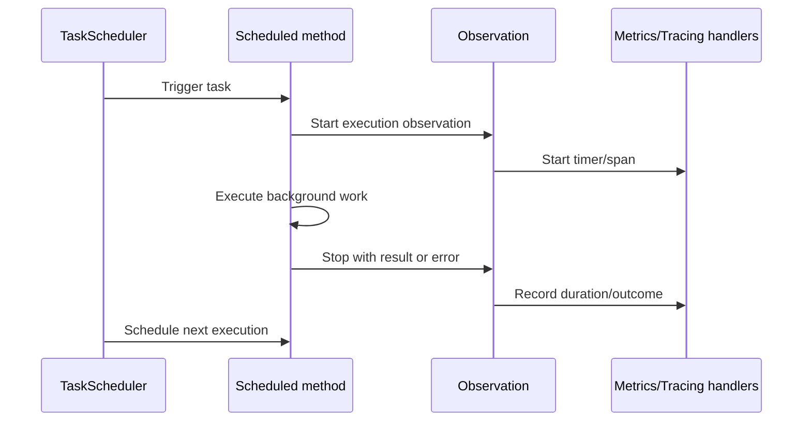
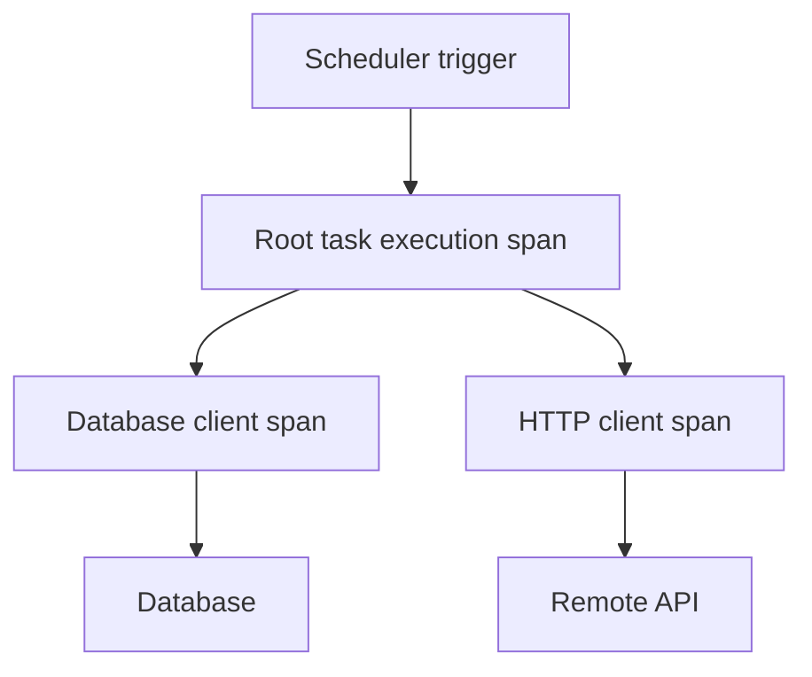

# tasks.scheduled.execution trong Spring Boot

Ứng dụng Spring Boot thường chạy công việc định kỳ như đồng bộ dữ liệu, dọn dẹp bản ghi hết hạn, làm mới cache, tổng hợp báo cáo hoặc kiểm tra dependency. Scheduled tasks không nằm trong vòng đời HTTP request thông thường, nhưng chúng tiêu thụ CPU, thread, database connections và tài nguyên hệ thống bên ngoài. Khi một lần chạy chậm, thất bại hoặc chồng lấn với lần kế tiếp, đội vận hành cần biết task nào chạy, mất bao lâu, kết quả ra sao và task được thực thi trên instance nào.

**tasks.scheduled.execution** là observation mô tả một lần thực thi scheduled task. Nó giúp ghi nhận lifecycle bắt đầu/kết thúc, thời lượng, outcome và lỗi. Trong Spring Boot, scheduling có thể được kích hoạt bằng @EnableScheduling và khai báo lịch qua @Scheduled; scheduler thực thi method trên thread được quản lý. Observation có thể được tạo tự động ở một số integration/version hoặc cần instrumentation bổ sung tùy stack. Không nên giả định @Scheduled tự động tạo đầy đủ metrics và spans trong mọi phiên bản.

Bài học thuộc chương **Messaging và task observability** của module **SPRING_BOOT_OBSERVABILITY**. Module hướng dẫn thiết lập observability cho Spring Boot bằng Micrometer Observation, metrics, logs và distributed tracing; học propagation ngữ cảnh, tag/cardinality, exporter, sampling và liên kết tín hiệu để điều tra lỗi, độ trễ và hành vi ứng dụng trên môi trường thực. Bài này tập trung vào execution observation của scheduled tasks, cách đặt tên, đo duration/outcome và liên kết log/trace cho background work.

## Mục tiêu học tập

1. Giải thích scheduled task execution và phân biệt với HTTP request/message consumption.
2. Mô tả lifecycle của một lần chạy @Scheduled task.
3. Hiểu vai trò TaskScheduler, scheduler thread và executor.
4. Thiết kế observation name, task identity và low-cardinality dimensions ổn định.
5. Đo execution count, duration, success/failure và task lag.
6. Tạo Observation/metrics/tracing khi framework không tự instrument.
7. Xử lý exception, retry, overlap và concurrency.
8. Hiểu trace context của background task và cách tạo root/linked span.
9. Kiểm thử schedule execution, failure, cancellation và shutdown.
10. Vận hành scheduled tasks với dashboard, alert và runbook.

## 1. Scheduled task execution là gì?

Scheduled task là công việc được kích hoạt theo lịch hoặc thời điểm định kỳ. Spring scheduling thường sử dụng @Scheduled trên bean method. Trigger có thể dựa trên fixed rate, fixed delay hoặc cron expression.

- **fixedRate:** lần chạy tiếp theo được lên lịch theo nhịp thời gian tính từ thời điểm bắt đầu lần trước; scheduler/thread availability và execution model ảnh hưởng thời điểm thực tế.
- **fixedDelay:** khoảng delay được tính sau khi lần chạy trước hoàn tất.
- **cron:** lịch chạy theo biểu thức thời gian và timezone đã cấu hình.
- **one-time scheduling:** task được lên lịch một lần qua scheduler API.

Observation nên đại diện cho **một lần thực thi**, không chỉ sự tồn tại của method hoặc lịch cấu hình. Một task chạy mỗi phút sẽ tạo nhiều execution observations, mỗi observation có duration và outcome riêng.



### 1.1. Schedule time và execution time

Cần phân biệt thời điểm task dự kiến chạy với thời điểm thực tế bắt đầu. Scheduler có thể bị trễ vì thread bận, JVM pause, CPU contention hoặc task khác chiếm worker. Chỉ đo duration của method chưa cho biết task có bắt đầu đúng lịch không.

Nếu lịch quan trọng, ghi thêm scheduled time và actual start time theo cách có cardinality thấp; từ đó tính scheduling lag. Không gắn timestamp cụ thể làm metric tag.

### 1.2. Execution duration

Execution duration đo thời gian task thực sự chạy từ lúc bắt đầu tới lúc kết thúc. Nó có thể gồm SQL, HTTP calls, lock waits, computation và sleep. Để tìm nguyên nhân, cần trace spans hoặc metrics riêng cho dependency operations bên trong task.

## 2. Spring scheduling runtime

Kích hoạt scheduling:

```java
@Configuration
@EnableScheduling
class SchedulingConfiguration {
}
```

Khai báo task:

```java
@Component
class CacheRefreshJob {

    @Scheduled(fixedDelayString = "60000")
    void refresh() {
        // Refresh dữ liệu cache.
    }
}
```

Nếu không cấu hình TaskScheduler rõ ràng, Spring có thể chọn scheduler mặc định tùy môi trường/version. Để quản lý thread pool, error handling và lifecycle, cấu hình scheduler bean tường minh khi workload yêu cầu.

### 2.1. Thread scheduling và concurrency

Scheduler một thread có thể chạy tuần tự các task; một task chậm có thể trì hoãn task khác. Scheduler nhiều thread cho phép nhiều executions đồng thời, nhưng cũng có thể khiến cùng loại task overlap nếu lịch/trigger và execution model cho phép.

Không suy luận concurrency chỉ từ cron/fixedRate. Xác minh TaskScheduler thực tế, thread pool size, trigger semantics và execution duration.

### 2.2. Fixed rate, fixed delay và overlap

Fixed delay thường đợi lần chạy trước hoàn tất rồi mới tính delay cho lần kế tiếp trong cùng scheduled execution. Fixed rate hướng tới nhịp thời gian cố định; nếu task chạy lâu hơn chu kỳ, scheduler implementation có thể làm lần chạy trễ hoặc overlap tùy scheduling model/cấu hình. Với nhiều application replicas, cùng @Scheduled method có thể chạy trên mỗi replica.

Nếu công việc chỉ được phép chạy một lần toàn cluster, cần distributed coordination/leader election/lock phù hợp. Observation chỉ giúp nhìn thấy overlap; nó không ngăn overlap.

## 3. Định danh scheduled task

Một observation cần tên ổn định để phân biệt task. Ví dụ:

```text
cache.refresh
orders.expire
report.daily.aggregate
inventory.reconcile
partner.catalog.sync
```

Tránh dùng instance ID, thời gian chạy, cron timestamp hoặc dữ liệu đầu vào động làm observation name.

### 3.1. Task identity và instance identity

Task name mô tả loại công việc. Service name/version mô tả ứng dụng phát telemetry. Instance ID có thể giúp biết pod/host nào chạy task, nhưng chỉ nên là resource attribute theo chuẩn deployment; không trộn vào task name hoặc metric tag nếu tạo cardinality không cần thiết.

### 3.2. Schedule metadata

Có thể ghi schedule type như fixed-delay, fixed-rate hoặc cron nếu tập giá trị nhỏ. Không ghi cron expression động thành metric tag nếu cấu hình thay đổi theo tenant hoặc không giới hạn. Schedule expression có thể là config metadata trong log/tracing khi cần chẩn đoán.

## 4. Observation name và key-values

| Thành phần | Ví dụ | Mục đích |
|---|---|---|
| Observation name | tasks.scheduled.execution | Loại operation ổn định |
| Task name | cache.refresh | Phân biệt logical task |
| Scheduler type | thread-pool | Nhóm runtime |
| Outcome | success, failure | Kết quả thực thi |
| Exception | IllegalStateException | Loại lỗi đã giới hạn |
| Duration | 420 ms | Thời gian thực thi |
| Instance/resource | service, pod | Nguồn telemetry |

Tên convention chính xác tùy framework/integration. Nếu dùng tasks.scheduled.execution, giữ nhất quán qua metrics và tracing.

### 4.1. Low-cardinality keys

Giá trị phù hợp cho metrics tags thường là task name từ allowlist, outcome, scheduler pool name ổn định và exception class đã giới hạn. Tránh task input, customer ID, file path, tenant ID, exception message hoặc execution timestamp.

### 4.2. High-cardinality context

Trace attributes/log fields có thể giữ execution ID hoặc correlation ID khi có nhu cầu và policy cho phép. Những giá trị này không nên thành meter tags. Định vị một lần chạy cụ thể bằng trace ID hoặc log field thay vì tạo time series cho mỗi execution.

## 5. Tự instrument scheduled task bằng Micrometer Observation

Nếu Spring/framework version không tự tạo observation cho scheduled method, có thể bọc phần thực thi bằng Observation API:

```java
@Component
class CatalogSyncJob {
    private final ObservationRegistry observationRegistry;
    private final CatalogService catalogService;

    CatalogSyncJob(
            ObservationRegistry observationRegistry,
            CatalogService catalogService) {
        this.observationRegistry = observationRegistry;
        this.catalogService = catalogService;
    }

    @Scheduled(cron = "0 */5 * * * *")
    void sync() {
        Observation.createNotStarted(
                        "tasks.scheduled.execution",
                        observationRegistry)
                .lowCardinalityKeyValue("task.name", "catalog.sync")
                .observe(catalogService::synchronize);
    }
}
```

Observation API quản lý start/stop quanh callback; handlers đã đăng ký có thể tạo metrics/tracing. Tùy version, contextual name, error handling hoặc convention API có thể khác. Không tạo ObservationRegistry rỗng mới; inject registry đã được Spring Boot cấu hình.

### 5.1. Ghi exception

Observation.observe callback có thể đánh dấu error khi exception thoát khỏi callback và ném lại cho caller. Nếu catch exception bên trong callback rồi return bình thường, handler có thể thấy execution thành công. Nếu task có retry/fallback, định nghĩa rõ outcome của từng attempt và logical execution.

### 5.2. Tránh double instrumentation

Nếu framework hoặc agent đã tạo scheduled execution observation/span, bọc thêm observation cùng mục đích có thể tạo duplicate timers/spans. Kiểm tra meter và trace hiện có trước khi thêm custom instrumentation.

## 6. Duration, count và outcome

Metrics cho scheduled task nên trả lời: task chạy bao nhiêu lần, duration phân phối ra sao, tỷ lệ failure, task nào chưa chạy đúng lịch và executions nào đang chạy quá lâu/overlap.

Timer theo task name/outcome có thể cung cấp count và duration:

```text
tasks.scheduled.execution{
  task_name="catalog.sync",
  outcome="success"
}
```

Tên meter và tag mapping tùy convention/registry. Nếu timer chỉ ghi khi task hoàn tất, executions đang chạy chưa được phản ánh vào count/duration cho tới khi kết thúc. Có thể cần gauge/in-progress counter riêng để theo dõi concurrent executions.

### 6.1. Success không luôn là business success

Method có thể kết thúc bình thường nhưng bỏ qua một phần dữ liệu hoặc trả kết quả partial. Xác định outcome theo contract của task. Ví dụ success, partial, skipped và failure hữu ích nếu tập giá trị nhỏ, ổn định và được định nghĩa rõ.

### 6.2. Duration không đo scheduling lag

Task có thể chạy trong 100 ms nhưng bắt đầu trễ 10 phút. Nếu freshness/deadline quan trọng, đo thêm scheduling lag hoặc last-success timestamp bằng gauge/timestamp metric. Không dùng raw timestamp làm tag.

## 7. Scheduler pool và thread observability

TaskScheduler có thể dùng thread pool. Cần quan sát pool size, active scheduler threads, queue size nếu implementation hỗ trợ, task duration, scheduling lag, rejected executions và thread saturation/JVM CPU/GC pause.

Nếu scheduler có một thread và task A gọi dependency chậm, task B có thể trễ dù B không có lỗi riêng. Thread pool metrics giúp phát hiện contention ở scheduler layer.

### 7.1. Tách scheduler workload

Task chạy lâu hoặc blocking không nên chiếm thread pool nhỏ dùng cho task ngắn cần đúng lịch. Có thể cấu hình nhiều scheduler/pool theo workload class, với tên ổn định để metrics phân biệt. Không tạo pool riêng cho từng task nếu chi phí thread/resource vượt lợi ích.

### 7.2. Blocking và reactive work

Nếu scheduled method khởi tạo reactive publisher nhưng không subscribe, công việc có thể không chạy. Nếu subscribe fire-and-forget rồi method return ngay, observation bao quanh method có thể kết thúc trước reactive work. Cần quản lý lifecycle để observation bao trùm execution thực tế hoặc tạo observation trong reactive pipeline.

## 8. Error handling, retry và idempotency

Scheduled task thường chạy lại theo lịch, vì vậy một execution failure không nhất thiết dừng lịch. Spring scheduler có error handling behavior tùy cấu hình; cần quyết định exception được log, propagate hay xử lý bên trong method.

- Ghi error một lần tại boundary chịu trách nhiệm.
- Phân biệt attempt failure với logical task failure.
- Retry có giới hạn, backoff và jitter khi phù hợp.
- Không retry lỗi permanent như invalid configuration hoặc schema mismatch.
- Task phải idempotent nếu cùng input/window có thể được xử lý lại.
- Lưu checkpoint/watermark để tránh bỏ sót hoặc xử lý trùng.

### 8.1. Observation cho retry

Nếu một lần chạy thử 3 lần, có thể có observation ngoài cho logical execution và child observations cho từng attempt. Điều này giúp thấy tổng thời gian và từng dependency call. Đặt attempt number ở trace/log context; không thêm nó làm metric tag nếu tạo nhiều series.

### 8.2. Không nuốt exception

Nếu catch và chỉ log lỗi rồi return bình thường, scheduler và observation có thể coi execution hoàn tất thành công. Nếu policy yêu cầu failure phải được nhìn thấy, hãy ghi outcome/error rõ ràng hoặc ném lại exception theo semantics scheduler. Nếu task chủ động xử lý partial failure, biểu diễn outcome riêng.

## 9. Concurrency, overlap và distributed lock

Trong một instance, pool nhiều thread có thể chạy nhiều scheduled methods đồng thời. Trên nhiều replicas, mỗi replica thường có scheduler riêng nên cùng lịch có thể kích hoạt task trên tất cả replicas.

Nếu task chỉ được chạy một lần toàn cluster, dùng cơ chế coordination phù hợp như database lock, scheduler cluster hoặc leader election. Khi có lock, đo thời gian chờ lock, ghi outcome skipped/lock-not-acquired, đo duration sau khi lấy lock và quản lý lease/TTL/renewal.

Observation không thay thế distributed lock và không đảm bảo exactly-once execution. Hệ thống phân tán thường cần idempotency và checkpoint để xử lý retry/crash an toàn.

## 10. Trace context cho background task

Scheduled task không bắt đầu từ inbound HTTP request, nên thường không có parent request span. Một execution có thể tạo root trace mới với span đại diện scheduled task. Nếu task được kích hoạt bởi message/event hoặc business workflow có trace context, có thể tiếp tục context hoặc tạo span link tùy quan hệ causal.



Không dùng trace ID cố định cho mọi lần chạy cùng task. Mỗi execution độc lập thường cần trace identity riêng.

### 10.1. Task tạo child spans

Database/HTTP operations trong task có thể trở thành child spans của task execution span nếu current context được giữ. Trace tree giúp phân tích một lần chạy gồm những dependency calls nào.

### 10.2. Async boundaries

Nếu scheduled method submit công việc vào executor rồi return, task observation có thể kết thúc quá sớm. Có hai cách: chờ công việc hoàn tất trong scope hiện tại, hoặc tạo observation/span riêng bên trong worker cho execution thực tế. Propagate context qua executor nếu cần giữ causal relationship.

### 10.3. Task dài và trace volume

Task có thể chạy nhiều giờ hoặc tạo nhiều spans. Cân nhắc span lifecycle, event volume, sampling và trace size. Với batch lớn, tạo span theo batch/chunk thay vì mỗi record để tránh trace quá lớn.

## 11. Liên kết logs và metrics

Log cho scheduled execution nên có event name ổn định, task name, outcome, duration, instance/resource context và trace/span ID nếu có. Không log toàn bộ input batch hoặc credentials.

```json
{
  "event.name": "tasks.scheduled.execution.completed",
  "task.name": "catalog.sync",
  "outcome": "success",
  "duration_ms": 420,
  "trace_id": "0af7651916cd43dd8448eb211c80319c",
  "span_id": "b7ad6b7169203331"
}
```

Metrics theo dõi count/duration/failure theo task. Logs giải thích một execution cụ thể. Traces mô tả timeline và dependency calls. Không thêm execution ID hoặc trace ID vào metric tags.

## 12. Kiểm thử scheduled task observation

Tách task logic khỏi trigger để có thể gọi method/service trực tiếp thay vì chờ cron nhiều phút.

1. **Success:** observation bắt đầu/kết thúc và duration được ghi.
2. **Failure:** exception được đánh dấu error và outcome phù hợp.
3. **Retry:** logical execution và từng attempt được phân biệt.
4. **Overlap:** task chạy lâu hơn chu kỳ; kiểm tra concurrency behavior.
5. **Scheduler saturation:** một task block; quan sát lag của task khác.
6. **Multi-instance:** hai instances cùng lịch; xác minh lock/coordination nếu cần.
7. **Async:** task submit executor; observation bao trùm đúng công việc.
8. **Shutdown:** ứng dụng dừng khi task đang chạy; xác minh interruption/cancellation policy.

### 12.1. Dùng ObservationRegistry test

Có thể dùng test ObservationHandler hoặc in-memory MeterRegistry để xác minh tên observation và low-cardinality keys. Với tracing, dùng test span exporter để assert root/child spans và status. Test metric không thay thế test trace propagation.

### 12.2. Điều khiển scheduler

Trong integration test, dùng scheduler test/deterministic hoặc trigger task qua method invocation có kiểm soát. Không dùng Thread.sleep dài để đợi lịch. Nếu test scheduler lifecycle, dùng latch/future với timeout hữu hạn.

## 13. Chẩn đoán scheduled task bất thường

| Triệu chứng | Nguyên nhân có thể | Cách kiểm tra |
|---|---|---|
| Task chạy nhưng không có metrics | Chưa có observation instrumentation/handler | ObservationRegistry và meter registry |
| Có metrics nhưng không span | Tracing handler/bridge không active | Tracer và exporter |
| Duration thấp nhưng task trễ lịch | Scheduler lag/thread starvation | Scheduler pool, queue, JVM pauses |
| Task không chạy ở một replica | Scheduling chưa enable hoặc bean/profile khác | Application context và scheduler logs |
| Task chạy trên mọi replicas | Mỗi instance có scheduler riêng | Replica count và coordination |
| Executions overlap | Pool nhiều thread hoặc nhiều replicas | Active executions, lock, schedule semantics |
| Observation kết thúc trước async work | Method submit rồi return | Worker lifecycle/context |
| Failure không được ghi | Exception bị catch/nuốt | Error handling/outcome mapping |
| Trace quá lớn | Span cho từng record hoặc task quá dài | Batch/chunk instrumentation và sampling |
| Metrics cardinality tăng | Task name/exception/tenant động | Tag values và allowlist |
| Task B bị trễ sau task A | Scheduler thread bị block | Thread dump, pool size, execution duration |
| Lock timeout tăng | Distributed lock contention | Lock metrics/lease và owner logs |

### Quy trình điều tra

1. Xác định task name, cron/fixedRate/fixedDelay và timezone.
2. Kiểm tra scheduled bean được khởi tạo và trigger.
3. Xem last execution, duration, outcome và scheduling lag.
4. Kiểm tra scheduler thread pool, queue và rejected tasks.
5. Đọc exception logs và trace của execution.
6. Kiểm tra database/HTTP child spans và dependency latency.
7. Kiểm tra overlap giữa executions và số replicas.
8. Kiểm tra distributed lock/lease nếu task cluster-wide.
9. Xác minh async/reactive work không làm observation kết thúc sớm.
10. Kiểm tra sampling/export riêng nếu trace không xuất hiện ở backend.

## 14. Các anti-pattern cần tránh

| Anti-pattern | Hậu quả | Cách phù hợp |
|---|---|---|
| Nghĩ @Scheduled tự động tạo observation mọi version | Thiếu metrics/spans | Kiểm tra integration và instrument khi cần |
| Dùng task input làm metric tag | Cardinality explosion | Task name allowlist |
| Dùng execution timestamp làm tag | Mỗi lần chạy tạo series mới | Timestamp field/log hoặc gauge |
| Catch exception rồi return bình thường | Failure bị ghi thành success | Error/outcome semantics rõ |
| Submit async rồi kết thúc observation | Duration đo thời gian submit | Observation trong worker hoặc chờ completion |
| Dùng scheduler một thread cho task blocking dài | Task khác bị trễ | Pool/workload isolation |
| Tăng thread pool mà không kiểm tra overlap | Concurrent duplicate executions | Coordination/idempotency |
| Cho rằng @Scheduled chạy một lần toàn cluster | Mỗi replica có thể chạy task | Distributed lock/leader election |
| Tạo span cho từng row trong batch lớn | Trace quá lớn và tốn chi phí | Span theo batch/chunk |
| Dùng trace count làm task execution count | Sampling làm sai số liệu | Metrics độc lập với trace sampling |
| Không tính scheduling lag | Bỏ sót task chạy trễ | Đo scheduled vs actual start |
| Nuốt lỗi retry cuối cùng | Dashboard báo task thành công giả | Mark failure sau retry exhaustion |

## 15. Checklist production cho scheduled tasks

1. **Identity:** mỗi task có tên ổn định, không chứa input động?
2. **Trigger:** cron/timezone/fixedRate/fixedDelay được cấu hình rõ?
3. **Runtime:** scheduler thread pool, queue và lifecycle được quan sát?
4. **Observation:** mỗi execution có observation đúng boundary?
5. **Metrics:** count, duration, outcome và in-progress/lag cần thiết được ghi?
6. **Cardinality:** task name/outcome/exception dimensions có tập giá trị giới hạn?
7. **Errors:** exception không bị nuốt; retry cuối cùng phản ánh failure?
8. **Concurrency:** overlap behavior được xác định?
9. **Cluster:** task cần chạy một lần toàn cluster có lock/leader election?
10. **Idempotency:** execution lặp/crash/retry không gây side effects sai?
11. **Async:** observation/span bao trùm công việc thực tế?
12. **Tracing:** background execution có root/linked trace phù hợp?
13. **Logs:** event/task/outcome/trace context hữu ích, không lộ input nhạy cảm?
14. **Dependencies:** DB/HTTP child operations được instrument?
15. **Shutdown:** cancellation/interruption và in-flight task được xử lý?
16. **Alerts:** task fail, không chạy, chạy trễ, duration tăng và overlap được phát hiện?
17. **Testing:** success/failure/retry/overlap/saturation/multi-instance được kiểm thử?
18. **Capacity:** task runtime và concurrency phù hợp database/API quotas?

## 16. Câu hỏi tự đánh giá

**Câu 1.** Observation tasks.scheduled.execution đại diện điều gì?

**Gợi ý:** Một lần thực thi scheduled task, gồm lifecycle, duration, outcome và error.

**Câu 2.** Khác nhau giữa fixedRate và fixedDelay là gì?

**Gợi ý:** Fixed rate hướng tới nhịp tính từ lần bắt đầu trước; fixed delay tính khoảng chờ sau khi lần chạy trước hoàn tất.

**Câu 3.** Vì sao duration không cho biết task có chạy đúng lịch?

**Gợi ý:** Duration chỉ đo thời gian thực thi; cần scheduling lag giữa scheduled time và actual start time.

**Câu 4.** Vì sao active connection tăng trong scheduled job có thể ảnh hưởng API?

**Gợi ý:** Background job có thể giữ database connections và cạnh tranh pool với HTTP requests.

**Câu 5.** Vì sao không dùng execution ID làm metric tag?

**Gợi ý:** Mỗi execution có ID riêng, tạo cardinality rất cao; giữ ID trong logs/traces.

**Câu 6.** @Scheduled trên nhiều replicas có chạy một lần toàn cluster không?

**Gợi ý:** Không. Mỗi instance có scheduler riêng; cần distributed coordination nếu chỉ một execution được phép chạy.

**Câu 7.** Vì sao catch exception rồi return có thể làm observation sai?

**Gợi ý:** Callback kết thúc bình thường nên handler có thể ghi success; cần thể hiện failure/partial outcome rõ.

**Câu 8.** Khi submit task sang executor rồi return, vấn đề observability là gì?

**Gợi ý:** Observation của method kết thúc trước worker; cần observation/span trong worker hoặc chờ completion.

**Câu 9.** Có nên tạo span cho mọi record trong batch?

**Gợi ý:** Thường không; trace có thể quá lớn. Dùng span theo batch/chunk và metrics cho từng record khi cần.

**Câu 10.** Cần kết hợp tín hiệu nào để điều tra scheduled task chậm?

**Gợi ý:** Task duration/lag metrics, scheduler pool/thread state, trace child spans, logs và database/HTTP dependency metrics.

## Kết luận

**tasks.scheduled.execution mô tả một lần chạy background task để đo thời lượng, kết quả và lỗi độc lập với HTTP request lifecycle.** Trong Spring Boot, @Scheduled xác định trigger, TaskScheduler quyết định execution thread và Micrometer Observation có thể tạo metrics/tracing khi được tích hợp hoặc instrument phù hợp. Hãy dùng task identity ổn định, đo duration lẫn scheduling lag, phân biệt logical execution với retry attempts, xử lý overlap/multi-replica bằng idempotency và coordination khi cần. Với async/reactive work, observation phải bao trùm đúng lifecycle thực tế. Kết hợp metrics, logs và trace child spans để biết task chạy trễ ở scheduler, chờ database, gọi HTTP dependency hay xử lý nghiệp vụ, đồng thời giữ cardinality và telemetry volume trong giới hạn.
