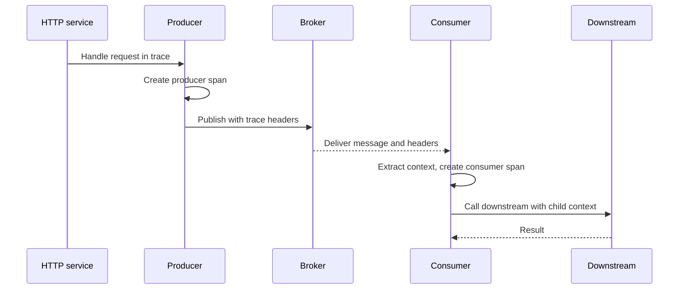
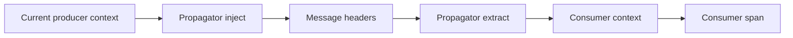

# Trace context qua message header trong Spring Boot

**Trace context qua message header** là cơ chế truyền ngữ cảnh distributed tracing từ producer sang consumer thông qua metadata của message. Khi một service publish message, tracing instrumentation có thể inject Trace ID, Span ID và sampling flags vào headers. Consumer extract metadata đó để tạo consumer span liên kết với trace ban đầu, giúp quan sát luồng xử lý xuyên qua broker và nhiều service.

Trong module **SPRING_BOOT_OBSERVABILITY**, trace context propagation nối HTTP, messaging, background tasks và database operations thành một distributed trace. Bài thuộc chương **Messaging và task observability**, tập trung vào W3C Trace Context, inject/extract qua Kafka/Rabbit headers, producer/consumer span relationships, tracestate/baggage, async context, retry/redelivery, bảo mật và kiểm thử.

## 1. Vì sao cần truyền trace context qua message?

Trong hệ thống đồng bộ, trace context thường được truyền qua HTTP headers như traceparent. Với messaging, producer và consumer không giao tiếp trực tiếp trong cùng một call stack. Message có thể nằm trong broker một khoảng thời gian, được xử lý bởi consumer khác, retry hoặc redeliver.

Nếu context không được truyền, trace có thể bị tách thành nhiều trace độc lập. Khi đó khó trả lời:
- Request HTTP ban đầu đã publish message nào?
- Consumer xử lý message đó mất bao lâu?
- Lỗi xảy ra khi publish, broker delivery hay consumer processing?
- Một message retry có thuộc cùng luồng nghiệp vụ không?
- Downstream database/API calls thuộc trace nào?

Trace context trong message headers cho phép liên kết các operation qua ranh giới bất đồng bộ. Nó không thay thế message ID, correlation ID hoặc business identifiers.

### 1.1. Luồng tổng quan



Producer và consumer thường chạy ở các process/thread khác nhau và không chia sẻ memory. Headers là carrier vận chuyển context qua broker.

## 2. W3C Trace Context cơ bản

W3C Trace Context định nghĩa các trường chuẩn để truyền tracing context qua các hệ thống. Hai header quan trọng là:

- **traceparent:** chứa version, Trace ID, Parent ID và trace flags.
- **tracestate:** mang vendor-specific tracing state theo định dạng chuẩn.

Ví dụ traceparent:

```text
00-4bf92f3577b34da6a3ce929d0e0e4736-00f067aa0ba902b7-01
```

Cấu trúc khái quát:

```text
version-trace-id-parent-id-trace-flags
```

Trace ID nhận diện trace xuyên hệ thống. Parent ID nhận diện span upstream mà operation hiện tại nối vào. Trace flags có thể chứa sampled bit. Giá trị trong ví dụ chỉ minh họa, không phải giá trị cố định.

### 2.1. Trace ID và Span ID khác nhau

- **Trace ID:** dùng chung cho các spans thuộc cùng trace.
- **Span ID:** định danh một operation cụ thể.
- **Parent Span ID:** chỉ ra operation cha trong quan hệ cây span.
- **Trace flags:** truyền thông tin điều khiển tracing theo protocol.

Khi producer tạo span mới, producer span có Span ID riêng. Consumer sau khi extract context tạo consumer span khác, nhưng giữ Trace ID theo propagation context.

### 2.2. Tracestate

tracestate cho phép tracing vendors truyền state bổ sung. Không tự phân tích hoặc viết lại tracestate nếu instrumentation đã quản lý. Giữ tuân thủ W3C format, giới hạn kích thước header và không đưa secrets/PII vào vendor state.

## 3. Inject và extract là hai thao tác riêng

**Inject** ghi context hiện tại vào carrier, trong trường hợp messaging là message headers. **Extract** đọc headers từ message nhận được và dựng context để consumer span tiếp tục trace.



Không copy nguyên object context của process này sang process khác. Chỉ truyền representation theo propagation protocol qua carrier được hỗ trợ.

### 3.1. TextMapPropagator và carrier

OpenTelemetry sử dụng propagator để inject/extract các key-value qua carrier. Với messaging, carrier adapter ánh xạ header API của broker vào interface mà propagator sử dụng.

Trong Java SDK, W3C Trace Context propagator thường được cấu hình trên OpenTelemetry instance. Instrumentation messaging tương ứng sẽ chịu trách nhiệm gọi inject/extract. Nếu tự viết carrier adapter, cần xử lý header names, encoding, duplicate values và giới hạn kích thước theo broker.

### 3.2. Không tự tạo Trace ID mới khi extract thất bại

Nếu message không có trace headers hoặc headers không hợp lệ, consumer thường bắt đầu trace mới hoặc xử lý trong context mặc định. Không tự đoán Trace ID từ message ID. Ghi nhận tình trạng propagation missing/invalid bằng metrics/logs có kiểm soát nếu cần.

## 4. Producer span và consumer span

Một message publish thường tạo producer span. Khi consumer nhận message, consumer span có thể tiếp tục trace qua parent context hoặc được liên kết bằng span link, tùy messaging semantic convention và instrumentation.

Các khái niệm:
- **Producer span:** mô tả thao tác gửi message.
- **Consumer span:** mô tả thao tác nhận/xử lý message.
- **Span link:** biểu diễn quan hệ giữa spans khi quan hệ parent-child không phản ánh đúng semantics hoặc có nhiều message contexts.
- **Trace ID:** liên kết các spans trong cùng trace nếu dùng parent continuation.

Không phải mọi messaging integration đều chọn cùng một parent/link strategy. Kiểm tra instrumentation version và OpenTelemetry messaging semantic conventions đang áp dụng.

### 4.1. Khi nào dùng parent-child?

Với một message được publish trong một request và được xử lý bởi một consumer, consumer span có thể tiếp tục context producer theo parent-child. Cách này phù hợp khi muốn biểu diễn processing như phần tiếp nối của trace.

### 4.2. Khi nào dùng span links?

Một consumer có thể nhận batch gồm nhiều messages, mỗi message mang một context khác nhau. Một span chỉ có một parent, nên span links có thể phù hợp hơn để liên kết với nhiều producer contexts. Một số messaging conventions cũng dùng links để mô tả asynchronous processing hoặc batch consumption.

Không tự tạo nhiều consumer spans chỉ để gắn từng parent nếu framework đã có semantics batch phù hợp. Kiểm tra conventions của instrumentation đang dùng.

## 5. Kafka message headers

Kafka record hỗ trợ headers dạng key-value bytes. Trace context thường được ghi vào headers như traceparent và tracestate theo propagator/instrumentation.

Ví dụ record concept:

```text
topic: orders.created
key: order-key
headers:
  traceparent: 00-4bf92f3577b34da6a3ce929d0e0e4736-00f067aa0ba902b7-01
  tracestate: vendor=value
value:
  { "eventType": "OrderCreated" }
```

Payload chỉ minh họa cấu trúc; trace metadata nằm trong headers, không cần nhúng vào business JSON.

### 5.1. Kafka producer instrumentation

Spring Kafka/Kafka client có instrumentation tùy version. Khi observation/tracing được bật và hỗ trợ, producer integration có thể inject context vào record headers. Nếu dùng KafkaProducer trực tiếp hoặc custom serializer/interceptor, xác minh instrumentation có hoạt động trên đường gửi thực tế.

Đừng giả định thêm Micrometer Tracing bridge là mọi KafkaTemplate/native producer đều tự inject headers ở mọi version. Kiểm tra configuration và message headers trong integration test.

### 5.2. Kafka consumer instrumentation

Consumer integration cần extract context từ record headers trước khi tạo consumer span và chạy handler. Nếu ứng dụng dùng batch listener, context strategy có thể khác với record listener. Kiểm tra Spring Kafka version, listener type và convention đang dùng.

## 6. RabbitMQ message headers

RabbitMQ AMQP message properties có phần headers, thường là bảng metadata. Trace context có thể được inject vào headers khi publish và extract khi consume.

Ví dụ concept:

```text
exchange: orders.exchange
routing-key: order.created
headers:
  traceparent: 00-4bf92f3577b34da6a3ce929d0e0e4736-00f067aa0ba902b7-01
  tracestate: vendor=value
```

RabbitMQ có thêm properties như correlationId, messageId và deliveryMode. Các trường này không tự động tương đương W3C Trace ID hoặc Span ID.

### 6.1. Spring AMQP integration

RabbitTemplate và listener container có thể được instrument theo Spring AMQP/Micrometer version. Xác minh template/listener observation configuration và propagation support của version đang dùng.

Nếu tự dùng MessagePostProcessor hoặc custom converter, đảm bảo không xóa headers được tracing instrumentation inject. Khi nhận message, giữ nguyên metadata qua conversion và mapping.

## 7. Spring Boot và Micrometer Tracing integration

Spring Boot có thể cấu hình ObservationRegistry, Micrometer Tracing bridge và propagators. Messaging integration cụ thể phụ thuộc Spring Kafka, Spring AMQP, Micrometer và OpenTelemetry bridge version.

Một checklist tích hợp:
1. Chọn đúng messaging stack và dependency version.
2. Xác định producer/consumer instrumentation có hỗ trợ observation/tracing.
3. Cấu hình tracing bridge và propagator.
4. Bật observation theo API/property của integration version.
5. Kiểm tra header inject ở producer.
6. Kiểm tra header extract ở consumer.
7. Xác nhận producer/consumer spans có quan hệ đúng.
8. Kiểm tra exporter/Collector/backend.

Không tự tạo thêm interceptor/Observation nếu integration mặc định đã inject/extract. Điều đó có thể gây duplicate spans hoặc ghi header hai lần.

### 7.1. W3C propagator trong OpenTelemetry SDK

Nếu ứng dụng tự quản lý OpenTelemetry SDK, có thể cấu hình W3C Trace Context propagator:

```java
OpenTelemetrySdk openTelemetry =
        OpenTelemetrySdk.builder()
                .setTracerProvider(tracerProvider)
                .setPropagators(
                        ContextPropagators.create(
                                W3CTraceContextPropagator.getInstance()))
                .build();
```

Ví dụ cấu hình SDK tổng quát. Trong Spring Boot-managed setup, không tạo OpenTelemetrySdk thứ hai chỉ để cấu hình propagator; dùng extension point/auto-configuration mà version đó hỗ trợ.

### 7.2. Micrometer Context Propagation

Messaging callback có thể chạy trên thread khác với producer request. Micrometer Context Propagation hỗ trợ bridge context giữa các context mechanisms; messaging instrumentation phải capture context lúc publish và restore/extract context ở consumer theo protocol.

Không dựa vào ThreadLocal được giữ xuyên broker. Broker chỉ vận chuyển message metadata; context runtime phải được tái tạo ở process nhận.

## 8. Baggage qua message headers

Baggage là key-value context được truyền cùng trace context. Nó hữu ích cho metadata cần đi qua nhiều service, nhưng có thể làm tăng header size và mang dữ liệu nhạy cảm.

Chỉ propagate baggage fields được allowlist, ví dụ:
- Tenant class hoặc region code có tập giá trị hữu hạn, nếu policy cho phép.
- Một correlation hint không nhạy cảm và có giới hạn.
- Metadata phục vụ routing/diagnostic đã được thiết kế rõ.

Không propagate:
- Access token/API key.
- Email, số điện thoại, địa chỉ.
- Raw user/customer identifiers không cần thiết.
- Dữ liệu authorization hoặc role để consumer tin cậy.
- Raw request headers hoặc toàn bộ baggage từ client.

Baggage là metadata truyền theo context, không phải cơ chế authorization. Consumer phải xác thực/ủy quyền theo nguồn tin cậy riêng.

## 9. Header size, encoding và compatibility

Broker/client có giới hạn về kích thước message/header hoặc frame. Tracestate và baggage có thể làm tăng tổng metadata. Cần:
- Giữ số baggage fields nhỏ.
- Giới hạn độ dài value.
- Không serialize object lớn vào một header.
- Tránh header names trùng với business metadata.
- Kiểm tra encoding/byte conversion.
- Kiểm tra broker quotas và maximum message/header size.

W3C traceparent có format chuẩn. Tránh sửa chữ hoa/thường, separator hoặc byte encoding theo cách làm propagator không parse được. Header names có thể được broker chuẩn hóa; adapter cần tuân thủ API broker.

## 10. Retry, redelivery và batch consumption

Messaging không đồng nghĩa mỗi message chỉ được xử lý đúng một lần. Consumer có thể retry, redeliver, requeue hoặc đưa message vào dead-letter queue.

Trace topology cần phản ánh semantics:
- Một producer publish tạo context ban đầu.
- Mỗi delivery attempt có thể tạo consumer span/attempt span riêng.
- Retry có thể tạo spans mới, liên kết với context gốc hoặc lần xử lý trước theo integration.
- DLQ routing có thể là operation publish khác.
- Batch consumer có thể liên kết nhiều producer contexts.

Không tái sử dụng cùng một mutable span/observation qua nhiều delivery attempts. Mỗi attempt là một operation riêng. Giữ message headers gốc nếu retry semantics yêu cầu context ban đầu, đồng thời có thể thêm metadata attempt đã chuẩn hóa.

### 10.1. Redelivery không phải producer retry

Producer retry là client gửi lại khi publish chưa được xác nhận theo policy. Consumer redelivery là broker gửi lại message chưa được ack hoặc được requeue. Hai quá trình có telemetry khác nhau; không gộp thành một retry counter.

### 10.2. Dead-letter queue

Khi message bị đưa vào DLQ, giữ context gốc nếu cần điều tra nhưng không copy tùy tiện toàn bộ baggage/headers không tin cậy. DLQ consumer có thể tạo span mới và link tới context producer/consumer ban đầu theo convention phù hợp.

## 11. Security và trust boundary

Message headers có thể được gửi bởi service nội bộ, external producer hoặc client không tin cậy nếu broker access bị mở rộng. Không coi trace context là bằng chứng danh tính.

Nguyên tắc:
- Không dùng Trace ID/Span ID để cấp quyền.
- Không dùng baggage để quyết định tenant authorization.
- Validate/limit header size và value length.
- Allowlist baggage fields.
- Không ghi toàn bộ headers vào logs.
- Không đưa secrets/PII vào tracestate hoặc baggage.
- Bảo vệ broker authentication và authorization độc lập.
- Kiểm soát message retention và dead-letter storage.

Trace context có thể bị giả mạo bởi producer không tin cậy. Backend tracing nên được bảo vệ và không được dùng trace metadata làm input bảo mật.

## 12. Kiểm thử trace propagation qua message headers

Kiểm thử phải chứng minh cả inject lẫn extract. Unit test của business handler không chứng minh broker giữ headers qua đường truyền thực tế.

### 12.1. Producer test

Gửi message qua producer integration và kiểm tra record/message headers chứa traceparent hợp lệ khi có active span. Xác nhận tracestate/baggage chỉ có fields được phép.

### 12.2. Consumer test

Đưa message có traceparent vào consumer và xác minh consumer span giữ Trace ID mong đợi, parent/link theo instrumentation convention. Thử message không có header và header không hợp lệ.

### 12.3. Broker integration test

Dùng Kafka/RabbitMQ test broker hoặc Testcontainers phù hợp để xác nhận:
- Header được broker giữ nguyên.
- Consumer nhận đúng bytes/values.
- Conversion/serializer không làm mất headers.
- Retry/redelivery giữ context theo policy.
- Batch consumption liên kết contexts đúng.
- Header limits không bị vượt.

### 12.4. Test privacy

Gửi message có baggage field không được allowlist và xác minh nó không được propagate. Kiểm tra logs không dump Authorization, Cookie hoặc toàn bộ headers.

## 13. Troubleshooting trace context propagation

| Triệu chứng | Nguyên nhân có thể | Cách kiểm tra |
| --- | --- | --- |
| Producer span có nhưng headers thiếu traceparent | Producer instrumentation chưa inject hoặc custom code ghi đè headers | Kiểm tra integration/config và record headers |
| Consumer tạo trace mới | Extractor không chạy hoặc header bị mất/invalid | Kiểm tra headers sau broker và consumer instrumentation |
| Producer/consumer Trace ID khác nhau | Context không propagate hoặc consumer tạo root span | So sánh traceparent inject/extract và sampler |
| Trace ID giống nhưng quan hệ span sai | Parent/link strategy hoặc span context sai | Kiểm tra semantic convention và span links |
| Tracestate mất | Propagator không cấu hình hoặc broker header adapter lỗi | Kiểm tra propagator và header conversion |
| Baggage quá lớn | Propagate quá nhiều fields/value | Allowlist và giới hạn header size |
| Trace bị duplicate | Auto instrumentation và custom interceptor cùng inject/create span | Kiểm tra instrumentation ownership |
| Retry có cùng span ID | Tái sử dụng span/observation qua nhiều attempts | Tạo operation/span riêng cho mỗi attempt |
| Batch consumer chỉ có một parent không phù hợp | Nhiều message contexts nhưng mô hình parent-child đơn | Kiểm tra span links/batch convention |
| Callback logs thiếu Trace ID | Async context không được restore | Kiểm tra context propagation trong callback |
| Header value bị lỗi encoding | Chuyển string/bytes không nhất quán | Kiểm tra broker API và carrier adapter |
| DLQ không liên kết trace gốc | Header bị loại khi republish | Kiểm tra DLQ republish logic |
| Metadata nhạy cảm xuất hiện | Baggage/header không được lọc | Allowlist và redact tại nguồn |

### Quy trình điều tra

1. Xác định messaging technology và integration version.
2. Gửi message từ một request có active trace.
3. Kiểm tra raw traceparent/tracestate ở producer record trước publish.
4. Đọc headers sau khi broker nhận và consumer nhận.
5. Xác minh consumer instrumentation extract context trước handler.
6. So sánh Trace ID, parent Span ID và links trong backend.
7. Kiểm tra retry/redelivery/batch semantics.
8. Kiểm tra async callback và Reactor Context nếu có.
9. Rà soát baggage, header size và sensitive metadata.
10. Kiểm tra exporter/sampling riêng nếu spans không xuất hiện.

## 14. Bài thực hành: nối trace qua Kafka hoặc RabbitMQ

Mục tiêu là tạo một trace bắt đầu từ HTTP request, publish message và tiếp tục ở consumer.

### Chuẩn bị

- Spring Boot producer và consumer applications.
- Kafka hoặc RabbitMQ lab broker.
- Micrometer Tracing bridge và exporter/test exporter.
- Messaging integration có hỗ trợ observation/propagation theo version.
- Backend trace hoặc in-memory exporter.

### Bước 1 — Instrument HTTP entry point

Gửi HTTP request tới producer service và xác nhận server span được tạo.

### Bước 2 — Bật producer observation

Bật observation/tracing theo integration version. Publish message trong active request context.

### Bước 3 — Kiểm tra headers trước broker

Xác minh traceparent được inject vào message headers. Ghi lại Trace ID và producer Span ID để đối chiếu.

### Bước 4 — Gửi qua broker

Publish message tới topic/queue test. Xác nhận broker nhận message và giữ headers.

### Bước 5 — Bật consumer instrumentation

Cấu hình consumer integration để extract context. Khi message được xử lý, xác nhận consumer span được tạo.

### Bước 6 — Kiểm tra trace topology

Trong backend, xác nhận Trace ID liên tục và parent/link relationship đúng theo instrumentation semantics. Không chỉ dựa trên timestamp.

### Bước 7 — Thử message không có context

Gửi message không có trace headers. Xác nhận consumer xử lý được và tạo trace mới/default context theo policy.

### Bước 8 — Thử retry/redelivery

Tạo lỗi có kiểm soát để broker redeliver hoặc consumer retry. Xác nhận mỗi attempt có span riêng và context gốc được giữ/link đúng.

### Bước 9 — Thử baggage allowlist

Gửi baggage field được phép và một field không được phép. Xác nhận chỉ field allowlist được truyền.

### Bước 10 — Kiểm tra privacy và header limits

Xác nhận không có token/PII trong headers và tổng metadata nằm trong giới hạn broker/client.

### Checklist nghiệm thu

| Điều cần chứng minh | Kết quả mong đợi |
| --- | --- |
| Protocol | Hiểu traceparent/tracestate |
| Inject | Producer ghi trace context vào headers |
| Extract | Consumer dựng context từ headers |
| Trace ID | Producer và consumer liên kết đúng |
| Parent/link | Quan hệ spans phù hợp single/batch message |
| Kafka/Rabbit | Headers được broker giữ và chuyển tiếp |
| Async | Context đúng trong callback/consumer thread |
| Retry | Mỗi attempt có operation/span phù hợp |
| Baggage | Chỉ propagate fields được allowlist |
| Security | Trace metadata không dùng làm authorization |
| Privacy | Không có secrets/PII trong headers |
| Export | Sampling/exporter không bị nhầm với propagation |

## 15. Những nguyên tắc cần ghi nhớ

1. **Trace context qua message headers nối producer và consumer qua broker.** Payload business không cần chứa Trace ID.
2. **W3C traceparent mang Trace ID, parent Span ID và flags; tracestate mang vendor state.** Giữ đúng format chuẩn.
3. **Inject và extract là hai bước riêng.** Kiểm tra headers trước publish, sau broker và tại consumer.
4. **Producer acknowledgement không đồng nghĩa consumer đã xử lý.** Trace topology phải thể hiện đúng các mốc messaging.
5. **Parent-child và span links có semantics khác nhau.** Batch consumption hoặc async processing có thể cần links.
6. **Kafka và RabbitMQ có header APIs/integration khác nhau.** Xác minh version, serializer/converter và auto instrumentation.
7. **Reactor Context/async context cần được khôi phục ở callback và consumer.** Không dựa vào ThreadLocal xuyên process.
8. **Retry, redelivery và DLQ là các operation riêng.** Không tái sử dụng một span mutable cho nhiều attempts.
9. **Baggage không phải authorization.** Chỉ propagate fields được allowlist và không chứa secrets/PII.
10. **Giữ header size và cardinality có kiểm soát.** Không dùng message ID, user ID hoặc raw payload làm metric tags.
11. **Xác minh end-to-end.** Producer span, broker headers, consumer span, exporter và backend đều cần được kiểm tra riêng.

Trace context qua message headers cho phép distributed tracing đi qua ranh giới bất đồng bộ của Kafka, RabbitMQ và các hệ thống messaging khác. Khi inject/extract đúng protocol, chọn parent/link semantics phù hợp, giữ context qua callback và kiểm soát baggage, nhóm vận hành có thể lần theo message từ request ban đầu đến consumer processing mà vẫn bảo vệ metadata và giữ telemetry có ý nghĩa.
