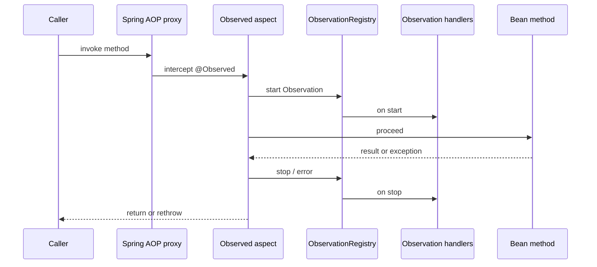

# @Observed trong Spring Boot observability

## 1. Mục tiêu và bối cảnh

Trong ứng dụng Spring Boot, một nghiệp vụ có thể chạy qua controller, service, repository và các client gọi hệ thống ngoài. Nếu chỉ instrument HTTP endpoints, các thao tác nội bộ như tính phí, kiểm tra tồn kho hay tạo hóa đơn khó quan sát riêng. Micrometer Observation cho phép tạo observation quanh một operation; annotation @Observed giúp áp dụng instrumentation trực tiếp lên Spring bean method.

Khi được kích hoạt và method đi qua Spring AOP proxy, @Observed tạo observation quanh method invocation. Observation handlers có thể chuyển observation thành metrics và/hoặc tracing data tùy cấu hình registry. Annotation không bảo đảm mọi method call đều được intercept.

Bài thuộc chương Annotation observability của module SPRING_BOOT_OBSERVABILITY. Module hướng dẫn thiết lập observability cho Spring Boot bằng Micrometer Observation, metrics, logs và distributed tracing; học context propagation, tag/cardinality, exporter, sampling và liên kết tín hiệu để điều tra lỗi, độ trễ và hành vi ứng dụng trên môi trường thực.

Sau bài học, bạn có thể:
1. Giải thích @Observed tạo observation quanh method invocation thế nào.
2. Kích hoạt annotation processing trong Spring Boot.
3. Phân biệt name, contextualName và low/high-cardinality key values.
4. Hiểu AOP proxy, self-invocation và giới hạn interception.
5. Phân biệt @Observed với @Timed, @Counted và @MeterTag.
6. Quan sát exception, metrics, spans và logs liên quan.
7. Xử lý async/reactive method đúng lifecycle.
8. Kiểm thử observation handlers và cardinality.

Baseline: Spring Boot 3.5.x, Java 17+, Micrometer Observation và Spring AOP. Chi tiết package/API phụ thuộc Micrometer/Spring Boot version; dùng dependency management của Boot.

## 2. @Observed là gì?

@Observed là annotation của Micrometer dùng để đánh dấu method hoặc type cần được quan sát. Khi annotation processing được bật, một AOP aspect/interceptor tạo Observation bao quanh invocation.

Một observation có thể có tên ổn định, contextual name, low-cardinality key values dùng cho metrics, high-cardinality key values dành cho tracing/diagnostics và ghi nhận exception nếu method ném lỗi ra khỏi invocation. ObservationRegistry handlers quyết định signals nào được tạo.



Đây là mô hình khái niệm. Cấu hình thực tế cần aspect, registry và Spring AOP proxy phù hợp.

## 3. Kích hoạt @Observed trong Spring Boot

Annotation-driven observation cần bật bằng property:

```yaml
management:
  observations:
    annotations:
      enabled: true
```

Cần dependencies tương ứng cho Actuator/Micrometer Observation và Spring AOP. Dùng dependency management của Spring Boot thay vì tự kéo các phiên bản Micrometer không tương thích.

Ví dụ Maven:

```xml
<dependency>
    <groupId>org.springframework.boot</groupId>
    <artifactId>spring-boot-starter-actuator</artifactId>
</dependency>
<dependency>
    <groupId>org.springframework.boot</groupId>
    <artifactId>spring-boot-starter-aop</artifactId>
</dependency>
```

Actuator cung cấp observability infrastructure; starter AOP cung cấp proxy infrastructure. Tracing backend/exporter cần dependencies và cấu hình riêng nếu muốn export spans.

Kiểm tra property đã bind, bean thuộc Spring container, method được gọi qua proxy, ObservationRegistry có handlers mong đợi và metric/span xuất hiện sau invocation. Chỉ thêm annotation mà thiếu aspect/AOP/registry thì chưa đủ.

## 4. Dùng @Observed trên method

Ví dụ service xử lý thanh toán:

```java
import io.micrometer.observation.annotation.Observed;
import org.springframework.stereotype.Service;

@Service
public class PaymentService {
    @Observed(
        name = "payment.authorize",
        contextualName = "authorize payment"
    )
    public PaymentResult authorize(PaymentCommand command) {
        return new PaymentResult("APPROVED");
    }
}
```

name là tên operation ổn định; contextualName giúp trace/context dễ đọc hơn. Method được bao bởi observation khi interception hoạt động. Nếu method ném exception ra khỏi invocation, observation lifecycle có thể ghi nhận error trước khi exception propagate.

Không đưa order ID, customer ID hoặc URL động vào name/contextualName. Tên phải ổn định, không sinh observation name mới cho mỗi request.

## 5. Low-cardinality và high-cardinality key values

| Attribute | Mục đích |
| --- | --- |
| lowCardinalityKeyValues | Tags có tập giá trị hữu hạn, có thể dùng cho metrics |
| highCardinalityKeyValues | Metadata thay đổi theo request, phù hợp tracing/diagnostics, không dùng làm metric tags |

Ví dụ metadata tĩnh:

```java
@Observed(
    name = "payment.authorize",
    contextualName = "authorize payment",
    lowCardinalityKeyValues = {
        "payment.method", "card",
        "payment.channel", "web"
    },
    highCardinalityKeyValues = {
        "payment.reference", "internal-reference"
    }
)
public PaymentResult authorize(PaymentCommand command) {
    return new PaymentResult("APPROVED");
}
```

Annotation attributes là chuỗi tĩnh; không thể nội suy giá trị runtime của command vào annotation literal. Để gắn metadata động, dùng Observation API trong code hoặc convention/customization phù hợp.

Quy tắc:
- Low-cardinality: operation type, channel, provider name từ allowlist, outcome hữu hạn.
- High-cardinality: request/reference ID chỉ khi thật sự cần và được phép.
- Không gắn password, PAN, token, email, raw SQL hoặc payload vào telemetry.
- High-cardinality không có nghĩa là an toàn để lưu; nó chỉ mô tả đặc tính cardinality.

## 6. Gắn metadata động bằng Observation API

Khi cần giá trị runtime, tạo Observation thủ công quanh operation:

```java
import io.micrometer.observation.Observation;
import io.micrometer.observation.ObservationRegistry;

public class InvoiceService {
    private final ObservationRegistry registry;

    public InvoiceService(ObservationRegistry registry) {
        this.registry = registry;
    }

    public Invoice create(CreateInvoiceCommand command) {
        return Observation.createNotStarted("invoice.create", registry)
                .lowCardinalityKeyValue("invoice.channel",
                        normalizeChannel(command.channel()))
                .observe(() -> doCreate(command));
    }

    private String normalizeChannel(String channel) {
        return switch (channel) {
            case "web", "mobile", "partner" -> channel;
            default -> "other";
        };
    }

    private Invoice doCreate(CreateInvoiceCommand command) {
        return new Invoice();
    }
}
```

Đây là cách khác với @Observed. Không bọc cùng method bằng cả @Observed và Observation thủ công chỉ để tạo hai bản ghi cho cùng operation. Chọn một instrumentation owner hoặc định nghĩa rõ parent/child operations.

## 7. @Observed trên type và method

Có thể đánh dấu type hoặc method tùy API/version. Type-level annotation có thể áp dụng cho các method phù hợp trong bean; method-level annotation diễn đạt rõ operation nào cần đo và cho phép name/context khác nhau.

Tránh annotate quá rộng: getter/setter hoặc method nhỏ không có giá trị vận hành; repository đã được datasource instrumentation đo; các method con tạo tín hiệu trùng. Chọn business operation có ý nghĩa như payment.authorize, order.submit hoặc inventory.reserve.

Kiểm tra precedence giữa type-level và method-level annotation theo Micrometer version đang dùng; không giả định mọi annotation sẽ được cộng dồn.

## 8. AOP proxy và self-invocation

Spring thường intercept method call khi caller gọi qua proxy. Nếu một method trong cùng object gọi method khác trên this, lời gọi nội bộ không đi qua proxy nên annotation trên method được gọi có thể không được áp dụng.

```java
@Service
public class OrderService {
    public void submit(OrderCommand command) {
        validate(command); // Self-invocation.
    }

    @Observed(name = "order.validate")
    public void validate(OrderCommand command) {
        // Validation logic.
    }
}
```

submit có thể được gọi qua bean proxy nhưng lời gọi validate nội bộ là direct call. Observation của validate có thể không được tạo.

Cách khắc phục:
1. Tách validate thành Spring bean riêng và inject vào OrderService.
2. Đưa ranh giới observation lên submit nếu đó là operation cần đo.
3. Dùng Observation API thủ công quanh đoạn code nội bộ.
4. Tránh self-injection/call proxy vòng vèo nếu có thiết kế đơn giản hơn.

Method private/final hoặc class không proxy được theo strategy đang dùng cũng có thể không intercept. Kiểm tra proxy strategy (JDK dynamic proxy/CGLIB), visibility và cấu hình Spring AOP.

## 9. Exception và lifecycle

Nếu method được intercept ném exception, observation được đánh dấu error theo lifecycle của aspect/handlers; exception tiếp tục propagate nếu không được xử lý. Metrics handler có thể ghi duration/error outcome; tracing handler có thể tạo span và ghi error/event tùy bridge. Log không tự xuất hiện chỉ vì có @Observed.

Nếu method bắt exception rồi trả fallback, observation bao method có thể kết thúc thành công theo góc nhìn invocation. Nếu lỗi nội bộ vẫn cần quan sát, ghi nhận ở child operation trước fallback bằng Observation/counter/log phù hợp.

Không nuốt exception rồi kỳ vọng aspect tự biết lỗi đã xảy ra. Annotation chỉ quan sát exception đi qua boundary mà nó intercept.

## 10. @Observed, @Timed, @Counted và @MeterTag

| Annotation | Mục đích chính | Kết quả |
| --- | --- | --- |
| @Observed | Observation abstraction | Có thể nối metrics và tracing handlers |
| @Timed | Đo thời gian method | Timer metric |
| @Counted | Đếm invocation | Counter metric |
| @MeterTag | Tạo tag từ method parameter cho meter annotation hỗ trợ | Dynamic meter tag theo resolver |

@Observed phù hợp khi cần một operation nối nhiều observability handlers. @Timed/@Counted hữu ích cho metric-focused instrumentation. Không gắn nhiều annotation lên cùng method nếu chưa xác định semantics, vì có thể tạo timer/counter trùng.

@MeterTag không phải thuộc tính của @Observed và không tự biến parameter thành low-cardinality observation key. Cần phân biệt annotation processing và resolver của từng cơ chế.

## 11. Async và reactive method

### 11.1. Async

Nếu method trả CompletableFuture hoặc submit task sang executor, cần xác định observation đo thời gian tạo future hay thời gian công việc hoàn tất; exception phát sinh trong method hay sau khi return; context có truyền sang worker thread hay không.

AOP aspect đồng bộ có thể kết thúc khi CompletableFuture được trả về, tùy integration/version; không mặc định nó theo dõi completion. Dùng context propagation và instrumentation async-aware hoặc Observation API gắn với completion lifecycle.

### 11.2. Reactive

Với Mono/Flux, method có thể trả publisher trước khi công việc chạy. Observation đồng bộ quanh invocation có nguy cơ chỉ đo thời gian dựng pipeline. Dùng reactive-aware instrumentation và bảo đảm context đi theo subscription.

Không tự subscribe publisher chỉ để kết thúc observation; điều đó có thể thực thi operation thêm lần nữa. Kiểm thử success, onError, cancellation và resubscription.

## 12. Metrics và tracing handlers

Khi ObservationRegistry có handlers tương ứng, metrics handler có thể tạo timer/summary theo convention; tracing handler có thể tạo span; logging correlation có thể liên kết logs với trace/span context nếu tracing được cấu hình.

Không giả định mọi backend hoặc handler đều bật mặc định chỉ vì @Observed có mặt. Kiểm tra output thật bằng Actuator metrics, tracing backend hoặc test ObservationHandler. Không dùng high-cardinality fields làm metric tags.

## 13. Kiểm thử @Observed

- Khởi tạo Spring application context với AOP và annotation processing.
- Inject bean từ context, không tự new object.
- Gọi method qua injected bean proxy.
- Dùng test ObservationHandler để thu start/stop/error.
- Xác nhận name, contextualName và low/high-cardinality key values.
- Gọi method ném exception và xác nhận error lifecycle.
- Kiểm tra self-invocation rồi test refactor qua bean riêng.
- Xác nhận timer/meter xuất hiện khi metrics handler được cấu hình.
- Xác nhận span xuất hiện khi tracing handler/bridge được cấu hình.
- Kiểm tra high-cardinality values không xuất hiện trong metric tags.
- Kiểm thử CompletableFuture, Mono/Flux completion, error, cancel và resubscription.

## 14. Troubleshooting

| Triệu chứng | Nguyên nhân có thể | Cách xử lý |
| --- | --- | --- |
| @Observed không tạo metric/span | Annotation processing chưa bật, thiếu AOP hoặc registry handler | Kiểm tra property, dependencies và handlers |
| Method public không được intercept | Caller gọi qua this hoặc object không phải Spring bean | Inject bean proxy hoặc dùng Observation API |
| Private/final method không có observation | Proxy không thể intercept theo strategy | Đổi boundary/visibility hoặc dùng explicit Observation |
| Future timer quá ngắn | Observation kết thúc khi future được trả về | Instrument completion lifecycle |
| Mono method duration gần 0 | Đo lúc tạo publisher, chưa subscribe | Reactive-aware instrumentation |
| Có timer nhưng không có span | Metrics handler có nhưng tracing bridge chưa cấu hình | Kiểm tra Micrometer Tracing/exporter |
| Có span nhưng không có timer | Meter registry/metrics handler chưa cấu hình | Kiểm tra metrics pipeline |
| Cardinality tăng đột biến | Dynamic data đưa vào low-cardinality keys | Normalize/allowlist values |
| Một operation có hai timers | @Observed và @Timed/manual Observation chồng lặp | Chọn một owner hoặc phân biệt operation |
| Exception không được đánh dấu error | Exception bị catch/fallback trước boundary | Record child operation failure |

## 15. Checklist production

- [ ] Bật annotation observation processing theo đúng Spring Boot version.
- [ ] Có Spring AOP và ObservationRegistry phù hợp.
- [ ] Method được gọi qua Spring proxy.
- [ ] Tránh self-invocation cho method cần annotation interception.
- [ ] Dùng name/contextualName ổn định.
- [ ] Chỉ đưa tập hữu hạn vào low-cardinality keys.
- [ ] Không đưa PII/secrets vào high-cardinality values.
- [ ] Không chồng @Observed với @Timed/@Counted vô ý.
- [ ] Xác nhận exception lifecycle và fallback behavior.
- [ ] Async/reactive operation được đo tới completion khi cần.
- [ ] Metrics và tracing handlers được kiểm tra riêng.
- [ ] Có tests cho proxy, self-invocation, error, async/reactive và cardinality.

## 16. Câu hỏi tự luyện

1. @Observed tạo Observation ở thời điểm nào?
2. Property nào bật annotation-driven observation trong Spring Boot?
3. Vì sao method phải được gọi qua Spring AOP proxy?
4. Self-invocation làm annotation trên method nội bộ bị bỏ qua thế nào?
5. name khác contextualName ra sao?
6. lowCardinalityKeyValues và highCardinalityKeyValues khác nhau ở đâu?
7. Vì sao annotation attributes không thể nội suy parameter runtime?
8. Khi nào nên dùng Observation API thủ công thay vì @Observed?
9. @Observed khác @Timed/@Counted/@MeterTag thế nào?
10. Nếu method bắt exception rồi trả fallback, observation thấy outcome gì?
11. Vì sao method trả Mono có thể có duration rất ngắn dù HTTP call chậm?
12. Cần kiểm tra gì để xác nhận metrics và tracing handlers đều hoạt động?

## Tài liệu tham khảo

- [Spring Boot 3.5 — Observability](https://docs.spring.io/spring-boot/3.5/reference/actuator/observability.html)
- [Spring Boot 3.5 — Common Application Properties](https://docs.spring.io/spring-boot/3.5/appendix/application-properties/index.html)
- [Micrometer Observation — Annotation Support](https://docs.micrometer.io/micrometer/reference/observation/annotations.html)
- [Micrometer Observation — Concepts](https://docs.micrometer.io/micrometer/reference/observation.html)
- [Micrometer — @Timed and @Counted](https://docs.micrometer.io/micrometer/reference/concepts/timers.html)
- [Spring Framework — AOP Proxies](https://docs.spring.io/spring-framework/reference/core/aop/proxying.html)
- [Micrometer Tracing — API](https://docs.micrometer.io/tracing/reference/api.html)

