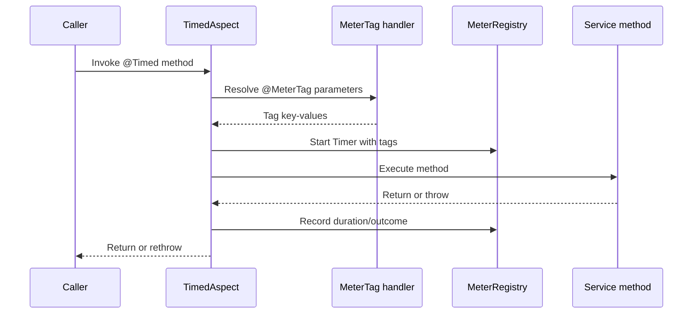

# @MeterTag trong Micrometer

Một service Spring Boot có method nghiệp vụ xử lý yêu cầu theo loại khách hàng, kênh hoặc nhóm operation. Đội vận hành muốn phân tích thời gian thực thi theo một vài nhóm có ý nghĩa, thay vì chỉ xem tổng latency của method. Micrometer cung cấp annotation **@MeterTag** để gắn tag vào meter được tạo từ method instrumentation, thường dùng cùng **@Timed** và **TimedAspect**.

@MeterTag đặt trên parameter của method được instrument. Khi TimedAspect xử lý invocation, tag handler đọc parameter value và chuyển nó thành tag key-value cho meter. Việc chuyển đổi giá trị có thể được tùy biến bằng resolver; một số cấu hình còn hỗ trợ expression-based resolution. Annotation giúp khai báo tag gần method signature, nhưng không tự tạo meter độc lập và không tự động instrument mọi method.

Bài **@MeterTag** thuộc chương **Annotation observability** của module **SPRING_BOOT_OBSERVABILITY**. Module tập trung thiết lập observability cho Spring Boot bằng Micrometer Observation, metrics, logs và distributed tracing; học context propagation, tag/cardinality, exporter, sampling và liên kết tín hiệu để điều tra lỗi, độ trễ và hành vi ứng dụng trên môi trường thực.

## 1. Mục tiêu học tập

Sau bài học, bạn có thể:

- Giải thích vai trò của @MeterTag trong method metrics của Micrometer.
- Kết hợp @MeterTag với @Timed và TimedAspect.
- Hiểu cách parameter value được chuyển thành meter tag.
- Cấu hình value resolver và expression resolver phù hợp.
- Tránh gắn ID, email, token hoặc giá trị động vào metric tags.
- Nhận biết giới hạn proxy/AOP và self-invocation.
- Kiểm tra tags thực tế trong MeterRegistry/Actuator.
- Viết test để xác minh meter name, tag values và cardinality.

## 2. @MeterTag làm gì?

Micrometer @Timed đánh dấu method cần đo thời gian. TimedAspect dùng AOP để bao quanh method invocation và ghi Timer vào MeterRegistry. @MeterTag cho phép lấy giá trị từ parameter của method và đưa vào tags của Timer.



Sơ đồ mô tả khái quát. API handler/resolver và chi tiết xử lý annotation phụ thuộc Micrometer version. Hãy dùng đúng API của phiên bản được Spring Boot BOM quản lý.

@MeterTag có ba điểm cần nhớ:

1. Nó cung cấp tag metadata từ method parameter.
2. Nó cần một instrumentation mechanism như TimedAspect đọc annotation.
3. Tag value phải có cardinality thấp và không chứa dữ liệu nhạy cảm.

Nếu không có aspect hoặc handler tương ứng, đặt annotation trên parameter không đảm bảo metric sẽ được tạo.

## 3. Ví dụ @Timed và @MeterTag

Ví dụ một service đo thời gian xử lý theo customer tier:

```java
import io.micrometer.core.annotation.MeterTag;
import io.micrometer.core.annotation.Timed;
import org.springframework.stereotype.Service;

@Service
public class PricingService {

    @Timed(value = "pricing.calculate", description = "Pricing calculation time")
    public Price calculate(
            @MeterTag(key = "customer_tier") String customerTier,
            String productCode) {
        return calculatePrice(customerTier, productCode);
    }

    private Price calculatePrice(String tier, String productCode) {
        return new Price(productCode, tier);
    }
}

record Price(String productCode, String tier) {}
```

Đoạn code minh họa annotation usage; xác nhận thuộc tính annotation theo Micrometer version đang dùng. Chỉ customerTier được đánh dấu @MeterTag, nên productCode không tự động trở thành metric tag.

### @MeterTag trên method return value

Micrometer cũng hỗ trợ đặt @MeterTag trên method để tạo tag từ giá trị trả về của method được @Timed instrument. Cách này hữu ích khi return value là một category hữu hạn, nhưng cần cân nhắc vì method result có thể là object lớn hoặc dữ liệu nhạy cảm:

```java
@Timed("feature.lookup")
@MeterTag("feature_result")
public String lookupFeature() {
    return "enabled";
}
```

Trong ví dụ, giá trị trả về trở thành tag value theo resolver đang cấu hình. Chỉ dùng cách này khi kết quả được chuẩn hóa thành tập giá trị nhỏ. Với parameter-based tagging, implementation method cần được instrument theo đúng proxy/AOP path; kiểm tra method/implementation annotations theo Micrometer version.

### Tag values cần được chuẩn hóa

Nếu customerTier chỉ có các giá trị hữu hạn như standard, silver, gold, tag này có thể hữu ích. Nếu parameter là customer ID, email hoặc free-text, không được gắn trực tiếp vì mỗi giá trị có thể tạo một time series riêng và lộ dữ liệu.

## 4. Cấu hình TimedAspect

@Timed là annotation; để method được intercept, ứng dụng cần cấu hình TimedAspect và MeterRegistry. Ví dụ cấu hình cơ bản:

```java
import io.micrometer.core.aop.TimedAspect;
import io.micrometer.core.instrument.MeterRegistry;
import org.springframework.context.annotation.Bean;
import org.springframework.context.annotation.Configuration;

@Configuration
class MetricsAspectConfiguration {

    @Bean
    TimedAspect timedAspect(MeterRegistry registry) {
        return new TimedAspect(registry);
    }
}
```

Trong Spring Boot, kiểm tra version và auto-configuration trước khi tự đăng ký aspect để tránh cấu hình trùng. TimedAspect dùng AOP proxy; method phải được gọi qua Spring proxy và đáp ứng điều kiện proxy của ứng dụng.

### Cấu hình @MeterTag resolver

Micrometer hỗ trợ cấu hình MeterTagAnnotationHandler cho TimedAspect. Resolver quyết định cách đọc/format argument. API constructor/lambda có thể thay đổi theo Micrometer version; ví dụ khái quát:

```java
@Bean
TimedAspect timedAspect(MeterRegistry registry) {
    TimedAspect aspect = new TimedAspect(registry);

    ValueResolver valueResolver = parameter ->
        parameter == null ? "none" : parameter.toString();
    ValueExpressionResolver expressionResolver = new MyExpressionResolver();

    MeterTagAnnotationHandler handler =
        new MeterTagAnnotationHandler(
            resolverClass -> valueResolver,
            resolverClass -> expressionResolver
        );

    aspect.setMeterTagAnnotationHandler(handler);
    return aspect;
}
```

Đây là ví dụ wiring khái quát. MyExpressionResolver là implementation do ứng dụng cung cấp; Micrometer không cung cấp sẵn một expression engine cụ thể. Xác minh functional interface và imports trong Micrometer version của dự án. Resolver nên trả về giá trị đã chuẩn hóa, có giới hạn và không chứa dữ liệu nhạy cảm.

### Vì sao cần resolver?

Parameter có thể là enum, object domain hoặc nullable value. Gọi toString() mặc định trên object có thể tạo tag khó kiểm soát, chứa ID hoặc thay đổi theo implementation. Resolver cho phép ánh xạ object sang category ổn định, ví dụ:

```java
String toMetricTier(Customer customer) {
    return switch (customer.tier()) {
        case GOLD -> "gold";
        case SILVER -> "silver";
        default -> "standard";
    };
}
```

Chỉ đưa các category đã allow-list vào metrics.

## 5. Expression-based tag resolution

Một số cấu hình MeterTagAnnotationHandler cho phép dùng expression resolver, chẳng hạn SpEL, để trích xuất thuộc tính từ argument. Cần đăng ký expression resolver tương ứng; annotation đơn lẻ không tự bật mọi expression engine.

Ví dụ khái niệm:

```java
@Timed("pricing.calculate")
public Price calculate(
        @MeterTag(key = "customer_tier", expression = "tier")
        Customer customer) {
    // ...
}
```

Ví dụ minh họa ý tưởng lấy property tier từ object; cú pháp annotation và expression resolver phải khớp phiên bản Micrometer. Nếu resolver không được cấu hình, expression có thể không được evaluate như mong muốn.

Expression nên đơn giản, deterministic và trả về tập giá trị hữu hạn. Không dùng expression để tạo UUID, nối toàn bộ object, đọc PII hoặc tạo giá trị mới mỗi invocation. Nếu logic mapping phức tạp, dùng custom resolver có allow-list rõ ràng.

## 6. Tag cardinality và chi phí

Mỗi tổ hợp meter name và tag values có thể tạo một meter/time series riêng. Ví dụ một method có 3 customer tiers, 4 channels và 5 outcomes thì số tổ hợp tối đa là 3 × 4 × 5 = 60 series cho một method, trước khi nhân với instance count, histogram buckets và dimensions khác.

| Parameter | Dùng làm tag? | Lý do |
| --- | --- | --- |
| Customer tier | Có thể | Tập giá trị nhỏ, được kiểm soát |
| Channel (web, mobile, partner) | Có thể | Tập category hữu hạn |
| Operation type | Có thể | Tập operation hữu hạn |
| Customer ID | Không | Mỗi customer có thể tạo series riêng |
| Order ID | Không | Giá trị gần như duy nhất |
| Email/phone | Không | PII và cardinality cao |
| Raw URL/query | Không | Giá trị động và có thể chứa secrets |
| Trace ID | Không | Gần như mỗi trace là một giá trị |
| Exception message | Không | Nội dung động, có thể chứa payload |

@MeterTag là annotation tiện lợi, không phải cơ chế tự bảo vệ cardinality. Người thiết kế phải chọn parameter an toàn và resolver phải chuẩn hóa giá trị. Đừng gắn @MeterTag vào mọi argument chỉ vì có thể.

## 7. Null values và exception

Method parameter có thể null nếu contract cho phép. Resolver cần định nghĩa rõ cách xử lý: dùng category như none/unknown, hoặc không tạo tag nếu handler/version hỗ trợ. Không để resolver ném exception làm hỏng business invocation chỉ vì tag conversion thất bại.

Method có thể kết thúc bình thường hoặc throw exception. TimedAspect ghi thời lượng quanh invocation; cách phân loại error/outcome phụ thuộc instrumentation và registry. @MeterTag chỉ bổ sung tag từ argument, không tự định nghĩa error semantics.

Nếu cần phân loại outcome, có thể dùng business Observation riêng hoặc metrics phù hợp. Tránh gắn exception message làm tag; dùng exception class/category có tập hữu hạn nếu thật sự cần.

## 8. Giới hạn AOP và proxy

TimedAspect dựa vào Spring AOP proxy:

- Gọi method từ bean khác qua Spring proxy thường được intercept.
- Self-invocation (method trong cùng object gọi method được annotate) thường bypass proxy.
- Method không được proxy theo cơ chế đang dùng có thể không được intercept.
- Object được tạo bằng new thay vì Spring container không tự có aspect.
- Final/private method có thể không được proxy/intercept như mong đợi tùy proxy strategy.

Ví dụ self-invocation:

```java
@Service
class ReportService {

    public void generate() {
        calculateRows(); // gọi nội bộ, có thể bypass AOP proxy
    }

    @Timed("report.calculate")
    public int calculateRows() {
        return 100;
    }
}
```

Nếu cần method-level timing cho đoạn nội bộ, tách operation sang bean khác hoặc dùng Observation/Timer API trực tiếp. Đừng dựa vào annotation mà không kiểm tra đường gọi thực tế.

## 9. Kiểm tra meter và tag values

Khi có Actuator, expose metrics endpoint trong môi trường được bảo vệ:

```yaml
management:
  endpoints:
    web:
      exposure:
        include: health,metrics
```

Kiểm tra meter:

```http
GET /actuator/metrics/pricing.calculate
```

Để lọc:

```http
GET /actuator/metrics/pricing.calculate?tag=customer_tier:gold
```

Tên tag cụ thể phụ thuộc annotation/resolver configuration. Dùng availableTags để xác minh tag key và values đã được tạo. Actuator cho thấy số liệu trong process; exporter/registry mới đưa time series tới backend bên ngoài.

### Kiểm tra qua MeterRegistry trong test

Một test có thể gọi method được proxy rồi kiểm tra Timer:

```java
Timer timer = meterRegistry.find("pricing.calculate")
    .tag("customer_tier", "gold")
    .timer();

assertThat(timer).isNotNull();
assertThat(timer.count()).isEqualTo(1);
```

Đoạn assert là minh họa; test cần gọi Spring-managed bean qua proxy trước khi tìm Timer. Nếu test gọi object tự khởi tạo, aspect có thể không chạy.

## 10. @MeterTag không thay thế Observation

@MeterTag thường phục vụ method metrics được tạo bởi @Timed/TimedAspect. Micrometer Observation có phạm vi rộng hơn: một Observation có thể được nhiều handlers xử lý để tạo metrics và tracing cùng lifecycle.

| Công cụ | Vai trò |
| --- | --- |
| @Timed | Khai báo method cần đo thời gian |
| @MeterTag | Bổ sung tag từ method parameter cho meter được instrument |
| TimedAspect | Intercept method và ghi Timer |
| Observation | Mô hình observation lifecycle đa handler |
| ObservationRegistry | Điều phối Observation handlers |
| @Observed (nếu integration/version hỗ trợ) | Annotation-based Observation qua aspect tương ứng |

Nếu cần một operation có cả metrics và trace span theo Observation, chọn cơ chế @Observed/Observation phù hợp với Spring Boot version. Không giả định @MeterTag tự tạo tracing span.

## 11. Troubleshooting

| Triệu chứng | Nguyên nhân có thể | Hướng kiểm tra |
| --- | --- | --- |
| Không có Timer | Thiếu TimedAspect hoặc method không đi qua proxy | Kiểm tra bean, AOP và invocation path |
| Có Timer nhưng thiếu tag | @MeterTag không được handler xử lý hoặc resolver chưa cấu hình | Kiểm tra Micrometer version và handler |
| Tag value là tên object khó hiểu | Resolver mặc định gọi toString() | Tạo resolver chuẩn hóa sang category |
| Expression không được evaluate | Chưa đăng ký expression resolver hoặc cú pháp không đúng version | Kiểm tra handler configuration |
| Self-invocation không đo | Method gọi nội bộ bypass proxy | Tách bean hoặc dùng Observation API |
| Timer bị nhân đôi | Nhiều aspects/instrumentation cùng đo method | Rà soát bean TimedAspect và custom metrics |
| Cardinality tăng nhanh | Parameter chứa ID/free-text được gắn làm tag | Loại bỏ tag và dùng allow-listed category |
| Resolver ném exception | Null/object không được xử lý | Xử lý null và fallback an toàn |
| Actuator có meter nhưng backend trống | Registry/exporter hoặc scrape chưa cấu hình | Kiểm tra metrics pipeline |
| Method đo sai thời lượng | Aspect bao cả đoạn không thuộc operation dự định | Xác định boundary hoặc tạo Observation riêng |

### Checklist điều tra

1. Xác nhận dependency Micrometer và Spring AOP tương thích.
2. Xác nhận TimedAspect được đăng ký đúng một lần.
3. Gọi method qua Spring-managed bean/proxy.
4. Kiểm tra Timer xuất hiện trong MeterRegistry.
5. Xác minh @MeterTag key và value qua available tags.
6. Kiểm tra resolver/expression resolver và null handling.
7. Ước lượng cardinality trước khi deploy.
8. Xác minh không có PII/secrets trong tag values.

## 12. Thực hành: phân nhóm latency theo customer tier

**Bối cảnh:** pricing-service có method calculate được gọi cho ba nhóm khách hàng standard, silver, gold. Nhóm muốn so sánh latency theo tier nhưng không muốn đưa customer ID vào metrics.

### Phần A — Chuẩn bị

1. Cấu hình MeterRegistry và TimedAspect.
2. Đánh dấu method bằng @Timed.
3. Đánh dấu parameter tier bằng @MeterTag.
4. Nếu parameter là object, cấu hình resolver ánh xạ về ba category hợp lệ.
5. Expose Actuator metrics trong môi trường test.

### Phần B — Kiểm chứng

| Ca | Input | Kết quả cần quan sát |
| --- | --- | --- |
| A — Standard | standard | Timer có tag customer_tier=standard |
| B — Gold | gold | Timer có tag customer_tier=gold |
| C — Silver | silver | Timer có tag customer_tier=silver |
| D — Unknown | Giá trị ngoài allow-list | Resolver trả category fallback đã định nghĩa |
| E — Null | Parameter null nếu contract cho phép | Không làm lỗi resolver/business invocation |
| F — Self-invocation | Gọi method annotated từ cùng object | Xác minh AOP proxy boundary |
| G — Cardinality | Truyền customer IDs khác nhau qua resolver | Metrics chỉ giữ tier category, không tạo series theo ID |

### Phần C — Câu hỏi tự đánh giá

1. @MeterTag được đặt ở đâu và được thành phần nào đọc?
2. Vì sao chỉ đặt annotation chưa chắc tạo meter?
3. @Timed và TimedAspect có vai trò gì?
4. Resolver giúp kiểm soát tag values như thế nào?
5. Khi nào expression-based resolver hữu ích?
6. Vì sao customer ID không phù hợp làm metric tag?
7. Self-invocation ảnh hưởng annotation-based timing ra sao?
8. @MeterTag khác Observation/@Observed ở điểm nào?
9. Làm thế nào kiểm tra tag values trong Actuator hoặc MeterRegistry?
10. Vì sao cần test null, exception và resolver fallback?

## 13. Ghi nhớ

**@MeterTag bổ sung tag values từ method parameters cho metrics được tạo bởi instrumentation như @Timed và TimedAspect.** Annotation cần handler/resolver phù hợp để chuyển argument thành key-value; nó không tự instrument mọi method và không tự tạo distributed tracing span.

Hãy dùng Spring-managed proxy, cấu hình TimedAspect đúng một lần và kiểm tra invocation path, đặc biệt với self-invocation. Resolver nên chuẩn hóa parameter thành một tập category hữu hạn, xử lý null an toàn và không phát sinh tag từ ID, email, token, free-text hoặc trace ID. Kiểm tra meter/tags trong MeterRegistry và Actuator trước khi export ra backend. Khi cần metrics và tracing chung một lifecycle, cân nhắc Micrometer Observation phù hợp với version thay vì kỳ vọng @MeterTag làm toàn bộ việc đó. Thiết kế tag cẩn thận giúp phân tích method latency mà vẫn kiểm soát cardinality, privacy và chi phí observability.
