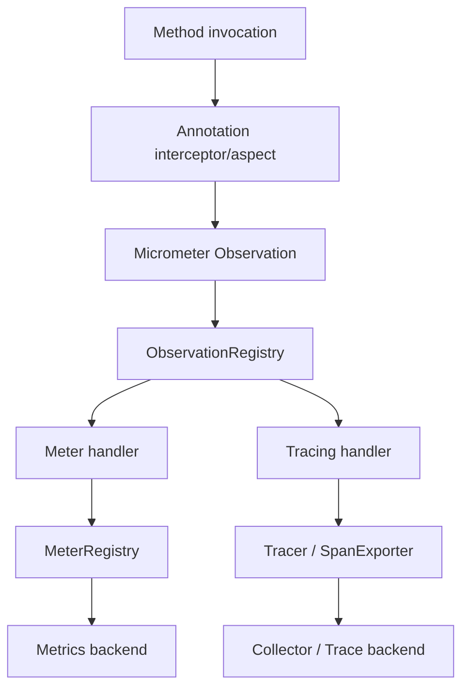

# management.observations.annotations.enabled trong Spring Boot

**management.observations.annotations.enabled** là cấu hình của Spring Boot dùng để bật hoặc tắt việc tạo observations từ các annotation quan sát được hỗ trợ trong ứng dụng. Khi annotation-driven observation được kích hoạt và các thành phần cần thiết đã được cấu hình, method được đánh dấu bằng annotation tương ứng có thể tạo Micrometer Observation; các ObservationHandlers sau đó chuyển observation thành metrics, spans hoặc tín hiệu khác.

Trong module **SPRING_BOOT_OBSERVABILITY**, property này điều khiển instrumentation ở tầng method, bổ sung cho HTTP server, database, messaging và background tasks. Bài thuộc chương **Annotation observability**, tập trung vào ý nghĩa property, profile configuration, điều kiện AOP/proxy, quan hệ giữa annotation và ObservationRegistry, cách xác minh metrics/tracing, cũng như các giới hạn cần biết khi áp dụng trong production.

## 1. Property này điều khiển điều gì?

management.observations.annotations.enabled là property thuộc nhóm management observations. Nó điều khiển việc bật annotation-based observations do Spring Boot hỗ trợ. Khi được enable và integration có mặt, method được đánh dấu bằng annotation tương ứng có thể được instrument thông qua AOP/interceptor và Micrometer Observation.

Cần phân biệt ba bước:

1. **Enablement:** property cho phép cơ chế annotation observation được cấu hình.
2. **Instrumentation:** annotation/interceptor nhận diện method và tạo observation khi method được gọi.
3. **Signal handling:** ObservationRegistry chuyển lifecycle observation tới handlers, chẳng hạn metrics hoặc tracing.

Bật property không tự tạo metrics cho mọi method. Method cần annotation phù hợp, integration cần hiện diện và ObservationRegistry phải có handlers tương ứng.

## 2. Cấu hình trong application.yml

Có thể đặt property trong cấu hình Spring Boot:

```yaml
management:
  observations:
    annotations:
      enabled: true
```

Để tắt:

```yaml
management:
  observations:
    annotations:
      enabled: false
```

Dùng đúng cấu trúc property theo Spring Boot version của dự án. Nếu property không được nhận diện trong version đang dùng, kiểm tra configuration metadata/reference documentation của đúng version thay vì suy đoán rằng mọi release hỗ trợ cùng cách cấu hình.

### 2.1. Bật theo environment

Ví dụ baseline tắt annotation observation, chỉ bật trong môi trường cần quan sát method-level:

application.yml:

```yaml
management:
  observations:
    annotations:
      enabled: false
```

application-local.yml:

```yaml
management:
  observations:
    annotations:
      enabled: true
```

application-staging.yml:

```yaml
management:
  observations:
    annotations:
      enabled: true
```

application-prod.yml:

```yaml
management:
  observations:
    annotations:
      enabled: false
```

Đây là chính sách minh họa. Production có thể bật nếu đã đánh giá overhead, số lượng observations, naming/cardinality và tracing configuration. Không có một lựa chọn true/false phù hợp cho mọi hệ thống.

### 2.2. Kích hoạt profile

```bash
SPRING_PROFILES_ACTIVE=staging
```

Hoặc:

```bash
java -jar app.jar --spring.profiles.active=staging
```

Profile chỉ chọn cấu hình tương ứng. Property vẫn có thể bị override bởi environment variables, system properties, command-line arguments hoặc external configuration có precedence cao hơn.

## 3. Annotation observation và Micrometer Observation

Micrometer Observation cung cấp abstraction chung để instrument một operation. Annotation-driven mechanism giúp khai báo observation ở method boundary thay vì viết boilerplate start/stop ở mỗi method.

Một observation có thể được xử lý bởi:
- Meter handler để ghi metrics.
- Tracing handler để tạo span.
- Handler tùy chỉnh để tích hợp hệ thống khác.

Annotation là cách khai báo instrumentation; nó không phải exporter. Nếu chỉ có observation nhưng không có MeterRegistry/tracing handler phù hợp, metrics/spans tương ứng có thể không xuất hiện.

### 3.1. Phân biệt @Observed và @Timed

Trong hệ sinh thái Micrometer:
- **@Observed** khai báo một observation, có thể được chuyển thành metrics và tracing bởi handlers.
- **@Timed** khai báo timing metric theo cơ chế metrics tương ứng.

Hai annotation có semantics và integration khác nhau. Không gắn cả hai lên cùng một method chỉ để chắc chắn có telemetry, vì có thể tạo dữ liệu timing trùng hoặc hai operation names khác nhau.

Việc annotation nào được Spring Boot tự động xử lý, cần dependency/configuration nào và property nào điều khiển phải được kiểm tra theo version Spring Boot/Micrometer đang dùng.

## 4. Điều kiện để annotation được xử lý

Để method-level observation hoạt động, cần kiểm tra:
- Spring Boot/Micrometer version có hỗ trợ annotation observation integration.
- Property được bind và enablement được kích hoạt.
- Annotation API nằm trong runtime classpath.
- AOP/interceptor infrastructure được cấu hình theo integration cần dùng.
- Bean được Spring quản lý.
- Invocation đi qua proxy/interceptor tương ứng.
- ObservationRegistry có handler mong muốn.

Không suy luận rằng mọi class Java đều tự động được instrument chỉ vì property đặt true.

### 4.1. Spring bean và proxy

Annotation-driven instrumentation thường phụ thuộc proxy/AOP hoặc interceptor integration. Một object được tạo bằng new ngoài Spring container có thể không đi qua proxy. Khi đó annotation có thể không tạo observation.

```java
@Service
class PricingService {

    public Price calculate(String productCode) {
        return loadFromStore(productCode);
    }
}
```

Class phải được quản lý và gọi qua cơ chế instrumentation phù hợp. Chỉ thêm annotation lên một object tự tạo thủ công không đảm bảo interception.

### 4.2. Self-invocation

Với proxy-based AOP, một method trong cùng bean gọi trực tiếp method khác của chính this có thể bỏ qua proxy:

```java
@Service
class ReportService {

    public void generate() {
        this.buildReport();
    }

    public void buildReport() {
        // work
    }
}
```

Nếu annotation nằm trên buildReport(), self-invocation có thể không đi qua proxy nên interceptor không chạy. Có thể tách operation thành bean khác hoặc tổ chức invocation qua proxy theo cách framework hỗ trợ.

## 5. Ví dụ method có annotation

Ví dụ dùng Micrometer @Observed trên Spring bean:

```java
import io.micrometer.observation.annotation.Observed;
import org.springframework.stereotype.Service;

@Service
class InventoryService {

    @Observed(name = "inventory.lookup")
    public InventoryItem findItem(String sku) {
        return loadFromStore(sku);
    }

    private InventoryItem loadFromStore(String sku) {
        return new InventoryItem(sku);
    }
}
```

Tên annotation/package và cách bật aspect phụ thuộc Micrometer/Spring Boot integration version. Với một số setup, cần đăng ký aspect/interceptor tương ứng; không giả định property tự thêm toàn bộ AOP infrastructure nếu dependency/version không cung cấp.

### 5.1. Đặt observation name ổn định

Observation name nên:
- Mô tả operation, ví dụ inventory.lookup.
- Ổn định qua các lần deploy.
- Không chứa SKU, user ID hoặc request-specific values.
- Có convention nhất quán giữa các service nếu dùng chung dashboard.

Không tạo observation name động từ method argument. Tên operation động làm khó so sánh và có thể gây bùng nổ số lượng metric series.

## 6. Thêm low-cardinality và high-cardinality values

Annotation observation có thể hỗ trợ khai báo metadata theo API/integration. Low-cardinality values phù hợp cho metric tags; high-cardinality values thường chỉ phù hợp ở span attributes nếu được phép.

| Field | Ví dụ | Khuyến nghị |
| --- | --- | --- |
| operation | inventory.lookup | Tên ổn định |
| component | inventory | Low cardinality |
| outcome | success/error | Tập hữu hạn |
| sku | SKU-10001 | Không dùng metric tag |
| customerId | 918273 | Không dùng metric tag |
| traceId | Một giá trị mỗi trace | Dùng trace correlation |

Không đưa toàn bộ method arguments vào observation. Arguments có thể chứa PII, credentials, payload lớn hoặc identifiers có cardinality cao.

### 6.1. Custom ObservationConvention

Nếu annotation integration hoặc observation API hỗ trợ convention tùy biến, dùng convention để chuẩn hóa tên và key values. Không thêm tag trực tiếp từ input không tin cậy.

Một custom convention cần:
- Allowlist các field được phép.
- Chuẩn hóa values thành tập hữu hạn nếu dùng metrics.
- Giữ naming consistent.
- Tránh duplicate với Resource attributes.
- Có test kiểm tra cardinality và privacy.

## 7. ObservationRegistry và signal handlers

ObservationRegistry là nơi quản lý observation lifecycle. Khi method annotation tạo observation, registry cung cấp handlers để chuyển nó thành signal.



Nếu metrics không xuất hiện, kiểm tra MeterRegistry và meter handler. Nếu span không xuất hiện, kiểm tra tracing bridge, sampler, span processor và exporter. Property enablement chỉ là một phần của pipeline.

### 7.1. Không tạo registry song song ngoài ý muốn

Spring Boot thường cấu hình ObservationRegistry cho application context. Nếu tự tạo registry khác và aspect dùng registry đó, observation có thể không tới handlers mà bạn đang xem. Dùng registry được application quản lý hoặc xác minh rõ registry mà instrumentation sử dụng.

## 8. Đồng bộ và bất đồng bộ

Với method đồng bộ, interceptor có thể bắt đầu observation trước method invocation và kết thúc khi method trả về hoặc ném exception.

Với method trả về Mono, Flux, CompletableFuture hoặc async handle, việc method trả về không nhất thiết đồng nghĩa operation đã hoàn tất. Nếu interceptor dừng observation ngay khi publisher/future được tạo, duration sẽ chỉ đo thời gian tạo object.

Reactive/async instrumentation phải theo lifecycle completion/error/cancel thực tế nếu mục tiêu là đo toàn bộ operation. Hành vi cụ thể phụ thuộc annotation integration và framework version.

### 8.1. Exception handling

Nếu method ném exception qua interceptor, observation có thể ghi nhận error. Nếu method tự bắt exception và trả fallback bình thường, interceptor có thể chỉ nhìn thấy kết quả thành công. Cần xác định semantics muốn đo: lỗi kỹ thuật, business rejection hay fallback.

Không gắn mọi business decline thành ERROR nếu đó là kết quả hợp lệ theo contract.

## 9. Property precedence và runtime configuration

management.observations.annotations.enabled là cấu hình externalized. Giá trị effective có thể đến từ:
- application.yml.
- application-{profile}.yml.
- Environment variables.
- Java system properties.
- Command-line arguments.
- Config server hoặc mounted configuration.

Khi property trong YAML không có hiệu lực, kiểm tra active profiles và property sources. Không chỉnh đồng thời nhiều nơi trước khi tìm nguồn override.

Nếu version Spring Boot không bind property này hoặc property không còn trong version đang dùng, kiểm tra configuration metadata và release documentation của đúng version. Không tự thêm property lạ với kỳ vọng framework sẽ hiểu.

## 10. Hiệu năng và chi phí instrumentation

Annotation observation thêm công việc ở method boundary: interceptor, tạo/stop observation, key-value processing và handler execution. Chi phí phụ thuộc số lần gọi, số handlers, số tags, tracing sampling và exporter/registry.

Cân nhắc:
- Chỉ instrument operation có giá trị vận hành.
- Không annotate method cực nhỏ được gọi hàng triệu lần nếu không cần.
- Dùng tên ổn định và ít low-cardinality tags.
- Tránh custom handler đồng bộ thực hiện network I/O trên request path.
- Đo overhead bằng load test đại diện.
- Theo dõi metrics/traces volume và backend cost.

Không dùng annotation trên mọi method như cách tự động bật observability toàn bộ. Instrumentation có chọn lọc tạo dữ liệu dễ diễn giải hơn.

## 11. Security và privacy

Annotation không làm dữ liệu trở nên an toàn. Nếu custom convention hoặc interceptor lấy method arguments làm tags/attributes, metadata nhạy cảm có thể bị export.

Không đưa vào telemetry:
- Password, API key, bearer token.
- Session/cookie values.
- Email/phone/address.
- Request/response body đầy đủ.
- Raw customer/account identifiers.
- Object toString() có thể chứa dữ liệu nhạy cảm.

Dùng allowlist và redact tại nguồn. Trace backend có thể lưu dữ liệu lâu hơn log local; cần retention/access control phù hợp.

## 12. Kiểm thử annotation observations

Unit test gọi method và xác nhận business result không chứng minh observation đã được tạo. Cần test integration với Spring context và registry/handler tương ứng.

### 12.1. Test business behavior

```java
@SpringBootTest
class InventoryServiceTest {

    @Autowired
    InventoryService inventoryService;

    @Test
    void findsItem() {
        InventoryItem item = inventoryService.findItem("SKU-1");
        assertEquals("SKU-1", item.sku());
    }
}
```

Test này kiểm tra method behavior. Để kiểm tra annotation, xác minh observation handler được gọi hoặc meter/span xuất hiện.

### 12.2. Test observation registry

Có thể dùng test handler hoặc test MeterRegistry để kiểm tra:
- Observation name.
- Low-cardinality values.
- Start/stop lifecycle.
- Error được ghi nhận.
- Không có high-cardinality value trong meter tags.
- Annotation disabled thì observation không được tạo theo cơ chế đó.

Cách đăng ký test handler phụ thuộc Micrometer version và Spring Boot test configuration.

### 12.3. Test proxy behavior

Kiểm tra method được gọi qua Spring bean proxy. Thêm test self-invocation hoặc object tự tạo thủ công để xác nhận những trường hợp không được intercept nếu kiến trúc dựa trên proxy-based AOP.

## 13. Troubleshooting management.observations.annotations.enabled

| Triệu chứng | Nguyên nhân có thể | Cách kiểm tra |
| --- | --- | --- |
| Annotation không tạo observation | Property false, không bind hoặc integration thiếu | Kiểm tra effective config và version |
| Property true nhưng không có metrics | Thiếu MeterRegistry/handler hoặc annotation aspect | Kiểm tra registry và AOP integration |
| Có metrics nhưng không có spans | Tracing bridge/sampler/exporter chưa cấu hình | Kiểm tra tracing pipeline |
| Method gọi trực tiếp không được instrument | Object không qua Spring proxy | Kiểm tra bean ownership và proxy |
| Self-invocation không tạo observation | Call nội bộ bỏ qua proxy | Tách bean hoặc gọi qua proxy |
| Duration async quá ngắn | Observation dừng khi future/publisher được tạo | Kiểm tra async lifecycle support |
| Duplicate timers/spans | Annotation và manual instrumentation cùng đo | Kiểm tra các instrumentation paths |
| Metric cardinality cao | Dynamic name/tags hoặc method args | Chuẩn hóa tên và allowlist tags |
| Production không giống staging | Profile/property source override | Kiểm tra active profile và precedence |
| Không thấy property trong metadata | Version không hỗ trợ hoặc artifact metadata khác | Kiểm tra docs/config metadata đúng version |
| Exception không đánh dấu error | Method xử lý exception thành fallback | Kiểm tra exception boundary và outcome |
| Trace ID khác giữa logs và span | Nhiều ObservationRegistry/provider | Kiểm tra registry ownership và tracing bridge |

### Quy trình điều tra

1. Xác nhận Spring Boot/Micrometer version.
2. Kiểm tra property có được version đó hỗ trợ và giá trị effective.
3. Xác nhận annotation class có trong runtime classpath.
4. Xác nhận bean được Spring quản lý và invocation đi qua proxy/interceptor.
5. Kiểm tra ObservationRegistry mà aspect sử dụng.
6. Kiểm tra MeterRegistry và tracing handlers riêng.
7. Với async methods, kiểm tra observation stop boundary.
8. Kiểm tra tên/tags và cardinality.
9. Tìm instrumentation trùng với manual Observation/Timer.
10. Kiểm tra exporter/Collector/backend nếu handler đã nhận observation nhưng không thấy dữ liệu.

## 14. Bài thực hành: bật annotation observations theo profile

Mục tiêu là bật annotation observation trong local/staging, xác minh method được instrument và so sánh với cấu hình disabled.

### Chuẩn bị

- Spring Boot version có hỗ trợ property/integration tương ứng.
- Actuator và Micrometer Observation.
- Annotation API và AOP/interceptor integration cần thiết.
- MeterRegistry; tracing bridge/exporter nếu muốn kiểm tra spans.
- Một Spring service có method ổn định.

### Bước 1 — Kiểm tra version và configuration metadata

Xác nhận property management.observations.annotations.enabled tồn tại trong version đang dùng. Kiểm tra integration docs cho annotation và aspect/interceptor cần thiết.

### Bước 2 — Đặt property disabled

Trong application.yml, đặt property false. Khởi động context và gọi method test. Xác nhận annotation-driven observation không được tạo theo integration đang thử.

### Bước 3 — Bật trong local profile

Đặt property true trong application-local.yml và kích hoạt profile local. Gọi method qua Spring-managed bean proxy.

### Bước 4 — Kiểm tra metrics

Kiểm tra MeterRegistry/test handler có nhận observation name và low-cardinality values mong đợi. Nếu không, xác minh aspect/interceptor và registry.

### Bước 5 — Kiểm tra tracing

Bật tracing bridge và test exporter. Xác minh span xuất hiện khi sampler cho phép và có Trace ID đúng với context hiện tại.

### Bước 6 — Kiểm tra self-invocation

Tạo call nội bộ trong cùng bean và so sánh với call qua bean proxy. Xác định proxy boundary có ảnh hưởng instrumentation hay không.

### Bước 7 — Kiểm tra async method

Thử method trả future/publisher nếu integration hỗ trợ. Đo thời gian completion và kiểm tra observation không kết thúc quá sớm.

### Bước 8 — Kiểm tra privacy/cardinality

Đảm bảo method arguments, IDs và payload không tự động thành metric tags. Kiểm tra custom convention/handler.

### Bước 9 — So sánh disabled và enabled

So sánh observation count, metrics/spans và overhead trong test workload có kiểm soát.

### Bước 10 — Chọn cấu hình triển khai

Quyết định profile nào bật property dựa trên nhu cầu vận hành, chi phí và version support. Ghi lại policy và kiểm tra effective config khi deploy.

### Checklist nghiệm thu

| Điều cần chứng minh | Kết quả mong đợi |
| --- | --- |
| Property support | Xác minh version có property |
| Enablement | True/false thay đổi annotation mechanism |
| AOP | Method được gọi qua integration/proxy |
| Observation | Đúng operation name và lifecycle |
| Metrics | Handler ghi nhận khi registry có |
| Tracing | Span được tạo khi bridge/sampler cho phép |
| Async | Completion/error/cancel được đo đúng |
| Cardinality | Không có dynamic arguments trong metric tags |
| Privacy | Không export secrets/PII |
| No duplicates | Không instrument cùng operation hai lần |
| Configuration | Profile và precedence đúng |
| Testing | Có test enabled/disabled và proxy behavior |

## 15. Những nguyên tắc cần ghi nhớ

1. **Property điều khiển annotation-driven observation theo khả năng của Spring Boot version đang dùng.** Xác minh configuration metadata trước khi triển khai.
2. **Enablement không đồng nghĩa mọi method tự động có telemetry.** Cần annotation, integration/interceptor và Spring-managed invocation phù hợp.
3. **ObservationRegistry kết nối observation với handlers.** MeterRegistry và tracing bridge/exporter quyết định signal nào được ghi/xuất.
4. **@Observed và @Timed có semantics khác nhau.** Không gắn trùng chỉ để tăng số lượng telemetry.
5. **Proxy/AOP có giới hạn.** Self-invocation hoặc object tự tạo ngoài Spring container có thể bỏ qua interception.
6. **Async/reactive lifecycle cần được xử lý đúng.** Method trả future/publisher không có nghĩa operation đã hoàn tất.
7. **Tên và tags phải ổn định.** Không dùng method arguments, IDs hoặc payload để tạo metric cardinality cao.
8. **Chọn lọc method có giá trị vận hành.** Annotation trên mọi method có thể tăng overhead và noise.
9. **Bảo vệ metadata.** Allowlist và redact secrets/PII tại nguồn.
10. **Kiểm tra từng signal riêng.** Observation được tạo không chứng minh metrics/traces đã tới backend.

management.observations.annotations.enabled là công tắc cấu hình cho annotation-driven observation trong những Spring Boot/Micrometer versions hỗ trợ nó. Khi property, AOP integration, ObservationRegistry và handlers được cấu hình thống nhất, method-level instrumentation có thể bổ sung góc nhìn chi tiết cho ứng dụng. Kiểm tra version support, proxy boundaries, async lifecycle và cardinality trước khi bật rộng giúp telemetry phản ánh đúng operation và tránh chi phí không cần thiết.
