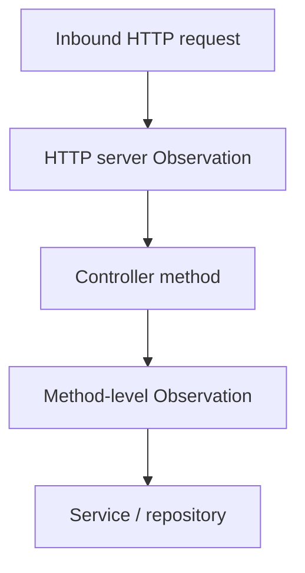

# Annotation trên controller trong Spring Boot observability

Annotation giúp bổ sung observability cho controller method mà không phải viết thủ công toàn bộ lifecycle của một Observation hoặc Timer. Chúng có thể làm code ngắn hơn và tạo quy ước nhất quán giữa các endpoint. Tuy nhiên, annotation chỉ hoạt động khi có đúng instrumentation, AOP/proxy và cấu hình phù hợp; chúng cũng không thay thế HTTP server instrumentation vốn đo toàn bộ vòng đời request ở tầng web.

Bài **Annotation trên controller** thuộc chương **Annotation observability** của module **SPRING_BOOT_OBSERVABILITY**. Module hướng dẫn thiết lập observability cho Spring Boot bằng Micrometer Observation, metrics, logs và distributed tracing; học context propagation, tag/cardinality, exporter, sampling và liên kết tín hiệu để điều tra lỗi, độ trễ và hành vi ứng dụng trên môi trường thực.

Sau bài học, bạn có thể phân biệt annotation ở tầng controller với server request Observation, hiểu vai trò của Micrometer @Observed và @Timed, cấu hình instrumentation phù hợp, nhận biết giới hạn proxy/AOP, thiết kế tên và tags có cardinality thấp, và kiểm thử annotation bằng metrics/tracing test.

## 1. Annotation mang lại điều gì?

Controller thường là điểm vào của HTTP request. Có thể cần quan sát một thao tác ở mức method như tìm kiếm đơn hàng, xác nhận thanh toán hoặc tạo báo cáo. Annotation cho phép khai báo ý định quan sát ngay trên method:

- Tên operation ổn định để tìm trong metrics/traces.
- Metadata bổ sung đã được allowlist.
- Thời gian thực thi method.
- Exception/outcome theo semantics của instrumentation.

Ví dụ khái niệm:

```java
@Observed(name = "orders.lookup")
public OrderView findOrder(String orderId) {
    return orderService.find(orderId);
}
```

Đoạn trên chỉ minh họa ý tưởng. Để annotation có hiệu lực, ứng dụng cần thư viện và cấu hình hỗ trợ, chẳng hạn Micrometer Observation AOP integration tương thích với Spring Boot version đang dùng. Không giả định chỉ thêm annotation là tự sinh metrics và spans.

## 2. Hai lớp observability khác nhau: HTTP request và controller method

Spring Boot có thể tự instrument HTTP server request thông qua Actuator/Micrometer. Server Observation thường đo request qua web stack, bao gồm thời gian xử lý, method, route, status và exception theo convention.

Annotation trên controller method có mục tiêu khác: đo một operation cụ thể trong code. Hai lớp có thể cùng tồn tại:



Ví dụ một request GET có server span bao trùm toàn bộ HTTP lifecycle, trong khi method observation chỉ bao quanh logic controller. Nếu annotation được áp dụng cho method xử lý request, trace có thể có span lồng nhau. Đây có thể là hữu ích khi cần phân biệt controller logic với framework overhead, nhưng cũng có thể tạo telemetry trùng nếu tên và mục đích không rõ.

Trước khi thêm annotation, xác định câu hỏi vận hành cần trả lời. Nếu chỉ cần HTTP latency theo route, server instrumentation có thể đã đủ. Nếu cần đo riêng một operation nghiệp vụ hoặc một đoạn xử lý controller, method-level Observation có thể bổ sung thông tin.

## 3. Micrometer @Observed và Observation AOP

Micrometer cung cấp annotation @Observed để khai báo một Observation quanh method. Với AOP integration, interceptor có thể bắt method invocation, bắt đầu Observation, đưa metadata vào context và kết thúc khi method return hoặc throw.

Ví dụ:

```java
import io.micrometer.observation.annotation.Observed;
import org.springframework.stereotype.Controller;

@Controller
class OrderController {
    private final OrderService orderService;

    OrderController(OrderService orderService) {
        this.orderService = orderService;
    }

    @Observed(name = "orders.controller.lookup")
    public OrderView getOrder(String id) {
        return orderService.find(id);
    }
}
```

Tên package, dependency và cách bật AOP phải khớp Micrometer/Spring Boot version. Một số ứng dụng cần thêm module observation annotation và cấu hình aspect/interceptor tương ứng. Hãy kiểm tra configuration metadata và tài liệu của đúng version thay vì sao chép property từ phiên bản khác.

Observation có thể được xử lý bởi nhiều handlers: metrics handler ghi Timer/counter phù hợp, tracing handler tạo span. Nếu không có tracing handler, annotation vẫn có thể tạo Observation nhưng không nhất thiết có span được export.

## 4. @Timed và thời gian method

Micrometer @Timed thường được dùng để ghi thời gian thực thi method dưới dạng Timer khi aspect hỗ trợ được cấu hình. Ví dụ:

```java
import io.micrometer.core.annotation.Timed;
import org.springframework.stereotype.Component;

@Component
class ReportService {
    @Timed(value = "report.generate", description = "Report generation time")
    public Report generate(String reportType) {
        return buildReport(reportType);
    }
}
```

@Timed và @Observed không hoàn toàn thay thế nhau:

| Tiêu chí | @Timed | @Observed |
| --- | --- | --- |
| Mục đích chính | Ghi thời gian method bằng Timer | Tạo Observation có thể xử lý thành nhiều signals |
| Metrics | Timer | Tùy handler, thường có thể tạo Timer |
| Tracing | Không tự đồng nghĩa với span trong mọi cấu hình | Có tracing handler thì có thể tạo span |
| Metadata | Theo convention/aspect hỗ trợ | Observation context và convention |
| Phù hợp | Đo duration đơn giản | Instrumentation cần liên kết metrics/tracing |

Không đặt cả hai annotation trên cùng method chỉ để “chắc chắn có metrics”. Nếu cả hai aspects cùng ghi thời gian, kết quả có thể đếm trùng. Chọn một cơ chế theo mục tiêu và xác minh meter/span thực tế.

## 5. Cấu hình và điều kiện để annotation chạy

Một setup thường cần:

1. Micrometer Observation API tương thích với Spring Boot.
2. Annotation integration/AOP module phù hợp.
3. Spring AOP proxy hoặc aspect được đăng ký.
4. ObservationRegistry được cấu hình và handlers cần thiết được gắn vào.
5. MeterRegistry và/hoặc tracing bridge/exporter nếu muốn xuất signals.

Ví dụ dependency minh họa theo Gradle:

```groovy
dependencies {
    implementation 'org.springframework.boot:spring-boot-starter-actuator'
    implementation 'org.springframework.boot:spring-boot-starter-aop'
    implementation 'io.micrometer:micrometer-observation'
    implementation 'io.micrometer:micrometer-observation-annotation'
}
```

Artifact names và auto-configuration có thể khác theo Spring Boot/Micrometer BOM. Không pin version riêng nếu Spring Boot dependency management đã quản lý phiên bản. Xác minh module annotation có trong dependency tree của ứng dụng.

Đừng thêm AOP dependency nếu framework integration đang dùng đã cung cấp aspect phù hợp. Quan trọng là chỉ có một interceptor sở hữu annotation đó.

## 6. Proxy và self-invocation

Spring AOP thường áp dụng advice thông qua proxy. Vì vậy, method invocation phải đi qua proxy thì aspect mới được gọi.

Một lỗi thường gặp:

```java
@Service
class InvoiceService {
    public void createInvoice() {
        calculateTax(); // self-invocation: không đi qua proxy
    }

    @Observed(name = "invoice.calculate-tax")
    public Tax calculateTax() {
        return computeTax();
    }
}
```

Trong ví dụ này, lời gọi nội bộ từ createInvoice tới calculateTax có thể bỏ qua proxy, nên annotation không được áp dụng theo cách mong đợi. Cách sửa thường là tách operation được instrument sang bean khác và inject bean đó, hoặc đặt annotation trên method được gọi từ bên ngoài qua proxy.

Không đổi toàn bộ ứng dụng sang AspectJ weaving chỉ để xử lý một self-invocation nhỏ nếu cấu trúc bean có thể làm rõ ranh giới.

## 7. Visibility, final methods và loại proxy

Khả năng intercept method phụ thuộc loại proxy và cấu hình AOP:

- JDK dynamic proxy dựa trên interface; lời gọi phải qua interface proxy.
- Class-based proxy kế thừa class; method/class final không thể override để intercept theo cách proxy subclass thông thường.
- Private method thường không phải join point của proxy-based Spring AOP.
- Method nội bộ gọi trực tiếp trên this không đi qua proxy.

Không mặc định mọi annotation trên mọi method đều được áp dụng. Hãy kiểm tra visibility, proxy type, bean registration và call path. Khi cần instrumentation ở private helper hoặc code không đi qua Spring bean, dùng Observation API trực tiếp ở ranh giới thích hợp.

## 8. Tên Observation và tag cardinality

Tên observation nên mô tả operation, ổn định giữa các lần gọi:

| Nên dùng | Tránh dùng |
| --- | --- |
| orders.controller.lookup | orders.lookup.ORD-98372 |
| checkout.confirm | checkout.confirm.customer-123 |
| report.generate | report.generate.2026-11-22 |

Tags phải được phân loại:

- **Low-cardinality:** channel, operation type, bounded outcome, loại report hữu hạn.
- **High-cardinality:** customer ID, order ID, email, request ID, raw query string.

Low-cardinality values có thể được dùng cho metrics. High-cardinality values có thể làm metric series tăng không kiểm soát; không đưa chúng vào low-cardinality Observation key-values.

Nếu cần identifier để tra cứu một lần chạy, cân nhắc log field hoặc trace attribute có policy, không dùng nó làm tên observation hay metric tag. Không gắn dữ liệu nhạy cảm vào annotation value cố định hoặc metadata tự động.

## 9. Custom Observation convention

Khi cần bổ sung tags, nên dùng convention/handler được quản lý thay vì nhồi mọi thông tin vào annotation. Ví dụ metadata channel chỉ nên nhận một tập giá trị hữu hạn:

```java
@Observed(name = "checkout.confirm")
public Receipt confirm(CheckoutCommand command) {
    return checkoutService.confirm(command);
}
```

Convention có thể đọc context đã được allowlist và bổ sung channel/outcome. Không đưa toàn bộ method arguments vào tags. Arguments có thể chứa DTO, credentials, PII hoặc object có toString() rất lớn.

Annotation thường thích hợp cho metadata tĩnh, trong khi convention phù hợp với metadata phụ thuộc runtime. Dù dùng cách nào, cần quy định rõ field nào low-cardinality và field nào được phép vào trace/log.

## 10. Exception và kết quả method

Observation interceptor thường kết thúc observation khi method trả về hoặc ném exception. Tracing handler có thể ghi error/status theo convention; metrics handler có thể ghi exception tag hoặc outcome.

Không ghi exception message làm tag vì message không ổn định và có thể chứa dữ liệu nhạy cảm. Ưu tiên exception class/category đã chuẩn hóa, hoặc error code hữu hạn.

Nếu controller bắt exception rồi trả ResponseEntity lỗi, method có thể return bình thường từ góc nhìn AOP. Khi đó method observation có thể không tự nhận biết HTTP response là 5xx nếu exception đã được chuyển thành response. HTTP server instrumentation vẫn có thể ghi status code thực tế. Đây là lý do không nên dùng method annotation thay cho server request metrics.

## 11. Async và reactive return types

Method annotation phải được hiểu theo lifecycle thực tế của return type. Với method trả CompletableFuture, Publisher hoặc reactive type, thời điểm method trả về có thể khác thời điểm công việc bất đồng bộ hoàn tất. Instrumentation cần hỗ trợ async/reactive lifecycle để observation không kết thúc quá sớm.

Không giả định một aspect đồng bộ tự động đo hết thời gian của future hoặc reactive stream. Kiểm tra support của phiên bản, context propagation và cách interceptor wrap completion/error/cancel signals.

Với controller trả Mono/Flux, HTTP server observation thường có integration riêng với reactive lifecycle. Annotation ở controller có thể thêm lớp đo khác; xác định rõ nó đo thời gian tạo publisher hay thời gian stream hoàn tất.

## 12. Annotation trên controller có thay thế server instrumentation không?

Không. Server instrumentation biết HTTP method, route template, response status và request lifecycle. Method annotation chủ yếu đo invocation cụ thể.

| Nhu cầu | Cơ chế phù hợp |
| --- | --- |
| HTTP request count/latency theo route | HTTP server Observation |
| HTTP status/outcome | HTTP server instrumentation |
| Một operation controller cụ thể | @Observed hoặc Observation API |
| Đo duration đơn giản của method | @Timed nếu aspect hỗ trợ |
| Truy vết SQL/downstream | JDBC/client instrumentation hoặc child Observations |
| Business event semantics | Observation tại application service |

Nếu cả server Observation và @Observed cùng tạo spans, trace tree có thể có server span và controller operation span. Đặt tên rõ để người xem biết span nào đo web lifecycle và span nào đo code operation.

## 13. Kiểm thử annotation observability

Không chỉ kiểm tra ứng dụng khởi động. Hãy xác minh annotation thật sự được intercept và tạo đúng telemetry:

| Test | Điều cần chứng minh |
| --- | --- |
| Context load test | Aspect/Observation integration được đăng ký |
| Proxy test | Bean được inject là proxy khi cần |
| Invocation test | External call đi qua proxy tạo Observation |
| Self-invocation test | Xác định rõ trường hợp nội bộ không được intercept |
| Metrics test | Timer/meter được tạo với tên và tags mong đợi |
| Trace test | Span được tạo nếu tracing handler bật |
| Exception test | Error được ghi đúng và observation kết thúc |
| Cardinality test | Runtime ID không tạo metric tags mới |
| Async test | Observation giữ đúng lifecycle tới completion |

Ví dụ kiểm tra method observation với test handler:

```java
// Pseudocode:
// 1. Tạo ObservationRegistry test.
// 2. Đăng ký ObservationHandler thu thập tên và lifecycle.
// 3. Khởi tạo Spring context có annotation aspect.
// 4. Lấy bean từ ApplicationContext và gọi method qua proxy.
// 5. Assert observation bắt đầu/kết thúc đúng một lần.
// 6. Gọi self-invocation case và xác nhận behavior theo proxy model.
```

Đây là test strategy, không phải mã test hoàn chỉnh cho mọi version. Với metrics, dùng SimpleMeterRegistry hoặc registry test phù hợp; với tracing, dùng in-memory/test exporter để không cần backend thật.

## 14. Lỗi thường gặp

| Hiện tượng | Nguyên nhân có thể | Hướng kiểm tra |
| --- | --- | --- |
| Annotation không tạo meter/span | Thiếu aspect/module hoặc ObservationRegistry handler | Kiểm tra dependency, bean và registry |
| Method ngoài bean có telemetry, method nội bộ không có | Self-invocation bỏ qua proxy | Tách bean hoặc gọi qua proxy |
| Final/private method không được intercept | Giới hạn proxy type/visibility | Kiểm tra JDK/class proxy và method visibility |
| Metrics đếm hai lần | @Timed và @Observed/custom Timer cùng chạy | Chọn một instrumentation owner |
| HTTP 500 nhưng method observation không có error | Exception đã được catch và chuyển thành response | Dùng server instrumentation cho status/outcome |
| p95 controller khác HTTP p95 | Hai instrumentation đo hai lifecycle khác nhau | So sánh scope và timestamps |
| Async duration quá ngắn | Aspect kết thúc khi Future/Publisher được tạo | Dùng integration hỗ trợ async/reactive lifecycle |
| Cardinality tăng theo request | Tag lấy từ method arguments | Chỉ dùng allowlist low-cardinality |
| Span tree quá sâu | Annotation lặp ở controller/service/helper | Chọn operation boundaries có ý nghĩa |
| Không thấy annotation sau nâng version | API/artifact/property thay đổi | Kiểm tra BOM và configuration metadata |

## 15. Tình huống thực tế: đo riêng controller operation

**Bối cảnh giả định:** orders-service có HTTP server metrics theo route. Endpoint GET /orders/{id} p95 tăng; nhóm muốn biết controller mapping/validation có tốn thời gian hay phần chậm nằm ở service/database.

Một cách instrument:

1. Giữ server Observation để đo toàn bộ HTTP lifecycle, status và route.
2. Thêm @Observed trên operation controller hoặc application service có ý nghĩa, đặt tên ổn định như orders.lookup.
3. Không thêm order ID/customer ID vào low-cardinality tags.
4. Kiểm tra method được gọi qua Spring proxy và annotation aspect thực sự hoạt động.
5. Dùng child spans/DB instrumentation để xem phần thời gian downstream.
6. So sánh server span duration với method Observation duration; chênh lệch có thể là framework binding, serialization hoặc phần xử lý ngoài method.
7. Kiểm thử success/error và trường hợp async nếu controller trả reactive type.

Kết quả là dashboard vẫn phản ánh trải nghiệm HTTP tổng thể, trong khi operation observation giúp khoanh vùng phần code cần tối ưu.

## 16. Bài tập tự kiểm tra

**Bài 1.** @Observed trên controller có tự động thay thế HTTP server Observation không?

*Gợi ý:* Không. Nó đo method operation; server instrumentation đo request lifecycle, route và status.

**Bài 2.** Vì sao self-invocation có thể làm annotation không chạy?

*Gợi ý:* Lời gọi this.method() không đi qua Spring AOP proxy.

**Bài 3.** Khi nào nên chọn @Timed thay vì @Observed?

*Gợi ý:* Khi chỉ cần Timer duration đơn giản và aspect hỗ trợ; dùng Observation khi cần một context có thể tạo nhiều signals.

**Bài 4.** Có nên đưa order ID vào annotation tags?

*Gợi ý:* Không vào low-cardinality metrics tags; ID tạo cardinality cao và có thể nhạy cảm.

**Bài 5.** Controller catch exception rồi trả ResponseEntity 500. Vì sao method observation có thể không đánh dấu error?

*Gợi ý:* Method return bình thường sau khi catch; HTTP server instrumentation vẫn thấy status 500.

**Bài 6.** Method trả Mono và aspect kết thúc khi method return. Đoạn nào chưa được đo?

*Gợi ý:* Reactive work có thể tiếp tục sau khi publisher được trả; cần async/reactive-aware instrumentation.

**Bài 7.** @Timed và @Observed cùng tạo Timer có thể gây hậu quả gì?

*Gợi ý:* Đếm trùng và dashboard sai; chỉ chọn một cơ chế cho cùng operation.

**Bài 8.** Làm sao xác minh annotation thật sự hoạt động?

*Gợi ý:* Gọi bean qua ApplicationContext proxy, capture Observation/Timer/Span bằng test handlers hoặc in-memory exporter.

## 17. Ghi nhớ

- Annotation giúp khai báo instrumentation ở method, nhưng cần đúng module, aspect/proxy và Observation handlers.
- **HTTP server Observation** đo request lifecycle; **method annotation** đo operation cụ thể. Hai lớp bổ sung nhau và cần tên rõ ràng để tránh trùng.
- @Observed tạo Observation có thể xử lý thành metrics/tracing; @Timed tập trung vào Timer. Chọn một cơ chế phù hợp, tránh đếm duration hai lần.
- Spring proxy có giới hạn: self-invocation, private/final methods và proxy type có thể làm advice không chạy.
- Giữ observation names ổn định và tags low-cardinality; không đưa IDs, PII hoặc toàn bộ method arguments vào metrics.
- Exception đã catch và chuyển thành response có thể không xuất hiện như method error; dùng server instrumentation để ghi HTTP status/outcome.
- Async/reactive method cần instrumentation theo lifecycle completion, không giả định method return đồng nghĩa công việc đã xong.
- Kiểm thử proxy, observation lifecycle, metrics, tracing, exceptions, cardinality và async behavior bằng test registry/handler/exporter.
