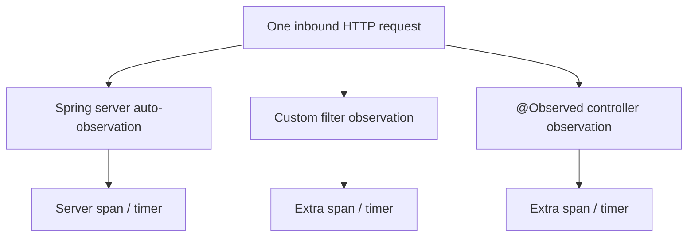
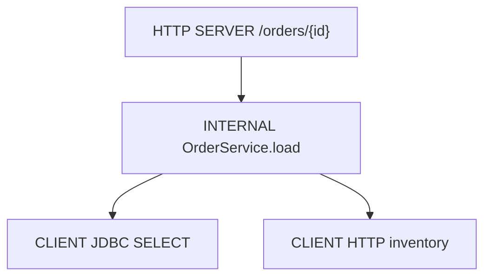
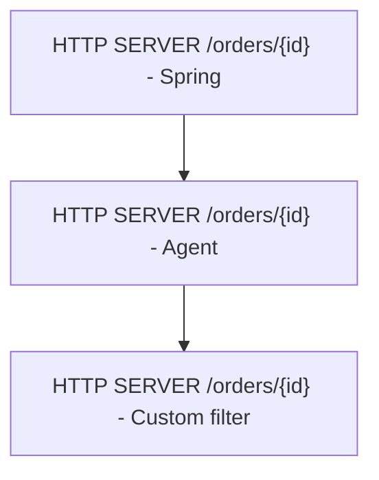

# Duplicate observation khi auto-instrumented

Một controller Spring Boot nhận HTTP request, gọi service nghiệp vụ, rồi service gọi database hoặc HTTP client. Framework có thể đã tự tạo server observation, service có thể được instrument bằng annotation, còn JDBC/HTTP client đã có instrumentation riêng. Nếu developer tiếp tục bọc toàn bộ controller hoặc service bằng một Observation thủ công có cùng mục đích, một operation logic có thể tạo nhiều observations, timers hoặc spans lồng nhau. Dashboard có thể đếm request nhiều lần, trace hiển thị span trùng và latency bị hiểu sai.

**Duplicate observation** xảy ra khi cùng một operation hoặc cùng một instrumentation boundary bị ghi nhận nhiều lần ngoài ý muốn. Trong môi trường auto-instrumented, nguyên nhân thường là kết hợp framework instrumentation, Micrometer annotations, custom Observation wrappers, tracing bridge và Java Agent cùng quan sát một boundary. Không phải mọi span lồng nhau đều là duplicate: server span, service operation span và database client span có thể là các operation khác nhau hợp lệ. Cần phân biệt instrumentation trùng boundary với hierarchy phản ánh công việc thật.

Bài học thuộc chương **Annotation observability** của module **SPRING_BOOT_OBSERVABILITY**. Module hướng dẫn thiết lập observability cho Spring Boot bằng Micrometer Observation, metrics, logs và distributed tracing; học propagation ngữ cảnh, tag/cardinality, exporter, sampling và liên kết tín hiệu để điều tra lỗi, độ trễ và hành vi ứng dụng trên môi trường thực. Bài này giải thích cách phát hiện, ngăn ngừa và xử lý duplicate observations khi framework hoặc agent đã auto-instrument.

## Mục tiêu học tập

Sau bài này, bạn có thể:

1. Giải thích duplicate observation và tác động lên metrics, traces và logs.
2. Phân biệt duplicate instrumentation với các spans lồng nhau hợp lệ.
3. Nhận diện những boundary đã được Spring Boot, Micrometer, library hoặc Java Agent tự instrument.
4. Hiểu cách @Observed, Observation API và AOP/proxy tạo thêm observation.
5. Phân tích trường hợp một HTTP request hoặc DB call tạo nhiều spans/timers trùng nhau.
6. Chọn một instrumentation owner cho mỗi boundary.
7. Bảo toàn child spans và context propagation khi loại bỏ instrumentation trùng.
8. Kiểm thử observation count, span kind, parent relationship và metric count.
9. Xử lý migration khi bật/tắt Java Agent hoặc thay đổi tracing bridge.
10. Thiết lập checklist để phát hiện duplicate instrumentation trước production.

## 1. Duplicate observation là gì?

Một observation thường đại diện cho một operation có lifecycle start/stop, context và các handlers. Observation handlers có thể tạo meter hoặc span. Nếu cùng operation bị instrument hai lần, hệ thống có thể nhận hai bản ghi tương tự.

Ví dụ, một inbound HTTP request đã được Spring MVC instrumentation ghi nhận thành server observation. Controller lại được gắn @Observed với tên http.server.requests và custom filter tiếp tục tạo một observation khác quanh cùng request. Kết quả có thể là ba measurements cùng đại diện một request.



Điều quan trọng là không kết luận chỉ từ số spans. Một request hợp lệ có thể tạo:
- Một SERVER span cho inbound HTTP request.
- Một INTERNAL span cho service operation nếu được chủ động instrument.
- Một CLIENT span cho outbound HTTP call.
- Một CLIENT/database span cho database operation.

Đây là các operation khác nhau. Duplicate xảy ra khi hai instrumentation cùng ghi nhận một operation/boundary với semantics tương đương, ví dụ hai SERVER spans cho cùng một inbound request.

### 1.1. Tác động của duplicate

| Tín hiệu | Tác động |
|---|---|
| Metrics | Request count/duration bị nhân đôi hoặc bị ghi dưới hai meter names |
| Traces | Span tree có spans giống nhau, duration chồng lấn hoặc parent sai |
| Logs | Event log lặp nếu nhiều layer cùng log một lỗi |
| Alerts/SLO | Error rate, throughput và latency có thể sai |
| Cost | Tăng telemetry volume, storage, indexing và ingestion |
| Diagnosis | Operator khó xác định span nào đại diện operation thực |

Duplicate có thể không làm tăng mọi metric theo cùng tỷ lệ. Hai observations có thể có tên/tag khác nhau, một cái bị filter hoặc một cái chỉ tạo span. Cần kiểm tra từng handler và signal.

## 2. Auto-instrumentation trong Spring Boot

Instrumentation có thể đến từ nhiều lớp:

| Nguồn | Ví dụ boundary |
|---|---|
| Spring Framework | Inbound MVC/WebFlux requests |
| Spring Boot/Micrometer | Observation registry, HTTP client customizers, metrics binders |
| Micrometer annotations | Method được đánh dấu @Observed khi aspect được bật |
| JDBC/HTTP libraries | Client calls qua instrumented datasource/client |
| OpenTelemetry Java Agent | HTTP server/client, JDBC, messaging và runtime libraries |
| Custom code | Observation.createNotStarted, Observation.observe hoặc wrapper |
| Third-party AOP | Annotation/aspect của thư viện monitoring khác |

Không phải mọi nguồn đều instrument cùng boundary. Ví dụ Spring MVC auto-observation và một INTERNAL method observation có thể cùng tồn tại hợp lệ. Rủi ro tăng khi nhiều nguồn cùng tạo SERVER span cho một request hoặc cùng tạo client span cho một outbound exchange.

### 2.1. Auto-configured không đồng nghĩa auto-instrument mọi method

Spring Boot có thể instrument các framework boundary đã tích hợp. Điều đó không có nghĩa mọi service method tự có observation. @Observed hoặc custom Observation vẫn hữu ích cho business operation chưa được framework đo.

Trước khi thêm annotation, xác định rõ câu hỏi cần trả lời: muốn đo inbound request, service method, scheduled task hay outbound dependency call? Mỗi loại nên có boundary và semantics riêng.

### 2.2. Java Agent và in-process instrumentation

Java Agent có thể instrument bytecode của thư viện mà không cần thay đổi application code. Spring/Micrometer cũng có thể instrument cùng thư viện qua framework integration. Nếu bật cả hai cho cùng boundary, có nguy cơ duplicate spans.

Agent và framework instrumentation có thể được phối hợp nếu cấu hình loại trừ hoặc ownership rõ. Không giả định chúng tự phát hiện và loại bỏ lẫn nhau trong mọi version.

## 3. Phân biệt span hierarchy hợp lệ với duplicate

Trace tree phản ánh quan hệ operation. Ví dụ:



Đây là hierarchy hợp lệ nếu mỗi span đo một boundary khác nhau.

Ngược lại:



Ba server spans cùng mô tả một inbound request thường là dấu hiệu duplicate instrumentation, trừ khi hệ thống có proxy/forwarding boundary thực sự riêng biệt.

### 3.1. So sánh span attributes

Hai spans có cùng trace ID chưa phải duplicate. So sánh:
- Span kind: SERVER, CLIENT, INTERNAL.
- Operation/span name.
- Start/end timestamps và duration.
- HTTP method, route, URL/target.
- Peer/service identity.
- Parent span ID.
- Instrumentation scope/library/version.
- Events/status.

Nếu hai spans có cùng kind, name, method, route, timestamps gần như trùng và instrumentation scopes khác nhau, cần kiểm tra double instrumentation.

### 3.2. So sánh metrics

Một HTTP request có thể làm tăng meter của framework và một custom meter khác. Nếu dashboard cộng cả hai, request count bị nhân đôi. So sánh meter name, tags, registry và nơi ghi meter. Hai metric names khác nhau không tự động có nghĩa duplicate; cần xác định chúng có đo cùng quantity hay không.

## 4. @Observed và Observation API

Micrometer có thể tạo observation quanh method qua annotation @Observed khi aspect tương ứng được cấu hình. Application cũng có thể tạo observation thủ công bằng Observation API.

Ví dụ annotation:

```java
@Service
class OrderService {
    @Observed(name = "order.load")
    Order load(String orderId) {
        return repository.findById(orderId)
                .orElseThrow();
    }
}
```

Annotation này có thể tạo INTERNAL observation/span cho business operation. Nó không nhất thiết trùng server observation: server span đo HTTP request, còn order.load đo service method. Tuy nhiên, nếu custom annotation hoặc aspect khác cũng dùng cùng operation boundary/name, có thể duplicate.

Ví dụ Observation thủ công:

```java
Observation.createNotStarted(
        "order.load",
        observationRegistry)
    .observe(() -> repository.findById(orderId));
```

Không đặt cả @Observed và wrapper thủ công quanh cùng method chỉ để “chắc chắn có tracing”. Chọn một cơ chế tạo observation cho boundary đó.

### 4.1. Proxy/AOP boundary

Annotation-based observation thường dựa trên AOP proxy/aspect. Self-invocation trong cùng bean có thể không đi qua proxy, nên annotation có thể không được áp dụng như mong đợi. Khi developer thấy thiếu span rồi thêm wrapper thủ công, một lần refactor sau đó có thể làm annotation hoạt động và tạo duplicate.

Kiểm tra proxy behavior và method invocation path trước khi thêm instrumentation thứ hai.

### 4.2. Method name và observation name

Tên observation cần biểu thị operation ổn định. Không dùng cùng tên cho nhiều loại operation chỉ vì chúng thuộc cùng service. Ngược lại, đổi tên meter/span không giải quyết duplicate nếu hai instrumentation vẫn đo cùng boundary.

## 5. Duplicate HTTP server instrumentation

Spring MVC/WebFlux có thể tự tạo server observation. Các nguồn duplicate thường gặp:

- Spring server instrumentation và Java Agent HTTP server instrumentation cùng active.
- Custom servlet filter/WebFilter tạo observation bao quanh request đã được instrument.
- @Observed trên controller dùng lại tên và semantics của server request observation.
- Reverse proxy hoặc gateway tạo spans riêng; trường hợp này có thể là boundary khác hợp lệ, cần xem trace context.

### 5.1. Cách nhận diện

Gửi một request test duy nhất và xem trace:
- Có bao nhiêu SERVER spans?
- Span nào có route template?
- Instrumentation scope/library nào tạo từng span?
- Có cùng timestamps và HTTP attributes không?
- Parent relationship có tạo chuỗi server span bất thường không?

Kiểm tra cả metrics: một request có làm tăng hai request timers tương đương không?

### 5.2. Cách xử lý

Chọn instrumentation framework hoặc agent làm owner cho inbound HTTP server boundary. Nếu giữ framework instrumentation, disable/exclude server instrumentation tương ứng trong agent theo cơ chế/version của agent. Nếu giữ agent, tránh custom filter/aspect tạo thêm server span. Không tắt toàn bộ tracing nếu chỉ một instrumentation bị trùng.

Cấu hình exclude phải được kiểm tra bằng trace test sau khi thay đổi; tên property/agent option thay đổi theo phiên bản.

## 6. Duplicate HTTP client instrumentation

Outbound HTTP call có thể được instrument bởi Spring RestClient/WebClient/RestTemplate integration, HTTP library instrumentation của Java Agent hoặc custom interceptor.

Dấu hiệu:
- Hai CLIENT spans có cùng method/target và duration gần nhau.
- Hai spans lồng nhau nhưng không có hai network attempts thực.
- Client request metrics tăng gấp đôi.
- Một span có instrumentation scope của Spring/Micrometer, span kia từ agent/library.

### 6.1. Phân biệt retry với duplicate

Retry thực sự tạo nhiều network attempts. Có thể thấy nhiều request gửi tới server hoặc nhiều attempt spans với status/duration khác nhau. Duplicate instrumentation có thể tạo hai spans cho một network exchange duy nhất.

Dùng mock server/access logs để đếm số request thực tế. Một outbound exchange nhưng hai client spans cùng operation là dấu hiệu double instrumentation.

### 6.2. Chọn một owner

Với mỗi client type, quyết định instrumentation đến từ Spring/Micrometer hay Java Agent. Nếu cần cả hai cho các library khác nhau, cấu hình exclude theo package/client boundary để không trùng. Đừng xóa observation metrics nếu chỉ span instrumentation bị duplicate; xác định signal nào bị lặp.

## 7. Duplicate database instrumentation

JDBC calls có thể được instrument bởi datasource proxy, Micrometer integration, OpenTelemetry Java Agent hoặc custom repository aspect. Cùng một SQL execution có thể tạo hai CLIENT/database spans.

Phân biệt:
- Database span đại diện SQL execution.
- INTERNAL repository/service span đại diện logic nghiệp vụ.
- Connection pool metrics đo active/idle/acquire/usage; chúng không phải SQL spans.

Nếu một repository method có @Observed và JDBC driver/agent tạo database span, hai spans là hợp lệ khi một cái đo method logic và cái kia đo SQL. Duplicate chỉ khi hai spans cùng mô tả một JDBC execution.

### 7.1. Kiểm tra SQL spans

So sánh database system, operation, sanitized statement, peer/database name, duration và instrumentation scope. Không bật statement capture rộng chỉ để tìm duplicate nếu nó có thể lộ parameter nhạy cảm. Dùng test query đơn giản và kiểm soát dữ liệu.

## 8. Duplicate metrics và observation handlers

Một Observation có thể được xử lý bởi nhiều handlers, ví dụ metrics handler và tracing handler. Điều này là thiết kế bình thường: một observation sinh ra nhiều signals.

Duplicate xảy ra nếu:
- Hai metrics handlers cùng ghi timer cho cùng observation.
- Cùng method có hai observations giống nhau, mỗi cái tạo timer.
- Framework meter và custom meter đo cùng request count rồi dashboard cộng cả hai.
- Registry hoặc binder được đăng ký lặp dẫn đến cùng instrumentation bind nhiều lần.

### 8.1. Không nhầm nhiều signals với duplicate

Một observation tạo một timer và một span không phải duplicate. Một observation có cả logs/events cũng không phải duplicate. Phải kiểm tra số lượng record trong từng signal và semantics của từng record.

### 8.2. Handler registration

Kiểm tra ObservationRegistry có handlers nào được đăng ký, auto-configuration nào tạo chúng và có custom bean đăng ký trùng không. Không tự thêm DefaultMeterObservationHandler nếu Spring Boot đã cấu hình handler tương ứng, trừ khi biết rõ registry đang thiếu handler.

## 9. Quy trình inventory instrumentation

Trước khi sửa, lập bảng ownership theo boundary:

| Boundary | Instrumentation hiện có | Owner được chọn |
|---|---|---|
| HTTP server | Spring MVC/WebFlux, agent, filter | Một nguồn |
| HTTP client | RestClient/WebClient, agent, interceptor | Một nguồn mỗi client |
| JDBC | datasource proxy, agent, custom aspect | Một nguồn cho SQL |
| Business service | @Observed hoặc Observation API | Một cơ chế cho method |
| Scheduled task | scheduler integration/custom wrapper | Một cơ chế cho execution |
| Messaging | broker integration/agent/custom wrapper | Một cơ chế cho receive/send |

Ghi lại:
- Dependency/version.
- Agent enabled instrumentation.
- Spring auto-configuration.
- Custom aspects/filters/interceptors.
- ObservationRegistry handlers.
- Meter binders.
- Exclusions hiện tại.

Chỉ đọc cấu hình và trace output cần thiết để xác định nguồn tạo spans. Không loại bỏ một instrumentation khác boundary vì tên spans trông giống nhau.

## 10. Kiểm thử phát hiện duplicate

### 10.1. Test một operation duy nhất

Tạo test request hoặc một outbound call có thể lặp lại. Dùng in-memory span exporter/test ObservationHandler và in-memory MeterRegistry để đếm records. Xác định kỳ vọng:
- Một server span cho một inbound server boundary.
- Một client span cho một outbound exchange.
- Một database span cho một SQL execution nếu instrumentation đó được bật.
- Các business spans riêng chỉ xuất hiện khi được khai báo.

### 10.2. Assert attributes và parent relationship

Không chỉ assert tổng span count. Assert span kind, operation name, instrumentation scope, route/target, parent span ID và timestamps. Parent-child relationship giúp phát hiện cùng operation bị bọc lặp.

### 10.3. Test với và không có agent

Nếu production dùng Java Agent, cần có test profile chạy cùng agent hoặc smoke test môi trường staging tương đương. Test không agent không thể phát hiện duplicate chỉ xuất hiện khi agent được bật.

### 10.4. Test metrics count

Gọi endpoint N lần trong test và assert meter count tăng N lần ở meter canonical. Kiểm tra các meter tương đương khác để dashboard không cộng trùng. Đảm bảo test isolation/reset registry giữa các trường hợp.

## 11. Xử lý duplicate mà không mất observability

Một quy trình an toàn:

1. Chọn một operation boundary cụ thể.
2. Xác định mọi instrumentation tạo record cho boundary đó.
3. Chọn owner phù hợp với framework/agent architecture.
4. Disable/exclude đúng instrumentation trùng.
5. Giữ các spans con cho operation khác biệt.
6. Kiểm tra metrics handlers không bị loại bỏ ngoài ý muốn.
7. Kiểm thử success, error, retry và async path.
8. So sánh trace/metrics trước và sau thay đổi.
9. Xác minh propagation và log correlation vẫn hoạt động.
10. Theo dõi telemetry volume và SLO dashboards sau rollout.

Không disable toàn bộ agent hoặc tracing bridge chỉ vì phát hiện một cặp spans trùng. Thay đổi rộng có thể làm mất HTTP, JDBC, messaging hoặc runtime instrumentation khác.

## 12. Chẩn đoán qua ví dụ thực tế

### Ví dụ A: Hai SERVER spans cho một HTTP request

Trace có hai spans cùng method, route, status, duration gần bằng nhau; một span từ Spring, một span từ OTel Java Agent. Kiểm tra server instrumentation config của agent và Spring integration. Chọn một owner, exclude boundary còn lại, rồi gửi lại một request và xác nhận chỉ còn một SERVER span.

### Ví dụ B: Hai CLIENT spans nhưng chỉ một network request

Mock server nhận một request duy nhất, nhưng trace có hai CLIENT spans cùng URL và duration gần trùng. Kiểm tra WebClient filter/interceptor, agent HTTP client instrumentation và custom wrapper. Chọn một nguồn client instrumentation.

### Ví dụ C: Một request làm tăng hai timers

Dashboard cộng meter framework HTTP và custom timer quanh controller. Xác định hai timers đo cùng quantity. Dùng meter chuẩn làm request SLI; nếu cần custom business metric, đổi semantics/name để đo business operation khác, không cộng hai request counters.

### Ví dụ D: @Observed và custom Observation cùng bọc method

Một service method tạo hai INTERNAL spans giống tên, parent-child lồng nhau, cùng duration gần trùng. Giữ một cơ chế: annotation hoặc Observation API. Nếu muốn phân biệt method cha và child operation, đặt boundary/name khác nhau và đo công việc khác nhau.

## 13. Các anti-pattern cần tránh

| Anti-pattern | Hậu quả | Cách phù hợp |
|---|---|---|
| Bật agent và framework instrumentation cùng boundary mà không kiểm tra | Duplicate spans | Inventory và chọn owner |
| Bọc mọi controller bằng @Observed cùng semantics server span | Nhiều server-like spans | Chỉ instrument business operation khác |
| Dùng @Observed và Observation API quanh cùng method | Hai observations/timers | Một cơ chế cho boundary |
| Tắt toàn bộ tracing để xử lý một duplicate | Mất nhiều tín hiệu | Exclude đúng instrumentation |
| Coi mọi span lồng nhau là duplicate | Xóa mất causal detail | So sánh operation và span kind |
| Cộng meter framework và custom cùng quantity | SLI sai | Chọn canonical metric |
| Chỉ nhìn span name | Không biết nguồn tạo | So instrumentation scope/attributes |
| Chỉ test không có Java Agent | Bỏ sót duplicate production | Smoke test với agent |
| Xóa client spans cùng server spans | Mất dependency visibility | Giữ boundary khác biệt |
| Đổi tên span để che duplicate | Vẫn tốn telemetry và sai semantics | Loại instrumentation trùng |

## 14. Checklist production

1. **Inventory:** đã liệt kê framework, agent, annotations, custom wrappers và handlers?
2. **Boundary:** mỗi instrumentation đại diện operation nào?
3. **Owner:** mỗi boundary có một owner rõ ràng?
4. **Span kind:** SERVER/CLIENT/INTERNAL phù hợp operation?
5. **Scope:** instrumentation scope giúp xác định nguồn tạo span?
6. **Metrics:** meter count/duration không bị ghi hai lần?
7. **Handlers:** ObservationRegistry không đăng ký metrics handler trùng?
8. **Annotations:** @Observed không chồng Observation API trên cùng method?
9. **Agent:** exclusions phù hợp với framework instrumentation?
10. **Propagation:** trace ID/parent context vẫn đúng sau khi loại duplicate?
11. **Children:** DB/HTTP spans hợp lệ vẫn được giữ?
12. **Errors:** exception/status được ghi một lần theo semantics rõ?
13. **Tests:** test span count, kind, parent, meter count và agent profile?
14. **Cardinality:** custom duplicate tags không tạo series mới?
15. **Rollout:** so sánh telemetry volume/SLO trước và sau thay đổi?

## 15. Câu hỏi tự đánh giá

**Câu 1.** Duplicate observation là gì?

**Gợi ý:** Cùng operation boundary bị ghi nhận nhiều lần ngoài ý muốn, tạo metrics/spans trùng hoặc tương đương.

**Câu 2.** Một HTTP request có server span, service span và database span có phải duplicate không?

**Gợi ý:** Không. Chúng đại diện các operation boundary khác nhau và tạo hierarchy hợp lệ.

**Câu 3.** Vì sao bật Spring instrumentation và Java Agent có thể tạo duplicate?

**Gợi ý:** Cả hai có thể instrument cùng HTTP/JDBC boundary nếu không có exclusion/ownership rõ.

**Câu 4.** @Observed và Observation API quanh cùng method có thể gây gì?

**Gợi ý:** Hai observations có semantics giống nhau, tạo duplicate timers hoặc nested spans không cần thiết.

**Câu 5.** Làm sao phân biệt retry với duplicate client spans?

**Gợi ý:** Kiểm tra số network requests thực tế, attempt spans, status và timing; duplicate có thể tạo hai spans cho một exchange.

**Câu 6.** Một observation tạo timer và span có phải duplicate không?

**Gợi ý:** Không. Metrics và tracing là hai handlers/signals của cùng observation.

**Câu 7.** Vì sao không nên tắt toàn bộ Java Agent khi phát hiện một duplicate?

**Gợi ý:** Có thể làm mất instrumentation ở các boundary khác không bị trùng.

**Câu 8.** Instrumentation scope giúp gì?

**Gợi ý:** Chỉ ra thư viện/instrumentation source tạo span, hỗ trợ xác định nguồn trùng.

**Câu 9.** Cần test gì nếu production bật agent?

**Gợi ý:** Smoke/integration test với agent tương đương production, đếm spans và metrics theo boundary.

**Câu 10.** Sau khi loại duplicate cần xác minh gì?

**Gợi ý:** Span count/kind/parent, meter count, propagation, child spans, log correlation và SLO dashboards.

## Kết luận

**Duplicate observation xuất hiện khi nhiều instrumentation cùng ghi nhận một operation boundary, làm sai metrics, trace structure và chi phí telemetry.** Spring Boot/Micrometer, annotations, custom Observation wrappers và Java Agent có thể cùng tham gia observability; cần inventory nguồn instrumentation và phân biệt spans lồng nhau hợp lệ với spans trùng semantics. Chọn một owner cho mỗi boundary, chỉ loại phần instrumentation trùng, giữ các child spans mô tả operation khác nhau và kiểm thử span kind, parent relationship, meter count cùng propagation. Với môi trường production có Java Agent, smoke test phải phản ánh cấu hình agent thực tế trước khi rollout.
