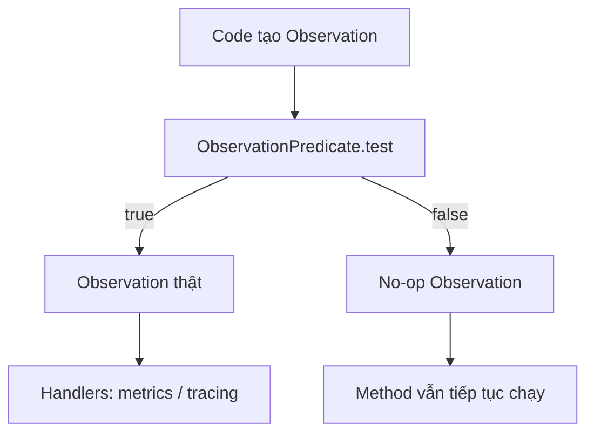

# Predicate để loại trừ annotation trong Spring Boot observability

## 1. Mục tiêu và bối cảnh

Trong ứng dụng Spring Boot, annotation @Observed giúp tạo observation quanh method của Spring bean. Tuy nhiên, không phải method nào cũng cần xuất metrics hoặc tracing. Một số method quá nhỏ, được gọi với tần suất rất cao hoặc đã được đo ở boundary khác. Nếu vẫn tạo telemetry cho tất cả, hệ thống có thể tăng chi phí, cardinality và lượng dữ liệu khó sử dụng.

Micrometer cung cấp ObservationPredicate để quyết định một observation có được phép bắt đầu hay không. Predicate nhận observation name và context; nếu trả về false, Micrometer dùng no-op observation cho operation đó. Cơ chế này hữu ích để loại trừ một nhóm observation được tạo từ annotation, dựa trên naming convention hoặc metadata có thể nhận diện.

Bài thuộc chương Annotation observability của module SPRING_BOOT_OBSERVABILITY. Module hướng dẫn thiết lập observability cho Spring Boot bằng Micrometer Observation, metrics, logs và distributed tracing; học context propagation, tag/cardinality, exporter, sampling và liên kết tín hiệu để điều tra lỗi, độ trễ và hành vi ứng dụng trên môi trường thực.

Sau bài học, bạn có thể:
1. Giải thích vai trò của ObservationPredicate trong lifecycle.
2. Đăng ký predicate trong Spring Boot.
3. Loại trừ @Observed theo observation name có quy ước.
4. Hiểu phạm vi global của predicate và tránh chặn instrumentation khác.
5. Phân biệt loại trừ telemetry với bỏ qua method/business logic.
6. Kiểm thử cả observation được giữ và observation bị loại trừ.
7. Thiết kế naming convention để chính sách lọc dễ quản lý.

Baseline: Spring Boot 3.5.x, Micrometer Observation và Spring AOP. Dùng dependency management của Spring Boot; kiểm tra package/API với version thực tế.

## 2. ObservationPredicate hoạt động thế nào?

ObservationPredicate là hook được Micrometer gọi khi tạo observation. API cốt lõi có dạng:

```java
boolean test(String name, Observation.Context context)
```

- name là tên observation đang được tạo.
- context chứa dữ liệu của operation và có thể cung cấp thêm thông tin cho quyết định.
- Trả về true để cho phép observation tiếp tục.
- Trả về false để loại observation khỏi pipeline; caller vẫn thực hiện method/business logic.

Predicate được đánh giá trước khi observation được start. Nó là chính sách lọc ở tầng ObservationRegistry, không phải điều kiện chạy method và cũng không phải bộ lọc log backend.



Predicate hoạt động ở registry nên có thể ảnh hưởng nhiều loại observation: annotation-driven, HTTP server/client, database hoặc observation tạo thủ công. Phạm vi chính sách cần được thiết kế rõ ràng.

## 3. Đăng ký predicate trong Spring Boot

Trong ứng dụng Spring, đăng ký ObservationPredicate như một bean. Spring Boot/Micrometer áp dụng các bean predicate vào ObservationRegistry được auto-configure.

Ví dụ loại trừ namespace dành riêng cho các method @Observed nội bộ:

```java
import io.micrometer.observation.ObservationPredicate;
import org.springframework.context.annotation.Bean;
import org.springframework.context.annotation.Configuration;

@Configuration
public class ObservationFilteringConfiguration {
    @Bean
    ObservationPredicate excludeInternalAnnotatedOperations() {
        return (name, context) ->
                name == null || !name.startsWith("internal.annotated.");
    }
}
```

Đánh dấu method với naming convention tương ứng:

```java
import io.micrometer.observation.annotation.Observed;
import org.springframework.stereotype.Service;

@Service
public class CacheMaintenanceService {
    @Observed(
        name = "internal.annotated.cache.refresh",
        contextualName = "refresh internal cache"
    )
    public void refreshCache() {
        // Business operation vẫn thực thi bình thường.
    }
}
```

Observation có name bắt đầu bằng internal.annotated. bị loại trừ. Method refreshCache() vẫn chạy và vẫn có thể ném exception như trước; chỉ telemetry đi qua Observation pipeline bị bỏ.

## 4. Vì sao dùng naming convention?

ObservationPredicate nhận name và context, nhưng không nhất thiết có một cờ chuẩn nói observation cụ thể được tạo bởi @Observed. Quy ước tên rõ ràng giúp phân loại nhóm annotation observations mà không dựa vào tên class nội bộ của aspect.

| Namespace | Mục đích | Chính sách ví dụ |
| --- | --- | --- |
| internal.annotated.* | Method @Observed nội bộ, tần suất cao | Có thể loại trừ có chọn lọc |
| business.* | Business operations cần theo dõi | Giữ |
| http.server.requests | HTTP server instrumentation | Giữ |
| http.client.requests | HTTP client instrumentation | Giữ |
| db.* | Database operations | Giữ theo policy riêng |

Không nên dùng điều kiện quá rộng như loại trừ mọi observation có chứa từ internal nếu HTTP/database instrumentation cũng dùng namespace đó. Namespace phải do đội phát triển quản lý và được kiểm tra khi thêm operation mới.

## 5. Predicate có phạm vi global

Predicate gắn vào ObservationRegistry có thể áp dụng cho mọi observation được tạo qua registry đó, không chỉ annotation-driven observations.

Nếu predicate loại trừ theo tên chung như cache.lookup, một observation thủ công hoặc observation từ thư viện khác có cùng name cũng có thể bị chặn. Vì vậy:
- Dùng prefix riêng cho nhóm annotation cần lọc.
- Tránh tên chung như service, method hoặc internal.
- Giữ HTTP/database observations quan trọng ngoài namespace bị lọc.
- Kiểm thử instrumentation khác sau khi thêm predicate.
- Chỉ dựa vào context metadata đã được xác minh ở đúng Micrometer version; không phụ thuộc class nội bộ chưa được cam kết API.

Predicate không phải cách disable toàn bộ AOP hoặc annotation processing. Nó lọc observation ở registry sau khi code đã yêu cầu tạo observation.

## 6. Kết hợp nhiều predicate

Một ứng dụng có thể có nhiều bean ObservationPredicate, ví dụ một predicate loại trừ namespace nội bộ và một predicate giữ observation thuộc allowlist. Các predicate cần được xem như chính sách phối hợp: chỉ cần một predicate từ chối thì observation không được ghi nhận.

Tránh predicate mâu thuẫn hoặc có side effects. Predicate nên:
- Nhanh và deterministic.
- Chỉ đọc name/context, không gọi database/network.
- Không ghi log cho từng lần đánh giá.
- Không thay đổi context hoặc business state.
- Có unit test cho trường hợp true/false.

Nếu cần chính sách phức tạp, hợp nhất điều kiện vào một predicate có cấu trúc thay vì nhiều bean khó theo dõi.

## 7. Loại trừ observation khác với loại trừ method

Khi predicate trả về false:
- Spring AOP vẫn intercept lời gọi method nếu proxy đã được cấu hình.
- Method target vẫn thực thi.
- Return value hoặc exception vẫn được trả/ném theo logic method.
- Observation handlers không nhận lifecycle của observation bị loại trừ.
- Không có timer/span được tạo từ observation đó qua registry.

Predicate không thay thế authorization, validation, feature flag hoặc business condition. Không dùng nó để quyết định có thực hiện thanh toán, ghi database hay gọi dependency hay không.

## 8. Exception và nested observations

Nếu method bị loại trừ ném exception, caller vẫn nhận exception. Predicate không nuốt exception và không biến lỗi thành success.

Nếu operation bị loại trừ tạo nested observation khác bên trong, nested observation được đánh giá độc lập. Ví dụ internal.annotated.cache.refresh bị loại trừ nhưng HTTP client call bên trong vẫn có thể tạo http.client.requests và client span nếu predicate khác cho phép.

Điều này hữu ích khi muốn bỏ telemetry cho wrapper method nhỏ nhưng vẫn giữ dependency calls. Ngược lại, nếu predicate loại trừ cả namespace của nested operation, các tín hiệu đó cũng biến mất.

## 9. Phân biệt predicate, sampling và exporter filtering

| Cơ chế | Thời điểm | Tác động |
| --- | --- | --- |
| ObservationPredicate | Khi tạo observation | Không tạo observation thật nếu bị từ chối |
| Trace sampling | Khi quyết định ghi/giữ trace | Có thể bỏ một số traces theo sampling policy |
| Meter filter | Khi meter được đăng ký/được chấp nhận | Lọc hoặc biến đổi meter/tags |
| Logging filter | Khi log event được xử lý | Lọc log records |
| Exporter/backend filtering | Khi telemetry được gửi/lưu | Dữ liệu có thể đã được tạo trước khi bị lọc |

Nếu mục tiêu là giảm số observation và tránh handlers chạy, predicate là tầng phù hợp. Nếu chỉ muốn không export một số traces, sampling/exporter policy có thể phù hợp hơn. Nếu chỉ muốn giảm log volume, dùng logging policy.

## 10. Kiểm thử predicate

### 10.1. Unit test

```java
import io.micrometer.observation.Observation;
import io.micrometer.observation.ObservationPredicate;
import org.junit.jupiter.api.Test;
import static org.assertj.core.api.Assertions.assertThat;

class ObservationPredicateTest {
    @Test
    void excludesOnlyInternalAnnotatedNamespace() {
        ObservationPredicate predicate =
                (name, context) -> name == null
                        || !name.startsWith("internal.annotated.");

        assertThat(predicate.test(
                "internal.annotated.cache.refresh",
                new Observation.Context())).isFalse();
        assertThat(predicate.test(
                "business.payment.authorize",
                new Observation.Context())).isTrue();
        assertThat(predicate.test(
                "http.client.requests",
                new Observation.Context())).isTrue();
    }
}
```

### 10.2. Integration test với Spring context

1. Tạo test application context có ObservationRegistry, predicate bean và @Observed aspect.
2. Inject service bean từ context để lời gọi đi qua proxy.
3. Gọi method có name thuộc namespace bị loại trừ.
4. Xác nhận method vẫn được thực thi và return value không đổi.
5. Dùng test ObservationHandler hoặc meter registry xác nhận không có observation/meter tương ứng.
6. Gọi method có name được giữ và xác nhận handler nhận start/stop.
7. Gọi method bị loại trừ nhưng ném exception; xác nhận exception vẫn propagate.
8. Gọi HTTP client/database operation bên trong để kiểm tra predicate không vô tình chặn instrumentation khác.

Test cần dùng đúng version Micrometer/Spring Boot. Đừng chỉ assert predicate lambda mà bỏ qua wiring thật vào ObservationRegistry.

## 11. Troubleshooting

| Triệu chứng | Nguyên nhân có thể | Cách xử lý |
| --- | --- | --- |
| @Observed không tạo span/metric | Predicate trả false hoặc annotation/AOP chưa bật | Kiểm tra predicate, name, AOP và handlers |
| HTTP metrics cũng biến mất | Predicate global có điều kiện quá rộng | Giới hạn namespace bị loại trừ |
| Method không chạy sau khi thêm predicate | Nhầm predicate với business guard hoặc lỗi proxy | Kiểm tra exception/proxy; predicate không skip target method |
| Observation cùng tên bị loại ngoài ý muốn | Manual/library observation dùng chung prefix | Đặt namespace riêng và kiểm tra caller |
| Observation bị loại nhưng HTTP client span vẫn có | Nested observation được đánh giá độc lập | Giữ dependency telemetry theo policy |
| Predicate gây latency | Xử lý nặng hoặc logging trong test() | Giữ predicate thuần, nhanh và deterministic |
| Exception biến mất trong test | Test chỉ kiểm tra telemetry | Assert exception vẫn propagate |
| Không thấy khác biệt metrics | Handler chưa cấu hình hoặc meter tạo ở nguồn khác | Dùng test ObservationHandler và kiểm tra meter source |

## 12. Checklist production

- [ ] Annotation processing và Spring AOP được cấu hình đúng.
- [ ] Predicate được đăng ký với ObservationRegistry của ứng dụng.
- [ ] Namespace loại trừ có quy ước rõ và không trùng HTTP/database instrumentation.
- [ ] Predicate không có side effects, I/O hoặc log mỗi lần đánh giá.
- [ ] Method/business logic vẫn chạy khi observation bị từ chối.
- [ ] Exception vẫn propagate và được xử lý theo application policy.
- [ ] Nested observations quan trọng vẫn được giữ.
- [ ] Metrics, tracing sampling, logging filters và predicate có mục đích riêng.
- [ ] Có unit test và integration test cho keep/drop behavior.
- [ ] Đã kiểm tra cardinality và telemetry volume sau triển khai.

## 13. Câu hỏi tự luyện

1. ObservationPredicate được gọi ở giai đoạn nào của observation lifecycle?
2. Predicate trả false có làm method target ngừng chạy không?
3. Vì sao predicate bean có thể ảnh hưởng HTTP server/client observations?
4. Naming convention giúp giới hạn phạm vi loại trừ như thế nào?
5. Vì sao không nên loại trừ theo prefix quá chung như internal?
6. Một nested HTTP client observation có bị loại cùng parent không?
7. Predicate khác trace sampling và MeterFilter thế nào?
8. Những side effects nào cần tránh trong predicate?
9. Làm thế nào kiểm thử exception vẫn propagate khi observation bị loại?
10. Vì sao cần integration test với ObservationRegistry thật?

## Tài liệu tham khảo

- [Micrometer Observation — Concepts](https://docs.micrometer.io/micrometer/reference/observation.html)
- [Micrometer Observation — API](https://docs.micrometer.io/micrometer/reference/observation/instrumenting.html)
- [Spring Boot 3.5 — Observability](https://docs.spring.io/spring-boot/3.5/reference/actuator/observability.html)
- [Spring Boot 3.5 — Common Application Properties](https://docs.spring.io/spring-boot/3.5/appendix/application-properties/index.html)
- [Spring Framework — AOP Proxies](https://docs.spring.io/spring-framework/reference/core/aop/proxying.html)
- [Micrometer Tracing — Sampling](https://docs.micrometer.io/tracing/reference/api.html)

