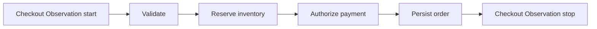

# Khi dùng annotation thay custom API trong Spring Boot

Spring Boot và Micrometer cung cấp nhiều cách instrument code: annotation như @Counted, @Timed, @Observed, hoặc gọi trực tiếp API như Observation, Counter, Timer và MeterRegistry. Cả hai hướng đều có thể tạo telemetry hữu ích, nhưng phù hợp với những boundary khác nhau.

**Annotation phù hợp khi một method boundary rõ ràng đã thể hiện đúng operation cần đo và metadata tương đối tĩnh.** Custom API phù hợp khi cần kiểm soát chính xác thời điểm bắt đầu/kết thúc, outcome, context, tags động có kiểm soát, hoặc một operation trải qua nhiều bước và asynchronous boundaries.

Bài **“Khi dùng annotation thay custom API”** thuộc chương **Annotation observability** của module **SPRING_BOOT_OBSERVABILITY**. Module hướng dẫn thiết lập observability cho Spring Boot bằng Micrometer Observation, metrics, logs và distributed tracing. Mục tiêu là chọn đúng công cụ để đo metrics, tạo traces, propagate context và liên kết tín hiệu khi điều tra lỗi, độ trễ và hành vi ứng dụng trên môi trường thực.

## 1. Hai cách instrument code

### Annotation-driven instrumentation

Annotation đặt trên method để aspect/interceptor thực hiện instrumentation quanh lời gọi.

```java
@Service
public class InvoiceService {

    @Counted("invoice.generate.calls")
    public Invoice generate(GenerateInvoice command) {
        return createInvoice(command);
    }
}
```

Code nghiệp vụ gọn, instrumentation khai báo ngay tại method boundary. Tuy nhiên, annotation chỉ có tác dụng khi framework hỗ trợ nó, aspect/interceptor được đăng ký và lời gọi đi qua cơ chế interception tương ứng.

### Programmatic/custom API

Code gọi trực tiếp Micrometer API tại điểm có ý nghĩa:

```java
@Service
public class InvoiceService {

    private final Counter generated;

    public InvoiceService(MeterRegistry registry) {
        this.generated = Counter.builder("invoice.generated")
                .register(registry);
    }

    public Invoice generate(GenerateInvoice command) {
        Invoice invoice = createInvoice(command);
        generated.increment();
        return invoice;
    }
}
```

Custom API dài hơn một chút, nhưng vị trí increment biểu đạt rõ business outcome: chỉ tăng sau khi invoice được tạo thành công.

Với Observation:

```java
Observation.createNotStarted("invoice.generate", observationRegistry)
        .lowCardinalityKeyValue("invoice.channel", channel)
        .observe(() -> createInvoice(command));
```

Observation API có thể kết nối nhiều handlers để tạo metrics và tracing từ cùng một lifecycle.

## 2. Chọn theo semantics cần đo

Câu hỏi đầu tiên không phải annotation hay API ngắn hơn, mà là tín hiệu có ý nghĩa gì và boundary nào đại diện đúng cho nó?

| Nhu cầu | Lựa chọn thường phù hợp | Lý do |
| --- | --- | --- |
| Đếm mỗi lần một Spring bean method được gọi | @Counted | Method invocation là boundary rõ |
| Đo thời gian thực thi method đồng bộ | @Timed | Aspect bao quanh method call |
| Tạo metrics và tracing cho method operation đơn giản | @Observed | Khai báo Observation boundary |
| Đếm business success sau transaction | Custom Counter/API tại outcome boundary | Invocation không đồng nghĩa thành công |
| Đo workflow qua nhiều method | Custom Observation | Boundary bao trùm workflow |
| Đo từng pha trong operation | Custom Timer/Observation | Kiểm soát start/stop từng pha |
| Metadata dựa trên runtime context | Custom convention/API | Phụ thuộc request/task context |
| Đo reactive task đến terminal signal | Reactive-aware API/instrumentation | Method return có thể chỉ trả Publisher |
| Đo retry attempts và final outcome riêng | Custom metrics | Phân biệt attempt với kết quả cuối |

Annotation chính xác khi method invocation đúng là operation muốn đo. Custom API cũng không tự động tốt hơn; đặt start/stop sai chỗ có thể làm duration sai.

## 3. Khi nào annotation là lựa chọn tốt?

Annotation thường phù hợp khi operation tương ứng một method boundary ổn định, method được gọi qua Spring-managed proxy, metadata tĩnh hoặc convention có thể cung cấp, không cần điều khiển start/stop thủ công và semantics annotation khớp số liệu muốn thu thập.

Đếm số lần method được gọi:

```java
@Counted(
    value = "catalog.lookup.calls",
    extraTags = {"operation", "lookup"}
)
public Product lookup(String code) {
    return repository.findByCode(code);
}
```

Đo duration:

```java
@Timed(
    value = "catalog.lookup",
    histogram = true
)
public Product lookup(String code) {
    return repository.findByCode(code);
}
```

Tên annotation attributes và hỗ trợ histogram cần xác minh theo Micrometer version được Spring Boot BOM quản lý.

Ưu điểm của annotation là ít boilerplate, dễ scan trong code review và tách instrumentation khỏi business logic. Với method boundary rõ, đây là cách khai báo đơn giản và nhất quán.

## 4. Khi nào custom API phù hợp hơn?

Custom API nên được ưu tiên khi instrumentation cần biểu đạt logic không trùng với method call:

1. Chỉ tăng Counter sau khi business operation thành công.
2. Đo riêng validation, database, remote call và serialization.
3. Operation bắt đầu ở method này nhưng hoàn tất ở callback/async task khác.
4. Cần KeyValues từ runtime context đã được kiểm tra/chuẩn hóa.
5. Cần Observation quanh workflow nhiều bước.
6. Cần links tới nhiều parent contexts, ví dụ batch message processing.
7. Cần ghi nhận outcome sau retry/recovery.
8. Cần custom error handling hoặc lifecycle control.

Ví dụ phân biệt attempts và kết quả cuối:

```java
public Result execute(Command command) {
    attempts.increment();

    Result result = performWithRetry(command);

    if (result.isSuccessful()) {
        successes.increment();
    } else {
        failures.increment();
    }
    return result;
}
```

Một @Counted trên method chỉ cho biết method được gọi; nó không tự phân loại retry attempts, business success và final failure.

## 5. Phân biệt @Counted, @Timed và @Observed

Ba annotation không có cùng semantics.

| Annotation | Signal/chức năng chính | Dùng khi |
| --- | --- | --- |
| @Counted | Counter cho method invocation | Cần số lần method được gọi |
| @Timed | Timer cho duration/count/distribution | Cần latency của method boundary |
| @Observed | Observation lifecycle cho handlers | Cần metrics và tracing nếu handlers được cấu hình |

@Counted đếm invocation qua aspect. Invocation có thể vẫn được đếm khi method ném exception. Không dùng nó làm business success counter nếu failure cũng được tính.

@Timed đo khoảng thời gian aspect bao quanh method invocation. Với method đồng bộ, boundary khá rõ. Với method trả Future/Publisher, cần xác minh instrumentation đo thời gian gọi method hay thời gian asynchronous work hoàn tất; không mặc định hai khoảng thời gian giống nhau.

@Observed tạo Observation cho method boundary. ObservationRegistry handlers có thể chuyển lifecycle thành metrics và tracing. Annotation không tự bảo đảm có span nếu tracing handler/bridge chưa được cấu hình hoặc sampling không giữ trace.

Không gắn cả ba annotation lên cùng method chỉ để có đủ telemetry. Chọn signal cần thiết, tránh duplicate counters/timers và span lồng nhau không có ý nghĩa.

## 6. AOP proxy và self-invocation

Annotation-driven instrumentation trong Spring thường dựa trên proxy/interceptor. Method call từ bean khác qua proxy có thể được intercept; lời gọi nội bộ qua this thường bỏ qua proxy.

```java
@Service
public class BillingService {

    public void runBilling() {
        calculate(); // Self-invocation may bypass the proxy
    }

    @Counted("billing.calculate.calls")
    public void calculate() {
        // Work
    }
}
```

Nếu runBilling() gọi trực tiếp calculate() trên cùng instance, aspect có thể không chạy. Object được tạo bằng new ngoài Spring container cũng không tự nhận AOP proxy.

Cách xử lý: đưa operation sang bean riêng, gọi qua proxy Spring quản lý, dùng programmatic API nếu method boundary không thể qua proxy và kiểm thử hành vi thực tế.

## 7. Async và reactive lifecycle

Với method đồng bộ, aspect có thể start trước method và stop sau khi method return/throw. Nhưng asynchronous method có thể return trước khi công việc thực sự kết thúc.

```java
@Timed("report.generate")
public CompletableFuture<Report> generateAsync() {
    return CompletableFuture.supplyAsync(this::generateReport);
}
```

Nếu aspect đo method invocation, duration có thể chỉ là thời gian tạo và trả CompletableFuture, không phải thời gian generateReport hoàn tất.

Với Reactor, method trả Mono ngay; công việc thường bắt đầu khi subscribe. Không suy rằng timer quanh method tự động bao phủ thời gian reactive exchange tới terminal signal.

Khi cần đo asynchronous completion, dùng instrumentation reactive-aware được framework hỗ trợ hoặc đặt Observation/Timer quanh publisher lifecycle, bao gồm complete/error/cancel. Giữ context qua Reactor Context/Micrometer Context Propagation; tránh giữ ThreadLocal scope thủ công xuyên scheduler.

## 8. Workflow nhiều bước cần Observation boundary riêng

Giả sử checkout gồm validate, reserve inventory, authorize payment và persist order. Gắn @Timed lên từng method cho biết thời gian từng method, nhưng không nhất thiết cung cấp operation-level Observation bao trùm workflow.



Có thể dùng Observation API:

```java
public CheckoutResult checkout(CheckoutCommand command) {
    return Observation.createNotStarted("checkout.process", registry)
            .lowCardinalityKeyValue("channel", normalizeChannel(command.channel()))
            .observe(() -> {
                validate(command);
                reserveInventory(command);
                authorizePayment(command);
                return persistOrder(command);
            });
}
```

Ví dụ phù hợp workflow đồng bộ. Nếu một bước bất đồng bộ, phải giữ Observation lifecycle đến khi workflow hoàn tất và xử lý cancel/error đúng semantics.

## 9. Runtime metadata và cardinality

Annotation thường phù hợp metadata tĩnh như operation name hoặc channel cố định. Nếu tag phụ thuộc runtime, custom convention/API có thể phù hợp hơn, nhưng giá trị phải được chuẩn hóa và cardinality kiểm soát.

Ví dụ tốt: channel=web/mobile/partner; dependency=payment/inventory; operation=authorize/capture/refund; outcome=success/failure.

Không đưa user ID, order ID, trace ID, request ID, raw URL/query string, exception message, message payload, email hoặc token vào metric tags.

Không vì dùng custom API mà được phép thêm dynamic values tùy ý. Cardinality và privacy là ràng buộc cho cả annotation lẫn API.

## 10. Custom convention so với thêm code ở từng method

Nếu nhiều method cần cùng metadata policy, không lặp logic trong từng method. Dùng convention hoặc ObservationFilter để tập trung hóa.

| Cách | Phạm vi | Khi phù hợp |
| --- | --- | --- |
| Annotation attributes | Từng method, metadata tĩnh | Operation có tags cố định |
| Custom ObservationConvention | Một loại Observation | Chuẩn hóa keys/values theo context |
| ObservationFilter | Nhiều loại Observation | Policy hậu xử lý dùng chung |
| Observation API | Workflow cụ thể | Kiểm soát lifecycle và runtime metadata |
| MeterRegistry API | Một metric cụ thể | Business counters/timers tại outcome boundary |

Không dùng ObservationFilter để thay thế toàn bộ instrumentation nếu convention hoặc handler là extension point đúng hơn. Mỗi extension point có trách nhiệm riêng.

## 11. Transaction và business outcome

Một method có thể return thành công trước khi transaction commit hoàn tất, tùy transaction boundary và proxy ordering. Nếu counter cần phản ánh dữ liệu đã commit, increment ngay trong method body có thể quá sớm.

Service method có thể return bình thường nhưng transaction commit sau đó thất bại. Invocation counter và committed-operation counter có semantics khác nhau.

Nếu cần đếm sau commit, dùng transaction synchronization/event phù hợp với transaction manager và chỉ ghi metric sau khi commit thành công. Cân nhắc outbox/audit pattern nếu đây là dữ liệu nghiệp vụ cần độ tin cậy cao; metric không phải ledger.

Annotation phù hợp method invocation; custom hook phù hợp business outcome gắn với transaction lifecycle.

## 12. Tính nhất quán và chi phí vận hành

Chọn convention đặt tên nhất quán:

- Tên mô tả operation, không gắn implementation detail dễ thay đổi.
- Tag keys ổn định giữa services.
- Tag values là enum/allowlist.
- Phân biệt attempt, success, failure và retry exhaustion.
- Dùng Timer/Histogram cho latency.
- Chỉ tạo spans ở boundary có ý nghĩa.
- Tránh nhiều instrumentation đo cùng operation nếu không có mục tiêu rõ.

Annotation giảm boilerplate nhưng vẫn có overhead AOP/interceptor và registry updates. Custom API kiểm soát chi tiết hơn nhưng tăng code cần review/test. Chọn theo semantics và khả năng duy trì.

## 13. Bảng quyết định nhanh

| Câu hỏi | Nếu có | Lựa chọn |
| --- | --- | --- |
| Chỉ cần đếm method invocations? | Có | @Counted |
| Cần duration của synchronous method? | Có | @Timed |
| Cần Observation ở method boundary đơn giản? | Có | @Observed |
| Chỉ count khi business outcome thành công? | Có | Custom Counter tại outcome |
| Workflow kéo dài qua nhiều method? | Có | Custom Observation |
| Cần đo async completion/cancellation? | Có | Reactive/async-aware instrumentation |
| Cần nhiều producer contexts cho batch? | Có | Custom Observation với links |
| Metadata runtime cần chuẩn hóa? | Có | Convention hoặc custom API |
| Method không đi qua Spring proxy? | Có | Programmatic API hoặc sửa boundary |
| Metadata tĩnh và method boundary chuẩn? | Có | Annotation |

## 14. Kiểm thử lựa chọn instrumentation

Một bộ test cần xác minh semantics, không chỉ meter có tồn tại:

1. Gọi method qua Spring proxy và xác minh annotation được intercept.
2. Thử self-invocation và object tự tạo để thấy giới hạn proxy.
3. Ném exception và kiểm tra count/error semantics.
4. Với business counter, xác minh chỉ tăng sau outcome mong muốn.
5. Với transaction, thử commit và rollback.
6. Với Timer, xác minh duration boundary.
7. Với CompletableFuture/Mono, xác minh timer kết thúc ở method return hay async completion.
8. Với Observation API, xác minh start/stop và terminal signals.
9. Kiểm tra trace context và logs correlation nếu dùng @Observed/Observation.
10. Kiểm tra tag cardinality và không có sensitive values.
11. Kiểm tra không có duplicate metrics/spans.
12. Xác minh meter/observation đi vào đúng registry và exporter.

Dùng SimpleMeterRegistry hoặc test ObservationHandler trong unit tests; dùng Spring integration test cho AOP proxy, auto-configuration và HTTP/messaging instrumentation.

## 15. Ví dụ lựa chọn theo tình huống

### Đếm số lần gọi service method

Dùng @Counted khi cần tổng invocation:

```java
@Counted("inventory.reserve.calls")
public Reservation reserve(ReserveCommand command) {
    return inventoryRepository.reserve(command);
}
```

### Đếm số reservation thành công

Dùng custom Counter sau khi kết quả được xác nhận:

```java
public Reservation reserve(ReserveCommand command) {
    Reservation reservation = repository.reserve(command);
    successfulReservations.increment();
    return reservation;
}
```

### Đo latency và trace của operation

Dùng @Observed khi method boundary là operation phù hợp và handlers đã cấu hình:

```java
@Observed(name = "inventory.reserve")
public Reservation reserve(ReserveCommand command) {
    return repository.reserve(command);
}
```

### Đo workflow async

Dùng Observation quanh publisher/task completion, không chỉ quanh method trả publisher. Với reactive chain, bảo đảm Observation scope/context được quản lý đúng qua subscription và terminal signals theo API Micrometer/Spring version.

## 16. Câu hỏi tự kiểm tra

1. Khi nào annotation phù hợp hơn custom API?
2. @Counted đo invocation hay business success?
3. @Timed trên method trả Mono có nhất thiết đo tới terminal signal không?
4. @Observed cần handlers nào để tạo metrics và traces?
5. Vì sao AOP self-invocation có thể bỏ qua annotation?
6. Khi nào nên dùng custom Counter tại outcome boundary?
7. Workflow nhiều method nên đặt Observation ở đâu?
8. Runtime tags cần kiểm soát cardinality thế nào?
9. ObservationConvention khác ObservationFilter và ObservationHandler ra sao?
10. Transaction commit có thể làm business success khác method return thế nào?
11. Khi nào custom API giúp xử lý cancellation và async lifecycle?
12. Làm sao tránh duplicate metrics khi kết hợp annotation và API?
13. Test nào xác minh annotation được proxy intercept?
14. Vì sao metrics, traces và logs cần cùng operation/service identity?

## Tài liệu tham khảo

- [Micrometer — Annotation-based Observability](https://docs.micrometer.io/micrometer/reference/observation/annotations.html): @Observed và aspect configuration.
- [Micrometer — Counters](https://docs.micrometer.io/micrometer/reference/concepts/counters.html): Counter semantics và @Counted.
- [Micrometer — Timers](https://docs.micrometer.io/micrometer/reference/concepts/timers.html): Timer duration/count/distribution.
- [Micrometer — Observation](https://docs.micrometer.io/micrometer/reference/observation.html): Observation API, registry, conventions, filters và handlers.
- [Spring Boot — AOP](https://docs.spring.io/spring-boot/reference/features/aop.html): proxy-based AOP behavior.
- [Spring Boot — Metrics](https://docs.spring.io/spring-boot/reference/actuator/metrics.html): MeterRegistry, Actuator metrics và instrumentation.

## Kết luận

**Dùng annotation khi method boundary chính là operation cần quan sát; dùng custom API khi semantics hoặc lifecycle vượt ra ngoài method invocation.** @Counted đếm calls, @Timed đo duration theo phạm vi interception, còn @Observed tạo Observation cho handlers. Chúng đơn giản và dễ đọc khi boundary rõ, metadata ổn định và proxy/interceptor hoạt động đúng.

Custom Counter/Timer/Observation phù hợp khi cần đếm business outcome, đo workflow nhiều bước, theo dõi async completion/cancellation, gắn runtime context hoặc kiểm soát retry và transaction boundary. Dù chọn cách nào, hãy giữ cardinality thấp, tránh duplicate instrumentation và kiểm thử đúng lifecycle. Mục tiêu là telemetry phản ánh đúng operation thực tế để metrics, traces và logs hỗ trợ điều tra trên production.

