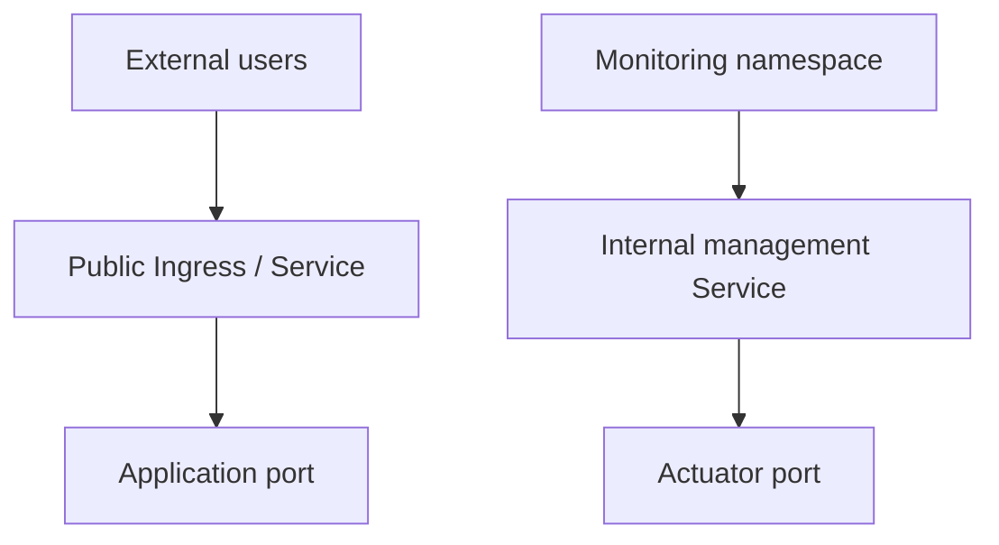

# Security cho Actuator trong Spring Boot

Spring Boot Actuator cung cấp các endpoint giúp vận hành và quan sát ứng dụng như health, metrics, info, loggers, env, configprops, threaddump và heapdump. Những endpoint này rất hữu ích cho monitoring và troubleshooting, nhưng một số endpoint có thể tiết lộ thông tin nội bộ hoặc cho phép thay đổi trạng thái ứng dụng. Nếu expose chúng không đúng cách, người ngoài có thể đọc cấu hình, xem thông tin môi trường, tải dữ liệu chẩn đoán hoặc thay đổi log levels.

Bài **Security cho actuator** thuộc chương **Actuator và management** của module **SPRING_BOOT_OBSERVABILITY**. Module hướng dẫn thiết lập observability cho Spring Boot bằng Micrometer Observation, metrics, logs và distributed tracing; học context propagation, tag/cardinality, exporter, sampling và liên kết tín hiệu để điều tra lỗi, độ trễ và hành vi ứng dụng trên môi trường thực.

Sau bài học, bạn có thể phân biệt endpoint exposure với authorization, thiết kế quyền truy cập theo endpoint và role, cấu hình Spring Security cho management endpoints, tách management port/network boundary khi phù hợp, bảo vệ health details và kiểm thử quyền truy cập trong môi trường production.

## 1. Actuator endpoint có thể tiết lộ điều gì?

| Endpoint | Mục đích | Rủi ro cần đánh giá |
| --- | --- | --- |
| health | Trạng thái ứng dụng và dependency | Health details có thể tiết lộ hostname, database hoặc trạng thái hạ tầng |
| info | Thông tin ứng dụng/build | Có thể chứa version, commit hoặc metadata nội bộ |
| metrics | Danh sách meter và measurements | Có thể tiết lộ tên service, dependency, traffic và cấu trúc hệ thống |
| prometheus | Export metrics cho scraper | Dữ liệu vận hành có thể bị đọc công khai nếu endpoint mở |
| env | Environment properties | Có thể lộ secrets/configuration nếu dữ liệu không được lọc đúng |
| configprops | Configuration properties | Có thể tiết lộ topology, credentials hoặc nội dung cấu hình |
| loggers | Xem và thay đổi log levels | Người dùng không được phép có thể bật DEBUG/TRACE hoặc làm tăng log volume |
| threaddump | Chẩn đoán threads | Có thể tiết lộ class names, request context hoặc thông tin nội bộ |
| heapdump | Tải heap dump | Có thể chứa credentials, tokens và dữ liệu người dùng trong memory |
| shutdown | Tắt ứng dụng nếu được bật | Có thể gây gián đoạn dịch vụ |

Mức độ nhạy cảm phụ thuộc endpoint, nội dung thực tế và môi trường. Một endpoint chỉ đọc vẫn có thể là rủi ro bảo mật nếu trả về thông tin nội bộ.

## 2. Exposure và authorization là hai lớp khác nhau

Spring Boot Actuator có cơ chế exposure để quyết định endpoint nào được publish qua web/JMX. Spring Security kiểm tra request nào được phép truy cập endpoint đã publish.

| Lớp | Câu hỏi | Ví dụ |
| --- | --- | --- |
| Exposure | Endpoint có được đưa ra giao diện quản lý không? | Chỉ expose health và prometheus qua web |
| Authentication | Request đến từ ai? | Service account hoặc operator đăng nhập |
| Authorization | Principal đó được phép làm gì? | Monitoring role đọc metrics; operator đọc health details |
| Network boundary | Request có thể đi tới management listener không? | Chỉ monitoring subnet truy cập management port |

Ẩn endpoint bằng exposure không thay thế authorization cho các endpoint còn lại. Ngược lại, chỉ thêm Spring Security rule mà expose mọi endpoint vẫn làm tăng bề mặt cần bảo vệ.

Thiết kế an toàn cần cả exposure tối thiểu, authentication/authorization và network controls phù hợp.

## 3. Chỉ expose endpoint cần thiết

Ví dụ cấu hình chỉ expose health và prometheus qua HTTP:

```yaml
management:
  endpoints:
    web:
      exposure:
        include: health,prometheus
```

Nếu ứng dụng cần metrics qua endpoint riêng, có thể thêm metrics sau khi xác định scraper nào cần dùng. Không dùng wildcard include trong production nếu chưa có inventory và policy rõ ràng.

Một số endpoint có thể được bật mặc định hoặc phụ thuộc dependency. Hãy kiểm tra danh sách endpoint thực tế của ứng dụng sau khi thêm starter, thay vì suy luận chỉ từ file YAML.

## 4. Cấu hình Spring Security cho management endpoints

Một security chain dành cho management endpoints giúp tách policy của actuator khỏi policy của application API. Ví dụ Spring Security 6 minh họa:

```java
import org.springframework.boot.actuate.autoconfigure.security.servlet.EndpointRequest;
import org.springframework.context.annotation.Bean;
import org.springframework.context.annotation.Configuration;
import org.springframework.core.annotation.Order;
import org.springframework.security.config.Customizer;
import org.springframework.security.config.annotation.web.builders.HttpSecurity;
import org.springframework.security.web.SecurityFilterChain;

@Configuration
class ManagementSecurityConfiguration {
    @Bean
    @Order(1)
    SecurityFilterChain actuatorSecurity(HttpSecurity http) throws Exception {
        return http
            .securityMatcher(EndpointRequest.toAnyEndpoint())
            .authorizeHttpRequests(auth -> auth
                .requestMatchers(EndpointRequest.to("health")).permitAll()
                .requestMatchers(EndpointRequest.to("prometheus"))
                    .hasRole("MONITOR")
                .anyRequest().hasRole("OPS")
            )
            .httpBasic(Customizer.withDefaults())
            .build();
    }

    @Bean
    @Order(2)
    SecurityFilterChain applicationSecurity(HttpSecurity http) throws Exception {
        return http
            .authorizeHttpRequests(auth -> auth
                .requestMatchers("/public/**").permitAll()
                .anyRequest().authenticated()
            )
            .httpBasic(Customizer.withDefaults())
            .build();
    }
}
```

Ví dụ minh họa cấu trúc hai filter chains, không phải cấu hình credentials production. Cần cấu hình AuthenticationProvider/UserDetailsService hoặc OAuth2 resource server phù hợp với hệ thống danh tính. Không lưu password trong source; dùng identity provider, secret manager hoặc cơ chế xác thực của platform.

Điểm quan trọng: chain đầu tiên match Actuator endpoints bằng EndpointRequest; health có thể được cho phép đọc status tối thiểu; Prometheus chỉ cho monitoring principal; các endpoint management còn lại yêu cầu role vận hành; chain ứng dụng xử lý routes khác.

Nếu application đã có custom SecurityFilterChain, cần xem toàn bộ chain ordering và matcher để tránh actuator rơi vào chain không mong muốn.

## 5. Health endpoint và health details

Health endpoint thường được dùng bởi load balancer/orchestrator. Tuy nhiên, health details có thể tiết lộ thông tin dependency như database, disk, broker hoặc component names.

Ví dụ:

```yaml
management:
  endpoint:
    health:
      show-details: when-authorized
      roles: OPS
```

Các giá trị show-details phổ biến gồm never, when-authorized và always. Không nên dùng always trên endpoint có thể truy cập từ mạng không tin cậy. Với liveness/readiness probes, chỉ trả trạng thái tối thiểu có thể đủ.

Health groups cho phép tách liveness/readiness và các thành phần kiểm tra. Không đưa thông tin nhạy cảm vào custom HealthIndicator details; dữ liệu có thể xuất hiện trong log hoặc monitoring system.

## 6. Tách management port và network boundary

Management endpoints có thể dùng port riêng:

```yaml
server:
  port: 8080
management:
  server:
    port: 8081
```

Port riêng giúp áp dụng firewall, Kubernetes Service hoặc network policy khác với traffic người dùng. Tuy nhiên, khác port không tự động có nghĩa là an toàn: nếu listener vẫn bind trên interface công khai hoặc ingress route được mở, endpoint vẫn có thể bị truy cập.

Trong production, chỉ route management port tới monitoring/operator networks; dùng NetworkPolicy hoặc firewall/security group; không publish management service ra Internet; giới hạn source IP/workload identity của scraper; dùng TLS và authentication khi đi qua mạng không tin cậy; kiểm tra ingress/service mesh có vô tình expose port quản lý hay không.

## 7. Authentication và role model

| Principal | Quyền gợi ý |
| --- | --- |
| Liveness/readiness probe | Đọc health status tối thiểu theo cơ chế probe nội bộ |
| Metrics scraper | Đọc prometheus/metrics |
| Support engineer | Đọc health và thông tin chẩn đoán đã được phê duyệt |
| Operator | Đọc management endpoints cần cho vận hành |
| Administrator | Thực hiện thao tác thay đổi như loggers nếu policy cho phép |

Không cấp một role toàn quyền cho mọi scraper hoặc mọi người trực vận hành. Dùng service account riêng, credentials có vòng đời/rotation và audit access.

HTTP Basic có thể phù hợp cho một số mạng nội bộ nếu được bọc TLS và secrets được quản lý tốt; môi trường tổ chức có thể dùng OAuth2 resource server, mTLS hoặc workload identity. Chọn phương thức tương thích với platform, không tự thiết kế authentication protocol.

## 8. Bảo vệ endpoint có thể thay đổi trạng thái

Endpoint loggers có thể thay đổi log level trong runtime. Shutdown endpoint có thể dừng ứng dụng. Những endpoint này cần policy chặt chẽ hơn endpoint chỉ đọc.

- Chỉ expose khi có nhu cầu vận hành được phê duyệt.
- Chỉ cho role có quyền thay đổi cấu hình truy cập.
- Ghi audit event cho thao tác thay đổi.
- Có quy trình khôi phục log level sau debug.
- Không bật shutdown endpoint nếu deployment platform đã quản lý lifecycle.

Nếu một endpoint không cần thiết, không expose nó. Đây là cách giảm bề mặt tấn công đơn giản nhất.

## 9. CSRF, CORS và HTTP methods

Không tắt CSRF toàn cục chỉ để một scraper đọc Prometheus. Hãy hiểu endpoint nào dùng browser session/cookie và endpoint nào dùng service credentials. Với machine-to-machine access, cấu hình authentication phù hợp và giới hạn matcher cụ thể.

CORS không phải cơ chế authorization. Cho phép browser origin gọi Actuator không có nghĩa user đã được cấp quyền. Không dùng wildcard CORS cho management endpoints có thông tin nhạy cảm.

Nếu cần disable CSRF cho một endpoint scrape không dùng cookie/session, giới hạn matcher chính xác và xem xét security chain riêng. Tránh cấu hình rộng làm thay đổi bảo vệ application routes.

## 10. Sanitize thông tin và secrets

Actuator có thể trả metadata từ nhiều nguồn cấu hình. Một số endpoint có sanitization behavior, nhưng không nên giả định mọi custom property hoặc custom endpoint đều được che tự động.

- Không lưu secrets dạng plain text trong application properties nếu có secret manager phù hợp.
- Kiểm tra env/configprops output trên đúng version và custom sanitizers.
- Không ghi token/password vào info endpoint hoặc build metadata.
- Không trả connection strings có credentials.
- Không đưa request headers, cookies hoặc payload vào custom health details.
- Hạn chế truy cập thread dumps/heap dumps vì chúng có thể chứa dữ liệu runtime.

Sanitization là lớp giảm rò rỉ; authorization và network controls vẫn cần thiết.

## 11. Endpoint security trong môi trường Kubernetes

Trong Kubernetes, nên tách đường đi của user traffic và management traffic:



Chỉ monitoring namespace hoặc workload identity được phép truy cập management service. Không tạo Ingress công khai cho Actuator. NetworkPolicy cần giới hạn nguồn, đích và port theo cluster CNI hỗ trợ.

Probe liveness/readiness có thể được kubelet thực hiện qua pod network; thiết kế rule sao cho probe vẫn hoạt động mà không mở endpoint cho toàn cluster. Nếu health endpoint cần authentication, cấu hình probe credentials hoặc chọn health group/port phù hợp với cơ chế triển khai.

## 12. Kiểm thử security cho Actuator

Security tests nên xác minh cả quyền được phép và bị từ chối:

| Test | Kỳ vọng |
| --- | --- |
| Anonymous GET health | Chỉ được status tối thiểu nếu policy cho phép |
| Anonymous GET prometheus | 401/403 |
| MONITOR GET prometheus | 200 |
| MONITOR GET loggers | 403 |
| OPS GET management endpoint | 200 nếu endpoint được expose |
| OPS POST loggers | Chỉ thành công khi policy cho phép thay đổi |
| Health details without role | Không có details nhạy cảm |
| Application API request | Vẫn tuân theo security chain ứng dụng |
| Unexposed endpoint | Không xuất hiện qua web mapping |

Ví dụ MockMvc security test minh họa:

```java
import org.junit.jupiter.api.Test;
import org.springframework.beans.factory.annotation.Autowired;
import org.springframework.boot.test.autoconfigure.web.servlet.AutoConfigureMockMvc;
import org.springframework.boot.test.context.SpringBootTest;
import org.springframework.test.web.servlet.MockMvc;
import static org.springframework.security.test.web.servlet.request
    .SecurityMockMvcRequestPostProcessors.user;
import static org.springframework.test.web.servlet.request.MockMvcRequestBuilders.get;
import static org.springframework.test.web.servlet.result.MockMvcResultMatchers.status;

@SpringBootTest
@AutoConfigureMockMvc
class ActuatorSecurityTest {
    @Autowired MockMvc mvc;

    @Test
    void monitorCanReadPrometheus() throws Exception {
        mvc.perform(get("/actuator/prometheus")
                .with(user("scraper").roles("MONITOR")))
            .andExpect(status().isOk());
    }

    @Test
    void monitorCannotChangeLoggers() throws Exception {
        mvc.perform(get("/actuator/loggers")
                .with(user("scraper").roles("MONITOR")))
            .andExpect(status().isForbidden());
    }
}
```

Ví dụ cần dependency spring-security-test và endpoint tương ứng phải được expose. Status code cụ thể phụ thuộc authentication entry point và access-denied handler; test production policy thực tế, không chỉ copy status kỳ vọng.

## 13. Lỗi thường gặp

| Hiện tượng | Nguyên nhân có thể | Hướng kiểm tra |
| --- | --- | --- |
| Anonymous truy cập được env | Endpoint được expose và security matcher không bắt đúng | Kiểm tra chain order, EndpointRequest và exposure |
| Scraper nhận 401 | Credentials/role không khớp hoặc chain sai | Kiểm tra service account và authentication provider |
| Scraper nhận 403 | Đã xác thực nhưng thiếu role | Kiểm tra authority mapping |
| Health details lộ database info | show-details always hoặc custom indicator trả quá nhiều | Dùng when-authorized/never và sanitize details |
| Actuator vẫn public qua port riêng | Management listener vẫn reachable từ ingress/network | Kiểm tra bind, Service, Ingress và firewall |
| Endpoint không được bảo vệ | Security chain ứng dụng bắt request trước | Kiểm tra @Order và securityMatcher |
| Prometheus scrape lỗi sau CSRF change | Matcher/CSRF policy không phù hợp | Cấu hình cụ thể cho scrape endpoint, giữ protection cho app |
| Loggers bị thay đổi ngoài ý muốn | Role quá rộng hoặc endpoint không cần thiết vẫn expose | Giới hạn role, exposure và audit |
| Cấu hình secrets xuất hiện trong logs | Sanitizer không bao phủ custom endpoint hoặc log dump | Kiểm tra output và loại bỏ nguồn secret |
| Probe thất bại sau bật auth | Probe không có credentials hoặc health group sai | Điều chỉnh probe path/port và policy nội bộ |

## 14. Tình huống thực tế: khóa Actuator sau khi phát hiện endpoint public

**Bối cảnh giả định:** Một lần kiểm tra bảo mật phát hiện /actuator/env và /actuator/configprops có thể truy cập từ Internet. Không có bằng chứng endpoint đã bị khai thác, nhưng ứng dụng cần giảm exposure ngay.

Quy trình:

1. **Giảm exposure:** chỉ giữ các endpoint web thực sự cần, ví dụ health và prometheus.
2. **Bổ sung authorization:** dùng management security chain riêng; scraper chỉ có MONITOR, operator có OPS.
3. **Bảo vệ details:** đặt health details thành when-authorized và rà soát custom HealthIndicators.
4. **Giới hạn mạng:** chuyển scrape sang internal management Service/port và giới hạn nguồn bằng firewall/NetworkPolicy.
5. **Kiểm tra secrets:** xem xét logs/access records và rotate credentials nếu có khả năng đã bị lộ.
6. **Regression tests:** xác minh anonymous không truy cập env/configprops, scraper chỉ đọc metrics và application API vẫn hoạt động.
7. **Theo dõi:** alert khi có request bị từ chối bất thường hoặc thay đổi log level ngoài change window.

Việc endpoint từng public không chứng minh đã có truy cập trái phép. Cần đánh giá access logs và incident evidence theo quy trình của tổ chức.

## 15. Bài tập tự kiểm tra

**Bài 1.** Exposure và authorization khác nhau thế nào?

*Gợi ý:* Exposure quyết định endpoint có được publish; authorization quyết định principal nào được phép gọi endpoint đã publish.

**Bài 2.** Vì sao không nên dùng show-details=always trên health endpoint public?

*Gợi ý:* Health details có thể tiết lộ database, broker, host và dependency status.

**Bài 3.** Tách management port có đủ bảo vệ Actuator không?

*Gợi ý:* Không. Cần giới hạn network reachability, authentication và authorization.

**Bài 4.** Vì sao metrics scraper nên có role riêng?

*Gợi ý:* Least privilege; scraper chỉ cần đọc metrics, không cần quyền thay đổi loggers hoặc truy cập env.

**Bài 5.** Có nên disable CSRF cho toàn bộ ứng dụng để Prometheus scrape được không?

*Gợi ý:* Không. Giới hạn policy vào endpoint/service authentication cần thiết và giữ bảo vệ cho application routes.

**Bài 6.** Endpoint loggers có rủi ro gì?

*Gợi ý:* Có thể thay đổi log levels, làm tăng log volume, tiết lộ dữ liệu hoặc ảnh hưởng hiệu năng.

**Bài 7.** Vì sao heapdump và threaddump cần kiểm soát chặt?

*Gợi ý:* Có thể chứa dữ liệu runtime, secrets, request context và cấu trúc nội bộ.

**Bài 8.** Làm sao kiểm tra security chain thật sự bảo vệ Actuator?

*Gợi ý:* Test anonymous, từng role, endpoint exposure, health details và application chain bằng integration tests.

## 16. Ghi nhớ

- Actuator cung cấp endpoint vận hành hữu ích nhưng có thể tiết lộ cấu hình, topology, runtime data hoặc cho phép thay đổi trạng thái.
- **Exposure không phải authorization**: chỉ expose endpoint cần thiết, sau đó xác thực và cấp quyền theo least privilege.
- Dùng security chain riêng cho management endpoints, matcher chính xác và thứ tự chain rõ ràng.
- Health details nên được giới hạn theo role; không dùng always trên endpoint có thể truy cập từ mạng không tin cậy.
- Management port riêng chỉ hữu ích khi network path thực sự bị giới hạn; không publish management Service/Ingress ra Internet.
- Scraper, probe, support và operator cần quyền khác nhau; không cấp một role toàn quyền cho tất cả.
- Endpoint có thể thay đổi trạng thái như loggers/shutdown cần exposure và authorization nghiêm ngặt, cùng audit.
- Kiểm thử anonymous/role-based access, CSRF behavior, health details, endpoint exposure và application routes sau mỗi thay đổi security.
