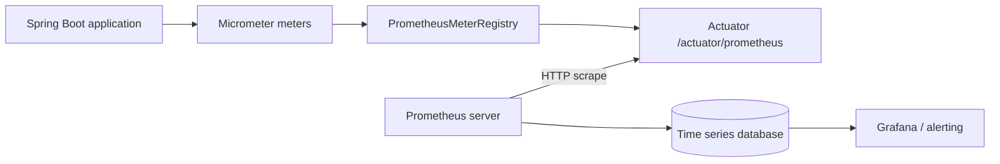

# Prometheus endpoint trong Spring Boot Actuator

## 1. Mục tiêu và bối cảnh

Prometheus thu thập metrics bằng cách định kỳ scrape HTTP endpoint của ứng dụng. Trong Spring Boot, Actuator cung cấp endpoint `/actuator/prometheus` để xuất meters của Micrometer theo Prometheus exposition format. Ứng dụng ghi nhận metrics, Actuator expose chúng, Prometheus scrape và lưu time series để truy vấn/alert.

Để endpoint hoạt động cần đủ ba phần: Prometheus registry trên classpath, Actuator endpoint được expose qua web và cấu hình mạng/security cho Prometheus truy cập. Chỉ thêm Actuator hoặc mở exposure mà thiếu registry là chưa đủ.

Bài thuộc chương **Actuator và management** của module **SPRING_BOOT_OBSERVABILITY**. Module hướng dẫn thiết lập observability cho Spring Boot bằng Micrometer Observation, metrics, logs và distributed tracing; học context propagation, tag/cardinality, exporter, sampling và liên kết tín hiệu để điều tra lỗi, độ trễ và hành vi ứng dụng trên môi trường thực.

Sau bài học, bạn có thể:
1. Thêm Prometheus registry vào Spring Boot.
2. Phân biệt endpoint enablement với web exposure.
3. Cấu hình và kiểm tra `/actuator/prometheus`.
4. Thiết lập Prometheus scrape job.
5. Hiểu metric naming, labels, cardinality và histogram.
6. Bảo vệ endpoint bằng network policy và authentication.
7. Chẩn đoán endpoint hoặc scrape failure.

**Baseline:** Spring Boot 3.5.x, Java 17+, Actuator và Micrometer Prometheus registry. Property và format chi tiết cần đối chiếu phiên bản ứng dụng.

## 2. Kiến trúc scrape

Prometheus thường chủ động gọi endpoint theo chu kỳ. Trong mô hình scrape thông thường, ứng dụng không push metrics tới Prometheus.



Micrometer cung cấp API thống nhất để code tạo Counter, Timer, Gauge và các meters khác. PrometheusMeterRegistry chuyển meters thành exposition format. Actuator endpoint cung cấp nội dung qua HTTP.

## 3. Thêm dependency

Maven:

```xml
<dependency>
    <groupId>org.springframework.boot</groupId>
    <artifactId>spring-boot-starter-actuator</artifactId>
</dependency>
<dependency>
    <groupId>io.micrometer</groupId>
    <artifactId>micrometer-registry-prometheus</artifactId>
</dependency>
```

Gradle:

```groovy
dependencies {
    implementation 'org.springframework.boot:spring-boot-starter-actuator'
    runtimeOnly 'io.micrometer:micrometer-registry-prometheus'
}
```

Dùng dependency management của Spring Boot thay vì tự chọn version Micrometer không tương thích. Kiểm tra dependency tree để chắc registry có mặt ở runtime.

## 4. Enablement và exposure

Actuator endpoint có thể được enable nhưng chưa expose qua HTTP. Cấu hình exposure:

```yaml
management:
  endpoints:
    web:
      exposure:
        include: health,info,prometheus
```

Exposure quyết định endpoint có được truy cập qua web hay không. Endpoint Prometheus được auto-configure khi registry phù hợp có mặt; nếu cần, kiểm soát enablement riêng theo property của version đang dùng. Không dùng wildcard `*` trong production nếu không có lý do và kiểm soát bảo mật.

Ví dụ management port riêng:

```yaml
management:
  server:
    port: 8081
  endpoints:
    web:
      exposure:
        include: health,prometheus
```

Prometheus phải scrape đúng management port. Nếu ứng dụng có base path hoặc reverse proxy prefix, URL cuối cùng cũng thay đổi.

## 5. Endpoint và response

Với cấu hình mặc định:

```text
http://<host>:<port>/actuator/prometheus
```

Ví dụ local:

```text
http://localhost:8080/actuator/prometheus
```

Response chứa Prometheus text exposition format, thường có HELP/TYPE và samples. Ví dụ minh họa:

```text
# HELP orders_submitted_total Number of submitted orders
# TYPE orders_submitted_total counter
orders_submitted_total{channel="web"} 42
```

Tên meter và cách chuyển đổi phụ thuộc Micrometer registry/version. Kiểm tra endpoint thực tế trước khi viết dashboard.

Base path mặc định là `/actuator`, có thể thay đổi:

```yaml
management:
  endpoints:
    web:
      base-path: /manage
```

Khi đó endpoint là `/manage/prometheus`. Cũng cần xét management port, servlet context path và proxy routing.

## 6. Expose custom metrics

Ví dụ đăng ký Counter và Timer:

```java
import io.micrometer.core.instrument.Counter;
import io.micrometer.core.instrument.Timer;
import io.micrometer.core.instrument.MeterRegistry;
import org.springframework.stereotype.Service;

@Service
public class OrderMetrics {
    private final Counter submitted;
    private final Timer processing;

    public OrderMetrics(MeterRegistry registry) {
        this.submitted = Counter.builder("orders.submitted")
                .description("Number of submitted orders")
                .tag("channel", "web")
                .register(registry);
        this.processing = Timer.builder("orders.processing")
                .description("Order processing duration")
                .register(registry);
    }

    public void recordSubmission() {
        submitted.increment();
    }

    public void recordProcessing(Runnable operation) {
        processing.record(operation);
    }
}
```

Registry nhận meters và Prometheus endpoint xuất chúng. Không cần viết controller riêng cho từng metric. Metrics tự động từ Spring Boot cũng có thể xuất hiện nếu instrumentation tương ứng được bật, ví dụ JVM, process, HTTP server, datasource và cache. Endpoint chỉ xuất meters đã đăng ký; nó không tự đo mọi thứ.

## 7. Naming và labels

Prometheus biểu diễn dimensions bằng labels; trong Micrometer, chúng tương ứng với meter tags. Một metric có thể tạo nhiều time series khi kết hợp label values.

Ví dụ:

```text
orders_submitted_total{channel="web",outcome="success"} 128
orders_submitted_total{channel="partner",outcome="success"} 42
```

Labels nên có tập giá trị hữu hạn. Tránh user ID, order ID, email, session/request ID, raw URL/path, exception message, SQL text, UUID hoặc hostname/tenant động không giới hạn.

Nếu mỗi request tạo một label value mới, số time series tăng nhanh, làm tăng memory, storage và query cost. Dùng route template thay raw path; error category thay message; logical dependency name thay hostname động.

Micrometer meter names thường dùng dạng dotted name trong code, ví dụ `orders.processing`. Prometheus registry chuyển sang dạng phù hợp conventions, thường dùng dấu gạch dưới. Counter/Timer có thể có suffix và series bổ sung theo registry; kiểm tra tên cuối tại endpoint thay vì tự thêm suffix.

## 8. Histogram và percentile

Timer mặc định cung cấp count và total time. Để Prometheus tính histogram quantiles, cần bật histogram buckets cho meter phù hợp.

```yaml
management:
  metrics:
    distribution:
      percentiles-histogram:
        http.server.requests: true
```

Khi buckets được xuất, Prometheus có thể dùng `histogram_quantile()` để ước lượng quantile. Percentile phía client và histogram buckets có semantics/cost khác nhau; lựa chọn theo nhu cầu query/backend.

Không bật histogram cho mọi meter. Mỗi bucket và mỗi label combination tạo thêm series. Bắt đầu từ latency metrics quan trọng, sau đó đánh giá series count.

Ví dụ PromQL minh họa:

```promql
histogram_quantile(0.95,
  sum by (le, uri) (
    rate(http_server_requests_seconds_bucket[5m])
  )
)
```

Tên metric/labels thực tế có thể khác theo registry version và instrumentation. Kiểm tra endpoint trước khi dùng query.

## 9. Exemplars và trace correlation

Prometheus exemplars có thể đính kèm tham chiếu trace vào sample/histogram observation để chuyển từ metric spike sang trace cụ thể, nếu stack hỗ trợ exemplar end-to-end.

Exemplar không phải label thông thường. Không thêm traceId làm label vì traceId có cardinality gần như mỗi request một giá trị. Dùng exemplar integration/configuration phù hợp với Micrometer, tracing bridge và Prometheus server version.

Cần tracing bridge/exporter, context trace hiện hành, scrape format hỗ trợ exemplar và giao diện Prometheus/Grafana liên kết được trace backend. Endpoint Prometheus hoạt động không đồng nghĩa exemplars tự động xuất hiện.

## 10. Prometheus scrape configuration

Ví dụ `prometheus.yml` cho ứng dụng local:

```yaml
scrape_configs:
  - job_name: 'spring-boot-app'
    metrics_path: '/actuator/prometheus'
    scrape_interval: 15s
    static_configs:
      - targets: ['localhost:8080']
```

Nếu ứng dụng chạy trong Docker/Kubernetes, target phải là địa chỉ Prometheus server truy cập được. `localhost` bên trong Prometheus container là chính container Prometheus, không phải host/container ứng dụng.

Prometheus Operator có thể dùng ServiceMonitor/PodMonitor để discovery; đây là cơ chế discovery bổ sung, không thay đổi việc ứng dụng expose endpoint.

Scrape interval quyết định tần suất lấy mẫu. Interval ngắn tăng độ phân giải nhưng cũng tăng request load và ingest volume. Chọn theo tốc độ biến động, số target và capacity Prometheus.

Counter là giá trị tích lũy; thường dùng `rate()` hoặc `increase()`. Gauge là giá trị tức thời. Timer/histogram có count, total time và bucket counters tùy cấu hình.

## 11. Bảo mật endpoint

`/actuator/prometheus` có thể tiết lộ request rates, route names, datasource, JVM, pool sizes và trạng thái dependency. Không expose công khai chỉ vì Prometheus cần scrape.

Khuyến nghị:
- Đặt management endpoint trong private network/VPC/cluster network.
- Dùng firewall, security group hoặc Kubernetes NetworkPolicy chỉ cho phép Prometheus scrape.
- Nếu cần authentication, cấu hình Spring Security để chỉ service identity được phép truy cập.
- Dùng TLS/mTLS khi đi qua network không tin cậy hoặc theo security standard.
- Chỉ expose endpoint cần thiết; không mở toàn bộ Actuator bằng wildcard.
- Không đưa secrets/PII vào metric names hoặc labels.
- Kiểm soát ai có thể truy cập Prometheus và dashboard.

Security matcher cần tích hợp vào SecurityFilterChain hiện có; không copy chain độc lập rồi vô tình thay thế policy của endpoint khác. Chỉ cấp quyền scrape cho identity của Prometheus.

## 12. Kiểm tra endpoint

Kiểm tra bằng curl:

```bash
curl -i http://localhost:8080/actuator/prometheus
```

Xác nhận HTTP status thành công, Content-Type phù hợp, có HELP/TYPE và samples, có meters dự kiến, không có PII/secrets/labels động.

Trong Prometheus UI, mở Targets và xác nhận job ở trạng thái UP. Nếu DOWN, xem scrape error, HTTP status, DNS, network route, TLS và authentication.

Kiểm tra metric bằng PromQL:

```promql
up{job="spring-boot-app"}
```

Giá trị 1 nghĩa lần scrape gần nhất thành công; 0 nghĩa target được phát hiện nhưng scrape thất bại. Nếu series không xuất hiện, kiểm tra discovery, labels và target config.

## 13. Troubleshooting

| Triệu chứng | Nguyên nhân có thể | Cách xử lý |
| --- | --- | --- |
| `/actuator/prometheus` trả 404 | Registry thiếu, endpoint chưa expose hoặc base path khác | Kiểm tra dependency, exposure và base path |
| Endpoint trả 401/403 | Spring Security chặn Prometheus | Cấp quyền scrape cho service identity |
| Endpoint lỗi khởi tạo | Registry/configuration không tương thích | Kiểm tra startup logs và dependency versions |
| Có HELP/TYPE nhưng thiếu custom metric | Meter chưa đăng ký hoặc code path chưa chạy | Kiểm tra bean/instrumentation |
| Prometheus target DOWN | Sai host/port/path, DNS, firewall hoặc auth | Xem scrape error và thử curl từ network Prometheus |
| Scrape sai path | Management base path/context path thay đổi | Đồng bộ metrics_path với URL thực |
| Target UP nhưng dashboard trống | Query sai metric name/labels hoặc chưa có samples | Query trực tiếp Prometheus và xem endpoint output |
| Time series tăng nhanh | Label cardinality cao | Loại ID/URL/message khỏi tags |
| Không có p95 | Histogram buckets chưa bật hoặc query sai | Bật histogram có chọn lọc và kiểm tra bucket series |
| Exemplar không xuất hiện | Tracing/exemplar provider/scrape format chưa hỗ trợ | Kiểm tra từng thành phần và version |
| Local curl được nhưng Prometheus không scrape | Network namespace/DNS khác nhau | Dùng target reachable từ Prometheus |
| Endpoint công khai ngoài ý muốn | Exposure wildcard hoặc ingress route mở | Thu hẹp exposure và network policy |

## 14. Checklist production

- [ ] Có Actuator và `micrometer-registry-prometheus` đúng version.
- [ ] Prometheus endpoint được enable và expose qua web.
- [ ] Scrape path/port/base path khớp cấu hình management.
- [ ] Prometheus target UP và metric samples query thành công.
- [ ] Labels có cardinality thấp; không có IDs, PII, secrets hoặc raw URLs.
- [ ] Histogram chỉ bật cho meters cần percentile/bucket analysis.
- [ ] Exemplar chỉ bật khi tracing và Prometheus/Grafana stack hỗ trợ.
- [ ] Endpoint chỉ truy cập từ network/identity được phép.
- [ ] Không expose toàn bộ Actuator endpoints ngoài nhu cầu.
- [ ] Có alert cho scrape failure và telemetry pipeline health.
- [ ] Dashboard query dùng metric names/labels đã xác minh từ endpoint thực.

## 15. Câu hỏi tự luyện

1. Prometheus endpoint của Spring Boot Actuator có đường dẫn mặc định nào?
2. Vì sao cần `micrometer-registry-prometheus` ngoài Actuator?
3. Endpoint enablement khác web exposure thế nào?
4. Prometheus scrape khác push metrics thế nào?
5. Vì sao raw request ID không phù hợp làm label?
6. Timer được chuyển thành những loại series nào trong Prometheus?
7. Khi nào cần bật histogram buckets?
8. Exemplar khác label thông thường ra sao?
9. Vì sao Prometheus container không thể dùng localhost để scrape app container khác?
10. Làm thế nào xác định target DOWN do security hay network?
11. Vì sao không nên expose mọi Actuator endpoint bằng wildcard?
12. Cần kiểm tra gì trước khi viết PromQL dashboard?

## Tài liệu tham khảo

- [Spring Boot 3.5 — Prometheus Endpoint](https://docs.spring.io/spring-boot/3.5/reference/actuator/metrics.html#actuator.metrics.export.prometheus)
- [Spring Boot 3.5 — Actuator Endpoints](https://docs.spring.io/spring-boot/3.5/reference/actuator/endpoints.html)
- [Spring Boot 3.5 — Metrics](https://docs.spring.io/spring-boot/3.5/reference/actuator/metrics.html)
- [Micrometer — Prometheus Registry](https://docs.micrometer.io/micrometer/reference/implementations/prometheus.html)
- [Prometheus — Configuration](https://prometheus.io/docs/prometheus/latest/configuration/configuration/)
- [Prometheus — Exposition Formats](https://prometheus.io/docs/instrumenting/exposition_formats/)
- [Prometheus — Histograms](https://prometheus.io/docs/practices/histograms/)
- [Prometheus — Exemplars](https://prometheus.io/docs/prometheus/latest/feature_flags/)

