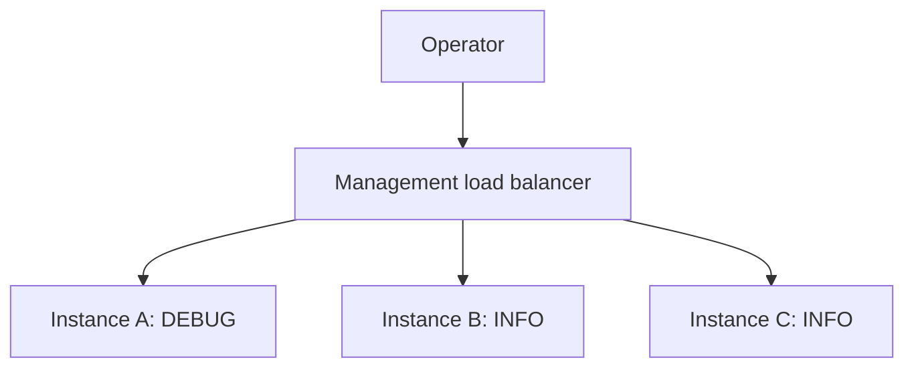
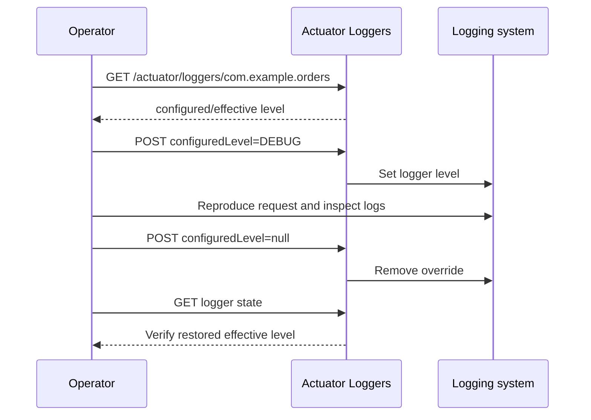

# Loggers endpoint trong Spring Boot Actuator

Trong quá trình vận hành, đôi khi cần tăng log level của một package hoặc class để điều tra lỗi đang xảy ra. Thay đổi cấu hình rồi restart ứng dụng có thể mất thời gian và gây gián đoạn service. Spring Boot Actuator cung cấp **Loggers endpoint** để xem logger hiện tại và thay đổi mức log tại runtime qua HTTP.

Loggers endpoint hỗ trợ điều tra có mục tiêu: tăng mức log của một package từ INFO lên DEBUG, quan sát trong thời gian ngắn rồi khôi phục mức cũ. Thay đổi tác động tới logging system của process đang chạy; nó không tự sửa application configuration hoặc bảo đảm giá trị còn tồn tại sau restart.

Bài **“Loggers endpoint”** thuộc chương **Actuator và management** của module **SPRING_BOOT_OBSERVABILITY**. Module hướng dẫn thiết lập observability cho Spring Boot bằng Micrometer Observation, metrics, logs và distributed tracing; học propagation ngữ cảnh, tag/cardinality, exporter, sampling và liên kết tín hiệu để điều tra lỗi, độ trễ và hành vi ứng dụng trên môi trường thực.

## 1. Loggers endpoint giải quyết vấn đề gì?

Logging level quyết định logger phát ra những sự kiện nào. Logger ở INFO thường không phát DEBUG messages. Khi cần điều tra production, có thể cần bật DEBUG cho đúng package thay vì tăng log level toàn ứng dụng.

Loggers endpoint cho phép:

- Liệt kê logger names được logging system biết tới.
- Xem configured level nếu logger được cấu hình rõ ràng.
- Xem effective level đang được áp dụng sau khi kế thừa từ parent/root.
- Thay đổi configured level tại runtime.
- Đặt lại logger về trạng thái kế thừa bằng cách gửi level null.
- Kiểm tra logging behavior mà không restart process.

Endpoint không phải log viewer. Nó không trả về log records đã phát ra và không truy vấn log aggregation backend. Nó chỉ quản lý mức log của logging system đang chạy.

## 2. Bật và expose Loggers endpoint

Thêm Spring Boot Actuator:

```groovy
dependencies {
    implementation 'org.springframework.boot:spring-boot-starter-actuator'
}
```

Để truy cập qua HTTP, expose endpoint bằng cấu hình management phù hợp:

```yaml
management:
  endpoints:
    web:
      exposure:
        include: health,info,loggers
```

Không expose tất cả Actuator endpoints ra public network. Loggers có khả năng thay đổi runtime behavior, nên chỉ cho phép truy cập qua management network và principal được phân quyền.

Nếu dùng Spring Security, bảo vệ đường dẫn /actuator/loggers/** bằng authorization policy dành cho operator/admin. Exposure chỉ quyết định endpoint có được publish; nó không thay thế authentication, authorization hoặc network controls.

## 3. Xem danh sách logger

Gọi endpoint:

```http
GET /actuator/loggers
```

Response có thể có cấu trúc:

```json
{
  "levels": [
    "OFF",
    "ERROR",
    "WARN",
    "INFO",
    "DEBUG",
    "TRACE"
  ],
  "loggers": {
    "ROOT": {
      "configuredLevel": "INFO",
      "effectiveLevel": "INFO"
    },
    "com.example.orders": {
      "configuredLevel": null,
      "effectiveLevel": "INFO"
    }
  }
}
```

Logger names phụ thuộc classes/packages logging system đã biết tới. Không phải mọi package đều xuất hiện trước khi class được load hoặc logger được khởi tạo. Có thể truy vấn logger cụ thể bằng tên đầy đủ.

## 4. Configured level và effective level

Hai field quan trọng:

- **configuredLevel:** mức được đặt trực tiếp cho logger; có thể null nếu logger không có cấu hình riêng.
- **effectiveLevel:** mức thực tế logger đang sử dụng sau khi áp dụng kế thừa từ parent logger hoặc root.

Ví dụ:

```json
{
  "configuredLevel": null,
  "effectiveLevel": "INFO"
}
```

Logger không có level riêng; nó kế thừa INFO từ parent/root. Nếu root là WARN, logger không có configured level riêng có thể effective WARN.

Configured level null không có nghĩa logger bị tắt. Hãy đọc effectiveLevel để hiểu behavior thực tế.

## 5. Xem một logger cụ thể

Dùng logger name làm path segment:

```http
GET /actuator/loggers/com.example.orders
```

Response ví dụ:

```json
{
  "configuredLevel": "DEBUG",
  "effectiveLevel": "DEBUG"
}
```

Tên logger thường là package hoặc fully-qualified class name, ví dụ com.example.orders.OrderService. URL cần được encode nếu logger name có ký tự đặc biệt.

## 6. Thay đổi log level tại runtime

Loggers endpoint hỗ trợ POST để đặt configured level:

```http
POST /actuator/loggers/com.example.orders
Content-Type: application/json

{
  "configuredLevel": "DEBUG"
}
```

Sau request thành công, logger được đặt trực tiếp ở DEBUG trong process hiện tại. DEBUG statements của logger đó và child loggers không có override riêng có thể được phát ra.

Các level phổ biến:

| Level | Mục đích |
| --- | --- |
| TRACE | Chi tiết rất sâu, thường có volume cao |
| DEBUG | Thông tin phục vụ điều tra |
| INFO | Sự kiện vận hành thông thường |
| WARN | Điều kiện bất thường cần chú ý |
| ERROR | Lỗi cần xử lý |
| OFF | Tắt logging cho logger |

### Đặt lại để kế thừa

Gửi configuredLevel null:

```http
POST /actuator/loggers/com.example.orders
Content-Type: application/json

{
  "configuredLevel": null
}
```

Logger bỏ override riêng và quay lại effective level từ parent/root. Đây là cách khôi phục nếu trước đó logger không có configured level riêng.

Không đặt lại thành INFO một cách máy móc nếu ban đầu logger kế thừa WARN hoặc DEBUG. Ghi lại configuredLevel trước khi thay đổi để khôi phục đúng trạng thái.

## 7. Thay đổi root logger

Có thể thay đổi root logger:

```http
POST /actuator/loggers/ROOT
Content-Type: application/json

{
  "configuredLevel": "WARN"
}
```

Root logger ảnh hưởng rộng tới mọi logger kế thừa level từ root. Đây là thay đổi có phạm vi lớn; không dùng root DEBUG để điều tra một package nếu có thể target logger cụ thể.

Logger con có configured level riêng sẽ tiếp tục dùng override đó. Vì vậy root level thay đổi không nhất thiết làm mọi logger có cùng effective level.

## 8. Logger groups

Spring Boot hỗ trợ logger groups để gom nhiều logger liên quan thành một tên logic. Operator có thể thay đổi nhiều package/class cùng lúc.

Ví dụ:

```yaml
logging:
  group:
    web:
      - org.springframework.core.codec
      - org.springframework.http
      - org.springframework.web
    sql:
      - org.springframework.jdbc
      - org.hibernate.SQL
```

Sau khi group được định nghĩa, có thể truy vấn hoặc thay đổi logger group qua tên group:

```http
POST /actuator/loggers/web
Content-Type: application/json

{
  "configuredLevel": "DEBUG"
}
```

Tên group là alias cấu hình của Spring Boot, không phải logger class mới. Kiểm tra logging configuration để biết group names đang có; endpoint không tự suy ra group theo package.

Dùng group khi cần bật DEBUG cho nhóm framework logger có liên quan, ví dụ HTTP mapping/serialization hoặc SQL. Group quá rộng vẫn có thể tạo log volume lớn; đặt tên theo chức năng và kiểm soát members.

## 9. Runtime change có tồn tại sau restart không?

Thay đổi qua Loggers endpoint cập nhật logging system trong process hiện tại. Nó không tự ghi ngược vào application.yml, environment variables, Config Server hoặc deployment manifest.

Sau restart, logging system khởi tạo lại từ cấu hình được load lúc startup. Runtime override thường mất. Nếu có external configuration management, level sẽ theo cấu hình nguồn đó. Trong deployment nhiều replicas, thay đổi một instance không tự cập nhật các instance còn lại.

Endpoint phù hợp cho troubleshooting tạm thời. Nếu muốn thay đổi lâu dài, cập nhật cấu hình quản lý tập trung theo quy trình release/configuration change.

## 10. Multi-instance và load balancer

Trong deployment có nhiều replicas, một HTTP call tới load balancer có thể chỉ tới một instance. Khi đó, chỉ một process được thay đổi level.



Nếu cần thay đổi trên nhiều instances:

1. Xác định instance/pod cần điều tra.
2. Gọi management endpoint của đúng instance hoặc dùng orchestration automation được kiểm soát.
3. Xác minh configured/effective level trên từng instance.
4. Ghi lại thay đổi và thời điểm.
5. Khôi phục từng instance sau điều tra.

Không giả định một POST qua load balancer đã cập nhật toàn cluster. Management endpoints nên có routing/identity rõ để operator biết request tác động tới instance nào.

## 11. Bảo mật Loggers endpoint

Loggers endpoint có thể làm lộ thông tin nội bộ và tăng mạnh lượng log. DEBUG/TRACE logs đôi khi chứa headers, payload, SQL values hoặc identifiers nhạy cảm.

- Chỉ expose endpoint trên management interface/network.
- Bắt buộc authentication.
- Chỉ cấp quyền thay đổi log levels cho operator role phù hợp.
- Audit ai thay đổi logger, logger nào, level cũ/mới và thời gian.
- Giới hạn root-level changes.
- Có runbook khôi phục level.
- Kiểm tra log statements không ghi secrets trước khi bật DEBUG/TRACE.
- Theo dõi log ingestion volume và storage cost.

Không xem việc endpoint chỉ expose nội bộ là đủ bảo vệ. Cần authorization ở application layer và network segmentation.

## 12. Tích hợp với logging system

Spring Boot hỗ trợ các logging systems như Logback và Log4j2 tùy dependency. Actuator Loggers endpoint làm việc thông qua logging system abstraction; hành vi cụ thể phụ thuộc backend.

Logger name phải khớp category mà logging backend sử dụng. Parent-child hierarchy ảnh hưởng effective level. Logger có override riêng không nhất thiết theo root. Async appenders có thể làm log xuất hiện trễ. Filter/appender threshold có thể vẫn loại events dù logger level đã cho phép.

Runtime level không sửa pattern, encoder, appender hoặc destination. Nếu đặt DEBUG nhưng không thấy log, kiểm tra logger name, effective level, appender threshold, filters và code có thực sự phát DEBUG event không.

## 13. Quy trình vận hành an toàn

1. Xác định symptom và package/class nghi vấn.
2. Đọc configuredLevel/effectiveLevel trước khi thay đổi.
3. Chọn logger cụ thể hoặc group nhỏ nhất cần thiết.
4. Đặt DEBUG tạm thời, tránh root TRACE.
5. Tạo một reproduction/request có kiểm soát.
6. Theo dõi log volume và dữ liệu nhạy cảm.
7. Thu thập evidence cần thiết.
8. POST configuredLevel null nếu logger ban đầu kế thừa, hoặc đặt lại level cũ nếu có override.
9. Đọc lại endpoint để xác nhận effective level đã phục hồi.
10. Ghi audit trail và cập nhật runbook nếu cần.



## 14. Kiểm thử Loggers endpoint

Trong integration tests, có thể dùng MockMvc/WebTestClient để kiểm tra endpoint được expose và behavior của logging system.

Các trường hợp nên kiểm tra:

1. GET danh sách loggers trả levels và logger map.
2. GET logger cụ thể trả configuredLevel/effectiveLevel.
3. POST DEBUG thay đổi configuredLevel.
4. GET sau POST xác nhận effectiveLevel.
5. POST null loại bỏ override.
6. Logger con kế thừa level mới từ parent/root.
7. Logger con có override giữ level riêng.
8. Logger group thay đổi các members theo cấu hình.
9. Security chặn user không có quyền.
10. HTTP endpoint không được expose khi cấu hình không cho phép.
11. Runtime override không bị hiểu nhầm là persistent config sau restart.

Ví dụ HTTP test:

```java
mockMvc.perform(post("/actuator/loggers/com.example.orders")
        .contentType(MediaType.APPLICATION_JSON)
        .content("""
            {"configuredLevel":"DEBUG"}
            """))
    .andExpect(status().isNoContent());
```

Status code và test setup cần khớp Spring Boot version. Sau POST, thực hiện GET để kiểm tra state thay vì chỉ dựa vào response status.

## 15. Chẩn đoán khi Loggers endpoint không hoạt động

| Triệu chứng | Nguyên nhân có thể | Cách kiểm tra |
| --- | --- | --- |
| 404 endpoint | Actuator thiếu hoặc loggers chưa được expose | Kiểm tra dependency và exposure include |
| 401/403 | Authentication/authorization policy | Kiểm tra management security rules |
| POST không đổi level | Logger name sai hoặc backend behavior khác | GET logger state và kiểm tra logging system |
| configuredLevel null | Logger kế thừa parent/root | Xem effectiveLevel |
| DEBUG không xuất hiện | Appender/filter threshold hoặc code không phát DEBUG | Kiểm tra backend config và logger call |
| Chỉ một replica thay đổi | Request chỉ tới một instance | Kiểm tra pod/instance routing |
| Level quay lại sau restart | Runtime override không persistent | Cập nhật external/application config nếu muốn lâu dài |
| Log volume tăng đột biến | Scope quá rộng hoặc TRACE/DEBUG trên root | Khôi phục level, giảm logger scope |
| Group không tìm thấy | Group chưa được cấu hình | Kiểm tra logging.group properties |
| Log vẫn thiếu sau khi bật | Logger con có override hoặc appender filter | Kiểm tra hierarchy và appenders |

## 16. Bài thực hành: điều tra lỗi bằng Loggers endpoint

Thực hiện trong local/test:

1. Thêm Spring Boot Actuator và expose loggers endpoint trên local management interface.
2. Tạo service package com.example.orders có INFO/DEBUG logs.
3. Khởi động ứng dụng và GET logger state.
4. Đặt package logger thành DEBUG bằng POST.
5. Gọi endpoint nghiệp vụ và xác minh DEBUG event xuất hiện.
6. Tạo child logger có override WARN; quan sát effective level.
7. Đặt parent logger null và xác minh child kế thừa đúng.
8. Định nghĩa logger group web, thử thay đổi group level.
9. Thử request không có quyền và xác minh bị chặn.
10. Restart ứng dụng, kiểm tra runtime override không được coi là cấu hình persistent.
11. Khôi phục mọi levels về trạng thái ban đầu và kiểm tra log volume.

Không thực hiện thử nghiệm DEBUG/TRACE trên production nếu chưa có scope, thời gian và người chịu trách nhiệm khôi phục.

## 17. Câu hỏi tự kiểm tra

1. Loggers endpoint quản lý điều gì và không làm điều gì?
2. Làm sao expose endpoint qua HTTP?
3. configuredLevel khác effectiveLevel thế nào?
4. configuredLevel null có nghĩa logger bị tắt không?
5. POST nào dùng để đặt logger thành DEBUG?
6. Làm sao xóa override để logger kế thừa parent?
7. Root logger ảnh hưởng các logger con thế nào?
8. Logger group được định nghĩa ở đâu?
9. Runtime level có tồn tại sau restart không?
10. Vì sao một POST qua load balancer có thể chỉ đổi một replica?
11. Rủi ro bảo mật nào xuất hiện khi bật DEBUG/TRACE?
12. Vì sao exposure không thay thế authorization?
13. Nếu DEBUG không xuất hiện, cần kiểm tra những lớp nào?
14. Làm sao xác minh level đã được khôi phục?
15. Khi nào dùng Loggers endpoint và khi nào cần sửa cấu hình lâu dài?

## Tài liệu tham khảo

- [Spring Boot — Actuator Loggers Endpoint](https://docs.spring.io/spring-boot/reference/actuator/loggers.html): API đọc và thay đổi logger levels.
- [Spring Boot — Logging](https://docs.spring.io/spring-boot/reference/features/logging.html): logging systems, logger hierarchy và cấu hình.
- [Spring Boot — Actuator Endpoints](https://docs.spring.io/spring-boot/reference/actuator/endpoints.html): endpoint exposure, HTTP/JMX và security.
- [Spring Boot — Externalized Configuration](https://docs.spring.io/spring-boot/reference/features/external-config.html): cấu hình theo môi trường và nguồn config.

## Kết luận

**Loggers endpoint cho phép operator xem và thay đổi logger levels của process Spring Boot đang chạy mà không cần restart.** GET cho biết configured/effective level; POST đặt level mới hoặc gửi null để bỏ override và kế thừa từ parent. Logger groups giúp thay đổi một tập logger có chủ đích.

Runtime override thường không tồn tại sau restart và không tự lan sang replicas khác. Hãy bảo vệ endpoint bằng authentication/authorization và management network, target logger nhỏ nhất cần thiết, theo dõi log volume và khôi phục level sau điều tra. Khi kết hợp log level tạm thời với metrics/traces có correlation, operator có thể thu thập thêm evidence mà vẫn kiểm soát tác động vận hành.

