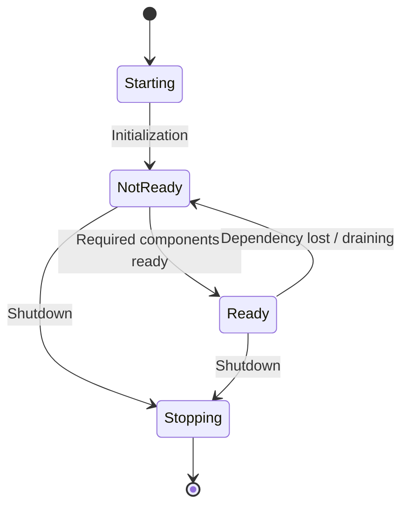

# Readiness state trong Spring Boot

Một instance Spring Boot có thể đang chạy nhưng chưa sẵn sàng nhận traffic. Ví dụ ứng dụng vừa khởi động, đang warm cache, chưa hoàn tất kết nối tới dependency bắt buộc hoặc đang drain trước khi shutdown. Nếu load balancer chỉ kiểm tra process còn sống, nó có thể gửi request vào instance chưa thể phục vụ. **Readiness state** biểu thị instance hiện có đủ điều kiện nhận traffic hay không; đây là một phần quan trọng của health model và deployment lifecycle.

Spring Boot Actuator cung cấp health indicators và health groups để thể hiện trạng thái ứng dụng. Với Kubernetes probes integration, readiness endpoint có thể được dùng để quyết định Pod có được đưa vào Service endpoints hay không. Readiness khác liveness: readiness failure thường loại instance khỏi traffic, còn liveness failure có thể khiến platform restart container. Cần thiết kế hai tín hiệu theo failure semantics riêng.

Bài **Readiness state** thuộc chương **Health và readiness** của module **SPRING_BOOT_OBSERVABILITY**. Module tập trung thiết lập observability cho Spring Boot bằng Micrometer Observation, metrics, logs và distributed tracing; học context propagation, tag/cardinality, exporter, sampling và liên kết tín hiệu để điều tra lỗi, độ trễ và hành vi ứng dụng trên môi trường thực.

## 1. Mục tiêu học tập

Sau bài học, bạn có thể:

- Giải thích readiness state và phân biệt với liveness/overall health.
- Bật readiness/liveness probes trong Spring Boot Actuator.
- Hiểu health groups và cách health indicators đóng góp trạng thái.
- Chọn dependency nào ảnh hưởng readiness theo yêu cầu nghiệp vụ.
- Tránh restart loop do đưa dependency tạm thời vào liveness.
- Thiết kế startup, warm-up, drain và shutdown transitions.
- Cấu hình Kubernetes readiness probe và kiểm tra traffic routing.
- Chẩn đoán readiness DOWN, probe timeout và instance bị loại khỏi service.

## 2. Readiness state là gì?

Readiness trả lời câu hỏi: **instance này có nên nhận request mới vào lúc này không?** Trạng thái này phản ánh khả năng phục vụ hiện tại của instance, không đơn thuần là process có tồn tại.

Ví dụ các tình huống ảnh hưởng readiness:

- Ứng dụng chưa hoàn tất startup hoặc warm-up.
- Cache bắt buộc chưa được nạp.
- Dependency thiết yếu cho request path đang unavailable.
- Instance đang drain để deploy/scale down.
- Consumer/worker chưa hoàn tất initialization nếu năng lực đó là điều kiện nhận traffic.

Không phải mọi dependency đều phải làm readiness DOWN. Nếu ứng dụng có thể phục vụ request bằng degraded mode, cache hoặc fallback, readiness policy cần phản ánh khả năng thực tế thay vì phụ thuộc mọi external service.

## 3. Readiness, liveness và overall health

| Tín hiệu | Câu hỏi | Hành động platform thường thực hiện |
| --- | --- | --- |
| Liveness | Process có còn hoạt động và có thể tiếp tục chạy không? | Restart instance nếu probe thất bại đủ ngưỡng |
| Readiness | Instance có sẵn sàng nhận traffic mới không? | Ngừng route traffic tới instance |
| Overall health | Các health indicators được cấu hình đang báo trạng thái gì? | Dùng cho diagnostics/operations theo policy |
| Startup probe | Ứng dụng đã hoàn tất giai đoạn khởi động chưa? | Tạm hoãn liveness/readiness checks theo cấu hình platform |



Readiness có thể thay đổi nhiều lần trong vòng đời instance. Dependency phục hồi có thể đưa instance từ NotReady trở lại Ready, nếu policy và ứng dụng cho phép.

## 4. Bật readiness và liveness probes

Với Spring Boot Actuator, có thể bật probe health groups:

```yaml
management:
  endpoint:
    health:
      probes:
        enabled: true
```

Các endpoint thường được cung cấp trong môi trường hỗ trợ probes:

```text
/actuator/health/liveness
/actuator/health/readiness
```

Đường dẫn thực tế phụ thuộc management base path, management port và Spring Boot version. Xác minh endpoint runtime và web exposure thay vì chỉ dựa vào YAML.

### Expose health endpoint

Nếu cấu hình web exposure allow-list, bảo đảm health endpoint được expose:

```yaml
management:
  endpoints:
    web:
      exposure:
        include: health,metrics
```

Exposure chỉ làm endpoint có thể truy cập qua web; authorization và network restrictions vẫn phải được cấu hình riêng. Với Kubernetes probe, chọn security policy cho phép kubelet truy cập đúng endpoint nhưng không mở rộng các management endpoints khác.

## 5. Health groups và indicators

Spring Boot Actuator tổng hợp trạng thái từ HealthIndicator/reactive health contributors. Mỗi contributor trả về status và có thể kèm details. Health groups cho phép tập hợp contributors theo mục đích, ví dụ readiness và liveness.

Ví dụ cấu hình readiness group bổ sung một health contributor:

```yaml
management:
  endpoint:
    health:
      group:
        readiness:
          include: readinessState,db
```

Đây là ví dụ cấu hình khái quát. Tên contributor phải tồn tại trong application và có thể khác theo dependency/auto-configuration. Spring Boot thường tự thêm readinessState vào readiness group khi probes được bật; kiểm tra effective group members theo version.

### Dependency nào nên ảnh hưởng readiness?

Đặt câu hỏi theo request path:

1. Nếu dependency này unavailable, instance còn trả lời request hợp lệ không?
2. Có fallback/cache/degraded mode được thiết kế và kiểm thử không?
3. Dependency có bắt buộc cho tất cả routes hay chỉ một nhóm?
4. Nếu readiness DOWN, có làm giảm capacity quá mạnh và tạo overload ở replicas còn lại không?
5. Dependency phục hồi có thể đưa instance trở lại Ready an toàn không?

Ví dụ database có thể là dependency thiết yếu với service CRUD. Nhưng hệ thống có cache đủ dữ liệu hoặc fallback đọc-only có thể vẫn phục vụ một số routes khi database tạm unavailable. Readiness group nên phản ánh mục tiêu routing đã chọn.

Không đưa mọi external dependency vào readiness. Nếu analytics API hoặc recommendation service không thiết yếu bị lỗi, không nhất thiết phải loại toàn bộ instance khỏi traffic. Nếu mọi replicas đồng loạt readiness DOWN do một dependency dùng chung, hệ thống có thể mất toàn bộ capacity dù chức năng chính vẫn hoạt động.

## 6. ReadinessState và ApplicationAvailability

Spring Boot có application availability model để biểu diễn LivenessState và ReadinessState. Các state events có thể được publish trong startup/shutdown lifecycle. Readiness probe health indicator phản ánh readiness state hiện tại.

Ứng dụng có thể cập nhật readiness theo lifecycle khi cần:

```java
import org.springframework.boot.availability.AvailabilityChangeEvent;
import org.springframework.boot.availability.ReadinessState;
import org.springframework.context.ApplicationEventPublisher;
import org.springframework.stereotype.Component;

@Component
public class TrafficAvailability {
    private final ApplicationEventPublisher events;

    public TrafficAvailability(ApplicationEventPublisher events) {
        this.events = events;
    }

    public void markReady() {
        AvailabilityChangeEvent.publish(
            events, this, ReadinessState.ACCEPTING_TRAFFIC
        );
    }

    public void markNotReady() {
        AvailabilityChangeEvent.publish(
            events, this, ReadinessState.REFUSING_TRAFFIC
        );
    }
}
```

Ví dụ minh họa publish state event; Spring Boot có thể tự quản lý một phần transitions. Chỉ cập nhật state từ lifecycle coordinator phù hợp, tránh nhiều component ghi đè readiness lẫn nhau.

### Startup và warm-up

Ứng dụng có thể hoàn tất context refresh nhưng vẫn cần warm-up dữ liệu hoặc initialize local resources. Trong trường hợp đó, readiness nên giữ NotReady cho tới khi bước bắt buộc hoàn tất. Không đánh dấu Ready chỉ vì JVM đã mở port.

Nếu warm-up thất bại, quyết định retry, degraded mode hay fail startup phải được xác định theo yêu cầu nghiệp vụ. Tránh để readiness NotReady vô thời hạn mà không có metric/log giải thích.

## 7. Kubernetes readiness probe

Pod readiness probe có thể gọi HTTP endpoint:

```yaml
apiVersion: v1
kind: Pod
metadata:
  name: order-service
spec:
  containers:
    - name: app
      image: example/order-service:1.0
      ports:
        - name: http
          containerPort: 8080
        - name: management
          containerPort: 8081
      readinessProbe:
        httpGet:
          path: /actuator/health/readiness
          port: management
        periodSeconds: 5
        timeoutSeconds: 2
        failureThreshold: 3
```

Đây là ví dụ minh họa khi management server chạy trên port 8081. Nếu Actuator dùng chung application port, probe phải trỏ tới đúng port đó. Path cần khớp management base path và exposure.

Kubernetes đánh dấu Pod Ready khi readiness probe thành công theo policy. Endpoint readiness thất bại sẽ khiến Pod bị loại khỏi endpoints của Service; container không nhất thiết bị restart chỉ vì readiness failure.

### Startup probe và liveness probe

Nếu ứng dụng khởi động lâu, dùng startup probe để tránh liveness probe restart process trước khi startup hoàn tất:

```yaml
startupProbe:
  httpGet:
    path: /actuator/health/liveness
    port: management
  periodSeconds: 5
  failureThreshold: 30
livenessProbe:
  httpGet:
    path: /actuator/health/liveness
    port: management
  periodSeconds: 10
  timeoutSeconds: 2
  failureThreshold: 3
```

Thông số là ví dụ; chọn period/timeout/failure threshold theo startup duration và recovery behavior đã đo. Không đặt timeout quá thấp khiến probe tự tạo false failures khi node chịu tải.

## 8. Readiness khi deploy, scale down và graceful shutdown

Khi instance chuẩn bị shutdown, cần ngừng nhận traffic mới trước khi dừng xử lý requests hiện tại. Một quy trình thường gồm:

1. Chuyển readiness sang Refusing traffic.
2. Đợi load balancer/orchestrator cập nhật routing.
3. Drain requests đang chạy trong giới hạn thời gian.
4. Dừng consumers/background tasks theo shutdown policy.
5. Đóng resources và process.

Spring Boot graceful shutdown có thể hỗ trợ xử lý requests đang tồn tại trong server shutdown lifecycle. Readiness transition và orchestrator termination grace period cần phối hợp để tránh request mới tới instance đã bắt đầu dừng.

### Không dùng readiness như circuit breaker

Readiness biểu thị khả năng nhận traffic của cả instance. Nó không thay thế circuit breaker cho một dependency cụ thể. Nếu remote service chậm, circuit breaker có thể ngăn gọi dependency đó trong khi instance vẫn Ready để phục vụ routes khác.

## 9. Readiness cho reactive applications

Với WebFlux/reactive applications, health contributors có thể là reactive. Tránh blocking I/O trong health check vì probe có thể chạy thường xuyên và làm nghẽn event loop. Dùng reactive clients và timeout có chủ đích; không tạo connection mới hoặc query nặng cho mỗi probe nếu có thể dùng trạng thái/cache đã được cập nhật.

Health checks cũng cần tránh khuếch đại sự cố. Nếu mỗi replica liên tục gọi dependency đang down, probes có thể tạo thêm tải. Dùng caching/refresh strategy hợp lý và giới hạn concurrency/timeouts.

## 10. Readiness metrics và diagnostics

Readiness endpoint trả trạng thái tại thời điểm kiểm tra. Để hiểu xu hướng, kết hợp số lượng replicas Ready/NotReady theo thời gian, readiness transition count/reason, startup/warm-up duration, dependency health, request traffic/error rate, Pod restarts và deployment events.

Không dùng mỗi health endpoint làm nguồn duy nhất để phân tích incident. Health là snapshot trạng thái; metrics/logs/events giải thích khi nào và vì sao state thay đổi.

### Reason codes có kiểm soát

Nếu ứng dụng ghi readiness reason vào logs/metrics, dùng category hữu hạn như startup, dependency_unavailable, draining. Không đưa exception message, URL động hoặc dependency response body vào metric tag.

## 11. Security và thông tin health

Health details có thể tiết lộ tên dependency, hostname, database status hoặc internal topology. Chỉ trả details cho caller được phép; probe chỉ cần status thường không cần toàn bộ component details.

Ví dụ cấu hình details:

```yaml
management:
  endpoint:
    health:
      show-details: when-authorized
```

Property cụ thể có thể thay đổi theo Spring Boot version và security setup. Kết hợp endpoint exposure, role-based authorization và network isolation. Không trả credentials, connection strings hoặc raw exception messages trong health details.

## 12. Troubleshooting

| Triệu chứng | Nguyên nhân có thể | Hướng kiểm tra |
| --- | --- | --- |
| Readiness endpoint 404 | Probes chưa bật, health chưa expose hoặc base path khác | Kiểm tra Actuator config và runtime endpoint |
| Readiness luôn DOWN lúc startup | Required contributor chưa sẵn sàng hoặc custom state chưa cập nhật | Xem health group contributors và lifecycle |
| Pod không vào Service endpoints | Readiness probe fail hoặc selector/port sai | Kiểm tra Pod conditions và Service endpoints |
| Readiness fail nhưng app port vẫn hoạt động | Management port/path/address không reachable | Test probe từ container/network tương ứng |
| Liveness restart loop khi DB down | DB được đưa vào liveness group | Tách dependency check sang readiness nếu phù hợp |
| Tất cả replicas NotReady | Dependency dùng chung lỗi hoặc readiness policy quá chặt | Đánh giá fallback và capacity impact |
| Probe timeout dưới tải | Health check blocking/nặng hoặc timeout quá thấp | Đo health handler latency và giảm work |
| Instance Ready quá sớm | Warm-up chưa được tính vào readiness | Cập nhật lifecycle state sau initialization |
| Instance vẫn nhận traffic khi drain | Readiness transition/routing propagation chậm | Phối hợp termination grace và load balancer |
| Health details lộ topology | show-details/exposure/security chưa giới hạn | Thu hẹp details và authorization |
| Reactive probe làm nghẽn event loop | Health contributor blocking I/O | Chuyển sang reactive/non-blocking checks |

### Checklist điều tra

1. Gọi readiness endpoint từ cùng network namespace với probe.
2. Kiểm tra Pod Ready condition và event history.
3. Xem readiness group contributors và status details được phép.
4. Xác nhận management port, address, base path và exposure.
5. Đối chiếu readiness state transitions với startup/warm-up/dependency events.
6. Kiểm tra liveness group không phụ thuộc external dependencies không cần thiết.
7. Đo health check latency và timeout behavior dưới tải.
8. Kiểm tra Service endpoints cập nhật sau khi readiness thay đổi.

## 13. Thực hành: điều khiển traffic bằng readiness state

**Bối cảnh:** order-service khởi động cần nạp product cache trước khi nhận traffic. Trong lúc deploy, instance phải ngừng nhận request mới, drain request đang chạy rồi shutdown.

### Phần A — Chuẩn bị

1. Bật Actuator health probes.
2. Xác nhận readiness và liveness endpoints hoạt động.
3. Tạo startup initializer đại diện cho cache warm-up.
4. Chỉ chuyển readiness sang ACCEPTING_TRAFFIC sau khi warm-up hoàn tất.
5. Cấu hình Kubernetes readiness/startup/liveness probes tới đúng management port.
6. Bật graceful shutdown và termination grace period phù hợp.

### Phần B — Kiểm chứng

| Ca | Thao tác | Kết quả cần quan sát |
| --- | --- | --- |
| A — Startup | Khởi động ứng dụng và giữ warm-up chưa hoàn tất | Readiness chưa cho nhận traffic |
| B — Ready | Hoàn tất warm-up | Readiness chuyển UP/ACCEPTING_TRAFFIC |
| C — Dependency | Làm dependency bắt buộc unavailable trong test | Readiness phản ánh policy đã chọn |
| D — Degraded mode | Tắt dependency không thiết yếu | Instance vẫn Ready nếu fallback đáp ứng contract |
| E — Drain | Gửi shutdown signal | Readiness chuyển Refusing traffic trước khi dừng |
| F — Probe path | Đổi management base path | Kubernetes probe được cập nhật đúng |
| G — Overload | Tăng tải trong lúc probe | Health endpoint vẫn đáp ứng trong timeout |
| H — Security | Gọi health details bằng caller không đủ quyền | Details bị ẩn theo policy |

### Phần C — Câu hỏi tự đánh giá

1. Readiness trả lời câu hỏi gì về một instance?
2. Readiness failure khác liveness failure ở hành động platform nào?
3. Vì sao không nên đưa mọi external dependencies vào liveness?
4. Khi nào database nên ảnh hưởng readiness?
5. ReadinessState và ApplicationAvailability phối hợp như thế nào?
6. Vì sao startup probe hữu ích với ứng dụng warm-up lâu?
7. Khi drain, tại sao phải chuyển readiness trước khi đóng server?
8. Làm thế nào tránh health checks tạo tải lớn lên dependency đang lỗi?
9. Vì sao health details cần authorization?
10. Nếu Pod NotReady nhưng API port vẫn trả response khi gọi trực tiếp, cần kiểm tra gì?

## 14. Ghi nhớ

**Readiness state** cho biết một instance có nên nhận traffic mới hay không. Spring Boot Actuator cung cấp readiness health group và application availability state; Kubernetes readiness probe dùng trạng thái này để đưa Pod vào hoặc loại khỏi Service endpoints. Liveness có mục tiêu khác: xác định process cần restart hay không.

Thiết kế readiness theo khả năng phục vụ thực tế, có xét fallback và degraded mode. Đừng để dependency outage thông thường làm liveness restart toàn bộ replicas. Chuyển sang NotReady trước khi drain/shutdown, và chỉ chuyển Ready sau khi initialization bắt buộc hoàn tất. Kiểm tra management port/path, probe timeout, health group membership và security policy trong môi trường triển khai. Kết hợp health state với metrics, logs và deployment events giúp giải thích transitions và giữ traffic đi tới những instances thực sự sẵn sàng.
