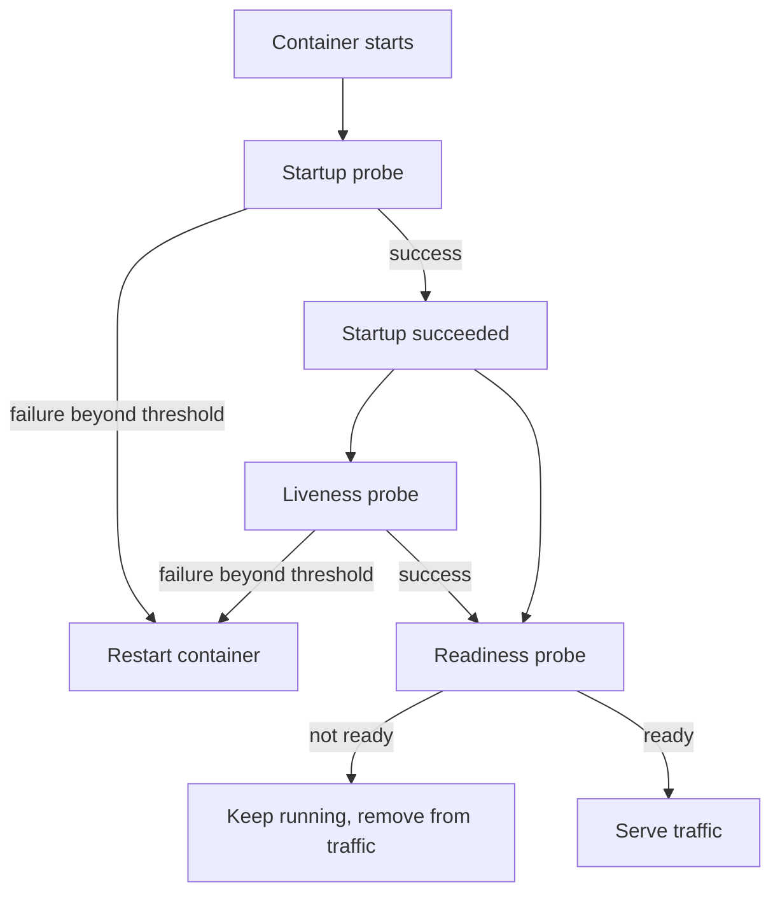

# Liveness state trong Spring Boot

Trong production, một ứng dụng có thể đang chạy nhưng không còn xử lý request đúng cách. Ví dụ process bị deadlock, event loop không tiến triển hoặc một thành phần nội bộ rơi vào trạng thái không thể phục hồi. Kubernetes cần biết khi nào nên khởi động lại container. Đó là vai trò của **liveness state**. Liveness trả lời câu hỏi: process này còn sống và có khả năng tiếp tục chạy không? Nó khác với readiness, vốn trả lời ứng dụng hiện có sẵn sàng nhận traffic hay không.

Bài **Liveness state** thuộc chương **Health và readiness** của module **SPRING_BOOT_OBSERVABILITY**. Module hướng dẫn thiết lập observability cho Spring Boot bằng Micrometer Observation, metrics, logs và distributed tracing; học context propagation, tag/cardinality, exporter, sampling và liên kết tín hiệu để điều tra lỗi, độ trễ và hành vi ứng dụng trên môi trường thực.

Sau bài học, bạn có thể phân biệt liveness, readiness và startup probes; cấu hình Spring Boot Actuator health groups; tránh đưa dependency health vào liveness một cách máy móc; hiểu tác động của probe failure tới restart; và kiểm thử custom health indicators để tránh restart loop.

## 1. Liveness state là gì?

Liveness là tín hiệu cho biết process/container còn ở trạng thái có thể tiếp tục hoạt động hay đã bị kẹt/hỏng theo cách cần restart. Khi liveness probe thất bại liên tiếp vượt ngưỡng cấu hình, kubelet có thể restart container.

Liveness không phải phép đo chất lượng tổng thể của hệ thống. Một ứng dụng có thể:

- **Live và ready:** process hoạt động và có thể nhận traffic.
- **Live nhưng not ready:** process còn chạy nhưng chưa hoàn tất startup, đang drain traffic hoặc dependency cần thiết tạm thời không khả dụng.
- **Not live:** process bị deadlock hoặc ở trạng thái không thể phục hồi; restart có thể là biện pháp khôi phục.

Liveness probe thất bại thường dẫn đến restart, trong khi readiness probe thất bại chỉ loại pod khỏi endpoints phục vụ traffic. Dùng sai hai tín hiệu có thể biến một sự cố dependency ngắn thành restart storm.

## 2. Phân biệt liveness, readiness và startup

Kubernetes có ba loại probe chính:

| Probe | Câu hỏi | Khi thất bại |
| --- | --- | --- |
| Startup | Ứng dụng đã hoàn tất khởi động chưa? | Container bị restart sau khi vượt failure threshold |
| Liveness | Process còn sống và có thể tiếp tục chạy không? | Kubelet restart container |
| Readiness | Pod có thể nhận traffic ngay lúc này không? | Pod bị loại khỏi Service endpoints cho tới khi ready lại |

Startup probe hữu ích với ứng dụng khởi động chậm. Khi startup probe được cấu hình, Kubernetes trì hoãn liveness và readiness checks cho tới khi startup probe thành công.



Probe endpoints nên đơn giản, nhanh, có kết quả ổn định và không tạo tải đáng kể. Không dùng một endpoint tổng hợp tất cả dependency làm liveness nếu lỗi dependency không đồng nghĩa process cần restart.

## 3. Vì sao không nên kiểm tra mọi dependency trong liveness?

Giả sử orders-service không kết nối được database trong 30 giây do database maintenance. Nếu liveness phụ thuộc database, mọi pod có thể báo unhealthy và bị restart. Restart không sửa được database; nó chỉ làm mất thêm connections, tăng startup load và có thể gây ra vòng lặp restart.

Một nguyên tắc thực tế:

- **Liveness:** kiểm tra trạng thái nội bộ của process, ví dụ app context còn hoạt động và một invariant nội bộ quan trọng không bị phá vỡ.
- **Readiness:** kiểm tra ứng dụng có thể phục vụ traffic theo yêu cầu hiện tại không; có thể bao gồm dependency bắt buộc.
- **Startup:** kiểm tra quá trình khởi tạo đã hoàn tất.

Không có quy tắc rằng readiness luôn phải kiểm tra tất cả dependencies. Chỉ đưa dependency vào readiness nếu request không thể được phục vụ an toàn khi dependency đó unavailable. Với một số hệ thống, degradation/fallback vẫn cho phép nhận traffic.

## 4. Spring Boot Actuator cung cấp liveness state

Spring Boot Actuator có health indicators và health groups. Khi ứng dụng dùng Kubernetes probes integration phù hợp, Actuator có thể expose các health groups cho liveness và readiness, thường tại các path:

```text
/actuator/health/liveness
/actuator/health/readiness
```

Trong các phiên bản Spring Boot hỗ trợ Kubernetes probes, cấu hình có thể bật probe groups trên Actuator:

```yaml
management:
  endpoint:
    health:
      probes:
        enabled: true
```

Các path và auto-configuration phụ thuộc Spring Boot version và deployment setup. Xác minh endpoint thực tế bằng Actuator mappings hoặc integration test. Không giả định probe group tự được expose qua web nếu exposure policy đang giới hạn endpoints.

Ví dụ expose health endpoint:

```yaml
management:
  endpoints:
    web:
      exposure:
        include: health
```

Nếu management port tách riêng, Kubernetes probe phải truy cập đúng port và path. Đồng thời bảo vệ endpoint khỏi truy cập ngoài phạm vi cần thiết.

## 5. Cấu hình Kubernetes probes

Một Deployment có thể định nghĩa startup, liveness và readiness probes riêng:

```yaml
apiVersion: apps/v1
kind: Deployment
metadata:
  name: orders-service
spec:
  replicas: 3
  selector:
    matchLabels:
      app: orders-service
  template:
    metadata:
      labels:
        app: orders-service
    spec:
      containers:
        - name: app
          image: example/orders-service:1.0.0
          ports:
            - name: http
              containerPort: 8080
          startupProbe:
            httpGet:
              path: /actuator/health/liveness
              port: http
            periodSeconds: 5
            failureThreshold: 30
          livenessProbe:
            httpGet:
              path: /actuator/health/liveness
              port: http
            periodSeconds: 10
            timeoutSeconds: 2
            failureThreshold: 3
          readinessProbe:
            httpGet:
              path: /actuator/health/readiness
              port: http
            periodSeconds: 5
            timeoutSeconds: 2
            failureThreshold: 3
```

Đây là cấu hình minh họa. Với startup probe periodSeconds=5 và failureThreshold=30, kubelet cho ứng dụng khoảng 150 giây để startup probe thành công (không tính các yếu tố scheduling/runtime khác). Chọn timeout, period và thresholds theo thời gian khởi động thực tế, không copy máy móc.

Nếu probe endpoint cần authentication, kubelet HTTP probe không tự gửi credentials tùy ý như một browser login. Thiết kế probe path/port/network phù hợp; không mở rộng endpoint nhạy cảm ra công khai chỉ để probe hoạt động.

## 6. Custom liveness indicator

Có thể tạo HealthIndicator tùy chỉnh cho một invariant nội bộ thực sự cần thiết. Ví dụ:

```java
import org.springframework.boot.actuate.health.Health;
import org.springframework.boot.actuate.health.HealthIndicator;
import org.springframework.stereotype.Component;

@Component("processState")
class ProcessStateHealthIndicator implements HealthIndicator {
    private final ProcessState processState;

    ProcessStateHealthIndicator(ProcessState processState) {
        this.processState = processState;
    }

    @Override
    public Health health() {
        if (processState.isAcceptingWork()) {
            return Health.up().build();
        }
        return Health.down()
            .withDetail("reason", "process-not-accepting-work")
            .build();
    }
}
```

Đây là ví dụ minh họa; ProcessState là abstraction nội bộ của ứng dụng. Không dùng một biến boolean tự đặt làm liveness duy nhất nếu nó không phản ánh khả năng tiến triển thật. Health indicator cần nhanh, không blocking và không phụ thuộc remote call dễ timeout.

Custom indicator cũng cần có semantics rõ: trạng thái nào có thể phục hồi bằng restart, trạng thái nào chỉ cần ngừng nhận traffic? Nếu process đang draining có chủ đích, thường nên đánh dấu not ready thay vì not live.

## 7. Health groups và thành phần được bao gồm

Health groups cho phép chỉ định indicators nào tham gia liveness/readiness. Có thể cấu hình nhóm riêng thay vì để mọi indicator tự động ảnh hưởng tới mọi probe.

Ví dụ cấu hình group:

```yaml
management:
  endpoint:
    health:
      group:
        liveness:
          include: livenessState
        readiness:
          include: readinessState,db
```

Tên indicator livenessState, readinessState và db phụ thuộc auto-configuration/dependencies. Cấu hình nhóm cần kiểm tra với health contributors thực tế. Spring Boot có thể tự cấu hình probe groups khi bật probes; nếu khai báo group thủ công, đảm bảo không loại bỏ indicator cần thiết.

Không đưa database vào liveness chỉ vì database quan trọng. Nếu database unavailable khiến mọi pod restart, recovery của database có thể bị làm nặng hơn bởi reconnect storm.

## 8. Liveness và graceful shutdown

Khi ứng dụng nhận tín hiệu shutdown, nó nên ngừng nhận traffic mới và hoàn tất requests đang xử lý trong giới hạn thời gian. Trong giai đoạn này, readiness nên chuyển sang DOWN/OUT_OF_SERVICE để Service ngừng route traffic; liveness thường vẫn UP cho tới khi process thực sự kết thúc.

Luồng graceful shutdown khái quát:

1. Nhận SIGTERM hoặc lifecycle stop signal.
2. Đánh dấu ứng dụng không còn ready.
3. Ngừng nhận request/message mới theo cơ chế server/container.
4. Chờ in-flight work hoàn tất trong shutdown timeout.
5. Đóng resources và kết thúc process.

Nếu liveness chuyển DOWN quá sớm trong shutdown, kubelet có thể restart container thay vì để graceful shutdown hoàn tất. Kiểm tra terminationGracePeriodSeconds, Spring lifecycle timeout và load balancer propagation delay.

## 9. Tránh probe flapping và restart loops

Probe flapping xảy ra khi kết quả liên tục đổi UP/DOWN quanh ngưỡng. Nguyên nhân có thể là timeout quá ngắn, CPU throttling, GC pauses, endpoint thực hiện remote calls hoặc health logic quá nhạy.

Để giảm flapping:

- Đặt timeout đủ lớn cho endpoint nội bộ nhưng vẫn nhỏ hơn period hợp lý.
- Dùng failureThreshold để hấp thụ spike ngắn.
- Không thực hiện query database/HTTP remote trong liveness.
- Tránh tạo object nặng hoặc scan trạng thái toàn hệ thống mỗi lần probe.
- Theo dõi probe failure events và restart count.
- Đảm bảo endpoint probe không phụ thuộc thread pool đang bị nghẽn bởi business traffic nếu có thể tách management execution.

Tăng failureThreshold quá cao cũng có thể làm thời gian phát hiện deadlock kéo dài. Chọn thông số dựa trên recovery objectives và hành vi ứng dụng.

## 10. Liveness state và observability signals

Probe state là tín hiệu điều khiển của orchestrator; metrics/logs/traces giúp giải thích tại sao state thay đổi.

Theo dõi container restart count và last termination reason, liveness/readiness probe failures, JVM thread count/blocked threads/deadlock detection, CPU throttling/memory pressure/GC pauses, HTTP latency/error rate, startup duration và graceful shutdown duration, cùng application logs quanh thời điểm probe fail.

Không tạo trace span mới cho mỗi probe request nếu nó làm telemetry noise lớn. Có thể loại probe traffic khỏi access log/metrics chi tiết hoặc phân nhóm riêng theo route, nhưng không che giấu probe failures khỏi monitoring.

## 11. Kiểm thử liveness behavior

| Test | Kỳ vọng |
| --- | --- |
| App starts | Startup probe chuyển UP sau khi initialization hoàn tất |
| Healthy process | Liveness UP |
| Dependency unavailable | Readiness có thể DOWN; liveness vẫn UP nếu process còn hoạt động |
| Process invariant broken | Liveness DOWN chỉ khi restart là hành động khôi phục hợp lý |
| Graceful shutdown begins | Readiness DOWN trước khi process kết thúc |
| Slow startup | Startup probe cho đủ thời gian, không restart sớm |
| Probe endpoint timeout | Failure được quan sát và thresholds hoạt động như dự kiến |
| Remote dependency timeout | Liveness không bị kéo DOWN bởi dependency check không cần thiết |

Ví dụ kiểm tra health group:

```java
import org.junit.jupiter.api.Test;
import org.springframework.beans.factory.annotation.Autowired;
import org.springframework.boot.actuate.health.HealthEndpoint;
import org.springframework.boot.test.context.SpringBootTest;
import static org.assertj.core.api.Assertions.assertThat;

@SpringBootTest
class LivenessStateTest {
    @Autowired
    HealthEndpoint healthEndpoint;

    @Test
    void livenessIsUpWhenProcessIsHealthy() {
        assertThat(healthEndpoint.healthForPath("liveness").getStatus())
            .isEqualTo(org.springframework.boot.actuate.health.Status.UP);
    }
}
```

API healthForPath và cách truy cập group có thể khác theo Spring Boot version; đây là ví dụ định hướng. Có thể dùng WebTestClient/MockMvc để test HTTP path thực tế và test riêng Kubernetes probe behavior trong integration environment.

## 12. Lỗi thường gặp

| Hiện tượng | Nguyên nhân có thể | Hướng kiểm tra |
| --- | --- | --- |
| Pod restart khi database tạm mất | DB indicator được gộp vào liveness | Chuyển dependency check sang readiness nếu phù hợp |
| Startup chậm dẫn tới restart loop | Chưa cấu hình startup probe hoặc threshold quá thấp | Đo startup duration và tăng startup budget |
| Readiness UP trước khi app nhận traffic | Indicator không phản ánh initialization thật | Kiểm tra readiness group và startup lifecycle |
| Probe timeout khi tải cao | Health endpoint dùng thread pool bị nghẽn hoặc làm việc quá nặng | Giữ probe nhanh, tách management execution nếu cần |
| Liveness liên tục đổi UP/DOWN | Timeout/threshold nhạy hoặc remote dependency check | Loại remote calls, hiệu chỉnh period/threshold |
| Shutdown bị kill giữa chừng | Readiness không chuyển DOWN hoặc grace period quá ngắn | Kiểm tra lifecycle, termination grace và drain |
| Health path trả 404 | Group chưa được tạo/expose hoặc path khác version | Kiểm tra Actuator endpoint mapping |
| Probe nhận 401/403 | Security chain chặn kubelet | Thiết kế internal probe access và management network |
| Một pod restart nhiều hơn replicas khác | Resource pressure hoặc process-specific deadlock | Đối chiếu restart reason, JVM/CPU/GC và logs |

## 13. Tình huống thực tế: database outage gây restart storm

**Bối cảnh giả định:** PostgreSQL bảo trì ngắn. Tất cả orders-service pods có liveness check gọi database. Khi DB không phản hồi, liveness thất bại và Kubernetes restart nhiều pods. Sau khi DB phục hồi, các pods đồng loạt khởi động, tạo connection storm và readiness tiếp tục chậm.

Hướng xử lý:

1. **Phân loại probe:** xác nhận liveness phụ thuộc DB trong khi process vẫn có thể chạy.
2. **Tách health groups:** liveness chỉ phản ánh process state; DB availability ảnh hưởng readiness nếu request không thể phục vụ khi DB unavailable.
3. **Giảm restart cascade:** điều chỉnh probe groups/config và rollout an toàn; tránh đồng loạt restart replicas.
4. **Giới hạn reconnect:** xem pool initialization, retry/backoff và database connection budget.
5. **Kiểm tra readiness:** chỉ đưa pod trở lại Service khi dependency cần thiết đã phục hồi.
6. **Xác minh:** mô phỏng DB outage trong staging, quan sát restart count, probe state, queue/HTTP latency và connection pool.

Liveness nên dùng để phục hồi process hỏng. Readiness điều khiển traffic khi ứng dụng còn chạy nhưng chưa thể phục vụ. Tách hai ý nghĩa giúp tránh biến lỗi dependency thành sự cố toàn cụm.

## 14. Bài tập tự kiểm tra

**Bài 1.** Liveness và readiness khác nhau thế nào?

*Gợi ý:* Liveness quyết định process có cần restart; readiness quyết định pod có nhận traffic hay không.

**Bài 2.** Database tạm unavailable nhưng process vẫn hoạt động. Probe nào nên phản ánh trạng thái này?

*Gợi ý:* Thường là readiness nếu DB bắt buộc cho request; liveness nên tiếp tục UP.

**Bài 3.** Startup probe giúp gì cho ứng dụng Spring Boot khởi động chậm?

*Gợi ý:* Nó trì hoãn liveness/readiness cho tới khi startup hoàn tất, tránh restart sớm.

**Bài 4.** Vì sao liveness không nên gọi HTTP tới mọi downstream service?

*Gợi ý:* Một dependency outage có thể khiến toàn bộ pods restart dù process không hỏng.

**Bài 5.** Khi graceful shutdown bắt đầu, state nào nên chuyển trước?

*Gợi ý:* Readiness chuyển DOWN để ngừng route traffic mới; liveness tiếp tục UP trong lúc drain.

**Bài 6.** Probe flapping có thể gây tác động gì?

*Gợi ý:* Restart không cần thiết, traffic capacity giảm và tạo thêm tải lên dependencies.

**Bài 7.** Nếu management endpoint trả 401 cho kubelet, nên làm gì?

*Gợi ý:* Thiết kế probe access nội bộ đúng network/security boundary, không mở mọi Actuator endpoints công khai.

**Bài 8.** Làm sao xác minh database outage không gây restart storm?

*Gợi ý:* Test staging với DB unavailable; liveness vẫn UP, readiness DOWN theo policy và restart count không tăng bất thường.

## 15. Ghi nhớ

- **Liveness** cho biết process còn có thể tiếp tục chạy hay cần restart; **readiness** cho biết pod có thể nhận traffic; **startup** bảo vệ ứng dụng khởi động chậm.
- Không đưa mọi dependency vào liveness. Database outage thường nên ảnh hưởng readiness nếu process vẫn hoạt động và có thể phục hồi.
- Spring Boot Actuator health groups cung cấp liveness/readiness state; xác minh endpoint path, exposure và version cụ thể.
- Kubernetes restart container sau liveness failure vượt threshold; readiness failure chỉ loại pod khỏi traffic endpoints.
- Dùng startup probe để dành đủ startup budget; chọn period, timeout và failure threshold theo dữ liệu thực tế.
- Trong graceful shutdown, chuyển readiness DOWN trước, drain in-flight work rồi kết thúc process.
- Giữ probe nhanh, nội bộ và ổn định; tránh remote calls, blocking work và dependency cascade gây flapping/restart storm.
- Kết hợp probe events với restart count, JVM/CPU/GC, logs và application metrics để điều tra nguyên nhân thay đổi liveness state.
