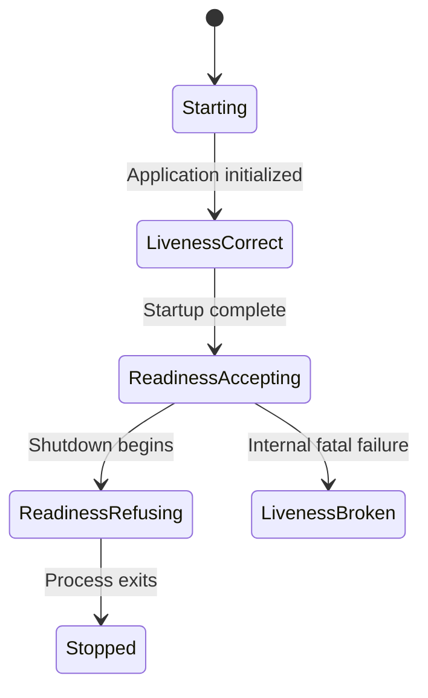

# Application availability trong Spring Boot

Một service có thể đang chạy nhưng chưa sẵn sàng nhận traffic. Ví dụ, JVM đã khởi động và HTTP server đã mở port, nhưng schema migration chưa xong hoặc connection pool chưa thể kết nối database. Ngược lại, một dependency phụ như hệ thống gửi email có thể tạm thời lỗi trong khi API đọc dữ liệu vẫn phục vụ tốt. Nếu mọi tín hiệu đều bị gộp thành một trạng thái UP/DOWN, orchestration có thể restart service không cần thiết hoặc tiếp tục gửi traffic vào instance chưa sẵn sàng.

**Application availability** mô tả khả năng một instance hoặc service tham gia phục vụ workload tại một thời điểm. Trong Spring Boot Actuator, health indicators và health groups cung cấp trạng thái để phân biệt liveness với readiness. Liveness trả lời tiến trình có cần được khởi động lại hay không; readiness trả lời instance có nên nhận traffic hay không. Startup probes cho ứng dụng thời gian khởi động dài trước khi liveness/readiness bắt đầu có hiệu lực.

Availability là quyết định vận hành, không đơn giản là mọi dependency đều UP. Cần chọn thành phần nào ảnh hưởng trực tiếp tới khả năng phục vụ, thời điểm kiểm tra và hành động của platform khi trạng thái thay đổi.

Bài học thuộc chương **Health và readiness** của module **SPRING_BOOT_OBSERVABILITY**. Module hướng dẫn thiết lập observability cho Spring Boot bằng Micrometer Observation, metrics, logs và distributed tracing; học propagation ngữ cảnh, tag/cardinality, exporter, sampling và liên kết tín hiệu để điều tra lỗi, độ trễ và hành vi ứng dụng trên môi trường thực. Bài này tập trung vào application availability, liveness/readiness, startup, dependency policy và phối hợp với orchestration platform.

## Mục tiêu học tập

1. Giải thích application availability và các trạng thái health của Spring Boot.
2. Phân biệt liveness, readiness và startup probes.
3. Chọn dependency nào nên ảnh hưởng readiness và dependency nào không nên ảnh hưởng liveness.
4. Cấu hình Actuator health groups và endpoint exposure.
5. Thiết kế HealthIndicator/ReactiveHealthIndicator phù hợp.
6. Hiểu cách Kubernetes dùng probe để restart hoặc ngừng route traffic.
7. Kết hợp startup, graceful startup/shutdown và readiness transitions.
8. Tránh restart loop và cascading failure do health checks thiết kế sai.
9. Kiểm thử UP, DOWN, OUT_OF_SERVICE và UNKNOWN.
10. Chẩn đoán availability bằng health, metrics, logs và deployment signals.

## 1. Application availability là gì?

Application availability là khả năng instance đáp ứng workload mà nó được triển khai để phục vụ. API có thể phục vụ request đọc dù một dependency báo cáo phụ đang lỗi; worker có thể sống khỏe nhưng không nên nhận message mới khi queue consumer đang shutdown.

Health response thường gồm status (UP, DOWN, OUT_OF_SERVICE hoặc UNKNOWN), components và details theo cấu hình/quyền truy cập.

Ví dụ response:

```json
{
  "status": "UP",
  "components": {
    "readinessState": { "status": "UP" },
    "db": { "status": "UP" }
  }
}
```

Cấu trúc components/details phụ thuộc health group và show-details policy. Không giả định mọi component luôn hiển thị với anonymous caller.

### 1.1. Process health và service availability

Process còn sống không chứng minh service có thể phục vụ traffic. JVM có thể deadlock một phần, hết worker threads, không kết nối được database hoặc chưa hoàn tất startup. Vì vậy, một probe duy nhất không đủ trả lời mọi câu hỏi vận hành.

### 1.2. Instance availability và system availability

Readiness của một instance chỉ nói instance đó có thể nhận traffic. Service tổng thể vẫn có thể hoạt động khi một replica NOT_READY nếu replicas khác khỏe và còn capacity. Ngược lại, mọi instance READY nhưng dependency chung quá tải thì service vẫn có thể suy giảm.

## 2. Liveness, readiness và startup

| Probe | Câu hỏi | Platform thường làm gì khi fail? |
|---|---|---|
| Liveness | Process có bị kẹt/hỏng tới mức cần restart? | Restart container/process |
| Readiness | Instance có thể nhận request/message mới? | Ngừng gửi traffic hoặc ngừng cấp work |
| Startup | Ứng dụng đã hoàn tất giai đoạn khởi động? | Tạm hoãn liveness/readiness cho tới khi startup thành công |

### 2.1. Liveness

Liveness nên phản ánh tình trạng nội tại của process. Nếu liveness phụ thuộc database hoặc remote API, outage bên ngoài có thể khiến mọi replicas cùng fail liveness và bị restart liên tục. Restart không sửa được database outage và còn làm tăng tải reconnect.

Spring Boot có thể cung cấp liveness state indicator trong Actuator khi availability support được cấu hình phù hợp. Kiểm tra endpoint group thực tế theo version.

### 2.2. Readiness

Readiness phản ánh instance có sẵn sàng nhận workload hay không. Các yếu tố có thể gồm startup complete, listener sẵn sàng, local initialization và dependency thực sự bắt buộc cho request path.

Không đưa mọi optional dependency vào readiness. Nếu email provider tạm lỗi nhưng API vẫn phục vụ được, đánh dấu toàn service NOT_READY có thể làm giảm capacity không cần thiết.

### 2.3. Startup probe

Startup probe dành cho ứng dụng khởi động lâu, ví dụ load cache, migration hoặc warm-up. Khi startup probe chưa thành công, Kubernetes có thể trì hoãn liveness/readiness checks theo cấu hình. Điều này tránh liveness restart ứng dụng chỉ vì startup cần nhiều thời gian.

Startup probe không thay thế readiness: sau startup, instance vẫn có thể chưa sẵn sàng nhận traffic.

## 3. Spring Boot AvailabilityState

Spring Boot có application availability model với các state events, thường gồm:
- LivenessState: CORRECT hoặc BROKEN.
- ReadinessState: ACCEPTING_TRAFFIC hoặc REFUSING_TRAFFIC.

Các event phản ánh trạng thái application lifecycle. Actuator health groups có thể expose trạng thái qua health endpoints.



Tên event/class và thời điểm publish phụ thuộc Spring Boot version. Ứng dụng có thể publish readiness/liveness events khi cần kiểm soát lifecycle, nhưng không nên tự chuyển state theo từng lỗi dependency thoáng qua mà không có policy.

### 3.1. Readiness khi khởi động

Khi application context sẵn sàng nhưng app chưa hoàn tất warm-up, readiness có thể vẫn REFUSING_TRAFFIC. Khi warm-up xong, state chuyển ACCEPTING_TRAFFIC. Platform chỉ route traffic khi instance thực sự sẵn sàng.

### 3.2. Readiness khi shutdown

Khi graceful shutdown bắt đầu, ứng dụng nên ngừng nhận work mới. Readiness chuyển REFUSING_TRAFFIC để platform loại instance khỏi traffic, sau đó server hoàn tất requests đang xử lý trong shutdown timeout.

## 4. Health groups trong Actuator

Health groups cho phép tách health indicators theo mục đích. Spring Boot thường cung cấp group liveness và readiness khi availability probes được bật hoặc qua cấu hình.

Ví dụ:

```yaml
management:
  endpoint:
    health:
      probes:
        enabled: true
      group:
        liveness:
          include: livenessState
        readiness:
          include: readinessState,db
```

Đây là cấu hình minh họa. Include db vào readiness chỉ phù hợp nếu database thực sự bắt buộc để instance phục vụ workload. Đánh giá dependency policy trước khi thêm indicator.

### 4.1. Endpoint paths

```http
GET /actuator/health
GET /actuator/health/liveness
GET /actuator/health/readiness
```

Context path, management base path/port và exposure policy có thể làm URL khác. Chỉ expose health groups cần cho platform.

### 4.2. Component details

Health details có thể chứa hostnames, database names, URLs hoặc error messages. Chỉ hiển thị details cho role được phép. Probe của orchestrator thường chỉ cần status.

## 5. Dependency health và readiness policy

| Dependency | Ảnh hưởng có thể | Readiness policy gợi ý |
|---|---|---|
| Primary database cho mọi request | Không thể xử lý phần lớn traffic | Có thể ảnh hưởng readiness |
| Optional reporting database | Chỉ ảnh hưởng báo cáo | Không nhất thiết ảnh hưởng API readiness |
| Email provider | Gửi mail có thể retry/queue | Thường không làm API NOT_READY |
| Payment provider | Chỉ ảnh hưởng payment operations | Quyết định theo contract/fallback |
| Cache | Có thể fallback database | Đánh giá fallback/capacity |
| Message broker cho worker | Worker không thể nhận/ack messages | Có thể ảnh hưởng worker readiness |
| Remote config service | Chỉ cần lúc startup/refresh | Policy theo cache/fallback |

### 5.1. Không đưa dependency vào liveness

Database outage thường không có nghĩa JVM cần restart. Nếu database nằm trong liveness, mọi replicas có thể restart trong outage, tạo connection storm khi DB phục hồi.

### 5.2. Readiness và partial degradation

Service có thể vẫn phục vụ phần lớn endpoints khi dependency phụ hỏng. Có thể dùng readiness policy theo workload hoặc tách deployment/service theo capability. Không dùng một indicator tổng hợp để biểu diễn mọi chức năng nếu chúng có khả năng phục vụ khác nhau.

### 5.3. Timeout và health check frequency

Health check cần timeout ngắn và giới hạn concurrency. Probe tạo truy vấn đắt hoặc chờ dependency lâu có thể tự làm tăng tải khi hệ thống suy giảm. Dùng query nhẹ, timeout rõ và tránh kiểm tra mọi dependency trên mỗi lần probe nếu không cần.

## 6. Tạo custom HealthIndicator

Khi cần kiểm tra capability nội bộ, có thể tạo HealthIndicator. Ví dụ component kiểm tra local initialization:

```java
@Component
class CacheWarmupHealthIndicator implements HealthIndicator {
    private final CacheWarmupState warmupState;

    CacheWarmupHealthIndicator(CacheWarmupState warmupState) {
        this.warmupState = warmupState;
    }

    @Override
    public Health health() {
        if (warmupState.isComplete()) {
            return Health.up().build();
        }
        return Health.outOfService()
                .withDetail("reason", "cache-warmup-in-progress")
                .build();
    }
}
```

Đây là ví dụ khái niệm. Indicator nên đọc state có sẵn, không chạy warm-up hoặc gọi remote operation trong mỗi lần health check.

### 6.1. Health status mapping

Spring Boot có status order và mapping để tổng hợp component statuses. OUT_OF_SERVICE thường nghĩa component tạm không phục vụ được; DOWN thể hiện lỗi; UNKNOWN khi chưa xác định. Platform cần mapping rõ status nào khiến probe fail.

### 6.2. ReactiveHealthIndicator

Ứng dụng reactive có thể dùng ReactiveHealthIndicator để kiểm tra bất đồng bộ. Health check vẫn cần timeout và không tạo load quá lớn. Tránh block event-loop thread khi gọi dependency.

## 7. Kubernetes probes

Kubernetes có thể gọi Actuator health group endpoints từ livenessProbe, readinessProbe và startupProbe.

Ví dụ deployment snippet:

```yaml
livenessProbe:
  httpGet:
    path: /actuator/health/liveness
    port: 8080
  periodSeconds: 10
  timeoutSeconds: 2
  failureThreshold: 3

readinessProbe:
  httpGet:
    path: /actuator/health/readiness
    port: 8080
  periodSeconds: 5
  timeoutSeconds: 2
  failureThreshold: 2

startupProbe:
  httpGet:
    path: /actuator/health/liveness
    port: 8080
  periodSeconds: 5
  timeoutSeconds: 2
  failureThreshold: 30
```

Các giá trị chỉ minh họa. Chọn path/port đúng management server và thời gian dựa trên startup duration, recovery và SLO.

### 7.1. Liveness fail

Khi liveness probe fail đủ số lần theo threshold, Kubernetes restart container. Dùng liveness cho lỗi nội tại không thể tự phục hồi, không dùng cho mọi dependency outage.

### 7.2. Readiness fail

Khi readiness fail, Pod được đánh dấu not ready và thường bị loại khỏi Service endpoints cho traffic mới. Container không nhất thiết bị restart.

### 7.3. Startup probe

Startup probe bảo vệ ứng dụng khởi động chậm. Khi được cấu hình, Kubernetes hoãn liveness/readiness checks cho tới khi startup thành công. Thiết kế failureThreshold x periodSeconds đủ lớn cho worst-case startup hợp lý.

## 8. Graceful startup và shutdown

Availability là trạng thái chuyển đổi, không chỉ phép kiểm tra tại một thời điểm.

Startup:
1. Khởi tạo application context.
2. Khởi tạo server và dependencies cần thiết.
3. Chạy migration/warm-up theo deployment design.
4. Chuyển readiness sang ACCEPTING_TRAFFIC khi có thể phục vụ.

Shutdown:
1. Nhận tín hiệu shutdown.
2. Chuyển readiness sang REFUSING_TRAFFIC.
3. Ngừng nhận request/message mới.
4. Hoàn tất in-flight work trong timeout.
5. Đóng connection pools, executors và resources.
6. Kết thúc process.

Spring Boot graceful shutdown có thể được cấu hình qua server shutdown properties tùy version:

```yaml
server:
  shutdown: graceful
spring:
  lifecycle:
    timeout-per-shutdown-phase: 30s
```

Kubernetes terminationGracePeriodSeconds cần lớn hơn thời gian drain/shutdown dự kiến. Nếu platform kill process trước khi ứng dụng hoàn tất, requests đang chạy có thể fail.

### 8.1. Readiness propagation

Readiness transition cần thời gian để platform cập nhật endpoints/load balancer. Không giả định ngay khi application đổi state thì mọi network route đã dừng. Thiết kế preStop/drain và shutdown timeout phù hợp platform.

### 8.2. Background workers

Worker cần ngừng poll/consume message mới khi shutdown bắt đầu, nhưng hoàn tất hoặc requeue work đang xử lý theo semantics broker. Readiness của worker nên phản ánh khả năng nhận work mới.

## 9. Availability và autoscaling

Readiness không phải tín hiệu autoscaling. Pod NOT_READY có thể bị loại khỏi traffic, nhưng autoscaler thường dựa CPU, memory, custom metrics hoặc queue depth. Nếu readiness fail vì thiếu capacity, cần scale policy riêng.

Liveness restart cũng không thay autoscaling. Khi tải cao làm worker pool cạn, restart có thể làm mất capacity tạm thời và tăng tải lên replicas còn lại.

### 9.1. Probe flapping

Nếu readiness dao động do dependency latency hoặc threshold quá nhạy, Pod có thể liên tục vào/ra khỏi Service endpoints. Dùng period/failureThreshold/successThreshold phù hợp, timeout hợp lý và indicator ổn định.

### 9.2. Dependency storm

Nếu mọi Pod probe cùng remote dependency vài giây một lần, health check có thể tạo thêm tải trong outage. Dùng local cached state, timeout, jitter hoặc giảm tần suất kiểm tra tùy yêu cầu.

## 10. Bảo mật health endpoints

Health endpoints có thể tiết lộ database status, internal service names, hostnames và exception details.

- Chỉ expose health groups cần thiết.
- Giới hạn network access management endpoints.
- Dùng status-only response cho probe không cần details.
- Bật show-details chỉ cho role quản trị.
- Không đưa credentials/token vào HealthIndicator details.
- Không gọi arbitrary URLs từ input để kiểm tra health.
- Bảo vệ custom indicators khỏi SSRF hoặc resource exhaustion.
- Đảm bảo orchestrator được phép truy cập đúng endpoint.

Probe status-only có thể được expose trong cluster network; diagnostic health details nên yêu cầu authentication.

## 11. Kiểm thử availability behavior

### 11.1. Test health groups

Dùng Spring Boot test gọi liveness/readiness endpoints và assert status theo application availability state. Xác nhận dependency indicators chỉ nằm trong group dự định.

### 11.2. Test startup transitions

Khởi tạo application với warm-up state chưa hoàn tất, assert readiness NOT_READY/OUT_OF_SERVICE theo policy; sau warm-up complete, assert readiness UP. Dùng latch/state control thay sleep dài.

### 11.3. Test dependency outage

Giả lập database/remote dependency không sẵn sàng. Xác minh liveness vẫn UP nếu process còn healthy, readiness thay đổi chỉ khi dependency thực sự bắt buộc, optional dependency outage không loại service ngoài policy và probe timeout không tạo cascading load.

### 11.4. Test graceful shutdown

Khởi chạy request dài, bắt đầu shutdown và xác minh readiness chuyển REFUSING_TRAFFIC, request in-flight được xử lý theo timeout, worker ngừng nhận work mới và resources đóng đúng thứ tự.

### 11.5. Test Kubernetes behavior

Trong staging/integration environment, xác minh Pod readiness conditions, Service endpoints, restart count và termination behavior. Unit test health indicator không chứng minh manifest probes được cấu hình đúng.

## 12. Chẩn đoán availability bất thường

| Triệu chứng | Nguyên nhân có thể | Cách điều tra |
|---|---|---|
| Pod restart liên tục khi DB outage | DB indicator nằm trong liveness | Kiểm tra liveness group |
| Pod chạy nhưng không nhận traffic | Readiness DOWN/OUT_OF_SERVICE | Health readiness và endpoint conditions |
| Startup probe timeout | Threshold ngắn hơn startup thực tế | Startup duration và probe budget |
| Readiness flapping | Dependency latency hoặc threshold nhạy | Probe history, indicator timing |
| Tất cả replicas NOT_READY | Shared dependency hoặc indicator quá rộng | Dependency policy và health group |
| Health endpoint chậm | Indicator gọi remote/blocking dependency | Per-indicator duration và thread dump |
| Health UP nhưng request lỗi | Probe không đại diện capability thực | Readiness scope và request SLO |
| Shutdown làm mất request | Drain/grace period quá ngắn | Readiness transition và termination logs |
| Worker nhận message khi shutdown | Consumer không phối hợp lifecycle | Listener container lifecycle |
| Health details lộ nội bộ | show-details/exposure policy rộng | Security config và payload |

### Quy trình điều tra

1. Xác định probe fail: startup, liveness hay readiness.
2. Kiểm tra endpoint URL, management port và response status.
3. Đọc component details theo quyền truy cập.
4. Xác định indicator quyết định aggregate status.
5. So sánh dependency outage với process health và request capability.
6. Kiểm tra probe timeout, period, failureThreshold và successThreshold.
7. Xem logs/metrics về indicator duration, thread saturation và dependency latency.
8. Kiểm tra Pod events, restart count và Service endpoints.
9. Kiểm tra graceful startup/shutdown và in-flight requests.
10. Điều chỉnh health policy rồi test trong môi trường tương tự production.

## 13. Các anti-pattern cần tránh

| Anti-pattern | Hậu quả | Cách phù hợp |
|---|---|---|
| Dùng database check trong liveness | Restart storm khi DB outage | Liveness tập trung process |
| Gộp mọi optional dependency vào readiness | Giảm capacity không cần thiết | Readiness theo workload capability |
| Dùng info/metrics endpoint làm probe | Không đo readiness/liveness | Dùng health groups |
| Health check gọi remote API không timeout | Probe treo và tăng tải | Timeout ngắn, cache/local state |
| Expose health details công khai | Lộ topology/error details | Status-only cho probe, secure details |
| Readiness flapping theo lỗi ngắn | Traffic liên tục đổi replicas | Threshold/hysteresis |
| Coi readiness fail là restart | Hiểu sai hành động platform | Readiness loại traffic; liveness restart |
| Không có startup probe cho app khởi động lâu | Liveness restart sớm | Startup probe budget phù hợp |
| Shutdown trước khi drain | Mất in-flight work | Graceful shutdown và termination grace |
| Dùng health làm autoscaling signal | Scale behavior không phù hợp | Autoscale bằng workload/capacity metrics |

## 14. Checklist production

1. **Semantics:** liveness, readiness và startup có mục đích riêng?
2. **Liveness:** chỉ phản ánh lỗi nội tại cần restart?
3. **Readiness:** phản ánh capability nhận workload thực tế?
4. **Dependencies:** chỉ dependency bắt buộc mới ảnh hưởng readiness?
5. **Startup:** probe budget đủ cho cold start/warm-up?
6. **Groups:** health groups include đúng indicators?
7. **Timeouts:** probe và indicator có timeout ngắn?
8. **Load:** health checks không tạo tải lớn khi outage?
9. **Security:** details chỉ hiển thị cho role được phép?
10. **Kubernetes:** path/port/period/threshold khớp deployment?
11. **Transitions:** readiness rút traffic trước shutdown?
12. **Graceful:** in-flight requests/messages có thời gian hoàn tất?
13. **Workers:** consumer ngừng nhận work mới khi shutdown?
14. **Testing:** có dependency outage, warm-up, flapping và shutdown tests?
15. **Observability:** probe history, indicator duration và restart events được theo dõi?
16. **Runbook:** có hướng dẫn phân biệt app failure, dependency outage và orchestration misconfiguration?

## 15. Câu hỏi tự đánh giá

**Câu 1.** Liveness trả lời câu hỏi gì?

**Gợi ý:** Process có bị hỏng/kẹt đến mức cần restart hay không; không phải mọi dependency có khỏe không.

**Câu 2.** Readiness khác liveness thế nào?

**Gợi ý:** Readiness quyết định instance có nhận workload mới; liveness quyết định có cần restart process.

**Câu 3.** Startup probe giải quyết vấn đề gì?

**Gợi ý:** Cho ứng dụng thời gian khởi động dài trước khi liveness/readiness checks bắt đầu tác động.

**Câu 4.** Vì sao database outage không nên tự động làm liveness DOWN?

**Gợi ý:** Restart không sửa database và có thể tạo reconnect storm trên toàn deployment.

**Câu 5.** Optional email provider lỗi có nên làm API NOT_READY?

**Gợi ý:** Không nếu API vẫn phục vụ workload chính và email có thể queue/retry.

**Câu 6.** OUT_OF_SERVICE có thể biểu thị điều gì?

**Gợi ý:** Component/instance tạm thời không nên phục vụ traffic theo health policy.

**Câu 7.** Vì sao health indicator nên nhanh và có timeout?

**Gợi ý:** Probe chạy định kỳ; indicator chậm có thể gây tải bổ sung và làm probe thất bại hàng loạt.

**Câu 8.** Readiness fail thường khiến Kubernetes làm gì?

**Gợi ý:** Đánh dấu Pod not ready và loại khỏi Service endpoints cho traffic mới; không nhất thiết restart container.

**Câu 9.** Khi shutdown bắt đầu, readiness nên chuyển thế nào?

**Gợi ý:** Chuyển REFUSING_TRAFFIC để ngừng nhận work mới trước khi drain và đóng resources.

**Câu 10.** Vì sao cần test manifest probe trong Kubernetes/staging?

**Gợi ý:** Unit test indicator không xác minh path/port/threshold, Pod conditions, Service endpoints và restart behavior.

## Kết luận

**Application availability cần phân biệt process còn sống, instance sẵn sàng nhận workload và giai đoạn startup.** Spring Boot Actuator health groups cùng LivenessState/ReadinessState giúp biểu diễn các trạng thái này; Kubernetes dùng liveness để restart, readiness để ngừng route traffic và startup probe để bảo vệ ứng dụng khởi động lâu. Hãy giữ liveness độc lập với dependency outage, chỉ đưa dependency bắt buộc vào readiness, giới hạn thời gian và tải của health indicators, đồng thời phối hợp readiness transition với graceful shutdown. Kiểm thử dependency outage, warm-up, probe flapping và rollout trong môi trường gần production để tránh restart storm, mất capacity hoặc nhận traffic quá sớm.
